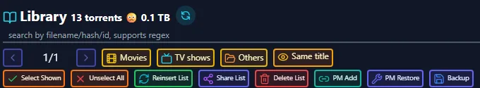

# ما هو DMM وكيف أستخدمه؟ {#what-is-dmm-and-how-do-i-use-it}

[Debrid Media Manager](https://debridmediamanager.com) (DMM) هو موقع مجاني للبحث عن الأفلام والمسلسلات وإضافتها إلى حسابك في خدمة debrid: Real-Debrid أو AllDebrid أو TorBox أو Premiumize أو Offcloud أو Debrid-Link. تسجّل الدخول بهذا الحساب، وتبحث عن العنوان، ثم تضغط على **Instant RD** (أو زر خدمتك) في أحد الإصدارات. يصبح الملف في مكتبتك فورًا، وجاهزًا للمشاهدة من DMM، أو في Stremio أو Kodi، أو في Plex عبر [zurg](../zurg/index.md).

DMM مشروع مفتوح المصدر، وليس جزءًا من Real-Debrid أو أي خدمة أخرى. الملفات تبقى في خدمة debrid الخاصة بك.

## تسجيل الدخول {#sign-in}

1. افتح [debridmediamanager.com](https://debridmediamanager.com) واضغط على الخدمة التي تستخدمها: **Login with Real Debrid**، أو **Login with AllDebrid**، أو **Login with Torbox**، أو **Login with Premiumize**، أو **Login with Offcloud**، أو **Login with Debrid-Link**.
2. على Real-Debrid، اضغط على **Sign in with Real-Debrid**. يعرض DMM رمزًا: اضغط على **Open real-debrid.com/device**، وأدخل الرمز هناك ووافق عليه. تنتهي صفحة DMM تلقائيًا. يمكنك أيضًا لصق [API token](../guides/real-debrid-api-token.md) الخاص بك تحت **or paste an API key** واضغط على **Save API Key**.
3. الخدمات الأخرى: اتبع صفحة تسجيل الدخول الخاصة بها. عندما تطلب مفتاح API، انسخه من حسابك على تلك الخدمة، ثم الصقه واضغط على **Save API Key**.

لديك خدمة أخرى أيضًا؟ افتح **Debrid services** في الصفحة الرئيسية لـ DMM واضغط على زر **Login** الخاص بها، مثلًا **AllDebrid Login**.

لديك Easynews فقط؟ اضغط على **Login with Easynews**. يمكنك البحث في Easynews وإرساله إلى Stremio، لكن المكتبة تحتاج إلى حساب debrid. يمكن للداعمين أيضًا تسجيل الدخول عبر **Login with DMM key**.

## ابحث عن فيلم أو مسلسل {#search-a-movie-or-show}

1. اكتب عنواناً في **Search movies & shows...** في الصفحة الرئيسية. اختر واحداً من الاقتراحات، أو اضغط **Search** لعرض القائمة الكاملة.
2. اضغط على الملصق. تسرد صفحة العنوان الإصدارات التي وجدها DMM.
3. اضغط على الشريحة الخاصة بخدمتك فوق النتائج (**RD** أو **PM** وغيرهما) لعرض الإصدارات الموجودة فيها بالفعل فقط.

## معنى الأزرار الموجودة على كل إصدار {#what-the-buttons-on-a-release-mean}

| الزر | ما وظيفته |
|---|---|
| **Instant RD** (**Instant TB**، **Instant AD**، **Instant PM**، **Instant OC**، **Instant DL**) | خدمتك تملك هذا الإصدار بالفعل. اضغط عليه وسيكون في مكتبتك فورًا. |
| **DL with RD** (**DL with TB** وما شابه؛ **Add to DL** على Debrid-Link) | خدمتك لا تملكه بعد. الضغط عليه يضيفه على أي حال، وتقوم الخدمة بتنزيله أولًا. اختر زر **Instant** إذا كنت تريد المشاهدة الآن. [لماذا يحدث هذا](../guides/torrent-being-downloaded-to-debrid.md). |
| **RD (100%)** (**PM (100%)** وما شابه) | الإصدار موجود في مكتبتك. الرقم يوضح مدى تقدم التنزيل. اضغط عليه لإزالته من مكتبتك. |
| **Check RD** (**Check AD**، **Check DL**) | يسأل تلك الخدمة إن كانت تملك هذا الإصدار مخزنًا مؤقتًا الآن. |
| **Cast (RD)** (**Cast (PM)** وما شابه) | يرسل الإصدار إلى Stremio. انظر [DMM في Stremio](stremio.md). |
| **Watch** | يفتح تبويب **Ready to play**. اضغط **Play** وسيفتح مشغلك. اختر المشغل من **Settings** → **Video player**. |
| **Copy** | ينسخ رابط magnet الخاص بالإصدار ويعرض **Magnet link copied.** عند تفعيل **Download .magnet files instead of copy** في **Settings**، يظهر الزر **Download** ويحفظ ملف .magnet. |
| **Report** | يبلغ عن إصدار سيئ: **XXX / Porn Content**، **Incorrect IMDB ID**، **Malware / Executable File**، وفي المسلسلات **Tagged for Wrong Season**. |

تبويب **Usenet** بجانب **Torrents** يعرض إصدارات Usenet للعنوان نفسه. الزر **NZB** ينزل أحدها. إرسالها إلى مكتبتك يتطلب Real-Debrid أو TorBox. لديك Easynews؟ أضفه في **Settings** وسيتم البحث فيه هنا أيضًا.

## مكتبتك {#your-library}

‏اضغط على **Library** في الصفحة الرئيسية. تعرض القائمة كل ما في الحسابات التي سجلت الدخول بها: الاسم والحجم والحالة وتاريخ الإضافة.

- ابحث باستخدام **search by filename/hash/id, supports regex**، أو صفِّ النتائج عبر **Movies** و**TV shows** و**Others**.
- اضغط على أي صف لعرض تفاصيله وأزرار **Hashlist** و**Delete** و**Cast** و**Copy**. الأيقونات في نهاية كل صف تقوم بالوظيفة نفسها.
- **Backup** يحفظ قائمتك في ملف `.dmm.json`. **RD Restore** (و**PM Restore** وغيرهما) يعيد إضافة قائمة محفوظة.
- **Share List** يحوّل ما يظهر لك، أو ما اخترته، إلى [hash list](hashlists.md) يمكن للآخرين إضافته إلى حساباتهم.
- **Delete List** يحذف كل ما يظهر، بعد تأكيد **Yes, delete!**. ابحث أو اختر أولاً.

## إلى أين تذهب بعد ذلك {#where-to-go-next}

- [DMM في Stremio](stremio.md): شاهد ما تجده في Stremio باستخدام إضافة DMM Cast.
- [قوائم الهاشات](hashlists.md): أضف مكتبة مشتركة كاملة إلى مكتبتك، أو شارك مكتبتك الخاصة.
- [TorBox في DMM](torbox.md): ما الذي تفعله كل خطة من خطط TorBox داخل DMM، وإرسال إصدارات Usenet إلى TorBox Pro.
- ["Torrent is being downloaded to debrid"](../guides/torrent-being-downloaded-to-debrid.md): ما تعنيه تلك الشاشة في Stremio وكيف يعرض DMM ما هو مخزّن مؤقتاً.
- [أزرار DMM في Safari](safari.md): تضيف إضافة المتصفح زر DMM إلى IMDb وTrakt ومواقع الأفلام والمسلسلات الأخرى.

يخدم DMM أيضاً المشاريع الأخرى:

- **zurg** يسأل DMM عن الفيلم أو الحلقة التي يمثلها كل ملف. يحصل الراعي على مفتاح DMM API من [gatekeeper](https://gatekeeper.debridmediamanager.com/). بدونه يعتمد zurg على أسماء الملفات، فتتطابق عناوين أقل. يشرح [rex with zurg](../rex/with-zurg.md#why-dmm-places-the-files) الفرق.
- **Sonarr Radarr and Prowlarr** يمكنها البحث في DMM كفهرس torrent من نوع Torznab أو فهرس Usenet من نوع Newznab. يتطلب الأمر رعاية نشطة ومفتاح DMM API. اضبطها من صفحتي [Torznab](https://debridmediamanager.com/torznab) و[Newznab](https://debridmediamanager.com/newznab).
- **قائمة المطلوبات لديك**: اضغط **Want** أو تابع قائمة Trakt أو MDBList. يجلب zurg القائمة والحلقات الجديدة فور عرضها. تتطلب رعاية. راجع [قائمة DMM المطلوبة](../zurg/guides/dmm-wanted.md).
- **Seerr Overseerr and Jellyseerr** يمكنها استخدام DMM بدلاً من Radarr وSonarr. عندها تصل الطلبات إلى قائمة المطلوبات لديك ليجلبها zurg. تتطلب رعاية. راجع [Seerr عبر DMM](seerr.md).
- **rex-direct** يمنح rex مُطالَباً به عنواناً وشهادة خاصين به. راجع [rex-direct](../rex/any-source.md#rex-direct).

كل ما تفتحه الرعاية وأين يُضبط كل شيء موجود في [ما تمنحك الرعاية](../guides/sponsorship.md).

## عندما تحدث مشكلة {#when-something-is-wrong}

| ما تراه | ما الذي تفعله |
|---|---|
| **Real-Debrid rejected that API key.** | الرمز الذي لصقته ليس صالحًا. انسخه مرة أخرى من [real-debrid.com/apitoken](https://real-debrid.com/apitoken)، أو اضغط **Sign in with Real-Debrid** بدلًا من ذلك. لمزيد من التفاصيل راجع [Your Real-Debrid API token](../guides/real-debrid-api-token.md). |
| **That code expired before it was approved. Try again.** | انتهت مهلة رمز Real-Debrid. اضغط **Sign in with Real-Debrid** مرة أخرى ووافق على الرمز الجديد في وقت أسرع. |
| **Your TorBox account is on the free plan, which has no API access. DMM needs a paid TorBox plan.** | لا يمكن استخدام الخطة المجانية لـ TorBox مع DMM. قم بترقيتها، أو سجّل الدخول بخدمة أخرى. |
| Only **DL with RD** buttons, no **Instant RD** | خدمتك لا تملك أيًا من هذه الإصدارات مخزنًا مؤقتًا. اضغط على أحدها وانتظر حتى ينتهي التنزيل، أو جرّب إصدارًا آخر. |

هل تحتاج إلى مساعدة؟ اسأل في منتدى **dmm-support** على [Discord](https://discord.com/invite/7u4YjMThXP). يشرح [Getting help](../guides/remote-help.md) ما الذي يجب تضمينه.

## أسئلة {#questions}

### ما هو DMM في الحقيقة؟ {#what-actually-is-dmm}

موقع بحث لحساب الـdebrid الخاص بك. يجد إصدارات فيلم أو مسلسل، ويخبرك أيّها موجود بالفعل في خدمتك، ويضيف الإصدار الذي تختاره إلى حسابك. DMM نفسه لا يخزّن أي ملفات.

### كيف أستخدمه؟ {#how-do-i-use-it}

سجّل الدخول بخدمة الديبريد الخاصة بك، وابحث عن عنوان، وافتحه، ثم اضغط على **Instant RD** (أو زر **Instant** الخاص بخدمتك) على إصدار معين. بعد ذلك اضغط على **Watch**، أو أرسله إلى Stremio، أو دع zurg يضعه في Plex.

### هل DMM من تطوير Real-Debrid؟ {#is-dmm-made-by-real-debrid}

لا. DMM مشروع مفتوح المصدر يعمل مع Real-Debrid وخمس خدمات أخرى. كثير من الناس يبحثون عنه باسم "Real-Debrid Media Manager".

### هل هو مجاني؟ {#is-it-free}

نعم. تحتاج إلى حساب debrid خاص بك، وهي خدمة مدفوعة. اشتراك الرعاية في DMM يضيف ميزات إضافية مثل قائمة المطلوبات والمفهرسات: [ما الذي تمنحه رعاية DMM لك](../guides/sponsorship.md).

### ما الخدمات التي تعمل معه؟ {#which-services-work}

Real-Debrid وAllDebrid وTorBox (الخطط المدفوعة) وPremiumize وOffcloud وDebrid-Link. يعمل Easynews للبحث والبث، لكن ليس للمكتبة.
