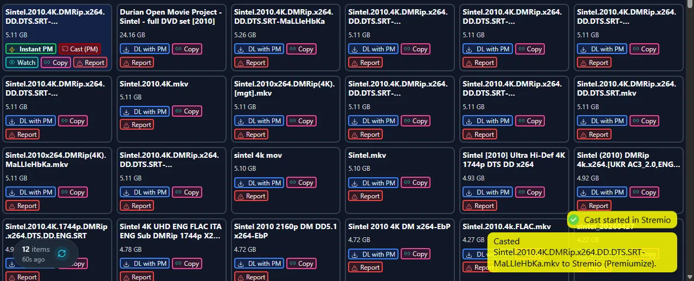
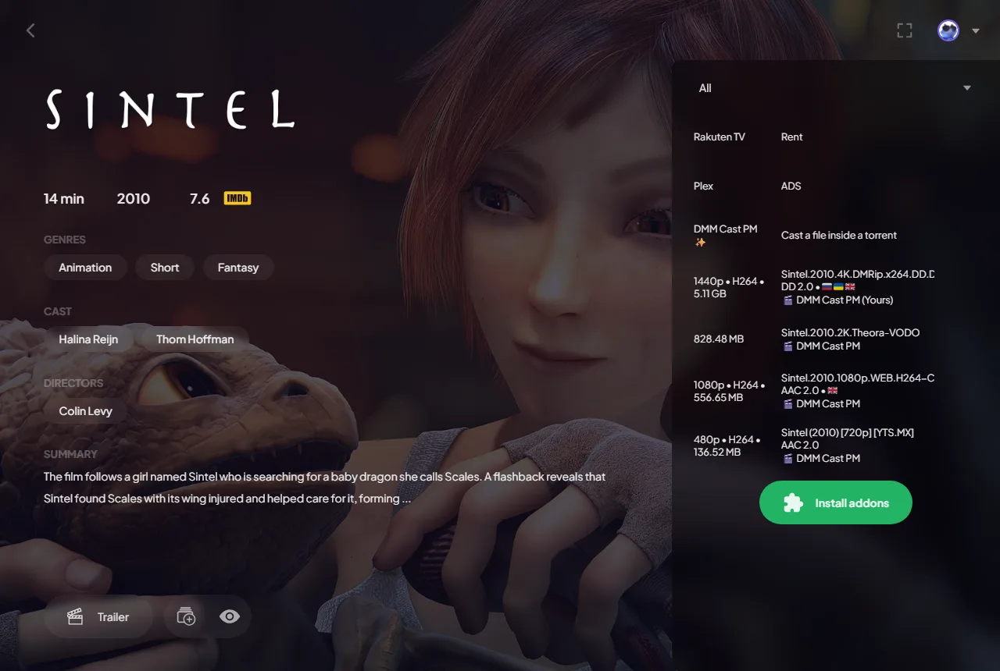

# استخدم DMM في Stremio مع DMM Cast {#use-dmm-in-stremio-with-dmm-cast}

DMM Cast هي إضافة Stremio الخاصة بـ Debrid Media Manager. من خلالها يظهر DMM داخل Stremio: تختار إصداراً على DMM، وتضغط **Cast**، فيعرض Stremio الإصدار كمصدر تشغيل من حسابك الخاص لدى مزود debrid أو Easynews. باختصار: سجّل الدخول إلى DMM، وافتح صفحة Cast الخاصة بمزودك، وثبّت الإضافة في Stremio، ثم اضغط **Cast** على أي فيلم أو مسلسل.

Cast هنا تعني إضافة DMM، وليس Chromecast أو عكس الشاشة.

## ما تحتاجه {#what-you-need}

- تسجيل الدخول إلى DMM باستخدام Real-Debrid أو TorBox أو AllDebrid أو Premiumize أو Offcloud أو Debrid-Link أو Easynews.
- Stremio. [Stremio Web](https://web.stremio.com) يعمل بدون حساب Stremio.

لا حاجة إلى رعاية.

## قم بإعداده {#set-it-up}

1. سجّل الدخول على [debridmediamanager.com](https://debridmediamanager.com) بحسابك لدى المزوّد. يتم تسجيل الدخول إلى Easynews من **Settings**.

2. في الصفحة الرئيسية لـ DMM اضغط على **Cast for RD** أو **Cast for TB** وهكذا. إذا كنت مسجّل الدخول بعدة حسابات، ستجد صفًا واحدًا بعنوان **Cast** فيه زر لكل مزوّد. ولكل مزوّد صفحة Cast خاصة به:

   | المزوّد | صفحة Cast |
   |---|---|
   | Real-Debrid | [debridmediamanager.com/stremio](https://debridmediamanager.com/stremio) |
   | TorBox | [debridmediamanager.com/stremio-torbox](https://debridmediamanager.com/stremio-torbox) |
   | AllDebrid | [debridmediamanager.com/stremio-alldebrid](https://debridmediamanager.com/stremio-alldebrid) |
   | Premiumize | [debridmediamanager.com/stremio-premiumize](https://debridmediamanager.com/stremio-premiumize) |
   | Offcloud | [debridmediamanager.com/stremio-offcloud](https://debridmediamanager.com/stremio-offcloud) |
   | Debrid-Link | [debridmediamanager.com/stremio-debridlink](https://debridmediamanager.com/stremio-debridlink) |
   | Easynews | [debridmediamanager.com/stremio-easynews](https://debridmediamanager.com/stremio-easynews) |

   

3. اضغط على **Install (web)**. ستُفتح Stremio Web مع الإضافة. اضغط **Install** هناك.

   

   لأي تطبيق Stremio آخر، انسخ العنوان الظاهر أسفل الأزرار وأضفه هناك. في Stremio Web المسار هو **Addons** → **Add addon** → الصق العنوان → **Add** → **Install**. هذا العنوان خاص بحسابك، فلا تشاركه مع أحد أبدًا.

4. ارجع إلى DMM وابحث عن فيلم أو مسلسل وافتحه. الإصدارات التي يملكها مزوّدك بالفعل تظهر معها زر **Cast**: **Cast (RD)** أو **Cast (TB)** أو **Cast (AD)** أو **Cast (PM)** أو **Cast (OC)** أو **Cast (DL)**. اضغط عليه. يؤكد DMM ذلك بعبارة **Cast started in Stremio** (وفي المسلسل **Casting succeeded.** مع عدد الحلقات التي تم بثها)، ويحاول فتح العنوان في تطبيق Stremio لديك.

   

5. افتح العنوان في Stremio. ستظهر إضافتك باسم **DMM Cast PM (Yours)** (وRD وTB وهكذا للمزوّدين الآخرين). اضغط عليها للتشغيل.

   

## ما الذي يمكنك فعله أيضًا في Stremio {#what-else-you-get-in-stremio}

- **DMM Cast PM ✨ · Cast a file inside a torrent** على كل فيلم وحلقة. يفتح هذا العنوان على DMM، فتقدر تختار منه إصداراً لإرساله (cast).
- حتى خمسة تدفقات إضافية من casts الآخرين ومن الإصدارات الموجودة أصلاً لدى مزوّدك. اضبط العدد تحت **Other streams limit** في صفحة Cast. الرعاة يقدرون يرفعونه إلى عشرة.
- صفوف في لوحة Stremio: **DMM PM Movies** و**DMM PM TV Shows** تحتوي على casts الخاصة بك. **DMM PM Library** يحتوي كل ما في حسابك، وكل عنصر يفتح مع ملفاته. Easynews ليس له صف Library.
- لا تريد الصفوف؟ ثبّت الإضافة باستخدام **Without catalogs** ← **Install (web)** بدلاً من ذلك. التدفقات ستظهر مع ذلك.
- **Manage Casted Links** في صفحة Cast يعرض casts الخاصة بك. ضع علامة على ما تريد حذفه (أو **Select All**) واضغط **Delete Selected** لإزالته من Stremio.
- **Hide "Cast a file inside a torrent" option** في صفحة Cast يزيل صف ✨.

على Debrid-Link، الإرسال يضيف الإصدار إلى حسابك. الإصدار الذي لا يملكه Debrid-Link بعد يبدأ تنزيلاً فعلياً ويستهلك واحداً من أصل 50 torrent لهذا اليوم.

## عندما تحدث مشكلة {#when-something-is-wrong}

| ما تراه | ما الذي يجب فعله |
|---|---|
| يظهر فقط **DMM Cast PM ✨ · Cast a file inside a torrent** (RD, TB…) ولا توجد مصادر أخرى | لم يتم إرسال أي شيء إلى Cast لهذا العنوان بعد. اضغط على هذا الصف: سيفتح العنوان على DMM. اضغط على **Cast** بجانب أحد الإصدارات، ثم افتح العنوان في Stremio مرة أخرى. |
| **⚠️ DMM Cast · Set up DMM Cast for Premiumize again** (أو مزودك) كالمصدر الوحيد | الإضافة في Stremio لم تعد تتطابق مع تسجيل دخولك إلى DMM. اضغط عليها لفتح صفحة Cast الخاصة بك، وسجّل الدخول، ثم احذف الإضافة القديمة من Stremio وأعد تثبيتها من تلك الصفحة. |
| **Real-Debrid Required. You must be logged in with Real-Debrid to use the Stremio Cast feature.** (أو TorBox أو Easynews…) | أنت غير مسجل الدخول إلى هذا المزود على DMM، أو فتحت صفحة Cast لمزود آخر. اضغط على **Login with …**، أو استخدم زر **Cast for …** في الصفحة الرئيسية لـ DMM. |
| **No episodes in this release on Premiumize** | لم يتمكن DMM من مطابقة ملفات هذا الإصدار مع الحلقات. أرسل إصداراً آخر إلى Cast. |
| عنوان الإضافة الملصوق في شريط البحث أعلى Stremio Web لا يفعل شيئاً | هذا الشريط للبحث فقط. استخدم **Addons** ← **Add addon**. |

هل لا تزال عالقاً؟ اسأل في منتدى **dmm-cast-support** على [Discord](https://discord.com/invite/7u4YjMThXP). يوضح [Getting help](../guides/remote-help.md) ما يجب تضمينه.

## أسئلة {#questions}

### هل يمكنني البحث في DMM من داخل Stremio؟ {#can-i-search-dmm-in-stremio}

لا، DMM Cast لا يضيف بحثاً إلى Stremio، ولا يظهر شيء منه في نتائج البحث داخل Stremio. ابحث على [debridmediamanager.com](https://debridmediamanager.com) واضغط **Cast**. ومن عنوان مفتوح لديك بالفعل في Stremio، يأخذك صف ✨ إلى ذلك العنوان على DMM.

### هل يعمل على التلفاز أو Fire TV أو الهاتف؟ {#does-it-work-on-my-tv-fire-tv-or-phone}

مسارات البث المُرسَلة تُحفظ على DMM، وليس على الجهاز الذي ترسل منه البث. كل Stremio يحمل عنوان الإضافة الخاصة بك سيعرضها. أرسل البث من هاتفك أو حاسوبك، ثم اختر البث **(Yours)** في Stremio حيثما تشاهد.

### ما المزودات التي تعمل؟ {#which-providers-work}

Real-Debrid وTorBox وAllDebrid وPremiumize وOffcloud وDebrid-Link وEasynews. لكل منها صفحة Cast خاصة به وإضافة خاصة به. ثبّت إضافة واحدة لكل حساب تريد استخدامه في Stremio.

### لماذا يعرض Stremio خيار Cast فقط ولا يعرض أي بث؟ {#why-does-stremio-show-only-cast-and-no-stream}

لم يتم اختيار أي ملف لهذا العنوان بعد. اضغط على الصف ✨، واختر إصدارًا على DMM، ثم افتح العنوان في Stremio مرة أخرى.

### هل يمكنني تشغيل مكتبة debrid كاملة في Stremio؟ {#can-i-play-my-whole-debrid-library-in-stremio}

نعم. صف **DMM Library** على لوحة Stremio يعرض كل ما في حسابك (وليس على Easynews). افتح أي عنصر لترى ملفاته.

### هل أحتاج إلى اشتراك رعاية؟ {#do-i-need-a-sponsorship}

لا. بالنسبة إلى DMM Cast، الرعاية ترفع **Other streams limit** من خمسة إلى عشرة فقط. احصل على مفتاح DMM API الخاص بك من [gatekeeper](https://gatekeeper.debridmediamanager.com/) والصقه في **Settings** الخاصة بـ DMM.
