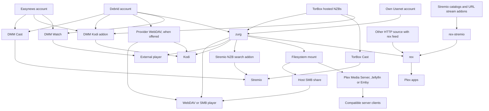
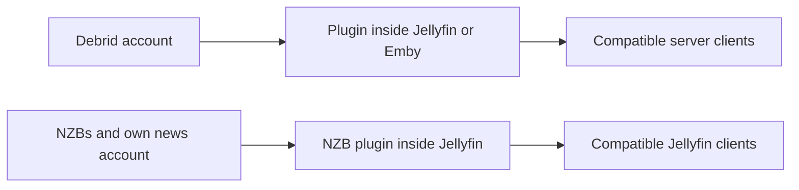
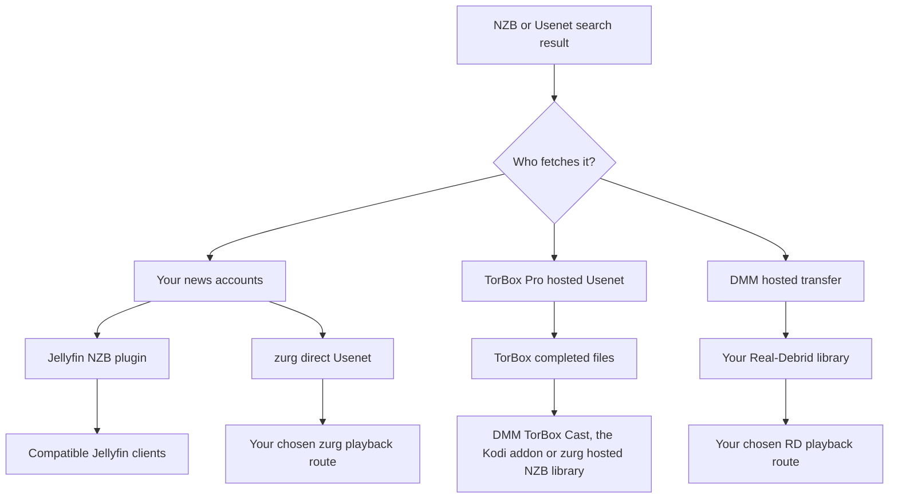

# أي إعداد يجب أن أستخدم؟ {#which-setup-should-i-use}

**[ابدأ من الإعداد المناسب لك باستخدام الاستبيان التفاعلي](https://debridmediamanager.com/choose-your-setup).** أجب عن بضعة أسئلة عن حساباتك في تطبيقات التشغيل وطريقة الاستضافة عندك. سيعيد لك الاستبيان المسارات والمتطلبات وروابط الإعداد. لا حاجة لتسجيل الدخول.

لا تعرف معنى اسم ما؟ يحتوي [ما تفعله كل قطعة](glossary.md) على سطر واحد لكل اسم.

**ابدأ بالتطبيق الذي تريد المشاهدة من خلاله.** لست بحاجة إلى كل القطع. يساعدك DMM في اختيار الإصدارات. يوفر المزود الملفات. يستطيع zurg تحويلها إلى مكتبة مشتركة. يقدّم rex المكتبة لتطبيقات Plex. بعض المسارات تتخطى قطعة أو أكثر.

تغطي هذه الخريطة المسارات المدعومة التي جرى التحقق منها بتاريخ **10 نوفمبر 2026**. وتشمل بدائل خارجية تحذف خطوة. قد تختلف الإضافات والأجهزة التابعة لجهات خارجية. اتبع الدليل المرتبط وحدوده المختبَرة.

## اختر حسب ما تستخدمه بالفعل {#pick-by-what-you-already-use}

على الهاتف، اسحب الجدول جانبياً لرؤية كل أعمدته.

| عندي / أريد… | اختر هذا المسار | لماذا تختاره؟ | ما الذي تتحمّله |
|---|---|---|---|
| Stremio وحساب debrid أو Easynews؛ دون خادم أحتاج إلى صيانته | **DMM Cast → Stremio**، أو إضافة البث الحالية لديك | شاهد عبر حسابك دون تشغيل zurg أو rex أو خادم وسائط | يجب أن توفّر الإضافة والمزوّد بثاً قابلاً للتشغيل؛ والجهاز يتولى التشغيل |
| Kodi وحساب debrid أو Easynews أو TorBox Pro | **إضافة Kodi من DMM → حسابك** | تصفّح وابحث وشغّل داخل Kodi؛ اقترن من هاتفك. مكتبة TorBox في الإضافة تتضمن تنزيلات NZB المستضافة | يتولى Kodi التشغيل. قائمة Wanted الخاصة بالداعم ما زالت تحتاج إلى zurg لتلبية الطلبات |
| فيلم واحد أشاهده في المشغّل المعتاد لدي | **DMM Watch → مشغّل خارجي** | لا حاجة إلى خادم مكتبة | ثبّت مشغّلاً مدعوماً واختر ملفاً يستطيع تشغيله |
| Infuse أو Kodi أو مشغّل WebDAV آخر | **WebDAV الخاص بالمزوّد** دون مضيف؛ **zurg → مشغّل WebDAV** عندما يمكن إبقاء مضيف يعمل | تصفّح مكتبة سحابية دون Plex أو Jellyfin أو Emby أو rex | تقدّم Real-Debrid وAllDebrid وPremiumize وTorBox وDebrid-Link خدمة WebDAV خاصة بها، مع تخطيط مجلدات خاص بكل منها. Offcloud لا يملك هذه الخدمة، لذا يحتاج إلى zurg. يحتاج zurg إلى مضيف يبقى قيد التشغيل أثناء المشاهدة |
| خادم Plex Media Server يعمل لدي بالفعل | **zurg → مجلد مربوط → Plex Media Server → تطبيق Plex** | تحتفظ بخادمك ومكتباته وطرق عملك الحالية | شغّل zurg وربط نظام الملفات بجانب الخادم؛ عمليات الفحص تقرأ الملفات البعيدة |
| تطبيقات Plex، لكن دون رغبة في صيانة مكتبة مربوطة | **zurg → rex → تطبيق Plex** | يزوّد zurg rex بالمكتبة دون ربط أو Plex Media Server | تبقى الخدمتان قيد التشغيل؛ راجع توافق rex مع التطبيقات وإرشادات الحساب |
| إضافات Stremio، لكنني أفضّل تطبيقات Plex | **الإضافات → rex-stremio → rex → تطبيق Plex** | حوّل كتالوجات الإضافات إلى مكتبات Plex؛ zurg اختياري | شغّل rex وrex-stremio؛ يجب أن تعيد إضافات البث روابط قابلة للتشغيل، لا تورنتات خام |
| Jellyfin هو الطريقة التي يصل بها مشغّلي إلى المكتبة | **إضافة المزوّد داخل Jellyfin → عميل متوافق** | لا خدمة zurg منفصلة ولا ربط | Jellyfin 12 والإضافة (أو الإضافات) المطابقة؛ للإضافات حدود أرشفة خاصة بها |
| Emby هو الطريقة التي يصل بها مشغّلي إلى المكتبة | **إضافة المزوّد داخل Emby → عميل متوافق** | أبقِ كل شيء داخل خادم Emby الحالي | استخدم إصدار Emby المدعوم؛ هذه الإضافات الست تغطي debrid فقط، لا Usenet المباشر |
| Jellyfin/Emby مع مستهلكين يحتاجون إلى وصول خاص بنظام الملفات أو WebDAV | **zurg → ربط → Jellyfin/Emby** | مكتبة واحدة تخدم أكثر من مستهلك | احتفظ بالربط ومسارات الخادم؛ يمكن للمستهلكين الآخرين استخدام zurg مباشرة |
| ملفات NZB وحساب Usenet الخاص بي وJellyfin | **إضافة NZB داخل Jellyfin → عميل متوافق** | بث ملفات NZB دون خدمة zurg منفصلة | وصول NNTP وإصدار Jellyfin المدعوم؛ الإضافة تستثني عناصر الأرشيف المضغوطة أو المشفّرة ولا تُصلح باستخدام PAR2 |
| جهاز تشغيل عتادي يقرأ مشاركات SMB | **zurg → ربط → مشاركة SMB لدى المضيف → المشغّل** | احتفظ بمتصفّح الملفات الأصلي للمشغّل وبالتشغيل | يوفّر المضيف SMB؛ zurg نفسه يوفّر WebDAV وليس خادم SMB |
| حساب Usenet الخاص بي وStremio | **فهرس Newznab → إضافة Stremio الخاصة بـ zurg → Stremio** | ابحث وقت التشغيل وابث عبر حساب الأخبار الخاص بك | zurg قيد التشغيل، ووصول إلى الفهرس، وبيانات اعتماد NNTP؛ الجهاز الآخر يحتاج إلى عنوان HTTPS قابل للوصول للإضافة |
| جهاز Android/Google TV دون جهاز كمبيوتر آخر | **zurg+rex على Android → المشغّل على ذلك الجهاز، أو تطبيقات Plex عليه وفي منزلك** | شغّل zurg وrex على جهاز Android، وخادم Plex الخاص بك على هاتفك أو صندوق TV لتلك الشاشة ولتطبيقات Plex في منزلك | وصول الداعمين والتثبيت الجانبي والتشغيل في الخلفية؛ Usenet يحتاج إلى Android 64 بت؛ ملفات NZB المستضافة في TorBox غير متاحة على Android |
| جهاز Android/Google TV وإضافات Stremio ويوتيوب وSpotify أو ملفات على NAS | **rex لنظام Android → تطبيقات Plex عليه وفي منزلك** | rex وإضافاته على الجهاز، مجاناً ودون كمبيوتر | التثبيت الجانبي والتشغيل في الخلفية؛ يجب أن تعيد إضافات البث روابط قابلة للتشغيل، لا تورنتات خام؛ الملفات على NAS تحتاج إلى إضافة تكتبها بنفسك. أما مكتبة debrid وUsenet الخاصة بك، فيستخدم الداعمون zurg+rex (الصف أعلاه) |
| ملفات موجودة على قرص أو NAS | **خادم وسائط موجود أو مشغّل شبكة**؛ **مصدر HTTP → rex** إذا أردت rex | استمر في استخدام الملفات التي تملكها؛ لا حاجة إلى حساب debrid أو Usenet | يحتاج rex إلى بيانات وصفية مُرسلة عبر واجهة feed API ووصول HTTP إلى الملفات؛ يمكن أن يكون منتج الـ feed وخادم الملفات منفصلين. rex لا يفحص الأقراص |
| وسائط HTTP قابلة للبث أو خادم HTTP خاص بي | **مصدر HTTP + feed من rex → rex → تطبيقات Plex**، أو مشغّل متوافق مباشرة | استخدم مصدراً موجوداً دون debrid أو zurg | يحتاج rex إلى منتج feed يرسل هوية المحتوى وتفاصيل الوسائط؛ الرابط المجرد لا يوفّر هذه البيانات الوصفية |

ابدأ هنا: [DMM Cast](https://debridmediamanager.com/stremio/) · [Kodi](https://debridmediamanager.com/kodi) · [إعدادات DMM](https://debridmediamanager.com/settings) · [إعداد zurg](../zurg/setup/index.md) · [rex مع zurg](../rex/with-zurg.md) · [rex مع إضافات Stremio](../rex/stremio.md) · [إضافات Jellyfin](https://debridmediamanager.com/jellyfin) · [إضافات Emby](https://debridmediamanager.com/emby) · [إضافة Stremio الخاصة بـ zurg](../zurg/guides/stremio.md) · [zurg+rex على Android](../zurg/guides/android.md) · [rex لنظام Android](../rex/android.md) · [rex مع أي مصدر](../rex/any-source.md).

يبدأ رابط Cast بـ Real-Debrid. استخدم صفحة الإعداد الخاصة بـ [TorBox](https://debridmediamanager.com/stremio-torbox/) أو [AllDebrid](https://debridmediamanager.com/stremio-alldebrid/) أو [Premiumize](https://debridmediamanager.com/stremio-premiumize/) أو [Offcloud](https://debridmediamanager.com/stremio-offcloud/) أو [Debrid-Link](https://debridmediamanager.com/stremio-debridlink/) أو [Easynews](https://debridmediamanager.com/stremio-easynews/) عندما تستخدم ذلك الحساب. وCast هنا يعني **إضافة DMM**. لا يعني Chromecast ولا عكس الشاشة.

## خريطة التشغيل {#the-playback-map}

```
Arrows mean “supplies a library or playable stream to.”
```

Hmm, that's not the right output. Here is the translation:

الأسهم تعني "تزوّد مكتبة أو بثًا قابلًا للتشغيل إلى". وهي ليست مخططًا لتوجيه الحزم: فحسب المسار، قد يجلب المشغّل المحتوى من المزوّد، أو قد يمرّر الخادم البايتات بنفسه.

[افتح خريطة التشغيل بالحجم الكامل](../assets/setup-routes/playback.svg) للتكبير أو الحفظ.



يحتاج فرع البحث عن NZB في Stremio إلى حساب NZB (`nzb`، أو `torbox_nzb` للإصدارات التي يحتفظ بها TorBox بالفعل) وفهرس Newznab. كما تعمل ملفات NZB المستضافة في TorBox أيضًا عبر TorBox Cast أو إضافة Kodi دون الحاجة إلى zurg. أما فرع المسار المركّب إلى SMB فيحتاج إلى مشاركة منفصلة مُعدّة على المضيف.

هناك مساران أصغر يستحقان أن يُبقى كل منهما منفصلًا:

[افتح خريطة الإضافات بالحجم الكامل](../assets/setup-routes/plugins.svg).



الإضافات تكاملات منفصلة. كلمة "zurg" في اسم الإضافة **لا** تعني أنك مضطر لتشغيل تطبيق zurg. كما أنها لا تَعِد بالميزات نفسها. مكتبة التورنت في إضافة TorBox منفصلة عن الواجهة الخلفية لملفات NZB المستضافة في zurg.

## اختر مصدر الملفات {#choose-where-the-files-come-from}

| المدخل | ما الذي يجلب الفيديو ويقدّمه؟ | ما الذي تحتاجه | متى يكون مفيدًا |
|---|---|---|---|
| تورنت مخزّن مؤقتًا، أو رابط magnet، أو ملف تورنت | مزوّد الدِبريد الخاص بك | حساب مدعوم من التكامل الذي اخترته | غالبًا أقصر وقت انتظار عندما يكون الإصدار المحدد متاحًا مسبقًا |
| تورنت غير مخزّن مؤقتًا | مزوّد الدِبريد ينزّله أولًا | حساب يقبل التورنت، ومصادر متاحة، ومساحة ضمن حدوده | إصدار تريده غير مخزّن مؤقتًا؛ توقّع انتظارًا وإمكانية الفشل |
| NZB، باستخدام حسابات الأخبار الخاصة بك | الواجهة **direct Usenet** في zurg، أو إضافة NZB في Jellyfin، تقرأ المقالات عند الحاجة | ملفات NZB، ووصول NNTP، والتكامل الذي اخترته؛ ووصول إلى المفهرس إذا أردت البحث | اختر مزوّدي الأخبار أو الخوادم الأساسية (backbones)، واستخدم حسابات احتياطية، وتجنّب تخزين الفيديوهات كاملة محليًا |
| NZB، باستخدام الخدمة المستضافة من TorBox | **TorBox يجلب الملف ويصلحه**، ثم يقدّم الملفات المكتملة | اشتراك TorBox Pro؛ أرسل عبر DMM أو عبر الواجهة **TorBox hosted NZB** في zurg | تريد ملفات NZB دون إدارة بيانات اعتماد خادم الأخبار أو فك الترميز محليًا |
| نتيجة Usenet من DMM مرسلة إلى Real-Debrid | خدمة النقل المستضافة في DMM تجلبها وتمررها إلى **مكتبة Real-Debrid الخاصة بك** | حساب Real-Debrid ورصيد نقل متاح في DMM | تشاهد أصلًا عبر RD وتريد وجود ذلك الإصدار هناك؛ لا حاجة إلى حساب NNTP شخصي |
| نتيجة بحث من Easynews | Easynews يقدّم تنزيلًا أو بثًا مباشرًا عبر HTTP | حساب Easynews الخاص بك | تشاهد أو تستخدم Cast من DMM، أو تستخدم مسار Easynews Cast/Kodi، دون بناء مكتبة NZB |
| رابط تنزيل HTTP(S) مباشر | مشغّل أو مصدر HTTP متوافق، أو مزوّد يدعم ذلك التنزيل | وصول إلى رابط الوسائط الفعلي؛ وحساب مزوّد مناسب إذا استوردته أو فككت قفله هناك | لديك رابط ملف بالفعل بدلًا من تورنت أو NZB |
| ملفات على قرصك أو NAS | خادم الملفات أو الوسائط لديك | تخزين محلي ومشغّل يستطيع الوصول إليه | ملكية دون اتصال، وفيديوهات منزلية، أو الاحتفاظ بمجموعة موجودة |

يدعم zurg **Real-Debrid وAllDebrid وTorBox وPremiumize وOffcloud وDebrid-Link**. يمكنك الجمع بين عدة حسابات في مكتبة واحدة. لكن الحصص وتوفّر الملفات يختلفان بين الخدمات. الشارة "مخزّن مؤقتًا" دليل فقط، وليست ضمانًا للتشغيل. راجع [providers](../zurg/providers/index.md).

### "Usenet بدون حساب Usenet": أي مسار؟ {#usenet-without-a-usenet-account-which-route}

[افتح خريطة Usenet بالحجم الكامل](../assets/setup-routes/usenet.svg).



**اختر TorBox hosted NZBs** إذا أردت أن يتولى TorBox التنزيل والإصلاح. يرسل DMM ملف NZB إلى TorBox. تستخدم إصدارات zurg الليلية الحالية نوع المزود `torbox_nzb`، وتقبل ملفات NZB من مجلد المراقبة watch directory ومن واجهة SABnzbd. لدى [TorBox hosted Usenet](../zurg/providers/torbox-nzb.md) إعداد خاص بـ zurg. إذا لم يكن الإصدار موجودًا في التخزين المؤقت، يجب أن ينتهي التنزيل قبل أن يبدأ التشغيل. تتشارك التنزيلات الفتحات slots مع التورنتات. قد تنتهي صلاحية الملفات المحفوظة، ولا يضمن zurg إعادة جلب الإصدار المنتهي. احتفظ بملف NZB لجلبه مرة أخرى لاحقًا.

**اختر Usenet المباشر** إذا أردت أن يقرأ zurg عبر حساباتك الخاصة في خوادم الأخبار، بما فيها حسابات الاحتياط والحظر. يستخدم هذا الخيار `nzb` مع بيانات اعتماد NNTP. ينتمي إليه أيضًا تسجيل الدخول إلى خادم أخبار TorBox. وهو منفصل عن TorBox hosted NZBs. راجع [TorBox NNTP](../zurg/providers/torbox-news-server.md) و[خططه](https://torbox.app/pricing).

**تستخدم نسخة zurg الواحدة إما `nzb` أو `torbox_nzb`.** يملك كلاهما مجلد مراقبة NZB نفسه. شغّل الاثنين بنسختين منفصلتين ومجلدي عمل منفصلين. وإذا كان `dmm_api_key` مضبوطًا في الاثنين، [أوقف مصدر `dmm-wanted` في إحداهما](../zurg/guides/dmm-wanted.md#two-zurgs-on-one-key)، وإلا سيُجلب كل عنوان في قائمة Wanted مرتين. ويمكن لأي منهما أن يعمل جنبًا إلى جنب مع مزودي التورنت. يرسل إضافة Stremio في zurg اختياره إلى أي حساب NZB تملكه النسخة. أما مع `torbox_nzb` فلا يبدأ التشغيل ضمن مهلة الانتظار في الإضافة إلا للإصدار الذي يملكه TorBox أصلًا، وفقط عندما لا يكون هناك إرسال NZB آخر في الانتظار.

**اختر DMM ← Real-Debrid** إذا أردت أن يصبح الإصدار في مكتبة RD لديك. وهو تحويل مستضاف له طوابير وحصص. تستغرق المهمة غير المخزنة وقتًا. ولا يضيف هذا الخيار دعم NNTP الأصلي إلى Real-Debrid أو إلى مزودي debrid الآخرين. تعرض نتيجة DMM و[صفحة Transfers](https://debridmediamanager.com/transfers) التقدم.

يقوم زر **Watch** و**Cast** في Easynews بتشغيل ملفات HTTP الخاصة به، ويحفظ **Download NZB** ملف NZB للإصدار. يضع **Send to zurg** ملف NZB هذا في قائمة Wanted الخاصة بك كراعٍ للمشروع. ويتطلب ذلك وجود خلفية NZB مضبوطة. ولا يضبط تسجيل الدخول إلى Easynews داخل DMM حساب NZB الخاص بـ zurg.

### ماذا عن روابط HTTP؟ {#what-about-http-links}

يتيح مربع الحوار **Add** في DMM الخاص بـ TorBox إضافة روابط HTTP(S) المباشرة كتنزيلات من الويب. يعرض zurg هذه الروابط في `__downloads__`. العنصر الموجود هناك لا يُعتبر تلقائياً عنصر مكتبة rex تم التعرف عليه. وقد تظهر هناك أيضاً تنزيلات Real-Debrid غير المقيّدة. يشمل DMM TorBox Cast التنزيلات المكتملة من الويب ومن Usenet، إضافةً إلى ملفات torrent. وقد تحتاج صفحة الويب إلى تكامل آخر، بسبب تسجيلات الدخول، أو انتهاء صلاحية الروابط، أو DRM، أو المشغّل الخاص بها.

**rex يدعم الوسائط القابلة للبث عبر HTTP(S) من خلال واجهة Feed API الخاصة به.** يرسل [مصدر أو إضافة](../rex/any-source.md) عنوان الوسائط والبيانات الوصفية، ثم يجعلها rex متاحة في تطبيقات Plex. يمكن أن يكون خادم الملفات ومنتج الـ feed منفصلين. لا حاجة إلى حساب zurg أو debrid. يقوم [rex-stremio](../rex/stremio.md) بذلك مع إضافات Stremio المتوافقة. لا تعمل روابط magnet الخام ولا البث الذي يعتمد على torrent فقط. يحتاج HLS إلى إعداد FFmpeg الخاص بـ rex. يستخدم rex الهوية التي يوفرها المصدر.

## قرر كيف تُضاف العناوين {#decide-how-titles-get-added}

الحصول على المحتوى والتشغيل خياران منفصلان. يمكنك تغيير طريقة طلب العنوان دون استبدال التطبيق الذي تشاهد منه.

| كيف تختار العناوين | المسار | لماذا تستخدمه؟ |
|---|---|---|
| اختر الإصدار المحدد بالضبط | بحث/مكتبة DMM → المزوّد؛ أو NZB → خلفية NZB التي اخترتها | تتحكم بالنسخة والحجم والإصدار بنفسك |
| اضغط Want، أو تابع قائمة Trakt/MDBList | [DMM Wanted](../zurg/guides/dmm-wanted.md) → الحصول على المحتوى في zurg | أفلام وحلقات جديدة تُجلب تلقائياً دون تشغيل Sonarr/Radarr؛ يتطلب اشتراك رعاية |
| طلبات العائلة عبر Seerr/Overseerr/Jellyseerr | [Seerr عبر DMM](../dmm/seerr.md) → Wanted → zurg | واجهة طلبات مألوفة دون خادم arr؛ يتطلب اشتراك رعاية. يحتاج Seerr إلى خادم Plex أو Jellyfin أو Emby ليُضبط معه |
| لديك بالفعل قوائم مشاهدة Plex أو نظام طلبات | [الحصول على المحتوى في zurg](../zurg/guides/acquisition.md) | أبقِ مصدر الطلبات الحالي؛ واضبط أهداف البحث والمزوّد فيه |
| تريد مراقبة مفصلة وملفات جودة في Sonarr/Radarr | DMM أو المفهرسات لديك → arr → واجهة عميل التنزيل في zurg → المكتبة | أبقِ قرارات arr وسير عمل الاستيراد؛ خدمات أكثر وإعداد مسارات أكثر |
| تريد الاختيار فقط عند الضغط على Play | DMM Cast/Kodi، أو إضافة بث أخرى، أو بحث Stremio في zurg | لا حاجة لبناء مكتبة مُدارة مسبقاً لكل العناوين |

في مسار arr الموصى به لـ DMM + zurg، **DMM هو المفهرس وzurg هو عميل التنزيل**. يقدم DMM [Torznab](https://debridmediamanager.com/torznab) و[Newznab](https://debridmediamanager.com/newznab). كلاهما يتطلب رعاية نشطة. Prowlarr اختياري. يوفر zurg واجهتي [qBittorrent](../zurg/guides/sonarr-radarr-torrents.md) و[SABnzbd](../zurg/guides/sonarr-radarr.md). لست بحاجة إلى تطبيقات التنزيل هذه إلى جانب zurg. [يمكن لـ zurg أيضاً البحث لصالح arr](../zurg/guides/sonarr-radarr-fetch.md).

إذا أردت **نسخاً محلية كاملة**، فنزّل الملفات من مزودك أو من zurg. يمكنك أيضاً استخدام ميزة التنزيل دون اتصال في المشغّل، أو مدير تنزيل عادي ومكتبة على القرص. تحقق من الحصص، وشغّل الملفات المحفوظة دون الحاجة إلى الشبكة. ملفات zurg الافتراضية و`.strm` وروابط [الكتالوجات المحلية](../zurg/guides/local-libraries.md) ليست نسخاً دون اتصال. الكتالوجات المحلية تخزن سجلات فقط، والتشغيل ما زال يعتمد على المزوّد.

## المقايضات المهمة قبل التثبيت {#the-tradeoffs-that-matter-before-installing}

| السؤال | ما الذي يغيّر اختيارك |
|---|---|
| هل يجب أن يبقى جهاز آخر قيد التشغيل؟ | مسارات Cast/Kodi المستضافة، وWebDAV الخاص بالمزوّد، وDMM Watch لا تحتاج إلى خادم خاص بك. تحتاج zurg وrex وrex-stremio وإضافات خادم الوسائط إلى المضيف الخاص بها أثناء المشاهدة. على جهاز Android، يشغّل zurg+rex برنامجَي zurg وrex، ويشغّل rex for Android برنامج rex مع إضافاته، بما فيها إضافات Stremio؛ وrex-stremio وإضافات خادم الوسائط ما زالت تحتاج إلى مضيف عادي. المضيف المستأجر أو المُدار يغيّر من يشغّله، لا المسار الأساسي. |
| هل سيشغّل تلفازي الملف؟ | تعتمد مسارات WebDAV والإضافات على ترميزات المشغّل وصوته وترجماته. يقدّم zurg البايتات فقط؛ وهو ليس أداة لتحويل ترميز الفيديو. يمكن لـ Plex Media Server أو Jellyfin أو Emby أو rex مع FFmpeg التحويل عند الحاجة، بشرط توفر العتاد وإمكانات الخادم/التطبيق المناسبة. |
| كم مساحة القرص التي تحتاجها؟ | البث يمنعك من تخزين المجموعة كاملة. خصّص مساحة لقواعد البيانات والصور المصغّرة وذاكرات التخزين المؤقت وأي عمل إصلاح أو تحويل أو تنزيل غير متصل. عبارة “لا تنزيل كامل أولاً” لا تعني عدم استخدام أي مساحة على القرص. |
| من يدفع ثمن عرض النطاق الترددي؟ | ما زالت حصص حركة المرور لدى المزوّد سارية. يحمل الوكيل على الخادم حركة التشغيل ويستخدم عرض النطاق الصادر منه؛ أما التشغيل المباشر فينقل الاتصال إلى المشاهد. وتحليل المكتبة يمكن أن يقرأ الملفات البعيدة أيضاً. |
| هل سيعمل خارج المنزل؟ | الإضافات المستضافة تتجنّب كشف خادمك الخاص. الخدمات المستضافة ذاتياً تحتاج إلى عنوان يمكن الوصول إليه بأمان؛ فعنوان LAN وحده لن يعمل عن بُعد. راجع [الوصول عن بُعد إلى rex](../rex/any-source.md#use-it-outside-your-home-optional) و[إرشادات HTTPS لـ Stremio](../zurg/guides/stremio.md#installing-it-on-another-device). |
| هل يمكن للعائلة استخدامه في الوقت نفسه؟ | تحقّق من قواعد IP/التزامن لدى مزوّدك ونموذج المشاركة في الخادم. يجب أن يبقى استخدام Real-Debrid على عنوان IP عام واحد؛ وقد تنتهك الروابط المباشرة إلى أسر مختلفة هذا الشرط حتى لو وفّرتها مكتبة مركزية. لا تفعّل إعادة التوجيه دون أن تفهم من أين تأتي التنزيلات. |
| على ماذا أدفع؟ | أبقِ اشتراكات المزوّدين، ووصول الفهرسات، ورعاية DMM، والاستضافة، ومشتريات المشغّل/الخادم منفصلة. موقع DMM الأساسي وrex للاستخدام الشخصي مجانيان، وكذلك [rex for Android](../rex/android.md). zurg+rex، الذي يربط أيضاً مكتبة debrid وUsenet الخاصة بك بـ rex على Android، مخصّص للرعاة. إصدارات zurg الليلية الحالية وتوزيع إضافات DMM من مزايا الرعاة؛ وWanted وواجهات برمجة الفهرسة في DMM تحتاج الرعاية أيضاً. لا تتطلب rex-stremio ذلك. [ما الذي تمنحه الرعاية](sponsorship.md) يسرد كل ميزة وأين تُعدّها. |
| هل يضمن إدراج الكتالوج التشغيل؟ | لا. تصف كتالوجات الإضافات العناوين فقط؛ وقد تنتهي صلاحية الملفات السحابية، وقد تفتقر التورنتات إلى مصادر، وقد تكون مقالات Usenet مفقودة. اختر المسار الذي ترتاح لطريقة فشله وانتظاره. |

يمكن أن يكون عميل الخادم المتوافق تطبيقاً من طرف ثالث أيضاً. [يتصل Infuse بـ Plex وEmby وJellyfin](https://support.firecore.com/hc/en-us/articles/360006462093-Streaming-from-Plex-Emby-and-Jellyfin). قد لا تحتاج إلى تركيب zurg منفصل. تحقّق من الإضافة والعميل معاً.

يدعم Infuse [WebDAV وغيره من مشاركات الشبكة](https://support.firecore.com/hc/en-us/articles/215090977-Streaming-From-a-Mac-PC-or-NAS). ملف `.strm` يمنح مشغّلاً متوافقاً مثل Kodi عنوان URL. وهو ليس بديلاً شاملاً عن التركيب. تحقّق من العميل وتوقّع سلوك وكيل وتحويل احتياطي مختلفاً. لا تستخدم `.strm` كإعداد عادي لـ Plex Media Server.

يوجد أيضاً [إصدار zurg المجاني القديم](https://github.com/debridmediamanager/zurg-public/releases). يقتصر على Real-Debrid فقط وبصيغة إعدادات مختلفة. أما مسارات Usenet متعددة المزوّدين وAndroid هنا فتستخدم إصدارات الرعاة الليلية.

**لدى rex حدود توافق خاصة به.** هو خادم تطبيق Plex مستقل. وليس Plex Media Server ولا إضافة Plex. استخدم [الأسئلة الشائعة](../rex/faq.md) للاطلاع على الأجهزة المختبرة والتحويل عند الاستخدام عن بُعد وتوصية الحساب الجديد. ويمكن أن يعمل خادم Plex التقليدي إلى جانب rex.

## احتياجات قد تغيّر المسار {#needs-that-can-change-the-route}

| أحتاج أيضاً إلى… | ما الذي يجب اختياره أو التحقق منه |
|---|---|
| الملفات المحلية وعناوين السحابة معاً | احتفظ بخادم Plex/Jellyfin/Emby الحالي وأضف الـ mount أو الإضافة المناسبة. يستطيع rex دمج عدة مصادر للـ feed، بما في ذلك مصدر HTTP للملفات المحلية، لكنه ما زال يحتاج إلى بياناتها الوصفية. |
| الترجمات التلقائية | قد تكفي الترجمات التي يوفرها المشغل أو المضمّنة في الملف. في سير عمل arr، يكتب [Bazarr مع zurg](../zurg/guides/subtitles.md) ملفات ترجمة محلية بجانب الفيديوهات الافتراضية. هذه الملفات لا تصل إلى DMM Cast أو إضافة Kodi أو DMM Watch أو إضافة zurg لـ Stremio، لكنها تصل إلى Kodi كمصدر zurg WebDAV. كما يحتوي rex على Search Subtitles من دون الحاجة إلى Bazarr. |
| سجل المشاهدة عند تغيير الخوادم | اقرأ [الانتقال من Plex](../rex/from-plex.md) و[استيراد حالة المشاهدة](../rex/import-watched.md) قبل التبديل، فتغيير المصدر لا ينقل تلقائياً سجل المشاهدة لكل التطبيقات. |
| مشاركة اختيار مع شخص لديه حسابه الخاص | تتيح قوائم DMM hashlists مشاركة اختيارات الإصدارات ليضيفها الآخرون إلى حساباتهم. لا تنقل بيانات الدخول الخاصة بك ولا تستضيف التشغيل. أما مشاركة الخادم فمسار مختلف، ويخضع لقواعد المشاركة والمزوّد الخاص به. |
| VPS أو مضيف بعرض نطاق محدود | تحقّق مما إذا كان المسار يمرّر التشغيل عبر وكيل أو يعيد توجيهه. تشرح [إعدادات التنزيل المباشر في rex](../rex/direct-download.md) خياراتها. إعادة التوجيه تغيّر عنوان IP العام لجهاز التنزيل، وقد تكشف روابط المزوّد. |

## وسائط أخرى وإعدادات قائمة {#other-media-and-existing-setups}

- **الموسيقى:** [DMM Music](https://debridmediamanager.com/music/) يوفر تشغيلاً وتنزيلاً عبر متصفح Real-Debrid. [مصادر rex للموسيقى](../rex/music.md) تغذي Plexamp وتطبيقات Plex المدعومة. قد يكون المصدر إضافة (addon) أو zurg مُعدّاً للموسيقى. لا تفترض أن إضافة الأفلام والمسلسلات توفر الموسيقى أيضاً.
- **البث المباشر (Live TV):** [مسار rex للبث المباشر](../rex/live-tv.md) يوفر القنوات ودليل البرامج في التطبيقات الموثقة. أما القنوات المباشرة من rex-stremio فتشكّل مكتبة من القنوات، وهذه ليست واجهة الدليل نفسها. تحقّق من توفر المصدر. rex لا يوفر تسجيل DVR.
- **فيديوهات منزلية وتسجيلات وصور:** استخدم خادم وسائط موجوداً لديك، أو [مصدر rex تتحكم فيه](../rex/addons.md). [الدرس التعليمي لفيديوهات المنزل](../rex/addon-home-videos.md) يوضح الخيار الأخير. يمكن لـ zurg أيضاً أن يزوّد rex بالكتب المصورة كصور، ودعم التطبيقات لذلك يختلف.
- **إضافات Kodi/Stremio الموجودة:** إن كانت إضافتك الحالية تمنحك التجربة التي تريدها، فاحتفظ بها. يمكن لـ DMM أن يكون المكان الذي تختار فيه الإصدارات وتديرها دون أن تستبدل مشغلك. يختلف دعم الإضافات للمزودين وUsenet وHTTP، ومسار DMM ليس ضماناً للتوافق مع كل الإضافات.
- **تركيب debrid mount/downloader آخر مثبّت مسبقاً:** راجع [خيارات الترحيل](../zurg/migrate/index.md) قبل التبديل. الإعداد الذي يعمل لا يحتاج إلى طبقة أخرى لمجرد وجودها.
- **تطبيقات أصلية قيد التطوير:** لا أنصح هنا بـ Usenet TV، فهو ليس إعداداً منشوراً في متجر التطبيقات. أما Yomu TV فهو مشروع منفصل للقراءة والكتب الصوتية، وليس مساراً لمكدس الأفلام والمسلسلات هذا. ولا يُشترط أيٌّ منهما للمسارات أعلاه.

## خمس نقاط بداية شائعة {#five-common-starting-points}

1. **“أملك Stremio وRD.”** ابدأ بـ DMM Cast. أضِف zurg فقط عندما تريد مكتبة مشتركة، أو أتمتة، أو مستهلكاً آخر يحتاج إليه.
2. **“أملك TorBox Pro وأريد الـ NZBs في هذا المنشور.”** أرسل الـ NZB إلى TorBox عبر DMM. استخدم TorBox Cast للمشاهدة في Stremio، أو إضافة Kodi للمشاهدة في Kodi، أو الواجهة الخلفية المستضافة لـ NZB في zurg لتغذية مسار المكتبة أو المشغّل الذي اخترته.
3. **“لديّ Jellyfin بالفعل.”** ابدأ بالإضافة الخاصة بالمزوّد لديك. اختر zurg المستقل عندما تحتاج إلى نظام الملفات المشترك الخاص به، أو الأتمتة، أو قدرات الواجهة الخلفية الأوسع.
4. **“أريد تطبيقات Plex، بدون تركيبات أقراص، وإضافاتي الحالية.”** استخدم rex-stremio مع rex. استخدم zurg كمصدر بدلاً من ذلك عندما يكون ما تريد عرضه هو مكتبة debrid أو Usenet المُدارة لديك. يمكن للمصدرين معاً أن يغذّيا rex نفسه.
5. **“لديّ حسابات أخبار وأريد Sonarr/Radarr.”** استخدم DMM Newznab أو الفهارس الحالية لديك، ومسار NZB/SABnzbd في zurg، ومسار تشغيل من الجدول الأول. للملفات المحلية الدائمة، اختر برنامج تنزيل عادياً أو احفظ نسخاً كاملة صراحةً؛ الاستيرادات الافتراضية وحدها ليست ملفات متاحة دون اتصال.

ما زلت غير متأكد؟ أخبرنا بـ **جهازك أو مشغّلك، وحساباتك الحالية، وهل يمكن لمضيف أن يبقى مفعّلاً، وهل تريد تشغيلاً عند الطلب أو مكتبة تلقائية**. هذه الإجابات عادةً ما تحدد المسار. يوضح [الحصول على المساعدة](remote-help.md) أين تطرح سؤالك.
