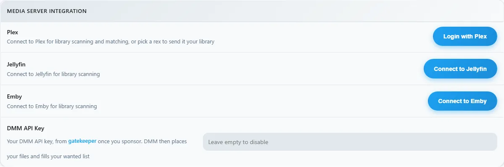

# مكتبة Real-Debrid في Plex مع zurg {#a-real-debrid-library-in-plex-with-zurg}

zurg يعرض كل ما في حسابك على Real-Debrid كمجلدات على جهازك، مرتبة مسبقاً في `movies` و `shows`. أضف هذين المجلدين إلى Plex Media Server، وستعمل مكتبة Real-Debrid كاملة في كل تطبيقات Plex، وتُبَثّ مباشرة من Real-Debrid دون تنزيل أي شيء أولاً. تثبّت zurg مرة واحدة فقط، ويأتي معه rclone الخاص به، فلا يلزمك إعداد أي شيء آخر.

لا ترغب في تشغيل Plex Media Server أو قرص مثبّت؟ [rex مع zurg](../rex/with-zurg.md) يعرض المكتبة نفسها لتطبيقات Plex دون أيٍّ منهما.

## ما تحتاجه {#what-you-need}

- **اشتراك رعاية.** النسخة الليلية من zurg متاحة للرعاة فقط. سجّل رعايتك على [gatekeeper](https://gatekeeper.debridmediamanager.com/) وسيمنح حساب GitHub الخاص بك صلاحية الوصول إلى التنزيل. [ما الذي يمنحه اشتراك الرعاية](sponsorship.md) يشرح لك الباقي.
- **حساب Real-Debrid مميز** و**رمز API** الخاص به: [رمز API الخاص بـ Real-Debrid](real-debrid-api-token.md) يوضح مكان العثور عليه.
- **خادم Plex على نفس الجهاز الذي يعمل عليه zurg.** يقرأ Plex الملفات من مجلدات zurg، لذا يجب أن يتمكن من رؤيتها. بعد ذلك يمكن لأي تطبيق Plex أن يعرض المحتوى.
- **جهاز يبقى مفتوحًا دائمًا**: Windows 10 أو 11، أو Linux، أو Mac، أو جهاز Linux يعمل عليه Docker.

## 1. تثبيت zurg {#1-install-zurg}

الكل صفحة إعداد تبدأ بمثبّت من سطر واحد. عندما تظهر الرسالة `Choose one or more providers in priority order:`، اكتب `1` لـ Real-Debrid، ثم الصق الرمز المميز (token) الخاص بك.

| جهازك | التثبيت باستخدام | تظهر مكتبتك في |
|---|---|---|
| Windows | [zurg on Windows](../zurg/setup/windows.md) | `Z:\movies` و `Z:\shows` |
| Linux | [zurg on Linux](../zurg/setup/linux.md) | `/mnt/zurg/movies` و `/mnt/zurg/shows` |
| Mac | [zurg on macOS](../zurg/setup/macos.md) | `/Volumes/Zurg/movies` و `/Volumes/Zurg/shows` |
| Linux مع Docker | [ملف Docker Compose واحد](../zurg/guides/docker-compose.md)، الذي يشغّل Plex Media Server جنبًا إلى جنب مع zurg | `/zurg_mnt/zurg/movies` و `/zurg_mnt/zurg/shows` |

ينتهي المثبّت بتشغيل `zurg doctor`، وهو قائمة من أسطر `PASS`.

## 2. التحقق من المجلدات {#2-check-the-folders}

افتح مجلد zurg أو القرص الخاص به. يفترض أن ترى `movies` و`shows` و`__all__` و`__downloads__` و`__unplayable__` و`version.txt`.

تقرأ أول مرة تشغيل مكتبة Real-Debrid الكاملة الخاصة بحسابك. وحتى ينتهي ذلك تبقى المجلدات فارغة. للتحقق، افتح `http://localhost:9999/ready` في المتصفح: سيظهر فيه `ready` بمجرد اكتمال تحميل مكتبتك.

## 3. إضافة المجلدات في Plex {#3-add-the-folders-in-plex}

في Plex Web، اضغط على **Add Library**، الزر الموجود بجانب اسم السيرفر في الشريط الجانبي:

1. اختر **Movies** واضغط على **Next**.
2. اضغط على **Browse for media folder** واختر مجلد `movies` الخاص بـ zurg من الجدول أعلاه، مثل `Z:\movies` على Windows.
3. اضغط على **Add Library**.

كرر نفس الخطوات مع **TV Shows** ومجلد `shows`. بعدها يفحص Plex المجلدين ويملأ الملصقات والعناوين تلقائياً.

## 4. جعل zurg يُخبر Plex بالأشياء الجديدة {#4-let-zurg-tell-plex-about-new-things}

بلكس لا ينتبه عندما يُضاف شيء جديد إلى حسابك على Real-Debrid. يستطيع zurg إبلاغه بذلك. افتح لوحة تحكم zurg على `http://localhost:9999/config/`، ثم انتقل إلى **Media Server Integration** واضغط **Login with Plex**. سجّل الدخول إلى Plex واختر السيرفر الخاص بك.

من تلك اللحظة يطلب zurg من Plex فحص كل مجلد يتغيّر. كما يوقف بعض إعدادات Plex الخطرة على مكتبة مبثوثة، مثل **Empty trash automatically after every scan**: [إعدادات Plex الموصى بها](../zurg/guides/plex.md#recommended-plex-settings) يسرد هذه الإعدادات.

## عندما تحدث مشكلة {#when-something-is-wrong}

| ما تراه | ما الذي تفعله |
|---|---|
| Plex لا يجد شيئاً، أو مجلدات zurg فارغة | zurg ما زال يقرأ حسابك. انتظر حتى يقول `http://localhost:9999/ready` كلمة `ready`، ثم أعد المسح في Plex. |
| على Windows لا يوجد محرك `Z:`، أو Plex لا يجد `Z:\movies` | محرك `Z:` يخص جلسة سطح مكتب Windows، ومثبّت zurg يشغّل zurg هناك عند تسجيل الدخول. كما أن PowerShell المفتوح كمسؤول لا يراه. يغطي [عند وجود خطأ على Windows](../zurg/setup/windows.md#when-something-is-wrong) كل حالة على حدة. |
| على Linux، يرى Plex مجلداً فارغاً أو لا يستطيع فتحه، و`./zurg doctor` يقول `user_allow_other is not enabled in /etc/fuse.conf; the mount will be visible only to the zurg service user` | Plex يعمل بمستخدم مختلف عن مستخدم zurg. اسمح للمستخدمين الآخرين بالوصول عبر <code>echo user_allow_other &#124; sudo tee -a /etc/fuse.conf</code>، ثم شغّل `./zurg service restart` داخل مجلد zurg. |
| في Docker، تصبح مكتبات Plex فارغة بعد إعادة تشغيل zurg، والأمر `docker exec plex ls /zurg_mnt/zurg` يقول `Transport endpoint is not connected` | امنح حاوية Plex مجلد zurg باستخدام `rslave`: `/zurg_mnt:/zurg_mnt:rslave`. يحتوي [ملف Docker Compose واحد](../zurg/guides/docker-compose.md) على هذا الإعداد. |
| تظهر أشياء جديدة في مجلدات zurg لكنها لا تظهر في Plex | نفّذ الخطوة 4. إلى أن تفعل ذلك، اضغط **Scan Library Files** على المكتبة في Plex. |
| zurg يقول `bad_token` | رمز Real-Debrid خاطئ أو مقطوع. يحتوي [رمز Real-Debrid API الخاص بك](real-debrid-api-token.md#when-something-is-wrong) على الحل. |
| يمتلئ القرص لديك | يحتفظ zurg بنسخة مما تشغّله، حتى 256G افتراضياً. حدّد هذا الحجم كما يوضح [الحفاظ على صغر الذاكرة المؤقتة](../zurg/setup/windows.md#keeping-the-cache-small) (Windows) أو [القرص الذي يستخدمه الـ mount](../zurg/setup/linux.md#disk-the-mount-uses) (Linux). |

ما زلت عالقاً؟ اسأل في منتدى **zurg-support** على [Discord](https://discord.com/invite/7u4YjMThXP). يوضح [طلب المساعدة](remote-help.md) ما يجب إرفاقه.

## أسئلة {#questions}

### هل يوجد دليل لإعداد DMM و zurg و rclone للبث في Plex؟ {#is-there-a-guide-to-set-up-dmm-zurg-and-rclone-to-stream-in-plex}

هذه الصفحة. أنت لا تقوم بإعداد rclone بنفسك: مثبّت zurg يقوم بتنزيله، وzurg يشغّله. DMM هو المكان الذي تجد فيه الإصدارات وتضيفها إلى حسابك على Real-Debrid ([ما هو DMM وكيفية استخدامه](../dmm/index.md)). ثم يعرضها zurg في مجلداته، ويلتقطها Plex.

### هل تُحمَّل الأفلام على جهاز الكمبيوتر الخاص بي؟ {#do-the-movies-download-to-my-computer}

لا. يقرأ Plex كل ملف من Real-Debrid عبر zurg عند الضغط على تشغيل. يحتفظ zurg بذاكرة مؤقتة (cache) لما تم تشغيله، ويمكن أن تكبر هذه الذاكرة كثيرًا: انظر إلى صف القرص في الجدول أعلاه.

### هل يمكنني تخطي Plex Media Server؟ {#can-i-skip-plex-media-server}

نعم، مع rex. [rex مع zurg](../rex/with-zurg.md) يعرض مكتبة zurg الخاصة بك داخل تطبيقات Plex، من دون الحاجة إلى Plex Media Server ومن دون أي mount. ويمكنك أيضاً تشغيل الاثنين معاً: [ملف Docker Compose واحد](../zurg/guides/docker-compose.md) يشغّل zurg وPlex Media Server وrex على جهاز واحد.

### هل يعمل مع TorBox أو Usenet أيضًا؟ {#does-it-work-with-torbox-or-usenet-too}

نعم. مثبّت zurg يتيح أيضًا TorBox وAllDebrid وPremiumize وDebrid-Link وOffcloud وUsenet، ويضعها كلها في مجلدي `movies` و`shows` نفسيهما. [المزوّدون](../zurg/providers/index.md) فيه صفحة لكل واحد منها.
