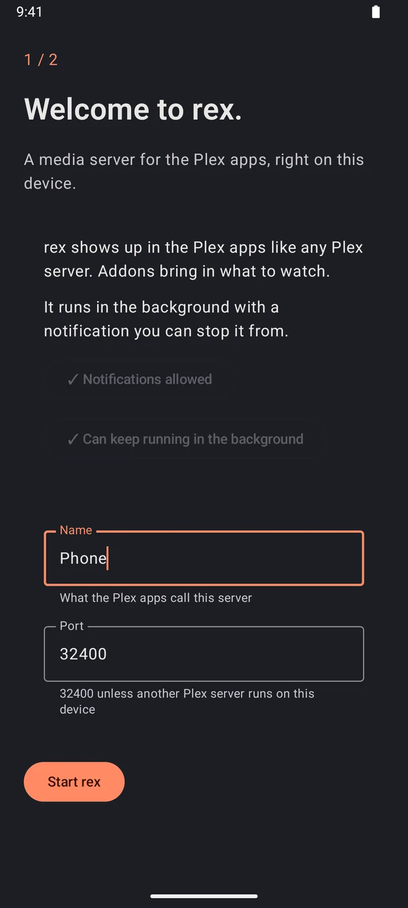

# rex لأندرويد {#rex-for-android}

rex هو خادم وسائط لتطبيقات Plex لا يملك أي ملفات. يعمل rex for Android على الهاتف أو الجهاز اللوحي أو Android TV أو Google TV أو Fire TV، دون الحاجة إلى حاسوب. تجد تطبيقات Plex على أجهزتك هذا الخادم كما تجد أي خادم Plex آخر، وتشغّل منه.

ما يُشغَّل يأتي من **الإضافات**. تبدأ المجموعة بأفلام الملكية العامة من Internet Archive. وتُثبَّت إضافات أخرى، مثل إضافات Stremio وYouTube وSpotify، من داخل التطبيق بعد أن تضيف مستودعها.

rex for Android مجاني. هل تريد أن تضيف إليه حسابات debrid وUsenet الخاصة بك أيضاً؟ zurg+rex، وهو خادم Plex على هاتفك مع zurg مدمج، يأتي مع اشتراك رعاية: راجع [zurg+rex for Android](../zurg/guides/android.md).

## قبل أن تبدأ {#before-you-start}

| تحتاج إلى | السبب |
|---|---|
| جهاز يعمل بنظام Android 8.0 أو أحدث | هاتف، أو جهاز لوحي، أو Android TV، أو Google TV، أو Fire TV. أجهزة Fire TV التي تعمل بنظام Vega OS، مثل Fire TV Stick 4K Select، لا تشغّل أي تطبيقات Android |
| حساب Plex | يظهر rex في تطبيقات Plex المسجّل الدخول إليها بهذا الحساب. الحساب المجاني يكفي |
| تطبيق Plex على الجهاز الذي تشاهد عليه | Plex for Android، وAndroid TV، وiPhone، أو تلفاز ذكي، وPlex Web، وPlexamp |

## الخطوة 1. احصل على التطبيق {#step-1-get-the-app}

اختر طريقة واحدة. كل طريقة تُبقي rex محدَّثًا بطريقتها الخاصة.

| الطريقة | مناسبة لـ |
|---|---|
| Google Play | الهواتف والأجهزة اللوحية وAndroid TV وGoogle TV. قريبًا |
| [Amazon Appstore](https://www.amazon.com/dp/B0HRQM5GGW) | أجهزة Fire TV وأجهزة Fire اللوحية |
| [Obtainium](#with-obtainium) | الهواتف والأجهزة اللوحية. يخبرك عندما يصدر تحديث |
| [Downloader](#with-downloader-on-fire-tv) | أجهزة Fire TV وصناديق التلفزيون |
| [الملف من GitHub](#the-file-from-github) | أي جهاز. أنت تثبّت التحديثات بنفسك |

**الطرق لا تُخلط.** Google Play وAmazon Appstore وملف GitHub (الذي يثبّته Obtainium وDownloader أيضًا) موقَّعة بطرق مختلفة، لذلك لا يستطيع أحدها تحديث الآخر. للتبديل، احذف rex، ثم أعد تنفيذ الخطوتين 2 و3 وثبّت الإضافات من جديد.

**كل طريقة تبدأ بإضافات مختلفة.** ملف GitHub يبدأ ومستودع [rex-addons](https://github.com/debridmediamanager/rex-addons) مُضاف. نسخ المتاجر تبدأ بإضافة Internet Archive فقط؛ أضف rex-addons بنفسك (انظر [الإضافات](#addons)) إذا أردته.

### باستخدام Obtainium {#with-obtainium}

[Obtainium](https://obtainium.imranr.dev/) يثبّت التطبيقات من GitHub ويبقيها محدّثة.

1. ثبّت Obtainium وافتحه مرة واحدة.
2. على الجهاز نفسه، افتح [rex.debridmediamanager.com/obtainium](https://rex.debridmediamanager.com/ar/obtainium). يُفتح Obtainium ويطلب منك **Import app**. اضغط **Continue**.
3. اضغط **rex**، ثم **Install**. يختار Obtainium الملف المناسب لمعالج جهازك.
4. في المرة الأولى، يفتح Android شاشة **Install unknown apps** الخاصة بـ Obtainium. فعّل **Allow from this source** ثم ارجع.
5. اضغط **Install**. إذا ظهرت رسالة **App scan recommended** من Play Protect، اضغط **Scan app** ثم **Install**.

عندما يصدر إصدار جديد، يُظهر Obtainium زر **Update** بجانب rex.

### باستخدام Downloader على Fire TV {#with-downloader-on-fire-tv}

1. على جهاز Fire TV، ثبّت تطبيق **Downloader** من تطوير AFTVnews من متجر التطبيقات (Appstore).
2. افتحه، واختر مربع العنوان واكتب الرمز `6291659` (أو `rex.debridmediamanager.com/tv`). اضغط **Next**. سيتم تنزيل `rex-android-armeabi-v7a.apk`.
3. اضغط **Install**. في المرة الأولى، سيفتح Fire TV صفحة **Developer options** بدلاً من ذلك. اختر **Install unknown apps**، ثم **Downloader** حتى يظهر **ON**. اضغط Back مرتين ثم اضغط **Install** مرة أخرى.
4. اضغط **Install**، ثم **Open**.

للتحديث، أعد تنفيذ الخطوات من 2 إلى 4.

### الملف من GitHub {#the-file-from-github}

على الجهاز، حمّل الملف الخاص بالمعالج لديك. كل رابط يشير دائماً إلى أحدث إصدار:

| جهازك | التحميل |
|---|---|
| معظم الهواتف والأجهزة اللوحية وصناديق التلفاز (64 بت) | [rex-android-arm64-v8a.apk](https://github.com/debridmediamanager/rex-android/releases/latest/download/rex-android-arm64-v8a.apk) |
| Fire TV، وصناديق 32 بت الأقدم أو الأرخص | [rex-android-armeabi-v7a.apk](https://github.com/debridmediamanager/rex-android/releases/latest/download/rex-android-armeabi-v7a.apk) |
| المحاكيات على الكمبيوتر | [rex-android-x86_64.apk](https://github.com/debridmediamanager/rex-android/releases/latest/download/rex-android-x86_64.apk) |

كل إصدار وتغييراته موجودة في [صفحة الإصدارات](https://github.com/debridmediamanager/rex-android/releases). غير متأكد؟ جرّب `arm64-v8a` أولاً. ملف واحد يعمل على الهواتف والتلفاز معاً.

افتح الملف الذي حمّلته. سيقول Android إنه **لا يُسمح بتثبيت تطبيقات غير معروفة من هذا المصدر**. اضغط **Settings**، ثم فعّل **Allow from this source**، ارجع واضغط **Install**.

للتحديث، ثبّت الملف الجديد فوق القديم. سيبدأ rex من جديد تلقائياً وستبقى تسجيلاتك والإضافات كما هي.

**ما الذي يجب أن تراه.** **rex** في قائمة تطبيقاتك.

## الخطوة 2. شغّل rex {#step-2-start-rex}

**rex** افتح. الشاشة الأولى تقول **Welcome to rex.**

1. اضغط **Allow notifications** ثم **Allow**. يعمل rex في الخلفية مع إشعار يمكنك إيقافه من خلاله.
2. اضغط **Let rex keep running in the background**. في القائمة التي تفتح، اختر **rex** ثم اختر **Don't optimize**. في أندرويد الأحدث يكون الخيار **Allow background usage** ثم **Unrestricted**. ارجع إلى rex. الزران يبدآن الآن بعلامة ✓.
3. **Name** هو الاسم الذي تعرضه تطبيقات Plex لهذا الخادم. غيّره إن أردت.
4. اترك **Port** على `32400`. إذا كان هناك خادم Plex آخر يعمل على هذا الجهاز، سيقول rex **Another app here already uses this port, maybe a Plex server. Try 32500.** اكتب `32500`.
5. اضغط **Start rex**.

**ما الذي يجب أن تراه.** **2 / 2** و**Sign in to Plex.**

| الشاشة الأولى | صفحة الفيلم في تطبيق Plex (الخطوة 4) |
|---|---|
|  |  |

## الخطوة 3. سجّل الدخول إلى Plex {#step-3-sign-in-to-plex}

اضغط **Sign in to Plex**. يعرض rex رمزًا: **On any phone or computer, go to plex.tv/link and enter** it.

- **على الهاتف أو الجهاز اللوحي** سيفتح المتصفح أيضًا صفحة Plex تقول **rex for Android would like to sign in to your Plex account**. سجّل الدخول هناك.
- **على التلفاز** افتح [plex.tv/link](https://plex.tv/link) على هاتفك أو حاسوبك، وسجّل الدخول وأدخل الرمز.

استخدم الحساب الذي سجّلت الدخول إليه في تطبيقات Plex. يمكنك الضغط على **Skip for now** وتسجيل الدخول لاحقًا من **Status**.

**ما الذي يجب أن تراه.** **Signed in. rex shows up in the Plex apps as** اسم الخادم الخاص بك. اضغط **Done**. تُظهر **Status** الحالة **RUNNING** والرسالة **Ready for the Plex apps.**

## الخطوة 4. شاهد من تطبيق Plex {#step-4-watch-in-a-plex-app}

افتح أي تطبيق Plex مسجّل الدخول بنفس الحساب. إذا كان Plex على هذا الجهاز، فستجد في **Status** زر **Open Plex**.

في تطبيق Plex للأندرويد، افتح **Libraries**، ثم **All Libraries**، ثم **Movies** تحت اسم الخادم الخاص بك. تعرض تطبيقات Plex الأخرى المكتبة تحت اسم الخادم أيضاً.

تستغرق المزامنة الأولى لأرشيف الإنترنت وقتاً، نحو نصف ساعة على جهاز الاختبار لدينا، لأن rex يتحقق من كل فيلم. تبقى **Status** تعرض **Syncing** حتى تنتهي، ثم تعرض العدد، مثل **Ready · 97 titles**. اضغط على التشغيل لأي فيلم.

## الإضافات {#addons}

**Addons** تعرض ما قمت بتثبيته. يعرض كل addon عناوينه ووقت آخر مزامنة له. أزراره هي **Sync now** و**Settings** و**Log** و**Remove**؛ على الهاتف، مرّر صف الأزرار جانباً لرؤيتها كلها. مفتاح **Enabled** يوقف addon دون حذفه.

تأتي الـ addons من **repositories**: مستودعات git تحتوي على addons. يأتي addon الخاص بـ Internet Archive مثبتاً مسبقاً. لمزيد منها، أضف [rex-community-addons](https://github.com/debridmediamanager/rex-community-addons) (انظر **Add a repository** أدناه)، وهو يوفر:

| Addon | ما يضيفه |
|---|---|
| Stremio addons | كتالوجات الأفلام والمسلسلات من Stremio addons الخاصة بك، وتُشغَّل من الـ streams التي تقدمها stream addons الخاصة بك |
| YouTube | قوائم تشغيل YouTube الخاصة بك. تسجل الدخول بواسطة رمز |
| Spotify | مكتبة Spotify الخاصة بك كموسيقى لـ Plex وPlexamp. يحتاج إلى addon الخاص بـ YouTube، وأن يكون مسجَّل الدخول |

**التثبيت.** ضمن **Repositories**، اضغط **Addons** بجانب أحد المستودعات، ثم **Install** أسفل الـ addon. يعرض rex المواقع التي يستطيع الوصول إليها ويسألك مرة أخرى، ثم يبدأ مزامنته.

**تسجيل الدخول.** الـ addon الذي يحتاج إلى حسابك يقول **Sign in to start.** اضغط زر **Sign in** الخاص به: انتقل إلى الصفحة التي يذكرها على أي جهاز وأدخل الرمز المعروض.

**إضافة مستودع.** ضمن **Add a repository**، اكتب رابطه (يكفي `github.com/user/repo`) واضغط **Add**. ثبّت فقط من أشخاص تثق بهم. لكتابة addon خاص بك، انظر [rex-addons](https://github.com/debridmediamanager/rex-addons).

## شاهد على أجهزة أخرى في المنزل {#watch-on-other-devices-at-home}

كل تطبيق Plex مسجّل الدخول بنفس الحساب يجد rex على شبكتك المنزلية باسمه: التلفاز عندك، هاتف آخر، أو Plex Web على الكمبيوتر. تُظهر **Status** عنوان rex داخل المنزل، مثل `http://192.168.1.20:32400`.

إذا أردت أن تشاهد أفراد العائلة بحساباتهم الخاصة في Plex، فراجع [مشاركة rex مع العائلة والأصدقاء](sharing.md).

## أبقه يعمل {#keep-it-running}

- يعمل rex طالما الجهاز مُشغّل. زر **Stop** في الإشعار يوقفه، وتحتوي **Status** على **Start** و**Stop** و**Restart**.
- في **Settings**، فعّل **Start when this device turns on**. وإلا افتح rex واضغط **Start** بعد إعادة التشغيل.
- بعض الهواتف ما زالت توقف التطبيقات التي تعمل في الخلفية. يشرح [Don't kill my app](https://dontkillmyapp.com/) ما يحتاجه تطبيقك.
- لتغيير اسم الخادم، افتح **Settings** ثم **General** في تطبيق Plex وغيّر **Friendly name**.

## القيود {#limits}

- **تعمل داخل المنزل.** خارج المنزل، تحتاج تطبيقات Plex إلى عنوان HTTPS يصل إلى الجهاز، ويلزم لذلك توجيه منفذ (port forward) على جهاز التوجيه (router) الخاص بك إليه. انظر [الاستخدام خارج منزلك](any-source.md#use-it-outside-your-home-optional).
- **الجهاز هو الخادم.** أبقِه شغّالاً، متصلاً بشبكة Wi-Fi أو بكابل Ethernet، ومتصلاً بالكهرباء. تحويل الفيديو لمشغّل لا يستطيع تشغيل ملف معين يعتمد على عتاد الجهاز نفسه، وقد يكون بطيئاً على جهاز رخيص.
- **فقط ما تجلبه الإضافات.** ليس لديه مكتبة ملفات على الجهاز نفسه.

## استكشاف الأخطاء وإصلاحها {#troubleshooting}

| ما تراه | ما الذي عليك فعله |
|---|---|
| **App not installed as app isn't compatible with your phone.** | اخترت الملف الخطأ لمعالج جهازك. جرّب الملف الآخر من الجدول الموجود تحت [الملف من GitHub](#the-file-from-github) |
| **Another app here already uses this port, maybe a Plex server. Try 32500.** | اكتب `32500` كمنفذ |
| **Use a number from 1024 to 65535** | يجب أن يكون المنفذ رقمًا ضمن هذا النطاق |
| لا يظهر الخادم في تطبيق Plex | سجّل الدخول إلى تطبيق Plex بالحساب نفسه الذي استخدمته في الخطوة 3، واجعل الجهازين على شبكة المنزل نفسها |
| المكتبة فارغة | ما زالت المزامنة الأولى قيد التشغيل: انتظر حتى تُظهر **Status** عدد العناوين |
| **Sign in needed** أسفل إضافة | اضغط زر **Sign in** الخاص بها وأدخل الرمز |
| **Needs an update** أسفل إضافة | لم يعد هذا الإصدار من التطبيق قادرًا على تشغيل نسخة الإضافة هذه. حدّث المستودع الخاص بها واضغط **Update**. تبقى عناوينها محفوظة في الأثناء |
| **That isn't a repository link. Try github.com/user/repo.** | اكتب رابط المستودع، مثل `github.com/user/repo` |
| **no public git repository there (it asks for a login)** | الرابط خاطئ أو أن المستودع خاص. تحقّق منه في المتصفح |
| يتوقف rex عندما تكون الشاشة مطفأة | أعد ضبط إعداد الخلفية في الخطوة 2، وراجع [Don't kill my app](https://dontkillmyapp.com/) |

يعرض **Logs** ما قاله rex والإضافات مؤخرًا، مع إخفاء المفاتيح وكلمات المرور. إذا طلب الدعم السجلات، فاضغط **Send logs to support**: سترى كل شيء قبل إرساله، ثم اضغط **Send** وانشر الرمز الذي تحصل عليه.

ما يرسله التطبيق وإلى أين، مذكور في [سياسة الخصوصية](android-privacy.md) الخاصة به.

هل تعثرت؟ اسأل في منتدى **rex-support** على [Discord](https://discord.com/invite/7u4YjMThXP).
