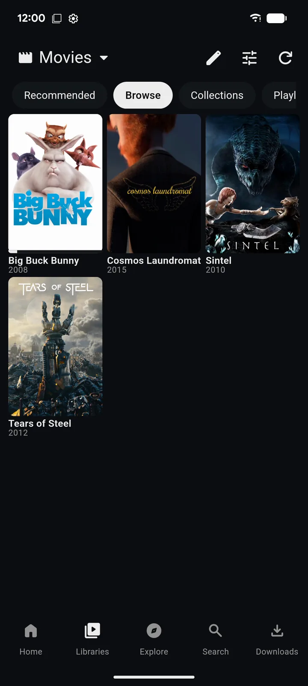

# zurg+rex لأجهزة Android وGoogle TV {#zurgrex-for-android-and-google-tv}

zurg+rex هو خادم Plex يعمل على هاتفك. يضيف zurg حساباتك لدى خدمات Debrid وحساب Usenet، ويقدّم rex هذه المحتويات لكل تطبيقات Plex في منزلك، مع الملصقات والمواسم وتقدّم المشاهدة. يعمل على الهاتف أو الجهاز اللوحي أو Android TV أو Google TV أو Fire TV، ولا تحتاج إلى حاسوب.

يأتي مع اشتراك رعاية. لا تريد الاشتراك في الرعاية؟ [rex لأندرويد](../../rex/android.md) مجاني، ويشغّل ما تجلبه إضافاته.

| التطبيق | في تطبيق Plex | في أي تطبيق Plex آخر |
|---|---|---|
|  |  |  |

## قبل أن تبدأ {#before-you-start}

| تحتاج إلى | السبب |
|---|---|
| جهاز يعمل بنظام Android 8.0 أو أحدث | هاتف أو جهاز لوحي أو Android TV أو Google TV أو Fire TV. يحتاج Usenet إلى جهاز 64 بت |
| رعاية مرتبطة بحساب GitHub الخاص بك | يتم تنزيل التطبيق ومحركه من مستودع الراعي. قم بالرعاية واربط GitHub على [gatekeeper](https://gatekeeper.debridmediamanager.com/) |
| حساب debrid أو حساب Usenet | ما يجلبه zurg إلى مكتبتك. لا تتوفر ملفات NZB المستضافة على TorBox (`torbox_nzb`) على Android |
| حساب Plex | يظهر rex في تطبيقات Plex عند تسجيل الدخول إليه. يكفي حساب مجاني |
| مفتاح API الخاص بـ DMM من gatekeeper (اختياري) | مع هذا المفتاح، تحصل المزيد من العناوين على اسمها وملصقها |

## الخطوة 1. نزّله {#step-1-download-it}

على الجهاز، افتح [صفحة التنزيل](https://zurg.debridmediamanager.com/ar/download.html#android)، وسجّل الدخول إلى GitHub بحساب الراعي الخاص بك، ثم اختر الملف المناسب لمعالج جهازك:

| جهازك | الملف |
|---|---|
| معظم الهواتف والأجهزة اللوحية وصناديق التلفزيون (64 بت) | `android-arm64-v8a.apk` |
| الهواتف القديمة 32 بت وأجهزة TV Stick | `android-armeabi-v7a.apk` |
| أجهزة Chromebook والمحاكيات | `android-x86_64.apk` |

ملف واحد يعمل على الهواتف والتلفاز على حد سواء.

**GitHub يعرض 404؟** الحساب الذي سجّلت الدخول به ليس لديه صلاحية الوصول للرعاة بعد. إذا كنت قد أصبحت راعياً للتو، [فاقبل الدعوة](https://github.com/debridmediamanager/zurg/invitations) أولاً؛ تُرسل الدعوات خلال 15 دقيقة.

## الخطوة 2. ثبّته {#step-2-install-it}

افتح الملف الذي نزّلته واسمح بالتثبيت من التطبيق الذي فتحه. قد يطلب منك Android أو Play Protect تأكيد ذلك.

**ما الذي يجب أن تراه.** **zurg+rex** في قائمة تطبيقاتك.

## الخطوة 3. سجّل الدخول إلى GitHub وثبّت المحرك {#step-3-sign-in-to-github-and-install-the-engine}

افتح التطبيق. يظهر فيه **Welcome to zurg+rex.**

1. اضغط **Sign in with GitHub**. يعرض التطبيق رمزًا: اضغط **Open GitHub**، وأدخل الرمز ثم وافق. يطلب GitHub صلاحية الوصول `repo` لأن إصدارات الداعمين خاصة.
2. **ثبّت المحرك.** المحرك هو zurg و rex نفسهما، ومحفوظان في حزمة منفصلة خاصة بهما حتى يتم تحديثهما بشكل مستقل عن التطبيق. اضغط **Install**. يسألك Android قبل التثبيت: اسمح بذلك.

**ما يجب أن تراه.** **أضف مزوّديك.**

## الخطوة 4. أضف مزوّدي الخدمة {#step-4-add-your-providers}

1. اضغط **Add an account** واختر المزوّد.
2. لحساب debrid، الصق التوكن الخاص به في **Provider token**. أما لـ Usenet، فاملأ **NNTP server** و**Port** و**Username** و**Password** و**Connections**.
3. اضغط **Test account**، ثم **Add provider**.

أضف أي عدد من الحسابات تريده؛ حقل **Account name** يساعدك على التمييز بين حسابين لدى المزوّد نفسه. وحد الاتصالات لحساب Usenet يُحسب لكل تطبيق وجهاز آخر يستخدمه.

## الخطوة 5. ابدأ مكتبتك {#step-5-start-your-library}

1. اختر **Phone** أو **Tablet** أو **TV box** أو **TV stick**. الخيارات الأصغر تستهلك ذاكرة أقل وذاكرة تخزين مؤقت أصغر.
2. اسمح بالإشعارات واترك التطبيق يعمل في الخلفية. فعّل **Start after reboot** إذا كان هذا الجهاز يجب أن يقدّم مكتبتك دائمًا.
3. اضغط **Start my library**.

**ما يجب أن تراه.** **Status** يعرض **Ready for your players** ويحسب عدد الإصدارات لديك. قد يستغرق التحميل الأول لحساب كبير عدة دقائق.

## الخطوة 6. سجّل الدخول إلى Plex {#step-6-sign-in-to-plex}

في **Status**، ضمن **rex for the Plex apps**، اضغط **Sign in to Plex**.

- **على الهاتف أو الجهاز اللوحي** سيفتح المتصفح صفحة تسجيل الدخول في Plex. سجّل الدخول هناك.
- **على التلفزيون** يعرض التطبيق **On any device, go to plex.tv/link and enter** مع رمز. أدخل الرمز على هاتفك أو حاسوبك.

استخدم الحساب الذي سجّلت الدخول به في تطبيقات Plex لديك.

**ما الذي يجب أن تراه.** **Ready for the Plex app**، مع زر **Open Plex** عندما يكون Plex على هذا الجهاز.

## الخطوة 7. شاهد من تطبيق Plex {#step-7-watch-in-a-plex-app}

افتح أي تطبيق Plex وسجّل الدخول بنفس الحساب: على هذا الجهاز، أو على التلفاز، أو على هاتف آخر، أو على حاسوب في المنزل. سيظهر السيرفر الخاص بك باسم هذا الجهاز، مع المكتبتين **Debrid Movies** و**Debrid TV**. اضغط على تشغيل.

يقوم rex بتحويل ما لا يستطيع المشغّل تشغيله، باستخدام مُرمِّز الفيديو الخاص بالجهاز نفسه.

## احصل على المزيد من العناوين المسماة {#get-more-titles-named}

افتح **Settings** ثم **Library**، والصق مفتاح DMM API الخاص بك في حقل **Dmm api key**، ثم احفظ. بعد ذلك يسأل zurg موقع DMM عن ماهية كل ملف. إذا لم يكن لديك المفتاح، يستنتج zurg ذلك من اسم الإصدار، وعندها تحصل عدد أقل من العناوين على اسمها الصحيح وملصقها.

إذا بقي عنوان يبدو خاطئًا، يمكنك تصحيحه من تطبيق Plex. افتح قائمة **⋯** الخاصة به واختر **Fix Match**.

هذا الحقل متوفر في الإصدارات الليلية منذ 14 نوفمبر 2026. في إصدار أقدم، أضف `dmm_api_key: YOUR_DMM_API_KEY` في **Settings** ثم **Advanced**. يقرأ المفتاح نفسه [قائمة DMM المطلوبة](dmm-wanted.md) الخاصة بك أيضًا.

## الإضافات {#addons}

تضيف الإضافات المزيد لمشاهدته في rex، إلى جانب مكتبتك. افتح **Addons**: تأتي إضافة Internet Archive مثبتة مسبقاً وتضيف أفلاماً من الملك العام، ومستودع [rex-addons](https://github.com/debridmediamanager/rex-addons) مُدرج بالفعل. أضف مستودعاً آخر عبر رابطه، وافتحه، وثبّت ما يقدمه.

تُعلن كل إضافة المواقع التي تستطيع الوصول إليها، وأي تحديث يصل إلى مواقع جديدة يسألك أولاً. ثبّت الإضافات من أشخاص تثق بهم فقط. يُظهر **Log** ما فعلته الإضافة مؤخراً. وإزالة إضافة تزيل عناوينها فقط.

## مشغّلات أخرى على هذا الجهاز {#other-players-on-this-device}

ما تحتاج إلى تطبيق Plex للمشاهدة.

- **Library** تستعرض مجلداتك وتشغّل الملف في المشغّل الذي تختاره. **More** يعرض مشغّلاً آخر وإجراءات الإصدار: repair وrename وtags وshow all files وdelete. هذه الإجراءات تُطبَّق على الإصدار كاملاً، وdelete يسألك أولاً ثم يحذفه من حساب المزوّد لديك.
- يعرض تطبيق **Files** ومنتقيات المستندات المكتبةَ نفسها تحت الجذر zurg. افتح مشغّلك مرة واحدة وأكمل إعداده قبل أن تختاره من Files.
- مشغّلات WebDAV مثل VLC وKodi وNova تستخدم `http://127.0.0.1:9999/dav/` كمصدر. تعرض **Status** العنوان إذا غيّرت المنفذ.

على التلفزيون، تنقّل بالـ D-pad والزر Select، وارجع بالزر Back، وافتح إجراءات الإصدار بالزر Menu أو **More**. اختر حقل النص لتكتب فيه، واضغط Back للانتقال إلى التالي.

## شارك مع مشغّلات أخرى في المنزل {#share-with-other-players-at-home}

تطبيقات Plex في المنزل لا تحتاج أي شيء آخر، فهي تجد rex بنفسها. أما لمشغّل WebDAV على جهاز آخر، فافتح **Settings** ثم **Connection** وفعّل **Expose on local network**. يُنشئ zurg اسم مستخدم وكلمة مرور، ويعرض لك العنوان الذي تُدخله في ذلك المشغّل.

استخدم هذا على شبكة تثق بها فقط، فكلمة المرور تنتقل بدون تشفير. وهو مُعطّل افتراضياً حتى تفعّله بنفسك.

## أبقه يعمل {#keep-it-running}

- يعرض الإشعار حالة الخادم ويحتوي على زر **Stop**. وهناك أيضًا بلاطة في Quick Settings تبدأ الخادم وتوقفه.
- بعض الهواتف توقف التطبيقات التي تعمل في الخلفية رغم ذلك. يشرح [Don't kill my app](https://dontkillmyapp.com/) ما يحتاجه تطبيقك.
- **Updates** يتحقق من وجود تطبيق جديد ومحرك جديد، وكل منهما يُحدَّث بشكل منفصل. إذا تصرّف إصدار nightly جديد بشكل غريب على جهازك، اضغط **Show engine versions** وثبّت الإصدار الذي كان يعمل. وأوقف مكتبتك من **Status** أولًا.
- تحتوي **Settings** على **Create backup** و**Restore backup**. النسخة الاحتياطية تحفظ كلمات المرور والرموز، فاحتفظ بها في مكان خاص. وأوقف مكتبتك قبل الاستعادة.
- أوقف rex من **Settings** ثم **Connection** ثم **rex for the Plex apps**. عندها يتوقف zurg عن تغذيته.

## ما الذي يرسله التطبيق وإلى أين {#what-the-app-sends-and-where}

ليس في zurg+rex إعلانات ولا تحليلات. هذا كل ما يغادر جهازك:

| الجهة | ما الذي يُرسل | متى |
|---|---|---|
| GitHub | تسجيل دخولك، ثم طلبات الإصدارات الخاصة بالرعاة | عند تسجيل الدخول وعند فحص **Updates** |
| مزوّدوك | رمز حسابك أو تسجيل دخول Usenet، وطلبات مكتبتك وملفاتك | أثناء عمل مكتبتك |
| debridmediamanager.com | أسماء إصداراتك، لمعرفة ما هو كل منها، مع مفتاح DMM API الخاص بك إن أدخلته | أثناء عمل مكتبتك مع تشغيل rex |
| plex.tv وخدمة البيانات الوصفية لدى Plex | طلب رمز تسجيل دخول؛ ثم اسم الخادم وعنوانه ومعرّفات عناوينك، لجلب الملصقات والأوصاف | عند تسجيل الدخول إلى Plex، وأثناء تشغيل rex وأنت مسجّل الدخول |
| debridmediamanager.com (rex-direct) | معرّف rex، ورمز الخادم الذي منحه إياه Plex، وعناوين IP الخاصة به ومنفذه، حتى تتمكن تطبيقات Plex من الوصول إليه عبر HTTPS | بعد تسجيل الدخول إلى Plex، ثم كل 6 ساعات |
| المواقع الإلكترونية لكل إضافة والمستودعات التي تضيفها | ما تطلبه الإضافة | عند مزامنة إضافة أو تشغيل عنوان |
| logs.debridmediamanager.com | الإصدارات، وطراز الجهاز، وسجلات التطبيق والمحرك، وإعداداتك مع استبدال المفاتيح وكلمات المرور والرموز بـ `[redacted]` | فقط عند الضغط على **Send** ضمن **Send logs to support**، بعد أن تراها كلها. تُحذف بعد 7 أيام |

يُخزَّن رمز GitHub الخاص بك مشفّرًا على الجهاز. وعند إلغاء تثبيت التطبيق تُحذف كل ما احتفظ به.

## القيود {#limits}

- **الجهاز هو الخادم.** أبقِه شغالاً ومتصلاً بالشبكة ومُوصَّلاً بالكهرباء. تحويل الفيديو بطيء على جهاز رخيص.
- **يعمل داخل المنزل.** خارج المنزل، تحتاج تطبيقات Plex إلى عنوان HTTPS يصل إلى الجهاز، ويلزم لذلك توجيه منفذ (port forward) على الراوتر. راجع [الاستخدام خارج منزلك](../../rex/with-zurg.md#use-it-outside-your-home-optional).
- **يحتاج Usenet إلى Android بمعالج 64 بت.** الجهاز الذي يعمل بمعالج 32 بت يشغّل مكتبات debrid فقط.
- **غير متوفر على Google Play.** يتحدّث من داخل التطبيق، من خلال **Updates**.

## استكشاف الأخطاء وإصلاحها {#troubleshooting}

| ما تراه | ما الذي تفعله |
|---|---|
| GitHub يرد بـ 404 على صفحة التنزيل | سجّل الدخول إلى GitHub بحساب الداعم الخاص بك و[اقبل الدعوة](https://github.com/debridmediamanager/zurg/invitations). إن لم تكن داعمًا بعد: [gatekeeper](https://gatekeeper.debridmediamanager.com/) |
| **No engine is installed. zurg needs one before it can serve your library.** | اضغط **Install an engine** واسمح لأندرويد بتثبيته |
| **No engine is available in the sponsor releases for this device yet.** | أحدث إصدار ليلي لا يحتوي على محرك لمعالجك. اسأل في الدعم |
| **This is a 32-bit device. Debrid libraries are supported; Usenet needs 64-bit Android.** | أضف حساب debrid، أو استخدم جهازًا بمعالج 64 بت لاستخدام Usenet |
| **The Plex code expired. Ask for a new one.** | اضغط **Sign in to Plex** مرة أخرى وأدخل الرمز الجديد خلال 10 دقائق |
| The server isn't in the Plex app | سجّل الدخول في تطبيق Plex بالحساب الذي استخدمته في الخطوة 6، وأبقِ الجهازين على نفس شبكة المنزل |
| Titles show a file name and no poster | أدخل مفتاح DMM API الخاص بك (انظر [Get more titles named](#get-more-titles-named))، أو استخدم **Fix Match** في تطبيق Plex |
| It stops when the screen is off | فعّل الاستخدام في الخلفية من جديد وراجع [Don't kill my app](https://dontkillmyapp.com/) |
| An update leaves the app without an engine | ثبّت محركًا من **Updates** مرة واحدة. مزوّديك وإعداداتك تبقى كما هي |

If support asks for logs, open **Logs** and press **Send logs to support**. You see everything before anything is sent, then press **Send** and post the code you get.

ألم تنجح الأمور؟ اسأل في منتدى **zurg-support** على [Discord](https://discord.com/invite/7u4YjMThXP).
