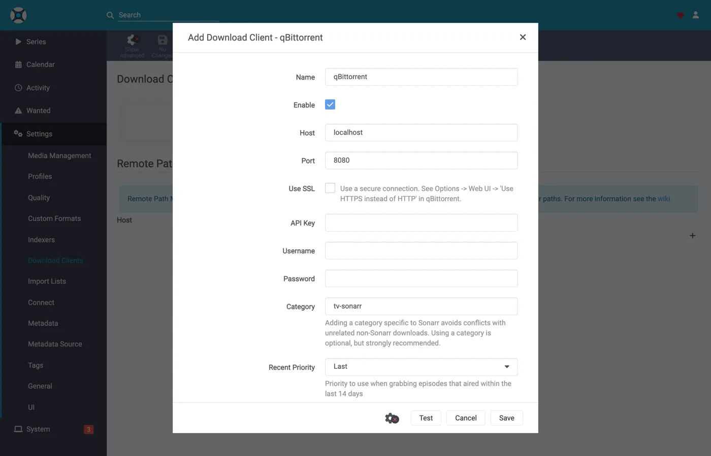
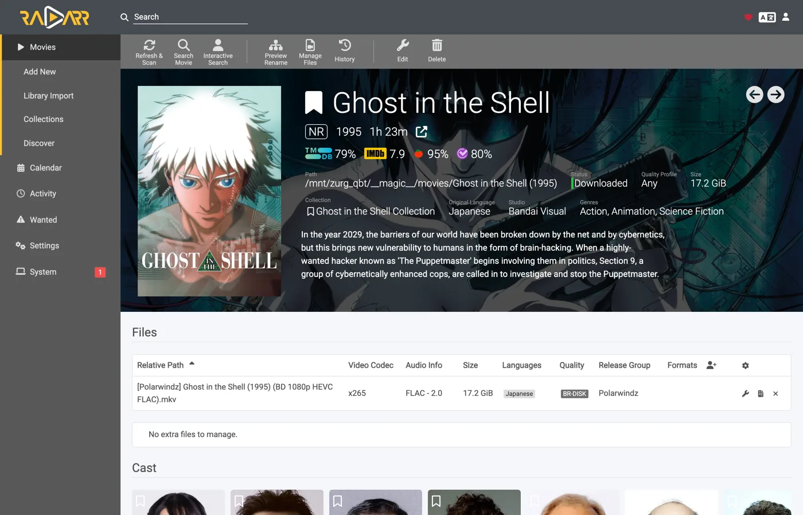
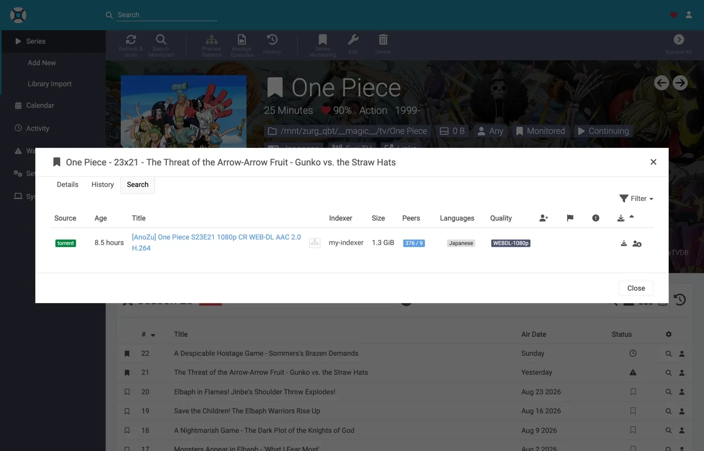
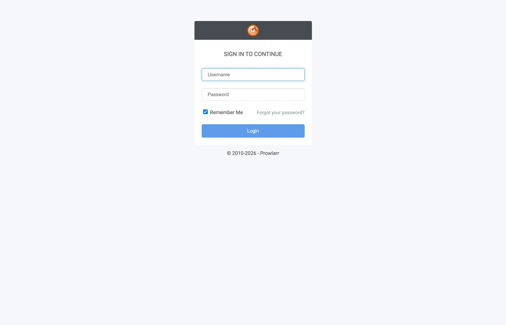

# Sonarr و Radarr مع التورنتات، خطوة بخطوة {#sonarr-and-radarr-with-torrents-step-by-step}

توجد ثلاث طرق لاستخدام Sonarr و Radarr مع zurg. الاختيار الحقيقي هو من يبحث: zurg أم \*arrs. يقارن [أيهما تختار](sonarr-radarr-fetch.md#which-one-to-pick) بينهما.

| الدليل | من يبحث | يعمل zurg كـ | ما تحتاجه |
|---|---|---|---|
| [Usenet](sonarr-radarr.md) | Sonarr و Radarr | SABnzbd | حساب Usenet (أو TorBox Pro للخلفية `torbox_nzb`) ومفهرسات Usenet في Prowlarr أو في \*arrs |
| [Torrents](sonarr-radarr-torrents.md) | Sonarr و Radarr | qBittorrent | حساب debrid ومفهرسات تورنت في Prowlarr أو في \*arrs |
| [عمليات البحث عبر zurg](sonarr-radarr-fetch.md) | zurg | لا يوجد عميل تنزيل أصلاً | حساب Usenet أو TorBox Pro أو debrid، ومفهرسات Newznab أو Torznab في ملف إعدادات zurg الخاص |

يمكن تشغيل الطريقتين الأولى والثانية جنبًا إلى جنب، فهما تتشاركان المجلد `__magic__` نفسه.

كان [الدليل السابق](sonarr-radarr.md) يوجّه \*arrs إلى zurg لاستخدام Usenet، حيث يرد zurg كـ SABnzbd. هذا هو النصف الآخر: يرد zurg كـ **qBittorrent**، وترسل \*arrs رابط magnet أو ملف `.torrent` بدلاً من NZB، فيُضاف الإصدار إلى حساب debrid بدلاً من خادم الأخبار. الاستيراد هو الحيلة نفسها: إعادة تسمية داخل `__magic__`، ولا شيء يُنزَّل للاستيراد، ولا شيء يُنسخ.

**أيٌّ من النوعين ترسله \*arr ليس أمرًا شكليًا.** عادةً يُرفع ملف `.torrent` إلى الحساب كما هو، بينما يُضاف رابط magnet بالاعتماد على info hash وحده. في وضع الكاش فقط، وهو الوضع الافتراضي، يحصل TorBox وDebrid-Link على info hash بدلاً من ذلك، لأن هذه هي الطريقة التي يرفضون بها إصدارًا غير مخزَّن دون إضافته. يجعل رابط magnet الحساب يستنتج ما يحتويه التورنت من الـ hash وحده، ولا يوجد لـ hash متتبّع خاص سرب عام يستنتج منه. لذلك يفشل Real-Debrid مع `magnet_error` دون أي ملفات، ويقبل TorBox الرابط ثم يبقى عالقًا في `checking` دون قائمة ملفات أو حجم، مع تقدير لمدة مئة يوم، فلا يفشل الالتقاط ولا ينتهي. أما ملف `.torrent` فيبحث عن الكاش في الحساب بالـ hash مباشرة، فيُضاف المحتوى الذي يملكه الحساب فورًا دون أي استنتاج من magnet. وهذا ما يجعل المفهرسات الخاصة تعمل هنا: إصداراتها قابلة للإضافة متى كان الحساب يملك المحتوى، وهذا هو الوضع الشائع لأي شيء تشاركه مجتمعات معينة. اجعل \*arr يشير إلى مفهرس يقدّم ملفات `.torrent` لا روابط magnet، فالخاصة منها تفعل ذلك.

كل ما يلي التُقط مع zurg بالإصدار `2026.08.30.0459-nightly-73-g5b4c9790`، وSonarr `4.0.19.2979`، وRadarr `6.3.0.10514`، وProwlarr `2.5.2.5491`، على تثبيت حي بحساب AllDebrid حقيقي. تم تغيير أسماء المضيف والمستخدم إلى `you@zurg-server`. أسماء المفهرسات هي `my-indexer`. مفاتيح API وأعداد المكتبة توضيحية. لم يُغيَّر أي شيء آخر في المخرجات الملتقطة.

## قبل أن تبدأ {#before-you-start}

ثلاثة أشياء يجب أن تكون صحيحة. تحقّق منها الآن كلها، لأن كل واحد منها إذا فشل سيظهر لاحقاً كمشكلة تبدو غير مرتبطة.

1. **لدى zurg حساب يستطيع إضافة التورنتات**: Real-Debrid أو AllDebrid أو TorBox أو Premiumize أو Debrid-Link أو Offcloud. هذه الخدمات الست كلها تقبل ملف `.torrent` المرفوع نفسه، وهذا ما يجعل إضافة إصدارات المتتبّعات الخاصة ممكنة. حساب Usenet لا يقبل التورنت بأي شكل: التثبيت الذي يكون مزوّده الوحيد `nzb` يقبل كل طلب ثم يرفضه. ويذكر zurg ذلك عند بدء التشغيل.
2. **`magic.enabled` مضبوط على `true`.** من دونه لا يوجد مسار الحفظ أصلاً، فيفشل كل استيراد. انظر [`__magic__`](magic.md).
3. **المجلد المركّب مرئي لـ \*arr** في المسار الذي يبلغ عنه zurg. إذا كان \*arr يعمل داخل حاوية، فاقرأ [الخطوة 8](#8-if-your-arr-is-in-docker) قبل أن تضبط أي شيء. إذا كان مثبّتاً كتطبيق عادي على الجهاز نفسه، فسيرى المجلد المركّب حيث يركّبه zurg، مع تحفّظ واحد على كل نظام:
   - **Linux:** إذا كان \*arr يعمل بمستخدم مختلف عن مستخدم zurg، فسيرى مجلداً فارغاً حتى تُفعَّل `user_allow_other`. انظر [إعداد Linux](../setup/linux.md#1-install-fuse-3).
   - **macOS:** شغّله بالمستخدم نفسه الذي يعمل به zurg. المسار المركّب هو `/Volumes/Zurg` ما لم تغيّر `mount_path`.
   - **Windows:** شغّل Sonarr وRadarr كتطبيق في شريط المهام، وهو الخيار الذي يعرضه المثبّت، لا كخدمة Windows. محرك `Z:` التابع لـ zurg يخص الجلسة التي سجّلت الدخول فيها، والخدمة تعمل خارج هذه الجلسة فلا ترى المحرك. انظر [قواعد الجلسة](../setup/windows.md#keeping-it-running-the-session-rules).

تحقّق من البندين الأولين مباشرة من ملف الإعدادات، في مجلد عمل zurg. على Windows، افتح `config.yml` في Notepad بدلاً من ذلك.

```bash
$ grep -A3 '^providers:' config.yml
providers:
- type: alldebrid
  token: <redacted>

$ grep -A3 '^magic:' config.yml
magic:
  enabled: true
  allow_delete: false
```

**ترتيب قائمة `providers:` مهم هنا.** يُعرض الطلب على كل حساب يقبل التورنتات، بهذا الترتيب. فإذا رفض حساب الطلب أو تعثّر فيه، يُتخلّى عنه وينتقل zurg إلى الحساب التالي. إذا كان لديك حسابان، فضع في الأعلى الحساب الذي تفضّل أن يُستنفد أولاً.

يوجد مفتاحان يغيّران موضع الحساب في هذا الترتيب. `watchlist: true` يضع الحساب أولاً أينما كان في الملف. أما `add_torrents: false` فيُخرجه من الترتيب تماماً، فيستمر الحساب في خدمة مكتبته وقراءتها دون أن تُضاف إليه أي تورنتات جديدة، وهذا مناسب لحساب أرشيفي أو لحساب استُنفدت حصته. ولا يُعرض حساب Usenet عليه أي تورنت في الحالتين. الشرح الكامل موجود في [مرجع الإعدادات](../reference/config.md#accounts).

## 1. فعّل نقطة الوصول {#1-turn-the-endpoint-on}

لديك طريقتان، والنتيجة واحدة. كلتاهما تكتب في `config.yml` وكلتاهما تحتاج إلى إعادة تشغيل: المسارات التي تخدم `__magic__` ونقطة نهاية qBittorrent تُسجَّل مرة واحدة فقط، عند بدء تشغيل zurg.

### الخيار أ — لوحة التحكم {#option-a--the-dashboard}

افتح لوحة تحكم zurg، واضغط **Config**، ثم انزل إلى **\_\_magic\_\_ & Download Clients**. فعّل **Serve \_\_magic\_\_** و**qBittorrent Endpoint**.


**Config** هو المكان الذي يوجد فيه الإعداد؛ و**Magic** هو المكان الذي ستراقب فيه عمليات الإضافة لاحقاً.


اترك **qBittorrent Save Path** فارغاً إلا إذا كان \*arr لديك يركّب zurg في مسار مختلف عن المسار الذي يستخدمه zurg نفسه — انظر [الخطوة 8](#8-if-your-arr-is-in-docker). الشريحة البرتقالية **Restart Required** صادقة: لا شيء هنا يسري قبل أن يُعاد تشغيل zurg.

### الخيار ب — `config.yml` {#option-b--configyml}

أضف الكتلة يدويًا ثم أعد تشغيل zurg.

```yaml
magic:
  enabled: true

qbittorrent:
  enabled: true
  api_key: ""                   # empty = zurg generates one and keeps it
  categories: [tv-sonarr, radarr]
  save_path: ""                 # empty = <mount_path>/__magic__/__all__
  cached_only: true             # the default: only take what an account already holds
```

**الفئات ليست مجلدات.** كلها تشير إلى المكان نفسه، أي مجلد الإصدار الخاص به ضمن `__magic__/__all__`. القائمة تنشئ الفئات مسبقًا فقط: زر **Test** في العميل ينشئ أي فئة مفقودة، ويحتفظ بها zurg في `data/qbittorrent-categories.json`. أما Prowlarr، إن كنت تستخدمه، فيحتاج إلى `prowlarr`. راجع [الخطوة 10](#10-prowlarr-manual-grabs).

أعد تشغيل zurg، ثم تأكد من تسجيل نقطة النهاية ومن أن المزوّد يعمل:


صف `alldebrid` واحد يكفي لنقطة النهاية، وأي نوع من الأنواع الستة التي تدعم التورنت يصلح.

سجل بدء التشغيل يقول الأمور نفسها، ويستحق أن تقرأه مرة واحدة:

```
INFO  router.qbittorrent  qBittorrent API on /api/v2 and /qbittorrent/api/v2, save path /mnt/zurg_qbt/__magic__/__all__, categories tv-sonarr, radarr
INFO  router.qbittorrent  qBittorrent: cached-only, so a grab is only accepted onto an account that already holds the content; anything else is refused and the *arr takes its next release. Set qbittorrent.cached_only: false to let accounts download
INFO  router.qbittorrent  qBittorrent: torrents are offered to alldebrid, in that order
```

## 2. اعثر على مفتاح API {#2-find-the-api-key}

**إذا تركت `api_key` فارغًا**، أنشأ zurg مفتاحًا تلقائيًا عند أول تشغيل وكتبه في `data/qbittorrent-apikey`:

```bash
$ cat data/qbittorrent-apikey
fedcba9876543210fedcba9876543210

```

هذا مفتاح توضيحي فقط، ومفتاحك سيكون مختلفًا. الملف يبقى بعد إعادة التشغيل، فالمفتاح يبقى ثابتًا بمجرد إنشائه.

**إذا عيّنت `api_key` بنفسك**، فسيكون موجودًا في `config.yml` ولن يُكتب أي ملف.

**هذه النقطة خارج المصادقة الأساسية لـ zurg.** تتصل تطبيقات \*arrs بعميل التنزيل بالطريقة الخاصة بذلك العميل، وطبقة HTTP فيها تحوّل خطأ 401 من المصادقة الأساسية إلى رسالة "unable to connect" بدون أي معلومة تساعد على الحل، لذلك استثنى zurg المسار `/api/v2` عمدًا. مفتاح API هو البوابة الوحيدة هنا. تعامل مع هذا المنفذ كما تتعامل مع بقية zurg: على شبكة موثوقة، أو خلف شيء يحميه.

هناك ثلاث طرق لإرسال المفتاح، وكلها مقبولة:

- **`Authorization: Bearer <key>`**: هذا ما يرسله العميل عندما تكون خانة **API Key** مملوءة. وهذه هي الطريقة المفضلة، لأنها تتجاوز تسجيل الدخول بالكامل.
- **المفتاح ككلمة مرور** في `auth/login`، مع أي اسم مستخدم. استخدم هذه الطريقة إذا كنت تفضّل تعبئة الحقلين Username و Password.
- **اسم المستخدم وكلمة المرور الخاصة بلوحة zurg**، إذا كانت `username:` و `password:` معيّنة في `config.yml`.

## 3. تأكد أنه يستجيب {#3-prove-it-answers}

افعل هذا قبل أن تلمس Sonarr. عشر ثوانٍ فقط، وهذه الخطوة تفصل بين «zurg به خطأ» و«الـ *arr به خطأ» طوال باقي الإعداد.

+++ Linux و macOS

```bash
$ KEY=fedcba9876543210fedcba9876543210
$ ZURG=192.168.88.244:9995

$ curl -s "http://$ZURG/api/v2/app/webapiVersion"
Forbidden

$ curl -s -H "Authorization: Bearer $KEY" "http://$ZURG/api/v2/app/webapiVersion"
2.11.2

$ curl -s -H "Authorization: Bearer $KEY" "http://$ZURG/api/v2/app/version"
v5.0.4

$ curl -s -H "Authorization: Bearer $KEY" "http://$ZURG/api/v2/app/preferences" | jq .save_path
"/mnt/zurg_qbt/__magic__/__all__"
```

+++ Windows

في PowerShell. اكتب `curl.exe` وليس `curl`: الأمر `curl` في Windows PowerShell أمر مختلف.

```powershell
PS> $KEY = "fedcba9876543210fedcba9876543210"
PS> $ZURG = "192.168.88.244:9995"

PS> curl.exe -s "http://$ZURG/api/v2/app/webapiVersion"
Forbidden

PS> curl.exe -s -H "Authorization: Bearer $KEY" "http://$ZURG/api/v2/app/webapiVersion"
2.11.2

PS> curl.exe -s -H "Authorization: Bearer $KEY" "http://$ZURG/api/v2/app/version"
v5.0.4

PS> (Invoke-RestMethod "http://$ZURG/api/v2/app/preferences" -Headers @{ Authorization = "Bearer $KEY" }).save_path
Z:/__magic__/__all__
```

+++

**رد `Forbidden` وحده هو الرد السليم.** أول طلب تجريبي يرسله العملاء هو `GET /api/v2/app/webapiVersion` *بدون مصادقة*، وqBittorrent الحقيقي يرد عليه بـ `403` عندما تكون الواجهة موجودة لكن لا أحد مسجّل دخول. لذلك هذا ما يرد به zurg، ويفهمه العميل على أنه «الإصدار v2 مدعوم، سجّل دخولك الآن». أما **404** العادي فمعناه أن `qbittorrent.enabled` ما زال false، أو أن zurg لم يُعَد تشغيله منذ أن غيّرت الإعداد.

ثم تأكد أن المفتاح الخاطئ يُرفض فعلاً:

+++ Linux و macOS

```bash
$ curl -s -o /dev/null -w "%{http_code}\n" -H "Authorization: Bearer wrongkey" \
    "http://$ZURG/api/v2/torrents/info"
403
```

+++ Windows

```powershell
PS> curl.exe -s -o NUL -w "%{http_code}\n" -H "Authorization: Bearer wrongkey" "http://$ZURG/api/v2/torrents/info"
403
```

+++

`save_path` هو المسار الذي سيعطيه zurg للعملاء. تأكد الآن أنه مسار *يستطيعون* هم فتحه.

الشكلان كلاهما يعملان، فأيهما مناسب في حقل **URL Base** لدى العميل:

| المسار | URL Base في Sonarr / Radarr | الرد |
|---|---|---|
| `/api/v2/…` | *(اتركه فارغاً)* | نعم |
| `/qbittorrent/api/v2/…` | `/qbittorrent` | نعم |

## 4. أنشئ مجلدات الجذر {#4-make-the-root-folders}

أنشئها قبل إضافتها، لأن نافذة Add Root Folder في *arr تتصفح نظام الملفات الفعلي، ولن تعرض مجلدًا غير موجود.

+++ Linux and macOS

```bash
$ mkdir -p /mnt/zurg_qbt/__magic__/tv /mnt/zurg_qbt/__magic__/movies

$ ls -d /mnt/zurg_qbt/__magic__/tv /mnt/zurg_qbt/__magic__/movies
/mnt/zurg_qbt/__magic__/movies
/mnt/zurg_qbt/__magic__/tv
```

+++ Windows

```powershell
PS> New-Item -ItemType Directory -Force Z:\__magic__\tv, Z:\__magic__\movies
```

أو أنشئ المجلدين في Explorer.

+++

استبدل `/mnt/zurg_qbt` بـ `mount_path` الخاص بك. إذا لم تضبطه، يكون `/mnt/zurg` على Linux و`/Volumes/Zurg` على macOS و`Z:` على Windows.

**يجب أن يكون مجلد الجذر بجانب مسار الحفظ، لا فيه ولا فوقه**، وهي القاعدة نفسها في دليل Usenet ولنفس السبب: يُبلغ zurg عن `__magic__/__all__` بوصفه مسار الحفظ، ويرفع كلا العميلين تنبيه فحص صحة إذا كان مجلد الجذر هو مجلد الإخراج لعميل التنزيل، ويرفع Radarr تنبيهًا أيضًا إذا كان مجلد الجذر *يحتوي* عليه، أما المجلدات الشقيقة فلا تثير أيًّا منهما. ([ذلك الدليل](sonarr-radarr.md#4-make-the-root-folders) يحتوي على لقطات شاشة لما يحدث عند الخطأ.)

وهناك سبب ثانٍ خاص بالتورنت: النقل إلى وجهة خارج `__magic__` هو نقل بين نظامي ملفات، أي نسخ فعليًا، والنسخ من تركيب debrid يعني قراءة الإصدار كاملًا عبر الشبكة. ترك خيار `Remove Completed` مفعّلًا ([أدناه](#if-the-import-copies-instead-of-moving)) يُبقي الاستيراد عملية إعادة تسمية، ومجلد الجذر الواقع خارج مساحة الأسماء سيُلغي ذلك على أي حال.

النقل بين وحدتي تخزين يُعد نسخًا أيضًا، وهذا مهم في Docker. تغطي الخطوة 8 ذلك.

## 5. أضف العميل في Sonarr {#5-add-the-client-in-sonarr}

نسخة Sonarr جديدة تمامًا تحجب كل شيء خلف شاشة الإعداد الأولى. اختر **Forms (Login Page)**، واضبط اسم مستخدم وكلمة مرور، ثم اضغط **Save**.


لن يسمح لك بالمتابعة حتى تصبح قيمة **Authentication Method** خيارًا غير None.


بعد الضغط على Save سيتم تسجيل خروجك مرة واحدة، وستنتقل إلى صفحة تسجيل الدخول.


### Settings → Download Clients

انتقل إلى **Settings → Download Clients**. في التثبيت الجديد لن تجد هنا سوى البطاقة **+**.


اضغط على **+** الموجود تحت "Download Clients"، وليس الزر الأبعد تحت "Remote Path Mappings".

اختر **qBittorrent** من عمود **Torrents**.


zurg يتقمص شخصية qBittorrent تحديدًا، لذلك لن يعمل أي خيار آخر في هذه القائمة. العمودان يدلّانك على الدليل الذي تتبعه: SABnzbd يقع تحت Usenet، أما qBittorrent فتحت Torrents.

تفتح النافذة بالإعدادات الافتراضية لـ qBittorrent نفسه: `localhost`، والمنفذ `8080`، وبدون مفتاح.



### ما الذي تضعه في كل حقل {#what-to-put-in-each-field}

| الحقل | القيمة | السبب |
|---|---|---|
| Name | `zurg (torrents)` | أي اسم تريده. هو مجرد تسمية. |
| Enable | on | اتركه مفعّلاً. |
| Host | `192.168.88.244` | العنوان الذي يعمل عليه zurg، كما يصل إليه \*arr. استخدم `localhost` إذا كان \*arr تطبيقاً عادياً على الجهاز نفسه. في Docker، راجع التحذير أدناه. |
| Port | `9995` | المنفذ المعتاد لـ zurg، وهو `9999` في التثبيت الافتراضي. |
| Use SSL | off | فعّله فقط إذا وضعت zurg خلف TLS بنفسك. |
| URL Base | فارغ | `/qbittorrent` يعمل أيضاً، انظر الخطوة 3. |
| API Key | من الخطوة 2 | هذا هو المفتاح الأساسي. يُرسل كرمز Bearer. |
| Username / Password | فارغان | اتركهما فارغين، فالمفتاح يحل محلهما. |
| Category | `tv-sonarr` | الإعداد الافتراضي لتطبيقات \*arr. zurg يسرده بالفعل، و**Test** ينشئ أي فئة غير موجودة. |
| Initial State / Sequential / First-Last | الافتراضيات | لا يوجد swarm هنا، ولا تفعل أي من هذه الإعدادات شيئاً. |
| **Remove Completed** | **on** | **الإعداد الأهم**، انظر [إذا كان الاستيراد ينسخ بدل النقل](#if-the-import-copies-instead-of-moving). |


مفتاح الـ API المعروض مجرد مثال، فالصق مفتاحك أنت.

**في Docker، يكذب كل من "localhost" واسم المضيف.** داخل الحاوية، `localhost` هو الحاوية نفسها، وعادةً ما يُحلّ اسم الجهاز إلى `127.0.1.1`، وهو أيضاً الحاوية. اسم مضيف هذا الإعداد هو `zurg-server`، وعندما حُلّ `zurg-server` داخل حاوية Sonarr إلى `127.0.1.1`، كان الاسم نفسه يعمل بشكل صحيح من shell المضيف. استخدم **عنوان LAN أو عنوان Tailscale IP** للمضيف، ولا تستخدم أبداً `localhost` ولا الاسم المجرد.

انقر **Test**. العلامة الخضراء تعني أن فحوصات العميل نجحت، وهي إصدار API والمصادقة والفئة وقائمة التورنتات.


الآن انقر **Save**.


## 6. أضف مجلد الجذر في Sonarr {#6-add-the-root-folder-in-sonarr}

انتقل إلى **Settings → Media Management** ومرّر إلى الأسفل.


انقر على **Add Root Folder**. يفتح مستعرض ملفات على نظام ملفات Sonarr، وفي Docker يكون هذا نظام ملفات الحاوية.


اكتب المسار أو تصفّحه. إذا كان الربط مرئياً فعلاً لـ Sonarr، سيُفتح `__magic__` ويعرض ما أنشأته في الخطوة 4، إلى جانب `__all__` الذي يضعه zurg بنفسه. وهذا أسرع دليل ستحصل عليه على أن bind mount صحيح.


إذا كان المجلد فارغاً أو ظهر خطأ، توقف وأصلح الربط قبل المتابعة.


أكمل المسار بـ `__magic__/tv` (`Z:\__magic__\tv` على Windows) ثم انقر على **Ok**.


القيمة `1 PiB` في **Free Space** تعني أن zurg يعرض نظام ملفات افتراضياً، وليس قرصاً حقيقياً. وهذا أمر متوقع، فهو ما يُرضي فحص المساحة الحرة لدى الـ\*arr قبل التقاط أي ملف.

## 7. افعل الشيء نفسه في Radarr {#7-do-the-same-in-radarr}

مطابق تمامًا، مع تغيير قيمتين: الفئة (Category) هي `radarr`، ومجلد الجذر هو `__magic__/movies`.


أول تشغيل لـ Radarr يعمل بالطريقة نفسها: فعّل Forms auth، ثم سجّل الدخول.


**Settings → Download Clients → +**، ثم **qBittorrent** ضمن Torrents.


المضيف نفسه، والمنفذ نفسه، والمفتاح نفسه. الاختلاف الوحيد هو **Category**: القيمة `radarr` وليست `tv-sonarr`.

اضغط **Test**، وانتظر العلامة الخضراء، ثم **Save**.


ثم انتقل إلى **Settings → Media Management → Root Folders → Add Root Folder**، وأضف `/mnt/zurg_qbt/__magic__/movies`.

**zurg واحد، وعميلان، وقائمة انتظار واحدة.** قائمة التورنتات التي يراها كل عميل تُفلتر حسب الفئة فقط ولا شيء آخر. إذا كان لديك نسختان من Sonarr تستخدمان `tv-sonarr` كلتاهما، فسيرى كل منهما التنزيلات التي يطلبها الآخر. أما Sonarr على `tv-sonarr` وRadarr على `radarr` فلن يحدث بينهما ذلك. التزم بعميل واحد لكل فئة، ولن تواجه هذه المشكلة أبدًا.

## 8. إذا كان \*arr لديك في Docker {#8-if-your-arr-is-in-docker}

هذه الخطوة خاصة بـ Docker على مضيف Linux. على macOS وWindows ثبّت تطبيقات \*arrs كتطبيقات عادية، كما تشرح [قبل أن تبدأ](#before-you-start)، وتوضح الخطوة 8 من دليل Usenet السبب.

المشكلات الثلاث نفسها في دليل Usenet، والحلول نفسها، لأن الجذر المركّب واحد، لذا هذه نسخة مختصرة. تجد التفاصيل في [الخطوة 8 من ذلك الدليل](sonarr-radarr.md#8-if-your-arr-is-in-docker).

**المسار الذي يبلغ عنه zurg يجب أن يكون مساراً يستطيع العميل فتحه.** إذا ركّبت الحاوية المكتبة في مكان مختلف عن المكان الذي يستخدمه zurg، سيفشل كل استيراد برسالة *download doesn't contain intermediate path* أو بفحص صحة للمسار البعيد. اضبط `qbittorrent.save_path` على المسار الذي *يراه العميل*، أو أضف ربط مسار بعيد (remote path mapping):

```yaml
qbittorrent:
  save_path: "/data/zurg/__magic__/__all__"   # what the *arr sees, not what zurg sees
```

**وحدة تخزين واحدة لمسار الحفظ ومجلدات الجذر.** لا تمنح الحاوية `__magic__/__all__` و`__magic__/tv` كوحدتي تخزين منفصلتين. عملية إعادة التسمية بينهما تفشل داخل الحاوية، وعندها ينسخ العميل كل عملية استيراد من حسابك ويكتبها على قرص zurg دون أن يخبرك. امنحه وحدة تخزين واحدة تحتوي على كامل تركيب zurg، وصل إلى المجلدين من خلالها. الربط أدناه هو وحدة التخزين هذه.

**اربط الأصل الأب للتركيب، لا نقطة التركيب نفسها.** إعادة تشغيل zurg تفكّ التركيب ثم تعيده، والحاوية التي ربطت نقطة التركيب نفسها تحتفظ باتصال fuse الميت، وكل قراءة بعد ذلك ترد بـ `Socket not connected`. وبما أن العميلين يتحققان من المساحة الحرة قبل كل طلب تنزيل، فإن *كل إصدار سيُرفض بصمت*. اربط الأب مع `rslave`، فيصل إعادة التركيب كحدث تركيب فرعي تتابعه الحاوية. الحاويات في هذا الإعداد بدأت قبل أن يركّب zurg أي شيء، ومع ذلك ظهر التركيب داخلها:

```bash
$ docker exec sonarr df -h /mnt/zurg_qbt
Filesystem      Size  Used Avail Use% Mounted on
zurg{8amax}:    1.0P     0  1.0P   0% /mnt/zurg_qbt
```

## 9. راقب عملية grab واحدة وهي تمر {#9-watch-one-grab-go-through}

أضِف عنصرًا واحدًا، واسحبه يدويًا، وتابعه حتى النهاية. كل ما يلي هو عملية سحب حقيقية عبر الإعداد الموضح أعلاه: *Ghost in the Shell (1995)*، سُحب يدويًا من مُفهرِس (indexer).

### Grab it

افتح الفيلم، ثم انقر على **Interactive Search**، واختر إصدارًا.


يُظهر عمود **Source** القيمة `torrent`، وهذا هو البروتوكول الذي تقبله هذه النقطة. انقر على زر السهم الدائري في نهاية الصف لتنزيله. إذا طلب العميل تأكيد الربط أولًا:


يظهر **Override and Grab** عندما لا يتطابق الإصدار بشكل سليم. تحقّق من الربط، ثم انقر على **Grab Release**. التنزيل العادي لا يظهر هذا المربع أبدًا.

### يأخذها الحساب {#the-account-takes-it}

ثلاثة أسطر في سجل zurg تشكّل عملية الإضافة كاملة: الحساب الذي يأخذ الطلب، والمهمة التي تُسجَّل، وسطر `finished`. اللقطة أدناه من إصدار أقدم سجّل السطرين الأخيرين فقط:

```
INFO  router.qbittorrent  qBittorrent: [Polarwindz] Ghost in the Shell (1995) (BD 1080p HEVC FLAC) (0c5e4077…) added to alldebrid as 720824192
INFO  router.qbittorrent  qBittorrent: [Polarwindz] Ghost in the Shell (1995) (BD 1080p HEVC FLAC) (0c5e4077…) finished on alldebrid
```

التجزئة هي info hash الذي أرسله العميل. `added … as 720824192` هو المعرّف الخاص بالحساب لهذا الطلب. كان هذا الإصدار مخزّنًا مؤقتًا في الحساب أصلًا، لذلك يظهر `finished` بعد ثانية تقريبًا. أما الإصدار غير المخزّن فيبقى بين السطرين بينما يحمّله الحساب، وما يفعله الحساب في تلك الفجوة هو ما تعرضه قائمة انتظار العميل:

| ما يفعله الحساب | ما تعرضه قائمة الانتظار |
|---|---|
| معرفة ما يشير إليه الـ magnet | *Loading metadata*، بدون أي قياس بعد |
| موضوع في قائمة انتظار الحساب الخاصة | *Queued* |
| قيد التنزيل — السرعة وعدد الأقران والوقت المتبقي هي أرقام الحساب الخاصة | *Downloading*، مع شريط تقدّم حقيقي |
| رفضت كل الحسابات الطلب أو انتهت مهلتها | **تحذير**، مع السبب — انظر [استكشاف الأخطاء وإصلاحها](#troubleshooting) |
| في المكتبة، والمجلد جاهز للاستيراد | *Completed* |

السرب المتعثر يُظهر **Downloading** مع السرعة وعدد البذور عند الصفر، بدلًا من تحذير تعثّر. `stalledDL` حالة تتصرف بناءً عليها \*arrs في معالجة التنزيلات الفاشلة، وسرب بلا بذور ليس حكمًا على الإصدار نفسه.

يصل الـ magnet كاملًا إلى الحساب. يمرّر zurg اسم العرض الذي التقطه العميل وأي المتتبّعات ذكرها. في مفهرِس ينشر magnets فقط، يكون اسم العرض المكان الوحيد الذي يوجد فيه اسم الإصدار. من دونه تسرد TorBox الطلب غير المحلول تحت تجزئته المكوّنة من أربعين حرفًا طالما بقيت البيانات الوصفية غير محلولة. ملف `.torrent` يحمل اسمه ومتتبّعاته الخاصة، لذلك لا يُضاف إليه شيء. الاستثناء هو وضع cached-only (الافتراضي) على TorBox وDebrid-Link، حيث يُسأل الحساب بالتجزئة وحدها، لأن الإصدار المخزّن مؤقتًا يعود باسمه الحقيقي.

### يحدث الاستيراد {#the-import-happens}

**Activity ← Queue**، ثم **Activity ← History**. حدثان بفارق ثوانٍ: **Grabbed** ثم **Movie Imported**:


وسّع الصف الذي تم استيراده واقرأ المسارات. **Source** هو `/mnt/zurg_qbt/__magic__/__all__/[Polarwindz] …/[Polarwindz] ….mkv` و**Imported To** هو `/mnt/zurg_qbt/__magic__/movies/Ghost in the Shell (1995)/…`. الملف لم يغادر `__magic__` أبداً، وهذا ما يجعل الاستيراد مجرد إعادة تسمية. التقطت لقطة الشاشة قبل أن تنتقل المكتبة إلى داخل `__all__`، لذا فمسار المصدر فيها أعلى بمستوى واحد عن المسار الذي ستقرأه في جهازك.

أما الإصدار الذي يقرر العميل عدم استيراده، فيبقى في قائمة الانتظار كتحذير. والعنصر الموجود في صف قائمة الانتظار في لقطة الشاشة هذه هو ترقية رفضها ملف الجودة. هو ظاهر، وعلى بعد نقرة واحدة من *Remove*، ولا يمسح شيئاً بمفرده:




**Status: Downloaded, Size 17.2 GiB**، ولم يتم تنزيل أي شيء ليصبح ذلك صحيحاً. تُقرأ البايتات من الحساب عندما يشغّل شيء ما الملف.

### تأكد أن الملف حقيقي {#prove-the-file-is-real}

قام الاستيراد بنقل الملف إلى مجلد الجذر. اقرأ بداية الملف ونهايته واسأل ffprobe ما هو:

+++ Linux and macOS

إذا لم يجد الـshell الأمر `ffprobe`، استخدم `~/zurg/bin/ffprobe`: فالإعداد يضع نسخته الخاصة هناك إذا لم يكن أي برنامج مثبت.

```bash
$ F="/mnt/zurg_qbt/__magic__/tv/One Piece/Season 23/[AnoZu] One Piece S23E21 1080p CR WEB-DL AAC 2.0 H.264.mkv"

$ ls -la "$F"
-rw-rw-r-- 1 you users 1446325722 Aug 31 00:44 …mkv

$ dd if="$F" bs=1M count=1 >/dev/null
1048576 bytes (1.0 MB, 1.0 MiB) copied, 0.00592934 s, 177 MB/s

$ ffprobe -v error -show_entries format=duration,size,format_name \
    -of default=noprint_wrappers=1 "$F"
format_name=matroska,webm
duration=1415.808000
size=1446325722
```

+++ Windows

في PowerShell، من داخل مجلد zurg. وضع الإعداد `bin\ffprobe.exe` هناك ما لم يكن `ffprobe` موجودًا أصلًا في PATH لديك؛ في هذه الحالة اكتب `ffprobe` بدلًا من ذلك:

```powershell
PS> $F = Get-Item -LiteralPath "Z:\__magic__\tv\One Piece\Season 23\[AnoZu] One Piece S23E21 1080p CR WEB-DL AAC 2.0 H.264.mkv"
PS> $F.Length
1446325722

PS> bin\ffprobe.exe -v error -show_entries format=duration,size,format_name -of default=noprint_wrappers=1 $F.FullName
format_name=matroska,webm
duration=1415.808000
size=1446325722
```

+++

هذا الملف سحبه Sonarr، حلقة سُحبت بالطريقة نفسها واستُوردت إلى `tv/One Piece/Season 23/`. ملف Matroska مدته 23 دقيقة، قُرئ مباشرة من حساب debrid. تصل البايتات عندما يقرأها شيء ما، لا عندما يستورد \*arr الملف.

### من Sonarr، يبدو الأمر نفسه {#from-sonarr-it-looks-the-same}




نفس حدثي السجل، ونفس الاستيراد بإعادة التسمية، وقائمة انتظار تُفرَّغ في اللحظة التي ينتهي فيها الاستيراد. الإصدار المخزَّن في الكاش ينتقل من الإرسال إلى الاستيراد خلال ثوانٍ معدودة، ولهذا لا توجد هنا لقطة شاشة لمرحلة التنزيل في منتصفها.

## 10. Prowlarr، عمليات grab يدوية {#10-prowlarr-manual-grabs}

Prowlarr يتصل بنفس نقطة النهاية، ويشارك كود عميل qBittorrent مع التطبيقين الآخرين، لكنه ليس مستوردًا. ليست لديه مكتبة ولا يستورد أي شيء أبدًا. ما يستطيع فعله هو **إرسال إصدار إلى الحساب يدويًا**، وهذا بالضبط ما وُجد من أجله عميل التنزيل الخاص به.

شاشة الدخول عند أول تشغيل لـ Prowlarr هي نفسها شاشة مصادقة Forms في التطبيقين الآخرين.




**Settings → Download Clients → +**، ثم **qBittorrent**. في منتقي Prowlarr تظهر كل العملاء في قائمة أبجدية واحدة، بدلًا من العمودين اللذين تستخدمهما تطبيقات \*arr. استخدم نفس المضيف والمنفذ ومفتاح API. هناك حقلان يختلفان عن تطبيقات \*arr:


| الحقل | القيمة | السبب |
|---|---|---|
| Default Category | `prowlarr` | هذه القيمة الافتراضية الخاصة بـ Prowlarr، ويستحق نص المساعدة أن تقرأه: *adding a category specific to Prowlarr avoids conflicts with unrelated non-Prowlarr downloads*. زر **Test** ينشئ الفئة في zurg، لذا لا حاجة لإضافتها إلى `qbittorrent.categories`. |
| Priority | `Last` | لا يوجد شيء آخر لتطبيق هذا الإعداد عليه. |


اضغط **Test**، وانتظر العلامة الخضراء، ثم **Save**.


ثم اضغط **Search**، واكتب ما تريده، وأرسل صفًا إلى العميل:


يُضاف الإصدار إلى الحساب تمامًا كما يفعل طلب تطبيقات \*arr، بنفس مسار الإضافة والفئات ومجلد `__magic__`. وقد وصل هذا الإصدار مخزنًا مؤقتًا، وصارت حالته `finished` خلال أقل من ثانية. لكن لا يقوم أحد باستيراده. يبقى في الحساب ويُقدَّم من الـ mount، وهذا هو المقصود: الإرسال من Prowlarr يعني *ضع هذا في حساب debrid الخاص بي الآن*، وليس خط عمل grab-import-clean الآلي. لذلك، أبقِ Sonarr وRadarr موجَّهين إلى نقطة النهاية، ودع Prowlarr يدير المفهرسات.

## 11. إضافة إصدار يدويًا {#11-adding-a-release-by-hand}

zurg ما فيه زر إضافة في لوحة التحكم. لكن تقدر تعطي zurg إصداراً بنفسك وترسله إلى Sonarr أو Radarr المناسب. أضفه عبر هذه النقطة النهائية مع فئة ذلك التطبيق. كل تطبيق يقرأ فئته فقط. أربعة تطبيقات بأربع فئات، وكل واحد يشوف إضافاته هو بس.

+++ Linux و macOS

```bash
KEY=your-qbittorrent-api-key
curl -H "Authorization: Bearer $KEY" http://localhost:9999/api/v2/torrents/add \
  -F 'urls=magnet:?xt=urn:btih:<hash>&dn=Movie.Title.2012.1080p.WEB-DL' \
  -F category=radarr4k
```

+++ Windows

في PowerShell، مع `curl.exe` بدل `curl`:

```powershell
$KEY = "your-qbittorrent-api-key"
curl.exe -H "Authorization: Bearer $KEY" http://localhost:9999/api/v2/torrents/add `
  -F 'urls=magnet:?xt=urn:btih:<hash>&dn=Movie.Title.2012.1080p.WEB-DL' `
  -F category=radarr4k
```

+++

ملف `.torrent` يشتغل كذلك. أرسله كـ `-F 'torrents=@Movie.Title.2012.1080p.WEB.torrent'` بدل `urls`.

أربعة أشياء تحدد إذا كان التطبيق راح يستورده.

1. **الفيلم أو المسلسل لازم يكون موجود في ذلك التطبيق من قبل.** يستورد بس اللي يقدر يطابقه مع شي يديره.
2. **الاسم لازم يدل على المحتوى.** اسم الـ magnet هو قيمته `dn`، واسم ملف `.torrent` هو اسم الملف. zurg يتجاهل حقل `rename` في qBittorrent. Radarr ما قدر يحلل الاسم `Sintel` وعلّقه كـ *Unable to parse download*. الاسم `Sintel.2010.1080p.WEB-DL` اتستورد. حط سنة في الاسم.
3. **صحح الاسم قبل ما يشوفه التطبيق لأول مرة.** إذا اعتبر Radarr تحميلاً ما يتحلل، يحتفظ بهذا الحكم لين يعاد تشغيل Radarr. إعادة الإضافة باسم أحسن ما غيّرته. بعد إعادة التشغيل اتستورد.
4. **الفئة مجرد تسمية.** الفئة اللي مو في `qbittorrent.categories` تنقبل، بس ما تظهر في قائمة الفئات. تقدر تنقل الإصدار لتطبيق ثاني لاحقاً. التطبيق اللي يملك الفئة الجديدة يستورده في فحصه الجاي.

```bash
curl -H "Authorization: Bearer $KEY" http://localhost:9999/api/v2/torrents/setCategory \
  -F hashes=<hash> -F category=radarr
```

على Windows هو `curl.exe` في سطر واحد، مع ضبط `$KEY` كما فوق.

الإصدار اللي موجود أصلاً في حسابك يشتغل بنفس الطريقة، وهذا يشمل اللي أرسلته من DMM. zurg يشوف أنه موجود في المكتبة، ويسجله تحت الفئة من غير ما يضيفه مرتين. الإصدار اللي ما تضيفه أبداً عبر هذه النقطة يبقى مخفياً عن Sonarr و Radarr. zurg يعرض لهم بس اللي مرّ من خلاله.

تم القياس بتاريخ 2026-10-04 على حساب AllDebrid مع Radarr 6.3. كل فيلم اتستورد بإعادة التسمية (rename) إلى `__magic__/movies` ولا اتنسخ شي. Radarr على فئة ثانية ما شافه أبداً. Sonarr ما اتختبر.

## 12. Plex يقرأ مجموعة واحدة من المجلدات {#12-plex-reads-one-set-of-folders}

لا يُخرج الاستيراد إصداراً من مجلدات zurg الخاصة به. فالفيلم الذي وضعه Radarr في `__magic__/movies` يبقى موجوداً في `movies` وفي `__all__` أيضاً. لذلك يجب أن تقرأ Plex مجموعة واحدة من المجلدات فقط، لا الاثنتين معاً.

| يقرأ Plex | ما ستحصل عليه |
|---|---|
| `movies` و`shows` | كل ما في حساباتك على خدمات debrid. تظهر فيها عمليات الجلب التي تقوم بها \*arrs أيضاً. تكون الأسماء هي اسم الإصدار كما هو. |
| `__magic__/movies` و`__magic__/tv` | فقط ما استوردته Sonarr وRadarr. الأسماء والمجلدات هي التي اختارتها \*arrs. |

إذا كانت مكتبات Plex لديك تشير بالفعل إلى `movies` و`shows`، فاتركها كما هي. تظهر عمليات الجلب التي تقوم بها \*arrs هناك دون أي تغيير. أضف مجلدات `__magic__` إلى Plex فقط إذا أردت مكتبة تتكون من عمليات الاستيراد التي تقوم بها \*arrs وحدها، ثم أزل المجلدات الأخرى. أما إذا أضفت الاثنين معاً، فسيجد Plex كل عنوان مرتين.

ولا تضف جذر `__magic__` أبداً. فهو يحتوي على `__magic__/__all__`، وهو المكتبة الكاملة مرة أخرى.

## 13. المفهرسات، وDMM للداعمين {#13-indexers-and-dmm-for-sponsors}

يبحث Sonarr وRadarr عبر Prowlarr. يعمل هنا أي مفهرس torrent عام، لأن zurg يضيف الرابط المغناطيسي إلى حسابك في خدمة التحميل. بعض المواقع العامة تعمل خلف Cloudflare، ويرفض Prowlarr إضافتها دون FlareSolverr. تجاهل هذه المواقع.

إذا كنت تدعم zurg، فإن DMM يُعد مفهرسًا أيضًا. يبحث في مكتبة DMM كاملة، ويضع في المقدمة ما يملكه حسابك في خدمة التحميل بالفعل. وعمليات الجلب هذه فورية.

1. احصل على مفتاح API الخاص بـ DMM من [gatekeeper](https://gatekeeper.debridmediamanager.com): اضغط **Connect GitHub**، وإذا كنت تدعم على Patreon فاربط Patreon بعد ذلك. انسخ **DMM API key** الذي يظهر. هذا ليس مفتاح zurg من [الخطوة 2](#2-find-the-api-key)، وهو المفتاح نفسه المستخدم لمفهرس Usenet الخاص بـ DMM، ويُضبط على [debridmediamanager.com/newznab](https://debridmediamanager.com/newznab).
2. في Prowlarr افتح **Indexers → Add Indexer** واختر **Generic Torznab**.
3. ضع رابط حسابك والمفتاح. اترك API Path على `/api`.

| حسابك | الرابط |
|---|---|
| Real-Debrid | `https://debridmediamanager.com/api/torznab/rd` |
| AllDebrid | `https://debridmediamanager.com/api/torznab/ad` |
| TorBox | `https://debridmediamanager.com/api/torznab/tb` |
| Premiumize | `https://debridmediamanager.com/api/torznab/pm` |

يلزم أولًا ربط مفتاحك لتلك الخدمة في DMM مع TorBox وPremiumize. تُظهر صفحة DMM مكان ذلك. أضف `/cached` إلى نهاية الرابط لاستبعاد أي شيء لا يملكه حسابك بعد.

يختبر Prowlarr المفهرس عند حفظه. إذا رُفض المفتاح، فهذا يعني أن الرعاية انتهت أو أن المفتاح غير صحيح، وسيوضح الخطأ أيهما. ثم يمرر Prowlarr خدمة DMM إلى Sonarr وRadarr تلقائيًا. يسمح كل مفتاح بـ 20 عملية بحث في الدقيقة عبر جميع تطبيقاتك.

## 14. قائمة المشاهدة في Plex {#14-your-plex-watchlist}

يستطيع Sonarr وRadarr متابعة قائمة المشاهدة الخاصة بك في Plex. أي عنوان تضيفه في Plex يُضاف ويُبحث عنه ويصل عبر zurg مثل أي طلب آخر.

في كل تطبيق، افتح **Settings → Import Lists → + → Plex Watchlist** واضغط **Authenticate with Plex.tv**. اضبط المجلد الجذر على مجلد `__magic__` وفعّل خيار search on add. يلتقط Radarr الأفلام الموجودة في القائمة، ويلتقط Sonarr المسلسلات.

لدى zurg [قائمة مشاهدة خاصة به](plex-watchlist.md) تجلب من المفهرسات التي تضيفها إلى zurg مباشرةً. استخدم إحداهما فقط. إذا فعّلتهما معاً، فسيُجلب العنوان نفسه مرتين.

لمتابعة قوائم أخرى، مثل قائمة حسب النوع، راجع [القوائم في Sonarr وRadarr](import-lists.md).

## إذا كان الاستيراد ينسخ بدلًا من النقل {#if-the-import-copies-instead-of-moving}

كل ما سبق يعتمد على أن يكون الاستيراد **إعادة تسمية** (rename). أمران يحسمان ذلك. الأول هو الطريقة التي تصل بها الحاوية إلى الـ mount، وهذا أمر تستطيع تغييره أنت وحدك. إذا كان مسار الحفظ ومجلدات الجذر موجودين على حجمين (volumes) مختلفين، فإن كل عملية استيراد ستُنسخ مهما كانت باقي الإعدادات. [الخطوة 8](#8-if-your-arr-is-in-docker) تغطي ذلك. الثاني هو إعداد واحد في الـ \*arr.

العميل لن ينقل ملفاً تم استيراده إلا إذا كان يعتقد أنه حر في حذف التنزيل بعد ذلك، وهذا يتطلب ثلاثة شروط معاً: **Remove Completed** مفعّل، وتورنت مكتمل ومتوقف مؤقتاً، وحد للـ seed يرى أنه تم بلوغه. zurg يبلّغ عن الشرطين الأخيرين بالضبط كما يجب أن يكونا، أي أن كل تورنت مكتمل يعود متوقفاً مؤقتاً، بنسبة 0 مقابل حد نسبة يساوي 0. **Remove Completed** هو الشرط الذي يعود إليك أنت.

مع إيقاف هذا الخيار يقوم العميل بالنسخ بدلاً من النقل، وعلى mount من الديبريد فإن النسخ يعني قراءة كل بايت من الإصدار عبر الشبكة وكتابته على القرص المحلي. الإصدار في الخطوة 9 كان سينتقل من إعادة تسمية لم تنقل أي شيء، إلى تنزيل بحجم 17 GiB، فقط لاستيراد ملف كان موجوداً أصلاً.

يعيد zurg تفعيله عندما يملك مفتاح API الخاص بالـ \*arr، سواء عبر مصدر [Radarr أو Sonarr](acquisition.md) (يكفي أن يكون فيه `enabled: false`) أو عبر الشريط في لوحة التحكم الذي يطلبه. يتحقق zurg عند البدء، وكل عشر دقائق، وعندما يتصل الـ \*arr بـ zurg للمرة الأولى، ثم يفعّل **Remove Completed** عبر واجهة API الخاصة بالـ \*arr نفسه. إذا فشل العميل في اختبار Test الخاص به، فلا يمكن تغييره، ويحتفظ zurg بتحذير يوضح السبب.

**لا يوجد في الـ \*arr ما يدل على أنه تم النسخ.** يُبلَّغ عن الاستيراد بأنه ناجح في كلتا الحالتين. أما النقل فيظهر كسطر واحد `MOVE __magic__` في سجل zurg. النسخة التي تمر عبر mount الخاص بـ zurg تُحفظ في `data/local`، ويجدها zurg هناك خلال دقيقتين تقريباً، فيحوّلها مرة أخرى إلى placement، ويحذف النسخة، ويسجل `A client copied …` مع شريط تنبيه في لوحة التحكم. والنسخة عبر mount تملكه أنت هي `PUT` يحمل العدد الكامل لبايتات الإصدار، وهذه يرفضها zurg. التنزيل الذي استغرقه النسخ لا يمكن استرداده.

خيار **Use Hardlinks instead of Copy** ليس بديلاً: العميل لا يلجأ إليه إلا بعد أن يكون قد قرر النسخ مسبقاً، لذلك لا يستطيع تحويل النسخ إلى نقل.

## المهلات، ووضع cached-only {#timeouts-and-cached-only-mode}

افتراضيًا، يقبل zurg الطلب فقط إذا كان المحتوى مخزَّنًا (cached) في الحساب من قبل. أوقف هذا الخيار، وعندها ينزل الطلب غير المخزَّن على الحساب، وإذا توقف الطلب عن التقدم يُسحب من ذلك الحساب وينتقل إلى الحساب التالي.

```yaml
qbittorrent:
  cached_only: true
  download_timeout_mins: 15
```

| الإعداد | ما يفعله |
|---|---|
| `cached_only: true` | الإعداد الافتراضي. يُقبل الطلب فقط على حساب يملك المحتوى مسبقًا، ويُرفض فورًا في غير ذلك. لا يُستخدم `download_timeout_mins`. |
| `cached_only: false` | ينزل الطلب غير المخزَّن على الحساب. إذا بقي دون أي تقدم لمدة `download_timeout_mins` (القيمة الافتراضية خمس عشرة دقيقة)، يُتخلى عنه وتُجرَّب الحساب التالي. المهلة السالبة لا تنتهي أبدًا. |

**الإعدادات القديمة.** قبل وجود `cached_only`، كان وضع التخزين المؤقت فقط يُكتب هكذا: `download_timeout_mins: 0`. الملف الذي يكتب `download_timeout_mins` دون `cached_only` يحتفظ بالمعنى نفسه: القيمة `0` تعني التخزين المؤقت فقط، وأي قيمة أخرى تعني التنزيل. إذا كُتب الإعدادان معًا واختلفا، يتغلب `cached_only`، ويكتب zurg تحذيرًا عند البدء.

**ما الذي يُعدّ تقدمًا؟** هو تغيّر في المرحلة أو ارتفاع في نسبة الإنجاز، ويُحكم عليه من الكسر الخام الذي يبلغ عنه الحساب لا من النسبة المئوية الصحيحة. فواحد بالمئة من إصدار حجمه 100 GB يساوي غيغابايتًا كاملًا. والإصدار الذي يفكّ ضغطه الحساب معفى من المؤقت، فتبقى تلك المرحلة على الرقم نفسه طالما استغرقت ذلك.

**الخمس عشرة دقيقة قيمة مقيسة وليست اعتباطية.** يضع AllDebrid المهمة السليمة في طابور خاص بها والعدادات كلها على صفر، وقد بقيت تجربتان من أصل تجربتين في هذا الوضع لمدة 580 و622 ثانية قبل أن تبدأ التنزيل خلال ثوانٍ وتكتمل. لو كانت القيمة الافتراضية عشر دقائق لتخلّى zurg عن الاثنتين. التسجيلات، وجدول يربط صياغة كل حساب الخاصة بالحالات الخمس التي تفهمها تطبيقات \*arrs، موجودة في [دورة حياة التورنت](../internals/torrent-lifecycle.md).

**ماذا تحذف المهلة؟** النسخة الموجودة على ذلك الحساب فقط، ولا شيء غيرها. يطال الحذف النسخة التي أضافها zurg بنفسه لهذا الطلب ولم تكتمل، وليس غيرها. وعندما لا يبقى أي حساب، يُبلَّغ عن الطلب كخطأ مع سبب يذكر كل حساب وما فعله.

**إذا حذفت تورنتًا يدويًا من الحساب،** ينتقل الطلب إلى الحساب التالي فورًا. وكل الخدمات الست تعلن بوضوح عندما يختفي التورنت.

**تُحدَّد ميزانية الإضافة كلها بـ 75 ثانية.** تُلغي تطبيقات \*arrs طلب `torrents/add` عند 100 ثانية، وتُبلغ عن انتهاء المهلة كفشل اتصال، ولا توجد طريقة لرفعها. تتشارك كل الحسابات الموعد النهائي نفسه، فثلاثة حسابات تتسع بسهولة، والحساب الرابع يحصل على ما لم تستهلكه الحسابات الثلاثة الأولى.

**وضع التخزين المؤقت فقط** يرفض داخل عملية الإضافة، والرفض هناك هو الإشارة الوحيدة التي تتصرف بناءً عليها تطبيقات \*arrs: فتُفشل الطلب وتنتقل إلى الإصدار التالي في القائمة. كل ما يأتي بعد الإضافة يصل إليها كتحذير عن تنزيل قيد التقدم، فتنتظره. وهذه طريقة سؤال كل حساب:

| الحساب | كيف يسأله zurg |
|---|---|
| TorBox | رابط magnet مع `add_only_if_cached=true`، فلا تُضاف أي نسخة عند الفشل. مع ذلك يستهلك واحدة من 60 إضافة غير مخزَّنة في الساعة لدى TorBox. |
| Debrid-Link | الـ info hash المجرد، ويرفضه Debrid-Link دون إضافة أي شيء إذا لم يكن المحتوى موجودًا لديه. |
| AllDebrid, Offcloud | الإضافة نفسها هي الجواب، إذ تخبر الخدمة في الرد هل كان المحتوى موجودًا لديها، وإذا لم يكن يُحذف التورنت فورًا. |
| Real-Debrid, Premiumize | يُضاف التورنت وتُختار ملفاته، ثم تُراقَب حتى خمس ثوانٍ. يكتمل المحتوى المخزَّن تقريبًا فورًا (من 0.4 إلى 1.5 ثانية بعد اختيار الملفات على Real-Debrid)، وأي شيء ما زال يعمل بعد خمس ثوانٍ فهو تنزيل حقيقي ويُحذف. |

لا يستعلم zurg عن `checkcached` في TorBox ولا عن أي استعلامات تخزين مؤقت أخرى. فهي تخبرك هل تملك الخدمة المحتوى، لا هل سينتهي حسابك فعلًا بنسخة قابلة للاستخدام.

## ما الذي يعمل وما الذي لا يعمل {#what-works-and-what-does-not}

ما يعمل:

- اختبار الاتصال في العملاء الثلاثة كلها: إصدار الـ API، والمصادقة، والفئة (category)، وقائمة التورنتات.
- جلب الإصدارات (Grabbing)، والطابور، والسجل، والاستيراد بإعادة التسمية، والتنظيف بعد الاستيراد، في Sonarr وRadarr.
- إعادة جلب إصدار يحتفظ به الحساب أصلاً. يستعيد \*arr التورنت الجاهز ويستورده، ويحتفظ الحساب بنسخة واحدة.
- حسابات متعددة: يُعرض الجلب على كل حساب بالترتيب المذكور في `providers:`، وإذا رفض الحساب أو تعطّل، ينتقل الطلب إلى الحساب التالي.
- إرسال إصدار يدوياً من Prowlarr.

ما لا يعمل:

- **واجهة qBittorrent الويب.** هذا الـ API فقط، ولا توجد صفحة يمكن فتحها.
- **الرفع (Seeding) والترتيب في الطابور والأولويات.** لا يوجد سرب (swarm). أوامر الإيقاف المؤقت، والبدء الإجباري، وإعادة ترتيب الأولوية، وإعادة الفحص، ونقل الموقع، وحدود المشاركة تُقبل ولا تفعل شيئاً.
- **الفشل كحالة أساسية.** لا توجد في واجهة qBittorrent API طريقة للإعلان عن فشل تنزيل، لذلك يصل الإصدار الذي لن يقبله أي حساب إلى \*arr كـ *تحذير*، وليس كإدخال في القائمة السوداء. يظهر في الطابور مع السبب المرفق، وتكفي نقرة واحدة على *Remove → Blocklist and Search*، لكنه لا يُزال تلقائياً ولا يُعاد جلبه دون تدخل. هذا هو الفرق الحقيقي عن نقطة نهاية SABnzbd، التي تستطيع الإبلاغ عن مهمة فاشلة فيتصرف العميل وفقها.
- **الإضافة عبر رابط HTTP عادي.** يقبل `torrents/add` روابط magnet وملفات `.torrent` المرفوعة. يرسل كلا الـ \*arr أحدهما، ويُرفض رابط `http://…/x.torrent` المجرد.
- **تحدي تسجيل الدخول إلى لوحة zurg على نقطة النهاية.** لا يُطبّق. تقبل نقطة النهاية مفتاح الـ API (كرمز bearer، أو كلمة مرور تسجيل الدخول، أو ترويسة Basic)، أو اسم المستخدم وكلمة المرور الخاصين بلوحة zurg.

**جلبٌ واحد يختفي من الطابور بدلاً من أن يظهر كتحذير.** إذا لم يأخذ أي حساب الإصدار أبداً، فلا يحتفظ أحد بالـ hash ولا يجلبه أحد، يُبلَّغ عنه كخطأ بعد عشر دقائق، ويُحذف من قائمة التورنتات بعد يوم. لا يوجد تنزيل لنبلغ عن حالته، ومدخل في الطابور لشيء غير موجود أسوأ من عدم وجوده. كل فشل آخر يبقى مرئياً.

**أسماء الإصدارات المحظورة، لـ Real-Debrid فقط.** يرفض RD بعض الإصدارات بناءً على الاسم وحده. منذ 14 أكتوبر 2026 أصبحت هذه القائمة أحد عشر نصاً. لا تُطابَق `WEB-DL` و`WEB.x264` و`WEB.H264` إلا بالحالة المكتوبة تماماً، لذا `web-dl` و`Web-Dl` و`WEB.h264` الخاصة بإصدارات scene مقبولة. تُطابَق `WEBRip` و`BDRip` و`HDRip` و`DVDRip` و`HDTV.x264` و`HDTV.XviD` و`BluRay.x264` و`p.BluRay.DTS` بأي حالة كانت. يحتاج الأخير إلى حرف p مباشرة قبله، كما في `1080p.BluRay.DTS`. الإصدار `2002.BluRay.DTS` مقبول. يعرف zurg هذه الأنماط، ويتخطى Real-Debrid لمثل هذا الاسم دون أن يسأله، ويعرض الجلب على الحساب التالي. مع Real-Debrid وحده يُرفض الجلب فوراً، ويأخذ العميل الإصدار التالي. أما على TorBox وAllDebrid فيُضاف الإصدار نفسه بشكل عادي.

## استكشاف الأخطاء وإصلاحها {#troubleshooting}

| ما يقوله \*arr | ما يعنيه |
|---|---|
| "Unable to connect to qBittorrent" | zurg غير قابل للوصول على هذا المضيف والمنفذ، أو أن شيئًا ما أمامه أجاب بردّ غير 200. تحقّق من `qbittorrent.enabled`، فطالما هو مُعطّل يكون `/api/v2` مجرد 404. في Docker، تأكّد أنك لم تستخدم `localhost` أو اسم المضيف المجرد. |
| الاختبار ينجح، لكن عمليات الجلب تفشل مع *Download client failed to add torrent* | الكلاينت وصل إلى zurg، لكن zurg رفض الإضافة. يسجّل zurg كل رفض، فابحث في السجل عن `qBittorrent: refusing`. السطر يذكر السبب وكل حساب جُرّب عليه. |
| `every account that takes torrents refused or timed out` في سجل zurg | لا يوجد حساب يقبل الإصدار. إذا ذكر حدّ معدّل (rate limit) في حساب كنت تتوقع أنه سليم، فعدّ نسخ zurg الأخرى على نفس الـ token. أول عملية جلب في هذا الجهاز فشلت بالضبط بهذه الطريقة، بينما كان zurg ثانٍ على نفس حساب Real-Debrid يمرّ على مكتبة كبيرة، وكان الاثنان يتشاركان ميزانية API واحدة. |
| "Category … does not exist" | الكلاينت لم ينشئها بعد. اضغط **Test** على الكلاينت، وهذا ينشئها في zurg. |
| العملية تبقى *Downloading* لوقت طويل | الحساب يُنزّلها فعلًا. يعرض الطابور المعدّل الخاص بالحساب والوقت المتبقي حيثما يوفّرهما. الإصدار الذي لا يملك seeds يظهر صفرًا في الاثنين، وهذا ليس خطأ. |
| إصدار مكتمل يبقى في الطابور كتحذير | إما أن الكلاينت قرّر عدم استيراده (ترقية يرفضها الملف الشخصي)، أو أن كل الحسابات رفضته. صف الطابور يحمل السبب. لا يمسحه شيء وحده، فاحذفه يدويًا، واستخدم *Blocklist and Search* إذا كان الإصدار سيئًا. |
| "Download client zurg places downloads in …/__magic__/__all__ but Radarr cannot see this directory" | zurg لم ينتهِ من تحميل المكتبة. أعلى الـ mount يظهر، لكن `__all__` و`__magic__/__all__` لا يظهران، ولا يرى Plex أي شيء أيضًا. ابحث في سجل zurg عن `rejected the API key`. السبب الشائع هو حساب توقّف مفتاحه أو خطته عن العمل. راجع [TorBox](../providers/torbox.md#when-it-goes-wrong) للخطة المجانية. يختفي التحذير بعد تحميل المكتبة. |
| "Downloads in root folder" / "Remote path mapping" | نفس قواعد المجلد الجذر ومسارات الخرائط المستخدمة في نقطة نهاية Usenet. انظر [الخطوة 4](#4-make-the-root-folders) و[الخطوة 8](#8-if-your-arr-is-in-docker). |
| متصفح المجلد الجذر يُظهر الـ mount الخاص بـ zurg فارغًا، أو لا يظهر محرك `Z:` أصلًا | الـ \*arr لا يستطيع رؤية الـ mount. على Linux يعمل كمستخدم آخر دون `user_allow_other`، وعلى Windows يعمل كخدمة. راجع [قبل أن تبدأ](#before-you-start). |
| كل إصدار مرفوض، ولا شيء في السجل | bind mount قديم. شغّل `docker exec <client> df -h <mount>`، وإذا ظهر `Socket not connected` فاربط المجلد الأب بـ `rslave` وأعد إنشاء الحاوية. |
| الاستيرادات تنجح، لكن كل واحد ينزّل الإصدار كاملًا | الـ \*arr ينسخ بدل أن يعيد التسمية. يسجّل zurg `A client copied …` ويعرض لافتة على لوحة التحكم. إما أن **Remove Completed** مُعطّل على الكلاينت، أو أن الحاوية فيها مسار الحفظ والمجلدات الجذر على volume-ين مختلفين. راجع [إذا كان الاستيراد ينسخ بدل النقل](#if-the-import-copies-instead-of-moving) و[الخطوة 8](#8-if-your-arr-is-in-docker). |

ما زلت عالقًا؟ اسأل في منتدى **zurg-support** على [Discord](https://discord.com/invite/7u4YjMThXP). يشرح [طلب المساعدة](../../guides/remote-help.md) ما الذي يجب تضمينه.

## أين تُحفظ الحالة {#where-the-state-lives}

| المسار | ما هو |
|---|---|
| `data/qbittorrent-apikey` | مفتاح API يُنشأ تلقائيًا. لا يُكتب هذا الملف عند ضبط `qbittorrent.api_key`. |
| `data/qbittorrent-jobs.json` | المهام التي سلّمها العملاء إلى نقطة النهاية، مع تحديد الحساب الذي يحمل كل مهمة، والفئة التي تنتمي إليها، وكل حساب جُرّب من قبل. |
| `data/magic.json` | جدول `__magic__` — يضم كل عمليات النقل وعلامات الحذف التي أنشأتها عمليات الاستيراد. |

تعرض صفحة `__magic__` في لوحة zurg نتائج الاستيراد: عمليات النقل هي الملفات التي نقلها العملاء، وعلامات الحذف هي مجلدات المهام التي حذفوها بعد ذلك، وتظهر الإصدارات التي استلمتها نقطة النهاية كصفوف مقابل المجلدات التي استوردت منها.


يحتوي [المرجع](../reference/config.md#qbittorrent-the-torrent-download-client-sonarr-and-radarr-see) على كل مفتاح `qbittorrent:`، و[عقد العميل](../internals/qbittorrent-client-contract.md) — المكتوب بالاستناد إلى كود Sonarr وRadarr — هو المواصفة التي تلتزم بها نقطة النهاية، مع ذكر الملف والسطر لكل ادعاء.
