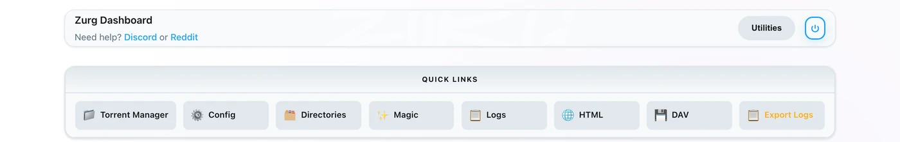
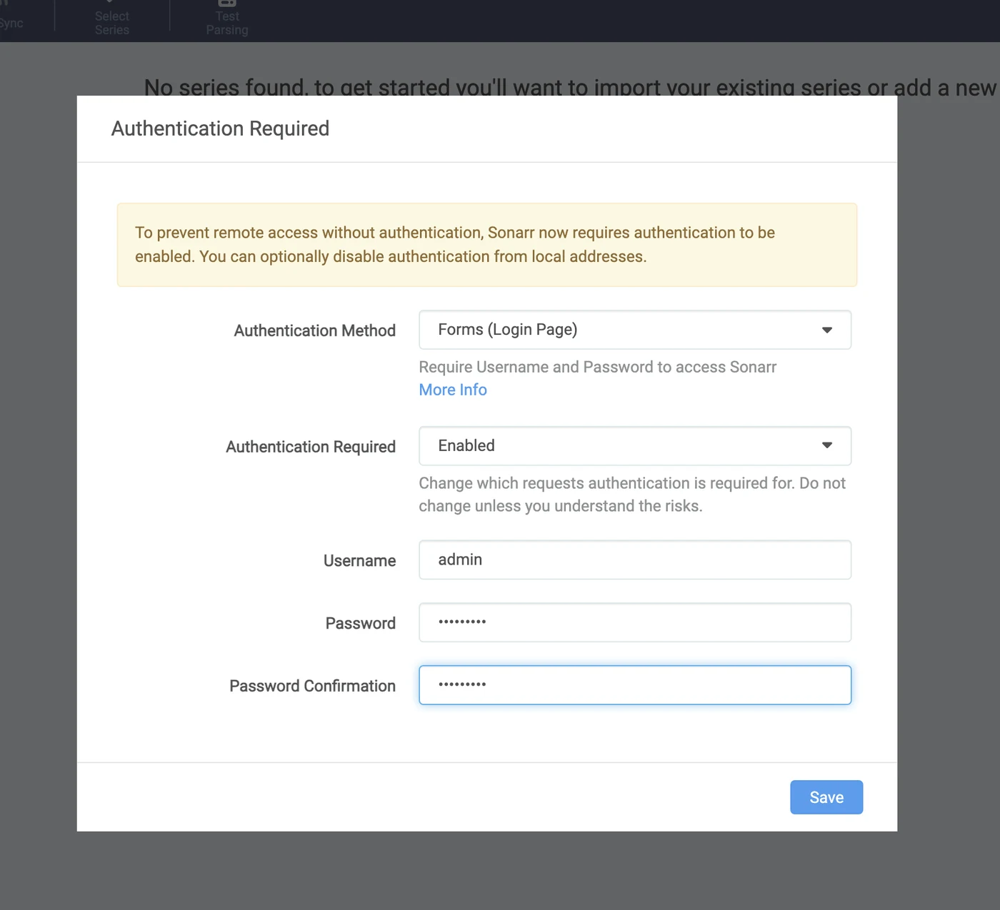
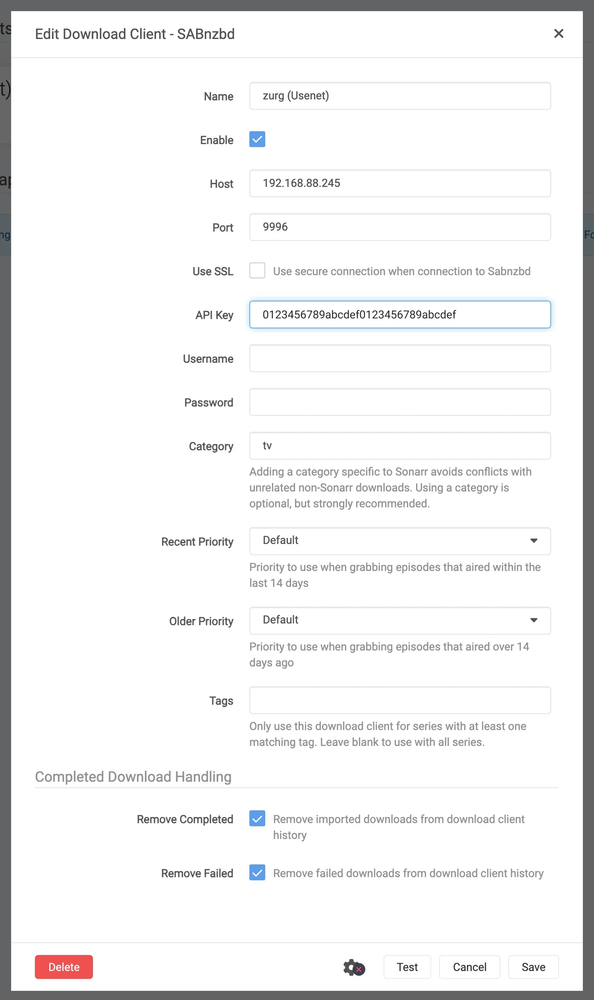
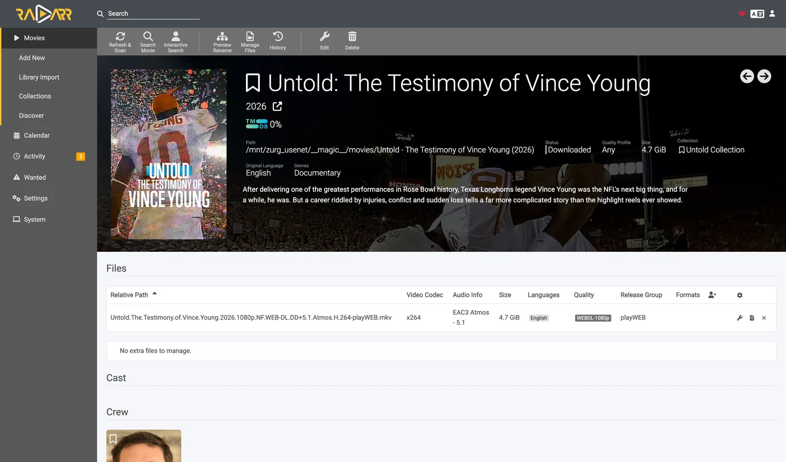

# Sonarr وRadarr، خطوة بخطوة {#sonarr-and-radarr-step-by-step}

هناك ثلاث طرق لاستخدام Sonarr وRadarr مع zurg. اختر من يبحث في zurg أو في \*arrs. انظر
[أيّها تختار](sonarr-radarr-fetch.md#which-one-to-pick).

| الدليل | من يبحث | يعمل zurg كـ | ما تحتاجه |
|---|---|---|---|
| [Usenet](sonarr-radarr.md) | Sonarr وRadarr | SABnzbd | حساب Usenet (أو TorBox Pro للواجهة الخلفية `torbox_nzb`) ومفهرسات Usenet في Prowlarr أو في \*arrs |
| [Torrents](sonarr-radarr-torrents.md) | Sonarr وRadarr | qBittorrent | حساب debrid ومفهرسات تورنت في Prowlarr أو في \*arrs |
| [zurg searches](sonarr-radarr-fetch.md) | zurg | لا يوجد أي عميل تنزيل إطلاقًا | حساب Usenet أو TorBox Pro أو debrid، ومفهرسات Newznab أو Torznab في إعدادات zurg نفسها |

يمكن تشغيل الطريقتين الأوليين جنبًا إلى جنب. فهما تشتركان في المجلد نفسه `__magic__`.

وجّه Sonarr وRadarr إلى zurg لتنزيل المحتوى من Usenet دون عميل. لا يُنزَّل فيديو كامل ولا يُفك ضغطه
أثناء عملية التنزيل. ومع ذلك، ما زالت ملفات NZB والذاكرة المؤقتة تستهلك مساحة القرص. تغطي هذه الصفحة Usenet. تستخدم نقطة نهاية التورنت العملاء نفسهم وتشارك المجلد. انظر
[Sonarr وRadarr للتورنت](sonarr-radarr-torrents.md).

كل ما يلي التقط أثناء العمل على zurg بالإصدار `nightly-993-g99bcf9a4`، وSonarr بالإصدار `4.0.19.2979`، وRadarr بالإصدار `6.3.0.10514`، على تثبيت حي مع حساب Usenet حقيقي. وقد غُيّرت أسماء المضيف والمستخدم إلى `you@zurg-server`. أسماء المفهرسات هي `my-indexer`. مفاتيح API وأعداد المكتبة توضيحية. لم يُعدَّل أي شيء آخر في المخرجات الملتقطة. قُرأت أسطر السجل الخاصة بـ `torbox_nzb` من الكود المصدري لـ zurg بتاريخ 2026-11-09، ولم تُلتقط مباشرةً أثناء العمل.

## قبل أن تبدأ {#before-you-start}

ثلاثة أمور يجب أن تتحقق. تحقّق منها كلها الآن، فكل واحد منها يفشل لاحقاً بشكل يبدو غير مرتبط بالمشكلة.

1. **لدى zurg مزوّد `nzb`، أو مزوّد `torbox_nzb` (TorBox Pro).** بدون أحدهما لن يوجد شيء يقرأ ما تكتبه نقطة النهاية، وستُبلَّغ كل مهمة بأنها Failed بعد 30 دقيقة، عندما يتوقف zurg عن انتظار ظهورها في المكتبة. راجع [Usenet](usenet.md)، أو [Usenet المستضاف على TorBox](../providers/torbox-nzb.md) لمزوّد `torbox_nzb`.
2. **`magic.enabled` مضبوط على `true`.** بدونه لن يوجد المجلد المكتمل، وسيفشل كل استيراد. راجع [`__magic__`](magic.md).
3. **يرى \*arr نقطة التركيب في المسار الذي يبلغ عنه zurg.** إذا كان Sonarr يعمل داخل حاوية، فاقرأ [الخطوة 8](#8-if-your-arr-is-in-docker) قبل أن تضبط أي شيء. إذا ثُبِّت كتطبيق عادي على الجهاز نفسه، فإنه يرى نقطة التركيب حيث يركّبها zurg، مع تحفظ واحد على كل نظام:
   - **Linux:** أي \*arr يعمل بمستخدم مختلف عن مستخدم zurg يرى مجلداً فارغاً حتى تُفعَّل `user_allow_other`. راجع [إعداد Linux](../setup/linux.md#1-install-fuse-3).
   - **macOS:** شغّله بالمستخدم نفسه الذي يعمل به zurg. نقطة التركيب هي `/Volumes/Zurg` ما لم تكن قد غيّرت `mount_path`.
   - **Windows:** شغّل Sonarr وRadarr كتطبيق في شريط المهام، وهو الخيار الذي يعرضه برنامج تثبيتهما، لا كخدمة Windows. محرك `Z:` الخاص بـ zurg يتبع الجلسة التي سجّلت الدخول إليها، والخدمة تعمل خارجها، لذلك لا ترى المحرك. راجع [قواعد الجلسة](../setup/windows.md#keeping-it-running-the-session-rules).

تحقّق من أول بندين مباشرةً من ملف الإعدادات، في مجلد العمل الخاص بـ zurg. على Windows، افتح `config.yml` في Notepad بدلاً من ذلك.

```bash
$ grep -A6 '^providers:' config.yml
providers:
- type: nzb
  nntp:
    host: news.example.com
    port: 563
    tls: true
    username: <redacted>
    password: <redacted>

$ grep -A4 '^magic:' config.yml
magic:
  enabled: true
  allow_delete: false
  sidecar_max_mb: 32
  sidecar_budget_mb: 2048
```

`allow_delete: false` هو الإعداد الآمن الافتراضي ولا يؤثر في الاستيراد، فالحذف داخل `__magic__` يخفي العنصر بدلاً من إزالة المحتوى من الحساب.

## 1. فعّل نقطة الوصول {#1-turn-the-endpoint-on}

بطريقتين، والنتيجة واحدة. كلتاهما تكتبان في `config.yml` وكلتاهما تحتاجان إلى إعادة تشغيل: المسارات التي تخدم `__magic__` ونقطة نهاية SABnzbd تُسجَّل مرة واحدة فقط، عند بدء تشغيل zurg.

### الخيار أ — لوحة التحكم {#option-a--the-dashboard}

افتح لوحة تحكم zurg، واضغط على **Config**، ثم انزل إلى **\_\_magic\_\_ & Download Clients**. فعّل **Serve \_\_magic\_\_** و**SABnzbd Endpoint**، ثم اضبط **SABnzbd Categories** على `tv, movies`.



**Config** هو المكان الذي يوجد فيه الإعداد، و**Magic** هو المكان الذي ستشاهد فيه عمليات السحب لاحقاً.


اترك حقل **SABnzbd Completed Directory** فارغاً إلا إذا كان \*arr الخاص بك يركّب zurg في مسار مختلف عن المسار الذي يستخدمه zurg نفسه، انظر [الخطوة 8](#8-if-your-arr-is-in-docker). الشارة البرتقالية **Restart Required** صادقة، فلا شيء هنا يسري قبل أن تعيد تشغيل zurg.

### الخيار ب — `config.yml` {#option-b--configyml}

أضف الكتلة يدويًا ثم أعد تشغيل zurg.

```yaml
magic:
  enabled: true

sabnzbd:
  enabled: true
  api_key: ""          # empty = zurg generates one and keeps it
  categories: [tv, movies]
  complete_dir: ""     # empty = <mount_path>/__magic__/__all__
```

**الفئات ليست مجلدات.** كلها تشير إلى المكان نفسه، فمجلد أي مهمة هو مجلد الإصدار الخاص به داخل `__magic__/__all__`. وجود القائمة الغرض منه فقط أن يتوقف Sonarr وRadarr عن التحذير من فئة لا يجدانها. إذا كانت فئة Sonarr هي `tv`، فيجب أن تكون `tv` موجودة في هذه القائمة.

أعد تشغيل zurg، ثم تأكد من أن المزود طُبّق:


يكفي صف واحد بالقيمة `nzb` أو `torbox_nzb` لنقطة النهاية.

## 2. اعثر على مفتاح API {#2-find-the-api-key}

مفتاح API هو المصادقة الكاملة على هذه النقطة الطرفية، لذا اضبطه بشكل صحيح مرة واحدة، ولا تنشره في أي مكان عام.

**إذا تركت `api_key` فارغًا**، أنشأ zurg مفتاحًا عند أول تشغيل وكتبه في `data/sabnzbd-apikey`:

```bash
$ cat data/sabnzbd-apikey
0123456789abcdef0123456789abcdef

```

هذا مفتاح توضيحي، ومفتاحك سيكون مختلفًا. يبقى الملف بعد إعادة التشغيل، لذا يظل المفتاح ثابتًا بعد إنشائه.

**إذا ضبطت `api_key` بنفسك**، فسيكون في `config.yml` ولن يُكتب أي ملف. تخبرك لوحة التحكم بأي الحالتين أنت فيها، في أسفل الكتلة في الخطوة 1، وتظهر إما *pinned in config.yml under `sabnzbd.api_key`* أو *generated and kept in `data/sabnzbd-apikey`*.

**هذه النقطة الطرفية خارج المصادقة الأساسية (basic auth) في zurg.** لا يرسل Sonarr ولا Radarr أبدًا basic auth إلى عميل التنزيل، وطبقة HTTP عندهما تحوّل رد 401 إلى «unable to connect» بلا أي معلومة تساعدك على الحل، لذلك يستثني zurg المسار `/api` عمدًا. مفتاح API هو البوابة الوحيدة. تعامل مع المنفذ كما تتعامل مع بقية zurg: على شبكة موثوقة، أو خلف شيء يحميه.

## 3. تأكد أنه يستجيب {#3-prove-it-answers}

افعل هذا قبل أن تلمس Sonarr. يستغرق الأمر عشر ثوانٍ فقط، وهو يفصل بين "zurg مخطئ" و"الـ \*arr مخطئ" طوال باقي الإعداد.

+++ Linux و macOS

```bash
$ SAB=0123456789abcdef0123456789abcdef
$ ZURG=192.168.88.245:9996

$ curl -s "http://$ZURG/api?mode=version&apikey=$SAB&output=json"
{"version":"4.5.1"}

$ curl -s "http://$ZURG/api?mode=get_config&apikey=$SAB&output=json" \
    | jq '.config.misc.complete_dir, [.config.categories[].name]'
"/mnt/zurg_usenet/__magic__/__all__"
[ "*", "tv", "movies" ]
```

+++ Windows

في PowerShell. اكتب `curl.exe` وليس `curl`: الأمر `curl` في Windows PowerShell هو أمر مختلف.

```powershell
PS> $SAB = "0123456789abcdef0123456789abcdef"
PS> $ZURG = "192.168.88.245:9996"

PS> curl.exe -s "http://$ZURG/api?mode=version&apikey=$SAB&output=json"
{"version":"4.5.1"}

PS> (Invoke-RestMethod "http://$ZURG/api?mode=get_config&apikey=$SAB&output=json").config.misc.complete_dir
Z:/__magic__/__all__
```

+++

`complete_dir` هو المسار الذي سيسلّمه zurg للعملاء. تحقّق الآن أنه مسار *يستطيعون* فتحه.

ثم تحقّق من أن المفتاح الخاطئ يُرفض فعلاً (على Windows، استخدم `curl.exe` مع نفس الروابط):

```bash
$ curl -s "http://$ZURG/api?mode=queue&apikey=wrongkey&output=json"
{"status":false,"error":"API Key Incorrect"}

$ curl -s "http://$ZURG/api?mode=queue&output=json"
{"status":false,"error":"API Key Required"}
```

**`mode=version` ليس اختباراً للمصادقة.** يرد بـ `{"version":"4.5.1"}` حتى مع مفتاح خاطئ، وهكذا يتصرف SABnzbd الحقيقي، وzurg ينسخ هذا السلوك. استخدم `mode=queue` أو `mode=get_config` عندما يكون ما تريد اختباره هو المفتاح فعلاً.

كلا شكلي الرابط يعملان، لذا يصلح أيٌّ منهما في حقل **URL Base** لدى العميل:

| المسار | URL Base في Sonarr / Radarr | يرد |
|---|---|---|
| `/api` | *(اتركه فارغاً)* | نعم |
| `/sabnzbd/api` | `/sabnzbd` | نعم |

إذا أعاد `/api` خطأ **404** عادياً، فهذا يعني أن `sabnzbd.enabled` ما زال false أو أنك لم تعد تشغيل zurg منذ أن غيّرته.

## 4. أنشئ مجلدات الجذر {#4-make-the-root-folders}

أنشئها قبل أن تضيفها، لأن نافذة Add Root Folder في تطبيقات \*arr تتصفح نظام الملفات الحالي، ولن تعرض مجلدًا غير موجود.

+++ Linux وmacOS

```bash
$ mkdir -p /mnt/zurg_usenet/__magic__/tv /mnt/zurg_usenet/__magic__/movies

$ ls -d /mnt/zurg_usenet/__magic__/tv /mnt/zurg_usenet/__magic__/movies
/mnt/zurg_usenet/__magic__/movies
/mnt/zurg_usenet/__magic__/tv
```

+++ Windows

```powershell
PS> New-Item -ItemType Directory -Force Z:\__magic__\tv, Z:\__magic__\movies
```

أو أنشئ المجلدين من Explorer.

+++

استبدل `/mnt/zurg_usenet` بقيمة `mount_path` الخاصة بك. إذا تركتها فارغة، فستكون `/mnt/zurg` على Linux و`/Volumes/Zurg` على macOS و`Z:` على Windows. أسماء المجلدات من اختيارك؛ فالاسمان `tv` و`movies` يطابقان الفئات فقط.

**يجب أن يكون مجلد الجذر بجوار مجلد الإكمال، لا فيه ولا فوقه.** يمرّر zurg للعملاء المسار `__magic__/__all__`، وهو مكتبتك كما يعرضها `__all__`. تقع مجلدات الجذر الخاصة بك بجواره، في `__magic__/tv` و`__magic__/movies`. **ليس** `__magic__/__all__`، و**ليس** `__magic__` نفسه، و**ليس** `/mnt/zurg_usenet`. يُصدر كلا التطبيقين تحذير health check عندما يكون مجلد الجذر *هو* مجلد إخراج عميل التنزيل، ويُصدر Radarr تحذيرًا أيضًا عندما يكون مجلد الجذر *يحتويه*. أما المجلدات الشقيقة فلا تثير أيًّا من التحذيرين، وعند توجيه الاستيراد اليدوي إلى مجلد الإكمال يصبح أمامك إصدار واحد للنظر فيه بدلًا من مكتبتك كاملة.

هذا ما يحدث عند الخطأ. كلا المثالين حقيقيان، من التطبيقين. أُخذا قبل نقل مجلد الإكمال إلى `__magic__/__all__`، لذا فالمسارات فيهما أعلى بمستوى واحد من مساراتك، لكن القاعدتين اللتين يعرضانهما هما نفسهما:


Sonarr مع إضافة مجلد الإكمال نفسه كمجلد جذر — يُصدر تحذيرًا لأن مجلد الجذر *هو* مجلد الإخراج.


Radarr مع إضافة `/mnt/zurg_usenet` — يُصدر تحذيرًا للمجلد الأب أيضًا، وهذا ما لا يفعله Sonarr. انقل مجلد الجذر بجوار مجلد الإكمال فيختفي التحذيران.

## 5. أضف العميل في Sonarr {#5-add-the-client-in-sonarr}

لقد صُممت Sonarr الجديدة تماماً لتحجب كل شيء خلف شاشة الإعداد الأولي. اختر **Forms (Login Page)**، وحدد اسم مستخدم وكلمة مرور، ثم انقر على **Save**.


لن يسمح لك بالمتابعة حتى يكون **Authentication Method** مضبوطاً على أي خيار غير None.



بعد الضغط على Save ستخرج من الحساب مرة واحدة وتنتقل إلى صفحة تسجيل الدخول.


### Settings → Download Clients

انتقل إلى **Settings → Download Clients**. في التثبيت الجديد لا يوجد هنا سوى البطاقة **+**.


اضغط على **+** تحت "Download Clients"، وليس الزر الموجود أسفل منه تحت "Remote Path Mappings".

اختر **SABnzbd** من عمود **Usenet**.


zurg يحاكي SABnzbd تحديدًا، لذا لن يعمل أي شيء آخر في هذه القائمة.

تفتح النافذة بالإعدادات الافتراضية لـ SABnzbd نفسه: `localhost` والمنفذ `8080` ومن دون مفتاح.


### ما الذي تضعه في كل حقل {#what-to-put-in-each-field}

| الحقل | القيمة | السبب |
|---|---|---|
| Name | `zurg (Usenet)` | أي اسم تريده. إنه مجرد تسمية. |
| Enable | مفعّل | اتركه مفعّلاً. |
| Host | `192.168.88.245` | الجهاز الذي يعمل عليه zurg، بحيث تستطيع *the \*arr* الوصول إليه. استخدم `localhost` إذا كان *the \*arr* تطبيقاً عادياً على الجهاز نفسه. في Docker، راجع التحذير أدناه. |
| Port | `9996` | المنفذ المعتاد لـ zurg — `9999` في التثبيت الافتراضي. |
| Use SSL | معطّل | فقط إذا وضعت zurg خلف TLS بنفسك. |
| API Key | من الخطوة 2 | هذه هي البوابة كلها. |
| Username | فارغ | لا يمكن استخدامه مع المفتاح في نفس الوقت. المفتاح وحده هو المقبول. |
| Password | فارغ | مثل Username. |
| Category | `tv` | يجب أن يكون موجوداً في `sabnzbd.categories`. |
| Recent / Older Priority | Default | zurg لا يملك شيئاً يطبّق عليه الأولوية. |
| Remove Completed | مفعّل | يسمح للعميل بتنظيف سجلات مهامه بنفسه. اتركه مفعّلاً. |
| Remove Failed | مفعّل | مثل Remove Completed. |



مفتاح API الظاهر في الصورة مجرد مثال — الصق مفتاحك أنت.

**في Docker، الاسم "localhost" واسم المضيف كلاهما يضلّلان.** داخل الحاوية، يشير `localhost` إلى الحاوية نفسها، ويُحلّ اسم الجهاز عادةً إلى `127.0.1.1` — وهو أيضاً الحاوية نفسها. استخدم **عنوان IP للشبكة المحلية أو Tailscale** للمضيف، ولا تستخدم أبداً `localhost` ولا اسم المضيف المجرد، حتى لو كانا يعملان بشكل جيد من الطرفية لديك.

انقر **Test**. العلامة الخضراء تعني أن الفحوصات الأربعة للعميل نجحت: الإصدار، ومفتاح API، والإعداد العام، والفئة.


الآن انقر **Save**.


## 6. أضف مجلد الجذر في Sonarr {#6-add-the-root-folder-in-sonarr}

اذهب إلى **Settings → Media Management** وانزل إلى أسفل الصفحة.


اضغط على **Add Root Folder**. سيفتح مستعرض ملفات على نظام ملفات Sonarr، وفي Docker يكون هذا نظام ملفات الحاوية.


اكتب المسار في الخانة في الأعلى. إذا كان التركيب مرئياً فعلاً لـ Sonarr، فسيظهر ما بداخل `__magic__` أثناء الكتابة: `__all__` مع كل الإصدارات الموجودة فيه، وأي شيء أضفته بجانبه. هذا أسرع دليل ستحصل عليه على أن الربط صحيح.


إذا كانت القائمة فارغة أو ظهر خطأ، توقف وأصلح التركيب قبل المتابعة.


أكمل المسار إلى `__magic__/tv` (`Z:\__magic__\tv` على Windows) ثم اضغط على **Ok**.


إذا ظهر في **Free Space** رقم معقول، فهذا يعني أن Sonarr يستطيع قراءة معلومات التركيب. أما **Unmapped Folders** فيحسب الإصدارات الموجودة هناك بالفعل.

## 7. افعل الشيء نفسه في Radarr {#7-do-the-same-in-radarr}

متطابق تمامًا، مع تغيير قيمتين: الفئة هي `movies` ومجلد الجذر هو `__magic__/movies`.


أول تشغيل لـ Radarr يعمل بالطريقة نفسها: فعّل Forms auth، ثم سجّل الدخول.


**Settings → Download Clients → +**، ثم **SABnzbd** ضمن Usenet.


المضيف نفسه، والمنفذ نفسه، والمفتاح نفسه. الشيء الوحيد المختلف هو **Category**: `movies`، وليس `tv`.


**Test**، ثم علامة خضراء، ثم **Save**.


ثم اذهب إلى **Settings → Media Management → Root Folders → Add Root Folder**، وأضف `/mnt/zurg_usenet/__magic__/movies`.

**zurg واحد، وعميلان، وطابور واحد.** تُفلتر قائمة الانتظار والسجل في zurg بحسب الفئة فقط ولا شيء غيرها. إذا استخدم سوناران اثنان الفئة `tv` كلاهما، فسيرى كل منهما مهام الآخر. أما Sonarr على `tv` وRadarr على `movies` فلن يحدث ذلك. احتفظ بعميل واحد لكل فئة، ولن تواجه هذه المشكلة أبدًا.

## 8. إذا كان \*arr لديك في Docker {#8-if-your-arr-is-in-docker}

هذه الخطوة مخصّصة لـ Docker على مضيف Linux. تعمل Docker Desktop على macOS وWindows داخل آلة افتراضية. يعتمد الربط `rslave` أدناه على انتشار التركيب في Linux (انظر [Docker setup](../setup/docker.md))، ولم يُختبر تمرير تركيب zurg إلى حاوية على هذه الأنظمة. على macOS وWindows، ثبّت Sonarr وRadarr كتطبيقات عادية بدلاً من ذلك، كما يصف [Before you start](#before-you-start).

ثلاث مشكلات منفصلة. الثانية تكلّفك تنزيلاً جديداً عند كل استيراد. الثالثة لا تظهر إلا عند أول إعادة تشغيل لـ zurg.

### المسار الذي يُبلغ عنه zurg يجب أن يكون مساراً يستطيع العميل فتحه {#the-path-zurg-reports-must-be-a-path-the-client-can-open}

إذا كانت الحاوية تربط المكتبة في مسار مختلف عن المسار الذي يستخدمه zurg، ستفشل كل عملية استيراد برسالة *download doesn't contain intermediate path* أو بفحص الصحة الخاص بالمسار البعيد (remote-path). أصلحها بأي من الطريقتين، فكلتاهما تعمل:

- **اضبط `sabnzbd.complete_dir`** على المسار الذي *يراه العميل*. هذه أسهل طريقة عندما يكون لديك عميل واحد، أو عدة عملاء يربطون المكتبة في المكان نفسه.
- **أضف remote path mapping** في تطبيقات \*arr. استخدم هذه الطريقة عندما يربط كل عميل المكتبة بطريقة مختلفة.

```yaml
sabnzbd:
  complete_dir: "/data/zurg/__magic__/__all__"   # what the *arr sees, not what zurg sees
```

بالنسبة للطريقة الثانية، اذهب إلى **Settings → Download Clients** واضغط على **+** تحت **Remote Path Mappings**، وهو الزر السفلي في الصفحة، وليس الزر الذي استخدمته في الخطوة 5.


يجب أن يكون **Host** مطابقاً تماماً لسلسلة المضيف التي كتبتها في عميل التحميل. **Remote Path** هو المسار الذي يبلغ عنه zurg، و**Local Path** هو المكان الذي يراه فيه العميل.

### وحدة تخزين واحدة لمجلد التنزيل ومجلدات الجذر {#one-volume-for-the-download-folder-and-the-root-folders}

الاستيراد من `__magic__/__all__` إلى `__magic__/tv` لا يكلّف شيئًا لأنه مجرد إعادة تسمية. وإعادة التسمية لا تعمل إلا داخل mount واحد. إذا أعطيت الحاوية المجلدين كوحدتي تخزين (volumes) منفصلتين، فستراهما كنظامي ملفات مختلفين. كلاهما فوق mount الخاص بـ zurg، ومع ذلك لا يغيّر هذا شيئًا.

```yaml
    volumes:                                        # do not do this
      - /mnt/zurg_usenet/__magic__/__all__:/downloads
      - /mnt/zurg_usenet/__magic__/tv:/tv
```

ترفض النواة إعادة التسمية داخل الحاوية. عندها يقوم Sonarr وRadarr بنسخ الملف ثم حذف الأصل دون أي إشعار. كل عملية استيراد تنزّل الإصدار كاملًا من حسابك وتكتبه على قرص zurg. الاستيراد ينجح، لكنه يكون بطيئًا. حلقة واحدة بحجم 1.46 GB أخذت 50 ثانية واستهلكت 2.9 GB من حركة البيانات بهذه الطريقة. أما مع وحدة تخزين واحدة فقد استغرقت ثانية واحدة ولم تقرأ شيئًا.

أعطِ الحاوية وحدة تخزين واحدة تحتوي على mount الخاص بـ zurg بالكامل، ثم صل إلى مجلد التنزيل والمجلدات الجذرية من خلالها. الربط (bind) في القسم التالي يفعل ذلك بالضبط. بعدها يوجّه remote path mapping أو `complete_dir` العميل إلى `__all__` داخل وحدة التخزين نفسها.

الاستيراد اليدوي المضبوط على **Hardlink/Copy Files** ينسخ الملفات أيضًا، لذلك اختر **Move Files**.

### اربط الأصل الأب للتركيب، لا نقطة التركيب نفسها {#bind-the-mounts-parent-not-the-mountpoint}

هذه هي المشكلة التي تكلّفك فترة بعد الظهر كاملة، وهي أيضاً المجلد الوحيد الذي يطلب القسم أعلاه ربطه. إعادة تشغيل zurg تفصل `/mnt/zurg_usenet` ثم تعيد تركيبه. الحاوية التي ربطت **نقطة التركيب نفسها** تحتفظ باتصال fuse الذي بدأت به، وهو الآن ميت. عندها تجيب كل قراءة بـ `Socket not connected`، ولأن العميلين يتحققان من المساحة الحرة على المجلد الجذر قبل الالتقاط، **يُرفض كل إصدار بصمت**:

```
FreeSpaceSpecification: Socket not connected
```

لا يذكر أي من العميلين أن التركيب أصبح قديماً، والمجلد ما زال يظهر داخل الحاوية، وعملية الالتقاط اليدوي التي تُرسل مباشرة إلى العميل ما زالت تعمل. ما ستراه هو \*arr توقف عن البحث بهدوء.

اربط **المجلد الأب** باستخدام `rslave`، وعندها تصل إعادة التركيب كحدث تركيب فرعي تتبعه الحاوية:

```yaml
    volumes:
      - type: bind
        source: /mnt          # the parent, not /mnt/zurg_usenet
        target: /mnt
        bind:
          propagation: rslave
```

تحقق من الحاوية بعد أي إعادة تشغيل لـ zurg. تريد أن ترى حجماً، لا خطأً:

```bash
$ docker exec radarr df -h /mnt/zurg_usenet
Filesystem      Size  Used Avail Use% Mounted on
zurg{PGSq4}:    1.0P     0  1.0P   0% /mnt/zurg_usenet
```

الرقم بالبيتابايت يعني أن zurg يعرض نظام ملفات افتراضياً، وليس قرصاً حقيقياً. هذا متوقع، وهو بالضبط ما يُرضي فحص المساحة الحرة لدى \*arr.

## 9. راقب عملية grab واحدة وهي تمر {#9-watch-one-grab-go-through}

أضِف عنصراً واحداً، واجلبه يدوياً، وتابعه حتى النهاية. كل ما يلي هو عملية جلب حقيقية عبر الإعداد الموضح أعلاه.

### Grab it

افتح فيلمًا (أو حلقة)، واضغط **Interactive Search**، واختر إصدارًا.


عمود **Source** يظهر `nzb`، وهذا هو البروتوكول الذي يستطيع zurg التعامل معه.

اضغط على زر السهم الدائري في نهاية الصف لالتقاط الإصدار. إذا لم يتطابق الإصدار بشكل صحيح، يطلب منك العميل تأكيد الربط أولاً:


يظهر **Override and Grab** عندما يريد العميل منك تأكيد ماهية الإصدار. تحقق من الربط واضغط **Grab Release**. الالتقاط التلقائي العادي لا يظهر هذا المربع أبدًا.

### إنه يصل إلى قائمة الانتظار {#it-lands-in-the-queue}


**Activity → Queue** مباشرةً بعد عملية الإرسال. لاحظ شريط التقدم: هو ممتلئ، و**Time Left** يظهر على شكل شرطة. لا يوجد تنزيل لقياسه، لذلك تكون المهمة إما في الصف أو مكتملة، ولا توجد حالة بينهما. *الصفوف الأخرى هنا تعود إلى Radarr ثانٍ موجَّه إلى نفس zurg وعلى نفس الفئة* — راجع الملاحظة في الخطوة 7.

### يكتب zurg ملف NZB ثم يقرؤه {#zurg-writes-the-nzb-and-reads-it}

```
Aug 25 14:44:03 zurg-server zurg[3034965]: INFO  nzb  Loaded NZB
  Last.Week.Tonight.with.John.Oliver.S13E22.480p.WEB.x264-RMTeam.nzb: 4 files
Aug 25 14:50:28 zurg-server zurg[3034965]: INFO  nzb  Loaded NZB
  Untold.The.Testimony.of.Vince.Young.2026.1080p.NF.WEB-DL.DD+5.1.Atmos.H.264-playWEB.nzb: 9 files
```

`Loaded NZB … : N files` هو السطر الذي يدل على أن ملف NZB تمت قراءته بنجاح. إذا ظهرت مهمة على أنها Failed بعد 30 دقيقة، أي عندما يتوقف zurg عن الانتظار حتى تظهر في المكتبة، فهذا السطر هو ما يكون مفقودًا.

### يحدث الاستيراد {#the-import-happens}


**Activity → History**. حدثان بفارق ثوانٍ: **Grabbed**، ثم **Movie Imported**.



**Status: Downloaded**، **Size 4.7 GiB** — ولم يُنزَّل أي شيء.

### تأكد أن الملف حقيقي {#prove-the-file-is-real}

الاستيراد نقل الملف إلى مجلد الجذر (root folder). اقرأ طرفيه الاثنين واسأل ffprobe عنه:

+++ Linux and macOS

إذا لم يجد الـ shell الأمر `ffprobe`، استخدم `~/zurg/bin/ffprobe`، فالإعداد يضع نسخته الخاصة هناك إذا لم يكن مثبتًا أي نسخة.

```bash
$ ls -la "/mnt/zurg_usenet/__magic__/movies/Untold - The Testimony of Vince Young (2026)/"
-rw-r--r-- 1 you you 4920958828 Aug 25 14:53 Untold.The.Testimony…playWEB.mkv

$ dd if="$F" bs=1M count=1 >/dev/null
1048576 bytes (1.0 MB, 1.0 MiB) copied, 0.0429446 s, 24.4 MB/s

$ ffprobe -v error -show_entries format=duration,size,format_name \
    -of default=noprint_wrappers=1 "$F"
format_name=matroska,webm
duration=4709.440000
size=4920958828
```

+++ Windows

من مجلد zurg في PowerShell. وضع الإعداد `bin\ffprobe.exe` هناك إلا إذا كان `ffprobe` موجودًا أصلًا في PATH لديك، وفي هذه الحالة اكتب `ffprobe` بدلًا من ذلك:

```powershell
PS> $F = Get-Item "Z:\__magic__\movies\Untold - The Testimony of Vince Young (2026)\*.mkv"
PS> $F.Length
4920958828

PS> bin\ffprobe.exe -v error -show_entries format=duration,size,format_name -of default=noprint_wrappers=1 $F.FullName
format_name=matroska,webm
duration=4709.440000
size=4920958828
```

+++

ملف Matroska مدته 78 دقيقة، يُبث من مقالات Usenet عند الطلب. البيانات تصل عندما يقرأها شيء ما، وليس عندما يستورد \*arr الملف.

## 10. إضافة إصدار يدوياً {#10-adding-a-release-by-hand}

أحياناً لا يلتقط Sonarr أو Radarr الإصدار الذي تريده أبداً. قد لا تحتوي المفهرسات (indexers) التي يبحث فيها على هذا الإصدار، أو قد يرفضه ملف الجودة (quality profile) أو تنسيق مخصص (custom format). يمكنك أن تعطي zurg ملف NZB بنفسك تحت فئة (category) التطبيق الذي يفترض أن يستورده. ذلك التطبيق يستورده بعد ذلك كأنه التقطه بنفسه.

إذا كان الإصدار موجوداً في مفهرس يبحث فيه التطبيق، فجرّب التطبيق أولاً. **Interactive Search** يعرض الإصدارات المرفوضة أيضاً. اختيار أحدها يرسله إلى zurg مثل أي التقاط عادي. Radarr التقط إصدار IMAX رفضه ملف الجودة لأنه حصل على 0 نقطة مقابل تنسيق مخصص مطلوب، ثم استورده.

+++ لينكس وmacOS

```bash
$ SAB=0123456789abcdef0123456789abcdef
$ ZURG=192.168.88.245:9996

# an NZB file you already have (the upload field is called name, as in SABnzbd)
$ curl -s "http://$ZURG/api?mode=addfile&apikey=$SAB&cat=movies" \
    -F 'name=@Movie.Title.2024.1080p.WEB-DL.nzb'
{"status":true,"nzo_ids":["SABnzbd_nzo_…"]}

# or a link to one, which zurg downloads itself
$ curl -s -G "http://$ZURG/api" \
    --data-urlencode mode=addurl --data-urlencode "apikey=$SAB" --data-urlencode cat=movies \
    --data-urlencode 'name=https://indexer.example/getnzb/<id>?r=<indexer-key>' \
    --data-urlencode nzbname=Movie.Title.2024.1080p.WEB-DL
{"status":true,"nzo_ids":["SABnzbd_nzo_…"]}
```

+++ ويندوز

في PowerShell، استخدم `curl.exe` بدلاً من `curl`. كل واحد منهما يرد بـ `{"status":true,"nzo_ids":[…]}` كما ورد أعلاه.

```powershell
$SAB = "0123456789abcdef0123456789abcdef"
$ZURG = "192.168.88.245:9996"

# an NZB file you already have (the upload field is called name, as in SABnzbd)
curl.exe -s "http://$ZURG/api?mode=addfile&apikey=$SAB&cat=movies" -F "name=@Movie.Title.2024.1080p.WEB-DL.nzb"

# or a link to one, which zurg downloads itself
curl.exe -s -G "http://$ZURG/api" `
  --data-urlencode mode=addurl --data-urlencode "apikey=$SAB" --data-urlencode cat=movies `
  --data-urlencode "name=https://indexer.example/getnzb/<id>?r=<indexer-key>" `
  --data-urlencode nzbname=Movie.Title.2024.1080p.WEB-DL
```

+++

`--data-urlencode` يُبقي علامتي `?` و`&` الخاصتين بالرابط داخل `name`. تظهر المهمة في Queue الخاص بالتطبيق عند فحصه التالي، أي خلال دقيقة.

خمسة أمور تحدد ما يحدث بعد ذلك.

1. **يجب أن يكون الفيلم أو المسلسل موجوداً في ذلك التطبيق مسبقاً.** لا يستورد إلا ما يستطيع مطابقته مع شيء يديره.
2. **يجب أن يصف الاسم محتواه.** تأخذ المهمة اسم ملف NZB، أو `nzbname` إذا مررته. وبدون `nzbname`، يستخدم `addurl` اسم الملف الذي يرسله المفهرس. أضف السنة إلى الاسم.
3. **الفئة تختار التطبيق.** `cat=movies` يصل إلى Radarr الذي يستخدم عميل التنزيل `movies`. كل تطبيق ينظر فقط إلى فئته.
4. **ملف الجودة لا يمنع الاستيراد. الملف الذي تملكه بالفعل قد يمنعه.** Radarr لا يتحقق لا من الجودات المسموح بها ولا من الحد الأدنى لنقاط التنسيق المخصص عند الاستيراد. استورد ملف 720p BluRay بنقاط 0 إلى ملف جودة لا يسمح إلا بـ 2160p ويشترط نقاط 100. واستورد أيضاً ملف 1080p WEBRip إلى فيلم لا يسمح ملفه الشخصي إلا بـ 720p. ثم أخذ ملف 1080p BluRay فوقه كترقية وحذف WEBRip. وإصدار WEB-DL أُضيف بعد ذلك توقف في Activity برسالة *Not an upgrade for existing movie file*. **Activity → Queue → Manual Import** يستورده رغم ذلك ويستبدل الملف.
5. **الفشل عليك أنت أن تنظفه.** التطبيق لا يضع في القائمة السوداء (blocklist) ولا يزيل تنزيلاً لم يلتقطه بنفسه. إصدار انتهت مقالاته من خوادم الأخبار ظهر كـ Failed من zurg وبقي في قائمة Radarr مع الرسالة *Download has failed wasn't grabbed by Radarr, skipping automatic download handling*. أزله من القائمة واختر إصداراً آخر.

جرى القياس في 2026-10-10 باستخدام Radarr 6.3، مع `addfile` و`addurl` معاً، بما في ذلك ملف جودة يشترط تنسيقاً مخصصاً مبنياً على اسم الإصدار. كل استيراد كان إعادة تسمية إلى `__magic__/movies` ولم يُنسخ أي شيء. لم يُختبر Sonarr.

شكراً لـ **.telmen** على Discord لسؤاله عن كيفية فعل ذلك مع Usenet.

## المشاهدة من جهة zurg {#watching-from-zurgs-side}

صفحة `/magic/` في zurg تعرض كل ملف NZB أرسله إليها أي طلب حتى الآن. يحذف Sonarr وRadarr الوظائف التي أخذوها، ويُحفظ السجل لمدة أسبوع بعدها، حتى تعطي عملية الاستطلاع التي تتزامن مع الحذف الجواب نفسه في كل مرة. يمكنك مسح وظيفة حالتها **Failed** أو **Stuck** (في الانتظار لأكثر من ساعة) ولن يحذفها أي عميل أبدًا، مثلًا بعد أن تتوقف عن استخدام zurg كعميل تنزيل لديه، وذلك بالضغط مطولًا على زر **Clear** الخاص بها. مسح الوظيفة يحذف ملف NZB الخاص بها، إلا إذا كان الاستيراد ما زال يستخدمه.


**Placements** هي الملفات التي نقلتها العملاء، و**tombstones** هي مجلدات الوظائف التي حذفوها بعد ذلك. إذا كان العميل ينسخ بدل أن ينقل، تظهر في الصفحة جدول أحمر بعنوان **Imports that were copies**. يحوّل zurg هذه النسخ إلى placements ثم يحذفها، لكن كل واحدة منها كانت تنزيلًا كاملًا، لذا أصلح إعداد الـ volumes.


**State** هو الخلاصة كلها. **Queued** يعني أن zurg لم ينتهِ من الإصدار بعد، إما لأن المكتبة لم تدرجه، أو لأن أحجام ملفاته لم تستقر، أو لأن مقالاته لم تُفحص بعد. **Completed** يعني أنه جاهز للاستيراد. و**Release** يسمي المجلد الذي يستورد منه العميل.

عمود **Release** لا يُخزَّن، بل يُقرأ من المكتبة في كل استطلاع. أعد تسمية الإصدار في لوحة zurg، أو اترك عملية repair تعيد بناءه، أو اترك zurg يضيف لاحقة لأن إصدارين يتشاركان الاسم، وستتبعه الوظيفة أينما ذهب.

## ما الذي يعمل وما الذي لا يعمل {#what-works-and-what-does-not}

ما يعمل:

- اختبار الاتصال، جميع الفحوصات الأربعة، في العميلين كليهما.
- الجلب، وقائمة الانتظار، والسجل، والاستيراد بإعادة التسمية، وتنظيف ما بعد الاستيراد.
- إعادة جلب الإصدار نفسه. تحصل كل عملية جلب لاحقة على معرّف مهمة خاص بها، فيتصرف العميل بناءً عليها بدلاً من إعادة استخدام نتيجة المهمة القديمة. يبقى الإصدار الأساسي كما هو. إعادة جلب إصدار كان استيراد سابق قد أفرغه تُبلَّغ بأنها **Failed**. مجلده تحت `__magic__/__all__` لم يبق فيه ما يُستورد، وتجعل حالة Failed العميل يضع الإصدار في القائمة السوداء ويجلب بديلاً. أما عملية الجلب التي أفرغته فتستمر في الإبلاغ عن Completed حتى يحذفها العميل.
- إزالة مهمة من قائمة الانتظار، مع حذف ملف NZB أو دونه.
- `mode=addurl`، لمن يمرّر رابطاً بدلاً من رفع الملف، سواء كان إنساناً أو أتمتةً. ولا يستخدمه أيٌّ من \*arr.

ما لا يفعله:

- **لا يوجد تقدّم.** المهمة إما في قائمة الانتظار أو مكتملة؛ لا توجد نسبة مئوية بينهما، لأنه لا يوجد تنزيل لقياسه. تعرض قائمة الانتظار الحجم المعلن في ملف NZB حتى لا يبقى السطر فارغاً.
- **لا توجد إيقاف مؤقت، ولا استئناف، ولا حدّ للسرعة، ولا أولوية، ولا سكربت ما بعد المعالجة.** يملك SABnzbd هذه كلها، أما zurg فليس لديه ما يطبّقها عليه.
- **يُتجاهل `del_files` عند حذف مهمة منتهية من السجل.** (بالنسبة إلى مهمة Failed يحذف ملف NZB إذا لم يُستورد منه شيء.) يقصد العميل بذلك "مجلد المهمة صار ملكك من جديد"، لكن الملف الذي استورده للتو ما زال يُقدَّم من ملف NZB ذاك. المجلد الذي أراد إزالته قد زال، فقد حذفه بنفسه عبر التركيب.
- **لا تستطيع Basic auth حماية نقطة الوصول هذه.** مفتاح API هو البوابة الوحيدة.

**إشارة الفشل.** يُبلَّغ عن إصدار لا يحتوي على أي شيء قابل للاستيراد بأنه **Failed**، ويضعه العميلان في القائمة السوداء ويجلبان بديلاً. ويشمل ذلك إصداراً تكون ملفاته كلها تالفة أو محذوفة أو مُصفّاة، وإصداراً لا يحتوي إلا على ملفات `.par2` و`.sfv` وملفات مساعدة، وإصداراً تكون كل ملفاته بصيغ لا يُشغَّل أيٌّ منها، وهذا ما تبدو عليه مشاركة مموّهة سمّت مجموعة RAR الخاصة بها `.z001`…`.z133`، وأرشيفاً فُتح ووُجد أنه لا يحتوي على وسائط. مجموعة RAR تُعدّ محتوى لا هيكلاً مساعداً، إذ يبثّ zurg الفيديو منها مباشرةً. وإذا كان إصدار يحتوي فعلاً على شيء لا يعرف zurg امتداده، فوسّع `addl_playable_extensions` بدلاً من إدراجه في القائمة السوداء.

**تُفحص المقالات قبل الإبلاغ عن اكتمال المهمة.** ينتظر zurg حتى تُدرج المكتبة الإصدار وتستقر أحجام ملفاته. ثم يسأل خوادم الأخبار عن بداية كل ملف محتوى ونهايته، أي أول ست عشرة مقالة وآخر مقالة. ويُنزّل أيضاً أول مقالة من كل ملف. وهذا يصل إلى أربع وستين مقالة كحد أقصى، زائداً بضع مقالات إضافية في إصدار لا يحتوي إلا على عدد قليل من الملفات. بعض خوادم الأخبار ما زالت تقول إن المقالة موجودة بعد أن أُزيل محتواها، ولا يكشف ذلك إلا التنزيل. كما أن المقالة المُنزَّلة تُظهر أيضاً أنها تنتمي إلى هذه المشاركة لا إلى رفعة أخرى. تبقى المهمة **Queued** حتى يُجاب على ذلك. أما الأضرار التي لا تطالها العينة فلا تُكتشف هنا، بل تظهر عند القراءة التي تصل إليها. الإصدار الذي غابت مقالاته يخضع أولاً لإصلاح PAR2، ويُفحص مجدداً بعد انتهاء الإصلاح. أما الإصدار الذي اكتمل من جديد فيمضي قدماً. والإصدار الذي ما زالت تنقصه مقالات، أو الذي لا يستطيع أي شيء إصلاحه، يُبلَّغ عنه بأنه **Failed** مع عدد المقالات الناقصة. وهذا فشل *تنزيل*، وهو الفشل الذي يتصرف العميلان بناءً عليه: يضعانه في القائمة السوداء ويجلبان بديلاً تلقائياً، بدلاً من استيراد شيء لن يُشغَّل. مع `torbox_nzb` لا توجد خوادم أخبار ولا فحص للمقالات: يُفحص الجلب من خلال ما إذا كانت TorBox قد جلبته.

**الفحص الذي لا يكتمل لا ينتظر إلى الأبد.** أحياناً لا يستطيع الفحص أن يكتمل أصلاً. قد يكون مجمع الاتصالات متوقفاً، أو الحساب مُقيَّداً بالسرعة، أو انتهى وقت الانتظار. هذه ليست إجابة. تبقى المهمة **Queued** ويُسأل عنها مرة أخرى بعد دقيقة. يحسب zurg المحاولات على المهمة حتى لا تُنسى عند إعادة التشغيل. بعد ثلاثين محاولة فاشلة متتالية تمتد على ثلاث ساعات على الأقل تنتقل المهمة إلى السجل بحالة **Failed**. تتضمن الرسالة عدد المحاولات والمدة وآخر خطأ. أما انقطاع يتمثل في رفض صريح متكرر فيصل إلى ثلاثين محاولة خلال ساعة واحدة، ولا يُفشل قائمة الانتظار بسببه.

**الإصدار الذي يغادر المكتبة يُفشل مهمته.** قد يُحذف إصدار من لوحة التحكم، أو يُزال ملف NZB الخاص به من مجلد المراقبة، أو يُسقطه كل حساب. تبقى مهمته **Queued** لمدة خمس عشرة دقيقة ثم تنتقل إلى السجل بحالة **Failed**. يضعه العميل في القائمة السوداء ويجلب إصداراً آخر. وجود هذه المهلة من أجل عمليات إعادة التشغيل، لأن المكتبة تُدرج كل الإصدارات على أنها غير مُدرجة أثناء تحميلها، ولا يجوز أن يُفهم ذلك على أنه حذف. لا يفشل شيء على هذا الأساس خلال الخمس عشرة دقيقة الأولى بعد بدء تشغيل zurg. أما المهمة التي لم تُدرج المكتبة إصدارها قط فلا تتأثر، لأنها ما زالت في طور الوصول.

## استكشاف الأخطاء وإصلاحها {#troubleshooting}

| ما يقوله \*arr | ما معناه |
|---|---|
| "Unable to connect to SABnzbd" | zurg غير قابل للوصول على هذا المضيف والمنفذ، أو أن شيئاً ما أمامه أعاد ردّاً غير 200. تحقّق من `sabnzbd.enabled`، فما دام مُعطّلاً يكون `/api` مجرد 404. في Docker، تأكّد أنك لم تستخدم `localhost` ولا اسم المضيف المجرد. |
| "API Key Incorrect" / "API Key Required" | المفتاح غير مطابق. يوجد في `config.yml` إذا ضبطته بنفسك، وفي `data/sabnzbd-apikey` إذا أنشأه zurg تلقائياً. |
| "Test was aborted due to an error" | السبب ليس فشل مصادقة. سجّل zurg كل طلب رفضه، فابحث في السجل عن `SABnzbd:`. |
| "Category … does not exist" | الفئة الموجودة في \*arr غير موجودة في `sabnzbd.categories`. أضفها ثم أعد تشغيل zurg. |
| "Downloads in root folder" | مجلد جذر يقع عند مجلد التنزيلات المكتملة أو فوقه. انقله إلى جانبه، أي `__magic__/tv`، وليس `__magic__/__all__` ولا `__magic__` ولا `/mnt/zurg_usenet`. |
| "Remote path mapping" / "download doesn't contain intermediate path" | المسار الذي يبلغ عنه zurg ليس مساراً يستطيع العميل فتحه. راجع [الخطوة 8](#8-if-your-arr-is-in-docker). |
| الاستيراد ينجح لكنه يستغرق وقت التنزيل نفسه، وتُدرجه صفحة `/magic/` في zurg تحت **Imports that were copies** | العميل ينسخ من `__magic__/__all__` بدلاً من إعادة التسمية. السبب أن حاوية العميل تضع مجلد التنزيل ومجلدات الجذر على وحدتي تخزين مختلفتين. أو أن الاستيراد اليدوي ضُبط على النسخ. راجع [وحدة تخزين واحدة لمجلد التنزيل ومجلدات الجذر](#one-volume-for-the-download-folder-and-the-root-folders). |
| متصفّح مجلد الجذر يُظهر جهاز zurg المركّب فارغاً، أو لا يُظهر محرك `Z:` أصلاً | لا يستطيع \*arr رؤية جهاز التركيب. على Linux يعمل بمستخدم آخر من دون `user_allow_other`. وعلى Windows يعمل كخدمة. راجع [قبل أن تبدأ](#before-you-start). |
| كل الإصدارات مرفوضة، ولا شيء في السجل | ربط تركيب قديم. شغّل `docker exec <client> df -h <mount>`. إذا ظهر `Socket not connected`، فاربط المجلد الأب بخيار `rslave` ثم أعد إنشاء الحاوية. |
| تبقى المهمة في الطابور لدورة استطلاع أو اثنتين بعد ظهور الإصدار | هذا متوقع، وتستقر المهمة مرة واحدة لكل إصدار. ملف NZB لا يذكر طول الملف، والتقدير يُستبدل بالطول الدقيق من فهرس PAR2 أو من ترويسة مقالة واحدة. والإبلاغ بالاكتمال مبكراً هو ما يجعل العميل يعرض *File move incomplete, data loss may have occurred*. مهمة `torbox_nzb` لا تقرأ أي مقالات ولا تسأل خوادم الأخبار، وتبقى في الطابور حتى ينتهي TorBox من جلب الإصدار، لمدة 30 دقيقة كحد أقصى (راجع الصف التالي). |
| "zurg accepted the NZB but it never appeared in the library" | لم يظهر الإصدار في المكتبة بعد مرور 30 دقيقة من عملية الجلب أو من بدء zurg، أيّهما أحدث. لذلك توقّف zurg عن الانتظار وأبلغ أن المهمة **Failed**. تحقّق أولاً من أن مزوّد `nzb` أو `torbox_nzb` مضبوط أصلاً، ثم ابحث عن ملف NZB في السجل. حساب `nzb` يكتب `Loaded NZB <name>: N files` بعد أن يحلّله. يظهر إصدار `torbox_nzb` فقط بعد أن ينتهي TorBox منه، لذلك تفشل مهمته بهذه الطريقة كلما استغرق TorBox أكثر من 30 دقيقة: جلب بطيء، أو انتظار خانة حرة، أو تراكم خلف مشاركة واحدة في الدقيقة لدى zurg. حساب `torbox_nzb` يكتب `TorBox Usenet: posting <name>` ثم رد TorBox. تعني `TorBox answered <name> with download <id>` أن TorBox يجلبه الآن أو يملكه سلفاً. وتعني `TorBox queued <name> as <id> for want of a free slot` أن الحساب لا يملك خانة حرة، وتنتظر المشاركة حتى تتحرر واحدة. |
| تفشل المهمة فوراً برسالة "The Usenet account could not fetch the NZB" | تخلّى الحساب الذي أُرسل إليه ملف NZB عنه، لذلك لا ينتظر zurg 30 دقيقة. مع `torbox_nzb`، تنتهي السطر `TorBox refused <name>, …` في السجل بسبب TorBox، ولا يُرسل ملف NZB هذا مرة أخرى حتى يُعاد تشغيل zurg أو يتغيّر الملف. |
| "The release holds no files that can be imported" | المكتبة تحتوي الإصدار، لكن لا يوجد فيه شيء يستطيع العميل استيراده. هذا بالضبط حال ملف NZB يحتوي على ملفات استعادة فقط، وكذلك منشور مموّه تكون مجموعة RAR فيه مسماة `.z001`…`.z133`. وسّع `addl_playable_extensions` إذا كان الإصدار يحمل فعلاً محتوى لا تعرف zurg امتداده. |
| تبقى الإصدارات المكتملة في الطابور أثناء تدفّق كبير | هناك أكثر من ستين مهمة جاهزة في وقت واحد. يطلب Sonarr وRadarr أحدث ستين عنصراً من السجل فقط، لذلك يحتفظ zurg بالزائد في الطابور، وينقل عنصراً واحداً إلى السجل كلما أفرغ استيراد خانة. هذا متوقع، ويتفرّغ الطابور وحده. |
| "The release could not be checked against the news servers" | فشل فحص المقالات في الاكتمال ثلاثين مرة متتالية على مدى ثلاث ساعات على الأقل. لم يُعثر على أي شيء مفقود، لكن تعذّر السؤال عن حساب الأخبار. تحمل الرسالة آخر خطأ. افحص الحساب أولاً، وأعد جلب الإصدار بعد أن يستجيب. لا يملك حساب `torbox_nzb` خوادم أخبار ولا فحص مقالات، لذلك يُفحص جلبه بالتحقق من أن TorBox جلبه. |
| "The release was in the library and has since been removed from it" | سردت المكتبة الإصدار مرة واحدة، ولم تسرده منذ خمس عشرة دقيقة. شيء ما حذفه، ويقول السجل `Release <name> is gone from every account`. يضعه العميل في القائمة السوداء ويجلب إصداراً آخر، بدلاً من انتظار مجلد لن يعود. |

ما زلت عالقاً؟ اسأل في منتدى **zurg-support** على [Discord](https://discord.com/invite/7u4YjMThXP). يشرح [الحصول على المساعدة](../../guides/remote-help.md) ما يجب تضمينه.

### أين تُحفظ الحالة {#where-the-state-lives}

| المسار | ما هو |
|---|---|
| `nzbs/<name>.nzb` | ملف NZB نفسه، يُسمّى مرة واحدة ولا يُعاد تسميته أبدًا. الواجهة الخلفية لـ Usenet تستمد هوية الإصدار من اسم الملف، لذا تغيير الاسم سيُفقد الإصدار وكل عمليات الوضع المبنية عليه. |
| `data/sabnzbd-jobs.json` | أي ملفات NZB تم جلبها، وتحت أي فئة، ومتى. |
| `data/sabnzbd-apikey` | مفتاح API يتم إنشاؤه تلقائيًا. لا يُكتب هذا الملف عند ضبط `sabnzbd.api_key`. |
| `data/magic.json` | جدول `__magic__`، وفيه كل عمليات الوضع وشواهد الحذف التي أنشأتها عمليات الاستيراد. |
