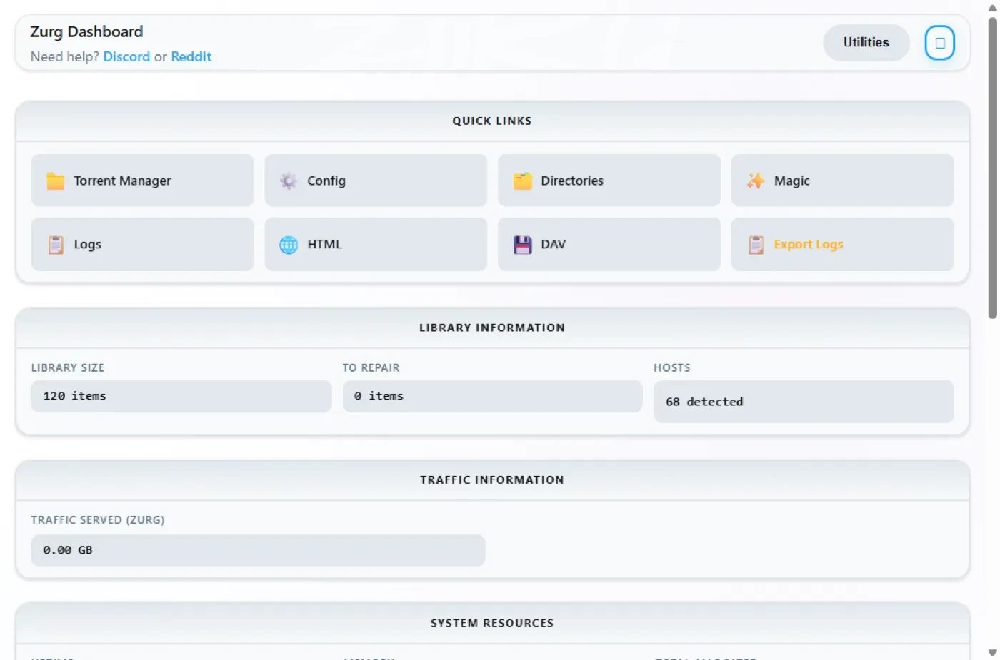
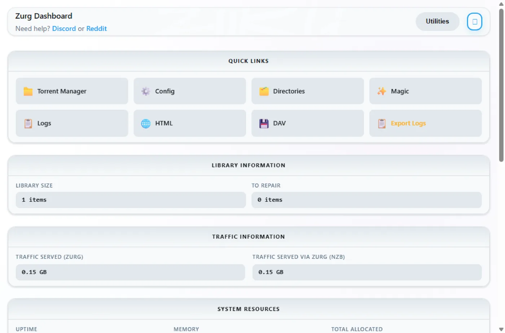

# Windows, الملف التنفيذي، من الصفر {#windows-the-binary-from-scratch}

## خيار سطر واحد {#one-line-option}

شغّل برنامج التثبيت الاختياري للراعي من PowerShell. يثبّت WinFsp عبر UAC، وينزّل zurg، ويشغّل أداة اختيار المزوّد والتشخيص:

```powershell
irm https://raw.githubusercontent.com/debridmediamanager/zurg-site/main/public/install.ps1 | iex
```

يعتمد على تسجيل الدخول إلى GitHub من المتصفح، ويثبّت كل شيء في `$HOME\zurg`. الملفات التنفيذية والإعدادات الموجودة تبقى في مكانها. تابع أدناه للطريقة اليدوية.

لا حاجة إلى Docker ولا WSL: ملف zurg التنفيذي `.exe` داخل مجلد، وملف `config.yml` تكتبه مرة واحدة، ومحرك أقراص `Z:` يظهر في Explorer.
تشرح هذه الصفحة العملية كلها على مرحلتين. أولاً **RealDebrid مع نقطة نهاية qBittorrent**، ثم إعادة ضبط كاملة و**Usenet مع نقطة نهاية SABnzbd**. اخترنا هذين السيناريوين لأنهما أكثر ما يقوم به الناس فعلياً، وكل واحد يختبر جانباً مختلفاً من zurg.

كل ما يلي سُجّل على تثبيت فعلي: Windows 11 Pro 23H2 (الإصدار 22631)، وPowerShell 5.1، وWinFsp 2.0.23075، وzurg `2026.08.30.0459-nightly-73-g5b4c9790`، إضافة إلى حساب Real-Debrid وحساب أخبار Usenet. تم تغيير أسماء المستخدمين. مفاتيح API وأعداد المكتبة توضيحية، وكذلك أي بيانات اعتماد.

## ما تحتاجه {#what-you-need}

- **zurg.exe**: من [إصدارات الرعاة](https://github.com/debridmediamanager/zurg/releases). كن راعيًا على [gatekeeper](https://gatekeeper.debridmediamanager.com/) لمنح حساب GitHub الخاص بك حق الوصول. تفترض هذه الصفحة أنك قد نزّلته بالفعل.
- **WinFsp**: يركّب zurg المكتبة عبر rclone، وrclone يحتاج WinFsp للحصول على حرف محرك أقراص على Windows. ثبّته بصمت، أو من [المثبّت](https://github.com/winfsp/winfsp/releases):

  ```powershell
  $url = "https://github.com/winfsp/winfsp/releases/download/v2.1/winfsp-2.1.25156.msi"
  Invoke-WebRequest -Uri $url -OutFile "$env:TEMP\winfsp.msi" -UseBasicParsing
  Start-Process msiexec.exe -ArgumentList "/i", "$env:TEMP\winfsp.msi", "/qn", "/norestart" -Wait
  ```

- **حساب**: رمز API من Real-Debrid للمرحلة الأولى، وخادم أخبار للمرحلة الثانية.

لا شيء غير ذلك. يقوم المثبّت المدمج بتنزيل rclone، وffprobe أيضًا ما لم يكن موجودًا بالفعل في PATH لديك.

## موصى به: دع zurg يُكمل الإعداد {#recommended-let-zurg-finish-the-setup}

أنشئ مجلداً، وضع فيه `zurg.exe`، ثم شغّل المثبّت من PowerShell:

```powershell
New-Item -ItemType Directory -Force "$HOME\zurg" | Out-Null
Set-Location "$HOME\zurg"
# Copy the downloaded zurg.exe here, then:
.\zurg.exe setup
.\zurg.exe doctor
```

يسألك `setup` عن المزوّدين الذين تريد إعدادهم. اختر واحداً أو أكثر من Real-Debrid وTorBox وAllDebrid وUsenet وPremiumize وDebrid-Link وOffcloud، بحسب ترتيب الأولوية. يطلب بيانات الاعتماد المختارة فقط. ثم يقوم بما يلي:

1. ينشئ `config.yml` ويتحقق من صحته.
2. يقيّد صلاحيات ACL الخاصة به على مستخدمك وSYSTEM وAdministrators.
3. ينزّل `bin\rclone.exe`، وكذلك `bin\ffprobe.exe` ما لم يكن ffprobe موجوداً بالفعل في PATH لديك (وفي هذه الحالة يكتب `config.yml` القيمة `ffprobe_binary: ffprobe`).
4. يفعّل تركيب rclone على `Z:`.
5. يسجّل `\Zurg\zurg` كمهمة تسجيل دخول تفاعلية، ويشغّلها عندما يسجّل مستخدم سطح المكتب الدخول.

اختر محرك أقراص آخر غير مستخدم عند الحاجة:

```powershell
.\zurg.exe setup --mount-path "Y:"
```

يمكن تشغيل الإعداد مرة أخرى بأمان. يحدّث المهمة المولَّدة، لكنه لا يستبدل `config.yml` الموجود.

المهمة التفاعلية مقصودة. تنتمي تركيبات محركات WinFsp إلى جلسة تسجيل دخول Windows التي أنشأتها. تعمل خدمة Windows العادية في الجلسة 0، لذلك يكون محركها غير مرئي لـ Plex وExplorer على سطح المكتب. تم التحقق من سلوك هذا المثبّت على Windows 11 بتاريخ 4 سبتمبر 2026.

يوضح الشرح أدناه الملفات والإعدادات التي يقوم عليها المثبّت، ثم يبني إعدادات عملاء التنزيل لـ Real-Debrid وUsenet. وتفيدك وصفة التشغيل الأول اليدوي ووصفة المهمة المجدولة إذا أردت تجميع هذه الأجزاء بنفسك.

## 1. التشغيل الأول يدوياً: zurg يبني مجلده الخاص {#1-manual-first-run-zurg-builds-its-own-home}

```powershell
PS C:\Users\you> mkdir C:\Users\you\zurg
PS C:\Users\you\zurg> .\zurg.exe
```

zurg ينشئ ملف إعدادات افتراضياً محايداً لأي مزوّد، ويخبرك بالخطوة التالية، ثم يُنهي عمله:

```
INFO  setup  Config file not found, creating default from config.simple.yml
INFO  zurg   Default config created at config.yml
INFO  zurg   Run zurg setup to choose provider(s), or add a providers block to config.yml, then rerun zurg.
```

شغّل `.\zurg.exe setup` لاختيار المزوّدين وتنزيل الأدوات المساعدة. بعد الإعداد سيبدو المجلد هكذا:

```
C:\Users\you\zurg\
├── bin\                rclone.exe, and ffprobe.exe unless ffprobe was on your PATH
├── data\               library cache, keys, the __magic__ table
├── dump\
├── logs\               zurg.log, rclone.log
├── nzbs\               the Usenet watch directory (second pass)
├── strm\
├── config.yml
└── zurg.exe
```

يبدأ ملف `config.yml` الذي يُنشأ بقائمة مزوّدين فارغة ومرشّحَي مجلدات. يملأ الإعداد القائمة حسب اختياراتك. الأمثلة اليدوية أدناه تستبدله بالإعداد الخاص بكل شرح.

## 2. مرحلة RealDebrid {#2-the-realdebrid-pass}

### الإعدادات {#the-config}

اكتب فوق `config.yml` بهذا المحتوى: رمز Real-Debrid، ونقطة نهاية qBittorrent مفعّلة، والتركيب على `Z:`:

```yaml
zurg: v1
providers:
  - type: realdebrid
    token: YOUR_RD_API_TOKEN

directories:
  shows:
    group: media
    group_order: 10
    filters:
      - has_episodes: true
  movies:
    group: media
    group_order: 20
    only_show_the_biggest_file: true

ffprobe_binary: bin\ffprobe.exe   # or ffprobe, if that is what setup wrote
rclone_binary: bin\rclone.exe

rclone_enabled: true
mount_path: "Z:"
rclone_extra_args:
  - "--links"

magic:
  enabled: true

qbittorrent:
  enabled: true
  api_key: ""          # empty = zurg generates one and keeps it
  categories: [tv-sonarr, radarr]
```

ثلاث نقاط خاصة بويندوز هنا:

- **`--links` اختياري، لكن يستحق الإبقاء عليه على أي حال.** يقدّم zurg المكتبة كـ rclone union يجمع نصفًا محليًا ونصفًا بعيدًا، ويسأل WinFsp جذر التركيب فور ظهور القرص ما إذا كان symlink. بدون هذا الخيار يجيب rclone على هذا الاستعلام بالسجل `ERROR : symlinks not supported without the --links flag: /` ثم يُركّب مع ذلك. القياس تم بتاريخ 2026-08-31 على zurg `2026.08.31.0443-nightly` مع rclone 1.74.2 و1.75.0، وتصرّف القرص ونصفا الـ union وكتابة `__magic__` بالطريقة نفسها مع الخيار وبدونه. مع الخيار يسجّل الاستعلام نفسه بدلًا من ذلك `NOTICE: union root '': Symlinks support enabled`، وسيتعامل rclone مع الروابط الرمزية الحقيقية إن وضعتَ أيًا منها تحت `data\local`. أبقِه لتبقى السجلات نظيفة.
- **`mount_path: "Z:"`** هنا حرف محرك أقراص وليس مسار POSIX. أي حرف حر يصلح.
- **أبقِ `magic.enabled: true`** إن أردت يومًا أن يستورد Sonarr أو Radarr من هذا الجهاز، فالاستيراد عملية إعادة تسمية داخل `__magic__`، وبدونها يصبح كل استيراد تنزيلًا كاملًا. وينطبق الأمر نفسه على قسم Usenet أدناه.

### شغّله واقرأ السجل {#start-it-and-read-the-log}

ابدأ تشغيل zurg بالطريقة البسيطة في الوقت الحالي، من نافذة PowerShell داخل المجلد:

```powershell
PS C:\Users\you\zurg> .\zurg.exe --config config.yml
```

أول ما يفعله هو اختبار الشبكة الخاص بـ Real-Debrid. يفك قيود روابط الاختبار على كل منطقة تنزيل ويقيس زمن الاستجابة، وهذا يستغرق نحو عشرين ثانية. بعدها تظهر السطور المهمة:

```
INFO  network_test  Network test completed!
INFO  zurg          Provider realdebrid ready (type=realdebrid)
INFO  router        __magic__ serves sidecar files from data\local\__magic__
INFO  router.qbittorrent  qBittorrent API on /api/v2 and /qbittorrent/api/v2, save path Z:/__magic__/__all__, categories tv-sonarr, radarr
INFO  router.qbittorrent  qBittorrent: generated an API key in data/qbittorrent-apikey — paste it into Sonarr or Radarr's API Key field, or pin one as qbittorrent.api_key in config.yml
INFO  zurg          Starting server on http://[::]:9999
INFO  rclone        rclone started with mount Z:, union local C:\Users\you\zurg\data\local
```

السجل لا يطبع المفتاح نفسه أبداً. وهو موجود في `data\qbittorrent-apikey`. ثم تبدأ عملية مسح المكتبة. أول تشغيل يقرأ كل التورنتات في الحساب، وعلى الحساب الكبير يستغرق ذلك وقتاً. تشترك عملية المسح في ميزانية واجهة برمجة التطبيقات الخاصة بالمزوّد مع كل شيء آخر في الحساب. **أثناء المسح، يرد `__magic__` بـ *Library is still loading*. وهذا متوقع، وليس عطلاً.**

تحذير واحد قد تراه، وهو معروف وغير قاتل:

| التحذير | ما هو |
|---|---|
| `Debug logging is enabled` | الإعداد المولّد يكون مفصّلاً افتراضياً. أضف `log_level: INFO` لتقليل السجل. |


### لوحة التحكم {#the-dashboard}

`http://localhost:9999/` — حجم المكتبة يرتفع مع تقدّم عملية المسح، وكذلك حركة الطلبات المخدومة والذاكرة. **Quick Links** هي الواجهة كلها: Torrent Manager وConfig وDirectories وMagic وLogs.



**Config** هي المكان الذي تُدار فيه كل الأمور بعد التشغيل الأول. تعرض كتلة providers الحساب الوحيد:


كتلة download-client هي نفس الخيارات التي تضبطها في `config.yml`، ويمكنك تعديلها من هنا. كل تغيير يظهر عليه **Restart Required**، وهذا يعني حرفيًا أنه مطلوب: فكلا النقطتين الطرفيتين تسجّلان مساراتهما مرة واحدة فقط عند بدء التشغيل.


وأخيرًا كتلة mount، التي تُظهر حرف القرص وإدارة rclone:


### محرك Z: {#the-z-drive}

عندما يعمل zurg، يصبح `Z:` نظام ملفات بحجم بيتابايت في مستكشف الملفات:


**لكن فقط إذا كان zurg يعمل في مكان يستطيع فيه مستكشف الملفات رؤيته، وهذه هي القاعدة الوحيدة في هذا الإعداد المرتبطة فعلاً بويندوز.** يرتبط حرف محرك الأقراص بـ*جلسة تسجيل الدخول* التي أنشأته. إذا شغّلت zurg من اتصال SSH أو من خدمة، فإن الربط يكون موجوداً ويعمل، لكنه يبقى غير مرئي لسطح المكتب لديك. هذا ليس خللاً في WinFsp أو rclone، بل هكذا يحدد ويندوز نطاق أحرف محركات الأقراص. يحتوي [القسم الأخير](#keeping-it-running-the-session-rules) على الوصفة العملية، وهي مهمة مجدولة تعمل في الجلسة التفاعلية، إضافةً إلى ما تم قياسه عند تجربة البدائل.

### تأكد من نقطة qBittorrent {#prove-the-qbittorrent-endpoint}

نفس الاختبارات تعمل على أي منصة، من أي PowerShell:

```powershell
PS> $KEY = Get-Content data\qbittorrent-apikey
PS> Invoke-WebRequest "http://localhost:9999/api/v2/app/webapiVersion"

# the healthy unauthenticated answer is a 403 — "the API is here, log in"
PS> Invoke-RestMethod "http://localhost:9999/api/v2/app/version" -Headers @{ Authorization = "Bearer $KEY" }
v5.0.4
PS> (Invoke-RestMethod "http://localhost:9999/api/v2/app/preferences" -Headers @{ Authorization = "Bearer $KEY" }).save_path
Z:/__magic__/__all__
```

ثم أضف torrent إليه. ملف `.torrent` يُرفع باستخدام `curl.exe -F` (أما `curl` العادي في Windows PowerShell فهو في الحقيقة `Invoke-WebRequest`، وهو لا يملك الخيار `-F`)، أو أي عميل يقوم بذلك عنك:

```
INFO  router.qbittorrent  qBittorrent: added op1176 (dc98af37…) to realdebrid as W7FRRMVJWUOMS
```

الإصدار الذي التقطه هذا التثبيت لم يكن مخزنًا مؤقتًا في الحساب، لذلك أظهرت قائمة الانتظار (بأسلوب \*arr) تنزيلًا حقيقيًا. التقدم ارتفع من 2% → 10% → 50% → 75% → 99% خلال نحو ست دقائق، بالسرعة التي أبلغ عنها Real-Debrid، ثم:

```
INFO  router.qbittorrent  qBittorrent: op1176 (dc98af37…) finished on realdebrid
```

وبعد ذلك أبلغ التورنت عن الانتهاء ووجود مجلد للاستيراد منه:

```
"content_path": "Z:/__magic__/__all__/[NanakoRaws] One Piece S01E1176 (THK TV 1080p HEVC AAC)"
```

قراءة الملف عبر `Z:` جلبت ميغابايت واحدًا في أجزاء من الألف من الثانية. التخزين المؤقت للقراءة المسبقة في VFS التابع لـ rclone يعمل أمام المزوّد، لذلك القراءات الدافئة تكون بسرعة القرص المحلي، وتتدفق المقالات في الخلفية.

أمر يستحق المعرفة: أول إصدار جربه هذا التثبيت كان اسمه `…WEBRip…`، وReal-Debrid يحظر بعض أسماء الإصدارات بشكل كامل. zurg يعرف هذه الأنماط ويرفض الطلب قبل أن يستهلك خانة إضافة:

```
WARN  router.qbittorrent  qBittorrent: realdebrid will not take op1176: it refuses that name outright, so the next account is tried
```

اختر إصدارًا باسم مختلف وسيمرّ الطلب. يغطي [دليل التورنت](../guides/sonarr-radarr-torrents.md) نقطة النهاية كاملةً بالتفصيل، من المهلات ووضع التخزين المؤقت فقط إلى دلالات الفشل، وإعدادات العميل فيه هي نفسها هنا، مع ملاحظتين خاصتين بنظام Windows: **Host** القيمة `localhost` عندما يعمل \*arr على الجهاز نفسه، ويجب أن يعمل \*arr في جلسة تسجيل الدخول نفسها التي يعمل فيها zurg حتى يرى `Z:`. راجع [قواعد الجلسة](#keeping-it-running-the-session-rules).

## 3. إعادة الضبط {#3-reset}

التحويل من Real-Debrid إلى Usenet يعني مسح التثبيت بالكامل: أوقف zurg، واحذف كل ما أنشأته المرحلة الأولى، واحتفظ بالملف التنفيذي و`bin\` حتى لا تتكرر عمليات تحميل المساعدات.

```powershell
PS> cd C:\Users\you\zurg
PS> .\zurg.exe service uninstall      # removes the task setup made; or Unregister-ScheduledTask zurg for the manual one, or close the console window
PS> taskkill /IM zurg.exe /F ; taskkill /IM rclone.exe /F
PS> Get-ChildItem -Exclude zurg.exe, bin | Remove-Item -Recurse -Force
PS> Get-ChildItem

bin
zurg.exe
```

أمر `Get-ChildItem -Exclude … | Remove-Item` هو إعادة الضبط كاملةً، إذ يحذف `config.yml` و`data\` و`logs\` و`nzbs\` وكل شيء آخر. ما يبقى بعد ذلك هو بالضبط ما يحتاجه التثبيت الجديد.

## 4. مرحلة Usenet {#4-the-usenet-pass}

### الإعدادات {#the-config-1}

نفس الهيكل، لكن مع مزوّد مختلف: حساب Usenet بدل توكن debrid، ونقطة نهاية SABnzbd بدل نقطة نهاية qBittorrent:

```yaml
zurg: v1
providers:
  - type: nzb
    nntp:
      host: news.example.usenet.com
      port: 563
      tls: true
      username: YOUR_NEWS_USERNAME
      password: YOUR_NEWS_PASSWORD
      connections: 8

directories:
  shows:
    group: media
    group_order: 10
    filters:
      - has_episodes: true
  movies:
    group: media
    group_order: 20
    only_show_the_biggest_file: true

ffprobe_binary: bin\ffprobe.exe   # or ffprobe, if that is what setup wrote
rclone_binary: bin\rclone.exe

rclone_enabled: true
mount_path: "Z:"
rclone_extra_args:
  - "--links"

magic:
  enabled: true

sabnzbd:
  enabled: true
  api_key: ""          # empty = zurg generates one and keeps it
  categories: [tv, movies]
```

ثمانية اتصالات تكفي تمامًا للبث، والحد الأقصى يحدده الاشتراك نفسه في خطة الحساب.

### شغّله {#start-it}

```powershell
PS C:\Users\you\zurg> .\zurg.exe --config config.yml
```

الفرق مع المرة الأولى واضح من أول لحظة: لا يوجد فحص للمكتبة هنا. مكتبة NZB تبدأ فارغة، ولا يوجد شيء تجلبه من أي مكان حتى تضع فيها NZB، لذلك يكون التشغيل الأول هو اختبار الشبكة وأسطر نقاط الوصول (endpoints) والاتصال بخادم الأخبار:

```
INFO  nzb       NZB articles are kept in memory for the life of the process (nzb_segments: resident)
INFO  zurg      Provider nzb ready (type=nzb)
INFO  router    __magic__ serves sidecar files from data\local\__magic__
INFO  router.sabnzbd  SABnzbd API on /api and /sabnzbd/api, completed directory Z:/__magic__/__all__, categories tv, movies
INFO  router.sabnzbd  SABnzbd: generated an API key in data/sabnzbd-apikey — paste it into Sonarr or Radarr, or pin one as sabnzbd.api_key in config.yml
INFO  zurg      Starting server on http://[::]:9999
INFO  rclone    rclone started with mount Z:, union local C:\Users\you\zurg\data\local
INFO  zurg      Usenet account nzb connected: nntps://news.example.com:563 (8 connections)
```

يتصل zurg بخادم الأخبار فور بدء التشغيل ويُبقي الاتصالات نشطة، مع TLS وكل ما يلزم. يُحفظ مفتاح SABnzbd في `data\sabnzbd-apikey`.


لوحة التحكم تعرض الآن مكتبة فارغة، وهذا هو الصحيح:



كتلة providers تحمل حساب الأخبار، وكتلة download-client تعرض الآن جزء SABnzbd:


### أضف ملف NZB {#drop-an-nzb-in}

مجلد `nzbs\` هو نقطة الإدخال الوحيدة. ضع فيه ملف NZB واحدًا، تنزّله من أي فهرس، وسيلتقطه zurg:

```powershell
PS> Copy-Item .\lanterns.nzb C:\Users\you\zurg\nzbs\
```

```
INFO  nzb  Loaded NZB lanterns.nzb: 8 files
```

هذا هو السطر الذي يدلّ على أن ملف NZB قد قُرئ بنجاح. يظهر الإصدار كمجلد تحت `__magic__\__all__` على نقطة التركيب. ولأن الناشر يسمّي ملفات إصدار Usenet كما يشاء، قد يبدو الملف داخله هكذا: `J8AZfuVQCD4yPpRIF566Bv0xKoEpYa3M.mkv`. مجلد الإصدار يحمل اسم ملف NZB، أما الملفات فتحمل أسماء الناشر:


لم يُنزَّل أي شيء حتى الآن، ولن يُنزَّل شيء ما لم يقرأ أحدهم ملفًا. أول قراءة للحلقة (162 MB) جلبت فقط المقالات التي تغطي النطاق المطلوب، وفكّت ترميزها yEnc، ثم أجابت. والقراءات اللاحقة كانت فورية لأن VFS قرأ مسبقًا ما حولها. ريميكس بحجم 60 GB لا يكلّفك 60 GB من المساحة في أي مكان، لا على Usenet ولا على debrid.

نقطة نهاية SABnzbd تجيب على الاستعلامات نفسها كالمعتاد:

```powershell
PS> $KEY = Get-Content data\sabnzbd-apikey
PS> Invoke-RestMethod "http://localhost:9999/api?mode=version&apikey=$KEY&output=json"
{"version":"4.5.1"}
PS> (Invoke-RestMethod "http://localhost:9999/api?mode=get_config&apikey=$KEY&output=json").config.misc.complete_dir
Z:/__magic__/__all__
```

المفتاح الخاطئ يُرفض داخل نص الرد مع HTTP 200. هكذا يتصرف SABnzbd نفسه، وzurg ينسخ هذا السلوك:

```powershell
PS> Invoke-RestMethod "http://localhost:9999/api?mode=queue&apikey=wrong&output=json"
{"status":false,"error":"API Key Incorrect"}
```

أما جانب العميل (Sonarr وRadarr والفئات والمجلدات الجذرية تحت `Z:\__magic__`) فشرح الخطوات بالتفصيل موجود في [دليل Usenet مع Sonarr وRadarr](../guides/sonarr-radarr.md). وكل مسار فيه يُحوَّل بالطريقة نفسها: استبدل `/mnt/zurg/__magic__` بـ `Z:\__magic__`. ويغطي [دليل Usenet](../guides/usenet.md) حسابات الحظر، ومدة الاحتفاظ بالملفات، والإصلاح.

## إبقاؤه شغالاً: قواعد الجلسة {#keeping-it-running-the-session-rules}

| طريقة تشغيل zurg | التركيب |
|---|---|
| نافذة PowerShell فتحتها بنفسك | `Z:` على سطح مكتبك |
| SSH (`ssh you@machine … zurg.exe`) | يعمل ويخدم، لكنه **غير مرئي على سطح المكتب**، لأن جلسة تسجيل الدخول عبر SSH ليست جلستك |
| `Invoke-CimMethod Win32_Process Create` من SSH | الأمر نفسه: العملية الجديدة ترث جلسة تسجيل الدخولของ المستدعي |
| PsExec `-i 1` | العملية تعمل على الجلسة التفاعلية، لكن في **جلسة تسجيل دخول خاصة بها**، فالتركيب يبقى غير مرئي لسطح المكتب |
| **مهمة مجدولة تفاعلية** | **`Z:` على سطح مكتبك** |

ينشئ `zurg setup` المهمة التفاعلية الصحيحة تلقائياً. أدرها من مجلد zurg:

```powershell
.\zurg.exe service status
.\zurg.exe service restart
.\zurg.exe service stop
.\zurg.exe service start
.\zurg.exe service uninstall
```

الإيقاف والإعادة تطلب من zurg أن يغلق نفسه بشكل سليم أولاً، حتى تُفلت عملية rclone التابعة له محرك الأقراص. الأمر `uninstall` يحذف المهمة فقط، ويترك الملف التنفيذي والإعدادات والبيانات والسجلات والذاكرة المؤقتة كما هي.

الطريقة اليدوية المكافئة هي مهمة مجدولة تعمل باسمك فقط عندما تكون مسجلاً الدخول:

```powershell
$wdir = "C:\Users\you\zurg"
Set-Content "$wdir\start-zurg.cmd" "@echo off`ncd /d $wdir`nzurg.exe --config config.yml"

$action    = New-ScheduledTaskAction -Execute "cmd.exe" -Argument "/c $wdir\start-zurg.cmd"
$trigger   = New-ScheduledTaskTrigger -Once -At (Get-Date).AddSeconds(5)
$principal = New-ScheduledTaskPrincipal -UserId $env:USERNAME -LogonType Interactive
$settings  = New-ScheduledTaskSettingsSet -AllowStartIfOnBatteries -ExecutionTimeLimit ([TimeSpan]::Zero)
Register-ScheduledTask -TaskName "zurg" -Action $action -Trigger $trigger `
  -Principal $principal -Settings $settings -Force
Start-ScheduledTask -TaskName "zurg"
```

استخدام **مشغّل عند تسجيل الدخول** (`New-ScheduledTaskTrigger -AtLogOn`) بدلاً من `-Once` يجعل المهمة تعود بعد إعادة التشغيل. الإعداد `ExecutionTimeLimit ([TimeSpan]::Zero)` مهم جداً، فبدونه سيُنهي Task Scheduler المهمة بعد 72 ساعة.

فخّان جربتهما بنفسي على هذا الجهاز:

- **النافذة التي تستخدم `-NoExit` تعلق خانة المهمة.** إذا تركت المشغّلة نافذة مفتوحة بعد توقف zurg، يعتبر المجدول المهمة ما زالت تعمل، وكل `Start-ScheduledTask` لاحقة ستُرفض بالخطأ `0x800710E0`. شغّل `Stop-ScheduledTask zurg` قبل بدئها من جديد، أو شغّل الملف التنفيذي مباشرة كما في الأعلى، فتنتهي المهمة مع انتهاء zurg.
- **الأمر `Get-PSDrive` في نافذة واحدة لا ينفي التركيب.** القرص يظهر للعمليات الموجودة في *جلسة تسجيل الدخول نفسها*، أي تطبيقات سطح مكتبك، وليس لكل نافذة PowerShell تفتحها. إذا اختفى `Z:` في نافذة ما، تحقق من مصدر جلسة تلك النافذة قبل أن تستنتج أن التركيب توقف.

إذا لم تكن بحاجة إلى مستكشف الملفات أبداً، كأن يكون الجهاز بلا شاشة أو كانت العملاء تتكلم HTTP، فلا تهمك هذه الأمور كلها: شغّل zurg كما تريد ووجّه التطبيقات إلى `http://localhost:9999/dav/` أو إلى نقاط النهاية. قاعدة الجلسة تنطبق فقط على حرف محرك الأقراص.

## الوصول إلى zurg من جهاز آخر {#reaching-zurg-from-another-machine}

يصل البرامج على هذا الكمبيوتر إلى zurg عبر `localhost`. يمنع جدار حماية Windows كل شيء آخر على شبكتك من الدخول حتى تسمح له بذلك. بالنسبة إلى Sonarr وRadarr وخادم الوسائط أو متصفح على جهاز آخر، شغّل هذا الأمر مرة واحدة في PowerShell كمسؤول (إذا كان لديك رقم `port:` آخر في `config.yml`، فاستخدم هذا الرقم):

```powershell
New-NetFirewallRule -DisplayName zurg -Protocol TCP -LocalPort 9999
```

ثم يستخدم الجهاز الآخر عنوان IPv4 لهذا الكمبيوتر، الذي يعرضه الأمر `ipconfig`، بدلاً من `localhost`.

إذا لم يصل الجهاز الآخر إلى رد، فابحث عن قاعدة تحظر zurg. الضغط على Cancel في نافذة Windows التي تطلب السماح لـ zurg.exe ينشئ قاعدة كهذه، وقاعدة الحظر تتغلب على القاعدة أعلاه. يزيل الأمر التالي هذه القواعد الخاصة بـ `zurg.exe` في `$HOME\zurg`، وشغّله أيضاً كمسؤول (غيّر المسار إذا كان zurg موجوداً في مكان آخر):

```powershell
Get-NetFirewallApplicationFilter -Program "$HOME\zurg\zurg.exe" | Get-NetFirewallRule | Where-Object Action -eq Block | Remove-NetFirewallRule
```

## إبقاء الذاكرة المؤقتة صغيرة {#keeping-the-cache-small}

يحفظ الـ mount كل ملف يشغّله، كاملاً، في `data\rclone-cache` داخل مجلد zurg (وفي `$HOME\zurg\data\rclone-cache` إذا استخدمت التثبيت بسطر واحد). ويحتفظ بهذه الملفات بعد انتهاء التشغيل، وينمو حتى 256G افتراضياً.

لا تعتمد على حد العمر 72h لتنظيفه. فالمهام المجدولة في Plex تقرأ الملفات المخزنة كل ليلة، وهذا يعيد ضبط عمرها، فلا تنتهي صلاحيتها أبداً. حد الحجم هو الحد الفعلي الذي يصمد.

لاستخدام مساحة أقل على القرص، خفّض الحد في `config.yml`. فـ `rclone_extra_args` قائمة واحدة، لذا أضف السطور الجديدة تحت `--links` الموجود لديك بدلاً من كتابة `rclone_extra_args:` ثانية:

```yaml
rclone_extra_args:
  - "--links"
  - "--vfs-cache-max-size"
  - "50G"
  - "--vfs-cache-min-free-space"
  - "20G"
```

`--vfs-cache-min-free-space` يجعل rclone يتوقف عن التخزين المؤقت عندما تقترب المساحة الحرة على القرص من هذا الحد. ثم أعد تشغيل zurg:

```powershell
.\zurg.exe service restart
```

يقلّص rclone ذاكرة التخزين المؤقت إلى الحد الجديد بعد إعادة التشغيل. لتفريغها فوراً، أوقف zurg أولاً:

```powershell
.\zurg.exe service stop
Remove-Item -Recurse -Force .\data\rclone-cache\vfs\*, .\data\rclone-cache\vfsMeta\* -ErrorAction SilentlyContinue
.\zurg.exe service start
```

لمعرفة المساحة الفعلية التي تأخذها، افتح Properties لمجلد `rclone-cache` واقرأ **Size on disk**. فالملفات المحمّلة جزئياً تكون متفرقة (sparse)، لذا يُظهر **Size** مساحة أكبر بكثير مما يشغله القرص فعلياً.

لمزيد من التفاصيل راجع [المساحة التي يستخدمها الـ mount](../reference/config.md#disk-the-mount-uses).

## تحديث zurg {#updating-zurg}

```powershell
cd $HOME\zurg
.\zurg.exe update
.\zurg.exe service restart
```

يحدّث نفسه بنفسه بناءً على رعاة المشروع: الأمر `update` يجلب أحدث بناء ليلي، ويتحقق من أن الملف المُنزَّل هو النسخة المتوقعة قبل أن يستبدل أي شيء، ثم ينقل `zurg.exe` الذي يعمل حاليًا جانبًا حتى يتمكن ويندوز من تثبيت الجديد. إذا كان البناء المثبَّت هو الأحدث بالفعل، فإنه يُخبرك بذلك ولا يغيّر شيئًا. وإعادة التشغيل تُشغّل البناء الجديد.

على بناء قديم جدًا لا يحتوي على هذا الأمر، يقوم المثبِّت بالمهمة نفسها:

```powershell
$env:ZURG_INSTALL_MODE = "update"; irm https://raw.githubusercontent.com/debridmediamanager/zurg-site/main/public/install.ps1 | iex
```

## استكشاف الأخطاء وإصلاحها {#troubleshooting}

| ما تراه | ما معناه |
|---|---|
| `Z:` غير ظاهر في Explorer | قاعدة الجلسة — انظر [أعلاه](#keeping-it-running-the-session-rules). على الأرجح أن التركيب سليم؛ تحقّق من `http://localhost:9999/http/` أولاً. |
| يقول `zurg doctor` إن المهمة جاهزة لكنها غير قيد التشغيل | لا يوجد مستخدم مسجّل دخوله بشكل تفاعلي. سجّل الدخول إلى سطح المكتب وشغّل `.\zurg.exe service start`. |
| `symlinks not supported without the --links flag` | الخيار `--links` غير موجود في `rclone_extra_args`. أمر تجميلي — rclone يردّ على فحص WinFsp للروابط الرمزية في جذر التركيب، مرة واحدة فقط عند ظهور القرص. التركيب يعمل بدونه؛ أضف الخيار لإخفاء هذا السطر. |
| `Library is still loading` تحت `__magic__` أو `/http/` | أول تشغيل لـ Real-Debrid يمرّ على الحساب كله. انتظر. في الحسابات الكبيرة قد يستغرق ذلك معظم ساعة. مكتبة NZB لا تظهر هذه الرسالة أبداً — تبدأ فارغة. |
| `realdebrid will not take <name>: it refuses that name outright` | Real-Debrid يمنع بعض أسماء الإصدارات (`WEBRip` وما شابهها). جرّب إصداراً باسم مختلف؛ لا خلل في الإعداد. |
| تفشل الإضافة برسالة `could not read back id=…` أو نص تحديد المعدل | استُنفدت حصة واجهة برمجة التطبيقات الخاصة بالحساب. قد يستنفدها المرور الأول على المكتبة، ويمكن أن يفعل ذلك أيضاً zurg ثانٍ على نفس الرمز. دع المرور ينتهي. لا تشارك رمزاً واحداً بين عدة نسخ. |
| رُفض بدء المهمة، `0x800710E0` | المهمة ما زالت «running» — نافذة المشغّل لم تُغلق أبداً. أوقفها بـ `Stop-ScheduledTask zurg`، ثم ابدأها. |
| `Get-PSDrive` لا يُظهر `Z:` من جلسة SSH | أمر متوقّع — جلسة تسجيل دخول مختلفة. انظر جدول الجلسات. |
| `data\rclone-cache` يستمر في النمو | هذا هو كاش التشغيل الخاص بالتركيب، ويُحدّ بـ 256G افتراضياً. انظر [الحفاظ على صغر الكاش](#keeping-the-cache-small). |

ما زلت عالقاً؟ اسأل في منتدى **zurg-support** على [Discord](https://discord.com/invite/7u4YjMThXP). يوضّح [طلب المساعدة](../../guides/remote-help.md) ما يجب ذكره.

## PowerShell عبر SSH، لمن يفكر بالتحكم عن بُعد {#powershell-over-ssh-for-the-remote-minded}

يُفسّر PowerShell على ويندوز بعض عادات POSIX تفسيراً خاطئاً، وSSH يأكل علامات الاقتباس. `&&` ليست فاصلاً للأوامر، و`2>/dev/null` ليست إعادة توجيه، و`$_.Property` داخل `-Command` مضمّن تصل مشوّهة. لأي شيء غير بسيط، ضعه في ملف `.ps1`، وانسخه إلى الجهاز، وشغّل `powershell -ExecutionPolicy Bypass -File C:\path\script.ps1`. هكذا شُغّل كل الإعداد الموجود في هذه الصفحة بالضبط.

## انظر أيضًا {#see-also}

- [Linux](linux.md)، [Docker](docker.md) و[macOS](macos.md) — نفس التثبيت على المنصات الأخرى
- [Sonarr و Radarr للتورنتات](../guides/sonarr-radarr-torrents.md) — نقطة نهاية qBittorrent من البداية إلى النهاية، مع إعدادات العميل
- [Sonarr و Radarr](../guides/sonarr-radarr.md) — نقطة نهاية SABnzbd، بنفس الطريقة
- [Usenet](../guides/usenet.md) — حسابات الأخبار، ومدة الاحتفاظ، والإصلاح، وواجهة `nzb` الخلفية بالتفصيل
- [`__magic__`](../guides/magic.md) — المجلد الذي تستورد منه نقطتا النهاية الاثنتان
