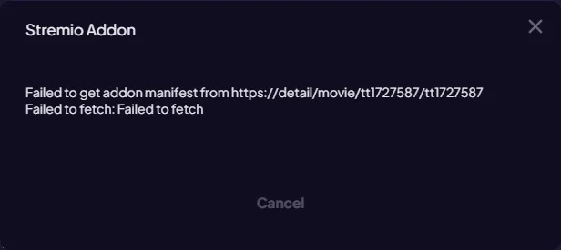

# Mit DMM Cast in Stremio DMM nutzen {#use-dmm-in-stremio-with-dmm-cast}

DMM Cast ist das Stremio-Addon von Debrid Media Manager. So taucht DMM in Stremio auf: Du wählst auf DMM eine Veröffentlichung aus, drückst **Cast**, und Stremio zeigt sie als Stream an, der über dein eigenes Debrid- oder Easynews-Konto abgespielt wird. Kurz gesagt: Melde dich bei DMM an, öffne die Cast-Seite deines Anbieters, installiere das Addon in Stremio und drücke dann bei einem beliebigen Film oder einer Serie auf **Cast**.

Mit Cast ist hier das DMM-Addon gemeint. Es hat nichts mit Chromecast oder Bildschirmspiegelung zu tun.

## Was du brauchst {#what-you-need}

- Ein DMM-Login mit Real-Debrid, TorBox, AllDebrid, Premiumize, Offcloud, Debrid-Link oder Easynews.
- Stremio. [Stremio Web](https://web.stremio.com) funktioniert ohne Stremio-Konto.

Kein Sponsoring nötig.

## So richtest du es ein {#set-it-up}

1. Melde dich auf [debridmediamanager.com](https://debridmediamanager.com) mit deinem Anbieter an. Easynews meldest du unter **Settings** an.
2. Drück auf DMMs Startseite auf **Cast for RD**, **Cast for TB** und so weiter. Wenn mehrere Konten angemeldet sind, gibt es eine Zeile **Cast** mit einem Button pro Anbieter. Jeder Anbieter hat seine eigene Cast-Seite:

   | Anbieter | Cast-Seite |
   |---|---|
   | Real-Debrid | [debridmediamanager.com/stremio](https://debridmediamanager.com/stremio) |
   | TorBox | [debridmediamanager.com/stremio-torbox](https://debridmediamanager.com/stremio-torbox) |
   | AllDebrid | [debridmediamanager.com/stremio-alldebrid](https://debridmediamanager.com/stremio-alldebrid) |
   | Premiumize | [debridmediamanager.com/stremio-premiumize](https://debridmediamanager.com/stremio-premiumize) |
   | Offcloud | [debridmediamanager.com/stremio-offcloud](https://debridmediamanager.com/stremio-offcloud) |
   | Debrid-Link | [debridmediamanager.com/stremio-debridlink](https://debridmediamanager.com/stremio-debridlink) |
   | Easynews | [debridmediamanager.com/stremio-easynews](https://debridmediamanager.com/stremio-easynews) |

   

3. Drück auf **Install (web)**. Stremio Web öffnet sich mit dem Addon. Drück dort auf **Install**.

   

   Für eine andere Stremio-Version kopierst du die Adresse, die unter den Buttons angezeigt wird, und fügst sie dort hinzu. In Stremio Web geht das so: **Addons** → **Add addon** → einfügen → **Add** → **Install**. Die Adresse gehört nur zu deinem Konto: teil sie niemals mit anderen.

4. Zurück auf DMM suchst du nach einem Film oder einer Serie und öffnest sie. Releases, die dein Anbieter schon hat, bekommen einen **Cast**-Button: **Cast (RD)**, **Cast (TB)**, **Cast (AD)**, **Cast (PM)**, **Cast (OC)** oder **Cast (DL)**. Drück darauf. DMM bestätigt mit **Cast started in Stremio** (bei einer Serie mit **Casting succeeded.** und der Anzahl der gecasteten Episoden) und versucht, den Titel in deiner Stremio-App zu öffnen.

   

5. Öffne den Titel in Stremio. Dein Cast steht als **DMM Cast PM (Yours)** in der Liste (bei anderen Anbietern RD, TB und so weiter). Drück darauf, um abzuspielen.

   

## Was du sonst noch in Stremio bekommst {#what-else-you-get-in-stremio}

- **DMM Cast PM ✨ · Cast a file inside a torrent** bei jedem Film und jeder Episode. Damit öffnet sich der Titel auf DMM, und du kannst dort ein Release casten.
- Bis zu fünf weitere Streams aus Casts anderer Leute und aus Releases, die dein Provider schon hat. Die Anzahl stellst du unter **Other streams limit** auf der Cast-Seite ein. Sponsoren können sie auf zehn erhöhen.
- Zeilen auf Stremios Board: **DMM PM Movies** und **DMM PM TV Shows** enthalten deine Casts. **DMM PM Library** enthält alles in deinem Konto, und jeder Eintrag öffnet sich mit seinen Dateien. Easynews hat keine Library-Zeile.
- Du willst die Zeilen nicht? Installiere das Addon stattdessen mit **Without catalogs** → **Install (web)**. Die Streams werden trotzdem angezeigt.
- **Manage Casted Links** auf der Cast-Seite listet deine Casts auf. Hake die an, die weg sollen (oder nimm **Select All**), und drücke **Delete Selected**, um sie von Stremio zu entfernen.
- **Hide "Cast a file inside a torrent" option** auf der Cast-Seite entfernt die ✨-Zeile.

Bei Debrid-Link fügt das Casten das Release zu deinem Konto hinzu. Eines, das Debrid-Link noch nicht hat, startet einen echten Download und verbraucht dafür einen deiner 50 Torrents am Tag.

## Wenn etwas nicht stimmt {#when-something-is-wrong}

| Was du siehst | Was zu tun ist |
|---|---|
| Nach einem Klick auf **Cast** zeigt Stremio **Failed to get addon manifest from https://detail/movie/…** und **Failed to fetch: Failed to fetch** | Dein Cast wurde gespeichert. Stremio hat DMMs Link zum Titel als Addon gelesen, das installiert werden soll. Klick auf **Cancel**, öffne den Titel selbst in Stremio und wähle den Stream **(Yours)**. |
| Nur **DMM Cast PM ✨ · Cast a file inside a torrent** (RD, TB…) wird angezeigt, keine anderen Streams | Für diesen Titel wurde noch nichts gecastet. Klick auf diese Zeile: Sie öffnet den Titel auf DMM. Klick bei einem Release auf **Cast** und öffne dann den Titel in Stremio erneut. |
| **⚠️ DMM Cast · Set up DMM Cast for Premiumize again** (oder dein Anbieter) als einziger Stream | Das Addon in Stremio passt nicht mehr zu deiner DMM-Anmeldung. Klick darauf, um deine Cast-Seite zu öffnen, melde dich an, entferne dann das alte Addon aus Stremio und installiere es von dieser Seite aus neu. |
| **Real-Debrid Required. You must be logged in with Real-Debrid to use the Stremio Cast feature.** (oder TorBox, Easynews…) | Du bist auf DMM bei diesem Anbieter nicht angemeldet, oder du hast die Cast-Seite eines anderen Anbieters geöffnet. Klick auf **Login with …** oder nutze den Button **Cast for …** auf der Startseite von DMM. |
| **No episodes in this release on Premiumize** | DMM konnte die Dateien dieses Releases keinen Episoden zuordnen. Cast ein anderes Release. |
| Die Addon-Adresse, die du in die Suchleiste oben in Stremio Web einfügst, passiert nichts | Diese Leiste sucht nur. Nutze **Addons** → **Add addon**. |

Du kommst nicht weiter? Frag im Forum **dmm-cast-support** auf [Discord](https://discord.com/invite/7u4YjMThXP). [Hilfe bekommen](../guides/remote-help.md) beschreibt, was du angeben solltest.

## Fragen {#questions}

### Kann ich in Stremio nach DMM suchen? {#can-i-search-dmm-in-stremio}

Nein. DMM Cast fügt Stremio keine Suche hinzu, und die Suche in Stremio zeigt nichts davon an. Suche auf [debridmediamanager.com](https://debridmediamanager.com) und drücke **Cast**. Von einem Titel, den du bereits in Stremio geöffnet hast, bringt dich die ✨-Zeile direkt zu diesem Titel auf DMM.

### Funktioniert es auf meinem Fernseher, Fire TV oder Handy? {#does-it-work-on-my-tv-fire-tv-or-phone}

Casts werden auf DMM gespeichert, nicht auf dem Gerät, von dem du castest. Jede Stremio-Instanz, die deine Addon-Adresse hat, zeigt sie an. Cast vom Handy oder Computer aus und wähle dann in Stremio, wo immer du schaust, den **(Yours)**-Stream aus.

### Welche Anbieter funktionieren? {#which-providers-work}

Real-Debrid, TorBox, AllDebrid, Premiumize, Offcloud, Debrid-Link und Easynews. Jeder hat seine eigene Cast-Seite und sein eigenes Addon. Installiere für jeden Account, den du in Stremio nutzen willst, eines davon.

### Warum zeigt Stremio nur Cast und keinen Stream? {#why-does-stremio-show-only-cast-and-no-stream}

Für diesen Titel wurde noch nichts gecastet. Klick auf die ✨-Zeile, cast ein Release über DMM und öffne den Titel danach erneut in Stremio.

### Kann ich meine ganze Debrid-Bibliothek in Stremio abspielen? {#can-i-play-my-whole-debrid-library-in-stremio}

Ja. Die Zeile **DMM Library** auf dem Board von Stremio listet alles in deinem Konto auf (nicht bei Easynews). Öffne ein Element, um seine Dateien zu sehen.

### Brauche ich eine Sponsorschaft? {#do-i-need-a-sponsorship}

Nein. Bei DMM Cast erhöht eine Sponsoring nur das **Other streams limit** von fünf auf zehn. Hol dir deinen DMM-API-Key auf [gatekeeper](https://gatekeeper.debridmediamanager.com/) und füg ihn in den **Settings** von DMM ein.
