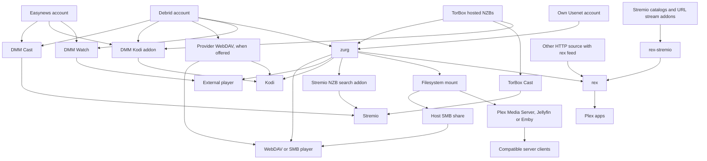
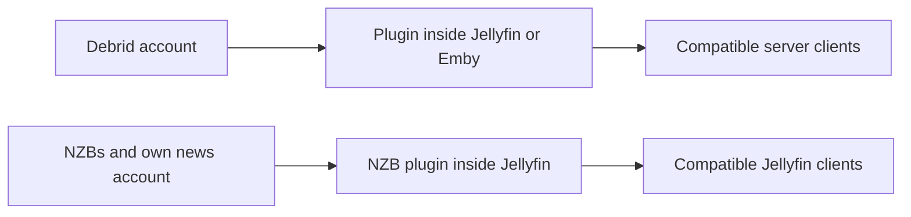
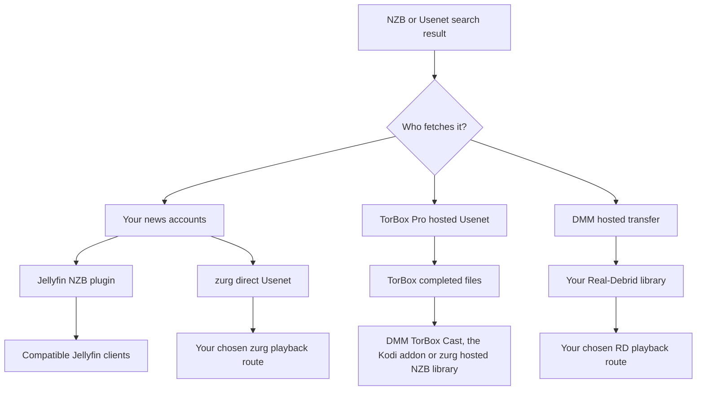

# Welches Setup sollte ich nutzen? {#which-setup-should-i-use}

**[Finde dein Setup mit dem interaktiven Fragebogen](https://debridmediamanager.com/choose-your-setup).** Beantworte ein paar Fragen zu deinen Player-Konten und zum Hosting. Du bekommst Routen, Voraussetzungen und Setup-Links. Kein Login nötig.

Du weißt nicht, was ein Begriff bedeutet? [Was jeder Teil macht](glossary.md) hat für jeden eine Zeile.

**Fang mit der App an, in der du schauen willst.** Du brauchst nicht jeden Teil. DMM hilft dir, Releases auszuwählen. Ein Provider liefert die Dateien. zurg kann sie in eine gemeinsame Bibliothek verwandeln. rex stellt eine Bibliothek für Plex-Apps bereit. Bei manchen Routen fällt ein Teil weg.

Diese Übersicht deckt unterstützte Routen ab, geprüft am **10. November 2026**. Sie enthält externe Alternativen, die einen Schritt überspringen. Drittanbieter-Addons und Geräte können sich trotzdem unterscheiden. Folge dem verlinkten Guide und seinen getesteten Grenzen.

## Such dir das aus, was du schon nutzt {#pick-by-what-you-already-use}

Auf dem Handy wischst du eine Tabelle seitwärts, um alle Spalten zu sehen.

| Ich habe / will… | Wähle diesen Weg | Warum diesen Weg? | Was du in Kauf nimmst |
|---|---|---|---|
| Stremio und ein Debrid- oder Easynews-Konto; kein Server zum Pflegen | **DMM Cast → Stremio**, oder dein bestehendes Stream-Addon | Schau über dein Konto, ohne zurg, rex oder einen Medienserver laufen zu lassen | Das Addon und der Anbieter müssen einen abspielbaren Stream liefern; das Gerät übernimmt die Wiedergabe |
| Kodi und ein Debrid-, Easynews- oder TorBox-Pro-Konto | **DMM's Kodi-Addon → dein Konto** | Durchsuchen, suchen und abspielen direkt in Kodi; vom Handy aus koppeln. Die TorBox-Bibliothek des Addons enthält gehostete NZB-Downloads | Kodi übernimmt die Wiedergabe. Die Wanted-Liste eines Sponsors braucht trotzdem zurg, um Anfragen zu erfüllen |
| Ein Film, den ich in meinem gewohnten Player schauen will | **DMM Watch → externer Player** | Kein Bibliotheksserver nötig | Installiere einen unterstützten Player und wähle eine Datei, die er abspielen kann |
| Infuse, Kodi oder ein anderer WebDAV-Player | **Provider-WebDAV** ohne Host; **zurg → WebDAV-Player**, wenn ein Host durchgehend laufen kann | Eine Cloud-Bibliothek durchsuchen, ohne Plex, Jellyfin, Emby oder rex | Real-Debrid, AllDebrid, Premiumize, TorBox und Debrid-Link stellen ihr eigenes WebDAV bereit, mit eigener Ordnerstruktur. Offcloud hat keins, daher braucht es zurg. zurg braucht einen Host, der läuft, während du schaust |
| Plex Media Server läuft bereits | **zurg → gemounteter Ordner → Plex Media Server → Plex-App** | Behalte deinen Server, seine Bibliotheken und deine bestehenden Abläufe | zurg und ein Dateisystem-Mount laufen neben dem Server; Scans lesen Remote-Dateien |
| Plex-Apps, aber ohne gemountete Bibliothek pflegen zu wollen | **zurg → rex → Plex-App** | zurg liefert die Bibliothek an rex, ohne Mount oder Plex Media Server | Beide Dienste laufen dauerhaft; prüfe rex's App-Kompatibilität und die Hinweise zum Konto |
| Stremio-Addons, ich bevorzuge aber Plex-Apps | **Addons → rex-stremio → rex → Plex-App** | Mach Addon-Kataloge zu Plex-Bibliotheken; zurg ist optional | Führe rex und rex-stremio aus; Stream-Addons müssen abspielbare URLs liefern, keine rohen Torrents |
| Jellyfin ist, wie meine Player auf die Bibliothek zugreifen | **Provider-Plugin in Jellyfin → kompatibler Client** | Kein separater zurg-Dienst und kein Mount | Jellyfin 12 und das passende Plugin bzw. die passenden Plugins; Plugins haben eigene Archivlimits |
| Emby ist, wie meine Player auf die Bibliothek zugreifen | **Provider-Plugin in Emby → kompatibler Client** | Alles bleibt im bestehenden Emby-Server | Nutze eine unterstützte Emby-Version; diese sechs Plugins decken Debrid ab, kein direktes Usenet |
| Jellyfin/Emby plus Konsumenten, die eigenen Dateisystem-/WebDAV-Zugriff brauchen | **zurg → Mount → Jellyfin/Emby** | Eine Bibliothek kann mehr als einen Konsumenten bedienen | Pflege Mount und Server-Pfade; andere Konsumenten können zurg direkt nutzen |
| NZB-Dateien, mein eigenes Usenet-Konto und Jellyfin | **NZB-Plugin in Jellyfin → kompatibler Client** | NZBs streamen ohne separaten zurg-Dienst | NNTP-Zugang und eine unterstützte Jellyfin-Version; das Plugin schließt komprimierte/verschlüsselte Archivmitglieder aus und repariert nicht mit PAR2 |
| Ein Hardware-Player, der SMB-Freigaben liest | **zurg → Mount → SMB-Freigabe des Hosts → Player** | Der eigene Dateibrowser und die Wiedergabe des Players bleiben erhalten | Der Host stellt SMB bereit; zurg selbst stellt WebDAV bereit, keinen SMB-Server |
| Mein eigenes Usenet-Konto und Stremio | **Newznab-Indexer → zurgs Stremio-Addon → Stremio** | Zur Wiedergabezeit suchen und über dein Newsserver-Konto streamen | Ein laufendes zurg, Indexer-Zugang und NNTP-Zugangsdaten; ein anderes Gerät braucht eine erreichbare HTTPS-Addon-Adresse |
| Ein Android/Google TV-Gerät, ohne anderen Computer | **zurg+rex Android → Player auf diesem Gerät, oder die Plex-Apps darauf und rund um dein Zuhause** | zurg und rex auf einem Android-Gerät laufen lassen, deinen eigenen Plex-Server auf dem Handy oder der TV-Box, für diesen Bildschirm und die Plex-Apps rund um dein Zuhause | Sponsor-Zugang, Sideloading und Hintergrundbetrieb; Usenet braucht 64-Bit-Android; gehostete TorBox-NZBs sind auf Android nicht verfügbar |
| Ein Android/Google TV-Gerät und Stremio-Addons, YouTube, Spotify oder Dateien auf einem NAS | **rex für Android → die Plex-Apps darauf und rund um dein Zuhause** | rex und seine Addons auf dem Gerät, kostenlos und ohne Computer | Sideloading und Hintergrundbetrieb; Stream-Addons müssen abspielbare URLs liefern, keine rohen Torrents; Dateien auf einem NAS brauchen ein Addon, das du selbst schreibst. Für deine Debrid- und Usenet-Bibliothek nutzen Sponsoren zurg+rex (die Zeile oben) |
| Dateien bereits auf einer Festplatte/einem NAS | **Bestehender Medienserver oder Netzwerkplayer**; **HTTP-Quelle → rex**, wenn du rex willst | Nutze weiter deine eigenen Dateien; kein Debrid- oder Usenet-Konto nötig | rex braucht Metadaten, die über seine Feed-API eingereicht werden, und HTTP-Zugriff auf die Dateien; Feed-Producer und Dateiserver können getrennt sein. rex scannt keine Festplatten |
| Streambare HTTP-Medien oder mein eigener HTTP-Server | **HTTP-Quelle + rex-Feed → rex → Plex-Apps**, oder ein kompatibler Player direkt | Nutze eine bestehende Quelle ohne Debrid oder zurg | rex braucht einen Feed-Producer, der Identität und Mediendetails einreicht; eine nackte URL liefert diese Metadaten nicht |

Hier starten: [DMM Cast](https://debridmediamanager.com/stremio/) · [Kodi](https://debridmediamanager.com/kodi) · [DMM-Einstellungen](https://debridmediamanager.com/settings) · [zurg-Einrichtung](../zurg/setup/index.md) · [rex mit zurg](../rex/with-zurg.md) · [rex mit Stremio-Addons](../rex/stremio.md) · [Jellyfin-Plugins](https://debridmediamanager.com/jellyfin) · [Emby-Plugins](https://debridmediamanager.com/emby) · [zurgs Stremio-Addon](../zurg/guides/stremio.md) · [zurg+rex auf Android](../zurg/guides/android.md) · [rex für Android](../rex/android.md) · [rex mit beliebiger Quelle](../rex/any-source.md).

Der Cast-Link beginnt mit Real-Debrid. Nutze für [TorBox](https://debridmediamanager.com/stremio-torbox/), [AllDebrid](https://debridmediamanager.com/stremio-alldebrid/), [Premiumize](https://debridmediamanager.com/stremio-premiumize/), [Offcloud](https://debridmediamanager.com/stremio-offcloud/), [Debrid-Link](https://debridmediamanager.com/stremio-debridlink/) oder [Easynews](https://debridmediamanager.com/stremio-easynews/) die Setup-Seite, wenn du dieses Konto nutzt. Cast bedeutet hier das **DMM-Addon**. Es ist nicht Chromecast oder Bildschirmspiegelung gemeint.

## Die Wiedergabe-Übersicht {#the-playback-map}

Die Pfeile bedeuten „liefert eine Bibliothek oder einen abspielbaren Stream an“. Sie sind kein Paket-Routing-Diagramm: Je nach Route holt der Player die Daten vom Anbieter, oder der Server übernimmt die Übertragung.

[Öffne die Abspielkarte in voller Größe](../assets/setup-routes/playback.svg), um sie zu vergrößern oder zu speichern.

Der Stremio-NZB-Suchzweig braucht ein NZB-Konto (`nzb` oder `torbox_nzb` für Releases, die TorBox bereits hat) und einen Newznab-Indexer. Von TorBox gehostete NZBs lassen sich auch über TorBox Cast oder das Kodi-Addon ohne zurg abspielen. Der Mount-zu-SMB-Zweig braucht eine separate Freigabe, die auf dem Host eingerichtet ist.

Zwei kleinere Routen solltest du getrennt halten:

[Öffne die Plugin-Karte in voller Größe](../assets/setup-routes/plugins.svg).

Die Plugins sind eigenständige Integrationen. „zurg“ im Namen eines Plugins bedeutet **nicht**, dass du die zurg-Anwendung laufen lassen musst. Es verspricht auch nicht dieselben Funktionen. Die Torrent-Bibliothek des TorBox-Plugins ist getrennt vom gehosteten NZB-Backend von zurg.

## Wähle, woher die Dateien kommen {#choose-where-the-files-come-from}

Ein **Indexer** findet Releases. Ein **Torrent oder NZB** beschreibt, wie man eins holt. Ein **Provider** liefert die Bytes. Ein **Player** dekodiert sie. Zugang zu einem davon schließt die anderen nicht ein.

| Eingabe | Wer holt/liefert das Video? | Was du brauchst | Wann es nützlich ist |
|---|---|---|---|
| Gecachter Torrent, Magnet oder Torrent-Datei | Dein Debrid-Provider | Ein Konto, das von deiner gewählten Integration unterstützt wird | Oft die kürzeste Wartezeit, wenn das genaue Release schon verfügbar ist |
| Nicht gecachter Torrent | Der Debrid-Provider lädt ihn zuerst herunter | Ein Konto, das den Torrent annimmt, verfügbare Quellen und Platz innerhalb seiner Limits | Ein gewünschtes Release ist nicht gecacht; mit Wartezeit und möglichem Fehlschlag rechnen |
| NZB, mit deinen eigenen News-Accounts | Das **direct Usenet**-Backend von zurg oder das NZB-Plugin von Jellyfin liest Artikel bei Bedarf | NZBs, NNTP-Zugang und deine gewählte Integration; Indexer-Zugang, wenn du suchen willst | Wähle deine Provider/Backbones, nutze Fallback-Accounts und vermeide es, ganze Videos lokal zu speichern |
| NZB, mit dem gehosteten Service von TorBox | **TorBox holt und repariert es**, und liefert danach die fertigen Dateien aus | TorBox Pro; einreichen über DMM oder das **TorBox hosted NZB**-Backend von zurg | Du willst NZBs, ohne News-Server-Zugangsdaten zu verwalten oder lokal zu dekodieren |
| DMM-Usenet-Ergebnis an Real-Debrid gesendet | Der gehostete Transfer-Service von DMM holt es und übergibt es an **deine Real-Debrid-Bibliothek** | Real-Debrid und ein verfügbares DMM-Transfer-Kontingent | Du schaust schon über RD und willst das Release dort haben; kein persönlicher NNTP-Account nötig |
| Easynews-Suchergebnis | Easynews liefert einen direkten HTTP-Download/Stream | Dein eigener Easynews-Account | Schauen oder Casten aus DMM heraus oder über die Easynews-Cast/Kodi-Route, ohne eine NZB-Bibliothek aufzubauen |
| Direkter HTTP(S)-Download-Link | Ein kompatibler Player/HTTP-Quelle oder ein Provider, der diesen Download unterstützt | Zugriff auf die eigentliche Medien-URL; ein passender Provider-Account, wenn du sie dort importierst/unrestricted | Du hast schon eine Datei-URL statt eines Torrents/NZBs |
| Dateien auf deiner Festplatte oder deinem NAS | Dein Datei-/Medienserver | Lokaler Speicher und ein Player, der ihn erreichen kann | Offline-Besitz, Heimvideos oder das Behalten einer bestehenden Sammlung |

zurg unterstützt **Real-Debrid, AllDebrid, TorBox, Premiumize, Offcloud und Debrid-Link**. Du kannst Accounts in einer Bibliothek kombinieren. Caches, Kontingente und Dateiverfügbarkeit unterscheiden sich trotzdem. Ein Cached-Badge ist ein Hinweis, aber keine Garantie für die Wiedergabe. Siehe [Provider](../zurg/providers/index.md).

### „Usenet ohne Usenet-Account“: welcher Weg? {#usenet-without-a-usenet-account-which-route}

[Öffne die Usenet-Übersicht in voller Größe](../assets/setup-routes/usenet.svg).

**Wähle TorBox-gehostete NZBs**, wenn TorBox herunterladen und reparieren soll. DMM schickt die NZB dorthin. Aktuelle zurg-Nightlies verwenden den Provider-Typ `torbox_nzb` und nehmen NZBs aus dem Watch-Verzeichnis und der SABnzbd-Schnittstelle an. [TorBox-gehostetes Usenet](../zurg/providers/torbox-nzb.md) hat seine zurg-Einrichtung. Ein Cache-Miss muss fertig werden, bevor es abspielt. Downloads teilen sich die Slots mit Torrents. Gespeicherte Dateien können ablaufen, und zurg verspricht nicht, ein abgelaufenes Release erneut zu holen. Bewahre die NZB für einen weiteren Abruf auf.

**Wähle direktes Usenet**, wenn zurg über deine eigenen News-Accounts lesen soll, inklusive Fallback- oder Block-Accounts. Es verwendet `nzb` mit NNTP-Zugangsdaten. Ein TorBox-News-Server-Login gehört ebenfalls hierher. Es ist getrennt von TorBox-gehosteten NZBs. Siehe [TorBox NNTP](../zurg/providers/torbox-news-server.md) und [die Tarife](https://torbox.app/pricing).

**Eine zurg-Instanz nutzt entweder `nzb` oder `torbox_nzb`.** Beide verwalten das NZB-Watch-Verzeichnis. Betreibe beide mit getrennten Instanzen und Arbeitsverzeichnissen. Wenn `dmm_api_key` bei beiden gesetzt ist, [schalte die `dmm-wanted`-Quelle bei einer davon aus](../zurg/guides/dmm-wanted.md#two-zurgs-on-one-key), sonst wird jeder Wanted-Titel doppelt geholt. Beides kann neben Torrent-Providern laufen. Das Stremio-Addon von zurg schickt seine Auswahl an den NZB-Account, den die Instanz hat. Mit `torbox_nzb` startet nur ein Release, das TorBox bereits hält, innerhalb der Wartezeit des Addons, und nur wenn kein anderer NZB-Post wartet.

**Wähle DMM → Real-Debrid**, wenn das Release in deiner RD-Bibliothek landen soll. Es ist ein gehosteter Transfer mit Warteschlangen und Kontingenten. Ein nicht gecachter Auftrag braucht Zeit. Real-Debrid oder andere Debrid-Provider bekommen dadurch keine native NNTP-Unterstützung. Das DMM-Ergebnis und die [Transfers-Seite](https://debridmediamanager.com/transfers) zeigen den Fortschritt.

Bei Easynews spielen **Watch** und **Cast** dessen HTTP-Dateien ab, und **Download NZB** speichert die NZB des Releases. **Send to zurg** legt diese NZB auf deine Sponsor-Wanted-Liste. Dafür brauchst du ein eingerichtetes NZB-Backend. Ein Easynews-Login in DMM richtet nicht den NZB-Account von zurg ein.

### Was ist mit HTTP-Links? {#what-about-http-links}

DMM's TorBox **Add**-Dialog akzeptiert direkte HTTP(S)-Links als Web-Downloads. zurg zeigt sie in `__downloads__` an. Ein Eintrag dort ist nicht automatisch ein erkanntes rex-Bibliothekselement. Auch Real-Debrid-Unrestricted-Downloads können dort auftauchen. DMM TorBox Cast enthält abgeschlossene Web- und Usenet-Downloads sowie Torrents. Bei einer Webseite kann trotzdem eine andere Integration nötig sein, zum Beispiel wegen Logins, ablaufender URLs, DRM oder eines eigenen Players.

**rex unterstützt streambare HTTP(S)-Medien über seine Feed-API.** Eine [Quelle oder ein Addon](../rex/any-source.md) schickt die Medienadresse und die Metadaten. rex macht sie dann in Plex-Apps verfügbar. Der Dateiserver und der Feed-Anbieter können getrennte Dienste sein. Du brauchst kein zurg- oder Debrid-Konto. [rex-stremio](../rex/stremio.md) macht das für kompatible Stremio-Addons. Rohe Magnets und reine Torrent-Streams funktionieren nicht. HLS braucht das FFmpeg-Setup von rex. rex verwendet die Identität, die die Quelle mitliefert.

## Entscheide, wie Titel hinzugefügt werden {#decide-how-titles-get-added}

Beschaffung und Wiedergabe sind getrennte Entscheidungen. Du kannst ändern, wie ein Titel angefordert wird, ohne die App zu wechseln, in der du ihn anschaust.

| Wie du Titel auswählst | Weg | Warum nutzen? |
|---|---|---|
| Genau das Release wählen | DMM-Suche/Bibliothek → Anbieter; oder ein NZB → dein gewähltes NZB-Backend | Edition, Größe und Release selbst kontrollieren |
| Auf Want drücken oder einer Trakt/MDBList-Liste folgen | [DMM Wanted](../zurg/guides/dmm-wanted.md) → zurg-Beschaffung | Automatische Filme und neue Folgen, ohne Sonarr/Radarr zu betreiben; Sponsoring erforderlich |
| Familienanfragen in Seerr/Overseerr/Jellyseerr | [Seerr über DMM](../dmm/seerr.md) → Wanted → zurg | Vertraute Anfrage-Oberfläche ohne arr-Server; Sponsoring erforderlich. Seerr braucht einen Plex-, Jellyfin- oder Emby-Server, mit dem es eingerichtet wird |
| Hast schon Plex-Watchlists oder einen Anfrage-Stack | [zurg-Beschaffung](../zurg/guides/acquisition.md) | Die bestehende Anfragequelle behalten; deren Such- und Anbieterziele konfigurieren |
| Detailliertes Monitoring und Qualitätsprofile in Sonarr/Radarr gewünscht | DMM oder deine Indexer → arr → zurg-Download-Client-Schnittstelle → Bibliothek | Die Entscheidungen und den Importablauf von arr behalten; mehr Dienste und Pfad-Einrichtung |
| Nur wählen wollen, wenn du Play drückst | DMM Cast/Kodi, ein anderes Stream-Addon oder die Stremio-Suche von zurg | Du musst keine verwaltete Bibliothek mit allen Titeln vorab aufbauen |

Für die empfohlene arr-Route mit DMM und zurg ist **DMM der Indexer und zurg der Download-Client**. DMM bietet [Torznab](https://debridmediamanager.com/torznab) und [Newznab](https://debridmediamanager.com/newznab) an. Beide setzen aktives Sponsoring voraus. Prowlarr ist optional. zurg stellt [qBittorrent](../zurg/guides/sonarr-radarr-torrents.md)- und [SABnzbd](../zurg/guides/sonarr-radarr.md)-Schnittstellen bereit. Du brauchst diese Download-Apps neben zurg nicht. [zurg kann auch für arr suchen](../zurg/guides/sonarr-radarr-fetch.md).

Wenn du **vollständige lokale Kopien** willst, lade die Dateien von deinem Anbieter oder über zurg herunter. Du kannst auch die Offline-Download-Funktion eines Players oder einen normalen Downloader und eine Festplattenbibliothek nutzen. Prüfe die Kontingente und spiele die gespeicherten Dateien ohne Netzwerk ab. zurg-virtuelle Dateien, `.strm`-Links und [lokale Debrid-Kataloge](../zurg/guides/local-libraries.md) sind keine Offline-Kopien. Lokale Kataloge speichern nur Datensätze. Die Wiedergabe hängt weiterhin vom Anbieter ab.

## Die wichtigen Abwägungen vor der Installation {#the-tradeoffs-that-matter-before-installing}

| Frage | Was deine Wahl beeinflusst |
|---|---|
| Muss ein anderer Rechner eingeschaltet bleiben? | Gehostete Cast/Kodi-Routen, Provider-WebDAV und DMM Watch brauchen keinen eigenen Server. zurg, rex, rex-stremio und Media-Server-Plugins brauchen ihren Host, solange du schaust. Auf einem Android-Gerät läuft bei zurg+rex zurg und rex, und rex für Android betreibt rex mit seinen Addons, einschließlich Stremio-Addons. rex-stremio und Media-Server-Plugins brauchen weiterhin einen normalen Host. Ein gemieteter/verwalteter Host ändert, wer ihn betreibt, nicht die zugrunde liegende Route. |
| Kann mein Fernseher die Datei abspielen? | WebDAV- und Addon-Routen hängen von den Codecs, dem Audio und den Untertiteln des Players ab. zurg liefert nur die Bytes; es ist kein Videotranscoder. Plex Media Server, Jellyfin, Emby oder rex mit FFmpeg können bei Bedarf umwandeln, mit passender Hardware und passenden Server-/App-Funktionen. |
| Wie viel Speicherplatz? | Streaming vermeidet, dass du die ganze Sammlung speicherst. Plane Platz ein für Datenbanken, Artwork, Caches und alle Reparatur-, Transcoding- oder Offline-Download-Vorgänge. „Kein vollständiger Download vorab“ heißt nicht, dass gar kein Speicherplatz benötigt wird. |
| Wer zahlt die Bandbreite? | Provider-Traffic-Kontingente gelten weiterhin. Ein Server-Proxy überträgt den Wiedergabe-Traffic und nutzt seine ausgehende Bandbreite; direkte Wiedergabe verlagert die Verbindung zum Zuschauer. Auch die Bibliotheksanalyse kann Remote-Dateien lesen. |
| Funktioniert es auch unterwegs? | Gehostete Addons vermeiden, dass dein eigener Server nach außen erreichbar ist. Selbst gehostete Dienste brauchen eine sicher erreichbare Adresse; eine reine LAN-Adresse funktioniert von unterwegs nicht. Siehe [rex-Fernzugriff](../rex/any-source.md#use-it-outside-your-home-optional) und die [Stremio-HTTPS-Anleitung](../zurg/guides/stremio.md#installing-it-on-another-device). |
| Kann die Familie es gleichzeitig nutzen? | Prüfe die IP-/Gleichzeitigkeitsregeln deines Providers und das Freigabemodell des Servers. Real-Debrid-Nutzung muss über eine öffentliche IP laufen; direkte Links an verschiedene Haushalte können dagegen verstoßen, auch wenn eine zentrale Bibliothek sie bereitgestellt hat. Aktiviere keine Weiterleitungen, ohne zu verstehen, woher die Downloads stammen. |
| Wofür zahlst du? | Halte Provider-Abos, Indexer-Zugang, DMM-Sponsoring, Hosting und Player-/Server-Käufe getrennt. Die Basis-Website von DMM und rex für den persönlichen Gebrauch sind kostenlos; ebenso [rex für Android](../rex/android.md). zurg+rex, das deine Debrid- und Usenet-Bibliothek außerdem mit rex auf Android verbindet, ist für Sponsoren. Aktuelle zurg-Nightlies und die Plugin-Verteilung von DMM sind Sponsor-Vorteile; Wanted und die Indexer-APIs von DMM brauchen ebenfalls Sponsoring. rex-stremio setzt es nicht voraus. [Was dir ein Sponsoring bringt](sponsorship.md) listet jeden Vorteil und wo du ihn einrichtest. |
| Garantiert ein Katalogeintrag die Wiedergabe? | Nein. Addon-Kataloge beschreiben Titel; Cloud-Dateien können ablaufen; Torrents können ohne Quellen sein; Usenet-Artikel können fehlen. Wähle die Route, deren Fehler- und Wartverhalten dir zusagt. |

Ein kompatibler Server-Client kann auch eine Drittanbieter-App sein. [Infuse verbindet sich mit Plex, Emby und Jellyfin](https://support.firecore.com/hc/en-us/articles/360006462093-Streaming-from-Plex-Emby-and-Jellyfin). Du brauchst womöglich keinen separaten zurg-Mount. Prüfe Plugin und Client gemeinsam.

Infuse unterstützt [WebDAV und andere Netzwerkfreigaben](https://support.firecore.com/hc/en-us/articles/215090977-Streaming-From-a-Mac-PC-or-NAS). Eine `.strm`-Datei gibt einem kompatiblen Player wie Kodi eine URL. Sie ersetzt keinen universellen Mount. Prüfe den Client und rechne mit anderem Proxy- und Failover-Verhalten. Verwende `.strm` nicht als normales Plex-Media-Server-Setup.

Es gibt auch eine [alte kostenlose zurg-Version](https://github.com/debridmediamanager/zurg-public/releases). Sie ist nur für Real-Debrid und hat ein anderes Konfigurationsformat. Die Multi-Provider-Usenet- und Android-Routen hier nutzen Sponsor-Nightlies.

**rex hat seine eigene Kompatibilitätsgrenze.** Es ist ein eigenständiger Plex-App-Server. Es ist weder Plex Media Server noch ein Plex-Plugin. Lies die [FAQ](../rex/faq.md) für getestete Geräte, Transcoding bei Fernzugriff und die Empfehlung für ein frisches Konto. Ein klassischer Plex-Server kann parallel zu rex laufen.

## Bedürfnisse, die den Weg ändern können {#needs-that-can-change-the-route}

| Ich brauche außerdem … | Was du auswählen oder prüfen solltest |
|---|---|
| Lokale Dateien und Cloud-Titel zusammen | Behalte deinen bestehenden Plex/Jellyfin/Emby-Server und füge den Mount oder das passende Plugin hinzu. rex kann mehrere Feed-Quellen kombinieren, auch eine HTTP-Quelle für lokale Dateien; deren Metadaten braucht es trotzdem. |
| Automatische Untertiteldateien | Vom Player bereitgestellte oder eingebettete Untertitel reichen womöglich aus. Für einen arr-Workflow schreibt [Bazarr mit zurg](../zurg/guides/subtitles.md) lokale Sidecar-Dateien neben die virtuellen Videos. Diese Sidecars erreichen DMM Cast, das Kodi-Addon, DMM Watch oder das Stremio-Addon von zurg nicht. Kodi erreichen sie aber als zurg-WebDAV-Quelle. rex hat außerdem Search Subtitles, auch ohne Bazarr. |
| Mein Wiedergabeverlauf beim Wechsel des Servers | Lies vor dem Wechsel [Wechsel von Plex](../rex/from-plex.md) und [Import des Wiedergabestatus](../rex/import-watched.md). Der Wechsel der Quelle überträgt nicht automatisch den Verlauf jeder App. |
| Eine Auswahl mit jemandem teilen, der ein eigenes Konto hat | DMM-Hashlisten teilen Release-Auswahlen, die andere in ihre Konten übernehmen können. Sie übertragen weder deine Zugangsdaten noch hosten sie die Wiedergabe. Einen Server zu teilen ist ein anderer Weg, der den Freigabe- und Anbieterregeln unterliegt. |
| Ein VPS oder Remote-Host mit begrenzter Bandbreite | Prüfe, ob die Route die Wiedergabe per Proxy leitet oder umleitet. Die [rex-Einstellungen für Direct-Download](../rex/direct-download.md) erklären die Optionen. Umleitungen ändern die öffentliche IP des Downloaders und können Anbieter-URLs offenlegen. |

## Andere Medien und bestehende Setups {#other-media-and-existing-setups}

- **Musik:** [DMM Music](https://debridmediamanager.com/music/) bietet Wiedergabe und Downloads im Browser über Real-Debrid. [rex-Musikquellen](../rex/music.md) stellen Musik für Plexamp und unterstützte Plex-Apps bereit. Eine Quelle kann ein Addon oder ein für Musik konfigurierter zurg sein. Geh nicht davon aus, dass ein Film-/Serien-Addon auch Musik liefert.
- **Live-TV:** [rex-Live-TV-Route](../rex/live-tv.md) bietet Kanäle und einen Programmguide in den dokumentierten Apps. Live-Kanäle von rex-stremio bilden stattdessen eine Kanalbibliothek; das ist nicht dieselbe Guide-Oberfläche. Prüfe, ob die Quelle verfügbar ist. rex bietet keine DVR-Aufnahme.
- **Heimvideos, Aufnahmen und Fotos:** Nutze einen vorhandenen Medienserver oder eine [rex-Quelle, die du selbst kontrollierst](../rex/addons.md). Das [Heimvideo-Tutorial](../rex/addon-home-videos.md) zeigt Letzteres. zurg kann außerdem Comics als Fotos an rex liefern; die App-Unterstützung unterscheidet sich.
- **Bestehende Kodi-/Stremio-Addons:** Wenn dein Setup dir schon das bietet, was du willst, behalte es. DMM kann der Ort sein, an dem du Releases auswählst und verwaltest, ohne deinen Player zu ersetzen. Die Addon-Unterstützung für Provider, Usenet und HTTP variiert; die DMM-Route ist kein Kompatibilitätsversprechen für alle Addons.
- **Bereits installierter anderer Debrid-Mount/Downloader:** Schau dir die [Migrationsoptionen](../zurg/migrate/index.md) an, bevor du wechselst. Ein funktionierendes Setup braucht keine zusätzliche Schicht allein deshalb, weil es sie gibt.
- **Native Apps in Entwicklung:** Usenet TV ist kein veröffentlichtes App-Store-Setup, das hier empfohlen werden sollte. Yomu TV ist ein separates Projekt für Lesen/Hörbücher und kein Weg für diesen Film-/Serien-Stack. Keines von beiden ist für die oben genannten Routen nötig.

## Fünf typische Startpunkte {#five-common-starting-points}

1. **„Ich habe Stremio und RD.“** Fang mit DMM Cast an. Füge zurg nur hinzu, wenn du eine gemeinsame Bibliothek, Automatisierung oder einen anderen Client brauchst, der es benötigt.
2. **„Ich habe TorBox Pro und möchte die NZBs aus diesem Beitrag.“** Schick die NZB über DMM an TorBox. Nutze TorBox Cast, um in Stremio zu schauen, das Kodi-Addon, um in Kodi zu schauen, oder zurgs gehostetes NZB-Backend, um deine gewählte Bibliotheks- oder Player-Route zu füttern.
3. **„Ich habe schon Jellyfin.“** Fang mit dem Plugin für deinen Anbieter an. Wähle separates zurg, wenn du dessen gemeinsames Dateisystem, Automatisierung oder umfassendere Backend-Funktionen brauchst.
4. **„Ich will Plex-Apps, keine Mounts und meine vorhandenen Addons.“** Nutze rex-stremio mit rex. Verwende stattdessen zurg als Quelle, wenn du deine verwaltete Debrid-/Usenet-Bibliothek freigeben willst. Beide Quellen können rex mit Inhalten versorgen.
5. **„Ich habe Usenet-Accounts und möchte Sonarr/Radarr.“** Nutze DMM Newznab oder deine vorhandenen Indexer, zurgs NZB/SABnzbd-Route und eine Wiedergabe-Route aus der ersten Tabelle. Für dauerhafte lokale Dateien wähle einen normalen Downloader oder speichere vollständige Kopien ausdrücklich. Virtuelle Importe allein sind keine Offline-Dateien.

Noch unsicher? Sag uns **dein Gerät oder deinen Player**, **deine vorhandenen Accounts**, **ob ein Host dauerhaft laufen kann** und **ob du On-Demand-Wiedergabe oder eine automatische Bibliothek willst**. Diese Antworten entscheiden meist den Weg. [Hilfe bekommen](remote-help.md) erklärt, wo du fragen kannst.
