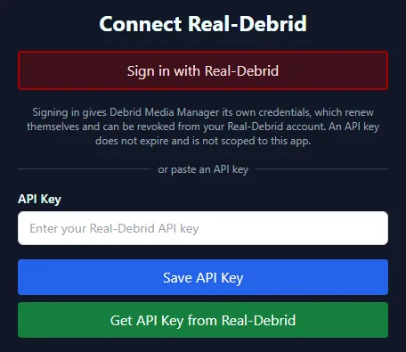

# Dein Real-Debrid-API-Token: wo du ihn bekommst und was die Fehler bedeuten {#your-real-debrid-api-token-where-to-get-it-and-what-the-errors-mean}

Dein Real-Debrid-API-Token findest du auf [real-debrid.com/apitoken](https://real-debrid.com/apitoken). Melde dich bei Real-Debrid an, öffne diese Seite und kopiere den Code unter **API Private Token**. Füge ihn dann in DMM oder zurg ein. Wenn eine App `bad_token` anzeigt, ist der Token in der App falsch oder unvollständig: Kopiere ihn von dieser Seite noch einmal.

## Token holen {#get-your-token}

1. Melde dich auf [real-debrid.com](https://real-debrid.com) an. Ohne Anmeldung zeigt die Token-Seite nur **403-Forbidden**.
2. Öffne [real-debrid.com/apitoken](https://real-debrid.com/apitoken).
3. Kopiere den kompletten Code unter **API Private Token**. Er besteht aus 52 Großbuchstaben und Ziffern.


Behandle ihn wie ein Passwort. Er läuft nie ab, und wer ihn hat, kann dein ganzes Konto nutzen. Die Warnung von Real-Debrid auf dieser Seite lautet: **This token is not meant to be used into public apps, it is insecure !**

Mit **Refresh** auf dieser Seite bekommst du einen neuen Token. Real-Debrid empfiehlt das, wenn du glaubst, dass jemand anderes deinen Token hat. Nach einem Refresh trägst du den neuen Token in jede App ein, die den alten verwendet.

## In DMM eintragen {#put-it-in-dmm}

1. Auf [debridmediamanager.com](https://debridmediamanager.com) auf **Login with Real Debrid** klicken.
2. Unter **or paste an API key** den Token in **API Key** einfügen und auf **Save API Key** klicken. **Get API Key from Real-Debrid** öffnet dir die Token-Seite.



DMM braucht den Token gar nicht: **Sign in with Real-Debrid** zeigt dir einen Code, den du unter real-debrid.com/device bestätigst. So bekommt DMM seine eigene Anmeldung, die sich selbst erneuert. Mehr dazu unter [What is DMM and how do I use it?](../dmm/index.md#sign-in)

## In zurg eintragen {#put-it-in-zurg}

In `config.yml`, unter `providers`:

```yaml
zurg: v1
providers:
  - type: realdebrid
    token: YOUR_RD_API_TOKEN
```

Oder im zurg-Dashboard unter `http://localhost:9999`: Öffne **Config**, klicke bei der realdebrid-Zeile unter **Providers** auf **Edit**, füge das Token in **Token** ein und klicke auf **Save**. Starte zurg in beiden Fällen neu. [Real-Debrid mit zurg](../zurg/providers/realdebrid.md) erklärt den Rest, inklusive der Docker-Einstellung `TOKEN`.

Um zu prüfen, was zurg davon hält:

```bash
curl -sS -X POST http://localhost:9999/api/providers/realdebrid/test
```

Ein Token, das Real-Debrid ablehnt, führt zu dieser Meldung: `account connection check failed; verify credentials and network`.

## Token selbst prüfen {#check-a-token-yourself}

```bash
curl -H "Authorization: Bearer YOUR_RD_API_TOKEN" https://api.real-debrid.com/rest/1.0/user
```

Unter Windows tippst du `curl.exe` statt `curl` ein. Ein funktionierender Token zeigt dein Konto an: `username`, `"type": "premium"` und das Datum `expiration`. Ein falscher gibt Folgendes aus:

```json
{
	"error": "bad_token",
	"error_code": 8
}
```

## Wenn etwas nicht stimmt {#when-something-is-wrong}

Real-Debrid-Fehler kommen mit einem Namen und einer Nummer. zurg zeigt beides, etwa `bad_token (status code: 401) (code: 8)`.

| Was du siehst | Was es bedeutet und was du tun solltest |
|---|---|
| `bad_token`, code 8. In zurg: `Failed to get user information: api response error: bad_token (status code: 401) (code: 8) trying again in 30s` | Real-Debrid kennt diesen Token nicht. Er wurde falsch kopiert, abgeschnitten oder ersetzt. Kopiere ihn erneut von [real-debrid.com/apitoken](https://real-debrid.com/apitoken), das ganze Ding ohne etwas davor oder danach, und starte zurg neu. |
| zurg: `Account realdebrid refused zurg (credential rejected)` | Dasselbe wie `bad_token`. Deine anderen Konten laufen weiter, und zurg fragt Real-Debrid alle 10 Minuten erneut nach. |
| DMM: **Real-Debrid rejected that API key.** | Dasselbe wie `bad_token`. Kopiere ihn erneut oder drücke stattdessen auf **Sign in with Real-Debrid**. |
| `permission_denied`, code 9. In zurg: `RD Permission denied (code=9)` | Real-Debrid hat das Konto abgelehnt, nicht den Token. In den Docs steht als Grund ein gesperrtes Konto und bei manchen Anfragen ein Konto ohne Premium. Melde dich auf real-debrid.com an und prüfe das Konto und die **Premium**-Tage. Sieht beides gut aus, drücke auf der Token-Seite auf **Refresh** und füge den neuen Token ein, wie es zurgs Meldung sagt. |
| `ip_not_allowed`, code 22. In zurg: `RD refused link generation from this IP (code=22, ip_not_allowed)` | Nicht der Token. Real-Debrid erstellt keine Download-Links für Server- und VPS-Adressen. Starte es von einem Heimanschluss aus oder kaufe Remote Traffic bei Real-Debrid. |
| `service_unavailable`, code 25 | Real-Debrid selbst hat Probleme. Auf deiner Seite gibt es nichts zu ändern. Schau bei [Is Real-Debrid down or just me?](https://debridmediamanager.com/is-real-debrid-down-or-just-me) nach und probiere es später noch einmal. |
| **403-Forbidden** on real-debrid.com/apitoken | Du bist bei Real-Debrid nicht angemeldet. Melde dich an und öffne die Seite erneut. |

Jeder Code steht unten in [Real-Debrids API-Doku](https://api.real-debrid.com/).

## Fragen {#questions}

### Wo finde ich meinen Real-Debrid-API-Token? {#where-do-i-find-my-real-debrid-api-token}

Auf [real-debrid.com/apitoken](https://real-debrid.com/apitoken) einloggen und dann den Code unter **API Private Token** kopieren.

### Mein Token funktioniert in einer anderen App, aber zurg sagt, er sei ungültig. Warum? {#my-token-works-in-another-app-but-zurg-says-its-invalid-why}

Dein Account hat einen API-Token. Viele Apps verwenden ihn gar nicht, sondern melden sich stattdessen mit einem Code an, etwa bei DMMs **Sign in with Real-Debrid**. Dass eine andere App funktioniert, heißt also nicht, dass zurg den richtigen Token hat. Kopiere ihn erneut von der Token-Seite in zurg, ohne Leerzeichen davor oder danach, und starte zurg neu.

### Läuft der Token ab? {#does-the-token-expire}

Nein, der API-Token hat kein Ablaufdatum. Eine Anmeldung über eine App ist etwas anderes: Dabei bekommt die App eigene Zugangsdaten, die sich selbst erneuern.

### Ist es sicher, meinen Token an ein Addon oder eine Website zu geben? {#is-it-safe-to-give-my-token-to-an-addon-or-website}

Nur an Apps, denen du vertraust. Der Token öffnet deinen gesamten Account, und Real-Debrid sagt, dass er nicht für öffentliche Apps gedacht ist. Wenn eine App eine Anmeldung mit einem Code anbietet, nutze stattdessen diese.
