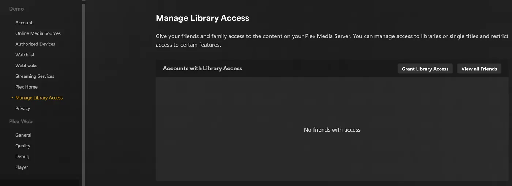
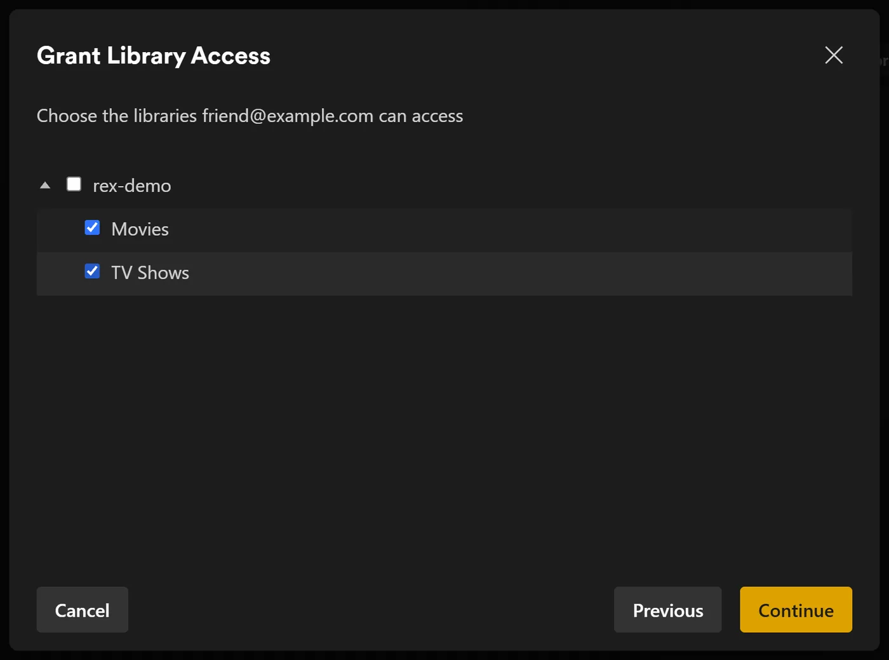
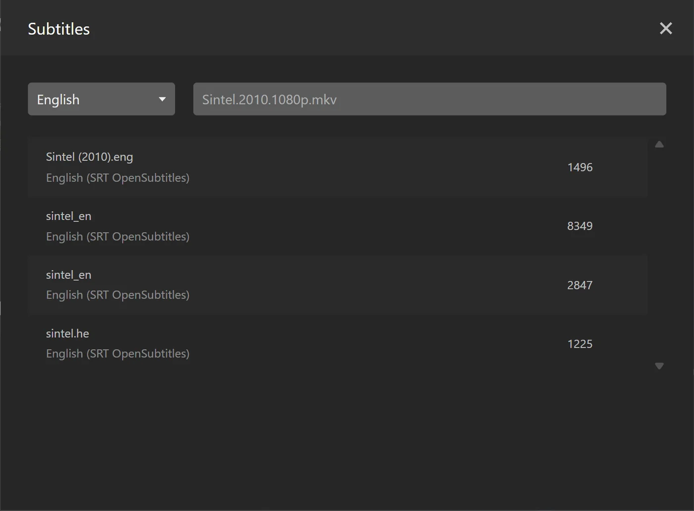

# rex mit deiner eigenen App {#rex-with-your-own-app}

[rex](https://rex.debridmediamanager.com/de/) ist ein Medienserver für die offiziellen Plex-Apps, der selbst keine Dateien besitzt. Die offiziellen Plex-Apps sehen rex als ganz normalen Plex-Server. Ein anderes Programm, das diese Seite **deine App** nennt, sagt rex, was in deiner Bibliothek ist, und liefert die Dateien aus. Wenn du auf Abspielen drückst, streamt rex die Datei direkt von deiner App. Vorher wird nichts heruntergeladen.

Diese Seite führt dich Schritt für Schritt von null bis zum ersten abgespielten Film. Sie geht von keiner bestimmten App aus. Sie sagt genau, was rex von einer App erwartet, damit du prüfen kannst, ob deine App das kann, oder selbst eine baust. Bei jedem Schritt steht, was er tut, warum er wichtig ist und was du sehen solltest, bevor du weitermachst.

Vier Dinge solltest du wissen, bevor du anfängst:

- **Deine App liefert die Dateien.** rex holt jedes Byte von deiner App über HTTP oder HTTPS, so wie ein Browser eine Datei herunterlädt. rex speichert keine Dateien und braucht für Medien keine Festplatte und kein Mount.
- **Deine App sagt rex, was sie hat.** Sie schickt rex eine Liste der Dateien über die Feed-API von rex und danach jede Änderung. rex listet nie einen Ordner auf und scannt auch nichts.
- **Deine App entscheidet, was jede Datei ist.** Sie sagt, ob es sich um einen Film oder eine Episode handelt, zu welchem Titel sie gehört (über IMDb- und TMDB-ID) und bei einer Episode, welche Staffel und Nummer sie hat. rex rät nie anhand des Dateinamens.
- **Plex beschreibt die Inhalte.** Sobald rex mit einem Plex-Konto verbunden ist, zeigt es jeden Titel mit Name, Poster, Zusammenfassung und Episodennamen aus den eigenen Metadaten von Plex zu diesen IDs. Für Dinge, die kein Plex-Agent kennt, benennt deine App sie selbst. Siehe [Eigene rex-Addons bauen](addons.md).

rex ist für die private Nutzung kostenlos (PolyForm Noncommercial). Es gibt keine Sponsor-Stufe und du brauchst kein Konto, um es herunterzuladen. Siehe [rex.debridmediamanager.com](https://rex.debridmediamanager.com/de/). Hast du nur ein Handy oder eine TV-Box? [rex für Android](android.md) betreibt rex und seine Addons direkt darauf. Für Sponsoren verbindet [zurg+rex](../zurg/guides/android.md), ein Plex-Server auf deinem Handy, außerdem deine Debrid- und Usenet-Bibliothek mit rex.

## Bevor du anfängst {#before-you-start}

| Du brauchst | Warum |
|---|---|
| Die nightly von rex mit Datum 2026.10.25 oder neuer | Schritt 1 lädt die neueste herunter |
| Einen Rechner, der dauerhaft läuft: Linux (Ubuntu 22.04 oder neuer), macOS oder Windows (64 Bit) | rex ist ein Server: Deine Plex-Apps erreichen ihn, sobald Du auf Play drückst. Wo sich die Befehle unterscheiden, hat ein Schritt für jedes System einen eigenen Tab. [Docker](#run-rex-in-docker) steht weiter unten, für Linux |
| 1 GB RAM | Bei 4.062 Filmen und 656 Serien (34.678 Episoden) hat rex beim Start unter 500 MB und beim Durchsuchen der Bibliothek etwa 730 MB verbraucht. Videokonvertierung braucht mehr, dazu mehr Kerne oder einen Grafikchip |
| Eine App, die das tut, was [Was Deine App tun muss](#what-your-app-must-do) auflistet | Von dort kommt Deine Bibliothek |
| Deine App sendet von diesem Rechner, Deinem Heimnetzwerk oder Tailscale aus | rex nimmt den Feed nur von dort an ([Halte den Port privat](#keep-the-port-private)). Eine App auf einem Seedbox- oder Cloud-Server kann nicht an rex senden, außer dieser Server ist in Deinem Tailnet. Die Dateien selbst können von überall ausgeliefert werden, das rex erreichen kann |
| Dateien auf den Festplatten dieses Rechners? Etwas, das sie per HTTP ausliefert und meldet | rex liest nie eine Festplatte. [Schritt 2](#step-2-see-it-work-by-hand) macht das von Hand für eine einzelne Datei; ansonsten behalte Plex für diese Dateien |
| Usenet? Eine Quelle, die es liest, etwa zurg | rex spricht nie mit einem Usenet-Anbieter. zurg ist eine Quelle, die das tut: siehe [rex mit zurg](with-zurg.md) |
| Ein neues Plex-Konto, nur für rex angelegt | rex holt sich jeden Titel, jedes Poster, jede Zusammenfassung und jeden Episodennamen aus Plex, sobald rex [zu einem Plex-Konto hinzugefügt](#step-3-add-it-to-a-plex-account) ist. Bis dahin behalten Titel ihre Dateinamen und haben keine Poster |

## Was deine App können muss {#what-your-app-must-do}

Gib diese Liste an alle weiter, die deine App bauen. Die eigene API-Referenz von rex ist [docs/feed-api.md](https://github.com/debridmediamanager/rex/blob/main/docs/feed-api.md).

| Deine App muss | Wie | Wenn nicht |
|---|---|---|
| Jede Datei über HTTP ausliefern | `GET <address>/<path>` liefert die Datei aus. `Range`-Anfragen machen das Spulen schnell; Weiterleitungen werden befolgt. Basic Auth oder ein Bearer-Token sind erlaubt | Es wird nichts abgespielt: rex protokolliert 502 |
| Bei rex registrieren | `PUT /rex/sources/<name>` (Buchstaben, Ziffern, `-` und `_`) mit `{"url": ...}` und, falls ein Login nötig ist, `"user"` und `"password"` oder `"bearer"`, niemals in der URL. Außerdem bei jedem Start erneut | rex hat keine Quelle, aus der gelesen werden kann |
| Jede Datei senden, die sie hat | `POST /rex/feed/<name>/items`, einige hundert Dateien pro Anfrage | rex bleibt leer |
| Die ffprobe-Ausgabe jeder Datei senden | Das JSON von ffprobe mit `-show_format -show_streams`, vollständig, als `media_info` | Die Datei wird **zurückgehalten**: gespeichert, aber nicht angezeigt, weil Plex-Apps eine Datei ohne sie nicht abspielen |
| Angeben, was jede Datei ist | `kind` (`movie`, `episode` oder `extra`) und `ids`: das `imdb` oder `tmdb` des Films oder der **Serie** (eines davon reicht), niemals das einer Episode. Bei einer Episode `season` und `episode` direkt am Item (neben `kind`, nicht in `ids`), so wie TMDB sie nummeriert; `episode_end` für eine Datei mit mehreren Episoden | Die Datei bleibt ohne Zuordnung: ein Film wird nach seiner Datei benannt, eine Episode landet in einer Serie, die nach ihrem Release benannt ist, und wird in Dateireihenfolge nummeriert |
| Dieselbe `id` für eine Datei für immer behalten | Auch wenn sie umbenannt wird | Eine umbenannte Datei wird zu einem neuen Titel und verliert ihren Wiedergabeverlauf |
| Änderungen sofort senden | Dasselbe `POST` für neue oder geänderte Dateien, `DELETE /rex/feed/<name>/items` für entfernte | Die Bibliothek veraltet |
| Ab und zu die komplette Bibliothek senden | `PUT /rex/feed/<name>/snapshot`. rex entfernt alles, was im Snapshot nicht genannt wird | Dateien, die deine App verloren hat, bleiben in rex |
| Ein WebDAV-`DELETE` für eine Datei akzeptieren | Wenn jemand einen Titel in einer Plex-App löscht, bittet rex deine App zuerst, die Datei zu löschen | Der Titel bleibt, und die Plex-App meldet, dass er nicht gelöscht werden konnte |

## Schritt 1. rex installieren {#step-1-install-rex}

**Was es macht.** Lädt rex in `~/rex` (unter Windows `$HOME\rex`) herunter und startet es als Dienst, mit allem, was die späteren Schritte brauchen. Die Schritte danach brauchen keinen Neustart; nur die optionalen Abschnitte weiter unten tun das.

**Warum das wichtig ist.** rex ist das, womit deine Plex-Apps sprechen. Beim ersten Start wird `rex.db` angelegt. Die Datei enthält deine Bibliotheken, alles, was deine App schickt, und deinen Wiedergabeverlauf.

Unter Linux kannst du stattdessen das Docker-Image von rex nutzen: siehe [rex in Docker ausführen](#run-rex-in-docker).

+++ Linux und macOS
```bash
mkdir -p ~/rex && cd ~/rex
TAG=$(curl -fsSL 'https://api.github.com/repos/debridmediamanager/rex/releases?per_page=1' | sed -n 's/.*"tag_name": *"\([^"]*\)".*/\1/p' | head -1)
P=$(uname -s | tr A-Z a-z)-$(uname -m | sed 's/x86_64/amd64/;s/aarch64/arm64/')
curl -fL "https://github.com/debridmediamanager/rex/releases/download/$TAG/rex-$TAG-$P.tar.gz" | tar xz --strip-components=1
```
+++ Windows
In PowerShell:

```powershell
New-Item -ItemType Directory -Force $HOME\rex | Out-Null; cd $HOME\rex
$tag = (Invoke-RestMethod 'https://api.github.com/repos/debridmediamanager/rex/releases?per_page=1')[0].tag_name
curl.exe -fLO "https://github.com/debridmediamanager/rex/releases/download/$tag/rex-$tag-windows-amd64.zip"
tar -xf "rex-$tag-windows-amd64.zip" --strip-components=1; Remove-Item "rex-$tag-windows-amd64.zip"
```
+++

Dieser Schritt holt die neueste Version von rex für deinen Rechner, meist eine Nightly.

Finde rex' LAN-IP heraus, also seine Adresse in deinem Heimnetz. Unter Linux gibt `hostname -I` mehrere aus: nimm die, die zu deinem Heimnetz gehört, nicht eine, die mit `172.17.` (Docker) oder `100.` (Tailscale) beginnt. Unter macOS liefert `ipconfig getifaddr en0` sie (`en1`, falls das nichts ausgibt). Unter Windows steht sie in `ipconfig` als **IPv4 Address** unter deinem WLAN- oder Ethernet-Adapter. **Diese Seite schreibt überall `192.168.1.20`: trag an dessen Stelle deine eigene ein.** Plex-Apps, deine App und deine eigenen Befehle erreichen rex dort.

**Läuft Plex Media Server auf demselben Rechner?** Hänge an den Startbefehl von rex unten `--port 32500` an und nimm `32500` überall dort, wo ein Befehl oder eine Einstellung `32400` nennt, auch in der Windows-Firewall-Regel. Plex belegt bereits Port 32400 und die Ports, über die Apps Server finden. Auf einem anderen Port lässt rex diese Ports Plex. Deine Apps zeigen dann zwei Server mit dem Namen des Rechners an: rex ist der, der mit dir geteilt wird, daneben steht der Name des neuen Kontos. Sobald rex in seinem Plex-Konto ist ([Schritt 3](#step-3-add-it-to-a-plex-account)), kannst du es umbenennen: Melde dich bei Plex mit diesem Konto an, öffne in rex **Settings**, **General**, ändere **Friendly name** und speichere. Starte rex dann wie unten neu. Die Plex-Apps zeigen den neuen Namen nach dem Neustart an.

Jetzt machen wir daraus einen Dienst:

+++ Linux
Erstelle `~/.config/systemd/user/rex.service`:

```bash
mkdir -p ~/.config/systemd/user
nano ~/.config/systemd/user/rex.service
```

```ini
[Unit]
Description=rex
After=network-online.target

[Service]
WorkingDirectory=%h/rex
EnvironmentFile=-%h/rex/rex.env
ExecStart=%h/rex/rex
Restart=always
RestartSec=5

[Install]
WantedBy=default.target
```

```bash
systemctl --user daemon-reload
systemctl --user enable --now rex
sudo loginctl enable-linger "$USER"
journalctl --user -u rex -f
```

Der **Startbefehl** von rex ist die Zeile `ExecStart`. Schlüssel kommen in `~/rex/rex.env`, je `NAME=value` eine Zeile. Nach einer Änderung startet `systemctl --user daemon-reload && systemctl --user restart rex` rex neu. `journalctl --user -u rex -f` zeigt sein Log. `loginctl enable-linger` sorgt dafür, dass rex weiterläuft, wenn du dich abmeldest.
+++ macOS
`run.sh` startet rex in seinem Ordner, und ein LaunchAgent startet `run.sh`, wenn du dich anmeldest:

```bash
cp ~/rex/examples/run.sh.example ~/rex/run.sh
mkdir -p ~/Library/LaunchAgents
cat > ~/Library/LaunchAgents/com.rex.plist <<PLIST
<?xml version="1.0" encoding="UTF-8"?>
<!DOCTYPE plist PUBLIC "-//Apple//DTD PLIST 1.0//EN" "http://www.apple.com/DTDs/PropertyList-1.0.dtd">
<plist version="1.0"><dict>
  <key>Label</key><string>com.rex</string>
  <key>ProgramArguments</key><array><string>/bin/bash</string><string>$HOME/rex/run.sh</string></array>
  <key>RunAtLoad</key><true/><key>KeepAlive</key><true/>
  <key>StandardOutPath</key><string>$HOME/rex/rex.log</string>
  <key>StandardErrorPath</key><string>$HOME/rex/rex.log</string>
</dict></plist>
PLIST
launchctl load ~/Library/LaunchAgents/com.rex.plist
tail -F ~/rex/rex.log
```

Der **Startbefehl** von rex ist die letzte Zeile von `~/rex/run.sh`. Schlüssel kommen in `~/rex/rex.env`, je `NAME=value` eine Zeile. Nach einer Änderung startet `launchctl kickstart -k gui/$(id -u)/com.rex` rex neu. `tail -f ~/rex/rex.log` zeigt sein Log.

rex läuft, solange du auf dem Mac angemeldet bist. Startet der Mac von selbst neu, schalte die automatische Anmeldung ein (**System Settings**, **Users & Groups**). Ist die macOS-Firewall an, erlaube rex, wenn macOS fragt, oder füge `~/rex/rex` unter **Options** der Firewall hinzu.
+++ Windows
Öffne PowerShell **als Administrator** und wechsle mit `cd $HOME\rex` in rex' Ordner. Erstelle zuerst `run.cmd`. Sie startet rex in seinem Ordner und schreibt das Log nach `rex.log`. Notepad bietet an, die Datei anzulegen:

```powershell
notepad run.cmd
```

```bat
@echo off
cd /d "%~dp0"
rex.exe 2>> rex.log
```

Speichere sie. Dann erlaube deinem Netzwerk durch die Windows-Firewall den Zugriff auf rex' Port und die zwei Erkennungsports, und starte rex jetzt und bei jeder Anmeldung:

```powershell
New-NetFirewallRule -DisplayName rex -Protocol TCP -LocalPort 32400
New-NetFirewallRule -DisplayName "rex discovery" -Protocol UDP -LocalPort 32410,32414
$settings = New-ScheduledTaskSettingsSet -ExecutionTimeLimit 0 -AllowStartIfOnBatteries -DontStopIfGoingOnBatteries
Register-ScheduledTask rex -Action (New-ScheduledTaskAction -Execute "$HOME\rex\run.cmd") -Trigger (New-ScheduledTaskTrigger -AtLogOn -User $env:USERNAME) -Settings $settings
Start-ScheduledTask rex; Start-Sleep 3
Get-Content rex.log -Wait
```

Der **Startbefehl** von rex ist die Zeile `rex.exe` in `run.cmd`. Schlüssel kommen darüber, je `set NAME=value` eine Zeile. Nach einer Änderung startet `Stop-Process -Name rex; Start-Sleep 1; Start-ScheduledTask rex` rex neu. `Get-Content $HOME\rex\rex.log -Wait` zeigt sein Log.

Hast du rex stattdessen von Hand in PowerShell gestartet? Dann steht sein Log nur in diesem Fenster, es gibt keine `rex.log`, und nach einem Neustart startet nichts rex. rex legt seine Datenbank und seine Zuordnung im Ordner ab, aus dem es startet. Ein rex aus einem anderen Ordner ist also ein neuer, nicht zugeordneter Server. Beende es mit Strg+C und starte es dann aus rex' Ordner mit denselben Flags neu. Besser ist, die Aufgabe oben einzurichten.

rex läuft, solange du bei Windows angemeldet bist, in einem eigenen Fenster: lass es offen. In PowerShell schreibst du `curl.exe`, wo diese Seite `curl` schreibt: Das eigene `curl` von Windows PowerShell ist ein anderer Befehl.
+++

**Was du sehen solltest.** Unter den ersten Zeilen:

```
INFO    seeded rex.db: an empty library named yourhost, machine=...
INFO    no source yet: a source registers itself once pointed at this server (PUT /rex/sources/{name}, docs/feed-api.md)
INFO    claim state: unclaimed
INFO    rex on http://192.168.1.20:32400  machine=...  items=0  parts=proxy
```

rex nennt sich nach dem Rechner, und deine Plex-Apps zeigen diesen Namen. `no source yet` ist richtig: Noch hat sich keine App angemeldet. Lass das Log offen.

## Schritt 2. Manuell prüfen, ob es läuft {#step-2-see-it-work-by-hand}

**Was es macht.** Spielt die Rolle deiner App für einen einzelnen Film, mit einem Wegwerf-Dateiserver und zwei `curl`-Befehlen.

**Warum es wichtig ist.** Damit prüfst du, dass rex auf diesem Rechner funktioniert, bevor deine App ins Spiel kommt. Wenn dieser Schritt klappt, deine App aber nicht, liegt das Problem in deiner App. Überspring ihn, wenn deine App schon eingerichtet ist.

Du brauchst `ffprobe`, einen kleinen Webserver und eine Videodatei. Du registrierst den Ordner der Datei bei rex unter dem Namen `test` und schickst rex dann die Datei. Dabei sagst du, dass es der Film Sintel ist (IMDb `tt1727587`, TMDB `45745`), und hängst die Ausgabe von ffprobe an.

+++ Linux und macOS
Installiere `ffprobe` und `jq` (`sudo apt install -y ffmpeg jq` unter Linux, `brew install ffmpeg jq` unter macOS). Lege die Datei dorthin, wo ein kleiner Webserver sie ausliefern kann:

```bash
mkdir -p ~/rex-test/movies/Sintel.2010
cp /path/to/any-video.mkv ~/rex-test/movies/Sintel.2010/Sintel.2010.mkv
cd ~/rex-test
python3 -m http.server 8099 --bind 127.0.0.1 &
```

Registriere sie bei rex:

```bash
curl -s -X PUT http://192.168.1.20:32400/rex/sources/test \
  -H 'Content-Type: application/json' -d '{"url": "http://127.0.0.1:8099"}'
```

Schick rex die Datei:

```bash
P=movies/Sintel.2010/Sintel.2010.mkv
jq -n --arg p "$P" \
  --argjson probe "$(ffprobe -v quiet -print_format json -show_format -show_streams "$P")" \
  '{items: [{id: $p, path: $p, kind: "movie", ids: {imdb: "tt1727587", tmdb: 45745}, media_info: $probe}]}' \
| curl -s -X POST http://192.168.1.20:32400/rex/feed/test/items \
    -H 'Content-Type: application/json' --data-binary @-
```
+++ Windows
Installiere `ffprobe` und Python mit `winget install Gyan.FFmpeg` und `winget install Python.Python.3.13`. Öffne danach ein neues PowerShell-Fenster. Lege die Datei dorthin, wo ein kleiner Webserver sie ausliefern kann:

```powershell
New-Item -ItemType Directory -Force $HOME\rex-test\movies\Sintel.2010 | Out-Null
Copy-Item C:\path\to\any-video.mkv $HOME\rex-test\movies\Sintel.2010\Sintel.2010.mkv
cd $HOME\rex-test
$server = Start-Process py '-m http.server 8099 --bind 127.0.0.1' -WindowStyle Hidden -PassThru
```

Registriere sie bei rex:

```powershell
Invoke-RestMethod -Method Put http://192.168.1.20:32400/rex/sources/test -ContentType application/json -Body '{"url": "http://127.0.0.1:8099"}'
```

Schick rex die Datei:

```powershell
$p = 'movies/Sintel.2010/Sintel.2010.mkv'
$probe = ffprobe -v quiet -print_format json -show_format -show_streams $p | Out-String | ConvertFrom-Json
$item = @{ id = $p; path = $p; kind = 'movie'; ids = @{ imdb = 'tt1727587'; tmdb = 45745 }; media_info = $probe }
Invoke-RestMethod -Method Post http://192.168.1.20:32400/rex/feed/test/items -ContentType application/json -Body (ConvertTo-Json @{ items = @($item) } -Depth 20)
```

PowerShell zeigt dir rex' Antworten als Listen statt als JSON.
+++

**Was du sehen solltest.** Die Antwort ist `{"created":1,"updated":0,"held":0,"unchanged":0}`, und das Log von rex zeigt:

```
INFO    FEED identified "Sintel.2010" -> movie tmdb:45745 (placed)
INFO    FEED test upsert: 1 created, 0 updated, 0 held, 0 unchanged, 0 rejected
```

Sintel ist jetzt unter **Movies** zu sehen und wird vom kleinen Webserver abgespielt. Keine Plex-App kann rex öffnen, bevor du [Schritt 3](#step-3-add-it-to-a-plex-account) machst. Dieser Schritt prüft also nur den Feed.

**Aufräumen**, bevor du weitermachst: Wenn du die Testquelle entfernst, wird alles gelöscht, was sie geschickt hat. Die erste Anfrage antwortet mit einem `confirm`-Pfad. Schick innerhalb von fünf Minuten ein `DELETE` an diesen Pfad.

+++ Linux und macOS
```bash
curl -s -X DELETE http://192.168.1.20:32400/rex/sources/test
curl -s -X DELETE "http://192.168.1.20:32400/rex/sources/test/confirm/<code from the answer>"
kill %1
```
+++ Windows
```powershell
Invoke-RestMethod -Method Delete http://192.168.1.20:32400/rex/sources/test
Invoke-RestMethod -Method Delete "http://192.168.1.20:32400/rex/sources/test/confirm/<code from the answer>"
Stop-Process -InputObject $server
```
+++

**Wenn nicht.**

- `"held":1`: `media_info` fehlt oder hat keine Streams. Prüfe, ob `ffprobe` für die Datei JSON ausgegeben hat.
- Eine Antwort mit `rejected`: Die Datei ist anhand ihrer Endung kein Video, ist ein Sample, hat keine `id` oder keinen `path`, hat einen fehlerhaften Pfad, oder eine andere `id` hat bereits ihren Pfad. Die Antwort und das Log von rex nennen jeweils den Grund.
- `404 no such source`: Das `PUT /rex/sources/test` wurde vorher nicht ausgeführt.

## Schritt 3. Zu einem Plex-Konto hinzufügen {#step-3-add-it-to-a-plex-account}

**Was es macht.** Meldet rex bei einem Plex-Konto an, so wie man einen echten Plex Media Server anmeldet, und teilt es mit deinem eigenen Konto.

**Warum es wichtig ist.** rex holt sich Name, Poster, Zusammenfassung und Episodennamen jedes Titels aus den eigenen Metadaten von Plex, und das darf es erst abfragen, wenn es bei einem Konto angemeldet ist. Was deine App vor der Anmeldung sendet, wird sofort benannt, sobald es ankommt, und Fix Match hat bis dahin nichts zur Auswahl. Außerdem verschwindet dadurch der Hinweis "unclaimed", und es ist nötig, bevor du [rex außerhalb deines Zuhauses nutzt](#use-it-outside-your-home-optional).

**Nimm dafür ein neues Plex-Konto, nicht dein eigenes.** rex wird nicht von Plex gemacht, und Plex könnte gegen ein Konto vorgehen, das rex anmeldet. Halte dein echtes Konto mit Wiedergabeverlauf, Freunden und eventuellem Plex Pass außer Reichweite: Erstelle auf [plex.tv](https://www.plex.tv) ein neues kostenloses Konto mit einer E-Mail-Adresse, die du sonst nirgends benutzt, melde rex bei diesem Konto an und teile rex mit deinem eigenen Konto. Danach schaust du angemeldet als du selbst, so wie du den Server eines Freundes nutzen würdest. Bis du diesen Schritt erledigt hast, spielt rex nichts ab.

### rex auf dem neuen Konto registrieren {#register-rex-on-the-fresh-account}

1. Melde dich **mit dem neuen Account** bei [plex.tv](https://www.plex.tv) an, öffne [plex.tv/claim](https://www.plex.tv/claim) und kopiere den Code. Er läuft nach etwa fünf Minuten ab.
2. Auf dem rex-Rechner (`curl.exe` unter Windows):

   ```bash
   curl -X POST "http://192.168.1.20:32400/myplex/claim?token=claim-xxxxxxxxxxxx"
   curl -s http://192.168.1.20:32400/identity
   ```

**Was du sehen solltest.** Der zweite Befehl zeigt `claimed="1"`, und `claim_state.json` existiert in rex' Ordner. Sichere diese Datei: Ohne sie muss rex neu beansprucht werden, und rex lehnt einen zweiten Claim ab, solange die Datei vorhanden ist. Ab jetzt kommen Titel mit Namen und Postern an, ohne Neustart.

**Falls nicht.**

- Der erste Befehl antwortet mit `409` und `rex: already claimed`: rex hängt bereits an einem Plex-Account.
- Er antwortet mit `500 Internal Server Error`, und rex protokolliert `claim exchange failed`: Der Code ist abgelaufen oder bereits benutzt. Hol dir einen neuen unter [plex.tv/claim](https://www.plex.tv/claim).

### Mit deinem eigenen Konto teilen {#share-it-with-your-own-account}

1. Bleib beim frischen Konto angemeldet, öffne [app.plex.tv](https://app.plex.tv) und dann **Settings** (der Schraubenschlüssel), **Manage Library Access** und **Grant Library Access**.
2. Gib den Benutzernamen oder die E-Mail-Adresse deines eigenen Kontos ein, wähle den rex-Server und beide Bibliotheken, **Movies** und **TV Shows**, und schick die Einladung ab.
3. Melde dich ab, melde dich als **dich selbst** an und nimm die Einladung an. Sie kommt per E-Mail und in app.plex.tv an.





**Was du sehen solltest.** Wenn du als du selbst angemeldet bist, zeigen die Plex-Apps den rex-Server neben deinen eigenen Servern an, mit beiden Bibliotheken. Dein Wiedergabeverlauf auf rex gehört dir: Er wird getrennt vom frischen Konto gespeichert. Teile ihn genauso mit allen anderen in deinem Haushalt.

## Schritt 4. Deine App verbinden {#step-4-connect-your-app}

**Was es tut.** Richtet deine App auf rex aus. Deine App meldet sich an, schickt ihre ganze Bibliothek und danach jede Änderung, sobald sie passiert.

**Warum es wichtig ist.** Das ist die einzige Verbindung zwischen beiden. rex hat keine Einstellung für deine App: deine App findet rex, nicht umgekehrt.

Gib deiner App die Adresse von rex, `http://192.168.1.20:32400`. Wie du sie eingibst, hängt von deiner App ab.

**Was du sehen solltest.** Das Log von rex zeigt unter dem Namen, unter dem sich deine App angemeldet hat:

```
INFO    SOURCES myapp registered at http://192.168.1.20:8080
INFO    SOURCES PUT /rex/sources/myapp -> 200
INFO    FEED myapp upsert: 0 created, 0 updated, 200 held, 0 unchanged, 0 rejected
INFO    FEED identified "Some.Movie.2019.1080p" -> movie tmdb:12345 (placed)
INFO    FEED myapp upsert: 180 created, 0 updated, 20 held, 0 unchanged, 0 rejected
```

rex liest jede Datei von der Adresse in der Zeile `registered at`. Deshalb muss deine App unter dieser Adresse erreichbar sein. rex schreibt diese Zeile nur dann erneut, wenn sich die Adresse ändert. `held`-Dateien warten auf ihre ffprobe-Ausgabe und erscheinen, sobald deine App sie sendet. Du kannst jederzeit prüfen, was rex von deiner App hat (unter Windows `curl.exe` ohne `| head -c 600`):

```bash
curl -s http://192.168.1.20:32400/rex/sources                # the apps that registered, and their addresses
curl -s http://192.168.1.20:32400/rex/feed/myapp/items | head -c 600   # what is shown
curl -s http://192.168.1.20:32400/rex/feed/myapp/held  | head -c 600   # what waits for ffprobe output
```

**Wenn nicht.**

- Nichts im Log von rex: Deine App hat rex nie erreicht. Prüfe die Adresse, die du ihr gegeben hast, und ob der Port von rex zwischen beiden Rechnern offen ist.
- Dateien kommen an, aber keine `identified`-Zeilen: Deine App sendet kein `kind` und keine `ids`. (Wartende Dateien und unveränderte erneute Sendungen erzeugen ebenfalls keine Zeilen.) Diese Titel bleiben ohne Zuordnung, bis sie das tut. Du kannst einen davon trotzdem von Hand mit **Fix Match** in einer Plex-App korrigieren, die mit dem neuen Konto angemeldet ist. Dein eigenes Konto, mit dem rex geteilt wird, wird abgelehnt.
- Titel erscheinen, aber nichts lässt sich abspielen: rex kann deine App unter der Adresse aus `registered at` nicht erreichen. Die Zeile `upstream failed` unter [Wenn etwas nicht stimmt](#when-something-is-wrong) prüft das.

## Schritt 5. Etwas ansehen {#step-5-watch-something}

**Was es macht.** Öffnet rex in einer Plex-App, genauso wie du jeden anderen Plex-Server öffnen würdest.

**Warum es wichtig ist.** Hier zeigt sich, ob das ganze Setup funktioniert. Außerdem bestätigt es das letzte Glied: rex liest während des Schauens eine Datei für deine App.

Öffne eine Plex-App auf einem Handy, Fernseher oder Computer **im selben Heimnetzwerk**. rex erscheint unter dem Namen des Rechners, mit **Movies** und **TV Shows**. Wähle einen Film aus und drücke auf Play.


Zu Hause brauchst du nichts weiter: Plex-Apps finden rex über die eigene lokale Erkennung von Plex und verbinden sich über dein Netzwerk damit. Dafür muss das Gerät im selben Netzwerk wie rex sein (nicht im Gäste-WLAN oder in einem separaten VLAN). Die Erkennung läuft über die UDP-Ports 32410 und 32414, deshalb müssen diese Ports durch eine Firewall auf dem rex-Rechner durchgelassen werden (unter Windows erledigen das die Firewall-Regeln aus Schritt 1). rex beantwortet die Erkennung, wenn es Port 32400 benutzt. Wenn du rex auf 32500 verschoben hast, weil Plex auf demselben Rechner läuft, übernimmt Plex die Erkennung, und Apps finden rex über das Plex-Konto, mit dem es [geteilt wird](#share-it-with-your-own-account). app.plex.tv im Webbrowser funktioniert zu Hause ebenfalls, und zwar über die HTTPS-Adresse, die rex nach dem Beanspruchen durch [rex-direct](#rex-direct) bekommt (rex nightly 2026.11.02 oder neuer). Beim ersten Mal fragt Chrome, ob app.plex.tv auf Geräte in deinem lokalen Netzwerk zugreifen darf: erlaube es. `http://192.168.1.20:32400/web` ist nicht Plex Web: rex hat keine eigene Web-App, und diese Seite zeigt nur, ob rex beansprucht ist und wo du schauen kannst.

**Was du sehen solltest.** Poster, Titel und Jahre wie auf jedem Plex-Server. Die Wiedergabe startet innerhalb weniger Sekunden.

Zwei Meldungen könnten dir begegnen:

- **"yourhost server is unclaimed and not secure".** Eine Plex-App zeigt das bei jedem Server, der nicht an einem Plex-Konto hängt. rex spielt nichts ab, bis er an einem hängt. Mach [Schritt 3](#step-3-add-it-to-a-plex-account).
- **"This server is not powerful enough to convert video".** Wenn jeder Titel auf jedem Gerät fehlschlägt, schau direkt nach dem Drücken von Play in rex' Log. Steht dort `upstream failed` oder `502`, kann rex deine App nicht erreichen, und FFmpeg behebt das nicht. Was du dann tun musst, steht in der Zeile `upstream failed` unter [Wenn etwas nicht stimmt](#when-something-is-wrong). Wenn nur manche Dateien fehlschlagen, oft nur im Webbrowser, kann das Gerät sie so nicht abspielen, oft wegen AC3- oder DTS-Ton. Plex-Apps auf Fernsehern und Handys spielen die meisten Dateien unverändert ab. Um alles überall abzuspielen, richte [Videokonvertierung](#converting-video-optional) ein.

**Löschen löscht bei deiner App.** Wenn du mit dem frischen Konto angemeldet bist, lässt **Delete** bei einem Titel in einer Plex-App rex deine App die Datei löschen, wie in [Was deine App tun muss](#what-your-app-must-do) beschrieben. Die Konten, mit denen rex geteilt wird, können nicht löschen. Um das Löschen abzuschalten: Öffne in app.plex.tv mit dem frischen Konto **Settings**, dann die **Library** des rex-Servers, **Show Advanced**, entferne den Haken bei **Allow media deletion** und speichere.


Eine Datei, die deine App entfernt, landet wie in Plex im Papierkorb der Bibliothek: Sie bleibt, als nicht verfügbar, mit ihrem Wiedergabeverlauf, und kommt unverändert zurück, wenn deine App sie erneut schickt. **Empty Trash** auf der Bibliothek entfernt sie endgültig. **Empty trash automatically after every scan** (Settings, Library) macht das von selbst. Diese Option ist standardmäßig aus.

Jede Datei landet in **Movies** oder **TV Shows** entsprechend dem `kind`, das deine App mitschickt. Eine Datei ohne `kind` richtet sich nach ihrem ersten Ordner: `shows` geht zu TV Shows, alles andere zu Movies.

Um einem Ordner eigene Bibliotheken zu geben, fügt deine App seiner Registrierung `directories` hinzu. Darin nennt sie den ersten Ordner der Dateipfade und die Titel der Bibliotheken: `{"url": ..., "directories": [{"name": "anime", "shows": "Anime", "movies": "Anime Movies"}]}`. Ein Titel allein reicht auch. rex legt sie an, wenn deine App sich registriert, und verschiebt, was in diesem Ordner schon liegt, dorthin, mit Wiedergabeverlauf, Fix Match und deinen Änderungen. Ein fehlerhafter Eintrag wird übersprungen und unter `ignored` in der Antwort mit Grund aufgelistet. Benenne die Bibliotheken in einer Plex-App nach Belieben um. Löschst du eine, bleibt sie gelöscht, und ihre Dateien wandern zurück zu Movies oder TV Shows, bis du sie mit **Add Library** wieder hinzufügst. Dessen Ordnerliste zeigt die Ordner deiner App. Die Regeln stehen unter [Bibliotheken, die eine Quelle angibt](https://github.com/debridmediamanager/rex/blob/main/docs/feed-api.md#libraries-a-source-declares).

**Sichere** `rex.db` im Ordner von rex (sie enthält deine Bibliothek, den Wiedergabeverlauf und die Anmeldung deiner App, also halte sie privat), `claim_state.json` und, sobald rex-direct rex einen Namen gegeben hat, `rex-direct.json` (dessen Zertifikatsschlüssel):

+++ Linux und macOS
```bash
sudo apt install -y sqlite3    # once, on Linux; macOS has it
mkdir -p ~/rex-backup
sqlite3 ~/rex/rex.db ".backup $HOME/rex-backup/rex.db"
cp ~/rex/*.json ~/rex-backup/
```
+++ Windows
Windows hat kein `sqlite3`. Stoppe deshalb rex kurz und kopiere `rex.db` zusammen mit den beiden Dateien daneben, die gleich beginnen:

```powershell
Stop-Process -Name rex; Start-Sleep 1
New-Item -ItemType Directory -Force $HOME\rex-backup | Out-Null
Copy-Item $HOME\rex\rex.db*, $HOME\rex\*.json $HOME\rex-backup
Start-ScheduledTask rex
```
+++

In Docker liegen die Dateien in `~/rex/config`, und nur root kann sie lesen. Sichere aus dem Container heraus mit `docker exec rex sqlite3 /config/rex.db ".backup /config/rex.db.bak"` und danach `mkdir -p ~/rex-backup && sudo cp ~/rex/config/rex.db.bak ~/rex/config/*.json ~/rex-backup/`.

[Backup wiederherstellen](#restore-a-backup) setzt sie wieder ein.

Du bist fertig. Die folgenden Abschnitte sind optional.

## Außerhalb deines Zuhauses nutzen (optional) {#use-it-outside-your-home-optional}

**Was es macht.** Gibt rex eine HTTPS-Adresse, die Plex-Apps unterwegs erreichen können, und meldet sie an plex.tv.

**Warum es wichtig ist.** Unterwegs verbindet sich app.plex.tv nur mit einer HTTPS-Adresse, und die anderen Plex-Apps bevorzugen eine solche. Ein echter Plex-Server kann auf Plex' Relay ausweichen, rex kann das nicht. Deshalb entscheidest du selbst, wie rex erreichbar ist. rex muss zuerst [beansprucht](#step-3-add-it-to-a-plex-account) werden. Ein Proxy, der aus dem Internet erreichbar ist, muss `/rex/` blockieren: siehe [Den Port privat halten](#keep-the-port-private).

**Plex Pass.** Plex Web spielt unterwegs ab, ohne Plex Pass oder Remote Watch Pass auf einem der beiden Konten. Andere Plex-Apps wurden unterwegs noch nicht getestet.

Egal, wofür du dich entscheidest: Jedes Byte, das du unterwegs schaust, läuft über die **Upload**-Geschwindigkeit deines Heimanschlusses. Als grobe Richtlinie: Ein 20-Mbit/s-Upload reicht für ein 1080p WEB-DL, aber nicht für ein Remux.

| Deine Situation | Nutze | Warum |
|---|---|---|
| Dein Router hat eine öffentliche IP, und du kannst einen Port weiterleiten | **[rex-direct](#rex-direct)** (am einfachsten) | Standardmäßig aktiv: eine Portweiterleitung. DMM gibt rex einen Namen und ein Zertifikat und hält den Namen auf deine Heim-IP gerichtet |
| Du kannst Tailscale auf den Geräten installieren, auf denen du schaust | **[Tailscale serve](#tailscale-serve)** (am besten) | Du musst nichts an deinem Router öffnen, und es funktioniert hinter jeder Internetverbindung. Das Zertifikat erneuert sich automatisch, und niemand außerhalb deines Tailnets kann rex erreichen |
| Geräte ohne Tailscale (der Fernseher eines Freundes, ein Hotel), und dein Router hat eine öffentliche IP | **[Caddy](#caddy)** mit eigener Domain oder mit einem kostenlosen `sslip.io`-Namen | Eine direkte Verbindung ohne Zwischenstation und ein kostenloses Zertifikat, das sich automatisch erneuert. Du leitest Port 443 weiter |
| Deine Verbindung hat keine öffentliche IPv4 (CGNAT oder DS-Lite, häufig bei Kabel, Mobilfunk und manchen Glasfaseranbietern), hat aber IPv6 | **[rex-direct über IPv6](#rex-direct-over-ipv6)** | Keine Portweiterleitung und nichts zu mieten: Du lässt Port 32400 über IPv6 durch. Die Geräte, auf denen du schaust, brauchen dann ebenfalls IPv6, was die meisten Mobilfunknetze haben |
| Deine Verbindung hat gar keine öffentliche IP, oder du schaust in Netzen ohne IPv6, und die Geräte haben kein Tailscale | **[Ein kleiner VPS](#a-small-vps)** | rex hat kein Relay und wird auch keins bekommen. Ein gemieteter VPS hat die öffentliche IP, und ein Tunnel leitet alles zu rex weiter, mit der vollen Bandbreite des VPS |

Nicht empfohlen:

- **Cloudflare-Tunnel.** Jedes Byte läuft über Cloudflare, und Cloudflare entfernt außerdem das `Range` beim ersten Lesen einer Datei. Deshalb lädt jeder Start die ganze Datei aus deiner App.
- **Tailscale Funnel, ngrok und andere gehostete Tunnel.** Sie begrenzen die Bandbreite oder das monatliche Datenvolumen, und ein Film verbraucht das schnell. Tailscale Funnel veröffentlicht außerdem ganz rex, einschließlich der Feed-API: Jeder im Internet könnte deine Bibliothek ergänzen oder daraus löschen.
- **Port 32400 weiterleiten, ohne rex-direct oder ein eigenes Zertifikat.** Plex-Apps bekämen dann eine einfache HTTP-Adresse, und app.plex.tv lehnt die ab.

### rex-direct

Die rex-direct ist DMMs Antwort auf plex.direct und ist standardmäßig aktiviert. Leite auf deinem Router den Port 32400 (TCP) an den rex-Rechner weiter. Mehr ist nicht nötig, und du musst nichts neu starten.

Sobald rex beansprucht ist, bekommt rex von DMM zwei Namen: `<hash>.rex-direct.debridmediamanager.com`, der auf die öffentliche IP deines Zuhauses zeigt, und `lan.<hash>.rex-direct.debridmediamanager.com`, der auf die LAN-IP von rex zeigt, mit einem Zertifikat für beide. Das erste Zertifikat braucht ein paar Minuten. Im rex-Log steht, dass es ausgestellt wird, und danach wird jeder Name in einer Zeile `rex-direct:` angezeigt. Eine neue Heim-IP und Zertifikatserneuerungen werden automatisch übernommen. Ein Plex-Konto kann bis zu zehn rex-direct-Namen haben. Zu Hause können Plex-Apps, auch app.plex.tv, den `lan.`-Namen verwenden. Der erreicht rex direkt über dein Netzwerk, daher wird die Portweiterleitung nur für unterwegs gebraucht. Erlaube in app.plex.tv den Zugriff auf Geräte im lokalen Netzwerk, wenn Chrome danach fragt. Sonst weicht die Seite auf den öffentlichen Namen aus, und der braucht die Portweiterleitung. [Was du sehen solltest](#what-you-should-see) prüft beide Namen.

Leitet dein Router an rex einen anderen externen Port weiter, füge den Schlüssel `REX_DIRECT_PORT=<that port>` hinzu, wie es [Schritt 1](#step-1-install-rex) für dein System zeigt, und starte rex neu. Die Portweiterleitung öffnet die Feed-API nicht: siehe [Keep the port private](#keep-the-port-private).

### rex-direct über IPv6 {#rex-direct-over-ipv6}

Für eine Verbindung ohne öffentliche IPv4-Adresse (CGNAT oder DS-Lite), die aber IPv6 hat. Sobald DMM sich über die IPv6-Adresse mit rex verbunden und dort denselben Server gefunden hat, trägt es diese Adresse auch für den Namen rex-direct von rex ein. Du brauchst rex Nightly 2026.11.08 oder neuer und in Docker das Host-Netzwerk.

Bei IPv6 gibt es keine Portweiterleitung und auch kein Port-Mapping: rex muss innen und außen auf demselben Port laufen, also lass `REX_DIRECT_PORT` ungesetzt. Erlaube in der Firewall deines Routers eingehende TCP-Verbindungen auf Port 32400 zu dem Rechner, auf dem rex läuft, über IPv6. rex meldet seine IPv6-Adresse eine Minute nach dem Start (oder nachdem es beansprucht wurde) und danach alle 6 Stunden. Füge die Regel also vor dem Start von rex hinzu, oder starte rex neu, nachdem du sie hinzugefügt hast. Etwa eine Minute später zeigt das Log beide Adressen:

```
rex-direct: https://<hash>.rex-direct.debridmediamanager.com:32400 -> <IPv4> and <IPv6>
```

Wenn nach ein paar Minuten keine Zeile mit `and <IPv6>` erscheint, konnte DMM rex nicht über IPv6 erreichen. Prüfe dann die Firewall-Regel und ob rex in Docker das Host-Netzwerk verwendet. Unter Windows bietet rex die temporäre IPv6-Adresse von Windows an, die Windows etwa täglich ersetzt. Schalte temporäre Adressen aus, indem du in einer PowerShell mit Administratorrechten `netsh interface ipv6 set privacy state=disabled` ausführst, und starte dann rex neu, damit es die feste Adresse anbietet. Die `<IPv4>` in dieser Zeile ist die geteilte Adresse deines Anbieters und erreicht rex nicht. Deshalb brauchen auch die Geräte, auf denen du schaust, IPv6. Die meisten Mobilfunknetze haben IPv6. Ein Hotel- oder Büronetz mit nur IPv4 kann rex auf diesem Weg nicht erreichen.

### Tailscale serve

Installiere [Tailscale](https://tailscale.com/download) auf dem rex-Rechner und auf den Geräten, auf denen du schaust, und melde dich bei beiden mit demselben Konto an. Führe dann auf dem rex-Rechner Folgendes aus:

```bash
sudo tailscale serve --bg 32400
```

Unter Windows führst du es in PowerShell als Administrator aus, ohne `sudo`. Unter macOS verwendest du das [Kommandozeilen-Tool](https://tailscale.com/kb/1080/cli) der Tailscale-App, ebenfalls ohne `sudo`.

Es gibt die Adresse aus, zum Beispiel `https://myhost.tailnet.ts.net`. Gib sie rex mit `:443` am Ende mit: Ergänze den Startbefehl von rex aus [Schritt 1](#step-1-install-rex) um `--announce-url https://myhost.tailnet.ts.net:443` und starte rex neu.

Jeder in deinem Tailnet, auch Personen, mit denen du diesen Rechner teilst, kann die Feed-API von rex nutzen. Teile den Rechner nur mit Leuten, denen du vertraust.

### Caddy

Du brauchst eine Portweiterleitung von Port 443 auf deinem Router zum rex-Rechner und einen Namen für die IP-Adresse deines Zuhauses:

- **Eigene Domain:** ein `A`-Eintrag wie `rex.example.com`, der auf deine Heim-IP zeigt.
- **Keine Domain:** nutze `1-2-3-4.sslip.io` mit den Zahlen deiner öffentlichen IP (`curl -s ifconfig.me` zeigt sie dir). Ändert sich deine IP, aktualisiere den Namen.

Installiere [Caddy](https://caddyserver.com/docs/install) und gib ihm diese Caddyfile (`/etc/caddy/Caddyfile` beim Linux-Paket; unter macOS und Windows eine Datei namens `Caddyfile` in einem eigenen Ordner, den `caddy run` in diesem Ordner liest):

```
rex.example.com {
	respond /rex/* 403
	reverse_proxy 192.168.1.20:32400
}
```

`respond /rex/* 403` hält die Feed-API vom Internet fern. Deine App erreicht rex trotzdem direkt. Lade danach Caddy neu (`sudo systemctl reload caddy` beim Linux-Paket). Unter macOS und Windows startest du stattdessen `caddy run` in seinem Ordner und lässt es laufen, so wie [Schritt 1](#step-1-install-rex) rex am Laufen hält. Unter Windows erlaubst du außerdem TCP-Port 443 in der Firewall, so wie in Schritt 1 für 32400. Dann hänge an den Startbefehl von rex `--announce-url https://rex.example.com:443` an und starte rex neu.

### Ein kleiner VPS {#a-small-vps}

Für eine Verbindung ganz ohne öffentliche IP oder wenn du in Netzwerken ohne IPv6 schaust: Dann läuft jeder Stream über den VPS, statt über [rex-direct über IPv6](#rex-direct-over-ipv6). rex hat kein Relay und wird auch keins bekommen. Deshalb übernimmt ein Server, den du mietest, die Rolle deines Routers: Er hat die öffentliche IP, und ein Tunnel von der rex-Maschine leitet alles zu rex weiter. Jeder VPS mit öffentlicher IPv4 funktioniert, für ein paar Euro im Monat. **Wähl einen, dessen monatliches Datenvolumen reicht für das, was du unterwegs schaust:** Jedes Byte läuft darüber, und ein Tarif mit kleinem Datenlimit ist schnell aufgebraucht.

Du brauchst die IP des VPS (`1.2.3.4` unten), die Ports 443, 80 und 7000 müssen offen sein, und einen langen zufälligen String für den Tunnel (`openssl rand -hex 32`).

**Auf dem VPS** installierst du [frp](https://github.com/fatedier/frp/releases) (das Programm `frps`) und [Caddy](https://caddyserver.com/docs/install). Erstelle `frps.toml`:

```toml
bindPort = 7000
auth.token = "your-long-random-string"
proxyBindAddr = "127.0.0.1"
```

`proxyBindAddr` sorgt dafür, dass das Ende des Tunnels auf dem Loopback des VPS bleibt. So erreicht das Internet rex nur über Caddy. Erstelle `/etc/caddy/Caddyfile`, mit der IP des VPS als `1-2-3-4.sslip.io` (ein kostenloser Name, der immer auf diese IP zeigt) oder mit deiner eigenen Domain, die darauf zeigt:

```
1-2-3-4.sslip.io {
	respond /rex/* 403
	reverse_proxy 127.0.0.1:32400
}
```

`respond /rex/* 403` hält die Feed-API vom Internet fern. Starte `frps -c frps.toml` als Dienst und führe `sudo systemctl reload caddy` aus.

**Auf der rex-Maschine** installierst du ebenfalls frp (das Programm `frpc`) und erstellst `frpc.toml`:

```toml
serverAddr = "1.2.3.4"
serverPort = 7000
auth.token = "your-long-random-string"

[[proxies]]
name = "rex"
type = "tcp"
localIP = "192.168.1.20"
localPort = 32400
remotePort = 32400
```

Lass es als Dienst laufen: unter Linux zum Beispiel `~/.config/systemd/user/frpc.service` mit `ExecStart=%h/frp/frpc -c %h/frp/frpc.toml` und `Restart=always`. Unter macOS und Windows startest du `frpc -c frpc.toml` so, wie du rex in [Schritt 1](#step-1-install-rex) startest. Hänge dann an den Startbefehl von rex `--announce-url https://1-2-3-4.sslip.io:443` an, füge den Schlüssel `REX_DIRECT_URL=off` hinzu (hinter CGNAT erreicht der IPv4 des rex-direct-Namens rex nicht, deshalb sollte plex.tv ihn nicht auflisten) und starte rex neu. app.plex.tv zu Hause läuft dann auch über den VPS. Andere Plex-Apps zu Hause verbinden sich weiterhin direkt mit rex.

### Was du sehen solltest {#what-you-should-see}

```bash
curl -s https://lan.<hash>.rex-direct.debridmediamanager.com:32400/identity
```

zeigt eine kurze XML-Seite mit rexs `machineIdentifier` auf einem Computer zu Hause. `curl` zeigt nichts an, wenn die Adresse oder ihr Zertifikat falsch ist. Verwende deine eigene Adresse: rex protokolliert sie beim Start als `rex-direct: https://lan.<hash>.rex-direct.debridmediamanager.com:32400 -> 192.168.1.20 (LAN)` (mit `REX_DIRECT_URL=off` gibt es keine). Öffne deine Adresse von außen mit angehängtem `/identity` im Browser eines Handys, bei ausgeschaltetem WLAN. Mit rex-direct ist es die andere `rex-direct:`-Zeile von rex. Bei Tailscale serve ist es `https://myhost.tailnet.ts.net`, und das Handy öffnet sie nur, wenn Tailscale eingeschaltet ist. Sie zeigt eine kurze XML-Seite ohne Zertifikatswarnung.

Wenn das Handy fehlschlägt, ist der Port nicht weitergeleitet (oder, [über IPv6](#rex-direct-over-ipv6), nicht freigegeben). Oder deine Verbindung steckt hinter CGNAT ohne IPv6, rex ist nur über IPv6 erreichbar und das Netz des Handys hat kein IPv6. Oder das Zertifikat von rex-direct wird noch ausgestellt (das Log von rex sagt dir das, solange es so ist).

Das Log von rex nennt die Adressen, die es ankündigt:

```
INFO    heartbeat every 600s for machine ... -> https://myhost.tailnet.ts.net:443,http://192.168.1.20:32400
```

rex gibt das bei jedem Start aus. Probleme zeigen sich später als `heartbeat failed` oder `announced but NOT visible`. Ansonsten trägt der Server diese Adressen auf plex.tv ein, und eine Plex-App unterwegs wählt die Adresse, die sie erreichen kann. Wenn rex `waiting for a claim` protokolliert, mach zuerst [Schritt 3](#step-3-add-it-to-a-plex-account).

## Dein Wiedergabeverlauf von einem anderen Plex-Server (optional) {#your-watch-history-from-another-plex-server-optional}

Schon mal auf einem anderen Plex-Server geschaut? Sobald deine Bibliothek in rex liegt, übernimmt [Bring your watch history](import-watched.md) von dort, was du geschaut hast, wo du aufgehört hast und deine Sternebewertungen, und zwar für jede Person einzeln.

## Video konvertieren (optional) {#converting-video-optional}

**Was es macht.** Damit kann rex konvertieren, was ein Gerät nicht abspielen kann, so wie Plex es macht.

**Warum das wichtig ist.** Ohne das bekommt ein Gerät, das eine Datei nicht so abspielen kann, wie sie ist, die Meldung „This server is not powerful enough to convert video“. Webbrowser trifft das am häufigsten, zum Beispiel bei AC3- oder DTS-Ton. Wenn jeder Titel auf jedem Gerät fehlschlägt, liegt die Ursache woanders: siehe [Schritt 5](#step-5-watch-something).

Installiere **jellyfin-ffmpeg** 8, nicht das `ffmpeg`, das dein System anbietet. Es ist die Version, mit der rex gemessen wird, und die einzige, die jede Dolby-Vision-Datei konvertiert, HDR auf dem Grafikchip tonemappt und dort Untertitel zeichnet. Ein anderes FFmpeg konvertiert gewöhnliche Videos, und das Log von rex sagt, was ihm fehlt (das eigene von Ubuntu 22.04 springt außerdem ein paar Sekunden daneben). rex findet es selbst.

+++ Linux
Das Paket landet in `/usr/lib/jellyfin-ffmpeg` neben jedem anderen FFmpeg. Die erste Zeile wählt den Build für dein System: Es gibt Builds für Ubuntu 22.04, 24.04 und 26.04 sowie Debian 12 und 13, auf amd64 oder arm64. Auf jedem anderen System bricht `curl` mit einem Fehler ab.

```bash
DEB=jellyfin-ffmpeg8_8.1.3-1-$(. /etc/os-release; echo "$VERSION_CODENAME")_$(dpkg --print-architecture).deb
curl -fLO "https://github.com/jellyfin/jellyfin-ffmpeg/releases/download/v8.1.3-1/$DEB"
sudo apt install -y "./$DEB" && rm "$DEB"
systemctl --user restart rex
```

Auf einem anderen Linux entpackst du den portablen Build von jellyfin-ffmpeg nach `~/rex/ffmpeg`, dort sucht rex ihn, und dann startest du rex neu. Er nutzt den Grafiktreiber deines Systems, deshalb konvertiert er auf einem älteren System nur mit dem Prozessor. Nimm das Paket, wo es eins gibt.

```bash
B=$( [ "$(uname -m)" = aarch64 ] && echo linuxarm64 || echo linux64 )
mkdir -p ~/rex/ffmpeg && curl -fL "https://github.com/jellyfin/jellyfin-ffmpeg/releases/download/v8.1.3-1/jellyfin-ffmpeg_8.1.3-1_portable_${B}-gpl.tar.xz" | tar xJ -C ~/rex/ffmpeg
```

Bei einem Intel- oder AMD-Grafikchip führst du außerdem `sudo usermod -aG render "$USER"` aus und startest neu, damit der Dienst die Gruppe bekommt. Im LXC reichst du die GPU durch. Der Chip macht die Konvertierung schnell; ohne ihn nutzt rex den Prozessor. Ohne Intel- oder AMD-Chip probiert rex zusätzlich den Encoder einer NVIDIA-Karte. Auf Intel konvertiert `sudo apt install intel-opencl-icd` außerdem HDR und Dolby Vision auf dem Chip, bei 4K auf einem kleinen Intel ungefähr in Echtzeit. Ohne das werden sie auf dem Prozessor konvertiert, und das schafft ein sparsames Intel-System bei 4K nicht in Echtzeit.
+++ macOS
Der portable Build kommt in `~/rex/ffmpeg`, dort sucht rex ihn:

```bash
B=$( [ "$(uname -m)" = arm64 ] && echo macarm64 || echo mac64 )
mkdir -p ~/rex/ffmpeg && curl -fL "https://github.com/jellyfin/jellyfin-ffmpeg/releases/download/v8.1.3-1/jellyfin-ffmpeg_8.1.3-1_portable_${B}-gpl.tar.xz" | tar xJ -C ~/rex/ffmpeg
launchctl kickstart -k gui/$(id -u)/com.rex
```

Auf dem Mac konvertiert rex immer mit dem Prozessor: Es gibt keinen Weg, den Grafikchip des Macs zu nutzen.
+++ Windows
Der portable Build kommt in einen Ordner `ffmpeg` im Ordner von rex, dort sucht rex ihn:

```powershell
cd $HOME\rex
curl.exe -fLO https://github.com/jellyfin/jellyfin-ffmpeg/releases/download/v8.1.3-1/jellyfin-ffmpeg_8.1.3-1_portable_win64-clang-gpl.zip
Expand-Archive jellyfin-ffmpeg_8.1.3-1_portable_win64-clang-gpl.zip ffmpeg
Remove-Item jellyfin-ffmpeg_8.1.3-1_portable_win64-clang-gpl.zip
Stop-Process -Name rex; Start-Sleep 1; Start-ScheduledTask rex
```

Unter Windows konvertiert rex mit dem Encoder einer NVIDIA-Karte, falls eine vorhanden ist, sonst mit dem Prozessor.
+++

**Was du sehen solltest.** Das Log von rex hat eine Zeile `transcoder:`, die das gefundene FFmpeg und die gefundene Hardware nennt (`hardware none` heißt Prozessor). `transcoder off` beim Start heißt, dass keins gefunden wurde. Eine Datei, die vorher fehlschlug, spielt jetzt ab; das Log zeigt, was konvertiert wurde, zum Beispiel `video=copy h264 audio=ac3->aac`.

Untertitel in einer konvertierten Datei: Ein Bilduntertitel wird ins Bild eingebrannt, und ein Untertitel, den du hochgeladen hast, kommt mit. Plex für Android und iOS behält einen Textuntertitel außerdem als eigene Spur; andere Apps zeichnen ihn ins Bild. Konvertierte Offline-Downloads lassen Textuntertitel weiterhin weg.

## Untertitel {#subtitles}

**Was es tut.** Die Untertitelsuche in einer Plex-App findet Untertitel über Plex' eigenen Anbieter, sobald rex verbunden ist. rex prüft den Untertitel, den du auswählst, gegen die Datei und korrigiert seine Zeitierung, wenn er zu spät läuft oder für eine andere Bildrate gemacht wurde. Wenn dein Plex-Konto so eingestellt ist, dass Untertitel angezeigt werden, und ein Titel keine in deiner Sprache hat, sucht rex bis zu 3 Sekunden lang nach einem, bevor die Wiedergabe startet.

**Warum es wichtig ist.** Das erste Ergebnis von Plex selbst ist oft nicht mit der Datei synchron.



Du musst nichts einrichten. rex prüft einen Untertitel gegen den eigenen Textuntertitel der Datei, wenn es einen gibt. Eine Datei ohne einen wird beim Drücken auf Play anhand ihres Tons geprüft. Das setzt voraus, dass [Converting video](#converting-video-optional) eingerichtet ist, und liest sechs 90-Sekunden-Stücke der Datei.

**Was du sehen solltest.** Das rex-Log hat für jeden geprüften Untertitel eine Zeile `SUBTITLE measured`, und `SUBTITLE applied ... corrected by`, wenn rex einen korrigiert hat.

## Film- und Serienfunktionen {#movie-and-tv-capabilities}

Downloads, Intro- und Credits-Erkennung, Vorschaubilder für die Suchleiste und die anderen Plex-Serverfunktionen, die rex bietet, sowie deren Einstellungen findest du in [rex' Einrichtungsanleitung](https://github.com/debridmediamanager/rex/blob/main/docs/setup.md#movie-and-tv-capabilities). Musik und Live-TV kommen von Quellen, die sie liefern ([rex' Grenzen](https://github.com/debridmediamanager/rex#limits)), etwa [rex-live-sports](https://github.com/debridmediamanager/rex-live-sports) für Live-Kanäle. Es gibt keinen DVR, also wird nichts aufgenommen. Fotos kommen nur von einer Quelle, die Bilder liefert ([Feed-API](https://github.com/debridmediamanager/rex/blob/main/docs/feed-api.md#photos)), zum Beispiel Comics von zurg. Plex Web zeigt sie an; Plex für Android zeigt keine Fotobibliothek an.

Behalte für gemeinsam genutzte Debrid-Wiedergabe den Standard-Proxy-Modus bei. Real-Debrid verfolgt die öffentliche IP jedes Downloaders. Wenn ein Konto über mehrere IPs genutzt wird, gibt es eine Freigabewarnung, auch wenn die Downloads funktionieren. Die Download-URLs von TorBox enthalten den vollständigen API-Schlüssel. Wenn du umleitest, bekommt daher jeder Client und jedes geteilte Benutzerkonto Zugriff, einschließlich Löschen. Lies dir die [Risiken der Umleitung und Einrichtung](direct-download.md#before-you-start) durch, bevor du Apps den Download direkt vom Anbieter erlaubst.

## rex in Docker ausführen {#run-rex-in-docker}

Diese Schritte gelten für einen Linux-Rechner. Auf macOS und Windows laufen Container bei Docker Desktop in einer virtuellen Maschine. Deshalb funktionieren dort Host-Networking, LAN-Erkennung und der Grafikchip nicht so wie unter Linux. Nutze dort stattdessen die Schritte oben.

Erstelle einen Ordner, zum Beispiel `~/rex`, mit dieser `compose.yml`:

```yaml
services:
  rex:
    image: ghcr.io/debridmediamanager/rex:nightly
    container_name: rex
    restart: unless-stopped
    network_mode: host
    volumes:
      - ./config:/config
```

- Intel- oder AMD-Grafikchip? Füge `devices: ["/dev/dri:/dev/dri"]` hinzu, dann konvertiert rex Videos damit.
- `network_mode: host` sorgt dafür, dass Plex-Apps in deinem Netzwerk rex selbst finden. Außerdem erreicht rex deine App unter der Adresse, die sie meldet, so als wäre sie direkt auf dem Rechner.
- `./config` enthält `rex.db` und später `claim_state.json`. Diese Dateien sind nur für root lesbar, weil `rex.db` den Login deiner App enthält.
- Plex Media Server läuft auf demselben Rechner? Füge `command: --port 32500` hinzu und verwende `32500` überall dort, wo ein Befehl oder eine Einstellung `32400` nennt.

```bash
docker compose up -d
docker compose logs -f rex
```

Du solltest dieselben Zeilen sehen wie in [Schritt 1](#step-1-install-rex). Mache danach Schritte 2 bis 5 wie oben. Falls deine App ebenfalls in einem Container läuft, muss sie eine Adresse melden, die rex vom Rechner aus erreichen kann, nicht nur Adressen, die andere Container sehen.

Aktualisieren kannst du mit `docker compose pull && docker compose up -d`. Das Image enthält jellyfin-ffmpeg. Für [Videokonvertierung (optional)](#converting-video-optional) musst du deshalb nur noch den Grafikchip durchreichen. HTTPS funktioniert wie oben: Tailscale, Caddy und frp laufen direkt auf dem Rechner, und `--announce-url ...` gehört in die `command:` der compose-Datei.

## Port privat halten {#keep-the-port-private}

rex verlangt an seiner Feed-API kein Passwort. Diese API beantwortet rex nur von diesem Rechner, deinem Heimnetzwerk (10.x, 172.16-31.x, 192.168.x, 169.254.x und private IPv6-Adressen) und Tailscale (100.64-127.x). Allen anderen antwortet rex so, als gäbe es die API nicht. Die Freigabe von rex' Port für [rex-direct](#rex-direct) oder der Zugriff über IPv6 öffnen sie deshalb nicht. Ein Router, der Besuchern von außen seine eigene Adresse gibt, lässt sie lokal aussehen, und dann öffnet das den Feed für das Internet. Deine App muss deshalb aus einem dieser Netze pushen. Hinter einem Heimrouter zählt auch ein Gerät mit einer IPv6-Adresse aus dem Bereich deines Heimnetzes. Ein Hostname, der auf rex' IPv6-Adresse auflöst, funktioniert daher zu Hause. Auf einem VPS gibst du rex über eine Adresse in einem privaten Netz an. Ein Proxy auf dem rex-Rechner wirkt für rex lokal. Blockiere `/rex/*` deshalb in jedem Proxy, der dem Internet zugewandt ist, so wie es das [Caddy](#caddy)-Beispiel macht.

## Aktualisieren {#updating}

rex aktualisiert sich nie selbst. Führe den Download-Block von [Schritt 1](#step-1-install-rex) noch einmal aus (er ersetzt das Programm und `data/` und lässt `rex.db`, deine Schlüssel, `claim_state.json` und `rex-direct.json` in Ruhe) und starte rex dann neu, so wie es Schritt 1 zeigt. Unter Windows führst du vor dem Download-Block `Stop-Process -Name rex` aus, weil Windows eine laufende `rex.exe` nicht ersetzen lässt, und danach `Start-ScheduledTask rex`. Wenn rex danach mit `unrecognized arguments` beendet wird, lösche die Flags, die dort genannt werden, aus dem Startbefehl von rex: rex kennt sie nicht mehr.

## Später: wiederherstellen, verschieben, entfernen {#later-restore-move-remove}

### Ein Backup wiederherstellen {#restore-a-backup}

Stoppe rex, lösche `rex.db` und die `rex.db-wal` und `rex.db-shm` daneben, lege die Dateien deines Backups in den Ordner von rex und starte rex. Wenn du die alte `rex.db-wal` liegen lässt, macht das die Wiederherstellung wieder rückgängig.

+++ Linux
```bash
systemctl --user stop rex
rm -f ~/rex/rex.db ~/rex/rex.db-wal ~/rex/rex.db-shm
cp ~/rex-backup/* ~/rex/
systemctl --user start rex
```
+++ macOS
```bash
launchctl unload ~/Library/LaunchAgents/com.rex.plist
rm -f ~/rex/rex.db ~/rex/rex.db-wal ~/rex/rex.db-shm
cp ~/rex-backup/* ~/rex/
launchctl load ~/Library/LaunchAgents/com.rex.plist
```
+++ Windows
```powershell
Stop-Process -Name rex; Start-Sleep 1
Remove-Item $HOME\rex\rex.db*
Copy-Item $HOME\rex-backup\* $HOME\rex
Start-ScheduledTask rex
```
+++ Docker
```bash
cd ~/rex && docker compose down
sudo rm -f config/rex.db config/rex.db-wal config/rex.db-shm
sudo cp ~/rex-backup/rex.db.bak config/rex.db && sudo cp ~/rex-backup/*.json config/
docker compose up -d
```
+++

### rex auf eine andere Maschine verschieben {#move-rex-to-another-machine}

Sichere wie in [Schritt 5](#step-5-watch-something) ein Backup und stoppe danach rex auf der alten Maschine endgültig, so wie es der erste Block von [rex entfernen](#remove-rex) macht. Auf der neuen Maschine führst du [Schritt 1](#step-1-install-rex) aus, kopierst aber die Dateien aus deinem Backup in den rex-Ordner, bevor du rex als Dienst einrichtest. Für deine Plex-Apps ist es weiterhin derselbe Server, weiterhin beansprucht (claimed) und geteilt.

Dann:

- Trage in deiner App die neue LAN-IP ein, so wie in [Schritt 4](#step-4-connect-your-app).
- Verschiebe die Portweiterleitung deines Routers auf die neue Maschine oder deine IPv6-Firewall-Regel, bevor rex dort startet. Der Name rex-direct bleibt gleich und folgt einer neuen öffentlichen IP ganz von allein. Tailscale serve und Caddy richtest du auf der neuen Maschine neu ein.

### rex auf ein anderes Plex-Konto verschieben {#move-rex-to-another-plex-account}

Wenn das Konto, mit dem rex beansprucht wurde, verloren gegangen oder gesperrt ist, oder du rex auf einem anderen Konto haben möchtest, erstelle ein neues frisches Konto, stoppe rex, lösche `claim_state.json` im Ordner von rex, starte rex und mach [Schritt 3](#step-3-add-it-to-a-plex-account) noch einmal: beanspruchen und dann wieder mit allen teilen. Wenn du dich noch bei dem alten Konto anmelden kannst, entferne rex dort auch: Öffne in app.plex.tv **Settings**, **Authorized Devices**, filtere nach **Servers** und entferne es. Mehr gehört zum Abmelden nicht. rex hat keine Abmeldefunktion: Plex' Abmeldeanfrage (`DELETE /myplex/account`) antwortet mit 200 und lässt rex beansprucht. Die Bibliothek, Fix Match, Änderungen und der rex-direct-Name bleiben erhalten, und der Wiedergabeverlauf jeder Person kommt zurück, sobald rex wieder mit ihrem Konto geteilt wird.

### Welches rex brauche ich? {#which-rex-do-i-run}

rex hat keinen Versionsbefehl. Das Datum des Nightly steht im Namen des Downloads (`2026.10.30.0040-nightly`), und die Programmdatei trägt dasselbe Datum: `ls -l ~/rex/rex` (unter Windows `(Get-Item $HOME\rex\rex.exe).LastWriteTime`). Die Plex-Version, die deine Apps anzeigen, ist nicht die von rex: rex meldet absichtlich die aktuelle Plex Media Server-Version, damit die Apps es als aktuell behandeln, und **Check for Updates** sagt immer, dass alles aktuell ist.

### rex entfernen {#remove-rex}

+++ Linux
```bash
systemctl --user disable --now rex && rm ~/.config/systemd/user/rex.service
```
+++ macOS
```bash
launchctl unload ~/Library/LaunchAgents/com.rex.plist && rm ~/Library/LaunchAgents/com.rex.plist
```
+++ Windows
In PowerShell als Administrator:

```powershell
Unregister-ScheduledTask rex -Confirm:$false; Stop-Process -Name rex
Remove-NetFirewallRule -DisplayName rex, "rex discovery"
```
+++ Docker
```bash
cd ~/rex && docker compose down
```
+++

Dann stoppe, dass deine App an rex sendet. Öffne in app.plex.tv mit dem frischen Konto **Settings**, **Authorized Devices**, filtere nach **Servers** und entferne rex. Entferne die Portweiterleitung deines Routers (oder die IPv6-Firewallregel) und lösche den rex-Ordner.

### Hilfe bekommen {#getting-help}

Frag im **rex-support**-Forum im DMM-[Discord](https://discord.com/invite/7u4YjMThXP) nach: [Hilfe bekommen](../guides/remote-help.md) erklärt, was du angeben solltest, und wie Sponsoren Hilfe aus der Ferne bekommen.

## Wenn etwas nicht stimmt {#when-something-is-wrong}

| Was du siehst | Was zu tun ist |
|---|---|
| `/rex/sources` bleibt `{"size":0}` | Deine App hat sich nicht registriert. Prüfe die Adresse, die sie bekommen hat, und ob sie den Port von rex erreichen kann |
| Ein Push antwortet `404 no such source` | Deine App hat gepusht, bevor sie sich registriert hat. Sie muss zuerst `PUT /rex/sources/<name>` senden |
| rex-Log zeigt `held ... no media_info yet` | Deine App hat die Datei ohne ffprobe-Ausgabe gesendet. Sie erscheint, sobald diese ankommt |
| Titel zeigen Dateinamen und keine Poster | rex ist mit keinem Plex-Konto verbunden. Mach [Schritt 3](#step-3-add-it-to-a-plex-account). Wurde rex beansprucht, nachdem deine App ihre Bibliothek gesendet hat, werden sie von selbst benannt, sobald die Zuordnung greift |
| Ein Titel steht in der falschen Serie, oder ein Film heißt wie seine Datei | Deine App hat dafür kein `kind` und keine `ids` gesendet, oder die falschen. Korrigiere es in deiner App oder nutze **Fix Match** in einer Plex-App, die mit dem frischen Konto angemeldet ist. Ein Fix Match bleibt so, wie du es eingestellt hast |
| Jeder Titel schlägt auf jedem Gerät fehl, oft mit „This server is not powerful enough to convert video“, und das rex-Log zeigt `upstream failed` oder `502` direkt nachdem du auf Play drückst (mit eingerichtetem FFmpeg: `TRANSCODE ... exited` mit einer abgelehnten oder abgelaufenen Verbindung) | rex kann deine App unter der Adresse, die sie registriert hat, nicht erreichen, und FFmpeg behebt das nicht. `curl -s http://192.168.1.20:32400/rex/sources` zeigt diese Adresse als `url` deiner App. Führe auf dem rex-Rechner `curl -I` darauf aus: Jede HTTP-Antwort, auch `401`, ist in Ordnung. `Failed to connect` heißt, dass rex deine App dort nicht erreichen kann. Deine App muss eine Adresse registrieren, die vom rex-Rechner aus funktioniert: Eine `172.`-Adresse gehört dem Container selbst, und die erreicht rex nur von derselben Linux-Maschine aus. Neuere Versionen sagen das klar: rex loggt `SOURCES <name>: cannot reach ... from this machine` |
| rex-Log zeigt `upstream failed: no source ... configured` | rex hat keine Registrierung von deiner App. Lass sie sich neu registrieren: Starte rex neu |
| rex-Log zeigt `part ... is unavailable upstream` | Deine App hat für diese Datei mit 404 geantwortet: Sie hat die Datei gerade nicht |
| Nichts spielt ab, 401 oder 403 | Deine App hat ihren eigenen Login abgelehnt. Lass sie sich mit dem aktuellen neu registrieren |
| Ein Snapshot antwortet mit 409 `would remove more than half` | rex's Schutz vor einer App, die eine halb geladene Bibliothek sendet. Wenn die Entfernung echt ist, muss deine App den ganzen Snapshot ab Teil 0 erneut senden, mit `"force": true` im letzten Teil. Nur den letzten Teil noch einmal zu senden wird abgelehnt. Ihn als neuen, eigenen Snapshot mit `force` zu senden entfernt alles, was die früheren Teile genannt haben |
| Löschen in einer Plex-App schlägt fehl, und rex loggt `DELETE refused by the source` | Deine App akzeptiert kein `DELETE` der Datei. Entferne die Datei stattdessen in deiner App |
| Nur manche Dateien schlagen mit „This server is not powerful enough to convert video“ fehl, oft nur im Webbrowser | Das Gerät kann die Datei so nicht abspielen. Probiere eine Plex-App auf einem TV oder Handy, oder richte [Videos konvertieren](#converting-video-optional) ein |
| Eine Dolby-Vision-Datei schlägt fehl, und das rex-Log sagt `DoVi (Profile 5) color space is not supported` | rex hat kein FFmpeg, oder eins, das nicht jellyfin-ffmpeg ist. Installiere jellyfin-ffmpeg, wie in [Videos konvertieren](#converting-video-optional) gezeigt, und lass **Enable HDR tone mapping** aktiviert (Settings, Transcoder) |
| rex beendet sich mit `cannot bind ...:32400 (another rex or Plex on this port? ...)` | Ein anderes Programm belegt den Port. Plex Media Server auf diesem Rechner: Nutze `--port 32500`, wie in [Schritt 1](#step-1-install-rex) beschrieben. Ein anderes rex, etwa eines, das du von Hand gestartet hast: Beende dieses |
| Ein Gerät zu Hause kann sich nicht verbinden, und die Zeile `heartbeat ... ->` in rex zeigt kein `http://192.168.1.20:32400` | rex meldet die private Adresse des Netzwerks, über das es ins Internet geht. Hinter einem VPN oder einem Tailscale-Exit-Node ist das nicht dein Heimnetz. Hänge an den Startbefehl von rex ([Schritt 1](#step-1-install-rex)) `--announce-url http://192.168.1.20:32400` an und starte rex neu |
| Zu Hause erreicht app.plex.tv rex nicht, und die `lan.`-Adresse aus [Was du sehen solltest](#what-you-should-see) antwortet nicht | Manche Router und DNS-Filter blockieren einen öffentlichen Namen, der auf eine Heim-Adresse zeigt (DNS-Rebind-Schutz). Erlaube dort `rex-direct.debridmediamanager.com`, so wie Plex-Nutzer `plex.direct` erlauben |
| Ein anderer Rechner kann rex unter Windows nicht erreichen, obwohl die Firewallregeln aus Schritt 1 existieren | Falls du jemals auf **Cancel** geklickt hast, als Windows gefragt hat, ob rex erlaubt werden soll, hat Windows eine Regel gespeichert, die rex blockiert. Diese gewinnt gegen die Portregeln. Entferne sie in PowerShell als Administrator: <code>Get-NetFirewallApplicationFilter -Program "$HOME\rex\rex.exe" &#124; Get-NetFirewallRule &#124; Where-Object Action -eq Block &#124; Remove-NetFirewallRule</code> (liegt rex woanders, dann mit dessen eigenem Pfad) |
| rex ist in den Plex-Apps außerhalb von zu Hause nicht verfügbar | Nicht beansprucht, oder das Gerät kann die HTTPS-Adresse nicht erreichen ([rex-direct über IPv6](#rex-direct-over-ipv6) braucht IPv6 im Netz dieses Geräts) |
| rex beendet sich mit `argument --announce-url: '...' is not an http:// or https:// address` | Gib `--announce-url` nur die Adresse, etwa `https://myhost.tailnet.ts.net:443`: ohne Klammern, Anführungszeichen oder Link drumherum |
| rex stoppt, wenn du dich abmeldest | Unter Linux führe `sudo loginctl enable-linger "$USER"` aus (Schritt 1). Unter macOS und Windows läuft rex, wie Schritt 1 es einrichtet, solange du angemeldet bist |

(Eine frühere Übersetzung wurde abgelehnt: Linkziele waren anders. Behalte die Struktur exakt bei.)
