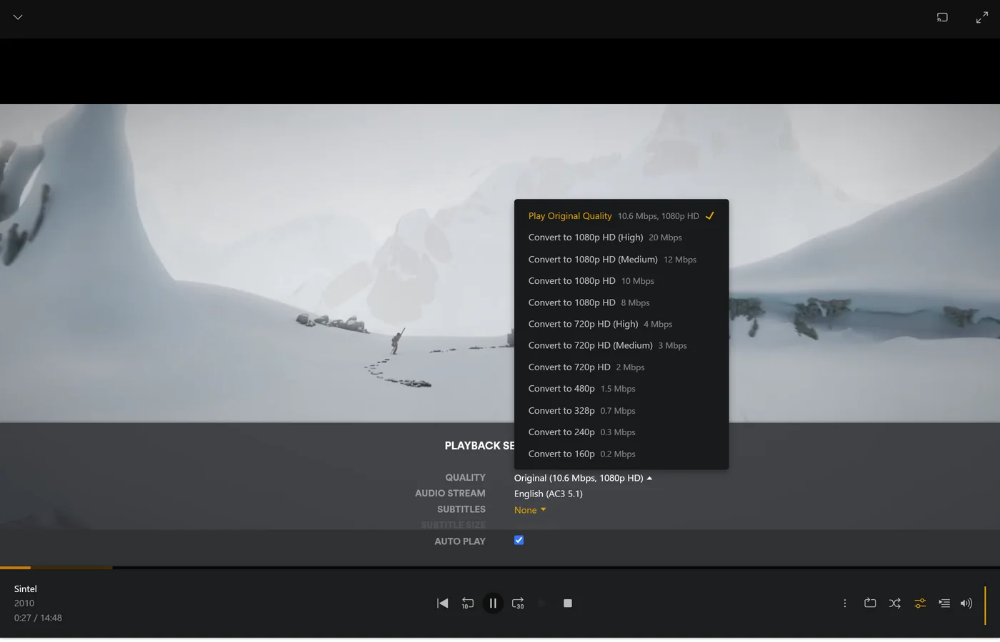

# rex mit Familie und Freunden teilen {#share-rex-with-family-and-friends}

Teile rex von dem Konto aus, mit dem es registriert ist, über **Manage Library Access** in Plex. Jede Person meldet sich bei Plex mit ihrem eigenen Konto an und sieht rex neben ihren anderen Servern, mit ihrem eigenen Wiedergabeverlauf.

Richte rex zuerst auf einem neuen Plex-Konto ein. Nutze dazu [rex mit deiner eigenen App](any-source.md), [rex mit deinen Stremio-Addons](stremio.md) oder [rex mit zurg](with-zurg.md). Unten bezeichnet **the owner** dieses Konto.

## Wer ist wer {#who-is-who}

| Konto | Wofür es da ist |
|---|---|
| Der Besitzer, das neue Konto, bei dem rex registriert ist | Teilen, Einstellungen, **Fix Match** und Löschen. Du meldest dich nur dafür damit an |
| Dein eigenes Konto | Hier schaust du. rex wird damit genauso geteilt wie mit jedem anderen |
| Familie und Freunde | Ihre eigenen Plex-Konten oder verwaltete Benutzer für Kinder (unten) |

Dein eigenes Konto bekommt nicht mehr Rechte als jeder andere, mit dem du teilst. Warum: [Is my Plex account at risk?](faq.md#is-my-plex-account-at-risk)

## Jemanden einladen {#invite-someone}

1. Melde dich als Besitzer bei [app.plex.tv](https://app.plex.tv) an und öffne dann **Settings** (den Schraubenschlüssel), **Manage Library Access** und **Grant Library Access**.
2. Gib den Plex-Benutzernamen oder die E-Mail-Adresse der Person ein, wähle den rex-Server und die Bibliotheken aus, die du freigeben willst, und schick die Einladung ab.
3. Die Person nimmt sie an, während sie als sie selbst angemeldet ist. Die Einladung kommt per E-Mail und in app.plex.tv an. Jede Einladung wird einzeln angenommen.

**Eine Bibliothek, die du später hinzufügst** (eine, die eine Quelle angibt, etwa eine **Anime**-Bibliothek oder die eines rex-stremio-Katalogs, oder eine, die mit **Add Library** erstellt wurde) ist noch in keiner Freigabe enthalten. Füge sie in Manage Library Access zu jeder Freigabe hinzu.

**Was sie sehen sollten.** Wenn die Person als sie selbst angemeldet ist, zeigen ihre Plex-Apps rex neben ihren eigenen Servern an. Zu Hause reicht das. Unterwegs lies weiter.

## Zu Hause und unterwegs {#at-home-and-away}

**Zu Hause** finden die Plex-Apps rex selbst im Netzwerk, wenn rex Port 32400 verwendet.

**Unterwegs**, was für einen Freund in einem anderen Haus immer der Fall ist, brauchen seine Apps die HTTPS-Adresse von rex. rex hat kein Relay. Am einfachsten ist rex-direct: Leite Port 32400 auf deinem Router an den rex-Rechner weiter. Hast du keine öffentliche IPv4-Adresse, aber IPv6, [nutze stattdessen IPv6](any-source.md#rex-direct-over-ipv6). Dann braucht auch das Netzwerk deines Freundes IPv6. [Außerhalb deines Zuhauses nutzen](any-source.md#use-it-outside-your-home-optional) beschreibt diesen und die anderen Wege.

**Dein Upload-Tempo ist der Engpass.** Jeder Stream, der unterwegs geschaut wird, läuft über den Upload deines Heimanschlusses, mit der Bitrate der Datei selbst, sofern sie nicht umgewandelt wird. Wenn also zwei Leute gleichzeitig schauen, brauchst du den Upload für beide. Drei Dinge helfen:

- **Niedrigere Qualität.** Wer im Player eine Qualität unter Original wählt, bekommt einen umgewandelten Stream, der kleiner ist. Dafür braucht der rex-Rechner FFmpeg ([Videos konvertieren](any-source.md#converting-video-optional)). Die Plex-Apps fürs Handy im mobilen Netz begrenzen die Qualität auf 720p und 4 Mbps. Ohne FFmpeg wird dort ein 1080p-Titel abgelehnt, bis die mobile Qualität auf Original gestellt wird.
  

- **Apps laden vom Anbieter herunter.** Plezy und Plex für Android können eine Datei über den Link holen, den deine Quelle liefert, etwa den deines Debrid-Dienstes. Dann läuft davon nichts über deinen Anschluss: [Apps laden vom Anbieter herunter](direct-download.md). Dein Anbieter sieht dann, dass jede Person von ihrer eigenen Adresse lädt. Prüfe deshalb vorher die Regeln deines Anbieters, bevor du so teilst.
- **Ein Limit pro Person** (siehe unten).

**Kein Plex Pass nötig.** Deine Freunde brauchen keinen Plex Pass oder Remote Watch Pass, um unterwegs zu schauen. Das wurde in Plex Web mit kostenlosen Konten auf beiden Seiten geprüft. Andere Apps wurden unterwegs nicht getestet.

## Kinder: verwaltete Benutzer {#children-managed-users}

Wenn der Besitzer ein **Plex Home** mit verwalteten Benutzern hat, funktioniert ein verwalteter Benutzer mit rex genauso wie mit einem Plex-Server. Teile rex wie bei jedem anderen über Manage Library Access mit ihm und schränke danach ein, was er sieht (siehe unten). Er bekommt seinen eigenen Wiedergabeverlauf. rex wurde mit einer Freigabe für einen verwalteten Benutzer getestet, die nur Movies, nur Titel mit der Bewertung G und PG und keine Downloads umfasste.

## Was jede Person sehen und tun darf {#what-each-person-may-see-and-do}

Du legst diese fest, pro Person, in ihrem Freigabe-Eintrag unter Manage Library Access, wie bei jedem Plex-Server. rex hält sich überall daran: in den Bibliothekslisten, bei der Suche, in den Zeilen der Startseite und auf den Titelseiten.

| Einstellung | Was sie auf rex bewirkt |
|---|---|
| Libraries | Sie sehen nur die Bibliotheken, die du freigegeben hast. Die anderen existieren für sie nicht |
| Ratings | Nur Titel mit den Altersfreigaben, die du erlaubst, etwa G und PG. Ein Titel ohne Altersfreigabe wird ebenfalls ausgeblendet |
| Labels | Blende die Titel aus, denen du ein Label gegeben hast, oder zeige nur diese |
| Downloads | Ob ihre Plex-Apps Inhalte zum Offline-Ansehen herunterladen dürfen |

Plex zeigt **Ratings** und **Labels** in einer Freigabe nur an, wenn das Besitzerkonto Plex Pass hat. Bei einem kostenlosen, neuen Konto bietet die Freigabe nur **Allow Downloads** an. Die eigenen Einschränkungen von rex unten legen Altersfreigaben und Labels trotzdem fest, auch ohne das.

rex erfährt jede Änderung von plex.tv, sobald du sie machst. Wird eine nicht angezeigt, starte rex neu.

rex kann für eine Freigabe außerdem eigene Einschränkungen speichern, zusätzlich zu denen von Plex. Sie können nur enger fassen, was Plex erlaubt. Sie werden mit einem Befehl gesetzt und nicht in einer Plex-App: [Local owner controls](https://github.com/debridmediamanager/rex/blob/main/docs/setup.md#local-owner-controls).

## Wer darf was {#who-can-do-what}

| | Der Besitzer | Alle anderen, dich eingeschlossen |
|---|---|---|
| Ansehen, mit dem eigenen Gesehen-Status, Weiterschauen, Bewertungen und Wiedergabelisten | Ja | Ja |
| Herunterladen zum Offline-Ansehen | Ja | Wenn deren Freigabe es erlaubt |
| **Fix Match** und Bearbeiten eines Titels | Ja | Nein |
| Einen Titel löschen (er wird an der Quelle gelöscht, für alle) | Ja | Nein |
| Servereinstellungen und wer gerade schaut | Ja | Nein |

Sammlungen und Poster gehören dem Server, daher sehen alle dieselben.

## Den Verlauf jeder Person übernehmen {#bring-each-persons-history}

Jeder, mit dem du teilst, kann das, was er gesehen und bewertet hat, auf einen anderen Plex-Server kopieren, jeweils mit eigenen Tokens: [Bring deinen Wiedergabeverlauf mit](import-watched.md). Das Ausführen ändert den Verlauf von niemand anderem.

## Wie viele gleichzeitig {#how-many-at-once}

rex setzt selbst keine Grenze, wie viele Leute gleichzeitig schauen. Das bestimmen deine Upload-Geschwindigkeit, dein Rechner und deine Quelle. Jede Konvertierung läuft mit FFmpeg auf dem rex-Rechner. Wie viele gleichzeitig dein Rechner schafft, hängt von der Hardware ab. Zwei gleichzeitige Konvertierungen wurden noch nicht gemessen. Ein kopiertes Video (nur der Ton wird konvertiert) kostet fast nichts.

Um Limits zu setzen, meldest du dich als Besitzer an und öffnest die Einstellungen des Servers:

| Einstellung | Wo | Standard |
|---|---|---|
| **Remote streams allowed per user** | Network, unter den erweiterten Einstellungen | 0, kein Limit. Zählt nur Streams außer Haus |
| **Maximum simultaneous CPU transcodes** | Transcoder | 0, kein Limit. Zählt jede Videokonvertierung, auch auf dem Grafikchip. Ein kopiertes Video wird nie mitgezählt |

rex lehnt eine Wiedergabe ab, wenn das Limit überschritten wird.

