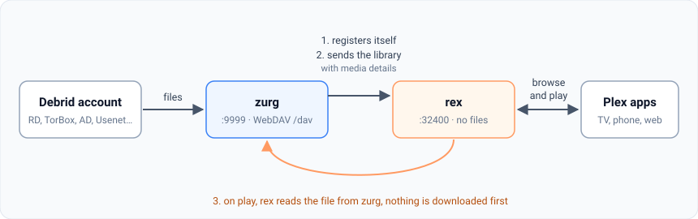
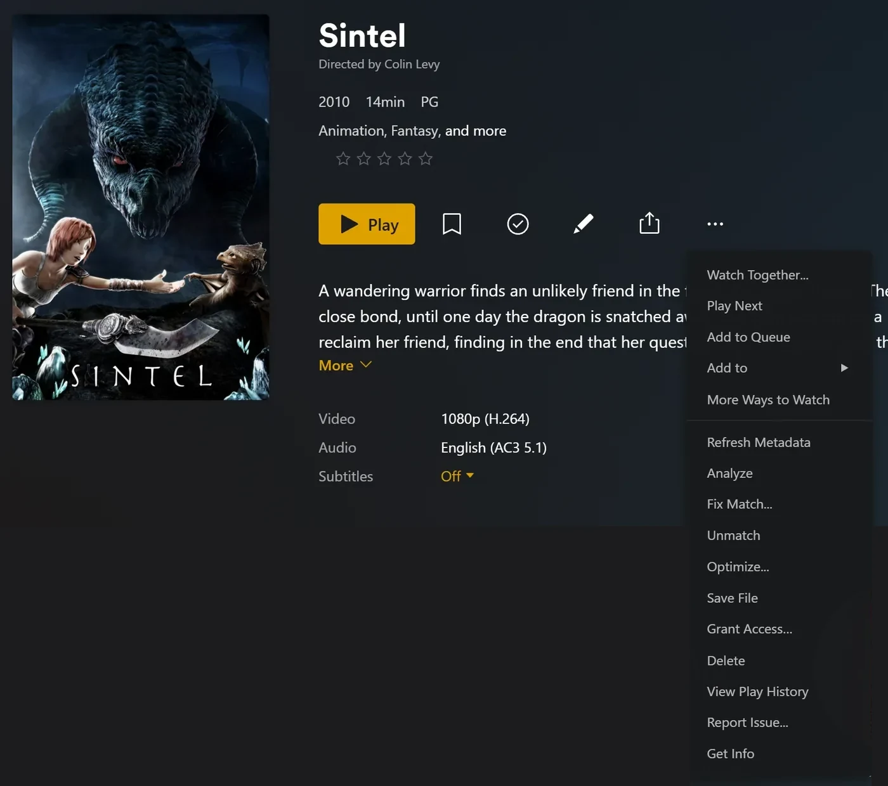
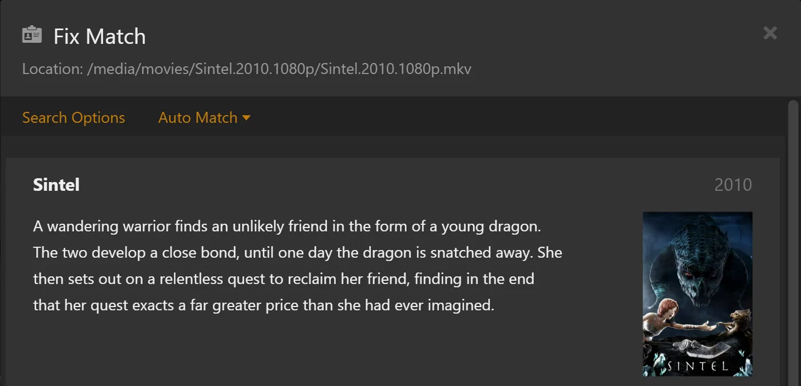

# rex mit zurg {#rex-with-zurg}

[rex](https://rex.debridmediamanager.com/de/) ist ein Medienserver für die offiziellen Plex-Apps, der keine Dateien besitzt. Die offiziellen Plex-Apps sehen ihn wie einen normalen Plex-Server. Jede App kann ihn füllen ([rex mit deiner eigenen App](any-source.md)). Diese Seite richtet ihn mit zurg ein, das ihm deine Debrid-Bibliothek schickt. Wenn du auf Play drückst, streamt rex die Datei direkt von zurg. Vorher wird nichts heruntergeladen.

Diese Seite führt dich Schritt für Schritt von null bis zum ersten abgespielten Film. Bei jedem Schritt steht, was er macht, warum er wichtig ist und was du sehen solltest, bevor du weitergehst. Wenn das, was du siehst, nicht passt, hör dort auf. Der nächste Schritt behebt das Problem nicht.



Vier Dinge solltest du vor dem Start wissen:

- **zurg ist der Teil, der mit deinem Debrid-Dienst spricht.** Es listet auf, was in deinem Konto liegt, und liefert die Dateien aus.
- **rex ist der Teil, mit dem deine Plex-Apps sprechen.** Es speichert keine Dateien und braucht keine Festplatte für Medien. Es braucht weder rclone noch einen Mount.
- **zurg meldet rex seine eigenen Daten.** Du gibst zurg die Adresse von rex, und zurg erledigt den Rest. Die Daten von zurg tippst du nie in rex ein.
- **zurg und DMM entscheiden, was jede Datei ist; Plex beschreibt sie.** zurg fragt DMM, welcher Film oder welche Episode jede Datei ist, und rex zeigt diesen Titel mit den Postern und Beschreibungen, die Plex' eigene Metadaten liefern, sobald rex in einem Plex-Konto eingerichtet ist. rex rät nie anhand des Dateinamens.

rex ist für die private Nutzung kostenlos (PolyForm Noncommercial): Es gibt keine Sponsor-Stufe, und du brauchst kein Konto, um es herunterzuladen. Die Nightly-Version von zurg, die diese Anleitung verwendet, bleibt ein Sponsor-Release. [rex mit deiner eigenen App](any-source.md) betreibt rex ohne sie. Du hast nur ein Handy oder eine TV-Box? zurg+rex, ein Plex-Server auf deinem Handy, betreibt zurg und rex gemeinsam darauf: siehe die [Android-Anleitung](../zurg/guides/android.md).

## Bevor du anfängst {#before-you-start}

| Du brauchst | Warum |
|---|---|
| Eine Maschine, die dauerhaft läuft: Linux (Ubuntu 22.04 oder neuer), macOS oder Windows (64 Bit). Ein Proxmox LXC funktioniert, unprivilegiert ist in Ordnung, sobald FUSE dafür aktiviert ist (Options > Features > FUSE). Ohne `/dev/fuse` bricht der Installer von zurg ab | rex und zurg sind Server: Deine Plex-Apps erreichen sie, wenn du auf Play drückst. Wo sich die Befehle unterscheiden, gibt es bei einem Schritt für jedes System einen eigenen Tab. [Docker](#run-rex-in-docker) findest du weiter unten, für Linux |
| 1 GB RAM | Bei 4,062 Filmen und 656 Serien (34,678 Episoden) brauchte rex beim Start weniger als 500 MB und beim Durchsuchen der Bibliothek etwa 730 MB. Die Umwandlung von Videos braucht mehr. zurg braucht wenig |
| Ein Debrid-Konto (Real-Debrid, TorBox, AllDebrid, Premiumize, Debrid-Link, Offcloud) oder Usenet | Dort liegen deine Filme und Serien tatsächlich |
| Ein GitHub-Konto mit Zugriff auf zurgs Sponsor-Releases | zurgs Nightly ist ein privates GitHub-Release. [gatekeeper](https://gatekeeper.debridmediamanager.com/) gibt deinem Konto Zugriff, wenn du sponserst. Der zurg-Installer meldet dich einmalig an |
| Dein DMM-API-Schlüssel, von [gatekeeper](https://gatekeeper.debridmediamanager.com/), sobald du sponserst (optional) | zurg fragt DMM, was jede Datei ist. Ohne den Schlüssel ermittelt zurg es aus dem Release-Namen, über die kostenlose Titelsuche von DMM. Dann passen weniger Titel, und eine Anime-Serie, die über die ganze Serie durchnummeriert ist, bleibt in der Dateireihenfolge |
| Ein neues Plex-Konto, nur für rex angelegt | rex holt sich jeden Titel, jedes Poster, jede Zusammenfassung und jeden Episodennamen aus Plex, sobald es [zu einem Plex-Konto hinzugefügt](#step-3-add-it-to-a-plex-account) wurde. Bis dahin behalten Titel ihre Dateinamen und haben keine Poster |

Diese Seite benötigt rex Nightly **2026.10.25 oder neuer** und zurg Nightly **2026.10.27 oder neuer**.

## Schritt 1. zurg installieren {#step-1-install-zurg}

**Was es macht.** Lädt zurg herunter, fragt nach deinem Debrid-Konto und startet zurg als Dienst, der nach einem Neustart wieder hochfährt.

**Warum das wichtig ist.** Alles, was rex anzeigt, kommt von zurg. Wenn zurg deine Bibliothek nicht sieht, sieht rex sie auch nie.

**Unter Windows und macOS installierst du zurg mit dem Installer unten, nicht in Docker Desktop.** rex liest jede Datei von der Adresse, die zurg ihm nennt, und kann ein zurg in Docker Desktop nicht erreichen: Titel würden erscheinen, aber nichts würde abspielen.

+++ Linux
```bash
curl -fsSL https://raw.githubusercontent.com/debridmediamanager/zurg-site/main/public/install.sh | bash
sudo loginctl enable-linger "$USER"
```

zurg landet in `~/zurg`. Die zweite Zeile sorgt dafür, dass deine Dienste weiterlaufen, wenn du dich abmeldest.
+++ macOS
```bash
curl -fsSL https://raw.githubusercontent.com/debridmediamanager/zurg-site/main/public/install.sh | bash
```

zurg landet in `~/zurg`. Der Installer installiert außerdem macFUSE. macOS verlangt dafür unter **System Settings**, **Privacy & Security** vielleicht eine Freigabe, danach ist ein Neustart nötig: [zurg unter macOS](../zurg/setup/macos.md).
+++ Windows
In PowerShell:

```powershell
irm https://raw.githubusercontent.com/debridmediamanager/zurg-site/main/public/install.ps1 | iex
```

zurg landet in `$HOME\zurg` (`C:\Users\you\zurg`). Der Installer installiert außerdem WinFsp und fragt dafür nach der Administrator-Freigabe. zurg startet bei jeder Anmeldung an Windows: [zurg unter Windows](../zurg/setup/windows.md).
+++

Der Installer fragt, welche Dienste du nutzt (tippe `1` für Real-Debrid), und danach nach deinem API-Token. Beim Einfügen bleibt das Token unsichtbar.

**Was du sehen solltest.** Am Ende zeigt der Installer eine Liste mit `PASS`-Zeilen und `==> zurg is installed in` mit dem Ordner von zurg. Danach lädt zurg deine Bibliothek: ein paar Sekunden bei einem kleinen Konto, etwa zehn Minuten bei einem mit tausend Releases auf Real-Debrid. Öffne das Dashboard von zurg unter `http://<this machine>:9999`: **Library Size** zählt deine Einträge, sobald es fertig ist.

Hast du zurg schon laufen? Dann aktualisierst und startest du es mit `cd ~/zurg && ./zurg update && ./zurg service restart` neu (unter Windows: `cd $HOME\zurg; .\zurg.exe update; .\zurg.exe service restart`).

## Schritt 2. rex installieren {#step-2-install-rex}

**Was es macht.** Lädt rex nach `~/rex` (`$HOME\rex` unter Windows) herunter und startet es als Dienst, mit allem, was die späteren Schritte brauchen. Die Schritte danach brauchen keinen Neustart; nur die optionalen Abschnitte weiter unten.

**Warum es wichtig ist.** rex ist das, womit deine Plex-Apps sprechen. Der erste Start legt `rex.db` an. Darin stehen deine Bibliotheken, alles, was zurg schickt, und dein Wiedergabeverlauf.

Unter Linux kannst du zurg und rex stattdessen in Docker laufen lassen: siehe [rex in Docker ausführen](#run-rex-in-docker).

+++ Linux und macOS
```bash
mkdir -p ~/rex && cd ~/rex
TAG=$(curl -fsSL 'https://api.github.com/repos/debridmediamanager/rex/releases?per_page=1' | sed -n 's/.*"tag_name": *"\([^"]*\)".*/\1/p' | head -1)
P=$(uname -s | tr A-Z a-z)-$(uname -m | sed 's/x86_64/amd64/;s/aarch64/arm64/')
curl -fL "https://github.com/debridmediamanager/rex/releases/download/$TAG/rex-$TAG-$P.tar.gz" | tar xz --strip-components=1
```
+++ Windows
In PowerShell:

```powershell
New-Item -ItemType Directory -Force $HOME\rex | Out-Null; cd $HOME\rex
$tag = (Invoke-RestMethod 'https://api.github.com/repos/debridmediamanager/rex/releases?per_page=1')[0].tag_name
curl.exe -fLO "https://github.com/debridmediamanager/rex/releases/download/$tag/rex-$tag-windows-amd64.zip"
tar -xf "rex-$tag-windows-amd64.zip" --strip-components=1; Remove-Item "rex-$tag-windows-amd64.zip"
```
+++

Das lädt rex' neuesten Build herunter, meist einen Nightly, passend für deinen Rechner.

Finde rex' LAN-IP, also seine Adresse in deinem Heimnetz. Unter Linux gibt `hostname -I` mehrere aus: nimm die aus deinem Heimnetz, nicht eine, die mit `172.17.` (Docker) oder `100.` (Tailscale) beginnt. Unter macOS gibt `ipconfig getifaddr en0` sie aus (`en1`, falls das nichts ausgibt). Unter Windows steht sie bei `ipconfig` als **IPv4 Address** unter deinem Wi-Fi- oder Ethernet-Adapter. **Diese Seite schreibt sie überall als `192.168.1.20`: trag deine an deren Stelle ein.** Plex-Apps, zurg und deine eigenen Befehle erreichen rex dort.

**Läuft Plex Media Server auf demselben Rechner?** Hänge an rex' Startbefehl unten `--port 32500` an und verwende `32500` überall, wo ein Befehl oder eine Einstellung `32400` nennt, auch bei der Windows-Firewall-Regel. Plex belegt schon Port 32400 und die Ports, über die Apps Server finden. Auf jedem anderen Port überlässt rex diese Ports Plex. Deine Apps zeigen dann zwei Server mit dem Namen des Rechners: rex ist der, der mit dir geteilt wird, daneben steht der Name des frischen Kontos. Sobald rex auf seinem Plex-Konto ist ([Schritt 3](#step-3-add-it-to-a-plex-account)), kannst du es umbenennen: Melde dich bei Plex als dieses Konto an, öffne rex' **Settings**, **General**, ändere **Friendly name** und speichere, dann starte rex wie unten neu. Die Plex-Apps zeigen es nach dem Neustart unter dem neuen Namen.

Jetzt machen wir daraus einen Dienst:

+++ Linux
Lege `~/.config/systemd/user/rex.service` an:

```bash
mkdir -p ~/.config/systemd/user
nano ~/.config/systemd/user/rex.service
```

```ini
[Unit]
Description=rex
After=network-online.target

[Service]
WorkingDirectory=%h/rex
EnvironmentFile=-%h/rex/rex.env
ExecStart=%h/rex/rex
Restart=always
RestartSec=5

[Install]
WantedBy=default.target
```

```bash
systemctl --user daemon-reload
systemctl --user enable --now rex
journalctl --user -u rex -f
```

rex' **Startbefehl** ist die Zeile `ExecStart`, und Schlüssel kommen in `~/rex/rex.env`, je eine `NAME=value`-Zeile. Nach einer Änderung startet `systemctl --user daemon-reload && systemctl --user restart rex` rex neu. `journalctl --user -u rex -f` zeigt sein Log.
+++ macOS
`run.sh` startet rex in seinem Ordner, und ein LaunchAgent startet `run.sh`, wenn du dich anmeldest:

```bash
cp ~/rex/examples/run.sh.example ~/rex/run.sh
mkdir -p ~/Library/LaunchAgents
cat > ~/Library/LaunchAgents/com.rex.plist <<PLIST
<?xml version="1.0" encoding="UTF-8"?>
<!DOCTYPE plist PUBLIC "-//Apple//DTD PLIST 1.0//EN" "http://www.apple.com/DTDs/PropertyList-1.0.dtd">
<plist version="1.0"><dict>
  <key>Label</key><string>com.rex</string>
  <key>ProgramArguments</key><array><string>/bin/bash</string><string>$HOME/rex/run.sh</string></array>
  <key>RunAtLoad</key><true/><key>KeepAlive</key><true/>
  <key>StandardOutPath</key><string>$HOME/rex/rex.log</string>
  <key>StandardErrorPath</key><string>$HOME/rex/rex.log</string>
</dict></plist>
PLIST
launchctl load ~/Library/LaunchAgents/com.rex.plist
tail -F ~/rex/rex.log
```

rex' **Startbefehl** ist die letzte Zeile von `~/rex/run.sh`, und Schlüssel kommen in `~/rex/rex.env`, je eine `NAME=value`-Zeile. Nach einer Änderung startet `launchctl kickstart -k gui/$(id -u)/com.rex` rex neu. `tail -f ~/rex/rex.log` zeigt sein Log.

rex läuft, solange du am Mac angemeldet bist. Startet sich der Mac selbst neu, schalte die automatische Anmeldung ein (**System Settings**, **Users & Groups**). Ist die macOS-Firewall an, erlaube rex, wenn macOS fragt, oder füge `~/rex/rex` unter den **Options** der Firewall hinzu.
+++ Windows
Öffne PowerShell **als Administrator** und wechsle mit `cd $HOME\rex` in rex' Ordner. Erstelle zuerst `run.cmd`; sie startet rex in seinem Ordner und schreibt sein Log nach `rex.log`. Notepad bietet an, die Datei anzulegen:

```powershell
notepad run.cmd
```

```bat
@echo off
cd /d "%~dp0"
rex.exe 2>> rex.log
```

Speichere sie. Dann lass dein Netzwerk durch die Windows-Firewall zu rex' Port und zu den zwei Discovery-Ports, und starte rex jetzt und künftig bei jeder Anmeldung:

```powershell
New-NetFirewallRule -DisplayName rex -Protocol TCP -LocalPort 32400
New-NetFirewallRule -DisplayName "rex discovery" -Protocol UDP -LocalPort 32410,32414
$settings = New-ScheduledTaskSettingsSet -ExecutionTimeLimit 0 -AllowStartIfOnBatteries -DontStopIfGoingOnBatteries
Register-ScheduledTask rex -Action (New-ScheduledTaskAction -Execute "$HOME\rex\run.cmd") -Trigger (New-ScheduledTaskTrigger -AtLogOn -User $env:USERNAME) -Settings $settings
Start-ScheduledTask rex; Start-Sleep 3
Get-Content rex.log -Wait
```

rex' **Startbefehl** ist die Zeile `rex.exe` in `run.cmd`, und Schlüssel kommen darüber, je eine Zeile `set NAME=value`. Nach einer Änderung startet `Stop-Process -Name rex; Start-Sleep 1; Start-ScheduledTask rex` rex neu. `Get-Content $HOME\rex\rex.log -Wait` zeigt sein Log.

Hast du rex von Hand in PowerShell gestartet? Dann steht sein Log nur in diesem Fenster, ohne `rex.log`, und nach einem Neustart startet es keine Aufgabe. rex hält Datenbank und Zuordnung im Ordner, aus dem es startet. Ein aus einem anderen Ordner gestartetes rex ist daher ein neuer, nicht zugeordneter Server. Beende es mit Strg+C und starte es dann aus rex' Ordner mit denselben Flags neu, besser ist aber die Aufgabe oben.

rex läuft, solange du bei Windows angemeldet bist, in einem eigenen Fenster: lass es offen. In PowerShell tippst du `curl.exe`, wo diese Seite `curl` schreibt: PowerShells eigenes `curl` ist ein anderer Befehl.
+++

**Was du sehen solltest.** Unter den ersten Zeilen:

```
INFO    seeded rex.db: an empty library named yourhost, machine=...
INFO    no source yet: a source registers itself once pointed at this server (PUT /rex/sources/{name}, docs/feed-api.md)
INFO    claim state: unclaimed
INFO    rex on http://192.168.1.20:32400  machine=...  items=0  parts=proxy
```

rex benennt sich nach dem Rechner; deine Plex-Apps zeigen diesen Namen. `no source yet` ist richtig: zurg wurde noch nicht mitgeteilt, dass es rex gibt. Lass das Log offen.

## Schritt 3. Zu einem Plex-Konto hinzufügen {#step-3-add-it-to-a-plex-account}

**Was es tut.** Registriert rex bei einem Plex-Konto, so wie man einen echten Plex Media Server registrieren würde, und teilt ihn mit deinem eigenen Konto.

**Warum es wichtig ist.** rex holt sich für jeden Titel den Namen, das Poster, die Zusammenfassung und die Episodennamen aus Plex' eigenen Metadaten, und das darf es erst, wenn es an einem Konto hängt. Titel, die zurg vor der Registrierung geschickt hat, bekommen ihre Namen, sobald sie registriert ist. Außerdem funktioniert damit Fix Match, der Hinweis "unclaimed" verschwindet, und es ist nötig, bevor du [rex außerhalb deines Zuhauses nutzt](#use-it-outside-your-home-optional).

**Nimm dafür ein frisches Plex-Konto, nicht dein eigenes.** rex wird nicht von Plex gemacht, und Plex könnte gegen ein Konto vorgehen, auf dem rex registriert wird. Halte dein echtes Konto mit Wiedergabeverlauf, Freunden und eventuellem Plex Pass da raus: Erstelle auf [plex.tv](https://www.plex.tv) ein neues kostenloses Konto mit einer E-Mail-Adresse, die du sonst nirgends verwendest, registriere rex auf diesem Konto und teile rex mit deinem eigenen Konto. Dann schaust du angemeldet als du selbst, so wie du den Server eines Freundes nutzen würdest. Bis dieser Schritt erledigt ist, spielt rex nichts ab.

### rex auf dem neuen Konto registrieren {#register-rex-on-the-fresh-account}

1. Melde dich bei [plex.tv](https://www.plex.tv) **mit dem neuen Konto an**, öffne [plex.tv/claim](https://www.plex.tv/claim) und kopiere den Code. Er läuft nach etwa fünf Minuten ab.
2. Auf dem rex-Rechner (`curl.exe` unter Windows):

   ```bash
   curl -X POST "http://192.168.1.20:32400/myplex/claim?token=claim-xxxxxxxxxxxx"
   curl -s http://192.168.1.20:32400/identity
   ```

**Das solltest du sehen.** Der zweite Befehl zeigt `claimed="1"`, und `claim_state.json` existiert im Ordner von rex. Sichere diese Datei: Ohne sie musst du mit einem neuen Code erneut beanspruchen. Solange sie existiert, lehnt rex eine zweite Beanspruchung ab.

### Mit deinem eigenen Konto teilen {#share-it-with-your-own-account}

1. Du bist noch mit dem neuen Konto angemeldet. Öffne [app.plex.tv](https://app.plex.tv), dann **Settings** (der Schraubenschlüssel), **Manage Library Access** und **Grant Library Access**.
2. Gib den Benutzernamen oder die E-Mail-Adresse deines eigenen Kontos ein, wähle den rex-Server und beide Bibliotheken, **Movies** und **TV Shows**, und schick die Einladung ab.
3. Melde dich ab, melde dich als **dir selbst** an und nimm die Einladung an. Sie kommt per E-Mail und in app.plex.tv an.


**Was du sehen solltest.** Wenn du als du selbst angemeldet bist, zeigen die Plex-Apps den rex-Server neben deinen eigenen Servern an, mit beiden Bibliotheken. Die sind noch leer, bis zum nächsten Schritt. Dein Wiedergabeverlauf auf rex gehört dir: Er wird getrennt vom Verlauf des neuen Kontos gespeichert. Die Freigabe funktioniert genauso für alle anderen in deinem Haushalt.

## Schritt 4. zurg mit rex verbinden {#step-4-connect-zurg-to-rex}

**Was es tut.** Sagt zurg, wo rex zu finden ist. zurg stellt sich bei rex vor, schickt die gesamte Bibliothek, liest für jede Datei die Video- und Audiodetails aus und schickt auch diese. Danach schickt es jede Änderung, sobald sie passiert.

**Warum es wichtig ist.** Das ist die einzige Verbindung zwischen beiden. rex hat keine Einstellung für zurg: Fehlt `rex_url`, bleibt rex leer. `rex_url` ist immer die einfache `http://`-Adresse in deinem Netzwerk, niemals eine HTTPS-Adresse aus [Von außerhalb deines Zuhauses nutzen](#use-it-outside-your-home-optional): rex nimmt die Pushes von zurg nur aus deinen eigenen Netzwerken an ([Port privat halten](#keep-the-port-private)). Dein DMM-Schlüssel erlaubt zurg, bei DMM nachzufragen, welcher Film oder welche Episode jede Datei ist. Ohne ihn errät zurg das anhand des Namens, und es passen weniger Titel.

zurg startet nicht zweimal mit demselben Schlüssel. Und das Dashboard von zurg schreibt `dmm_api_key` in die Konfiguration, wenn du deinen Schlüssel dort eingibst. Ohne DMM-Schlüssel lässt du `dmm_api_key` weg.

+++ Linux und macOS
Prüfe zuerst, ob die Konfiguration von zurg schon eine der beiden Zeilen enthält:

```bash
grep -n '^rex_url:\|^dmm_api_key:' ~/zurg/config.yml
```

Gibt sie eine Zeile aus, ist der Schlüssel schon gesetzt. Ändere ihn dann dort mit `nano ~/zurg/config.yml` und lass ihn im `printf` unten weg.

```bash
printf '\nrex_url: http://192.168.1.20:32400\ndmm_api_key: your_dmm_key\n' >> ~/zurg/config.yml
cd ~/zurg && ./zurg service restart
```
+++ Windows
Öffne die Konfiguration von zurg mit `notepad $HOME\zurg\config.yml`. Hat sie schon eine Zeile `rex_url:` oder `dmm_api_key:`, ändere diese Zeile. Die anderen fügst du am Ende hinzu:

```yaml
rex_url: http://192.168.1.20:32400
dmm_api_key: your_dmm_key
```

Speichere die Datei und starte zurg neu:

```powershell
cd $HOME\zurg; .\zurg.exe service restart
```
+++

**Was du sehen solltest.** Sobald zurg die Bibliothek neu geladen hat, schreibt das Log von zurg (`~/zurg/logs/zurg.log`, unter Windows `$HOME\zurg\logs\zurg.log`) `DMM placed N releases` (ohne DMM-Schlüssel: `Placed N releases by their names (no DMM sponsor key)`). Das Log von rex gibt Folgendes aus:

```
INFO    SOURCES zurg registered at http://192.168.1.20:9999/dav
INFO    SOURCES PUT /rex/sources/zurg -> 200
INFO    FEED zurg upsert: 0 created, 0 updated, 200 held, 0 unchanged, 0 rejected
INFO    FEED identified "Sintel.mp4" -> movie tmdb:45745 (placed)
INFO    FEED zurg upsert: 2 created, 0 updated, 0 held, 0 unchanged, 0 rejected
```

rex liest jede Datei von der Adresse in der Zeile `registered at`, also muss rex zurg dort erreichen können. rex schreibt diese Zeile nur dann erneut, wenn sich die Adresse ändert.

`held` bedeutet, dass zurg die Details dieser Datei noch nicht gelesen hat. zurg beginnt damit, sobald seine Bibliothek geladen ist, jeweils eine Release nach der anderen. Die Episoden eines Staffel-Packs kommen gemeinsam an. Mit DMM-Schlüssel kommen bis zu etwa 20 Releases pro Minute aus den gespeicherten Details von DMM. Eine große Bibliothek füllt sich über mehrere Stunden. Jeder Titel erscheint in rex, sobald seine Details ankommen. Alles, was du später zu deinem Debrid-Konto hinzufügst, taucht von selbst auf, sobald zurg es gelesen hat.

**Falls nicht.**

- Gar nichts im Log von rex: zurg lädt noch seine Bibliothek, zurg ist veraltet (aktualisiere es wie in [Schritt 1](#step-1-install-zurg)), oder in `rex_url` ist ein Tippfehler. `grep 'rex feed' ~/zurg/logs/zurg.log | tail -n 5` zeigt die Seite von zurg (unter Windows `Select-String 'rex feed' $HOME\zurg\logs\zurg.log | Select-Object -Last 5`). Fehlt eine Zeile `rex feed: pushing the library to ...`, hat zurg `rex_url` nicht gelesen. Die Zeile `rex feed: snapshot failed, retrying in ...` bedeutet, dass zurg rex unter dieser Adresse nicht erreichen kann.
- Ein Titel bleibt `held`, und zurg schreibt `Cannot probe file ...`: Das erste Lesen beim Debrid-Dienst ist fehlgeschlagen. zurg versucht es selbst erneut. **Analyze & Tag Library** unter **Utilities** im Dashboard von zurg startet den Versuch sofort.

  

- Titel kommen an, aber es gibt keine `identified`-Zeilen: zurg konnte sie nicht über den Namen zuordnen. Ist `dmm_api_key` gesetzt und kein Sponsor-Schlüssel, schreibt zurg `DMM refused the API key for placement`. zurg ordnet dann über den Namen zu und versucht den Schlüssel einen Tag später erneut, oder sofort beim Neustart.
- Titel erscheinen, aber nichts spielt ab: rex kann zurg unter der Adresse aus `registered at` nicht erreichen. Die Zeile `upstream failed` in [Wenn etwas nicht stimmt](#when-something-is-wrong) prüft das.

Läufen mehrere zurgs (einer pro Debrid-Dienst)? Gib jedem einen eigenen Namen mit einer zusätzlichen Zeile, `rex_source: rd`, `rex_source: tb` und so weiter. Sie füllen dieselben Bibliotheken.

### Warum DMM die Dateien ablegt {#why-dmm-places-the-files}

File names often number episodes differently from the episode lists Plex apps show. DMM knows where each file really belongs:

| Release | Named | Where it really is |
|---|---|---|
| `[Erai-raws] Hibike Euphonium 3 - 01` | Staffel 1, Folge 1 | Sound! Euphonium Staffel 3, Folge 1 |
| `[HorribleSubs] One Piece - 486` | Folge 486 | Staffel 13, Folge 486 |
| `Firefly.S01E02.The.Train.Job` (DVD-Reihenfolge) | Folge 2 | Folge 1, „The Train Job“ |

Eine Datei, die zurg nicht einordnen kann, bleibt unzugeordnet. Das betrifft einen Film, der nach seiner Datei benannt ist, oder eine Folge in einer Serie, die nach ihrem Release benannt ist und nach der Reihenfolge der Dateien nummeriert wurde. Mit einem DMM-Key fragt zurg DMM einen Tag später noch einmal nach. Du kannst es aber auch selbst mit **Fix Match** in einer Plex-App richten. Dafür meldest du dich mit dem frischen Account an, dem rex gehört (rex verweigert es den Accounts, mit denen es geteilt ist). Ein Titel, den du mit Fix Match korrigiert hast, bleibt so, wie du ihn eingestellt hast.





Das zurg-Dashboard zeigt dir, was es mit jedem Release gemacht hat. Öffne das Release im **Torrent Manager** und schau dir **Placement** an. Mit **Place again** fragt DMM noch einmal nach. Eine IMDb-ID, die du im Feld **External ID** einträgst, sorgt dafür, dass das Release anhand dieser ID eingeordnet wird.


## Schritt 5. Etwas ansehen {#step-5-watch-something}

**Was es tut.** Öffnet rex in einer Plex-App, so wie du jeden anderen Plex-Server öffnest.

**Warum es wichtig ist.** Das ist der Sinn des ganzen Setups. Außerdem beweist es das letzte Glied: rex liest beim Schauen eine Datei von zurg.

Öffne eine Plex-App (keinen Webbrowser) auf einem Handy, Fernseher oder Computer **im selben Heimnetzwerk**. rex taucht unter dem Namen des Geräts auf, mit **Movies** und **TV Shows**. Wähle einen Film und drück auf Play.


Zu Hause ist nichts weiter nötig: Plex-Apps finden rex mit Plex' eigener lokaler Erkennung und verbinden sich über dein Netzwerk. Dafür muss das Gerät im selben Netzwerk wie rex sein (nicht in einem Gast-WLAN oder einem separaten VLAN). Die Erkennung läuft über die UDP-Ports 32410 und 32414, deshalb muss eine Firewall auf dem rex-Rechner sie durchlassen (unter Windows erledigen das die Firewall-Regeln aus Schritt 2). rex beantwortet die Erkennung, wenn es Port 32400 nutzt. Wenn du rex auf 32500 verschoben hast, weil Plex auf demselben Rechner läuft, übernimmt die Erkennung dieses Plex, und die Apps finden rex über das Plex-Konto, mit dem es [geteilt wird](#share-it-with-your-own-account). app.plex.tv im Webbrowser funktioniert zu Hause ebenfalls, über die HTTPS-Adresse, die [rex-direct](#rex-direct) rex gibt, sobald es beansprucht ist (rex nightly 2026.11.02 oder neuer). Beim ersten Mal fragt Chrome, ob app.plex.tv auf Geräte in deinem lokalen Netzwerk zugreifen darf: Erlaube es. `http://192.168.1.20:32400/web` ist nicht Plex Web: rex hat keine eigene Web-App, und diese Seite sagt nur, ob rex beansprucht ist und wo du schauen kannst.

**Was du sehen solltest.** Poster, Titel und Jahreszahlen wie auf jedem Plex-Server, und der Film läuft.

Zwei Dinge, auf die du stoßen kannst:

- **"yourhost server is unclaimed and not secure".** Eine Plex-App sagt das über jeden Server, der nicht in einem Plex-Konto ist, und rex spielt nichts ab, bis er in einem ist. Mach [Schritt 3](#step-3-add-it-to-a-plex-account). Drück nicht auf **Claim it now**, während du als du selbst angemeldet bist: Damit wird rex in deinem eigenen Konto registriert.
- **"This server is not powerful enough to convert video".** Wenn jeder Titel auf jedem Gerät scheitert, schau direkt nach dem Druck auf Play ins Log von rex: `upstream failed` oder `502` dort heißt, dass rex zurg nicht erreichen kann, und FFmpeg behebt das nicht. Die Zeile `upstream failed` in [Wenn etwas nicht stimmt](#when-something-is-wrong) sagt, was zu tun ist. Wenn nur manche Dateien scheitern, oft nur im Webbrowser, kann das Gerät sie nicht so abspielen, wie sie sind, oft wegen AC3- oder DTS-Ton. Plex-Apps auf Fernsehern und Handys spielen die meisten Dateien unverändert ab. Um alles überall abzuspielen, richte [Videokonvertierung (optional)](#converting-video-optional) ein.

zurgs Ordner außer `movies` und `shows`, etwa `anime`, brauchen nichts: Jede Datei landet unter **Movies** oder **TV Shows**, je nachdem, was zurg über sie sagt. Eine Datei, bei der zurg nicht erkennen kann, ob sie eine Episode ist, wartet unter **Movies**.

Um einem dieser Ordner eigene Bibliotheken zu geben, füge in zurgs `config.yml` unter ihm `rex_movies` für einen Ordner mit Filmen und `rex_shows` für einen Ordner mit Serien hinzu, und beides nur, wenn er beides enthält, neben seinen Filtern. Starte zurg danach neu, wie in [Schritt 4](#step-4-connect-zurg-to-rex). Jede davon erzeugt eine Bibliothek, auch eine leere, sodass ein Ordner mit Filmen und `rex_shows` eine leere TV-Bibliothek bekommt. DMM legt manche Dateien eines Ordners als Filme ab und manche als Episoden. Die Art ohne eigenen Titel landet unter **Movies** oder **TV Shows**:

```yaml
directories:
  anime:
    rex_shows: Anime
    rex_movies: Anime Movies
  films:
    rex_movies: Films
```

Sobald zurg geladen ist, erzeugt rex **Anime**, **Anime Movies** und **Films** und verschiebt, was es vorher aus `anime` zeigte, unverändert dorthin: Wiedergabeverlauf, Fix Match und Änderungen inklusive. Ein geöffnetes Plex Web listet sie sofort unter **More** in der Seitenleiste auf, wo du sie anheften kannst. Teile sie mit deinem eigenen Konto wie in [Schritt 3](#share-it-with-your-own-account). Benenne sie in einer Plex-App nach Belieben um. Löschst du eine, bleibt sie gelöscht, und ihre Dateien wandern zurück unter **Movies** oder **TV Shows**, bis du sie mit **Add Library** wieder hinzufügst. Dessen Ordnerliste zeigt zurgs Ordner. Wenn du `rex_shows` oder `rex_movies` später aus zurgs Config entfernst, bleibt die dafür erzeugte Bibliothek von rex erhalten, leer oder nicht: Lösche sie in einer Plex-App, angemeldet als das frische Konto. Taucht eine Bibliothek nicht auf, sagt das Log von zurg oder von rex, warum.


!!!warning Löschen in einer Plex-App löscht von deinem Debrid-Konto
Angemeldet als das frische Konto löscht **Delete** bei einem Film oder einer Episode auch deren Datei bei zurg. zurg entfernt den Torrent aus deinem Debrid-Konto, sobald keine seiner Dateien mehr übrig ist. Die Konten, mit denen rex geteilt wird, deines eingeschlossen, können nicht löschen. Um das Löschen abzuschalten: Öffne in app.plex.tv als das frische Konto **Settings**, dann die **Library** des rex-Servers, **Show Advanced**, entferne den Haken bei **Allow media deletion** und speichere. rex verweigert dann jedes Löschen.
!!!


Ein Titel, der auf andere Weise aus deinem Debrid-Konto verschwindet, etwa dort entfernt oder von zurg, landet im Papierkorb der Bibliothek in rex, wie in Plex. Er bleibt, als nicht verfügbar, mit seinem Wiedergabeverlauf, und kommt unverändert zurück, sobald zurg ihn wieder hat. **Empty Trash** auf der Bibliothek entfernt ihn endgültig. **Empty trash automatically after every scan** (Settings, Library) erledigt das automatisch, ist aber aus.

**Sichere** `rex.db` im Ordner von rex (sie enthält deine Bibliothek, deinen Wiedergabeverlauf und zurgs Login, halte sie also privat) und, sobald du sie hast, `claim_state.json` und `rex-direct.json` (den Claim und den Zertifikatsschlüssel von rex-direct):

+++ Linux und macOS
```bash
sudo apt install -y sqlite3    # once, on Linux; macOS has it
mkdir -p ~/rex-backup
sqlite3 ~/rex/rex.db ".backup $HOME/rex-backup/rex.db"
cp ~/rex/*.json ~/rex-backup/
```
+++ Windows
Windows hat kein `sqlite3`. Stoppe rex deshalb kurz und kopiere `rex.db` mit den beiden Dateien daneben, die genauso beginnen:

```powershell
Stop-Process -Name rex; Start-Sleep 1
New-Item -ItemType Directory -Force $HOME\rex-backup | Out-Null
Copy-Item $HOME\rex\rex.db*, $HOME\rex\*.json $HOME\rex-backup
Start-ScheduledTask rex
```
+++

In Docker liegen die Dateien in `~/rex/config`, nur für root lesbar. Sichere aus dem Container heraus mit `docker exec rex sqlite3 /config/rex.db ".backup /config/rex.db.bak"` und danach mit `mkdir -p ~/rex-backup && sudo cp ~/rex/config/rex.db.bak ~/rex/config/*.json ~/rex-backup/`.

[Ein Backup wiederherstellen](#restore-a-backup) spielt sie zurück.

Du bist fertig. Die folgenden Abschnitte sind optional.

## Außerhalb deines Zuhauses nutzen (optional) {#use-it-outside-your-home-optional}

**Was es macht.** Gibt rex eine HTTPS-Adresse, die Plex-Apps unterwegs erreichen können, und meldet sie bei plex.tv.

**Warum es wichtig ist.** Unterwegs verbindet sich app.plex.tv nur mit einer HTTPS-Adresse, und die anderen Plex-Apps bevorzugen eine solche Adresse. Ein echter Plex-Server kann auf das Relay von Plex zurückgreifen; rex kann das nicht, deshalb legst du selbst fest, wie er erreicht wird. rex muss zuerst [beansprucht](#step-3-add-it-to-a-plex-account) werden, und ein Proxy, der dem Internet zugewandt ist, muss `/rex/` blockieren ([Keep the port private](#keep-the-port-private)).

**Plex Pass.** Plex Web spielt unterwegs ab, ohne Plex Pass oder Remote Watch Pass auf einem der beiden Konten. Andere Plex-Apps wurden unterwegs noch nicht getestet.

Egal, für welche Variante du dich entscheidest: Jedes Byte, das du unterwegs ansiehst, läuft über die **Upload**-Geschwindigkeit deines Heimanschlusses. Ein 20-Mbit/s-Upload reicht locker für ein 1080p-WEB-DL, aber nicht für ein Remux.

### Welche man nehmen sollte {#which-one-to-use}

| Deine Situation | Verwenden | Warum |
|---|---|---|
| Dein Router hat eine öffentliche IP und du kannst einen Port weiterleiten | **[rex-direct](#rex-direct)** (am einfachsten) | Standardmäßig aktiv: eine Portweiterleitung. DMM gibt rex einen Namen und ein Zertifikat und hält den Namen auf deine Heim-IP ausgerichtet |
| Du kannst Tailscale auf den Geräten installieren, auf denen du schaust | **[Tailscale serve](#tailscale-serve)** (am besten) | Am Router ist nichts zu öffnen, und es funktioniert hinter jeder Internetverbindung. Das Zertifikat erneuert sich selbst, und niemand außerhalb deines Tailnets kann rex erreichen |
| Geräte ohne Tailscale (der Fernseher eines Freundes, ein Hotel), und dein Router hat eine öffentliche IP | **[Caddy](#caddy)** mit deiner eigenen Domain oder mit einem kostenlosen `sslip.io`-Namen | Eine direkte Verbindung ohne Zwischenstation und ein kostenloses Zertifikat, das sich selbst erneuert. Du leitest Port 443 weiter |
| Deine Verbindung hat keine öffentliche IPv4 (CGNAT oder DS-Lite, häufig bei Kabel-, Mobilfunk- und manchen Glasfaseranbietern), aber IPv6 | **[rex-direct über IPv6](#rex-direct-over-ipv6)** | Keine Portweiterleitung und nichts zu mieten: Du lässt Port 32400 über IPv6 durch. Die Geräte, auf denen du schaust, brauchen dafür ebenfalls IPv6, was die meisten Mobilfunknetze haben |
| Deine Verbindung hat gar keine öffentliche IP, oder du schaust in Netzen ohne IPv6, und Geräte ohne Tailscale | **[Ein kleiner VPS](#a-small-vps)** | rex hat kein Relay und wird auch keines bekommen. Ein gemieteter VPS hat die öffentliche IP, und ein Tunnel leitet alles zu rex weiter, mit der vollen Bandbreite des VPS |

Nicht empfohlen:

- **Cloudflare-Tunnel.** Jedes Byte läuft über Cloudflare, und Cloudflare verwirft außerdem den `Range` beim ersten Lesen einer Datei. Deshalb lädt jeder Wiedergabestart die ganze Datei von deinem Debrid-Dienst.
- **Tailscale Funnel, ngrok und andere gehostete Tunnel.** Sie begrenzen die Bandbreite oder das monatliche Datenvolumen, und ein Film verbraucht das schnell. Tailscale Funnel veröffentlicht außerdem ganz rex, einschließlich der API, an die zurg Daten schickt: Jeder im Internet könnte dieser Bibliothek Inhalte hinzufügen oder daraus löschen.
- **Port 32400 weiterleiten ohne rex-direct oder ein eigenes Zertifikat.** Die Plex-Apps würden dann eine einfache HTTP-Adresse bekommen, die app.plex.tv ablehnt.

### rex-direct

rex-direct ist DMMs Antwort auf plex.direct und ist standardmäßig eingeschaltet. Leite auf deinem Router Port 32400 (TCP) an die rex-Maschine weiter. Mehr ist nicht nötig, du musst nichts neu starten.

Sobald rex verknüpft ist, bekommt es zwei Namen von DMM: `<hash>.rex-direct.debridmediamanager.com`, das auf die öffentliche IP deines Zuhauses zeigt, und `lan.<hash>.rex-direct.debridmediamanager.com`, das auf die LAN-IP von rex zeigt, dazu ein Zertifikat für beide. Das erste Zertifikat braucht ein paar Minuten. rex schreibt ins Log, dass es ausgestellt wird, und zeigt dann jeden Namen in einer `rex-direct:`-Zeile. Eine neue Heim-IP und Zertifikatserneuerungen werden automatisch übernommen. Ein Plex-Konto kann bis zu zehn rex-direct-Namen haben. Zu Hause können Plex-Apps, auch app.plex.tv, den `lan.`-Namen nutzen. Der geht direkt über dein Netzwerk zu rex, daher wird die Portweiterleitung nur unterwegs gebraucht. Erlaube in app.plex.tv den Zugriff auf Geräte im lokalen Netzwerk, wenn Chrome danach fragt. Sonst weicht es auf den öffentlichen Namen aus, und der braucht die Portweiterleitung. [Was du sehen solltest](#what-you-should-see) prüft beide Namen.

Wenn dein Router einen anderen externen Port an rex weiterleitet, füge den Schlüssel `REX_DIRECT_PORT=<that port>` hinzu, wie in [Schritt 2](#step-2-install-rex) für dein System gezeigt, und starte rex neu. Die Portweiterleitung öffnet nicht die API, an die zurg Daten schickt. Siehe [Halte den Port privat](#keep-the-port-private).

(Eine frühere Übersetzung wurde abgelehnt: Code-Spans unterscheiden sich. Behalte die Struktur exakt bei.)

### rex-direct über IPv6 {#rex-direct-over-ipv6}

Für eine Verbindung ohne öffentliche IPv4-Adresse (CGNAT oder DS-Lite), die aber IPv6 hat. Sobald DMM sich über die IPv6-Adresse mit rex verbunden und dort denselben Server gefunden hat, trägt es diese Adresse auch für den Namen rex-direct von rex ein. Du brauchst rex Nightly 2026.11.08 oder neuer und in Docker das Host-Netzwerk.

Bei IPv6 gibt es keine Portweiterleitung und auch kein Port-Mapping: rex muss innen und außen auf demselben Port laufen, also lass `REX_DIRECT_PORT` ungesetzt. Erlaube in der Firewall deines Routers eingehende TCP-Verbindungen auf Port 32400 zu dem Rechner, auf dem rex läuft, über IPv6. rex meldet seine IPv6-Adresse eine Minute nach dem Start (oder nachdem es beansprucht wurde) und danach alle 6 Stunden. Füge die Regel also vor dem Start von rex hinzu, oder starte rex neu, nachdem du sie hinzugefügt hast. Etwa eine Minute später zeigt das Log beide Adressen:

```
rex-direct: https://<hash>.rex-direct.debridmediamanager.com:32400 -> <IPv4> and <IPv6>
```

Wenn nach ein paar Minuten keine Zeile mit `and <IPv6>` erscheint, konnte DMM rex nicht über IPv6 erreichen. Prüfe dann die Firewall-Regel und ob rex in Docker das Host-Netzwerk verwendet. Unter Windows bietet rex die temporäre IPv6-Adresse von Windows an, die Windows etwa täglich ersetzt. Schalte temporäre Adressen aus, indem du in einer PowerShell mit Administratorrechten `netsh interface ipv6 set privacy state=disabled` ausführst, und starte dann rex neu, damit es die feste Adresse anbietet. Die `<IPv4>` in dieser Zeile ist die geteilte Adresse deines Anbieters und erreicht rex nicht. Deshalb brauchen auch die Geräte, auf denen du schaust, IPv6. Die meisten Mobilfunknetze haben IPv6. Ein Hotel- oder Büronetz mit nur IPv4 kann rex auf diesem Weg nicht erreichen.

### Tailscale serve

Installiere [Tailscale](https://tailscale.com/download) auf dem rex-Rechner und auf den Geräten, auf denen du schaust, und melde dich überall mit demselben Konto an. Führe dann auf dem rex-Rechner Folgendes aus:

```bash
sudo tailscale serve --bg 32400
```

Unter Windows startest du es in PowerShell als Administrator, ohne `sudo`. Unter macOS verwendest du das [Kommandozeilen-Tool](https://tailscale.com/kb/1080/cli) der Tailscale-App, ebenfalls ohne `sudo`.

Es zeigt die Adresse an, zum Beispiel `https://myhost.tailnet.ts.net`. Gib sie rex mit `:443` am Ende an: Ergänze den Startbefehl von rex aus [Schritt 2](#step-2-install-rex) um `--announce-url https://myhost.tailnet.ts.net:443` und starte rex neu.

Tailscale verbindet deine Geräte direkt miteinander. Der Stream läuft deshalb nicht über die Server von Tailscale, außer in Netzwerken, die das blockieren.

### Caddy

Du brauchst Port 443 auf deinem Router, der an den rex-Rechner weitergeleitet wird, und einen Namen für deine Heim-IP-Adresse:

- **Eigene Domain:** ein `A`-Eintrag, zum Beispiel `rex.example.com`, der auf deine Heim-IP zeigt.
- **Keine Domain:** Nimm `1-2-3-4.sslip.io` mit den Zahlen deiner öffentlichen IP (`curl -s ifconfig.me` zeigt sie dir an). Der Name löst immer auf diese IP auf. Wenn sich deine IP ändert, aktualisiere den Namen.

Installiere [Caddy](https://caddyserver.com/docs/install) und gib ihm dieses Caddyfile (`/etc/caddy/Caddyfile` beim Linux-Paket von Caddy; unter macOS und Windows eine Datei namens `Caddyfile` in einem eigenen Ordner, den `caddy run` in diesem Ordner liest):

```
rex.example.com {
	respond /rex/* 403
	reverse_proxy 192.168.1.20:32400
}
```

`respond /rex/* 403` hält die API, an die zurg Daten schickt, vom Internet fern. zurg erreicht sie weiterhin unter `http://192.168.1.20:32400`. Lade danach Caddy neu (`sudo systemctl reload caddy` beim Linux-Paket). Unter macOS und Windows startest du stattdessen `caddy run` in dessen Ordner und lässt es laufen, so wie [Schritt 2](#step-2-install-rex) rex am Laufen hält. Unter Windows lässt du außerdem den TCP-Port 443 durch die Firewall, so wie es Schritt 2 für 32400 macht.

Caddy holt beim Laden der Datei ein Zertifikat und erneuert es selbst. Hänge an den Startbefehl von rex `--announce-url https://rex.example.com:443` an und starte rex neu.

### Ein kleiner VPS {#a-small-vps}

Für eine Verbindung ohne öffentliche IP-Adresse oder wenn du in Netzen ohne IPv6 schaust: Der VPS trägt dann jeden Stream, statt [rex-direct über IPv6](#rex-direct-over-ipv6). rex hat kein Relay und wird auch keins bekommen. Deshalb steht ein gemieteter Server an Stelle deines Routers: Er hat die öffentliche IP, und ein Tunnel von der rex-Maschine transportiert alles zu rex. Jeder VPS mit öffentlicher IPv4 funktioniert, ein paar Euro im Monat. **Wähle einen, dessen monatliches Datenvolumen reicht für das, was du unterwegs schaust:** Jedes Byte läuft darüber, und ein Tarif mit kleinem Datenlimit ist schnell aufgebraucht.

Du brauchst die IP des VPS (`1.2.3.4` unten), offene Ports 443, 80 und 7000 darauf und einen langen zufälligen String für den Tunnel (`openssl rand -hex 32`).

**Auf dem VPS** installiere [frp](https://github.com/fatedier/frp/releases) (das Programm `frps`) und [Caddy](https://caddyserver.com/docs/install). Erstelle `frps.toml`:

```toml
bindPort = 7000
auth.token = "your-long-random-string"
proxyBindAddr = "127.0.0.1"
```

`proxyBindAddr` hält das Tunnelende auf dem Loopback des VPS, sodass das Internet nur über Caddy an rex kommt. Erstelle `/etc/caddy/Caddyfile` mit der IP des VPS als `1-2-3-4.sslip.io` (ein kostenloser Name, der immer auf diese IP zeigt) oder deiner eigenen Domain, die darauf zeigt:

```
1-2-3-4.sslip.io {
	respond /rex/* 403
	reverse_proxy 127.0.0.1:32400
}
```

`respond /rex/* 403` hält die API, an die zurg pusht, vom Internet fern. Starte `frps -c frps.toml` als Dienst und führe `sudo systemctl reload caddy` aus.

**Auf der rex-Maschine** installiere frp ebenfalls (das Programm `frpc`) und erstelle `frpc.toml`:

```toml
serverAddr = "1.2.3.4"
serverPort = 7000
auth.token = "your-long-random-string"

[[proxies]]
name = "rex"
type = "tcp"
localIP = "192.168.1.20"
localPort = 32400
remotePort = 32400
```

Starte es als Dienst: unter Linux zum Beispiel `~/.config/systemd/user/frpc.service` mit `ExecStart=%h/frp/frpc -c %h/frp/frpc.toml` und `Restart=always`. Unter macOS und Windows startest du `frpc -c frpc.toml` so, wie [Schritt 2](#step-2-install-rex) rex startet. Hänge dann an den Startbefehl von rex `--announce-url https://1-2-3-4.sslip.io:443` an, füge den Schlüssel `REX_DIRECT_URL=off` hinzu (hinter CGNAT erreicht die IPv4 des rex-direct-Namens rex nicht, deshalb sollte plex.tv ihn nicht auflisten) und starte rex neu. app.plex.tv zu Hause läuft dann ebenfalls über den VPS. Andere Plex-Apps zu Hause verbinden sich weiterhin direkt mit rex.

### Was du sehen solltest {#what-you-should-see}

```bash
curl -s https://lan.<hash>.rex-direct.debridmediamanager.com:32400/identity
```

zeigt eine kurze XML-Seite mit rexs `machineIdentifier` auf einem Computer zu Hause. `curl` zeigt nichts an, wenn die Adresse oder ihr Zertifikat falsch ist. Verwende deine eigene Adresse: rex protokolliert sie beim Start als `rex-direct: https://lan.<hash>.rex-direct.debridmediamanager.com:32400 -> 192.168.1.20 (LAN)` (mit `REX_DIRECT_URL=off` gibt es keine). Öffne deine Adresse von außen mit angehängtem `/identity` im Browser eines Handys, bei ausgeschaltetem WLAN. Mit rex-direct ist es die andere `rex-direct:`-Zeile von rex. Bei Tailscale serve ist es `https://myhost.tailnet.ts.net`, und das Handy öffnet sie nur, wenn Tailscale eingeschaltet ist. Sie zeigt eine kurze XML-Seite ohne Zertifikatswarnung.

Wenn das Handy fehlschlägt, ist der Port nicht weitergeleitet (oder, [über IPv6](#rex-direct-over-ipv6), nicht freigegeben). Oder deine Verbindung steckt hinter CGNAT ohne IPv6, rex ist nur über IPv6 erreichbar und das Netz des Handys hat kein IPv6. Oder das Zertifikat von rex-direct wird noch ausgestellt (das Log von rex sagt dir das, solange es so ist).

Das Log von rex nennt die Adressen, die es ankündigt:

```
INFO    heartbeat every 600s for machine ... -> https://myhost.tailnet.ts.net:443,http://192.168.1.20:32400
```

rex gibt das bei jedem Start aus. Probleme zeigen sich später als `heartbeat failed` oder `announced but NOT visible`. Ansonsten trägt der Server diese Adressen auf plex.tv ein, und eine Plex-App unterwegs wählt die Adresse, die sie erreichen kann. Wenn rex `waiting for a claim` protokolliert, mach zuerst [Schritt 3](#step-3-add-it-to-a-plex-account).

## Dein Wiedergabeverlauf von einem anderen Plex-Server (optional) {#your-watch-history-from-another-plex-server-optional}

Schon mal auf einem anderen Plex-Server geschaut? Sobald deine Bibliothek in rex liegt, übernimmt [Bring your watch history](import-watched.md) von dort, was du geschaut hast, wo du aufgehört hast und deine Sternebewertungen, und zwar für jede Person einzeln.

## Sonarr, Radarr und Bazarr (optional) {#sonarr-radarr-and-bazarr-optional}

rex braucht keinen Mount, Sonarr und Radarr aber schon: Sie importieren in den Mount von zurg, unter `__magic__`. Richte sie mit zurg ein, wie [Sonarr & Radarr für Torrents](../zurg/guides/sonarr-radarr-torrents.md) oder [für Usenet](../zurg/guides/sonarr-radarr.md) zeigt. Was sie herunterladen, erreicht rex dann über zurg wie alles andere. Untertitel, die Bazarr neben diesen Importen speichert, tauchen innerhalb von etwa einer Minute in rex auf: [Untertitel mit Bazarr](../zurg/guides/subtitles.md). Eine zurg kann dein Debrid-Konto und Usenet in einer Bibliothek vereinen ([Usenet](../zurg/guides/usenet.md)), und zwei Kopien desselben Films sind in rex ein Titel, mit einer Version für jede.

## Video konvertieren (optional) {#converting-video-optional}

**Was es macht.** Lässt rex umwandeln, was ein Gerät nicht abspielen kann, so wie Plex es tut.

**Warum es wichtig ist.** Ohne das bekommt ein Gerät, das eine Datei so, wie sie ist, nicht abspielen kann, die Meldung "This server is not powerful enough to convert video". Am häufigsten passiert das mit Webbrowsern, zum Beispiel bei AC3- oder DTS-Ton. Wenn jeder Titel auf jedem Gerät fehlschlägt, liegt die Ursache woanders: siehe [Schritt 5](#step-5-watch-something).

Installiere **jellyfin-ffmpeg** 8, nicht das `ffmpeg`, das dein System anbietet. Es ist die Version, mit der rex gemessen wird, und die einzige, die jede Dolby-Vision-Datei umwandelt, HDR auf dem Grafikchip tone-mappt und Untertitel dort zeichnet. Ein anderes FFmpeg wandelt normale Videos um, und rex' Log sagt dir, was ihm fehlt (das eigene von Ubuntu 22.04 springt außerdem ein paar Sekunden daneben). rex findet es selbst.

+++ Linux
Das Paket landet in `/usr/lib/jellyfin-ffmpeg`, neben jedem anderen FFmpeg. Die erste Zeile wählt das Build für dein System: Es gibt Builds für Ubuntu 22.04, 24.04 und 26.04 sowie Debian 12 und 13, auf amd64 oder arm64. Auf jedem anderen System bricht `curl` mit einem Fehler ab.

```bash
DEB=jellyfin-ffmpeg8_8.1.3-1-$(. /etc/os-release; echo "$VERSION_CODENAME")_$(dpkg --print-architecture).deb
curl -fLO "https://github.com/jellyfin/jellyfin-ffmpeg/releases/download/v8.1.3-1/$DEB"
sudo apt install -y "./$DEB" && rm "$DEB"
systemctl --user restart rex
```

Auf einem anderen Linux entpackst du das portable Build von jellyfin-ffmpeg in `~/rex/ffmpeg`, dort sucht rex danach, und startest rex neu. Es nutzt den Grafiktreiber deines Systems. Auf einem älteren System wandelt es daher nur auf dem Prozessor um. Nutze das Paket, wo es eines gibt.

```bash
B=$( [ "$(uname -m)" = aarch64 ] && echo linuxarm64 || echo linux64 )
mkdir -p ~/rex/ffmpeg && curl -fL "https://github.com/jellyfin/jellyfin-ffmpeg/releases/download/v8.1.3-1/jellyfin-ffmpeg_8.1.3-1_portable_${B}-gpl.tar.xz" | tar xJ -C ~/rex/ffmpeg
```

Bei einem Intel- oder AMD-Grafikchip führst du außerdem `sudo usermod -aG render "$USER"` aus und startest neu, damit der Dienst die Gruppe bekommt. In einem LXC reichst du die GPU durch. Der Chip macht die Umwandlung schnell; ohne ihn nutzt rex den Prozessor. Ohne Intel- oder AMD-Chip probiert rex zusätzlich den Encoder einer NVIDIA-Karte. Auf Intel wandelt `sudo apt install intel-opencl-icd` auch HDR und Dolby Vision auf dem Chip um, bei einem kleinen Intel etwa in Echtzeit für 4K; ohne das Paket werden sie auf dem Prozessor umgewandelt, und ein stromsparender Intel schafft 4K dort nicht in Echtzeit.
+++ macOS
Das portable Build kommt in `~/rex/ffmpeg`, dort sucht rex danach:

```bash
B=$( [ "$(uname -m)" = arm64 ] && echo macarm64 || echo mac64 )
mkdir -p ~/rex/ffmpeg && curl -fL "https://github.com/jellyfin/jellyfin-ffmpeg/releases/download/v8.1.3-1/jellyfin-ffmpeg_8.1.3-1_portable_${B}-gpl.tar.xz" | tar xJ -C ~/rex/ffmpeg
launchctl kickstart -k gui/$(id -u)/com.rex
```

Auf einem Mac wandelt rex immer auf dem Prozessor um: Es gibt keine Möglichkeit, den Grafikchip eines Macs zu nutzen.
+++ Windows
Das portable Build kommt in einen Ordner `ffmpeg` im Ordner von rex, dort sucht rex danach:

```powershell
cd $HOME\rex
curl.exe -fLO https://github.com/jellyfin/jellyfin-ffmpeg/releases/download/v8.1.3-1/jellyfin-ffmpeg_8.1.3-1_portable_win64-clang-gpl.zip
Expand-Archive jellyfin-ffmpeg_8.1.3-1_portable_win64-clang-gpl.zip ffmpeg
Remove-Item jellyfin-ffmpeg_8.1.3-1_portable_win64-clang-gpl.zip
Stop-Process -Name rex; Start-Sleep 1; Start-ScheduledTask rex
```

Unter Windows wandelt rex mit dem Encoder einer NVIDIA-Karte um, wenn eine vorhanden ist, sonst auf dem Prozessor.
+++

**Was du sehen solltest.** rex' Log hat eine Zeile `transcoder:`, die das FFmpeg und die gefundene Hardware nennt (`hardware none` heißt Prozessor); `transcoder off` beim Start heißt, dass keins gefunden wurde. Eine Datei, die vorher fehlschlug, spielt jetzt ab; das Log zeigt, was umgewandelt wurde, zum Beispiel `video=copy h264 audio=ac3->aac 6ch`.

Untertitel in einer umgewandelten Datei: Ein Bilduntertitel wird ins Bild eingebrannt, und ein Untertitel, den du hochgeladen hast, kommt mit. Plex für Android und iOS behält einen Textuntertitel außerdem als Spur; andere Apps zeichnen ihn ins Bild. Umgewandelte Offline-Downloads lassen Textuntertitel weiterhin weg.

## Untertitel {#subtitles}

**Was es tut.** Die Untertitelsuche in einer Plex-App findet Untertitel über Plex' eigenen Anbieter, sobald rex verbunden ist. rex prüft den Untertitel, den du auswählst, gegen die Datei und korrigiert seine Zeitierung, wenn er zu spät läuft oder für eine andere Bildrate gemacht wurde. Wenn dein Plex-Konto so eingestellt ist, dass Untertitel angezeigt werden, und ein Titel keine in deiner Sprache hat, sucht rex bis zu 3 Sekunden lang nach einem, bevor die Wiedergabe startet.

**Warum es wichtig ist.** Das erste Ergebnis von Plex selbst ist oft nicht mit der Datei synchron.


Du musst nichts einrichten. rex prüft einen Untertitel gegen den eigenen Textuntertitel der Datei, wenn es einen gibt. Eine Datei ohne einen wird beim Drücken auf Play anhand ihres Tons geprüft. Das setzt voraus, dass [Converting video](#converting-video-optional) eingerichtet ist, und liest sechs 90-Sekunden-Stücke der Datei.

**Was du sehen solltest.** Das rex-Log hat für jeden geprüften Untertitel eine Zeile `SUBTITLE measured`, und `SUBTITLE applied ... corrected by`, wenn rex einen korrigiert hat.

## Film- und Serienfunktionen {#movie-and-tv-capabilities}

Downloads, das Überspringen von Intro und Abspann, Vorschaubilder beim Spulen und die anderen Server-Einstellungen findest du in der [rex-Setup-Anleitung](https://github.com/debridmediamanager/rex/blob/main/docs/setup.md#movie-and-tv-capabilities). Musik und Live TV kommen von Quellen, die sie liefern ([rex-Einschränkungen](https://github.com/debridmediamanager/rex#limits)), zum Beispiel [rex-live-sports](https://github.com/debridmediamanager/rex-live-sports) für Live-Kanäle. Es gibt keinen DVR, also wird nichts aufgenommen. Fotos gibt es nur von einer Quelle, die Bilder liefert: zurg schickt Comics aus einem Ordner mit [`rex_photos`](../zurg/reference/config.md#directory-options). Plex Web zeigt sie an, Plex for Android zeigt keine Fotobibliothek.

Behalte für die Wiedergabe über geteilte Debrid-Accounts den Standard-Proxy-Modus bei. Real-Debrid verfolgt die öffentliche IP jedes Downloaders. Wenn du einen Account über mehrere IPs nutzt, gibt es eine Warnung wegen Account-Sharing, selbst wenn die Downloads funktionieren. TorBox-Download-URLs enthalten den vollständigen API-Schlüssel. Wenn du Weiterleitung nutzt, bekommt also jeder Client und jedes geteilte Benutzerkonto Zugriff, auch zum Löschen. Lies die [Risiken und Einrichtung der Weiterleitung](direct-download.md#before-you-start), bevor du Apps Downloads direkt vom Anbieter laden lässt.

## rex in Docker ausführen {#run-rex-in-docker}

Das gleiche Setup mit zurg und rex in Containern auf einer Linux-Maschine. Die Schritte entsprechen den oben beschriebenen; nur der Start der einzelnen Teile unterscheidet sich. Unter macOS und Windows laufen Container in Docker Desktop innerhalb einer virtuellen Maschine. Dort funktionieren Host-Networking, LAN-Erkennung und die Grafikkarte nicht so wie unter Linux, und rex kann zurg dort nicht erreichen ([Schritt 1](#step-1-install-zurg)). Nutze in diesem Fall stattdessen die Schritte von oben.

### D1. zurg in Docker installieren {#d1-install-zurg-in-docker}

**Was es macht.** Startet zurg in einem Container, dessen Mount auf dem Rechner unter `/zurg_mnt/zurg` erscheint.

**Warum es wichtig ist.** Wie in Schritt 1 stammt alles, was rex anzeigt, von zurg.

Folge [zurgs Docker-Anleitung](../zurg/setup/docker.md). Der Ein-Zeilen-Installer dort erledigt alles und fragt dich eventuell zuerst, ob du die Scopes `read:packages` und `repo` für deine GitHub-Anmeldung freigibst, per Einmalcode im Browser. Die manuellen Schritte auf derselben Seite machen dasselbe von Hand.

**Was du sehen solltest.** `docker compose exec zurg /app/zurg doctor --working-dir /config` endet mit `PASS`-Zeilen (`WARN service zurg is not installed` ist normal, denn Docker startet zurg neu, nicht systemd), und

```bash
ls /zurg_mnt/zurg/movies /zurg_mnt/zurg/shows
```

listet deine Bibliothek auf.

Hast du zurg schon in Docker laufen? Dann aktualisiere es: `cd ~/zurg && docker compose pull zurg && docker compose up -d zurg`. Wenn `ZURG_TAG` in `~/zurg/.env` einen datierten Build nennt, setze es vorher auf `latest`.

### D2. rex in Docker starten {#d2-start-rex-in-docker}

**Was es macht.** Startet rex aus seinem Image und speichert alles, was es sichert, in einem Ordner neben der compose-Datei.

**Warum es wichtig ist.** Es ist [Schritt 2](#step-2-install-rex) in einer Datei: Das Image ist das Programm, und Docker hält es am Laufen.

Wenn `docker ps` „permission denied“ meldet, setze `sudo` vor jeden `docker`-Befehl auf dieser Seite.

Erstelle einen Ordner, zum Beispiel `~/rex`, mit dieser `compose.yml`:

```yaml
services:
  rex:
    image: ghcr.io/debridmediamanager/rex:nightly
    container_name: rex
    restart: unless-stopped
    network_mode: host
    volumes:
      - ./config:/config
```

- `network_mode: host` sorgt dafür, dass Plex-Apps in deinem Netzwerk rex von selbst finden, und lässt rex den Container von zurg erreichen.
- Intel- oder AMD-Grafikchip? Füge `devices: ["/dev/dri:/dev/dri"]` hinzu, damit rex Videos darauf konvertieren kann.
- `./config` bekommt `rex.db` und später `claim_state.json`. Sie sind nur für root lesbar, weil `rex.db` den Login für zurg enthält.
- Plex Media Server auf demselben Rechner? Füge `command: --port 32500` hinzu und verwende `32500` überall dort, wo ein Befehl oder eine Einstellung `32400` nennt.

```bash
docker compose up -d
docker compose logs -f rex
```

**Was du sehen solltest.** Dieselben Zeilen wie in [Schritt 2](#step-2-install-rex), mit `seeded /config/rex.db` und `no source yet`. Lass das Log offen.

### D3. Zu einem Plex-Konto hinzufügen {#d3-add-it-to-a-plex-account}

**Was es macht.** [Schritt 3](#step-3-add-it-to-a-plex-account) für den Container, erledigt bevor zurg irgendetwas sendet, damit Titel mit ihren Postern ankommen.

Folge Schritt 3: Seine `curl`-Befehle funktionieren auf diesem Rechner so, wie sie dastehen. `claim_state.json` erscheint in `~/rex/config`.

### D4. zurg mit rex verbinden {#d4-connect-zurg-to-rex}

**Was es macht.** Wie [Schritt 4](#step-4-connect-zurg-to-rex). Die Konfiguration von zurg liegt im Compose-Ordner von zurg und gehört root. Prüfe sie zuerst, wie in Schritt 4:

```bash
cd ~/zurg
sudo grep -n '^rex_url:\|^dmm_api_key:' config.yml
```

Gibt sie eine Zeile aus, ändere den Schlüssel dort mit `sudo nano config.yml` und lass ihn aus dem `printf` weg. Dann:

```bash
printf '\nrex_url: http://192.168.1.20:32400\ndmm_api_key: your_dmm_key\n' | sudo tee -a config.yml >/dev/null
docker compose restart zurg
```

**Was du sehen solltest.** `SOURCES PUT /rex/sources/zurg -> 200` im Log von rex, und `curl -s http://192.168.1.20:32400/rex/sources` zeigt zurg unter seiner **Container**-Adresse, zum Beispiel `http://172.18.0.2:9999/dav`. Unter Linux ist das richtig: rex läuft auf derselben Maschine und erreicht den Container dort.

**zurg und rex auf unterschiedlichen Maschinen?** rex kann diese Container-Adresse nicht erreichen. Gib dem zurg-Container `network_mode: host` (und entferne seine `ports:`-Zeilen), damit er stattdessen die LAN-IP der Maschine registriert.

### D5. Anschauen {#d5-watch}

rex protokolliert jeden Titel so, wie zurg ihn liest, z. B. in [Schritt 4](#step-4-connect-zurg-to-rex). Öffne eine Plex-App in deinem Netzwerk wie in [Schritt 5](#step-5-watch-something).

**Was du sehen solltest.** Die Titel erscheinen unter **Movies** und **TV Shows**, und `docker compose restart rex` bringt sie zurück mit `state file /config/rex.db: restored` und `source zurg: registered`.

### D6. Aktualisieren {#d6-update}

```bash
cd ~/rex && docker compose pull && docker compose up -d
```

rex zeigt wieder dieselbe Bibliothek an. Zu zurg siehe [Verwalten und Aktualisieren von zurg](../zurg/setup/docker.md#managing-and-updating-zurg).

Das Image enthält jellyfin-ffmpeg, daher muss für [Videos konvertieren](#converting-video-optional) nur noch der Grafikchip durchgereicht werden. HTTPS funktioniert wie oben: Tailscale, Caddy und frp laufen direkt auf dem Rechner, und `--announce-url ...` kommt in das `command:` der Compose-Datei.

## Port privat halten {#keep-the-port-private}

Die Feed-API von rex, an die zurg seine Daten schickt, verlangt kein Passwort. Sie antwortet nur von diesem Rechner, deinem Heimnetzwerk und Tailscale. Wenn du also den rex-Port für [rex-direkt](#rex-direct) weiterleitest oder den Zugriff über IPv6 erlaubst, öffnet das die API nicht. Ein Router, der Besuchern von außen seine eigene Adresse gibt, lässt sie wie lokale Geräte aussehen, und dann ist der Feed aus dem Internet erreichbar. Ein Proxy auf dem rex-Rechner wirkt für rex wie ein lokaler Zugriff. Blockiere `/rex/*` deshalb in jedem Proxy, der zum Internet zeigt, so wie es das Beispiel für [Caddy](#caddy) macht.

## Aktualisieren {#updating}

- **zurg:** wie in [Schritt 1](#step-1-install-zurg).
- **rex:** rex aktualisiert sich nie selbst. Führe den Download-Block aus [Schritt 2](#step-2-install-rex) noch einmal aus (er ersetzt das Programm und `data/` und lässt `rex.db`, deine Schlüssel, `claim_state.json` und `rex-direct.json` in Ruhe). Starte danach rex neu, wie in Schritt 2 gezeigt. Unter Windows führst du vor dem Download-Block `Stop-Process -Name rex` aus, weil Windows eine laufende `rex.exe` nicht ersetzen lässt, und danach `Start-ScheduledTask rex`. Wenn rex danach mit `unrecognized arguments` beendet wird, lösche die Flags, die dort genannt werden, aus dem Startbefehl von rex. rex hat sie nicht mehr.

## Später: wiederherstellen, verschieben, entfernen {#later-restore-move-remove}

### Ein Backup wiederherstellen {#restore-a-backup}

Stoppe rex, lösche `rex.db` und die `rex.db-wal` und `rex.db-shm` daneben, lege die Dateien deines Backups in den Ordner von rex und starte rex. Wenn du die alte `rex.db-wal` liegen lässt, macht das die Wiederherstellung wieder rückgängig.

+++ Linux
```bash
systemctl --user stop rex
rm -f ~/rex/rex.db ~/rex/rex.db-wal ~/rex/rex.db-shm
cp ~/rex-backup/* ~/rex/
systemctl --user start rex
```
+++ macOS
```bash
launchctl unload ~/Library/LaunchAgents/com.rex.plist
rm -f ~/rex/rex.db ~/rex/rex.db-wal ~/rex/rex.db-shm
cp ~/rex-backup/* ~/rex/
launchctl load ~/Library/LaunchAgents/com.rex.plist
```
+++ Windows
```powershell
Stop-Process -Name rex; Start-Sleep 1
Remove-Item $HOME\rex\rex.db*
Copy-Item $HOME\rex-backup\* $HOME\rex
Start-ScheduledTask rex
```
+++ Docker
```bash
cd ~/rex && docker compose down
sudo rm -f config/rex.db config/rex.db-wal config/rex.db-shm
sudo cp ~/rex-backup/rex.db.bak config/rex.db && sudo cp ~/rex-backup/*.json config/
docker compose up -d
```
+++

### rex auf eine andere Maschine verschieben {#move-rex-to-another-machine}

Back up wie in [Schritt 5](#step-5-watch-something), stoppe dann rex auf der alten Maschine endgültig, so wie im ersten Block von [rex entfernen](#remove-rex). Auf der neuen Maschine führst du [Schritt 2](#step-2-install-rex) aus, kopierst aber die Dateien aus deinem Backup in den rex-Ordner, bevor du rex als Dienst einrichtest. Für deine Plex-Apps ist es derselbe Server wie vorher, weiterhin mit deinem Konto verknüpft und geteilt. Danach:

- Trage die neue LAN-IP in zurgs `rex_url` ein und starte zurg neu ([Schritt 4](#step-4-connect-zurg-to-rex)).
- Verschiebe die Portweiterleitung deines Routers auf die neue Maschine bzw. die IPv6-Firewall-Regel, bevor rex dort startet. Der rex-direct-Name bleibt gleich und folgt einer neuen öffentlichen IP automatisch. Tailscale serve und Caddy richtest du auf der neuen Maschine erneut ein.

### rex auf ein anderes Plex-Konto verschieben {#move-rex-to-another-plex-account}

Wenn das Konto, mit dem rex beansprucht wurde, verloren gegangen oder gesperrt ist, oder du rex auf einem anderen Konto haben möchtest, erstelle ein neues frisches Konto, stoppe rex, lösche `claim_state.json` im Ordner von rex, starte rex und mach [Schritt 3](#step-3-add-it-to-a-plex-account) noch einmal: beanspruchen und dann wieder mit allen teilen. Wenn du dich noch bei dem alten Konto anmelden kannst, entferne rex dort auch: Öffne in app.plex.tv **Settings**, **Authorized Devices**, filtere nach **Servers** und entferne es. Mehr gehört zum Abmelden nicht. rex hat keine Abmeldefunktion: Plex' Abmeldeanfrage (`DELETE /myplex/account`) antwortet mit 200 und lässt rex beansprucht. Die Bibliothek, Fix Match, Änderungen und der rex-direct-Name bleiben erhalten, und der Wiedergabeverlauf jeder Person kommt zurück, sobald rex wieder mit ihrem Konto geteilt wird.

### Welches rex brauche ich? {#which-rex-do-i-run}

rex hat keinen Versionsbefehl. Das Datum des Nightly steht im Namen des Downloads (`2026.10.30.0040-nightly`), und die Programmdatei trägt dasselbe Datum: `ls -l ~/rex/rex` (unter Windows `(Get-Item $HOME\rex\rex.exe).LastWriteTime`). Die Plex-Version, die deine Apps anzeigen, ist nicht die von rex: rex meldet absichtlich die aktuelle Plex Media Server-Version, damit die Apps es als aktuell behandeln, und **Check for Updates** sagt immer, dass alles aktuell ist.

### Von vorne anfangen {#start-over}

Um die Bibliothek wieder aus zurg zu füllen und dabei den Claim und die Freigaben zu behalten, entfern zurg als Quelle (`curl -s -X DELETE http://192.168.1.20:32400/rex/sources/zurg`, danach ein `DELETE` auf den `confirm`-Pfad, den er zurückgibt, innerhalb von fünf Minuten) und starte zurg neu. Dabei geht der Wiedergabeverlauf der Inhalte verloren, die zurg geschickt hat.

Um ganz von vorne anzufangen, stopp rex, lösch `rex.db`, `rex.db-wal`, `rex.db-shm`, `claim_state.json` und `rex-direct.json`, starte rex, entfern den alten Server wie unten beschrieben aus dem frischen Konto, mach [Schritt 3](#step-3-add-it-to-a-plex-account) und starte zurg neu.

### rex entfernen {#remove-rex}

rex endgültig stoppen:

+++ Linux
```bash
systemctl --user disable --now rex && rm ~/.config/systemd/user/rex.service
```
+++ macOS
```bash
launchctl unload ~/Library/LaunchAgents/com.rex.plist && rm ~/Library/LaunchAgents/com.rex.plist
```
+++ Windows
In PowerShell als Administrator:

```powershell
Unregister-ScheduledTask rex -Confirm:$false; Stop-Process -Name rex
Remove-NetFirewallRule -DisplayName rex, "rex discovery"
```
+++ Docker
```bash
cd ~/rex && docker compose down
```
+++

Lösche danach die Zeile `rex_url` aus zurgs `config.yml` und starte zurg neu. Öffne auf app.plex.tv mit dem frischen Account **Settings**, dann **Authorized Devices**, filtere nach **Servers** und entferne rex. Entferne die Portweiterleitung in deinem Router (oder die IPv6-Firewallregel) und lösche rex' Ordner.

### Hilfe bekommen {#getting-help}

Frag im **rex-support**-Forum im DMM-[Discord](https://discord.com/invite/7u4YjMThXP) nach: [Hilfe bekommen](../guides/remote-help.md) erklärt, was du angeben solltest, und wie Sponsoren Hilfe aus der Ferne bekommen.

## Wenn etwas nicht stimmt {#when-something-is-wrong}

| Was du siehst | Was zu tun ist |
|---|---|
| `/rex/sources` bleibt bei `{"size":0}` | zurg ist veraltet, `rex_url` ist falsch oder zurgs Bibliothek lädt noch. Aktualisiere zurg wie in [Schritt 1](#step-1-install-zurg) und schau dir das Ende von zurgs Log an ([Schritt 4](#step-4-connect-zurg-to-rex)) |
| Das Log von rex zeigt `held ... no media_info yet` und die Bibliothek bleibt leer | zurg hat die Dateien noch nicht gelesen. Warte, bis die Bibliothek von zurg geladen ist. Wenn zurg `segmentation fault` loggt, aktualisiere und starte zurg neu wie in [Schritt 1](#step-1-install-zurg) |
| Titel zeigen Dateinamen und keine Poster | rex ist mit keinem Plex-Konto verknüpft: Mach [Schritt 3](#step-3-add-it-to-a-plex-account). Wenn du rex beansprucht hast, nachdem zurg die Titel schon geschickt hat, bekommen sie ihre Namen von selbst, sobald der Anspruch greift |
| Ein Film trägt den Namen seiner Datei, oder eine Episode steckt in einer Serie, die nach ihrem Release benannt ist | zurg konnte sie nicht zuordnen. Ohne `dmm_api_key` heißt das: Die Titelsuche hat den Namen nicht gefunden. Mit Schlüssel hat DMM sie noch nicht zugeordnet, und zurg fragt einen Tag später erneut nach. Im Dashboard von zurg siehst du, welcher Fall vorliegt: Auf der Seite des Releases unter **Torrent Manager** gibt es eine Zeile **Placement** (**Unplaced**, **Not asked yet**) und **Place again**. Ein nicht zugeordnetes Release kannst du dort auch mit einer IMDb-ID versehen. **Fix Match** korrigiert es von Hand |
| Ein Titel steckt in der falschen Serie oder ist dem falschen Film zugeordnet | DMM hat ihn falsch zugeordnet. Mit gesetztem `dmm_api_key` fragt zurg DMM einmal pro Woche erneut nach, was hilft, sobald DMM dazugelernt hat. Bis dahin, und immer ohne Schlüssel, nutze **Fix Match** in einer Plex-App, angemeldet mit dem neuen Konto, dem rex gehört. rex lehnt das für Konten, mit denen es geteilt ist, mit 403 ab |
| Jeder Titel schlägt auf jedem Gerät fehl, oft mit „This server is not powerful enough to convert video“, und das Log von rex zeigt `upstream failed` oder `502`, direkt nachdem du auf Play drückst (mit eingerichtetem FFmpeg: `TRANSCODE ... exited` mit einer abgelehnten oder abgelaufenen Verbindung) | rex kann zurg unter der Adresse nicht erreichen, die zurg ihm genannt hat, und FFmpeg behebt das nicht. `curl -s http://192.168.1.20:32400/rex/sources` zeigt diese Adresse als `url` von zurg. Führe auf dem Rechner mit rex `curl -I` darauf aus: Jede HTTP-Antwort, auch `401`, ist in Ordnung. `Failed to connect` heißt, dass rex zurg dort nicht erreichen kann. Eine `172.`-Adresse gehört zu einem Container. zurg in Docker Desktop unter Windows oder macOS: Entferne es und installiere zurg wie in [Schritt 1](#step-1-install-zurg). zurg in Docker unter Linux, wenn rex auf einem anderen Rechner läuft: Gib dessen Container `network_mode: host` wie in [D4](#d4-connect-zurg-to-rex). Neuere Versionen sagen das direkt: rex loggt `SOURCES zurg: cannot reach ... from this machine`, und zurg loggt `rex feed: rex cannot reach zurg at ...` |
| Das Log von rex zeigt `upstream failed: no source ... configured` | rex hat keine Anmeldung von zurg. Starte zurg neu ([Schritt 4](#step-4-connect-zurg-to-rex)), damit es sich erneut anmeldet |
| Das Log von rex zeigt `part ... is unavailable upstream` | zurg hat diese Datei gerade nicht: Entweder lädt es seine Bibliothek noch, oder das Release ist aus deinem Debrid-Konto verschwunden |
| Nichts spielt ab, und das Log von rex zeigt `PART ... upstream 401` oder `403` | zurg wurde bei der eigenen Anmeldung abgelehnt. Starte zurg neu ([Schritt 4](#step-4-connect-zurg-to-rex)), damit es rex die aktuelle Anmeldung schickt |
| Nur manche Dateien schlagen mit „This server is not powerful enough to convert video“ fehl, oft nur im Webbrowser | Das Gerät kann die Datei so nicht abspielen. Probiere eine Plex-App auf einem Fernseher oder Handy, oder richte [Videokonvertierung](#converting-video-optional) ein |
| Eine Dolby-Vision-Datei schlägt fehl, und das Log von rex sagt `DoVi (Profile 5) color space is not supported` | rex hat kein FFmpeg oder ein anderes als jellyfin-ffmpeg. Installiere jellyfin-ffmpeg wie in [Videokonvertierung](#converting-video-optional) gezeigt, und lass **Enable HDR tone mapping** aktiv (Settings, Transcoder) |
| rex beendet sich mit `cannot bind ...:32400 (another rex or Plex on this port? ...)` | Ein anderes Programm belegt den Port. Plex Media Server auf diesem Rechner: Nutze `--port 32500` wie in [Schritt 2](#step-2-install-rex) beschrieben. Eine andere rex-Instanz, etwa eine, die du von Hand gestartet hast: Beende sie |
| Ein Gerät zu Hause kann keine Verbindung herstellen, und die Zeile `heartbeat ... ->` von rex zeigt kein `http://192.168.1.20:32400` | rex meldet die private Adresse des Netzwerks, über das es ins Internet kommt. Hinter einem VPN oder einem Tailscale-Exit-Node ist das nicht dein Heimnetz. Hänge an den Startbefehl von rex ([Schritt 2](#step-2-install-rex)) `--announce-url http://192.168.1.20:32400` an und starte rex neu |
| Zu Hause erreicht app.plex.tv rex nicht, und die `lan.`-Adresse aus [Was du sehen solltest](#what-you-should-see) antwortet nicht | Manche Router und DNS-Filter blockieren einen öffentlichen Namen, der auf eine Heimadresse zeigt (DNS-Rebind-Schutz). Erlaube dort `rex-direct.debridmediamanager.com`, so wie Plex-Nutzer `plex.direct` erlauben |
| Ein anderer Rechner erreicht rex unter Windows nicht, obwohl die Firewall-Regeln aus Schritt 2 existieren | Wenn du jemals auf **Cancel** geklickt hast, als Windows gefragt hat, ob rex erlaubt werden soll, hat Windows eine Regel gespeichert, die rex blockiert. Diese Regel hat Vorrang vor den Port-Regeln. Entferne sie in PowerShell als Administrator: <code>Get-NetFirewallApplicationFilter -Program "$HOME\rex\rex.exe" &#124; Get-NetFirewallRule &#124; Where-Object Action -eq Block &#124; Remove-NetFirewallRule</code> (liegt rex woanders, nimm dessen Pfad) |
| rex ist in den Plex-Apps unterwegs nicht zu sehen | Nicht beansprucht, oder das Gerät kann die HTTPS-Adresse nicht erreichen. Eine Adresse, die nur im Tailnet gilt, braucht Tailscale auf dem Gerät. [rex-direct über IPv6](#rex-direct-over-ipv6) braucht IPv6 im Netzwerk des Geräts |
| Das Log sagt `waiting for a claim` | Mach [Schritt 3](#step-3-add-it-to-a-plex-account) |
| rex beendet sich mit `argument --announce-url: '...' is not an http:// or https:// address` | Gib `--announce-url` nur die Adresse, etwa `https://myhost.tailnet.ts.net:443`, ohne Klammern, Anführungszeichen oder Link drumherum |
| zurg stoppt, wenn du dich abmeldest | Unter Linux führe `sudo loginctl enable-linger "$USER"` aus (Schritt 1) |
| zurg startet nicht mehr, nachdem du `config.yml` bearbeitet hast | Der Schlüssel stand schon in der Datei, und zurg meldet `mapping key "..." already defined`. Lösche einen der beiden Einträge |
