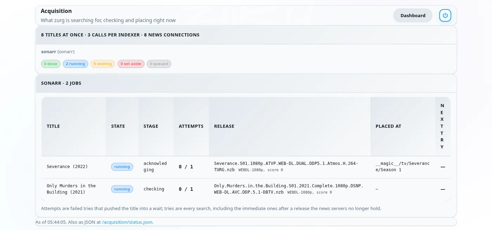
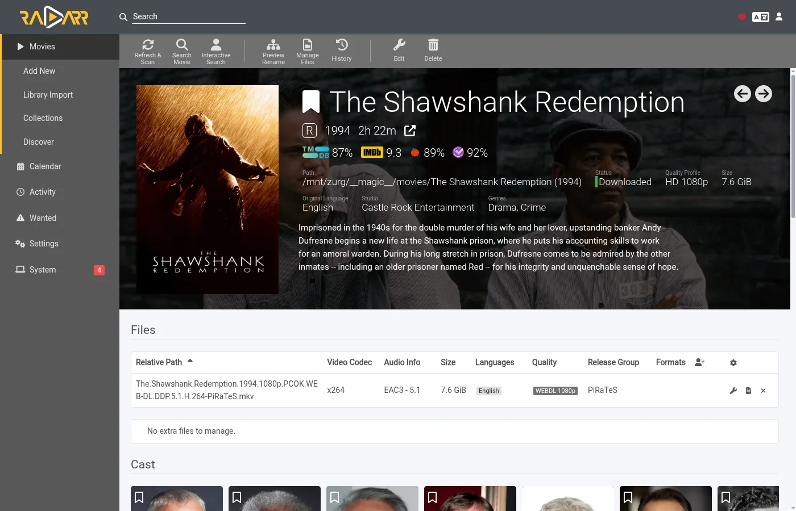

# Lass zurg holen, was Sonarr und Radarr wollen {#let-zurg-fetch-what-sonarr-and-radarr-want}

Es gibt drei Wege, Sonarr und Radarr mit zurg zu nutzen. Die eigentliche Wahl ist, wer sucht: zurg oder die \*arrs. [Welcher Weg passt](#which-one-to-pick) vergleicht sie.

| Anleitung | Wer sucht | zurg fungiert als | Du brauchst |
|---|---|---|---|
| [Usenet](sonarr-radarr.md) | Sonarr und Radarr | ein SABnzbd | ein Usenet-Konto (oder TorBox Pro für das `torbox_nzb`-Backend) und Usenet-Indexer in Prowlarr oder den \*arrs |
| [Torrents](sonarr-radarr-torrents.md) | Sonarr und Radarr | ein qBittorrent | ein Debrid-Konto und Torrent-Indexer in Prowlarr oder den \*arrs |
| [zurg sucht](sonarr-radarr-fetch.md) | zurg | gar kein Download-Client | ein Usenet-, TorBox-Pro- oder Debrid-Konto sowie Newznab- oder Torznab-Indexer in zurgs eigener Konfiguration |

Die ersten beiden können parallel laufen. Sie teilen sich denselben `__magic__`-Ordner.

### Welche man wählen sollte {#which-one-to-pick}

| | zurg sucht | Sonarr und Radarr suchen |
|---|---|---|
| Indexer kommen rein | in zurgs `config.yml`, und eine Änderung braucht einen Neustart | Prowlarr oder die \*arrs, wie gewohnt |
| Die \*arrs brauchen | Root-Ordner innerhalb von `__magic__`, sonst nichts | zurg als Download-Client, mit Download-Ordner und Root-Ordnern auf einem Volume |
| Die erste Datei ist | die schnellste, die dein Profil erlaubt, später bis zum Cutoff verbessert | die, die der \*arr in deinem Profil am besten bewertet |
| Anime, Daily-Serien und Specials | ab dem Nightly vom 5. November 2026 unterstützt | unterstützt |
| Manuelle Suche, Warteschlange, Verlauf, Blockliste | keine. Die Datei erscheint und der \*arr scannt neu | funktionieren wie gewohnt |
| zurgs [`exclude_words`](acquisition.md#excluding-releases-by-name) | greift | greift nicht. Blockiere dieselben Wörter im \*arr |

Beide prüfen ein Release, bevor der \*arr es importiert. Ein toter Usenet-Post oder ein Torrent, den dein Account noch nicht hat, wird nie abgelegt.

Bei einer frischen Installation fang mit der zurg-Suche an. Es gibt weniger einzurichten, und du musst kein Volume-Layout richtig hinbekommen. Nimm den Download-Client-Weg, wenn du Releases lieber selbst auswählen willst. Wenn du lieber auf das beste Release deines Profils warten willst, statt eine schnelle erste Datei zu nehmen, aktiviere [`best_first`](acquisition.md#taking-the-profiles-best-first).

Radarr und Sonarr verwalten die Liste und die Bibliothek. zurg übernimmt das Holen. Füge einen Film oder eine Serie so hinzu, wie du es sonst auch machst, und zurg findet ein Release bei deinen Indexern. Es prüft, ob eine NZB noch auf den News-Servern liegt (bei einem `torbox_nzb`-Account, dass TorBox sie geholt hat), oder ob dein Debrid-Account bereits einen Torrent hat. Dann legt es die Datei in ihrem Ordner innerhalb von `__magic__` ab und bittet Radarr oder Sonarr, neu zu scannen. Zum Importieren wird nichts heruntergeladen und nichts kopiert.

Für diesen Weg brauchen Radarr und Sonarr keine Indexer und keinen Download-Client. Sie suchen nie und holen nie etwas. Dein Qualitätsprofil bestimmt weiterhin, was zurg nehmen darf.

Die Screenshots stammen vom zurg-Build, der als Nightly vom 26. September 2026 ausgeliefert wird, mit Radarr 6.3.0.10514 und Sonarr 4.0.20.3014 in Docker. Beide sahen zurgs Mount unter `/mnt/zurg` in ihren Containern. Nichts daran wurde verändert.

## Bevor du anfängst {#before-you-start}

1. **zurg hat ein Usenet- oder Debrid-Konto und mindestens einen Newznab- oder Torznab-Indexer.** Die Indexer kommen in zurgs Konfiguration unter `acquisition.indexers`. Der Abschnitt [Watchlist und Seerr](acquisition.md) beschreibt diesen Block.
2. **`magic.enabled` steht auf `true`.** Ohne diese Einstellung starten die Radarr- und Sonarr-Quellen nicht, und das Log sagt das auch. Siehe [`__magic__`](magic.md).
3. **Radarr und Sonarr können zurgs Mount sehen.** Wenn du beide als ganz normale Apps installierst, gibt es bei jedem System einen Haken, der in [dem Usenet-Guide](sonarr-radarr.md#before-you-start) aufgeführt ist. In Docker auf einem Linux-Host heißt das, den Mount in ihre Container einzubinden. Binde den übergeordneten Ordner des Mounts einmal ein, dann erreichst du alles darüber. Wenn beide Apps außerdem Downloads von zurg als Download-Client entgegennehmen, kopiert jeder Import alles doppelt, sobald du zwei Volumes für den Download-Ordner und die Root-Ordner anlegst. Siehe [ein Volume](sonarr-radarr.md#one-volume-for-the-download-folder-and-the-root-folders).
4. **Du nutzt einen Nightly ab dem 26. September 2026 oder neuer.** Ältere Builds kennen die Quellen `radarr` und `sonarr` nicht.

## 1. zurg über Radarr und Sonarr informieren {#1-tell-zurg-about-radarr-and-sonarr}

Füge eine `radarr`-Quelle und eine `sonarr`-Quelle unter `acquisition` in `config.yml` hinzu und starte zurg neu. Für diesen Block gibt es noch kein Dashboard-Formular. Lass die weg, die du nicht nutzt.

```yaml
acquisition:
  quality: best
  indexers:
    - name: my-indexer
      url: https://indexer.example
      api_key: YOUR_INDEXER_API_KEY
  sources:
    - name: radarr
      type: radarr
      enabled: true
      url: http://radarr:7878         # http://localhost:7878 when Radarr is an ordinary app beside zurg
      api_key: YOUR_RADARR_API_KEY
      library_path: /mnt/zurg/__magic__
      check_every_secs: 30
    - name: sonarr
      type: sonarr
      enabled: true
      url: http://sonarr:8989         # http://localhost:8989 likewise
      api_key: YOUR_SONARR_API_KEY
      library_path: /mnt/zurg/__magic__
      check_every_secs: 30
```

`url` und `api_key` gehören der App selbst. Den API-Key findest du in beiden unter **Settings > General**. `check_every_secs` gibt an, wie oft zurg die App fragt, was sie haben will. Jede Abfrage ist eine Anfrage für die Liste. Beide Quellen nutzen dieselben Indexer.

`library_path` ist der Ort, an dem die App das `__magic__`-Verzeichnis von zurg sieht. zurg braucht ihn, um einen Radarr-Ordner in einen Ort innerhalb von `__magic__` umzuwandeln. Mit der obigen Konfiguration wird ein Film, den Radarr unter `/mnt/zurg/__magic__/movies/Heat (1995)` ablegt, innerhalb von zurgs `__magic__` als `movies/Heat (1995)` eingeordnet. Windows-Pfade wie `Z:\__magic__` funktionieren genauso. Lass `library_path` nur weg, wenn die App auf demselben Host wie zurg läuft und den Mount dort sieht, wo zurg ihn einhängt.

`concurrency` gibt an, wie viele Titel zurg gleichzeitig bearbeitet. Der Standard ist acht. Eine große Liste ist mit dem Standardwert kein Problem. Es dauert nur länger.

## 2. Die Root-Ordner in `__magic__` legen {#2-put-the-root-folders-inside-__magic__}

Der Root-Ordner muss in `__magic__` liegen und eine Ebene darunter. `/mnt/zurg/__magic__/movies` für Radarr und `/mnt/zurg/__magic__/tv` für Sonarr ist das Muster, das du übernehmen solltest (`/Volumes/Zurg/__magic__/movies` unter macOS, `Z:\__magic__\movies` unter Windows). Nicht `__magic__` selbst und nicht `__magic__/__all__`. Ein Titel, dessen Ordner woanders liegt, wird übersprungen, und zurg meldet das einmal in seinem Log.

In Radarr öffnest du **Settings > Media Management** und fügst den Root-Ordner hinzu.


Sonarr hat dieselbe Seite. Füge dessen Root-Ordner unter **Root Folders** hinzu.


**Season Folder Format** auf Sonarrs Seite ist der Name, den zurg einem neuen Staffelordner gibt. Eine Staffel, die schon Dateien hat, behält den Ordner, in dem diese Dateien liegen. Der freie Speicher, den beide Apps anzeigen, ist das, was das Mount meldet. Keine der beiden Apps schreibt dort jemals etwas.

## 3. Titel mit ausgeschalteter Suche hinzufügen {#3-add-titles-with-search-off}

Filme und Serien hinzufügen wie bisher. Von Hand, aus einer Liste oder aus einer Anfrage-App. Das Einzige, was sich ändert, ist die Suche. zurg übernimmt die Suche, deshalb dürfen die Arrs nicht suchen.

### Radarr

Diese Anleitung verwendet eine Importliste. Öffne **Settings > Import Lists** und füge deine hinzu oder bearbeite sie.


Lass in den Einstellungen der Liste **Enable Automatic Add** eingeschaltet und schalte **Search on Add** aus. Wähle das Qualitätsprofil und den Root-Ordner aus Schritt 2. Stelle **Minimum Availability** auf das ein, was du möchtest. zurg wartet, bis Radarr einen Film als verfügbar meldet, bevor es nach ihm sucht.


Wenn du einen einzelnen Film von Hand hinzufügst, heißt der gleiche Schalter **Start search for missing movie**. Lass ihn auch dort aus.

### Sonarr

Wenn du eine Serie manuell hinzufügst, lass **Start search for missing episodes** und **Start search for cutoff unmet episodes** deaktiviert. **Monitor** legt fest, wonach zurg sucht. Diese Serie ist auf ihre erste Staffel eingestellt.


Eine Importliste in Sonarr hat dieselbe Option in ihren Einstellungen. Schalte auch dort die Suche aus.

## 4. Indexer und Download-Clients leer lassen {#4-leave-indexers-and-download-clients-empty}

Damit ist die komplette Einrichtung auf der arr-Seite fertig. Die Indexer-Seite kann leer bleiben.


Das gilt auch für die Download-Clients-Seite.


Bei Sonarr ist es genauso. Falls in einer der beiden Apps aus einem früheren Setup schon Indexer und ein Download-Client vorhanden sind, funktionieren sie weiter. Die App würde dann für dieselben Titel parallel zu zurg suchen und laden. Deaktiviere in dem Fall die automatische Suche bei diesen Indexern oder entferne sie für die Titel, um die sich zurg kümmert.

## 5. Zusehen, wie es arbeitet {#5-watch-it-work}

Öffne das Dashboard von zurg. **Acquisition** ist ein neuer Eintrag in den Schnelllinks.


Die Seite zeigt jeden Titel, an dem zurg gerade arbeitet, und was er gerade macht. Dieselben Daten findest du unter `/acquisition/status.json`, falls du sie aus einem Skript auslesen willst.

### Filme {#movies}

Das ist eine Liste mit zehn Filmen, etwa eine halbe Minute nachdem Radarr sie hinzugefügt hat. Bei fünf liegt schon die Datei, und Radarr wird gerade darüber informiert. Die restlichen sind fertig.


Jede Zeile steht für einen Film. **State** zeigt, wo er gerade steht. **Stage** zeigt, was zurg gerade für ihn macht. Zuerst liest es die Indexer. Dann bewertet es die Kandidaten. Danach liest es die NZB eines Releases und prüft den Post bei den Newsservern. Zum Schluss legt es die Datei ab. **Release** ist der Post, den zurg genommen hat, und was Radarrs Parser daraus gemacht hat. **Placed at** ist der Pfad innerhalb von `__magic__`, an dem das Video jetzt liegt. Ein Titel, den die Newsserver nicht mehr haben, rückt sofort zum nächsten Kandidaten weiter. Ein Titel, bei dem nichts Brauchbares dabei ist, wird mit dem angezeigten Grund zur Seite gelegt.

Eine Minute später ist alles fertig.


### Serien {#series}



Die Staffeln von Sonarr erscheinen auf derselben Seite. Eine Zeile steht für eine Staffel oder eine Episodendatei, die zurg gerade upgradet. Hier sind zwei Serien, bei denen die erste Staffel eine halbe Minute nach dem Hinzufügen überwacht wurde. Beide Staffeln waren schon fertig ausgestrahlt und hatten keine Dateien, deshalb hat zurg für jede ein Season-Pack versucht. Das Severance-Pack liegt schon in seinem Staffelordner, und Sonarr wird gerade Bescheid gesagt. Das Only Murders-Pack wird gerade bei den News-Servern auf Vollständigkeit geprüft.

Etwa zwei Minuten nach dem Hinzufügen sind beide Staffeln fertig. Dem Only Murders-Pack fehlten Teile auf den News-Servern. zurg hat es beiseitegelegt und stattdessen die zehn Episoden einzeln geholt. Die Zeile zeigt die zuletzt einsortierte Episode.


## 6. Was Radarr und Sonarr anzeigen {#6-what-radarr-and-sonarr-show}

Die Bibliotheken füllen sich, während die Rescans durchlaufen. Jeder Film in dieser Liste hat jetzt seine Datei.


Auf der Seite eines Films siehst du die Datei in ihrem Ordner innerhalb von `__magic__`, mit der Qualität, die Radarr aus dem Namen gelesen hat.



In Sonarr haben alle zehn Episoden ihre Datei im Staffelordner, mit der Qualität, die Sonarr aus jedem Namen gelesen hat.


**Activity** bleibt in beiden leer. Es gibt keinen Eintrag in der Warteschlange und kein Grab- oder Import-Ereignis, weil nichts gegrabbt wurde. Die Datei ist einfach im Ordner aufgetaucht, und der Rescan, den zurg angefordert hat, hat sie erkannt.


Daraus folgen zwei Dinge. Die Sperrliste der Arrs wird nie geschrieben. zurg führt seine eigene Liste mit Posts, die die News-Server nicht mehr haben, und wählt diese nicht erneut aus. Und ein Titel, den du in Radarr oder Sonarr löschst, wird nicht aus deinem Account gelöscht. Die Datei wird wieder unter `__all__` aufgelistet wie jedes andere Release.

## Wie zurg eine Veröffentlichung auswählt {#how-zurg-picks-a-release}

Dein Qualitätsprofil ist das Tor. Jede Veröffentlichung, die zurg als Nächstes übernehmen will, geht zuerst durch den eigenen Parser der App. Es muss der richtige Titel sein. Seine Qualität muss vom Profil erlaubt sein. Sein Custom-Format-Score muss das Mindestmaß des Profils erreichen. Seine Größe muss in die Grenzen unter **Settings > Quality** passen. Eine Veröffentlichung, die eine dieser Prüfungen nicht besteht, wird nicht übernommen.

### Filme {#movies-1}

Unter den Releases, die das Profil erlaubt, nimmt zurg das erste, dessen Verfügbarkeit sich am schnellsten prüfen lässt. Posts mit nur einer einzelnen Videodatei kommen zuerst, weil sie auf den Newsservern am ehesten noch vollständig sind. Web-Releases kommen aus demselben Grund vor Blu-ray-Releases. Mehrteilige Archivsätze sind der Fallback.

Die Reihenfolge der Präferenz im Profil wird stattdessen durch Upgrades umgesetzt. Wenn das Profil Upgrades erlaubt und die abgelegte Datei unter dem Cutoff liegt, sucht zurg nach einem besseren Release, sobald der Film eines hat. Nur ein strikt besseres Release ersetzt die Datei. Eine niedrigere Qualität wird nie übernommen.

Ein Film mit einem Datum in der Zukunft wartet, bis Radarr ihn als verfügbar meldet. Eine Suche, die den falschen Film liefert, wird abgelehnt, weil Radarr den Titel keinem Film in deiner Bibliothek zuordnen kann.

### Serien {#series-1}

Eine Staffel ist eine zusammenhängende Einheit. Wenn jede Folge einer Staffel fehlt und die Staffel schon komplett ausgestrahlt ist, probiert zurg zuerst ein Staffel-Pack aus. Ansonsten holt es die fehlenden Folgen einzeln.

Eine Staffel, die schon einige Dateien hat, bekommt nie ein Pack. Sonst würden diese Folgen ein zweites Mal im Ordner landen.

Ein Release muss zu dieser Serie und dieser Staffel passen. Ein Pack muss die ganze Staffel enthalten. Ein Episoden-Release darf nur genau diese eine Folge enthalten. Das Größenlimit bezieht sich auf die Laufzeit der Folgen, die im Release enthalten sind.

Wenn für eine Folge einer Staffel noch nichts da ist, das zurg nehmen kann, werden die übrigen Folgen trotzdem eingeordnet, und Sonarr erfährt sofort davon. Die fehlende Folge wird später nach dem üblichen Wiederholungsplan erneut gesucht.

Eine Episodendatei unterhalb des Cutoffs ist ein Upgrade, wenn das Profil Upgrades erlaubt. Unterhalb des Cutoffs heißt unterhalb der Cutoff-Qualität oder unterhalb des Cutoff-Custom-Format-Scores. zurg zählt beides so, wie es Sonarrs Upgrade-Regel tut. Sonarrs eigene Liste **Cutoff Unmet** zeigt nur das Erste an. Ein Upgrade ersetzt nur die eigene Folge, und der Rest des Staffelordners bleibt, wo er ist.

## Wichtige Hinweise {#things-to-know}

- **Jede Änderung am `acquisition`-Block in `config.yml` braucht einen Neustart.** zurg liest die Datei nur beim Start.
- **Der Rescan ist der letzte Schritt und wartet hinter der eigenen Arbeit der App.** Direkt nachdem eine Liste viele Filme hinzufügt, aktualisiert Radarr zuerst jeden davon. Die Dateien sind schon an Ort und Stelle, während das läuft.
- **Analyse video files liest den Anfang jeder Datei über den Mount.** Das funktioniert. Es ist aber auch der langsamste Teil einer großen Liste. Lass es aktiviert, außer du weißt, dass du keine Medieninfos brauchst.
- **Unmonitored-Titel werden in Ruhe gelassen.** Das betrifft Filme, Serien, Staffeln und Episoden. Ebenso Titel, deren Ordner außerhalb von `__magic__` liegt.
- **Anime, Daily-Shows und Specials brauchen ein Nightly ab dem 5. November 2026.** Die Episoden einer Daily-Show werden anhand des Sendedatums gefunden, die eines Anime anhand der Nummer, mit der die Serie sie zählt (`Jujutsu Kaisen - 30` ist die sechste Folge der zweiten Staffel). Specials werden als Staffel 00 gesucht. Eine Datei für einen Anime oder eine Daily-Show wird als `JUJUTSU KAISEN - S02E06 - <the release's own name>` abgelegt. Der Grund: Der Rescan von Sonarr liest eine Datei nur anhand ihres Namens und würde `2nd Season - 06` unter Staffel 1 einordnen. Ein Special, das nur über seinen Titel benannt ist, ohne `S00Exx`, lässt sich auch von Sonarr nicht zuordnen. Auf einem älteren Build wird jede solche Serie übersprungen, mit einer einzigen Zeile im Log.

Die vollständige Beschreibung beider Quellen steht in [Watchlist und Seerr](acquisition.md).
