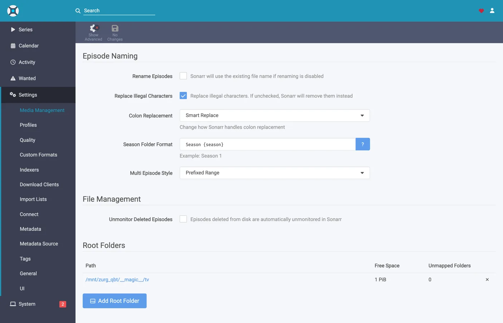
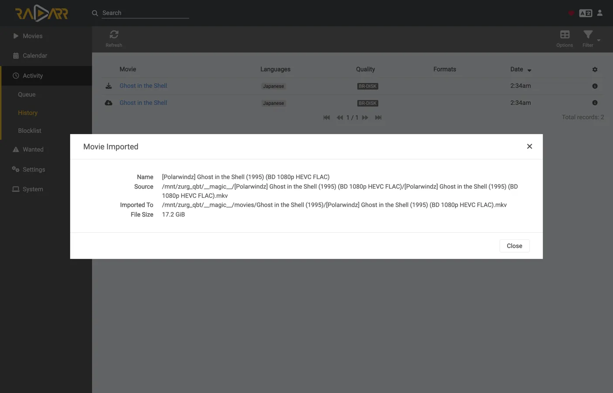
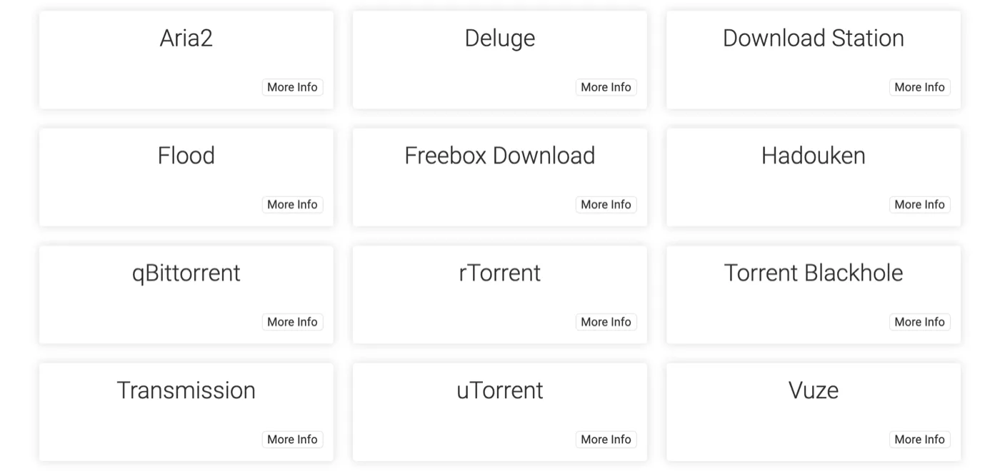

# Sonarr und Radarr mit Torrents, Schritt für Schritt {#sonarr-and-radarr-with-torrents-step-by-step}

Es gibt drei Wege, Sonarr und Radarr mit zurg zu nutzen. Die eigentliche Frage ist, wer sucht: zurg oder die \*arrs. [Welche Variante du nimmst](sonarr-radarr-fetch.md#which-one-to-pick) erklärt der Vergleich.

| Anleitung | Wer sucht | zurg agiert als | Du brauchst |
|---|---|---|---|
| [Usenet](sonarr-radarr.md) | Sonarr und Radarr | ein SABnzbd | ein Usenet-Konto (oder TorBox Pro für das Backend `torbox_nzb`) und Usenet-Indexer in Prowlarr oder den \*arrs |
| [Torrents](sonarr-radarr-torrents.md) | Sonarr und Radarr | ein qBittorrent | ein Debrid-Konto und Torrent-Indexer in Prowlarr oder den \*arrs |
| [zurg sucht](sonarr-radarr-fetch.md) | zurg | gar kein Download-Client | ein Usenet-, TorBox-Pro- oder Debrid-Konto und Newznab- oder Torznab-Indexer in zurgs eigener Konfiguration |

Die ersten beiden können parallel laufen. Sie teilen sich denselben Ordner `__magic__`.

Die [vorherige Anleitung](sonarr-radarr.md) hat die \*arrs für Usenet auf zurg gerichtet, wobei zurg als SABnzbd antwortet. Das hier ist die andere Hälfte: zurg antwortet als **qBittorrent**, die \*arrs geben ihm einen Magnet-Link oder eine `.torrent`-Datei statt einer NZB, und das Release landet auf einem Debrid-Konto statt auf einem News-Server. Der Import funktioniert genauso: ein Umbenennen innerhalb von `__magic__`, nichts wird zum Importieren heruntergeladen, nichts wird kopiert.

**Welche der beiden Varianten der \*arr schickt, ist nicht nebensächlich.** Eine `.torrent`-Datei wird normalerweise als Datei selbst auf das Konto hochgeladen; nur ein Magnet wird allein über den Info-Hash hinzugefügt. Im Modus nur gecachte Releases (cached-only, der Standard) schicken TorBox und Debrid-Link stattdessen den Info-Hash, denn so lehnen sie ein nicht gecachtes Release ab, ohne es hinzuzufügen. Bei einem Magnet muss das Konto anhand des Hashes herausfinden, was der Torrent enthält, und der Hash eines privaten Trackers hat keinen öffentlichen Schwarm, aus dem sich das ableiten ließe. Real-Debrid bricht dann mit `magnet_error` ohne Dateien ab, und TorBox nimmt den Magnet an und bleibt bei `checking` hängen, ohne Dateiliste, ohne Größe und mit einer Schätzung von hundert Tagen. Der Grab schlägt also nicht fehl, wird aber auch nie fertig. Die `.torrent`-Datei lässt die Cache-Abfrage des Kontos direkt über den Hash laufen, sodass Inhalte, die das Konto bereits hat, sofort hinzugefügt werden, ganz ohne Magnet-Auflösung. Genau deshalb funktionieren private Indexer hier: Ihre Releases lassen sich genau dann hinzufügen, wenn das Konto den Inhalt schon hat, und bei allem, was eine Community teilt, ist das der Normalfall. Richte die \*arr auf einen Indexer, der `.torrent`-Dateien statt Magnets ausgibt. Private tun das.

Alles Folgende wurde mit zurg `2026.08.30.0459-nightly-73-g5b4c9790`, Sonarr `4.0.19.2979`, Radarr `6.3.0.10514` und Prowlarr `2.5.2.5491` auf einer echten Installation mit einem echten AllDebrid-Konto aufgenommen. Host- und Benutzernamen wurden zu `you@zurg-server` geändert. Indexer-Namen lauten `my-indexer`. API-Schlüssel und Bibliotheksanzahlen sind nur Beispiele. Sonst wurde an der aufgenommenen Ausgabe nichts verändert.

## Bevor du anfängst {#before-you-start}

Drei Dinge müssen zutreffen. Prüfe alle drei jetzt, denn jedes davon führt später zu einem Fehler, der nach etwas ganz anderem aussieht.

1. **zurg hat ein Konto, das Torrents hinzufügen kann**: Real-Debrid, AllDebrid, TorBox, Premiumize, Debrid-Link oder Offcloud. Alle sechs nehmen die hochgeladene `.torrent`-Datei selbst an. Dadurch lässt sich das Release eines privaten Trackers überhaupt hinzufügen. Ein Usenet-Konto nimmt einen Torrent in keiner der beiden Formen an: Eine Installation, deren einziger Provider `nzb` ist, akzeptiert jeden Grab und lehnt ihn danach ab. zurg sagt das beim Start.
2. **`magic.enabled` ist `true`.** Ohne diese Einstellung existiert der Speicherpfad nicht, und jeder Import schlägt fehl. Siehe [`__magic__`](magic.md).
3. **Der Mount ist für den \*arr unter dem Pfad sichtbar, den zurg meldet.** Läuft der \*arr in einem Container, lies vor dem Konfigurieren [Schritt 8](#8-if-your-arr-is-in-docker). Ist er als normale App auf demselben Rechner installiert, sieht er den Mount dort, wo zurg ihn einhängt, mit je einer Besonderheit pro System:
   - **Linux:** Ein \*arr, der unter einem anderen Benutzer läuft als zurg, sieht einen leeren Ordner, bis `user_allow_other` aktiviert ist. Siehe [Linux-Einrichtung](../setup/linux.md#1-install-fuse-3).
   - **macOS:** Lass ihn unter demselben Benutzer laufen wie zurg. Der Mount ist `/Volumes/Zurg`, sofern du `mount_path` nicht geändert hast.
   - **Windows:** Lass Sonarr und Radarr als Tray-App laufen, die ihr Installer anbietet, nicht als Windows-Dienst. Das Laufwerk `Z:` von zurg gehört zu der Sitzung, in der du angemeldet bist. Ein Dienst läuft außerhalb davon und sieht das Laufwerk deshalb nicht. Siehe [die Sitzungsregeln](../setup/windows.md#keeping-it-running-the-session-rules).

Prüfe die ersten beiden direkt in der Konfigurationsdatei im Arbeitsverzeichnis von zurg. Unter Windows öffnest du stattdessen `config.yml` in Notepad.

```bash
$ grep -A3 '^providers:' config.yml
providers:
- type: alldebrid
  token: <redacted>

$ grep -A3 '^magic:' config.yml
magic:
  enabled: true
  allow_delete: false
```

**Die Reihenfolge der `providers:`-Liste ist hier wichtig.** Ein Grab wird jedem Konto angeboten, das Torrents annimmt, und zwar in dieser Reihenfolge. Lehnt ein Konto ihn ab oder hängt es daran, wird es aufgegeben und das nächste probiert. Hast du zwei Konten, setze an die erste Stelle das, das du zuerst nutzen willst.

Zwei Schlüssel nehmen ein Konto aus dieser Reihenfolge heraus. `watchlist: true` stellt ein Konto an die erste Stelle, egal wo es in der Datei steht. `add_torrents: false` nimmt es ganz aus der Rotation. Es liefert und liest seine Bibliothek weiter, aber es wird nie etwas Neues darauf gelegt, etwa bei einem Archivkonto oder einem Konto, dessen Kontingent schon verplant ist. Ein Usenet-Konto bekommt auf keinem der beiden Wege einen Torrent angeboten. Beides steht in [der Konfigurationsreferenz](../reference/config.md#accounts).

## 1. Den Endpoint einschalten {#1-turn-the-endpoint-on}

Zwei Wege, gleiches Ergebnis. Beide schreiben in `config.yml`, und beide brauchen einen Neustart: Die Routen, die `__magic__` ausliefern, und der qBittorrent-Endpoint werden nur einmal registriert, wenn zurg startet.

### Option A — das Dashboard {#option-a--the-dashboard}

Öffne das zurg-Dashboard, klicke auf **Config** und scrolle zu **\_\_magic\_\_ & Download Clients**. Aktiviere **Serve \_\_magic\_\_** und **qBittorrent Endpoint**.


**Config** ist der Ort, an dem die Einstellung liegt. **Magic** ist der Ort, an dem du später die eingehenden Grabs beobachtest.


Lass **qBittorrent Save Path** leer, außer dein *arr hängt zurg an einem anderen Pfad ein als zurg selbst. Dann siehe [Schritt 8](#8-if-your-arr-is-in-docker). Die orange **Restart Required**-Anzeige sagt die Wahrheit: Nichts hier wird wirksam, bis zurg neu startet.

### Option B — `config.yml`

Füge den Block von Hand hinzu und starte zurg neu.

```yaml
magic:
  enabled: true

qbittorrent:
  enabled: true
  api_key: ""                   # empty = zurg generates one and keeps it
  categories: [tv-sonarr, radarr]
  save_path: ""                 # empty = <mount_path>/__magic__/__all__
  cached_only: true             # the default: only take what an account already holds
```

**Die Kategorien sind keine Ordner.** Sie zeigen alle auf denselben Ort: den eigenen Ordner der Veröffentlichung unter `__magic__/__all__`. Die Liste legt Kategorien nur im Voraus an: Ein **Test** eines Clients legt jede fehlende Kategorie an, und zurg speichert sie in `data/qbittorrent-categories.json`. Prowlarr will, falls du es nutzt, `prowlarr` – siehe [Schritt 10](#10-prowlarr-manual-grabs).

Starte zurg neu und prüfe dann, ob der Endpunkt registriert wurde und der Anbieter übernommen wurde:


Eine `alldebrid`-Zeile reicht dem Endpunkt – jeder der sechs torrent-fähigen Typen funktioniert.

Das Startprotokoll sagt dasselbe, und es lohnt sich, es einmal durchzulesen:

```
INFO  router.qbittorrent  qBittorrent API on /api/v2 and /qbittorrent/api/v2, save path /mnt/zurg_qbt/__magic__/__all__, categories tv-sonarr, radarr
INFO  router.qbittorrent  qBittorrent: cached-only, so a grab is only accepted onto an account that already holds the content; anything else is refused and the *arr takes its next release. Set qbittorrent.cached_only: false to let accounts download
INFO  router.qbittorrent  qBittorrent: torrents are offered to alldebrid, in that order
```

## 2. Den API-Schlüssel finden {#2-find-the-api-key}

Der API-Key ist die gesamte Authentifizierung für diesen Endpunkt. Hol ihn dir also einmal richtig und veröffentliche ihn nirgendwo.

**Wenn du `api_key` leer gelassen hast**, hat zurg beim ersten Start einen erzeugt und in `data/qbittorrent-apikey` geschrieben:

```bash
$ cat data/qbittorrent-apikey
fedcba9876543210fedcba9876543210

```

Beispielhafter Key, deiner wird anders aussehen. Die Datei bleibt auch nach Neustarts erhalten, der Key bleibt also gleich, sobald er erzeugt wurde.

**Wenn du `api_key` selbst gesetzt hast**, steht er in `config.yml`, und es wird keine Datei geschrieben.

**Dieser Endpunkt liegt außerhalb der Basic-Auth von zurg.** Die \*arrs melden sich bei einem Download-Client auf dessen eigene Weise an. Ihre HTTP-Schicht macht aus einem Basic-Auth-401 aber nur „unable to connect“, ohne jeden brauchbaren Hinweis. Deshalb nimmt zurg `/api/v2` bewusst davon aus. Der API-Key ist die einzige Sperre. Behandle den Port wie den Rest von zurg: nur in einem vertrauenswürdigen Netzwerk oder hinter etwas, das ihn schützt.

Es gibt drei Möglichkeiten, den Key zu übergeben. Alle werden akzeptiert:

- **`Authorization: Bearer <key>`**: Das sendet der Client, wenn du sein Feld **API Key** ausfüllst. Das ist die empfohlene Variante, weil sie die Anmeldung komplett überspringt.
- **Der Key als Passwort** bei `auth/login`, mit einem beliebigen Benutzernamen. Nimm das, wenn du lieber die Felder Username und Password ausfüllst.
- **Benutzername und Passwort des zurg-Dashboards**, falls `username:` und `password:` in `config.yml` gesetzt sind.

## 3. Prüfen, ob er antwortet {#3-prove-it-answers}

Mach das, bevor du Sonarr anfasst. Zehn Sekunden, und danach weißt du für den Rest der Einrichtung, ob zurg das Problem ist oder der \*arr.

+++ Linux und macOS

```bash
$ KEY=fedcba9876543210fedcba9876543210
$ ZURG=192.168.88.244:9995

$ curl -s "http://$ZURG/api/v2/app/webapiVersion"
Forbidden

$ curl -s -H "Authorization: Bearer $KEY" "http://$ZURG/api/v2/app/webapiVersion"
2.11.2

$ curl -s -H "Authorization: Bearer $KEY" "http://$ZURG/api/v2/app/version"
v5.0.4

$ curl -s -H "Authorization: Bearer $KEY" "http://$ZURG/api/v2/app/preferences" | jq .save_path
"/mnt/zurg_qbt/__magic__/__all__"
```

+++ Windows

In PowerShell. Tippe `curl.exe` ein, nicht `curl`: Das `curl` von Windows PowerShell ist ein anderer Befehl.

```powershell
PS> $KEY = "fedcba9876543210fedcba9876543210"
PS> $ZURG = "192.168.88.244:9995"

PS> curl.exe -s "http://$ZURG/api/v2/app/webapiVersion"
Forbidden

PS> curl.exe -s -H "Authorization: Bearer $KEY" "http://$ZURG/api/v2/app/webapiVersion"
2.11.2

PS> curl.exe -s -H "Authorization: Bearer $KEY" "http://$ZURG/api/v2/app/version"
v5.0.4

PS> (Invoke-RestMethod "http://$ZURG/api/v2/app/preferences" -Headers @{ Authorization = "Bearer $KEY" }).save_path
Z:/__magic__/__all__
```

+++

**Das nackte `Forbidden` ist die gesunde Antwort.** Die erste Anfrage der Clients ist ein *nicht authentifiziertes* `GET /api/v2/app/webapiVersion`. Das echte qBittorrent antwortet darauf mit `403`, wenn die API da ist, aber niemand angemeldet ist. Genau das antwortet also zurg, und der Client liest es als „v2 wird unterstützt, jetzt anmelden“. Eine einfache **404** heißt dagegen, dass `qbittorrent.enabled` noch auf false steht oder zurg seit deiner Änderung nicht neu gestartet wurde.

Prüfe danach, ob ein falscher Key auch wirklich abgelehnt wird:

+++ Linux und macOS

```bash
$ curl -s -o /dev/null -w "%{http_code}\n" -H "Authorization: Bearer wrongkey" \
    "http://$ZURG/api/v2/torrents/info"
403
```

+++ Windows

```powershell
PS> curl.exe -s -o NUL -w "%{http_code}\n" -H "Authorization: Bearer wrongkey" "http://$ZURG/api/v2/torrents/info"
403
```

+++

`save_path` ist der Pfad, den zurg an die Clients weitergibt. Prüfe jetzt, ob es ein Pfad ist, den *sie* öffnen können.

Beide URL-Varianten funktionieren, also ist im Feld **URL Base** des Clients jede der beiden in Ordnung:

| Pfad | URL Base in Sonarr / Radarr | Antwort |
|---|---|---|
| `/api/v2/…` | *(leer lassen)* | ja |
| `/qbittorrent/api/v2/…` | `/qbittorrent` | ja |

## 4. Die Root-Ordner anlegen {#4-make-the-root-folders}

Leg sie an, bevor du sie hinzufügst, denn der Dialog Add Root Folder der \*arr durchsucht das laufende Dateisystem und bietet keinen Ordner an, der nicht existiert.

+++ Linux und macOS

```bash
$ mkdir -p /mnt/zurg_qbt/__magic__/tv /mnt/zurg_qbt/__magic__/movies

$ ls -d /mnt/zurg_qbt/__magic__/tv /mnt/zurg_qbt/__magic__/movies
/mnt/zurg_qbt/__magic__/movies
/mnt/zurg_qbt/__magic__/tv
```

+++ Windows

```powershell
PS> New-Item -ItemType Directory -Force Z:\__magic__\tv, Z:\__magic__\movies
```

Oder lege die beiden Ordner im Explorer an.

+++

Ersetze `/mnt/zurg_qbt` durch deinen eigenen `mount_path`. Wenn du nichts einträgst, ist er standardmäßig `/mnt/zurg` unter Linux, `/Volumes/Zurg` unter macOS und `Z:` unter Windows.

**Der Root-Ordner liegt neben dem Save-Pfad, nicht auf ihm und nicht darüber.** Das ist dieselbe Regel wie in der Usenet-Anleitung, aus demselben Grund: zurg meldet `__magic__/__all__` als Save-Pfad. Beide Clients schlagen Alarm (Health-Check), wenn ein Root-Ordner der Ausgabeordner des Download-Clients *ist*. Radarr meldet außerdem einen Alarm, wenn ein Root-Ordner ihn *enthält*. Geschwisterordner lösen keins von beidem aus. [Diese Anleitung](sonarr-radarr.md#4-make-the-root-folders) zeigt Screenshots, wie es falsch aussieht.

Es gibt noch einen Grund, der speziell für Torrents gilt: Ein Verschieben in ein Ziel außerhalb von `__magic__` ist ein Verschieben zwischen zwei Dateisystemen, und das ist ein Kopieren. Ein Kopieren von einem Debrid-Mount liest das ganze Release über das Netzwerk zurück. `Remove Completed` bleibt aktiviert ([weiter unten](#if-the-import-copies-instead-of-moving)), damit der Import ein Umbenennen bleibt. Ein Root-Ordner außerhalb des Namensraums würde das sowieso kaputt machen.

Ein Verschieben zwischen zwei Volumes ist ebenfalls ein Kopieren. Das ist in Docker wichtig. Schritt 8 behandelt das.

## 5. Den Client in Sonarr hinzufügen {#5-add-the-client-in-sonarr}

Ein brandneuer Sonarr sperrt alles hinter einem Ersteinrichtungsbildschirm. Wähle **Forms (Login Page)**, lege einen Benutzernamen und ein Passwort fest und klicke auf **Save**.


Du kommst nicht weiter, solange **Authentication Method** nicht auf etwas anderes als None gesetzt ist.


Nach dem Klick auf Save wirst du einmal abgemeldet und landest auf der Anmeldeseite.


### Settings → Download Clients

Gehe zu **Settings → Download Clients**. Bei einer frischen Installation gibt es hier nur die **+**-Karte.


Klick auf das **+** unter „Download Clients“ – nicht auf das weiter unten unter „Remote Path Mappings“.

Wähle **qBittorrent** aus der Spalte **Torrents**.


zurg gibt sich speziell als qBittorrent aus, deshalb funktioniert nichts anderes in dieser Liste. Die beiden Spalten verraten dir, welcher Guide der richtige ist: SABnzbd steht unter Usenet, qBittorrent unter Torrents.

Der Dialog öffnet sich mit den Standardwerten von qBittorrent – `localhost`, Port `8080`, kein Key.


### Was in welches Feld gehört {#what-to-put-in-each-field}

| Feld | Wert | Warum |
|---|---|---|
| Name | `zurg (torrents)` | Egal, was. Es ist nur eine Bezeichnung. |
| Enable | an | Lass es angehakt. |
| Host | `192.168.88.244` | Der Host, auf dem zurg läuft, so wie ihn der \*arr erreichen kann. `localhost`, wenn der \*arr eine ganz normale App auf demselben Rechner ist. In Docker siehe die Warnung unten. |
| Port | `9995` | zurgs normaler Port — `9999` bei einer Standardinstallation. |
| Use SSL | aus | Nur, wenn du zurg selbst hinter TLS betreibst. |
| URL Base | leer | `/qbittorrent` funktioniert auch — siehe Schritt 3. |
| API Key | aus Schritt 2 | Das ist der ganze Schlüssel. Wird als Bearer-Token gesendet. |
| Username / Password | leer | Beide leer lassen — der Key ersetzt sie. |
| Category | `tv-sonarr` | Der Standard für den \*arr. zurg kennt ihn schon, und **Test** legt jede Kategorie an, die noch fehlt. |
| Initial State / Sequential / First-Last | Standardwerte | Hier gibt es keinen Schwarm; keine dieser Optionen tut etwas. |
| **Remove Completed** | **an** | **Die wichtigste Einstellung** — siehe [Wenn der Import kopiert statt verschiebt](#if-the-import-copies-instead-of-moving). |


Der gezeigte API-Key ist nur ein Beispiel — trag deinen eigenen ein.

**In Docker sind „localhost“ und der Hostname beide irreführend.** In einem Container ist `localhost` der Container selbst, und der Hostname des Rechners wird meist auf `127.0.1.1` aufgelöst — das ist ebenfalls der Container. Der Host dieses Setups heißt `zurg-server`. `zurg-server` wurde im Sonarr-Container auf `127.0.1.1` aufgelöst, während derselbe Name aus der Host-Shell funktionierte. Nimm die **LAN- oder Tailscale-IP** des Hosts, niemals `localhost` und nie den nackten Hostnamen.

Klick auf **Test**. Ein grüner Haken bedeutet, dass die Prüfungen des Clients bestanden wurden — API-Version, Authentifizierung, die Kategorie und die Torrentliste.


Klick jetzt auf **Save**.


## 6. Den Root-Ordner in Sonarr hinzufügen {#6-add-the-root-folder-in-sonarr}

Gehe zu **Settings → Media Management** und scrolle ganz nach unten.


Klicke auf **Add Root Folder**. Es öffnet sich ein Dateibrowser für das Dateisystem von Sonarr. Unter Docker ist das das Dateisystem des Containers.


Tippe den Pfad ein oder navigiere dorthin. Wenn der Mount für Sonarr wirklich sichtbar ist, öffnet sich `__magic__` und zeigt, was du in Schritt 4 angelegt hast, neben dem `__all__`, das zurg selbst dort anlegt. Das ist der schnellste Beweis, dass der Bind-Mount richtig ist.


Wenn hier nichts angezeigt wird oder ein Fehler kommt, hör auf und behebe erst den Mount, bevor du weitermachst.


Beende den Pfad mit `__magic__/tv` (`Z:\__magic__\tv` unter Windows) und klicke auf **Ok**.



Wenn bei **Free Space** `1 PiB` steht, liegt das nicht an einer echten Festplatte. zurg meldet ein virtuelles Dateisystem. Das ist so gewollt, denn damit besteht der Speicherplatz-Check der \*arr-Apps, bevor ein Grab startet.

## 7. Dasselbe in Radarr machen {#7-do-the-same-in-radarr}

Identisch, mit zwei geänderten Werten: Die Kategorie ist `radarr` und der Root-Ordner ist `__magic__/movies`.


Radarrs erster Start läuft genauso ab: Forms-Authentifizierung einstellen, dann anmelden.


**Settings → Download Clients → +**, dann **qBittorrent** unter Torrents.


Gleicher Host, gleicher Port, gleicher Key. Nur **Category** ist anders: `radarr`, nicht `tv-sonarr`.

**Test**, grüner Haken, **Save**.


Dann **Settings → Media Management → Root Folders → Add Root Folder** und `/mnt/zurg_qbt/__magic__/movies` hinzufügen.

**Ein zurg, zwei Clients, eine Warteschlange.** Die Torrent-Liste, die jeder Client sieht, wird nur nach Kategorie gefiltert, sonst nach nichts. Zwei Sonarrs, die beide `tv-sonarr` verwenden, sehen gegenseitig ihre Grabs; Sonarr auf `tv-sonarr` und Radarr auf `radarr` tun das nicht. Wenn du pro Kategorie genau einen Client nutzt, taucht dieses Problem nie auf.

## 8. Wenn dein \*arr in Docker läuft {#8-if-your-arr-is-in-docker}

Dieser Schritt ist für Docker auf einem Linux-Host gedacht. Unter macOS und Windows installierst du die \*arrs stattdessen als ganz normale Apps, wie [Bevor du anfängst](#before-you-start) beschreibt. Schritt 8 der Usenet-Anleitung erklärt, warum.

Die gleichen drei Probleme wie in der Usenet-Anleitung, mit denselben Lösungen. Das Mount bleibt das Mount, deshalb hier die Kurzfassung. [Schritt 8 dieser Anleitung](sonarr-radarr.md#8-if-your-arr-is-in-docker) enthält die Details.

**Der Pfad, den zurg meldet, muss ein Pfad sein, den der Client öffnen kann.** Wenn der Container die Bibliothek an einer anderen Stelle einhängt als zurg, schlägt jeder Import mit *download doesn't contain intermediate path* oder einer fehlgeschlagenen Remote-Pfad-Prüfung fehl. Setze `qbittorrent.save_path` auf den Pfad, den *der Client* sieht, oder füge eine Remote-Pfad-Zuordnung hinzu:

```yaml
qbittorrent:
  save_path: "/data/zurg/__magic__/__all__"   # what the *arr sees, not what zurg sees
```

**Ein Volume für den Save-Pfad und die Root-Ordner.** Gib dem Container nicht `__magic__/__all__` und `__magic__/tv` als zwei Volumes. Das Umbenennen zwischen beiden schlägt im Container fehl. Der Client kopiert dann jeden Import aus deinem Account und schreibt ihn auf die Festplatte von zurg, ohne ein Wort darüber zu verlieren. Gib ihm ein einziges Volume, das den gesamten Mount von zurg enthält, und erreiche beide Ordner darüber. Das Bind unten ist genau dieses Volume.

**Bind das übergeordnete Verzeichnis des Mounts, nicht den Mountpoint.** Ein Neustart von zurg hängt den Mount aus und wieder ein. Ein Container, der den Mountpoint selbst gebunden hat, behält die tote FUSE-Verbindung, und jeder Lesezugriff danach antwortet mit `Socket not connected`. Weil beide Clients vor jedem Grab den freien Speicherplatz prüfen, wird dadurch *jedes Release stillschweigend abgelehnt*. Bind stattdessen das übergeordnete Verzeichnis mit `rslave`. Dann kommt der erneute Mount als Sub-Mount-Ereignis an, dem der Container folgt. Die Container dieses Setups wurden gestartet, bevor zurg überhaupt etwas eingehängt hatte, und der Mount erschien trotzdem in ihnen:

```bash
$ docker exec sonarr df -h /mnt/zurg_qbt
Filesystem      Size  Used Avail Use% Mounted on
zurg{8amax}:    1.0P     0  1.0P   0% /mnt/zurg_qbt
```

## 9. Einen Grab einmal durchlaufen sehen {#9-watch-one-grab-go-through}

Füg eine Sache hinzu, lös einen Grab von Hand aus und verfolg ihn bis zum Ende. Alles unten ist ein echter Grab über das Setup von oben: *Ghost in the Shell (1995)*, von Hand von einem Indexer geholt.

### Grab it

Öffne den Film, klicke auf **Interactive Search** und wähle ein Release aus.


Die Spalte **Source** zeigt `torrent` an — das ist das Protokoll, das dieser Endpunkt annimmt. Klicke auf den Button mit dem Kreispfeil am Ende der Zeile, um es zu übernehmen. Wenn der Client vorher eine Bestätigung der Zuordnung verlangt:


**Override and Grab** erscheint, wenn das Release nicht sauber passt. Prüfe die Zuordnung und klicke auf **Grab Release**. Bei einem normalen Grab siehst du das nie.

### Der Account übernimmt es {#the-account-takes-it}

Drei Zeilen im Log von zurg ergeben den ganzen Add: der Account, der den Auftrag annimmt, der Auftrag selbst und `finished`. Der Mitschnitt unten stammt aus einem älteren Build, der nur die letzten beiden Zeilen geloggt hat:

```
INFO  router.qbittorrent  qBittorrent: [Polarwindz] Ghost in the Shell (1995) (BD 1080p HEVC FLAC) (0c5e4077…) added to alldebrid as 720824192
INFO  router.qbittorrent  qBittorrent: [Polarwindz] Ghost in the Shell (1995) (BD 1080p HEVC FLAC) (0c5e4077…) finished on alldebrid
```

Der Hash ist der Info-Hash, den der Client geschickt hat. `added … as 720824192` ist die eigene ID, die der Account dafür vergibt. Dieses Release war beim Account schon im Cache, deshalb folgt `finished` nach etwa einer Sekunde. Ein nicht gecachtes Release steht zwischen den beiden Zeilen, während der Account es herunterlädt. Was der Account in dieser Zeit macht, zeigt die Queue des Clients:

| Was der Account gerade macht | Die Queue zeigt |
|---|---|
| Herausfinden, worauf der Magnet verweist | *Loading metadata*, noch nichts gemessen |
| Im Account in der Warteschlange geparkt | *Queued* |
| Wird heruntergeladen – Geschwindigkeit, Swarm und verbleibende Zeit sind die Werte des Accounts | *Downloading*, mit echtem Fortschrittsbalken |
| Alle Accounts haben abgelehnt oder sind in ein Timeout gelaufen | Eine **Warnung** mit dem Grund – siehe [Fehlerbehebung](#troubleshooting) |
| In der Bibliothek, Ordner bereit zum Importieren | *Completed* |

Ein hängender Swarm meldet **Downloading** mit Geschwindigkeit und Seed-Anzahl bei null, statt als Stall-Warnung. `stalledDL` ist ein Status, auf den die \*arrs bei der Behandlung fehlgeschlagener Downloads reagieren. Ein Swarm ohne Seeds ist aber kein Urteil über das Release.

Der komplette Magnet landet beim Account. zurg gibt den Anzeigenamen weiter, unter dem der Client den Grab gespeichert hat, und alle Tracker, die dieser nennt. Bei einem Indexer, der nur Magnets veröffentlicht, ist der Anzeigename die einzige Stelle, an der der Release-Name steht. Ohne ihn listet TorBox einen nicht aufgelösten Grab unter seinem vierzigstelligen Hash, solange die Metadaten nicht aufgelöst sind. Eine `.torrent`-Datei trägt Namen und Tracker bereits selbst, deshalb wird dort nichts ergänzt. Ausnahme ist der Modus nur gecachte Releases (Standard) bei TorBox und Debrid-Link. Dort wird nur über den Hash angefragt, weil ein Cache-Treffer unter seinem echten Namen zurückkommt.

### Der Import passiert {#the-import-happens}

**Activity → Queue**, dann **Activity → History**. Zwei Ereignisse, im Abstand von Sekunden: **Grabbed**, dann **Movie Imported**:



Klapp die importierte Zeile auf und lies die Pfade. **Source** ist `/mnt/zurg_qbt/__magic__/__all__/[Polarwindz] …/[Polarwindz] ….mkv` und **Imported To** ist `/mnt/zurg_qbt/__magic__/movies/Ghost in the Shell (1995)/…`. Die Datei verlässt `__magic__` nie, deshalb ist der Import nur eine Umbenennung. Der Screenshot wurde gemacht, bevor die Bibliothek nach `__all__` verschoben wurde. Der Quellpfad bei dir ist deshalb eine Ebene tiefer als hier.

Ein Grab, das der Client nicht importieren will, bleibt stattdessen als Warnung in der Warteschlange. Die Zeile in der Warteschlange auf diesem Screenshot ist ein Upgrade, das das Qualitätsprofil abgelehnt hat. Sie ist sichtbar, nur einen Klick von *Remove* entfernt und räumt von selbst nichts auf:


**Status: Downloaded, Size 17.2 GiB**, und dafür wurde nichts heruntergeladen. Die Bytes werden vom Account gelesen, sobald etwas die Datei abspielt.

### Prüfen, dass die Datei echt ist {#prove-the-file-is-real}

Der Import hat die Datei in den Root-Ordner verschoben. Lies eine davon an beiden Enden aus und frag ffprobe, was es ist:

+++ Linux und macOS

Wenn deine Shell `ffprobe` nicht findet, nimm `~/zurg/bin/ffprobe`: Das Setup legt dort eine eigene Kopie ab, wenn keins installiert war.

```bash
$ F="/mnt/zurg_qbt/__magic__/tv/One Piece/Season 23/[AnoZu] One Piece S23E21 1080p CR WEB-DL AAC 2.0 H.264.mkv"

$ ls -la "$F"
-rw-rw-r-- 1 you users 1446325722 Aug 31 00:44 …mkv

$ dd if="$F" bs=1M count=1 >/dev/null
1048576 bytes (1.0 MB, 1.0 MiB) copied, 0.00592934 s, 177 MB/s

$ ffprobe -v error -show_entries format=duration,size,format_name \
    -of default=noprint_wrappers=1 "$F"
format_name=matroska,webm
duration=1415.808000
size=1446325722
```

+++ Windows

In PowerShell, aus zurgs Ordner heraus. Das Setup hat `bin\ffprobe.exe` dort abgelegt, außer ein `ffprobe` war schon in deinem PATH; in dem Fall tippst du stattdessen `ffprobe`:

```powershell
PS> $F = Get-Item -LiteralPath "Z:\__magic__\tv\One Piece\Season 23\[AnoZu] One Piece S23E21 1080p CR WEB-DL AAC 2.0 H.264.mkv"
PS> $F.Length
1446325722

PS> bin\ffprobe.exe -v error -show_entries format=duration,size,format_name -of default=noprint_wrappers=1 $F.FullName
format_name=matroska,webm
duration=1415.808000
size=1446325722
```

+++

Das hier ist ein Sonarr-Grab: eine Episode, die genauso geholt und in `tv/One Piece/Season 23/` importiert wurde. Ein 23-minütiges Matroska, direkt vom Debrid-Konto gelesen. Die Bytes kommen an, wenn etwas sie liest, nicht wenn der \*arr importiert.

### Aus Sonarr sieht es genauso aus {#from-sonarr-it-looks-the-same}


Dieselben zwei Verlaufsereignisse, derselbe Import per Umbenennung, und eine Warteschlange, die sich leert, sobald der Import durch ist. Ein gecachter Release geht von Grab bis Import in ein paar Sekunden, deshalb gibt es hier keinen Screenshot mitten im Download.

## 10. Prowlarr, manuelle Grabs {#10-prowlarr-manual-grabs}

Prowlarr spricht mit demselben Endpunkt. Es nutzt den qBittorrent-Client-Code mit den beiden anderen Tools gemeinsam, ist aber kein Importer. Es hat keine Bibliothek und importiert nie etwas. Was es kann, ist, ein Release von Hand **an das Konto zu senden**. Dafür ist sein Download-Client schließlich da.

Der erste Start von Prowlarr zeigt denselben Forms-Auth-Bildschirm wie bei den anderen beiden.


**Settings → Download Clients → +**, dann **qBittorrent**. In Prowlarrs Auswahl steht jeder Client in einer alphabetischen Liste und nicht in den zwei Spalten, die die \*arrs verwenden. Host, Port und API-Key sind dieselben. Zwei Felder unterscheiden sich von den \*arrs:



| Feld | Wert | Warum |
|---|---|---|
| Default Category | `prowlarr` | Prowlarrs eigener Standard. Der Hilfetext lohnt sich: *adding a category specific to Prowlarr avoids conflicts with unrelated non-Prowlarr downloads*. Sein **Test** legt die Kategorie in zurg an, daher musst du nichts zu `qbittorrent.categories` hinzufügen. |
| Priority | `Last` | Es gibt nichts, worauf du sie anwenden müsstest. |


**Test**, grüner Haken, **Save**.


Dann **Search** klicken, eingeben, was du willst, und eine Zeile an den Client senden:


Das Release landet auf dem Konto genau so wie ein Grab eines \*arr. Derselbe Hinzufügeweg, dieselben Kategorien, derselbe `__magic__`-Ordner. Dieses hier war gecacht und stand innerhalb einer Sekunde auf `finished`. Aber es wird nichts importiert. Es liegt im Konto und wird vom Mount ausgeliefert, und genau darum geht es: Der Push von Prowlarr bedeutet *leg das jetzt auf mein Debrid-Konto*, nicht die automatisierte Pipeline aus Grab, Import und Aufräumen. Dafür lässt du Sonarr und Radarr auf den Endpunkt zeigen und Prowlarr die Indexer verwalten.

## 11. Einen Release von Hand hinzufügen {#11-adding-a-release-by-hand}

+++ Linux und macOS

```bash
KEY=your-qbittorrent-api-key
curl -H "Authorization: Bearer $KEY" http://localhost:9999/api/v2/torrents/add \
  -F 'urls=magnet:?xt=urn:btih:<hash>&dn=Movie.Title.2012.1080p.WEB-DL' \
  -F category=radarr4k
```

+++ Windows

In PowerShell, mit `curl.exe` statt `curl`:

```powershell
$KEY = "your-qbittorrent-api-key"
curl.exe -H "Authorization: Bearer $KEY" http://localhost:9999/api/v2/torrents/add `
  -F 'urls=magnet:?xt=urn:btih:<hash>&dn=Movie.Title.2012.1080p.WEB-DL' `
  -F category=radarr4k
```

+++

Eine `.torrent`-Datei funktioniert auch. Schick sie als
`-F 'torrents=@Movie.Title.2012.1080p.WEB.torrent'` statt `urls`.

Vier Dinge entscheiden, ob die App es importiert.

1. **Der Film oder die Serie muss schon in dieser App sein.** Sie importiert nur, was sie einem Eintrag zuordnen kann, den sie selbst verwaltet.
2. **Der Name muss sagen, worum es sich handelt.** Der Name eines Magnets ist sein `dn`. Der Name einer `.torrent`-Datei ist ihr Dateiname. zurg ignoriert das Feld `rename` von qBittorrent. Radarr konnte `Sintel` nicht parsen und hat es als *Unable to parse download* zurückgehalten. `Sintel.2010.1080p.WEB-DL` wurde importiert. Gib dem Namen also ein Jahr.
3. **Bring den Namen in Ordnung, bevor die App ihn zum ersten Mal sieht.** Sobald Radarr einen Download als nicht parsbar eingestuft hat, behält es dieses Urteil bis zu einem Neustart von Radarr. Ein erneutes Hinzufügen mit besserem Namen hat daran nichts geändert. Nach einem Neustart wurde es importiert.
4. **Die Kategorie ist nur ein Etikett.** Eine Kategorie, die nicht in `qbittorrent.categories` steht, wird trotzdem akzeptiert. Sie taucht nur nicht in der Kategorieliste auf. Du kannst ein Release später an eine andere App weitergeben. Die App, der die neue Kategorie gehört, importiert es bei ihrer nächsten Prüfung.

```bash
curl -H "Authorization: Bearer $KEY" http://localhost:9999/api/v2/torrents/setCategory \
  -F hashes=<hash> -F category=radarr
```

Unter Windows ist das `curl.exe` in einer Zeile, mit `$KEY` wie oben gesetzt.

Ein Release, das schon auf deinem Account liegt, funktioniert genauso. Dazu gehört auch eines, das du von DMM aus dorthin geschickt hast. zurg erkennt, dass es schon in der Bibliothek ist, und trägt es unter der Kategorie ein, ohne es doppelt hinzuzufügen. Ein Release, das du nie über diesen Endpunkt hinzufügst, bleibt für Sonarr und Radarr unsichtbar. zurg zeigt ihnen nur das, was über ihn hereingekommen ist.

Gemessen am 2026-10-04 mit einem AllDebrid-Account und Radarr 6.3. Jeder Film wurde durch Umbenennen nach `__magic__/movies` importiert, kopiert wurde nichts. Ein Radarr mit einer anderen Kategorie hat ihn nie gesehen. Sonarr wurde nicht getestet.

## 12. Plex liest nur einen Satz Ordner {#12-plex-reads-one-set-of-folders}

Ein Import holt ein Release nicht aus zurgs eigenen Ordnern heraus. Ein Film, den Radarr in `__magic__/movies` abgelegt hat, liegt weiterhin in `movies` und in `__all__`. Plex muss also einen Satz Ordner lesen und niemals beide.

| Plex liest | Du bekommst |
|---|---|
| `movies` und `shows` | Alles auf deinen Debrid-Accounts. Grabs der \*arrs tauchen dort auch auf. Die Namen sind so, wie das Release heißt. |
| `__magic__/movies` und `__magic__/tv` | Nur das, was Sonarr und Radarr importiert haben. Namen und Ordner sind die, die die \*arrs gewählt haben. |

Wenn deine Plex-Bibliotheken schon auf `movies` und `shows` zeigen, dann lass sie so. Die \*arr-Grabs erscheinen dort ohne jede Änderung. Füge die `__magic__`-Ordner nur dann zu Plex hinzu, wenn du eine Bibliothek willst, die aus nichts anderem als \*arr-Importen besteht, und nimm dann die anderen Ordner raus. Plex mit beiden findet jeden Titel zweimal.

Füge auch niemals wurzel von `__magic__` hinzu. Sie enthält `__magic__/__all__`, und das ist wieder die komplette Bibliothek.

## 13. Indexer und DMM für Sponsoren {#13-indexers-and-dmm-for-sponsors}

Jeder öffentliche Torrent-Indexer funktioniert hier, weil zurg den Magnet-Link zu deinem Debrid-Konto hinzufügt. Manche öffentlichen Seiten liegen hinter Cloudflare, und Prowlarr nimmt sie ohne FlareSolverr nicht an. Lass diese weg.

Wenn du zurg sponserst, ist DMM ebenfalls ein Indexer. Er durchsucht die gesamte DMM-Bibliothek und setzt das, was dein Debrid-Konto bereits hat, ganz nach oben. Diese Downloads sind sofort fertig.

1. Hol dir deinen DMM API key von [gatekeeper](https://gatekeeper.debridmediamanager.com): Drück **Connect GitHub**, und wenn du auf Patreon sponserst, verknüpfe danach Patreon. Kopier den **DMM API key**, den es anzeigt. Das ist nicht der zurg-Schlüssel aus [Schritt 2](#2-find-the-api-key), und es ist derselbe Schlüssel für DMMs Usenet-Indexer, der unter [debridmediamanager.com/newznab](https://debridmediamanager.com/newznab) eingerichtet wird.
2. Öffne in Prowlarr **Indexers → Add Indexer** und wähle **Generic Torznab**.
3. Trag die URL für dein Konto und den Schlüssel ein. Lass API Path auf `/api`.

| Dein Konto | URL |
|---|---|
| Real-Debrid | `https://debridmediamanager.com/api/torznab/rd` |
| AllDebrid | `https://debridmediamanager.com/api/torznab/ad` |
| TorBox | `https://debridmediamanager.com/api/torznab/tb` |
| Premiumize | `https://debridmediamanager.com/api/torznab/pm` |

TorBox und Premiumize brauchen zuerst deinen Schlüssel für den jeweiligen Dienst, der in DMM verknüpft sein muss. Die DMM-Seite zeigt dir, wo. Hänge `/cached` ans Ende der URL an, damit alles weggelassen wird, was dein Konto noch nicht hat.

Prowlarr testet den Indexer, wenn du ihn speicherst. Ein abgelehnter Schlüssel heißt, dass die Sponsorschaft abgelaufen ist oder der Schlüssel falsch ist, und die Fehlermeldung sagt dir, welches davon zutrifft. Danach gibt Prowlarr DMM selbstständig an Sonarr und Radarr weiter. Ein Schlüssel erlaubt 20 Suchanfragen pro Minute über alle deine Apps hinweg.

## 14. Deine Plex-Watchlist {#14-your-plex-watchlist}

Sonarr und Radarr können deiner Plex-Watchlist folgen. Alles, was du in Plex hinzufügst, wird hinzugefügt, gesucht und kommt über zurg an, wie jeder andere Download.

Öffne in jeder App **Settings → Import Lists → + → Plex Watchlist** und drücke **Authenticate with Plex.tv**. Stelle den Root-Ordner auf deinen `__magic__`-Ordner ein und aktiviere search on add. Radarr übernimmt die Filme von der Liste, Sonarr die Serien.

zurg hat eine [eigene Watchlist](plex-watchlist.md), die direkt bei Indexern, die du zurg gibst, nach Downloads sucht. Nutze nur eines von beiden. Wenn du beides nutzt, wird derselbe Titel zweimal geholt.

Um andere Listen zu verfolgen, etwa eine Genre-Liste, siehe [Lists in Sonarr & Radarr](import-lists.md).

## Wenn der Import kopiert statt verschiebt {#if-the-import-copies-instead-of-moving}

Alles weiter oben hängt davon ab, dass der Import ein **Umbenennen** ist. Zwei Dinge entscheiden das. Das eine ist, wie der Container das Mount erreicht. Nur du kannst das ändern. Ein Speicherpfad und Root-Ordner auf zwei Volumes kopieren jeden Import, egal was sonst eingestellt ist. [Schritt 8](#8-if-your-arr-is-in-docker) erklärt das. Das andere ist eine Einstellung im \*arr.

Der Client verschiebt eine importierte Datei nur, wenn er glaubt, dass er den Download danach gefahrlos löschen darf. Dafür müssen drei Dinge gleichzeitig stimmen: **Remove Completed** ist an, ein fertiger und pausierter Torrent, und ein Seed-Limit, das der Client als erreicht erkennt. zurg meldet die letzten beiden genau so, wie sie sein müssen. Jeder fertige Torrent kommt pausiert zurück, mit Ratio 0 bei einem Ratio-Limit von 0. **Remove Completed** ist die Einstellung, die bei dir liegt.

Ohne diese Option kopiert der Client stattdessen. Und auf einem Debrid-Mount bedeutet eine Kopie, dass jedes Byte des Releases über das Netzwerk gelesen und auf die lokale Platte geschrieben wird. Aus dem Release in Schritt 9 würde so aus einem Umbenennen, das nichts verschoben hat, ein 17 GiB großer Download, nur um eine Datei zu importieren, die schon da war.

**zurg schaltet es wieder ein**, wenn es den API-Key des \*arr hat. Das geht entweder über eine [Radarr- oder Sonarr-Quelle](acquisition.md) (eine mit `enabled: false` reicht) oder über den Banner im Dashboard, der danach fragt. Es prüft beim Start, alle zehn Minuten und wenn der \*arr zum ersten Mal zurg aufruft. Dann schaltet es **Remove Completed** über die eigene API des \*arr ein. Ein Client, der seinen eigenen **Test** nicht besteht, lässt sich nicht ändern. zurg behält dann eine Warnung mit dem Grund.

**Der \*arr sagt nicht, ob kopiert wurde.** Der Import wird in beiden Fällen als erfolgreich gemeldet. Ein Verschieben erkennst du an einer Zeile `MOVE __magic__` im Log von zurg. Eine Kopie über das eigene Mount von zurg landet in `data/local`. zurg findet sie dort innerhalb von etwa zwei Minuten, macht daraus wieder eine Platzierung, löscht die Kopie und loggt `A client copied …` mit einem Banner im Dashboard. Eine Kopie über ein eigenes Mount ist ein `PUT` mit der vollen Bytezahl des Releases, und das lehnt zurg ab. Den Download, den die Kopie gekostet hat, kann man nicht zurückholen.

**Use Hardlinks instead of Copy** ist kein Ersatz. Der Client schaut sich diese Option erst an, nachdem er sich schon fürs Kopieren entschieden hat. Deshalb kann sie eine Kopie nicht in ein Verschieben umwandeln.

## Timeouts und der Cached-only-Modus {#timeouts-and-cached-only-mode}

**Standardmäßig** akzeptiert zurg einen Grab nur, wenn der Account den Inhalt bereits gecacht hat. Schaltest du das aus, lädt ein nicht gecachter Grab auf dem Account herunter. Bleibt er stehen, wird er von diesem Account entfernt und dem nächsten angeboten.

```yaml
qbittorrent:
  cached_only: true
  download_timeout_mins: 15
```

| Einstellung | Was sie bewirkt |
|---|---|
| `cached_only: true` | Der Standard. Ein Grab wird nur auf einem Account akzeptiert, der den Inhalt bereits hat, sonst wird er sofort abgelehnt. `download_timeout_mins` wird nicht verwendet. |
| `cached_only: false` | Ein nicht gecachter Grab lädt auf dem Account herunter. Bewegt er sich `download_timeout_mins` lang (Standard fünfzehn) nicht, wird er aufgegeben und der nächste Account probiert. Ein negativer Timeout gibt nie auf. |

**Ältere Konfigs.** Bevor `cached_only` existierte, hieß nur-gecacht `download_timeout_mins: 0`. Eine Konfig, die `download_timeout_mins` schreibt, aber nicht `cached_only`, behält diese Bedeutung: `0` heißt nur gecacht, jeder andere Wert lädt herunter. Wenn beide gesetzt sind und sich widersprechen, gewinnt `cached_only`, und zurg schreibt beim Start eine Warnung ins Log.

**Was als Bewegung zählt**, ist ein Wechsel der Stufe oder ein Anstieg des Fortschritts. Gemessen wird der rohe Anteil, den der Account meldet, nicht ganze Prozent. Ein Prozent eines 100-GB-Releases ist ein Gigabyte. Ein Release, das der Account gerade entpackt, ist von der Uhr ausgenommen: Diese Stufe bleibt so lange bei einem Wert, wie das Entpacken dauert.

**Fünfzehn ist gemessen, nicht gewählt.** AllDebrid stellt einen gesunden Job mit allen Zählern auf null in die eigene Warteschlange. Zwei von zwei Läufen blieben dort 580 und 622 Sekunden, bevor sie in Sekunden herunterluden und fertig wurden. Ein Standard von zehn Minuten hätte beide abgebrochen. Die Mitschnitte und die Tabelle, die die eigenen Formulierungen jedes Accounts auf die fünf Zustände abbildet, die die \*arrs verstehen, stehen in [Torrent lifecycle](../internals/torrent-lifecycle.md).

**Was ein Timeout löscht.** Die Instanz auf diesem Account, und nur diese. Gelöscht wird eine Instanz, die zurg für genau diesen Grab selbst angelegt hat und die nie fertig wurde, sonst nichts. Ist kein Account mehr übrig, wird der Grab als fehlerhaft gemeldet, mit einem Grund, der jeden Account nennt und sagt, was er getan hat.

**Ein Torrent, den du von Hand auf dem Account löschst,** verschiebt den Grab sofort zum nächsten Account. Alle sechs Dienste sagen klar, wenn ein Torrent weg ist.

**Das gesamte Hinzufügen hat ein Budget von 75 Sekunden.** Die \*arrs brechen ein `torrents/add` nach 100 Sekunden ab und melden den Ablauf als Verbindungsfehler. Das lässt sich nicht erhöhen. Alle Accounts teilen sich die eine Frist. Drei Accounts passen also locker hinein, und ein vierter bekommt, was die ersten drei nicht verbraucht haben.

**Der Nur-gecacht-Modus** lehnt schon während des Hinzufügens ab. Diese Ablehnung ist das einzige Signal, auf das die \*arrs reagieren: Sie markieren den Grab als fehlgeschlagen und wechseln zum nächsten Release in der Liste. Alles nach dem Hinzufügen erreicht sie als Warnung über einen laufenden Download, auf den sie wartet. So wird jeder Account gefragt:

| Account | Wie zurg fragt |
|---|---|
| TorBox | Ein Magnet mit `add_only_if_cached=true`, sodass ein Treffer-Fehlschlag nichts hinzufügt. Es verbraucht trotzdem eines der 60 nicht gecachten Hinzufügen pro Stunde bei TorBox. |
| Debrid-Link | Der nackte Info-Hash. Debrid-Link lehnt ihn ab, ohne etwas hinzuzufügen, wenn der Dienst den Inhalt nicht hat. |
| AllDebrid, Offcloud | Das Hinzufügen selbst liefert die Antwort. Der Dienst sagt in der Antwort, ob er den Inhalt schon hatte, und ein Fehlschlag wird sofort wieder gelöscht. |
| Real-Debrid, Premiumize | Der Torrent wird hinzugefügt, seine Dateien werden ausgewählt und bis zu fünf Sekunden beobachtet. Gecachter Inhalt ist fast sofort fertig (bei Real-Debrid 0.4 bis 1.5 Sekunden nach der Dateiauswahl). Was nach fünf Sekunden noch läuft, ist ein echter Download und wird wieder gelöscht. |

zurg fragt die `checkcached`-Abfrage von TorBox und die anderen Cache-Abfragen nicht. Die sagen, ob der Dienst den Inhalt hat, nicht, ob dein Account am Ende eine nutzbare Kopie behält.

## Was funktioniert und was nicht {#what-works-and-what-does-not}

**Funktioniert:**

- Der Verbindungstest in allen drei Clients: API-Version, Authentifizierung, die Kategorie und die Torrent-Liste.
- Grabben, Warteschlange, Verlauf, Import per Umbenennen und die Bereinigung nach dem Import in Sonarr und Radarr.
- Erneutes Grabben eines Releases, das der Account schon hat. Der \*arr bekommt den fertigen Torrent zurück und importiert ihn. Der Account behält eine Kopie.
- Mehrere Accounts: Ein Grab wird jedem Account in der Reihenfolge von `providers:` angeboten. Lehnt einer ab oder hängt er, geht es zum nächsten.
- Ein Release von Hand aus Prowlarr pushen.

**Funktioniert nicht:**

- **Die qBittorrent-Web-UI.** Das ist nur die API. Es gibt keine Seite zum Öffnen.
- **Seeding, Warteschlange und Prioritäten.** Es gibt keinen Schwarm. Pause, Force-Start, Priorität ändern, Recheck, Verschieben und Share-Limits werden angenommen, bewirken aber nichts.
- **Fehler als eigenständiger Status.** Die qBittorrent-API hat keine Möglichkeit, einen fehlgeschlagenen Download zu melden. Deshalb kommt ein Release, das kein Account annimmt, beim \*arr als *Warnung* an, nie als Eintrag auf der Blocklist. Es ist in der Warteschlange mit dem Grund sichtbar und mit einem Klick über *Remove → Blocklist and Search* erreichbar. Es löst sich aber nicht von selbst, und nichts holt es unbeaufsichtigt erneut. Das ist der eigentliche Unterschied zum SABnzbd-Endpunkt, der einen fehlgeschlagenen Job melden kann, sodass der Client darauf reagiert.
- **Hinzufügen per einfacher HTTP-URL.** `torrents/add` nimmt Magnets und hochgeladene `.torrent`-Dateien an. Beide \*arrs schicken eines davon. Eine nackte `http://…/x.torrent` wird abgelehnt.
- **Die Anmelde-Challenge des zurg-Dashboards am Endpunkt.** Sie wird nicht angewendet. Der Endpunkt nimmt den API-Schlüssel (als Bearer-Token, als Login-Passwort oder als Basic-Header) oder Benutzername und Passwort des zurg-Dashboards an.

**Ein Grab verschwindet aus der Warteschlange, statt eine Warnung zu zeigen.** Hat nie ein Account das Release genommen, weil keiner den Hash hat und keiner es holt, wird es nach zehn Minuten als fehlerhaft gemeldet und nach einem Tag aus der Torrent-Liste entfernt. Es gibt keinen Download, für den sich ein Status melden ließe. Und ein Warteschlangeneintrag für etwas, das es nicht gibt, ist schlechter als gar keiner. Alle anderen Fehler bleiben sichtbar.

**Gesperrte Release-Namen, nur bei Real-Debrid.** RD lehnt manche Releases allein anhand des Namens ab. Seit dem 14. Oktober 2026 sind das elf Zeichenfolgen. `WEB-DL`, `WEB.x264` und `WEB.H264` gelten nur in genau dieser Schreibweise. Also sind `web-dl`, `Web-Dl` und das Scene-typische `WEB.h264` in Ordnung. `WEBRip`, `BDRip`, `HDRip`, `DVDRip`, `HDTV.x264`, `HDTV.XviD`, `BluRay.x264` und `p.BluRay.DTS` gelten in jeder Schreibweise. Das letzte braucht ein p direkt davor, wie in `1080p.BluRay.DTS`. Ein Release `2002.BluRay.DTS` ist in Ordnung. zurg kennt die Muster und überspringt Real-Debrid bei so einem Namen, ohne nachzufragen. Stattdessen bietet es den Grab dem nächsten Account an. Mit nur Real-Debrid wird der Grab sofort abgelehnt, und der Client nimmt sein nächstes Release. Bei TorBox und AllDebrid wird dasselbe Release normal hinzugefügt.

## Fehlerbehebung {#troubleshooting}

| Was der \*arr sagt | Was es bedeutet |
|---|---|
| "Unable to connect to qBittorrent" | zurg ist unter diesem Host und Port nicht erreichbar, oder etwas davor hat mit einem anderen Status als 200 geantwortet. Prüfe `qbittorrent.enabled`. Solange es aus ist, liefert `/api/v2` einfach ein 404. In Docker: Prüfe, ob du nicht `localhost` oder nur den nackten Hostnamen verwendet hast. |
| Test besteht, Grabs schlagen fehl mit *Download client failed to add torrent* | Der Client hat zurg erreicht, aber zurg hat das Hinzufügen abgelehnt. zurg protokolliert jede Ablehnung. Suche im Log nach `qBittorrent: refusing`. Die Zeile nennt den Grund und jeden Account, auf dem es versucht wurde. |
| `every account that takes torrents refused or timed out` im zurg-Log | Kein Account hat das Release angenommen. Wenn dort ein Rate Limit steht, wo du einen gesunden Account erwartet hast, zähl die *anderen* zurg-Instanzen mit demselben Token. Der erste Grab auf diesem Rig ist genau so fehlgeschlagen, während eine zweite zurg auf demselben Real-Debrid-Account eine große Bibliothek durchging und beide sich ein API-Budget teilten. |
| "Category … does not exist" | Der Client hat sie noch nicht angelegt. Klick im Download-Client auf **Test**. Dann wird sie in zurg erstellt. |
| Ein Grab bleibt lange *Downloading* | Der Account lädt es tatsächlich herunter. Die Queue zeigt die Rate und verbleibende Zeit des Accounts an, wo er sie liefert. Ein Release ohne Seeds zeigt bei beiden null. Das ist kein Fehler. |
| Ein fertiges Release steht als Warnung in der Queue | Entweder hat der Client entschieden, es nicht zu importieren (ein Upgrade, das das Profil ablehnt), oder jeder Account hat es abgelehnt. Die Queue-Zeile nennt den Grund. Sie verschwindet nicht von allein. Entfern sie von Hand, und nutze *Blocklist and Search*, wenn das Release schlecht ist. |
| "Download client zurg places downloads in …/__magic__/__all__ but Radarr cannot see this directory" | zurg hat die Bibliothek noch nicht fertig geladen. Die Spitze des Mounts listet, aber `__all__` und `__magic__/__all__` nicht, und Plex sieht ebenfalls nichts. Suche im zurg-Log nach `rejected the API key`. Meist liegt es an einem Account, dessen Schlüssel oder Plan nicht mehr funktioniert. Siehe [TorBox](../providers/torbox.md#when-it-goes-wrong) für den kostenlosen Plan. Die Warnung verschwindet, sobald die Bibliothek geladen ist. |
| "Downloads in root folder" / "Remote path mapping" | Dieselben Root-Ordner- und Pfadregeln wie beim Usenet-Endpoint. Siehe [Schritt 4](#4-make-the-root-folders) und [8](#8-if-your-arr-is-in-docker). |
| Der Root-Ordner-Browser zeigt zurgs Mount leer oder gar kein `Z:`-Laufwerk | Der \*arr kann den Mount nicht sehen. Unter Linux läuft er als anderer Benutzer ohne `user_allow_other`. Unter Windows läuft er als Dienst. Siehe [Bevor du anfängst](#before-you-start). |
| Jedes Release abgelehnt, nichts im Log | Ein veralteter Bind-Mount. Führ `docker exec <client> df -h <mount>` aus. Wenn dort `Socket not connected` steht, bind das übergeordnete Verzeichnis mit `rslave` und erstell den Container neu. |
| Importe klappen, aber jeder lädt das ganze Release erneut herunter | Der \*arr kopiert statt umzubenennen. zurg protokolliert `A client copied …` und zeigt ein Banner auf dem Dashboard. Entweder ist **Remove Completed** beim Download-Client aus, oder der Container hat Save-Pfad und Root-Ordner auf zwei Volumes. Siehe [Wenn der Import kopiert statt verschiebt](#if-the-import-copies-instead-of-moving) und [Schritt 8](#8-if-your-arr-is-in-docker). |

Noch nicht weitergekommen? Frag im **zurg-support**-Forum auf [Discord](https://discord.com/invite/7u4YjMThXP). [Hilfe bekommen](../../guides/remote-help.md) sagt, was du angeben solltest.

## Wo der Status gespeichert wird {#where-the-state-lives}

| Pfad | Was es ist |
|---|---|
| `data/qbittorrent-apikey` | Ein generierter API-Key. Wird nicht geschrieben, wenn `qbittorrent.api_key` gesetzt ist. |
| `data/qbittorrent-jobs.json` | Die Jobs, die die Clients dem Endpoint übergeben haben: welches Konto jeden Job hält, unter welcher Kategorie, und jedes Konto, das schon versucht wurde. |
| `data/magic.json` | Die `__magic__`-Tabelle: jede Platzierung und jeden Tombstone, die die Importe angelegt haben. |

Die Seite `__magic__` im Dashboard von zurg zeigt die Ergebnisse der Importe. Platzierungen sind Dateien, die die Clients verschoben haben. Tombstones sind die Job-Ordner, die sie danach gelöscht haben. Die Releases, die der Endpoint übernommen hat, stehen als Zeilen bei den Ordnern, aus denen sie importiert wurden.


Die [Referenz](../reference/config.md#qbittorrent-the-torrent-download-client-sonarr-and-radarr-see) enthält jeden `qbittorrent:`-Schlüssel. Der [Client-Vertrag](../internals/qbittorrent-client-contract.md) ist anhand des Quellcodes von Sonarr und Radarr geschrieben. Er ist die Spezifikation, auf die der Endpoint antwortet, mit Datei und Zeile zu jeder Aussage.
