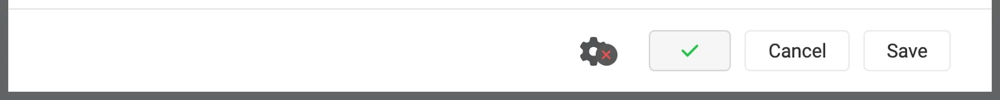
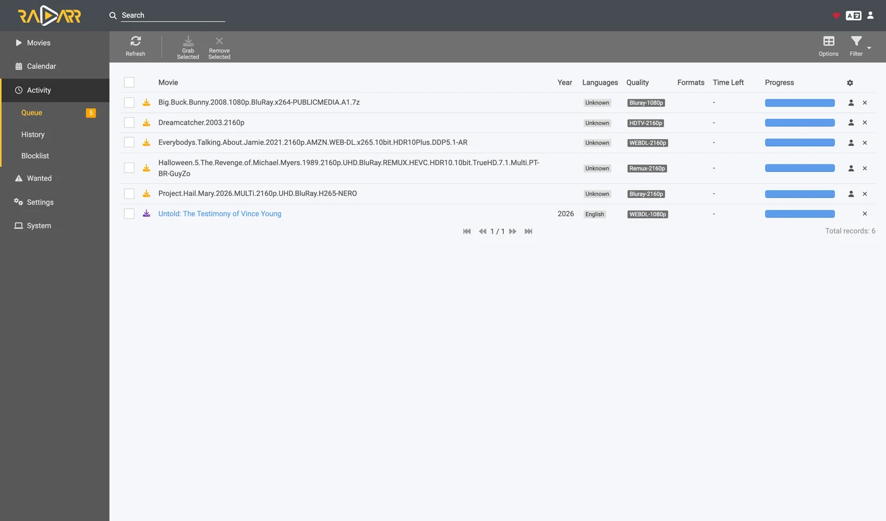

# Sonarr und Radarr, Schritt für Schritt {#sonarr-and-radarr-step-by-step}

Es gibt drei Wege, Sonarr und Radarr mit zurg zu nutzen. Entscheide, wer sucht: zurg oder die \*arrs. Siehe
[welchen du nehmen solltest](sonarr-radarr-fetch.md#which-one-to-pick).

| Anleitung | Wer sucht | zurg agiert als | Du brauchst |
|---|---|---|---|
| [Usenet](sonarr-radarr.md) | Sonarr und Radarr | ein SABnzbd | ein Usenet-Konto (oder TorBox Pro für das Backend `torbox_nzb`) und Usenet-Indexer in Prowlarr oder den \*arrs |
| [Torrents](sonarr-radarr-torrents.md) | Sonarr und Radarr | ein qBittorrent | ein Debrid-Konto und Torrent-Indexer in Prowlarr oder den \*arrs |
| [zurg sucht selbst](sonarr-radarr-fetch.md) | zurg | gar kein Download-Client | ein Usenet-, TorBox-Pro- oder Debrid-Konto sowie Newznab- oder Torznab-Indexer in zurgs eigener Konfiguration |

Die ersten beiden kannst du parallel betreiben. Sie teilen sich denselben `__magic__`-Ordner.

Richte Sonarr und Radarr auf zurg aus, damit sie ohne Client von Usenet holen. Bei einem Grab wird kein ganzes Video heruntergeladen oder entpackt.
NZBs und Caches belegen weiterhin Speicherplatz. Diese Seite behandelt Usenet. Der Torrent-Endpunkt nutzt dieselben Clients und teilt sich den Ordner. Siehe
[Sonarr & Radarr für Torrents](sonarr-radarr-torrents.md).

Alles unten wurde mit zurg `nightly-993-g99bcf9a4`, Sonarr `4.0.19.2979` und Radarr `6.3.0.10514` auf einer laufenden Installation mit einem echten Usenet-Konto aufgenommen. Host- und Benutzernamen wurden zu `you@zurg-server` geändert. Indexer-Namen lauten `my-indexer`. API-Keys und Bibliotheksanzahlen sind nur beispielhaft. Sonst wurde an der aufgenommenen Ausgabe nichts verändert. Die Log-Zeilen für `torbox_nzb` stammen aus dem Quellcode von zurg vom 2026-11-09 und wurden nicht live mitgeschnitten.

## Bevor du anfängst {#before-you-start}

Drei Dinge müssen zutreffen. Prüfe alle drei jetzt, denn jedes davon schlägt später fehl, und zwar so, dass es nach etwas ganz anderem aussieht.

1. **zurg hat einen `nzb`-Provider oder einen `torbox_nzb`-Provider (TorBox Pro).** Ohne einen davon gibt es nichts, was lesen könnte, was der Endpunkt schreibt. Dann wird jeder Job nach 30 Minuten als Failed gemeldet, weil zurg dann aufgibt, darauf zu warten, dass er in der Bibliothek erscheint. Siehe [Usenet](usenet.md) oder [TorBox-gehostetes Usenet](../providers/torbox-nzb.md) für `torbox_nzb`.
2. **`magic.enabled` ist `true`.** Ohne das existiert das completed-Verzeichnis nicht, und jeder Import schlägt fehl. Siehe [`__magic__`](magic.md).
3. **Der Mount ist für den \*arr sichtbar**, und zwar unter dem Pfad, den zurg meldet. Läuft Sonarr in einem Container, lies [Schritt 8](#8-if-your-arr-is-in-docker), bevor du irgendetwas konfigurierst. Als normale App auf derselben Maschine installiert sieht er den Mount dort, wo zurg ihn einhängt, mit einem Haken pro System:
   - **Linux:** Ein \*arr, der als anderer Benutzer als zurg läuft, sieht einen leeren Ordner, bis `user_allow_other` aktiviert ist. Siehe [Linux-Einrichtung](../setup/linux.md#1-install-fuse-3).
   - **macOS:** Lass ihn als derselbe Benutzer laufen wie zurg. Der Mount liegt unter `/Volumes/Zurg`, es sei denn, du hast `mount_path` geändert.
   - **Windows:** Lass Sonarr und Radarr als Tray-App laufen, die der Installer anbietet, nicht als Windows-Dienst. zurgs `Z:`-Laufwerk gehört zu der Sitzung, in der du angemeldet bist, und ein Dienst läuft außerhalb davon. Deshalb sieht er das Laufwerk nicht. Siehe [die Sitzungsregeln](../setup/windows.md#keeping-it-running-the-session-rules).

Prüfe die ersten beiden direkt in der Konfigurationsdatei im Arbeitsverzeichnis von zurg. Unter Windows öffne stattdessen `config.yml` in Notepad.

```bash
$ grep -A6 '^providers:' config.yml
providers:
- type: nzb
  nntp:
    host: news.example.com
    port: 563
    tls: true
    username: <redacted>
    password: <redacted>

$ grep -A4 '^magic:' config.yml
magic:
  enabled: true
  allow_delete: false
  sidecar_max_mb: 32
  sidecar_budget_mb: 2048
```

`allow_delete: false` ist der sichere Standard und hat keinen Einfluss auf Importe. Ein Löschen innerhalb von `__magic__` blendet den Eintrag nur aus, statt Inhalte aus dem Konto zu entfernen.

## 1. Den Endpoint einschalten {#1-turn-the-endpoint-on}

Zwei Wege, gleiches Ergebnis. Beide schreiben in `config.yml`, und beide brauchen einen Neustart: Die Routen, die `__magic__` ausliefern, und der SABnzbd-Endpunkt werden nur einmal registriert, wenn zurg startet.

### Option A — das Dashboard {#option-a--the-dashboard}

Öffne das zurg-Dashboard, klicke auf **Config** und scrolle zu **\_\_magic\_\_ & Download Clients**. Aktiviere **Serve \_\_magic\_\_** und **SABnzbd Endpoint** und setze dann **SABnzbd Categories** auf `tv, movies`.


**Config** ist der Ort, an dem die Einstellung liegt; **Magic** ist der Ort, an dem du später sehen wirst, wenn Grabs ankommen.


Lass **SABnzbd Completed Directory** leer, es sei denn, dein \*arr bindet zurg an einem anderen Pfad ein als zurg selbst. Siehe dazu [Schritt 8](#8-if-your-arr-is-in-docker). Der orangefarbene **Restart Required**-Chip sagt die Wahrheit: Hier wird nichts wirksam, bevor zurg neu gestartet wurde.

### Option B — `config.yml`

Füge den Block von Hand hinzu und starte zurg neu.

```yaml
magic:
  enabled: true

sabnzbd:
  enabled: true
  api_key: ""          # empty = zurg generates one and keeps it
  categories: [tv, movies]
  complete_dir: ""     # empty = <mount_path>/__magic__/__all__
```

**Die Kategorien sind keine Ordner.** Sie führen alle zum selben Ort. Der Ordner eines Jobs ist der eigene Ordner des Releases unter `__magic__/__all__`. Die Liste gibt es nur, damit Sonarr und Radarr aufhören, vor einer Kategorie zu warnen, die sie nicht finden können. Wenn die Kategorie von Sonarr `tv` ist, muss `tv` in dieser Liste stehen.

Starte zurg neu und prüfe dann, ob der Provider übernommen wurde:


Eine Zeile mit `nzb` oder `torbox_nzb` reicht dem Endpunkt.

## 2. Den API-Schlüssel finden {#2-find-the-api-key}

Der API-Key ist die gesamte Authentifizierung für diesen Endpunkt. Trag ihn also einmal richtig ein und poste ihn nirgendwo öffentlich.

**Wenn du `api_key` leer gelassen hast**, hat zurg beim ersten Start einen erzeugt und in `data/sabnzbd-apikey` geschrieben:

```bash
$ cat data/sabnzbd-apikey
0123456789abcdef0123456789abcdef

```

Beispielschlüssel, deiner wird anders aussehen. Die Datei bleibt auch nach Neustarts erhalten, der Schlüssel bleibt also stabil, sobald er erzeugt wurde.

**Wenn du `api_key` selbst gesetzt hast**, steht er in `config.yml` und es wird keine Datei geschrieben. Das Dashboard zeigt dir, welcher der beiden Fälle zutrifft: Unten im Block bei Schritt 1 steht entweder *pinned in config.yml under `sabnzbd.api_key`* oder *generated and kept in `data/sabnzbd-apikey`*.

**Dieser Endpunkt liegt außerhalb der Basic-Auth von zurg.** Weder Sonarr noch Radarr senden jemals Basic-Auth an einen Download-Client, und deren HTTP-Schicht macht aus einem 401 ein "unable to connect" ohne brauchbare Information. Deshalb nimmt zurg `/api` bewusst aus. Der API-Key ist die einzige Sperre. Behandle den Port so wie den Rest von zurg: nur in einem vertrauenswürdigen Netzwerk betreiben oder hinter etwas, das ihn absichert.

## 3. Prüfen, ob er antwortet {#3-prove-it-answers}

Mach das, bevor du Sonarr anfasst. Das dauert zehn Sekunden und zeigt dir für den Rest der Einrichtung, ob zurg falsch ist oder der \*arr.

+++ Linux und macOS

```bash
$ SAB=0123456789abcdef0123456789abcdef
$ ZURG=192.168.88.245:9996

$ curl -s "http://$ZURG/api?mode=version&apikey=$SAB&output=json"
{"version":"4.5.1"}

$ curl -s "http://$ZURG/api?mode=get_config&apikey=$SAB&output=json" \
    | jq '.config.misc.complete_dir, [.config.categories[].name]'
"/mnt/zurg_usenet/__magic__/__all__"
[ "*", "tv", "movies" ]
```

+++ Windows

In PowerShell. Tippe `curl.exe` ein, nicht `curl`: Das `curl` in Windows PowerShell ist ein anderer Befehl.

```powershell
PS> $SAB = "0123456789abcdef0123456789abcdef"
PS> $ZURG = "192.168.88.245:9996"

PS> curl.exe -s "http://$ZURG/api?mode=version&apikey=$SAB&output=json"
{"version":"4.5.1"}

PS> (Invoke-RestMethod "http://$ZURG/api?mode=get_config&apikey=$SAB&output=json").config.misc.complete_dir
Z:/__magic__/__all__
```

+++

`complete_dir` ist der Pfad, den zurg an die Clients weitergibt. Prüf jetzt, ob es ein Pfad ist, den *sie* öffnen können.

Prüf dann, ob ein falscher Key tatsächlich abgelehnt wird (unter Windows mit `curl.exe` und denselben URLs):

```bash
$ curl -s "http://$ZURG/api?mode=queue&apikey=wrongkey&output=json"
{"status":false,"error":"API Key Incorrect"}

$ curl -s "http://$ZURG/api?mode=queue&output=json"
{"status":false,"error":"API Key Required"}
```

**`mode=version` ist kein Authentifizierungstest.** Es antwortet `{"version":"4.5.1"}` auch mit einem falschen Key. So verhält sich das echte SABnzbd, und zurg kopiert das. Nimm `mode=queue` oder `mode=get_config`, wenn du tatsächlich den Key testen willst.

Beide URL-Varianten funktionieren, du kannst also im Feld **URL Base** des Clients jede der beiden eintragen:

| Pfad | URL Base in Sonarr / Radarr | Antwortet |
|---|---|---|
| `/api` | *(leer lassen)* | ja |
| `/sabnzbd/api` | `/sabnzbd` | ja |

Wenn `/api` ein einfaches **404** liefert, ist `sabnzbd.enabled` noch auf false oder zurg wurde nach der Änderung nicht neu gestartet.

## 4. Die Root-Ordner anlegen {#4-make-the-root-folders}

Lege sie an, bevor du sie hinzufügst, denn der Dialog Add Root Folder in den \*arrs durchsucht das laufende Dateisystem und bietet keinen Ordner an, der nicht existiert.

+++ Linux und macOS

```bash
$ mkdir -p /mnt/zurg_usenet/__magic__/tv /mnt/zurg_usenet/__magic__/movies

$ ls -d /mnt/zurg_usenet/__magic__/tv /mnt/zurg_usenet/__magic__/movies
/mnt/zurg_usenet/__magic__/movies
/mnt/zurg_usenet/__magic__/tv
```

+++ Windows

```powershell
PS> New-Item -ItemType Directory -Force Z:\__magic__\tv, Z:\__magic__\movies
```

Oder erstelle die beiden Ordner im Explorer.

+++

Ersetze `/mnt/zurg_usenet` durch deinen eigenen `mount_path`. Ist er nicht gesetzt, lautet er `/mnt/zurg` unter Linux, `/Volumes/Zurg` unter macOS und `Z:` unter Windows. Die Ordnernamen kannst du frei wählen; `tv` und `movies` passen nur zu den Kategorien.

**Der Root-Ordner liegt neben dem completed-Verzeichnis, nicht darin und nicht darüber.** zurg liefert den Clients `__magic__/__all__`, also deine Bibliothek so, wie `__all__` sie auflistet. Deine Root-Ordner liegen daneben, unter `__magic__/tv` und `__magic__/movies`. **Nicht** `__magic__/__all__`, **nicht** `__magic__` selbst und **nicht** `/mnt/zurg_usenet`. Beide Clients zeigen einen health check, wenn ein Root-Ordner *das* Ausgabeverzeichnis des Download-Clients ist, und Radarr zeigt außerdem einen, wenn ein Root-Ordner es *enthält*. Geschwister-Ordner lösen beides nicht aus, und ein manueller Import, der auf das completed-Verzeichnis zeigt, hat dann eine Release zum Ansehen statt deiner ganzen Bibliothek.

So sieht es aus, wenn man es falsch macht. Beide Beispiele sind echt, von den beiden Clients. Sie wurden aufgenommen, bevor das completed-Verzeichnis nach `__magic__/__all__` verschoben wurde. Die Pfade darin liegen daher eine Ebene höher als deine, aber die beiden Regeln sind dieselben.


Sonarr mit dem completed-Verzeichnis selbst als Root-Ordner. Es warnt, weil der Root-Ordner *das* Ausgabeverzeichnis ist.


Radarr mit `/mnt/zurg_usenet` als Root-Ordner. Es warnt auch für den übergeordneten Ordner, Sonarr dagegen nicht. Verschiebe den Root-Ordner neben das completed-Verzeichnis, dann verschwinden beide Warnungen.

## 5. Den Client in Sonarr hinzufügen {#5-add-the-client-in-sonarr}

Eine brandneue Sonarr blockiert alles hinter einem First-Run-Bildschirm. Wähle **Forms (Login Page)**, lege einen Benutzernamen und ein Passwort fest und klicke auf **Save**.


Du kommst nicht weiter, bis **Authentication Method** auf etwas anderes als None gesetzt ist.


Nach **Save** wirst du einmal abgemeldet und landest auf der Login-Seite.


### Settings → Download Clients

Gehe zu **Settings → Download Clients**. Bei einer frischen Installation gibt es hier nur die **+**-Karte.


Klicke auf das **+** unter „Download Clients“ – nicht auf das weiter unten unter „Remote Path Mappings“.

Wähle **SABnzbd** in der Spalte **Usenet** aus.


zurg tut sich speziell als SABnzbd aus, deshalb funktioniert nichts anderes in dieser Liste.

Der Dialog öffnet sich mit den eigenen Standardwerten von SABnzbd – `localhost`, Port `8080`, kein Key.


### Was in welches Feld gehört {#what-to-put-in-each-field}

| Feld | Wert | Warum |
|---|---|---|
| Name | `zurg (Usenet)` | Beliebig. Es ist nur eine Bezeichnung. |
| Enable | an | Lass es angehakt. |
| Host | `192.168.88.245` | Der Host, auf dem zurg läuft, so wie *der \*arr* ihn erreichen kann. `localhost`, wenn der \*arr eine normale App auf derselben Maschine ist. In Docker siehe die Warnung unten. |
| Port | `9996` | zurgs Standardport — `9999` bei einer Standardinstallation. |
| Use SSL | aus | Nur, wenn du zurg selbst hinter TLS betreibst. |
| API Key | aus Schritt 2 | Die ganze Zugangskontrolle. |
| Username | leer | Schließt sich mit dem Schlüssel gegenseitig aus. Nur der Schlüssel wird akzeptiert. |
| Password | leer | Wie oben. |
| Category | `tv` | Muss in `sabnzbd.categories` vorkommen. |
| Recent / Older Priority | Default | zurg hat nichts, worauf eine Priorität angewendet werden könnte. |
| Remove Completed | an | Lässt den Client seine eigenen Auftragsdaten aufräumen. Lass es an. |
| Remove Failed | an | Dasselbe. |


Der gezeigte API-Schlüssel ist nur ein Beispiel — füge deinen eigenen ein.

**In Docker lügen sowohl "localhost" als auch der Hostname.** Innerhalb eines Containers ist `localhost` der Container selbst, und der eigene Hostname der Maschine wird meist zu `127.0.1.1` aufgelöst — das ist ebenfalls der Container. Verwende die **LAN- oder Tailscale-IP** des Hosts, niemals `localhost` und niemals den bloßen Hostnamen, selbst wenn beides in deiner Shell gut funktioniert.

Klicke auf **Test**. Ein grüner Haken bedeutet, dass alle vier Prüfungen des Clients bestanden wurden: Version, API-Schlüssel, globale Konfiguration und die Kategorie.


Klicke jetzt auf **Save**.


## 6. Den Root-Ordner in Sonarr hinzufügen {#6-add-the-root-folder-in-sonarr}

Geh zu **Settings → Media Management** und scrolle ganz nach unten.


Klick auf **Add Root Folder**. Es öffnet sich ein Dateibrowser auf dem Dateisystem von Sonarr. Bei Docker ist das das Dateisystem des Containers.


Tipp den Pfad in das Feld oben. Wenn der Mount für Sonarr wirklich sichtbar ist, erscheint beim Tippen der Inhalt von `__magic__`: `__all__` mit allen Releases darin und alles, was du daneben angelegt hast. Das ist der schnellste Beweis, dass der Bind Mount stimmt.


Wenn hier nichts steht oder ein Fehler kommt, hör auf und behebe erst den Mount, bevor du weitermachst.


Vervollständige den Pfad zu `__magic__/tv` (`Z:\__magic__\tv` unter Windows) und klick auf **Ok**.


Zeigt **Free Space** eine plausible Zahl, kann Sonarr den Mount abfragen. **Unmapped Folders** zählt die Releases, die dort schon liegen.

## 7. Dasselbe in Radarr machen {#7-do-the-same-in-radarr}

Identisch, nur zwei Werte sind geändert: die Kategorie ist `movies` und der Root-Ordner ist `__magic__/movies`.


Radarrs erster Start läuft genauso: Forms auth einstellen, dann anmelden.


**Settings → Download Clients → +**, dann **SABnzbd** unter Usenet.


Gleicher Host, gleicher Port, gleicher Key. Nur **Category** ist anders: `movies`, nicht `tv`.



**Test**, grüner Haken, **Save**.


Dann **Settings → Media Management → Root Folders → Add Root Folder** und `/mnt/zurg_usenet/__magic__/movies` hinzufügen.

**Ein zurg, zwei Clients, eine Queue.** Die Queue und der Verlauf von zurg werden nur nach der Kategorie gefiltert, sonst nach nichts. Zwei Sonarrs, die beide `tv` verwenden, sehen sich gegenseitig die Jobs; Sonarr auf `tv` und Radarr auf `movies` tun das nicht. Wenn du pro Kategorie nur einen Client hast, kommt das gar nicht erst vor.

## 8. Wenn dein \*arr in Docker läuft {#8-if-your-arr-is-in-docker}

Dieser Schritt gilt für Docker auf einem Linux-Host. Docker Desktop unter macOS und Windows führt Container in einer virtuellen Maschine aus. Der `rslave`-Bind unten setzt Linux-Mount-Propagation voraus (siehe [Docker-Einrichtung](../setup/docker.md)). Ob zurgs Mount auf diesen Systemen an einen Container übergeben werden kann, wurde nicht getestet. Installiere Sonarr und Radarr unter macOS und Windows stattdessen als normale Apps, wie unter [Before you start](#before-you-start) beschrieben.

Drei getrennte Probleme. Das zweite kostet bei jedem Import einen Download. Das dritte macht sich erst bemerkbar, wenn zurg zum ersten Mal neu startet.

### Der Pfad, den zurg meldet, muss ein Pfad sein, den der Client öffnen kann {#the-path-zurg-reports-must-be-a-path-the-client-can-open}

Falls der Container die Bibliothek an einem anderen Ort einbindet als zurg, schlagen alle Importe mit *download doesn't contain intermediate path* oder einem Health-Check für den Remote-Pfad fehl. Du kannst das auf eine von zwei Arten beheben, beide sind in Ordnung:

- **Setze `sabnzbd.complete_dir`** auf den Pfad, den *der Client* sieht. Das ist am einfachsten, wenn es nur einen Client gibt oder mehrere Clients die Bibliothek am selben Ort einbinden.
- **Füge ein Remote Path Mapping** im \*arr hinzu. Nimm das, wenn verschiedene Clients die Bibliothek unterschiedlich einbinden.

```yaml
sabnzbd:
  complete_dir: "/data/zurg/__magic__/__all__"   # what the *arr sees, not what zurg sees
```

Für die zweite Variante gehst du zu **Settings → Download Clients** und klickst auf das **+** unter **Remote Path Mappings**. Das ist das untere auf der Seite, nicht das, das du in Schritt 5 benutzt hast.


**Host** muss genau dem Host-String entsprechen, den du im Download Client eingegeben hast. **Remote Path** ist der Pfad, den zurg meldet, **Local Path** ist der Ort, an dem der Client ihn sieht.

### Ein Volume für den Download-Ordner und die Root-Ordner {#one-volume-for-the-download-folder-and-the-root-folders}

Ein Import aus `__magic__/__all__` nach `__magic__/tv` ist kostenlos, weil es nur ein Umbenennen ist. Ein Umbenennen funktioniert nur innerhalb eines einzigen Mounts. Gibst du dem Container die beiden Ordner als zwei Volumes, sieht er zwei Dateisysteme. Dass beide darunter auf demselben zurg-Mount liegen, hilft trotzdem nicht.

```yaml
    volumes:                                        # do not do this
      - /mnt/zurg_usenet/__magic__/__all__:/downloads
      - /mnt/zurg_usenet/__magic__/tv:/tv
```

Der Kernel verweigert das Umbenennen im Container. Sonarr und Radarr kopieren dann die Datei und löschen das Original, ohne Bescheid zu sagen. Jeder Import lädt dann das komplette Release aus deinem Account und schreibt es auf zurgs Speicher. Der Import klappt trotzdem. Er ist nur langsam. Eine 1.46 GB große Episode hat so 50 Sekunden und 2.9 GB Traffic gebraucht. Mit einem Volume waren es eine Sekunde und gar nichts gelesen.

Gib dem Container ein einziges Volume, das zurgs gesamten Mount enthält. Greife über dieses Volume auf den Download-Ordner und die Root-Ordner zu. Der Bind im nächsten Abschnitt macht genau das. Ein remote path mapping oder `complete_dir` zeigt den Client dann auf `__all__` innerhalb desselben Volumes.

Ein manueller Import mit **Hardlink/Copy Files** kopiert ebenfalls. Wähle **Move Files**.

### Den Parent des Mounts binden, nicht den Mountpoint {#bind-the-mounts-parent-not-the-mountpoint}

Das ist der Punkt, der dich einen ganzen Nachmittag kostet. Außerdem ist es das einzige Volume, das der Abschnitt oben verlangt. Ein Neustart von zurg hängt `/mnt/zurg_usenet` aus und mountet es wieder. Ein Container, der **den Mountpoint selbst** eingebunden hat, behält die FUSE-Verbindung, mit der er gestartet wurde, und die ist jetzt tot. Jeder Lesezugriff liefert dann `Socket not connected`. Und weil beide Clients vor einem Grab den freien Speicher im Root-Ordner prüfen, werden *alle Releases stillschweigend abgelehnt*:

```
FreeSpaceSpecification: Socket not connected
```

Keiner der beiden Clients meldet, dass der Mount veraltet ist. Der Ordner ist im Container weiterhin sichtbar, und ein interaktiver Grab, den du direkt an den Client schickst, funktioniert trotzdem. Das sieht dann so aus, als hätte ein \*arr still und heimlich aufgehört zu suchen.

Bind stattdessen das **übergeordnete Verzeichnis** mit `rslave` ein. Dann kommt der Remount als Sub-Mount-Ereignis an, und der Container folgt ihm:

```yaml
    volumes:
      - type: bind
        source: /mnt          # the parent, not /mnt/zurg_usenet
        target: /mnt
        bind:
          propagation: rslave
```

Prüfe einen Container nach jedem zurg-Neustart. Du willst eine Größe sehen, keinen Fehler:

```bash
$ docker exec radarr df -h /mnt/zurg_usenet
Filesystem      Size  Used Avail Use% Mounted on
zurg{PGSq4}:    1.0P     0  1.0P   0% /mnt/zurg_usenet
```

Das Petabyte kommt daher, dass zurg ein virtuelles Dateisystem meldet und keine Festplatte. Das ist so gewollt, denn genau das erfüllt die Prüfung des freien Speichers beim \*arr.

## 9. Einen Grab einmal durchlaufen sehen {#9-watch-one-grab-go-through}

Füg eine Sache hinzu, hol sie manuell und verfolge sie bis zum Schluss. Alles unten ist ein echter Abruf mit dem oben beschriebenen Setup.

### Grab it

Öffne einen Film (oder eine Folge), klicke auf **Interactive Search** und wähle ein Release aus.


Die Spalte **Source** zeigt `nzb` an – das ist das Protokoll, das zurg verarbeiten kann.

Klicke auf den Button mit dem umkreisten Pfeil am Ende der Zeile, um es zu grabben. Wenn das Release nicht sauber passt, fragt der Client dich zuerst, ob die Zuordnung stimmt:


**Override and Grab** erscheint, wenn der Client von dir bestätigt haben möchte, worum es sich bei dem Release handelt. Prüfe die Zuordnung und klicke auf **Grab Release**. Bei einem normalen automatischen Grab wird dieser Dialog nie angezeigt.

### Es landet in der Warteschlange {#it-lands-in-the-queue}



**Activity → Queue** direkt nach dem Grab. Achte auf den Fortschrittsbalken: Er ist voll, und **Time Left** zeigt einen Strich. Es gibt keinen Download, den man messen könnte, also ist ein Job entweder in der Warteschlange oder fertig, dazwischen gibt es nichts. *Die anderen Zeilen hier gehören zu einer zweiten Radarr-Instanz, die auf dieselbe zurg und dieselbe Kategorie zeigt* — siehe den Hinweis in Schritt 7.

### zurg schreibt die NZB und liest sie {#zurg-writes-the-nzb-and-reads-it}

```
Aug 25 14:44:03 zurg-server zurg[3034965]: INFO  nzb  Loaded NZB
  Last.Week.Tonight.with.John.Oliver.S13E22.480p.WEB.x264-RMTeam.nzb: 4 files
Aug 25 14:50:28 zurg-server zurg[3034965]: INFO  nzb  Loaded NZB
  Untold.The.Testimony.of.Vince.Young.2026.1080p.NF.WEB-DL.DD+5.1.Atmos.H.264-playWEB.nzb: 9 files
```

`Loaded NZB … : N files` ist die Zeile, die sagt, dass die NZB geparst wurde. Wenn ein Job nach 30 Minuten als Failed gemeldet wird, weil zurg aufgibt, bis er in der Bibliothek erscheint, fehlt genau diese Zeile.

### Der Import passiert {#the-import-happens}


**Activity → History**. Zwei Ereignisse, nur Sekunden auseinander: **Grabbed**, dann **Movie Imported**.


**Status: Downloaded**, **Size 4.7 GiB** — und es wurde nichts heruntergeladen.

### Prüfen, dass die Datei echt ist {#prove-the-file-is-real}

Der Import hat die Datei in den Root-Ordner verschoben. Lies beide Enden davon und frag ffprobe, was es ist:

+++ Linux und macOS

Wenn deine Shell `ffprobe` nicht findet, nimm `~/zurg/bin/ffprobe`. Das Setup legt dort eine eigene Kopie ab, wenn keine installiert war.

```bash
$ ls -la "/mnt/zurg_usenet/__magic__/movies/Untold - The Testimony of Vince Young (2026)/"
-rw-r--r-- 1 you you 4920958828 Aug 25 14:53 Untold.The.Testimony…playWEB.mkv

$ dd if="$F" bs=1M count=1 >/dev/null
1048576 bytes (1.0 MB, 1.0 MiB) copied, 0.0429446 s, 24.4 MB/s

$ ffprobe -v error -show_entries format=duration,size,format_name \
    -of default=noprint_wrappers=1 "$F"
format_name=matroska,webm
duration=4709.440000
size=4920958828
```

+++ Windows

In PowerShell, aus dem zurg-Ordner. Das Setup hat `bin\ffprobe.exe` dort abgelegt, es sei denn, ein `ffprobe` war schon in deinem PATH. In dem Fall tippst du stattdessen `ffprobe`:

```powershell
PS> $F = Get-Item "Z:\__magic__\movies\Untold - The Testimony of Vince Young (2026)\*.mkv"
PS> $F.Length
4920958828

PS> bin\ffprobe.exe -v error -show_entries format=duration,size,format_name -of default=noprint_wrappers=1 $F.FullName
format_name=matroska,webm
duration=4709.440000
size=4920958828
```

+++

Ein 78 Minuten langes Matroska, das bei Bedarf aus Usenet-Artikeln gestreamt wird. Die Bytes kommen erst, wenn etwas sie liest, nicht wenn die \*arr-Tools importieren.

## 10. Eine Veröffentlichung von Hand hinzufügen {#10-adding-a-release-by-hand}

Manchmal holt Sonarr oder Radarr die gewünschte Veröffentlichung nie. Die Indexer, die sie durchsuchen, haben sie vielleicht nicht, oder ein Qualitätsprofil oder ein Custom Format lehnt sie ab. Du kannst zurg die NZB selbst geben, und zwar unter der Kategorie der App, die sie importieren soll. Diese App importiert sie dann, als hätte sie sie selbst geholt.

Wenn die Veröffentlichung bei einem Indexer liegt, den die App durchsucht, probier zuerst die App. **Interactive Search** zeigt auch abgelehnte Veröffentlichungen. Wenn du eine davon holst, geht sie wie jeder andere Abruf an zurg. Radarr hat einen IMAX-Release geholt, den sein Profil abgelehnt hatte, weil er gegen ein erforderliches Custom Format 0 Punkte bekam, und hat ihn importiert.

+++ Linux und macOS

```bash
$ SAB=0123456789abcdef0123456789abcdef
$ ZURG=192.168.88.245:9996

# an NZB file you already have (the upload field is called name, as in SABnzbd)
$ curl -s "http://$ZURG/api?mode=addfile&apikey=$SAB&cat=movies" \
    -F 'name=@Movie.Title.2024.1080p.WEB-DL.nzb'
{"status":true,"nzo_ids":["SABnzbd_nzo_…"]}

# or a link to one, which zurg downloads itself
$ curl -s -G "http://$ZURG/api" \
    --data-urlencode mode=addurl --data-urlencode "apikey=$SAB" --data-urlencode cat=movies \
    --data-urlencode 'name=https://indexer.example/getnzb/<id>?r=<indexer-key>' \
    --data-urlencode nzbname=Movie.Title.2024.1080p.WEB-DL
{"status":true,"nzo_ids":["SABnzbd_nzo_…"]}
```

+++ Windows

In PowerShell, mit `curl.exe` statt `curl`. Beide antworten mit `{"status":true,"nzo_ids":[…]}` wie oben.

```powershell
$SAB = "0123456789abcdef0123456789abcdef"
$ZURG = "192.168.88.245:9996"

# an NZB file you already have (the upload field is called name, as in SABnzbd)
curl.exe -s "http://$ZURG/api?mode=addfile&apikey=$SAB&cat=movies" -F "name=@Movie.Title.2024.1080p.WEB-DL.nzb"

# or a link to one, which zurg downloads itself
curl.exe -s -G "http://$ZURG/api" `
  --data-urlencode mode=addurl --data-urlencode "apikey=$SAB" --data-urlencode cat=movies `
  --data-urlencode "name=https://indexer.example/getnzb/<id>?r=<indexer-key>" `
  --data-urlencode nzbname=Movie.Title.2024.1080p.WEB-DL
```

+++

`--data-urlencode` sorgt dafür, dass das eigene `?` und `&` des Links innerhalb von `name` erhalten bleiben. Der Job erscheint innerhalb einer Minute in der Queue der App, bei deren nächster Prüfung.

Fünf Dinge entscheiden, was danach passiert.

1. **Der Film oder die Serie muss schon in der App sein.** Sie importiert nur, was sie einem Eintrag zuordnen kann, den sie verwaltet.
2. **Der Name muss sagen, was es ist.** Der Job nimmt den Dateinamen der NZB oder `nzbname`, wenn du es angibst. Ohne `nzbname` nutzt `addurl` den Dateinamen, den der Indexer ausliefert. Gib dem Namen ein Jahr.
3. **Die Kategorie bestimmt die App.** `cat=movies` erreicht den Radarr, dessen Download-Client `movies` nutzt. Jede App schaut nur in ihre eigene Kategorie.
4. **Das Qualitätsprofil blockiert es nicht. Die Datei, die du schon hast, kann es.** Radarr prüft beim Import weder die erlaubten Qualitäten noch einen Mindestwert im Custom Format. Es hat eine 720p BluRay mit 0 Punkten in ein Profil importiert, das nur 2160p erlaubt und einen Wert von 100 verlangt. Außerdem hat es eine 1080p WEBRip in einen Film importiert, dessen Profil nur 720p erlaubt. Danach hat es eine 1080p BluRay als Upgrade darübergelegt und die WEBRip gelöscht. Eine danach hinzugefügte WEB-DL blieb in Activity mit *Not an upgrade for existing movie file* stehen. **Activity → Queue → Manual Import** bringt sie trotzdem rein und ersetzt die Datei.
5. **Einen Fehler musst du selbst beheben.** Die App blockiert oder entfernt nie einen Download, den sie nicht selbst geholt hat. Eine Veröffentlichung, deren Artikel auf den News-Servern schon abgelaufen waren, kam von zurg als Failed zurück und blieb in Radarrs Queue mit *Download has failed wasn't grabbed by Radarr, skipping automatic download handling* stehen. Entferne sie aus der Queue und wähle eine andere Veröffentlichung.

Gemessen am 2026-10-10 mit Radarr 6.3, mit `addfile` und `addurl`, inklusive eines Profils, das ein Custom Format aus einem Release-Namen verlangt. Jeder Import war ein Umbenennen nach `__magic__/movies`, es wurde nichts kopiert. Sonarr wurde nicht getestet.

Danke an **.telmen** auf Discord, der gefragt hat, wie man das mit Usenet macht.

## Vom zurg-Standpunkt aus schauen {#watching-from-zurgs-side}

zurgs `/magic/`-Seite listet jede NZB auf, die der Endpunkt jemals erhalten hat. Sonarr und Radarr entfernen die Jobs, die sie übernommen haben, und der Eintrag bleibt danach eine Woche lang erhalten. So liefert eine Abfrage, die zeitgleich mit einem Löschvorgang läuft, immer dieselbe Antwort. Einen **Failed**- oder **Stuck**-Job (länger als eine Stunde in der Warteschlange), den kein Client jemals entfernen wird, zum Beispiel nachdem du zurg nicht mehr als Download-Client nutzt, kannst du hier löschen, indem du seine Schaltfläche **Clear** gedrückt hältst. Beim Löschen wird auch die zugehörige NZB entfernt, sofern ein Import sie noch verwendet.


**Placements** sind Dateien, die die Clients verschoben haben. **Tombstones** sind die Job-Ordner, die sie danach gelöscht haben. Wenn ein Client kopiert statt zu verschieben, zeigt die Seite eine rote Tabelle **Imports that were copies**. zurg macht diese Kopien wieder zu Placements und löscht sie. Jede davon war aber trotzdem ein vollständiger Download, also korrigiere die Volumes.


**State** ist das Entscheidende. **Queued** heißt, zurg ist mit dem Release noch nicht fertig, sei es, weil die Bibliothek es noch nicht aufgelistet hat, die Dateigrößen sich noch nicht eingependelt haben oder die Artikel noch nicht geprüft wurden. **Completed** heißt, das Release ist bereit zum Import. **Release** nennt den Ordner, aus dem der Client importiert.

Die Spalte **Release** wird bei jeder Abfrage direkt aus der Bibliothek gelesen und nicht gespeichert. Benennst du das Release im zurg-Dashboard um, lässt eine Reparatur es neu aufbauen oder hängt zurg ein Suffix an, weil zwei Releases denselben Namen haben, folgt der Job dem Release.

## Was funktioniert und was nicht {#what-works-and-what-does-not}

**Funktioniert:**

- Der Verbindungstest mit allen vier Prüfungen, in beiden Clients.
- Grabben, Warteschlange, Verlauf, Import per Umbenennen und die Bereinigung nach dem Import.
- Erneutes Grabben desselben Releases. Jeder spätere Grab bekommt eine eigene Job-ID, damit der Client darauf reagiert und nicht das Ergebnis des alten Jobs wiederverwendet. Das Release darunter bleibt dasselbe. Ein erneuter Grab eines Releases, das ein früherer Import schon geleert hat, wird als **Failed** gemeldet. Sein Ordner unter `__magic__/__all__` hat nichts mehr zum Importieren, und Failed sorgt dafür, dass der Client es auf die Blockliste setzt und ein anderes holt. Der Grab, der den Ordner geleert hat, meldet weiterhin Completed, bis der Client ihn löscht.
- Entfernen eines Jobs aus der Warteschlange, mit oder ohne Löschen der NZB.
- `mode=addurl`, für einen Menschen oder eine Automatisierung, die eine URL statt eines Uploads übergibt. Keiner der \*arr-Dienste nutzt das.

**Funktioniert nicht:**

- **Kein Fortschritt.** Ein Job ist entweder in der Warteschlange oder abgeschlossen; dazwischen gibt es keinen Prozentwert, weil kein Download stattfindet, den man messen könnte. Die Warteschlange zeigt die im NZB angegebene Größe an, damit die Zeile nicht leer bleibt.
- **Keine Pause, kein Fortsetzen, kein Geschwindigkeitslimit, keine Priorität und kein Skript nach der Verarbeitung.** SABnzbd hat all das, zurg hat aber nichts, worauf es das anwenden könnte.
- **`del_files` beim Löschen eines abgeschlossenen Jobs aus dem Verlauf wird ignoriert.** (Bei einem Failed-Job löscht es die NZB, wenn daraus nichts importiert wurde.) Der Client meint damit „der Job-Ordner gehört wieder dir“, aber die gerade importierte Datei wird weiterhin aus dieser NZB ausgeliefert. Der Ordner, den der Client entfernen wollte, ist weg – das hat zurg selbst über das Mount erledigt.
- **Basic Auth kann diesen Endpunkt nicht schützen.** Der API-Schlüssel ist die einzige Sperre.

**Das Fehlersignal.** Ein Release, in dem sich nichts importieren lässt, wird als **Failed** gemeldet, und beide Clients setzen es auf die Blockliste und holen eine Alternative. Dazu gehört ein Release, dessen Dateien alle kaputt, gelöscht oder herausgefiltert sind; eines, das nur `.par2`-, `.sfv`- und Begleitdateien enthält; eines, dessen Dateien alle in einem Format vorliegen, das nichts abspielt – so sieht ein verschleierter Post aus, der seinen RAR-Satz `.z001`…`.z133` nennt; und ein Archiv, das bereits geöffnet wurde und keine Mediendatei enthält. Ein RAR-Satz ist Inhalt, kein Beiwerk: zurg streamt das Video direkt daraus. Wenn ein Release wirklich etwas enthält, für das zurg keine Endung kennt, erweitere `addl_playable_extensions`, statt es auf die Blockliste zu setzen.

**Die Artikel werden geprüft, bevor ein Job als fertig gemeldet wird.** zurg wartet, bis die Bibliothek das Release auflistet und sich die Dateigrößen eingependelt haben. Dann fragt es die Newsserver nach Anfang und Ende jeder Inhaltsdatei. Das sind die ersten sechzehn Artikel und der letzte. Außerdem lädt es den ersten Artikel jeder Datei herunter. Das sind bis zu vierundsechzig davon plus ein paar weitere bei einem Release mit nur wenigen Dateien. Manche Newsserver melden weiterhin, dass ein Artikel existiert, obwohl sein Inhalt entfernt wurde, und das zeigt sich erst beim Herunterladen. Ein heruntergeladener Artikel zeigt außerdem, dass er zu diesem Post gehört und nicht zu einem anderen Upload. Der Job bleibt **Queued**, bis das geklärt ist. Schäden, die die Stichprobe nicht erreicht, werden hier nicht erkannt. Sie fallen beim Lesen auf, das sie erreicht. Ein Release, dessen Artikel fehlen, bekommt zuerst eine PAR2-Reparatur und wird nach der Reparatur erneut geprüft. Ist es wieder vollständig, läuft es weiter. Fehlen weiterhin Artikel oder kann nichts repariert werden, wird es als **Failed** gemeldet, mit einer Anzahl der fehlenden Teile. Das ist ein *Download*-Fehler, und genau darauf reagieren die Clients: Sie setzen das Release auf die Blockliste und holen unbeaufsichtigt eine Alternative, statt etwas zu importieren, das nicht abspielbar ist. Bei `torbox_nzb` gibt es keine Newsserver und keine Artikelprüfung; ein Grab gilt dort als geprüft, wenn TorBox ihn abgerufen hat.

**Eine Prüfung, die nicht abgeschlossen werden kann, wartet nicht ewig.** Manchmal lässt sich die Prüfung gar nicht vollständig durchführen. Der Verbindungspool ist eventuell down, das Konto gedrosselt oder der Durchlauf läuft in ein Zeitlimit. Das ist keine Antwort. Der Job bleibt **Queued** und wird eine Minute später erneut abgefragt. zurg zählt die Versuche pro Job mit, damit ein Neustart sie nicht vergisst. Nach dreißig fehlgeschlagenen Versuchen in Folge, die sich über mindestens drei Stunden erstrecken, wechselt der Job als **Failed** in den Verlauf. Die Meldung nennt die Anzahl, die Zeitspanne und den letzten Fehler. Ein Ausfall durch reine Ablehnungen erreicht die dreißig innerhalb einer Stunde und bringt die Warteschlange deshalb nicht zum Stillstand.

**Ein Release, das die Bibliothek verlässt, lässt seinen Job fehlschlagen.** Ein Release kann im Dashboard gelöscht werden, seine NZB kann aus dem Überwachungsordner entfernt werden oder von allen Konten fallen gelassen werden. Sein Job bleibt fünfzehn Minuten lang **Queued** und wechselt dann als **Failed** in den Verlauf. Der Client setzt es auf die Blockliste und holt ein anderes. Die Wartezeit ist wegen Neustarts da. Die Bibliothek listet während des Ladens jedes Release aus, und das darf nicht als Löschung gewertet werden. In den ersten fünfzehn Minuten nach dem Start von zurg schlägt deshalb aus diesem Grund nichts fehl. Ein Job, dessen Release die Bibliothek nie aufgelistet hat, ist davon nicht betroffen, weil es noch eintrifft.

## Fehlerbehebung {#troubleshooting}

| Was der \*arr sagt | Was es bedeutet |
|---|---|
| "Unable to connect to SABnzbd" | zurg ist unter diesem Host und Port nicht erreichbar, oder etwas davor hat mit einem Status ungleich 200 geantwortet. Prüfe `sabnzbd.enabled`. Solange das aus ist, ist `/api` ein einfaches 404. In Docker: Prüfe, ob du nicht `localhost` oder den nackten Hostnamen verwendet hast. |
| "API Key Incorrect" / "API Key Required" | Der Schlüssel passt nicht. Er steht in `config.yml`, falls du einen gesetzt hast, oder in `data/sabnzbd-apikey`, falls zurg ihn generiert hat. |
| "Test was aborted due to an error" | Der Fehler ist kein Authentifizierungsfehler. zurg protokolliert jede abgelehnte Anfrage. Durchsuche das Log nach `SABnzbd:`. |
| "Category … does not exist" | Die Kategorie im \*arr ist nicht in `sabnzbd.categories` enthalten. Füge sie hinzu und starte zurg neu. |
| "Downloads in root folder" | Ein Root-Folder liegt auf oder über dem completed-Verzeichnis. Verschiebe ihn daneben, also nach `__magic__/tv`, nicht nach `__magic__/__all__`, nicht nach `__magic__` und nicht nach `/mnt/zurg_usenet`. |
| "Remote path mapping" / "download doesn't contain intermediate path" | Der Pfad, den zurg meldet, ist kein Pfad, den der Client öffnen kann. Siehe [Schritt 8](#8-if-your-arr-is-in-docker). |
| Imports succeed but take as long as a download, and zurg's `/magic/` page lists them under **Imports that were copies** | Der Client kopiert aus `__magic__/__all__`, statt umzubenennen. Sein Container hat den Download-Ordner und die Root-Folder auf zwei verschiedenen Volumes. Oder ein manueller Import war auf Kopieren eingestellt. Siehe [ein Volume für den Download-Ordner und die Root-Folder](#one-volume-for-the-download-folder-and-the-root-folders). |
| The root folder browser shows zurg's mount empty, or no `Z:` drive at all | Der \*arr kann den Mount nicht sehen. Unter Linux läuft er als anderer Benutzer ohne `user_allow_other`. Unter Windows läuft er als Dienst. Siehe [Bevor du anfängst](#before-you-start). |
| Every release rejected, nothing in the log | Ein veralteter Bind-Mount. Führe `docker exec <client> df -h <mount>` aus. Wenn dort `Socket not connected` steht, binde das übergeordnete Verzeichnis mit `rslave` ein und erstelle den Container neu. |
| A job stays queued for a poll or two after the release appears | Das ist normal und legt sich pro Release einmal. Eine NZB sagt nicht, wie lang eine Datei ist. Die Schätzung wird durch die exakte Länge aus dem PAR2-Index oder aus dem eigenen Header eines Artikels ersetzt. Wenn zu früh Completed gemeldet wird, wirft der Client *File move incomplete, data loss may have occurred*. Ein `torbox_nzb`-Job liest keine Artikel und fragt keine News-Server ab. Er bleibt in der Warteschlange, bis TorBox das Release fertig geladen hat, höchstens 30 Minuten (siehe die nächste Zeile). |
| "zurg accepted the NZB but it never appeared in the library" | Das Release war 30 Minuten nach dem Grab oder nach zurgs eigenem Start erschienen, je nachdem, was später war, nicht in der Bibliothek. Deshalb hat zurg aufgegeben und den Job als **Failed** gemeldet. Prüfe zuerst, ob überhaupt ein `nzb`- oder `torbox_nzb`-Provider konfiguriert ist, und suche dann die NZB im Log. Ein `nzb`-Account schreibt `Loaded NZB <name>: N files`, sobald er sie geparst hat. Ein `torbox_nzb`-Release erscheint erst, wenn TorBox es fertig geladen hat. Daher schlägt der Job so immer fehl, wenn TorBox länger als 30 Minuten braucht: bei einem langsamen Abruf, beim Warten auf einen freien Slot oder bei einem Rückstau hinter zurgs einem Post pro Minute. Ein `torbox_nzb`-Account schreibt `TorBox Usenet: posting <name>` und danach die Antwort von TorBox. `TorBox answered <name> with download <id>` heißt, dass TorBox es gerade lädt oder schon hat. `TorBox queued <name> as <id> for want of a free slot` heißt, dass der Account keinen freien Slot hat. Der Post wartet, bis einer frei wird. |
| A job fails at once with "The Usenet account could not fetch the NZB" | Der Account, an den die NZB gesendet wurde, hat sie aufgegeben. Deshalb wartet zurg nicht die 30 Minuten. Bei `torbox_nzb` endet `TorBox refused <name>, …` im Log mit dem Grund von TorBox. Diese NZB wird erst wieder gepostet, wenn zurg neu startet oder sich die Datei ändert. |
| "The release holds no files that can be imported" | Die Bibliothek hat das Release, aber darin ist nichts, was ein Client importieren könnte. Eine NZB mit nur Recovery-Volumes ist genau so ein Fall, ebenso ein verschleierter Post, dessen RAR-Set `.z001`…`.z133` heißt. Erweitere `addl_playable_extensions`, wenn das Release wirklich Inhalte mit einer Endung enthält, die zurg nicht kennt. |
| Finished releases stay queued during a large burst | Mehr als sechzig Jobs sind gleichzeitig bereit. Sonarr und Radarr fragen nur die neusten sechzig Verlaufseinträge ab. Deshalb hält zurg den Rest in der Warteschlange und schiebt jedes Mal einen in den Verlauf, wenn ein Import einen Platz freigibt. Das ist normal und löst sich von selbst. |
| "The release could not be checked against the news servers" | Die Artikelprüfung ist dreißigmal hintereinander über mindestens drei Stunden fehlgeschlagen. Es wurde nichts als fehlend gefunden. Das News-Konto konnte nicht abgefragt werden. Die Meldung enthält den letzten Fehler. Prüfe zuerst das Konto und grabbe das Release neu, sobald es antwortet. Ein `torbox_nzb`-Account hat keine News-Server und keine Artikelprüfungen. Sein Grab wird deshalb danach geprüft, ob TorBox es geladen hat. |
| "The release was in the library and has since been removed from it" | Die Bibliothek hat das Release einmal aufgelistet und seitdem seit fünfzehn Minuten nicht mehr. Etwas hat es gelöscht, und das Log sagt `Release <name> is gone from every account`. Der Client setzt es auf die Blockliste und grabbt ein anderes, statt auf einen Ordner zu warten, der nicht zurückkommt. |

Noch hängen? Frag im **zurg-support**-Forum auf [Discord](https://discord.com/invite/7u4YjMThXP). [Hilfe holen](../../guides/remote-help.md) sagt dir, was du angeben solltest.

### Wo der Status gespeichert wird {#where-the-state-lives}

| Pfad | Was es ist |
|---|---|
| `nzbs/<name>.nzb` | Die NZB selbst, einmal benannt und nie umbenannt — das Usenet-Backend leitet die Identität des Releases aus diesem Dateinamen ab, daher verwaist es das Release und jede Platzierung, die daraus entstanden ist, wenn du sie umbenennst. |
| `data/sabnzbd-jobs.json` | Welche NZBs geholt wurden, unter welcher Kategorie und wann. |
| `data/sabnzbd-apikey` | Ein generierter API-Schlüssel. Wird nicht geschrieben, wenn `sabnzbd.api_key` gesetzt ist. |
| `data/magic.json` | Die `__magic__`-Tabelle — jede Platzierung und jeder Grabstein, den die Importe erzeugt haben. |
