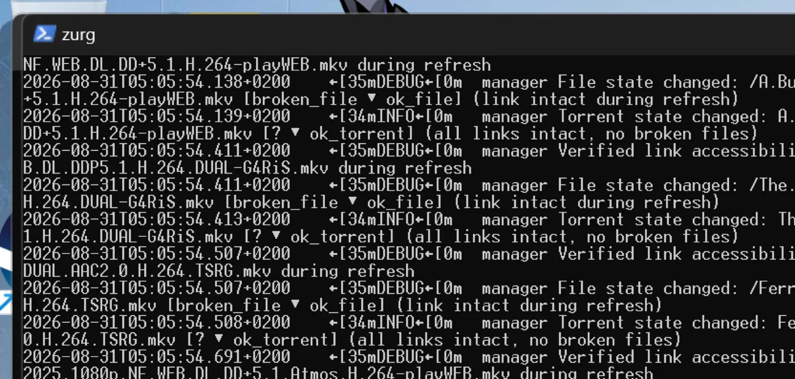
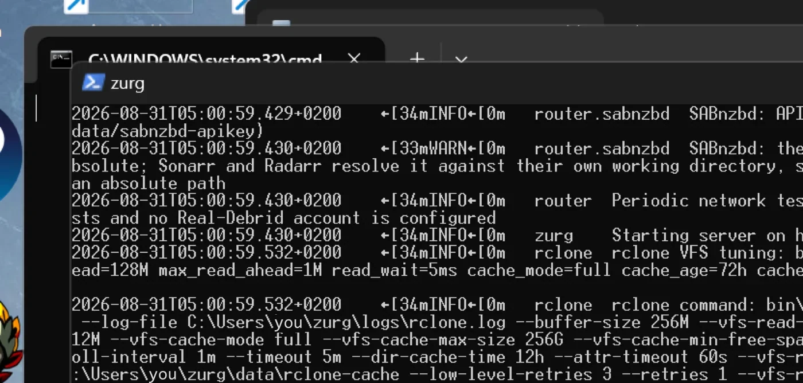
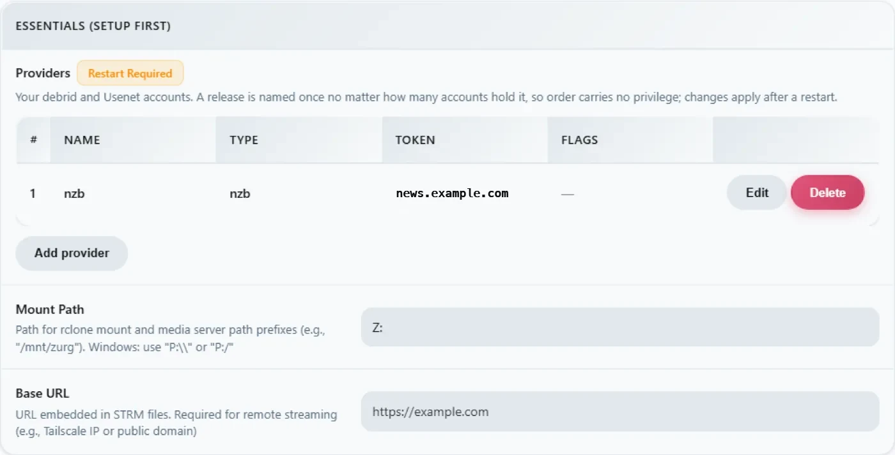

# Windows, die Binärdatei, von Grund auf {#windows-the-binary-from-scratch}

## Einzeilige Option {#one-line-option}

Führe das optionale Sponsor-Bootstrap über PowerShell aus. Es installiert WinFsp über UAC, lädt zurg herunter und startet die
Anbieterauswahl und die Diagnose:

```powershell
irm https://raw.githubusercontent.com/debridmediamanager/zurg-site/main/public/install.ps1 | iex
```

Es nutzt die Anmeldung über den Browser bei GitHub und installiert nach `$HOME\zurg`. Vorhandene Programmdateien und Konfigurationen bleiben erhalten. Für den manuellen Weg geht es unten weiter.

Kein Docker, kein WSL: die zurg-`.exe` in einem Ordner, eine `config.yml`, die du einmal schreibst, und ein `Z:`-Laufwerk im Explorer.
Diese Seite geht das Ganze in zwei Durchgängen durch: erst **RealDebrid mit dem qBittorrent-Endpunkt**, dann ein kompletter Reset und **Usenet mit dem SABnzbd-Endpunkt**. Das sind die zwei Installationen, die die Leute tatsächlich machen, und sie beanspruchen jeweils unterschiedliche Teile von zurg.

Alles unten wurde auf einer echten Installation aufgezeichnet: Windows 11 Pro 23H2 (Build 22631), PowerShell 5.1, WinFsp 2.0.23075, zurg `2026.08.30.0459-nightly-73-g5b4c9790`, dazu ein Real-Debrid-Konto und ein Usenet-News-Konto. Benutzernamen wurden geändert. API-Schlüssel und Bibliotheksanzahlen sind Beispielwerte. Das gilt auch für alle Zugangsdaten.

## Was du brauchst {#what-you-need}

- **zurg.exe** — von den [Sponsor-Releases](https://github.com/debridmediamanager/zurg/releases). Werde Sponsor auf [gatekeeper](https://gatekeeper.debridmediamanager.com/), damit dein GitHub-Konto Zugriff bekommt. Diese Seite setzt voraus, dass du es bereits heruntergeladen hast.
- **WinFsp** — zurg bindet die Bibliothek über rclone ein, und rclone braucht unter Windows WinFsp für einen Laufwerksbuchstaben. Installiere es still oder über den [Installer](https://github.com/winfsp/winfsp/releases):

  ```powershell
  $url = "https://github.com/winfsp/winfsp/releases/download/v2.1/winfsp-2.1.25156.msi"
  Invoke-WebRequest -Uri $url -OutFile "$env:TEMP\winfsp.msi" -UseBasicParsing
  Start-Process msiexec.exe -ArgumentList "/i", "$env:TEMP\winfsp.msi", "/qn", "/norestart" -Wait
  ```

- **Ein Konto** — ein Real-Debrid-API-Token für den ersten Durchlauf, einen Newsserver für den zweiten.

Mehr brauchst du nicht. Der eingebaute Installer lädt rclone herunter, und ffprobe ebenfalls, außer er ist schon in deinem PATH vorhanden.

## Empfohlen: zurg die Einrichtung fertigstellen lassen {#recommended-let-zurg-finish-the-setup}

Erstelle einen Ordner, leg `zurg.exe` hinein und starte den Installer in PowerShell:

```powershell
New-Item -ItemType Directory -Force "$HOME\zurg" | Out-Null
Set-Location "$HOME\zurg"
# Copy the downloaded zurg.exe here, then:
.\zurg.exe setup
.\zurg.exe doctor
```

`setup` fragt, welche Provider du einrichten willst. Wähle einen oder mehrere aus Real-Debrid, TorBox, AllDebrid, Usenet, Premiumize, Debrid-Link und Offcloud, in Prioritätsreihenfolge. Es fragt nur nach den Zugangsdaten der ausgewählten Provider. Danach passiert Folgendes:

1. Es erstellt `config.yml` und prüft sie.
2. Es beschränkt die ACL auf deinen Benutzer, SYSTEM und Administrators.
3. Es lädt `bin\rclone.exe` herunter sowie `bin\ffprobe.exe`, außer wenn ffprobe schon in deinem PATH liegt. In dem Fall steht in `config.yml` `ffprobe_binary: ffprobe`.
4. Es aktiviert den rclone-Mount auf `Z:`.
5. Es registriert `\Zurg\zurg` als interaktive Anmeldeaufgabe und startet sie, sobald ein Desktop-Benutzer angemeldet ist.

Wenn nötig, wähle einen anderen freien Laufwerksbuchstaben:

```powershell
.\zurg.exe setup --mount-path "Y:"
```

Setup kannst du gefahrlos erneut ausführen. Dabei wird die erstellte Aufgabe aktualisiert, eine vorhandene `config.yml` aber nicht ersetzt.

Die interaktive Aufgabe ist Absicht. WinFsp-Laufwerksmounts gehören zur Windows-Anmeldesitzung, die sie erstellt. Ein normaler Windows-Dienst läuft in Session 0, und sein Laufwerk ist für Plex und Explorer auf dem Desktop unsichtbar. Dieses Installer-Verhalten wurde am 4. September 2026 unter Windows 11 geprüft.

Die Anleitung unten zeigt dir die Dateien und die Konfiguration hinter dem Installer und baut danach Einrichtungen für Real-Debrid und Usenet als Download-Clients auf. Der manuelle erste Start und das Rezept für die geplante Aufgabe helfen dir, wenn du diese Teile selbst zusammenbauen willst.

## 1. Erster manueller Start: zurg baut sein eigenes Zuhause {#1-manual-first-run-zurg-builds-its-own-home}

Erstelle einen Ordner, lege die Binärdatei hinein und starte sie einmal ohne Konfigurationsdatei:

```powershell
PS C:\Users\you> mkdir C:\Users\you\zurg
PS C:\Users\you\zurg> .\zurg.exe
```

zurg erstellt eine anbieterneutrale Standardkonfiguration, sagt dir, was als Nächstes zu tun ist, und beendet sich dann:

```
INFO  setup  Config file not found, creating default from config.simple.yml
INFO  zurg   Default config created at config.yml
INFO  zurg   Run zurg setup to choose provider(s), or add a providers block to config.yml, then rerun zurg.
```

Führe `.\zurg.exe setup` aus, um Anbieter auszuwählen und die Helfer herunterzuladen. Nach dem Setup sieht der Ordner so aus:

```
C:\Users\you\zurg\
├── bin\                rclone.exe, and ffprobe.exe unless ffprobe was on your PATH
├── data\               library cache, keys, the __magic__ table
├── dump\
├── logs\               zurg.log, rclone.log
├── nzbs\               the Usenet watch directory (second pass)
├── strm\
├── config.yml
└── zurg.exe
```

Die erzeugte `config.yml` beginnt mit einer leeren Anbieterliste und zwei Verzeichnisfiltern. Das Setup füllt die Liste anhand deiner Auswahl. Die manuellen Beispiele weiter unten ersetzen sie durch die Konfiguration für die jeweilige Anleitung.

## 2. Der RealDebrid-Durchgang {#2-the-realdebrid-pass}

### Die Konfiguration {#the-config}

Überschreibe `config.yml` mit diesem Inhalt: ein Real-Debrid-Token, der qBittorrent-Endpoint aktiviert und das Mount als `Z:`:

```yaml
zurg: v1
providers:
  - type: realdebrid
    token: YOUR_RD_API_TOKEN

directories:
  shows:
    group: media
    group_order: 10
    filters:
      - has_episodes: true
  movies:
    group: media
    group_order: 20
    only_show_the_biggest_file: true

ffprobe_binary: bin\ffprobe.exe   # or ffprobe, if that is what setup wrote
rclone_binary: bin\rclone.exe

rclone_enabled: true
mount_path: "Z:"
rclone_extra_args:
  - "--links"

magic:
  enabled: true

qbittorrent:
  enabled: true
  api_key: ""          # empty = zurg generates one and keeps it
  categories: [tv-sonarr, radarr]
```

Hier stehen drei Windows-Besonderheiten:

- **`--links` ist optional, lohnt sich aber trotzdem.** zurg stellt die Bibliothek als rclone-Union aus einer lokalen und einer entfernten Hälfte bereit. WinFsp fragt beim Erscheinen des Laufwerks am Mount-Root ab, ob es sich um einen Symlink handelt. Ohne das Flag beantwortet rclone diese eine Abfrage mit `ERROR : symlinks not supported without the --links flag: /` und mountet trotzdem. Gemessen am 2026-08-31 mit zurg `2026.08.31.0443-nightly` gegen rclone 1.74.2 und 1.75.0: Laufwerk, beide Hälften der Union und ein Schreibvorgang in `__magic__` verhielten sich mit und ohne Flag identisch. Mit dem Flag protokolliert dieselbe Abfrage stattdessen `NOTICE: union root '': Symlinks support enabled`, und rclone übernimmt echte Symlinks, falls du jemals welche unter `data\local` ablegst. Behältst du es, bleibt das Log sauber.
- **`mount_path: "Z:"`** ist hier ein Laufwerksbuchstabe und kein POSIX-Pfad. Jeder freie Buchstabe funktioniert.
- **Lass `magic.enabled: true` aktiviert**, falls Sonarr oder Radarr jemals von diesem Rechner aus importieren sollen. Ein Import ist ein Umbenennen innerhalb von `__magic__`, und ohne diese Option wird jeder Import zu einem vollständigen Download. Dasselbe gilt für den Usenet-Teil weiter unten.

### Starten und das Log lesen {#start-it-and-read-the-log}

Starte zurg vorerst auf die einfache Art: ein PowerShell-Fenster im Ordner:

```powershell
PS C:\Users\you\zurg> .\zurg.exe --config config.yml
```

Als Erstes führt es den Netzwerktest von Real-Debrid durch. Dabei werden Testlinks an jede Download-Region entsperrt und die Latenz gemessen. Das dauert etwa zwanzig Sekunden. Danach kommen die wichtigen Zeilen:

```
INFO  network_test  Network test completed!
INFO  zurg          Provider realdebrid ready (type=realdebrid)
INFO  router        __magic__ serves sidecar files from data\local\__magic__
INFO  router.qbittorrent  qBittorrent API on /api/v2 and /qbittorrent/api/v2, save path Z:/__magic__/__all__, categories tv-sonarr, radarr
INFO  router.qbittorrent  qBittorrent: generated an API key in data/qbittorrent-apikey — paste it into Sonarr or Radarr's API Key field, or pin one as qbittorrent.api_key in config.yml
INFO  zurg          Starting server on http://[::]:9999
INFO  rclone        rclone started with mount Z:, union local C:\Users\you\zurg\data\local
```

Der Log zeigt den Schlüssel nie an. Er steht in `data\qbittorrent-apikey`. Danach beginnt der Bibliotheks-Durchlauf. Beim ersten Start werden alle Torrents im Konto gelesen, und bei einem großen Konto dauert das eine Weile. Der Durchlauf teilt sich das API-Kontingent des Anbieters mit allem anderen im Konto.

**Während der Durchlauf läuft, antwortet `__magic__` mit *Library is still loading*.** Das ist normal und kein Fehler.

Eine Warnung kannst du sehen. Sie ist bekannt und nicht schlimm:

| Warnung | Was es ist |
|---|---|
| `Debug logging is enabled` | Die generierte Konfiguration ist standardmäßig ausführlich. Füge `log_level: INFO` hinzu, um sie ruhiger zu machen. |



### Das Dashboard {#the-dashboard}

`http://localhost:9999/` — Bibliotheksgröße steigt, während der Scan läuft, dazu Traffic und Speicher. Die **Quick Links** sind die gesamte UI: Torrent Manager, Config, Directories, Magic, Logs.


**Config** ist nach dem ersten Start der Ort, an dem alles steht. Der providers-Block zeigt den einen Account:


Der download-client-Block – dieselben Schalter, die du in `config.yml` setzt, hier editierbar. Jede Änderung wird mit **Restart Required** markiert, und das ist wörtlich gemeint: Beide Endpunkte registrieren ihre Routen nur einmal beim Start.


Und der mount-Block mit Laufwerksbuchstabe und der rclone-Überwachung:


### Das Z:-Laufwerk {#the-z-drive}

Wenn zurg läuft, ist `Z:` in Explorer ein Dateisystem in Petabyte-Größe:


**Aber nur, wenn zurg dort läuft, wo Explorer es sehen kann. Und genau das ist die eine Regel in diesem Setup, die typisch für Windows ist.** Ein Laufwerksbuchstabe gehört zur *Anmeldesitzung*, die ihn erstellt hat. Startest du zurg über eine SSH-Verbindung oder als Dienst, existiert das Laufwerk, funktioniert, und dein Desktop sieht es nicht. Das ist kein Fehler in WinFsp oder rclone, sondern so werden Laufwerksbuchstaben unter Windows eingegrenzt. [Der letzte Abschnitt](#keeping-it-running-the-session-rules) zeigt dir das funktionierende Rezept, eine interaktive geplante Aufgabe, und was bei den Alternativen gemessen wurde.

### Den qBittorrent-Endpunkt prüfen {#prove-the-qbittorrent-endpoint}

Dieselben Tests wie auf jeder Plattform, aus jeder PowerShell:

```powershell
PS> $KEY = Get-Content data\qbittorrent-apikey
PS> Invoke-WebRequest "http://localhost:9999/api/v2/app/webapiVersion"

# the healthy unauthenticated answer is a 403 — "the API is here, log in"
PS> Invoke-RestMethod "http://localhost:9999/api/v2/app/version" -Headers @{ Authorization = "Bearer $KEY" }
v5.0.4
PS> (Invoke-RestMethod "http://localhost:9999/api/v2/app/preferences" -Headers @{ Authorization = "Bearer $KEY" }).save_path
Z:/__magic__/__all__
```

Und füge einen Torrent hinzu. Eine `.torrent`-Datei lädst du mit `curl.exe -F` hoch (das einfache `curl` in Windows PowerShell ist `Invoke-WebRequest`, das kein `-F` kennt), oder ein beliebiger Client erledigt das für dich:

```
INFO  router.qbittorrent  qBittorrent: added op1176 (dc98af37…) to realdebrid as W7FRRMVJWUOMS
```

Das Release, das diese Installation gegriffen hat, war auf dem Konto nicht gecacht. Deshalb zeigte die \*arr-artige Warteschlange einen echten Download: Der Fortschritt stieg in etwa sechs Minuten von 2 % über 10 %, 50 % und 75 % auf 99 %, mit der Geschwindigkeit, die Real-Debrid meldete. Danach kam:

```
INFO  router.qbittorrent  qBittorrent: op1176 (dc98af37…) finished on realdebrid
```

Der Torrent meldete sich dann als fertig, mit einem Ordner zum Importieren:

```
"content_path": "Z:/__magic__/__all__/[NanakoRaws] One Piece S01E1176 (THK TV 1080p HEVC AAC)"
```

Eine Datei über `Z:` zu lesen, hat in Millisekunden ein Megabyte geladen. Das VFS-Read-ahead von rclone sitzt vor dem Anbieter, deshalb sind warme Lesezugriffe so schnell wie eine lokale Festplatte, und der Rest wird im Hintergrund nachgeladen.

Eine Ablehnung solltest du kennen: Das erste Release, das diese Installation probiert hat, hieß `…WEBRip…`, und Real-Debrid blockiert manche Release-Namen komplett. zurg kennt die Muster und lehnt solche Releases ab, bevor ein Hinzufügen-Slot verbraucht wird:

```
WARN  router.qbittorrent  qBittorrent: realdebrid will not take op1176: it refuses that name outright, so the next account is tried
```

Wähle ein anders benanntes Release, dann klappt es. Die [Torrent-Anleitung](../guides/sonarr-radarr-torrents.md) erklärt den ganzen Endpunkt ausführlich, also Timeouts, Nur-Cache-Modus und Fehlerverhalten. Die Client-Einstellungen sind dort dieselben, mit zwei Hinweisen für Windows: **Host** `localhost`, wenn der \*arr auf demselben Rechner läuft. Und der \*arr muss in derselben Anmeldesitzung wie zurg laufen, damit er `Z:` sieht. Siehe dazu [die Sitzungsregeln](#keeping-it-running-the-session-rules).

## 3. Zurücksetzen {#3-reset}

Der Wechsel einer Installation von Real-Debrid zu Usenet bedeutet ein komplettes Zurücksetzen: zurg stoppen, alles löschen, was der erste Durchlauf erstellt hat, und die Binärdatei sowie `bin\` behalten, damit die Helfer-Downloads nicht wiederholt werden.

```powershell
PS> cd C:\Users\you\zurg
PS> .\zurg.exe service uninstall      # removes the task setup made; or Unregister-ScheduledTask zurg for the manual one, or close the console window
PS> taskkill /IM zurg.exe /F ; taskkill /IM rclone.exe /F
PS> Get-ChildItem -Exclude zurg.exe, bin | Remove-Item -Recurse -Force
PS> Get-ChildItem

bin
zurg.exe
```

Dieses `Get-ChildItem -Exclude … | Remove-Item` ist der ganze Reset: `config.yml`, `data\`, `logs\`, `nzbs\`, alles. Was übrig bleibt, ist genau das, was eine frische Installation braucht.

## 4. Der Usenet-Durchgang {#4-the-usenet-pass}

### Die Konfiguration {#the-config-1}

Gleiches Grundgerüst, anderer Anbieter: ein Usenet-Konto statt eines Debrid-Tokens und der SABnzbd-Endpunkt statt des qBittorrent-Endpunkts:

```yaml
zurg: v1
providers:
  - type: nzb
    nntp:
      host: news.example.usenet.com
      port: 563
      tls: true
      username: YOUR_NEWS_USERNAME
      password: YOUR_NEWS_PASSWORD
      connections: 8

directories:
  shows:
    group: media
    group_order: 10
    filters:
      - has_episodes: true
  movies:
    group: media
    group_order: 20
    only_show_the_biggest_file: true

ffprobe_binary: bin\ffprobe.exe   # or ffprobe, if that is what setup wrote
rclone_binary: bin\rclone.exe

rclone_enabled: true
mount_path: "Z:"
rclone_extra_args:
  - "--links"

magic:
  enabled: true

sabnzbd:
  enabled: true
  api_key: ""          # empty = zurg generates one and keeps it
  categories: [tv, movies]
```

Acht Verbindungen reichen fürs Streamen locker aus. Die Obergrenze steht im Tarif deines Kontos.

### Starten {#start-it}

```powershell
PS C:\Users\you\zurg> .\zurg.exe --config config.yml
```

Der Unterschied zum ersten Durchlauf fällt sofort auf: kein Walk. Eine NZB-Bibliothek startet leer. Es gibt nichts zu holen, bis du eine NZB hineinlegst. Der Start besteht deshalb nur aus dem Netzwerktest, den Endpoint-Zeilen und der News-Verbindung:

```
INFO  nzb       NZB articles are kept in memory for the life of the process (nzb_segments: resident)
INFO  zurg      Provider nzb ready (type=nzb)
INFO  router    __magic__ serves sidecar files from data\local\__magic__
INFO  router.sabnzbd  SABnzbd API on /api and /sabnzbd/api, completed directory Z:/__magic__/__all__, categories tv, movies
INFO  router.sabnzbd  SABnzbd: generated an API key in data/sabnzbd-apikey — paste it into Sonarr or Radarr, or pin one as sabnzbd.api_key in config.yml
INFO  zurg      Starting server on http://[::]:9999
INFO  rclone    rclone started with mount Z:, union local C:\Users\you\zurg\data\local
INFO  zurg      Usenet account nzb connected: nntps://news.example.com:563 (8 connections)
```

zurg baut die Verbindung zum News-Server sofort beim Start auf und hält die Verbindungen warm, inklusive TLS. Der SABnzbd-Key landet in `data\sabnzbd-apikey`.



Das Dashboard zeigt jetzt eine leere Bibliothek, und das ist so richtig:


Der providers-Block enthält den News-Account, und der Download-Client-Block zeigt jetzt den SABnzbd-Teil:




### Eine NZB reinwerfen {#drop-an-nzb-in}

Lege eine NZB in das Verzeichnis `nzbs\`. Das ist der ganze Eingang. Egal von welchem Indexer du sie geholt hast, zurg greift sie auf:

```powershell
PS> Copy-Item .\lanterns.nzb C:\Users\you\zurg\nzbs\
```

```
INFO  nzb  Loaded NZB lanterns.nzb: 8 files
```

Das ist die Zeile, die zeigt, dass die NZB geparst wurde. Das Release erscheint als Ordner unter `__magic__\__all__` im Mount. Ein Usenet-Release benennt seine Dateien, wie der Poster gerade Lust hat. Die Datei darin kann deshalb so heißen: `J8AZfuVQCD4yPpRIF566Bv0xKoEpYa3M.mkv`. Der Release-Ordner trägt den Namen der NZB, die Dateien tragen den Namen des Posters:


Zu diesem Zeitpunkt ist noch nichts heruntergeladen worden, und das passiert erst, wenn etwas eine Datei liest. Beim ersten Lesen der Episode (162 MB) wurden genau die Artikel geholt, die den angeforderten Bereich abdecken, per yEnc dekodiert, und dann kam die Antwort. Spätere Lesezugriffe waren sofort da, weil das VFS drumherum schon vorausgelesen hatte. Ein 60-GB-Remux kostet dich auf der Festplatte, bei Usenet oder bei Debrid, gar nichts, solange niemand reinschaut.

Der SABnzbd-Endpunkt beantwortet die Abfragen wie immer:

```powershell
PS> $KEY = Get-Content data\sabnzbd-apikey
PS> Invoke-RestMethod "http://localhost:9999/api?mode=version&apikey=$KEY&output=json"
{"version":"4.5.1"}
PS> (Invoke-RestMethod "http://localhost:9999/api?mode=get_config&apikey=$KEY&output=json").config.misc.complete_dir
Z:/__magic__/__all__
```

Ein falscher Schlüssel wird im Body mit einem HTTP-200 abgelehnt. So verhält sich SABnzbd selbst, und zurg übernimmt das:

```powershell
PS> Invoke-RestMethod "http://localhost:9999/api?mode=queue&apikey=wrong&output=json"
{"status":false,"error":"API Key Incorrect"}
```

Für die Client-Seite (Sonarr, Radarr, Kategorien, Root-Ordner unter `Z:\__magic__`) ist die [Usenet-Anleitung](../guides/sonarr-radarr.md) die Schritt-für-Schritt-Version. Jeder Pfad darin lässt sich übersetzen, indem du `/mnt/zurg/__magic__` durch `Z:\__magic__` ersetzt. Im [Usenet-Guide](../guides/usenet.md) findest du Block-Accounts, Retention und Repair.

## Dauerbetrieb halten: die Session-Regeln {#keeping-it-running-the-session-rules}

Eine Laufwerksbuchstabe gehört zu der Anmeldesitzung, die ihn eingebunden hat. Auf dem Rechner, auf dem diese Seite erstellt wurde, sieht das in der Praxis so aus:

| So wurde zurg gestartet | Das Laufwerk |
|---|---|
| Ein PowerShell-Fenster, das du geöffnet hast | `Z:` auf deinem Desktop |
| SSH (`ssh you@machine … zurg.exe`) | Funktioniert, liefert aus, **auf dem Desktop unsichtbar** — die SSH-Anmeldesitzung gehört nicht dir |
| `Invoke-CimMethod Win32_Process Create` über SSH | Dasselbe — der neue Prozess erbt die Anmeldesitzung des Aufrufers |
| PsExec `-i 1` | Prozess in der interaktiven Sitzung, aber in seiner **eigenen** Anmeldesitzung — das Laufwerk bleibt für den Desktop unsichtbar |
| **Eine interaktive geplante Aufgabe** | **`Z:` auf deinem Desktop** |

`zurg setup` erstellt die funktionierende interaktive Aufgabe automatisch. Verwalte sie aus dem zurg-Verzeichnis:

```powershell
.\zurg.exe service status
.\zurg.exe service restart
.\zurg.exe service stop
.\zurg.exe service start
.\zurg.exe service uninstall
```

Stop und Restart bitten zurg zuerst, sauber herunterzufahren, damit sein rclone-Kindprozess das Laufwerk freigibt. `uninstall` entfernt die Aufgabe, lässt aber die Binärdatei, die Konfiguration, die Daten, die Logs und den Cache stehen.

Das manuelle Gegenstück ist eine geplante Aufgabe, die als du läuft, aber nur, wenn du angemeldet bist:

```powershell
$wdir = "C:\Users\you\zurg"
Set-Content "$wdir\start-zurg.cmd" "@echo off`ncd /d $wdir`nzurg.exe --config config.yml"

$action    = New-ScheduledTaskAction -Execute "cmd.exe" -Argument "/c $wdir\start-zurg.cmd"
$trigger   = New-ScheduledTaskTrigger -Once -At (Get-Date).AddSeconds(5)
$principal = New-ScheduledTaskPrincipal -UserId $env:USERNAME -LogonType Interactive
$settings  = New-ScheduledTaskSettingsSet -AllowStartIfOnBatteries -ExecutionTimeLimit ([TimeSpan]::Zero)
Register-ScheduledTask -TaskName "zurg" -Action $action -Trigger $trigger `
  -Principal $principal -Settings $settings -Force
Start-ScheduledTask -TaskName "zurg"
```

Ein **Anmelde-Trigger** (`New-ScheduledTaskTrigger -AtLogOn`) statt `-Once` sorgt dafür, dass sie nach einem Neustart wieder startet. `ExecutionTimeLimit ([TimeSpan]::Zero)` ist wichtig — ohne diese Einstellung beendet der Task Scheduler die Aufgabe nach 72 Stunden.

Zwei Fallen, die ich auf diesem Rechner nachgemessen habe:

- **Eine Konsole mit `-NoExit` blockiert den Aufgabenplatz.** Wenn der Launcher ein Fenster offen lässt, nachdem zurg gestoppt wurde, hält der Scheduler die Aufgabe für noch laufend, und jedes spätere `Start-ScheduledTask` wird mit `0x800710E0` abgelehnt. Führe `Stop-ScheduledTask zurg` aus, bevor du sie erneut startest, oder starte die Binärdatei direkt wie oben, dann endet die Aufgabe, sobald zurg endet.
- **`Get-PSDrive` in einem Fenster widerlegt das Laufwerk nicht.** Das Laufwerk ist nur für Prozesse in *derselben Anmeldesitzung* sichtbar — deine Desktop-Apps — nicht für jedes PowerShell-Fenster, das du zufällig öffnest. Wenn `Z:` in einem Fenster fehlt, prüfe zuerst, aus welcher Sitzung dieses Fenster stammt, bevor du annimmst, dass das Laufwerk weg ist.

Wenn du Explorer gar nicht brauchst — etwa auf einem Headless-Rechner oder bei Clients, die HTTP sprechen — spielt das alles keine Rolle: Starte zurg wie du willst und richte alles auf `http://localhost:9999/dav/` oder die Endpunkte. Die Sitzungsregel betrifft nur den Laufwerksbuchstaben.

## zurg von einem anderen Rechner aus erreichen {#reaching-zurg-from-another-machine}

Programme auf diesem PC erreichen zurg über `localhost`. Die Windows Firewall blockiert alles andere aus deinem Netzwerk, bis du es erlaubst. Für Sonarr, Radarr, einen Medienserver oder einen Browser auf einem anderen Rechner führe das einmal in PowerShell als Administrator aus (wenn du in `config.yml` einen anderen `port:` eingetragen hast, nimm diese Nummer):

```powershell
New-NetFirewallRule -DisplayName zurg -Protocol TCP -LocalPort 9999
```

Der andere Rechner verwendet dann die IPv4-Adresse dieses PCs, die `ipconfig` ausgibt, statt `localhost`.

Wenn immer noch keine Antwort kommt, such nach einer Regel, die zurg blockiert. Wenn du bei der Windows-Abfrage, ob zurg.exe erlaubt werden soll, auf Cancel klickst, wird so eine Regel gespeichert. Eine Block-Regel hat Vorrang vor der Regel oben. Der folgende Befehl entfernt diese Regeln für `zurg.exe` in `$HOME\zurg`, ebenfalls als Administrator (ändere den Pfad, falls zurg woanders liegt):

```powershell
Get-NetFirewallApplicationFilter -Program "$HOME\zurg\zurg.exe" | Get-NetFirewallRule | Where-Object Action -eq Block | Remove-NetFirewallRule
```

## Den Cache klein halten {#keeping-the-cache-small}

Der Mount speichert jede Datei, die er abspielt, komplett im Ordner `data\rclone-cache` im zurg-Ordner (`$HOME\zurg\data\rclone-cache`, wenn du die Ein-Zeilen-Installation benutzt hast). Die Dateien bleiben nach dem Ende der Wiedergabe erhalten und wachsen standardmäßig bis auf 256G.

Verlass dich nicht auf das 72h-Alterslimit, um aufzuräumen. Die geplanten Aufgaben von Plex lesen die gecachten Dateien jede Nacht, was ihr Alter zurücksetzt, also läuft nie etwas ab. Das Größenlimit ist die Grenze, die wirklich greift.

Um weniger Speicherplatz zu nutzen, senke das Limit in `config.yml`. `rclone_extra_args` ist eine einzige Liste, also füge die neuen Zeilen unter dem `--links` hinzu, das du schon hast, statt einen zweiten `rclone_extra_args:` zu schreiben:

```yaml
rclone_extra_args:
  - "--links"
  - "--vfs-cache-max-size"
  - "50G"
  - "--vfs-cache-min-free-space"
  - "20G"
```

`--vfs-cache-min-free-space` sorgt dafür, dass rclone aufhört zu cachen, wenn die Festplatte so weit voll ist. Starte danach zurg neu:

```powershell
.\zurg.exe service restart
```

rclone kürzt den Cache nach dem Neustart auf das neue Limit. Um ihn sofort zu leeren, stoppe zuerst zurg:

```powershell
.\zurg.exe service stop
Remove-Item -Recurse -Force .\data\rclone-cache\vfs\*, .\data\rclone-cache\vfsMeta\* -ErrorAction SilentlyContinue
.\zurg.exe service start
```

Um zu prüfen, wie viel Platz er wirklich braucht, öffne die Properties des Ordners `rclone-cache` und lies **Size on disk** ab. Teilweise heruntergeladene Dateien sind sparse, daher meldet **Size** weit mehr, als die Festplatte tatsächlich belegt.

Mehr Details findest du unter [Speicherplatz, den der Mount nutzt](../reference/config.md#disk-the-mount-uses).

## zurg aktualisieren {#updating-zurg}

Ein Sponsor-Build ersetzt sich selbst:

```powershell
cd $HOME\zurg
.\zurg.exe update
.\zurg.exe service restart
```

`update` holt sich den neuesten Nightly-Build, prüft, dass der Download die erwartete Version meldet, bevor irgendetwas ersetzt wird, und verschiebt die laufende `zurg.exe` beiseite, damit Windows die neue Version einspielen kann. Ist der installierte Build schon der neueste, sagt es das und ändert nichts. Der Neustart startet den neuen Build.

Bei einem Build, der zu alt ist, um den Befehl zu kennen, erledigt der Installer dieselbe Aufgabe:

```powershell
$env:ZURG_INSTALL_MODE = "update"; irm https://raw.githubusercontent.com/debridmediamanager/zurg-site/main/public/install.ps1 | iex
```

## Fehlerbehebung {#troubleshooting}

| Was du siehst | Was es bedeutet |
|---|---|
| `Z:` nicht im Explorer | Die Sitzungsregel, siehe [oben](#keeping-it-running-the-session-rules). Der Mount ist wahrscheinlich in Ordnung. Prüfe zuerst `http://localhost:9999/http/`. |
| `zurg doctor` meldet, dass die Aufgabe bereit ist, aber nicht läuft | Kein interaktiver Benutzer ist angemeldet. Melde dich am Desktop an und führe `.\zurg.exe service start` aus. |
| `symlinks not supported without the --links flag` | `--links` fehlt in `rclone_extra_args`. Nur kosmetisch: rclone antwortet beim Hochfahren des Laufwerks einmalig auf WinFsps Symlink-Prüfung des Mount-Roots. Der Mount funktioniert auch ohne das Flag. Füge es hinzu, um die Zeile zu unterdrücken. |
| `Library is still loading` unter `__magic__` oder `/http/` | Der erste Real-Debrid-Lauf durchsucht das Konto. Warte einfach. Bei einem großen Konto kann das fast eine Stunde dauern. Eine NZB-Bibliothek zeigt diese Meldung nie an, sie startet leer. |
| `realdebrid will not take <name>: it refuses that name outright` | Real-Debrid blockiert manche Release-Namen (`WEBRip` und Co.). Nimm ein Release mit einem anderen Namen. Mit deinem Setup ist alles in Ordnung. |
| Ein Hinzufügen schlägt mit `could not read back id=…` oder einer Rate-Limit-Meldung fehl | Das API-Kontingent des Kontos ist aufgebraucht. Ein erster Bibliotheksdurchlauf kann es verbrauchen. Ein zweites zurg mit demselben Token kann das auch. Lass den Durchlauf fertig werden. Teile ein Token nicht zwischen mehreren Instanzen. |
| Start der Aufgabe abgelehnt, `0x800710E0` | Die Aufgabe läuft noch, ein Launcher-Fenster wurde nie beendet. Führe `Stop-ScheduledTask zurg` aus und starte dann neu. |
| `Get-PSDrive` zeigt aus einer SSH-Sitzung kein `Z:` | Erwartet, da es sich um eine andere Anmeldesitzung handelt. Siehe die Sitzungstabelle. |
| `data\rclone-cache` wird immer größer | Das ist der Wiedergabe-Cache des Mounts, standardmäßig auf 256G begrenzt. Siehe [Cache klein halten](#keeping-the-cache-small). |

Immer noch nicht weiter? Frag im **zurg-support**-Forum auf [Discord](https://discord.com/invite/7u4YjMThXP). [Hilfe bekommen](../../guides/remote-help.md) erklärt, was du angeben solltest.

## PowerShell über SSH, für Remote-Fans {#powershell-over-ssh-for-the-remote-minded}

Windows PowerShell kommt mit einigen POSIX-Gewohnheiten schlecht zurecht, und SSH frisst Anführungszeichen. `&&` ist kein Trennzeichen; `2>/dev/null` ist keine Umleitung; `$_.Property` kommt in einem Inline-`-Command` verstümmelt an. Bei allem, was nicht trivial ist, leg es in eine `.ps1`, kopier sie hinüber und führ `powershell -ExecutionPolicy Bypass -File C:\path\script.ps1` aus. Das ganze Setup auf dieser Seite wurde genau so betrieben.

## Siehe auch {#see-also}

- [Linux](linux.md), [Docker](docker.md) und [macOS](macos.md) — dieselbe Installation auf anderen Plattformen
- [Sonarr & Radarr für Torrents](../guides/sonarr-radarr-torrents.md) — der qBittorrent-Endpoint von Anfang bis Ende, inklusive Client-Einstellungen
- [Sonarr & Radarr](../guides/sonarr-radarr.md) — der SABnzbd-Endpoint, genauso
- [Usenet](../guides/usenet.md) — News-Accounts, Retention, Repair, das `nzb`-Backend im Detail
- [`__magic__`](../guides/magic.md) — das Verzeichnis, aus dem beide Endpoints importieren
