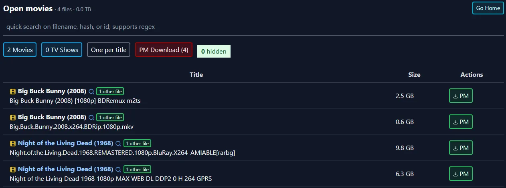

# DMM hash lists: add someone's library to yours

A hash list is a list of releases someone shared from their debrid library through DMM. Open one, sign in to DMM with your debrid service and press your service's button: the releases go into your own account. Shared lists are at [hashlists.debridmediamanager.com](https://hashlists.debridmediamanager.com), and you can share yours from DMM's **Library** with **Share List**.

A list holds release names, their hashes and sizes. No files and no accounts.

## Find a list

- On DMM's home page, press **Hash lists**. It opens [hashlists.debridmediamanager.com](https://hashlists.debridmediamanager.com) with a random list. **Previous hash list**, **Random hash list** and **Next hash list** move between lists.
- People post lists in the **hashlists** forum on [Discord](https://discord.com/invite/7u4YjMThXP). Each one is a link like `https://hashlists.debridmediamanager.com/<id>.html`. Opening it opens the list in DMM.

## Add a list to your library

1. Open the list. If it reads **Login to RD/AD/TB/PM/OC/DL to download**, sign in to [DMM](https://debridmediamanager.com) in the same browser first (see [how to sign in](index.md#sign-in)), then open the list again.
2. DMM checks which releases your service already has. It shows only those, and leaves out what's already in your library. The green **hidden** box counts what it left out.
3. Narrow it down if you like:
   - **Movies** and **TV Shows** show one kind. The numbers count titles, not files.
   - **One per title** keeps the best release of each title.
   - The green **other files** chip next to a title lists all its releases.
   - **quick search on filename, hash, or id; supports regex** searches the list.
4. Press the button on a row (**RD**, **TB**, **AD**, **PM**, **OC** or **DL**) to add that one release.
5. Or press **RD Download** (**TB Download**, **PM Download** and so on) to add every release shown. The number on it is how many. It starts right away, with no "are you sure".

On Real-Debrid, AllDebrid and TorBox, **Show All** also lists the releases your service doesn't have, and **Show Instant** goes back to the cached ones.

**RD Download** only adds releases Real-Debrid already has, one a minute, because Real-Debrid pauses accounts that add faster. Sixty releases take about an hour. The adds run in the page, so keep the tab open until it says **Started 60 downloads.** TorBox and AllDebrid skip anything they don't have cached.

## Share your own library

1. On DMM's home page, press **Library**.
2. Search or tick the releases you want to share. With nothing ticked, everything shown is shared.
3. Press **Share List** (it reads **Share (3)** when you ticked three). Type a name at **Enter a title for the hash list** and press **OK**.
4. DMM opens your list's new address on hashlists.debridmediamanager.com. It can show a 404 for a minute or two while it's published. Refresh, then share that address.

Shared lists are public. Anyone with the address can open them, and **Random hash list** can show yours to strangers. Only names, hashes and sizes go in: never your account, your key or a tracker address.

To share a single release without publishing anything, press the share icon at the end of its row in the library (or **Hashlist** in its details). DMM opens a one-release list. Copy that page's address and send it.

## When something is wrong

| What you see | What to do |
|---|---|
| **Login to RD/AD/TB/PM/OC/DL to download** | You're not signed in to DMM in this browser. Sign in, then open the list again. |
| Everything is **hidden** and the list looks empty | Hidden rows are already in your library, or your service doesn't have them. On Real-Debrid, AllDebrid or TorBox press **Show All**. |
| **This hash list is still being published; refresh in a minute or two.** | The list was shared moments ago. Wait a minute or two and refresh. |
| **0 files** and no rows | That list is empty. Press **Next hash list** or **Random hash list**. |
| **Everything already downloaded** | Every release shown is already in your library. |
| **Torrent not instant in TorBox; skipped.** or **Torrent not instant in AD; skipped.** | Your service doesn't have that one cached, so DMM skipped it instead of starting a download. |
| **Skipping 3 items with no info hash — they cannot be shared.** | Those rows (TorBox web downloads, for example) have no hash to share. The rest of the list is shared. |
| **Failed to generate hash list; try again soon.** | Publishing the list failed. Try again later. |

Stuck? Ask in the **dmm-support** forum on [Discord](https://discord.com/invite/7u4YjMThXP).

## Questions

### How do I add hash lists to my own library?

Open the list, sign in to DMM with your debrid service, then press your service's button on a row, or **RD Download** (or your service's **Download**) for everything shown. See [Add a list to your library](#add-a-list-to-your-library).

### Why are all the items in my hash list hidden?

DMM hides what's already in your library and what your service doesn't have cached. The **hidden** box says how many. On Real-Debrid, AllDebrid or TorBox, **Show All** shows the rest.

### Why don't TV shows show up in a hash list?

Press **TV Shows** at the top of the list. If it reads **0 TV Shows**, that list has no shows: most shared lists are movies. Shows your service doesn't have are hidden too, so try **Show All**.

### Why is adding a hash list so slow?

On Real-Debrid, DMM adds one release a minute so Real-Debrid doesn't pause your account. The other services go faster.

### Is there an API to query the hash lists?

There's no search API. Every shared list is a file in the public [hashlists repository](https://github.com/debridmediamanager/hashlists) on GitHub. Each page points at DMM with the list packed into the link after `#` (lz-string compressed JSON of names, hashes and sizes). A very big list sits beside it as `lists/<id>.txt` instead.

### Does sharing a list share my account?

No. A list has release names, hashes and sizes only.
