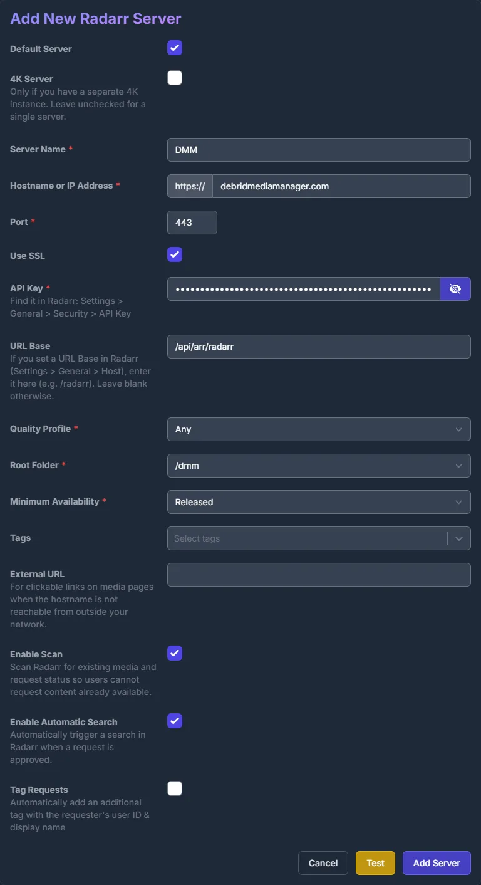
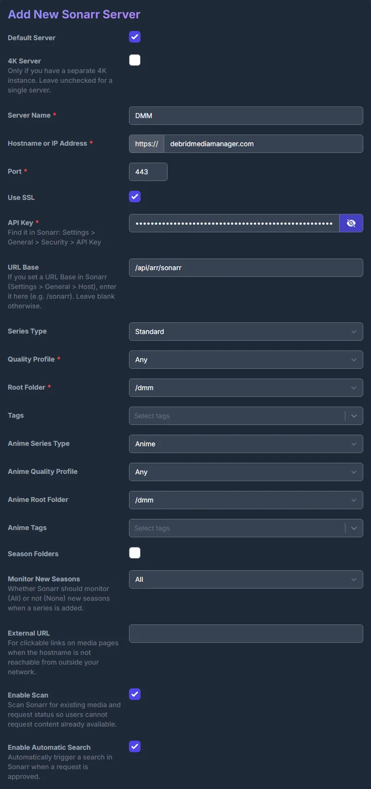
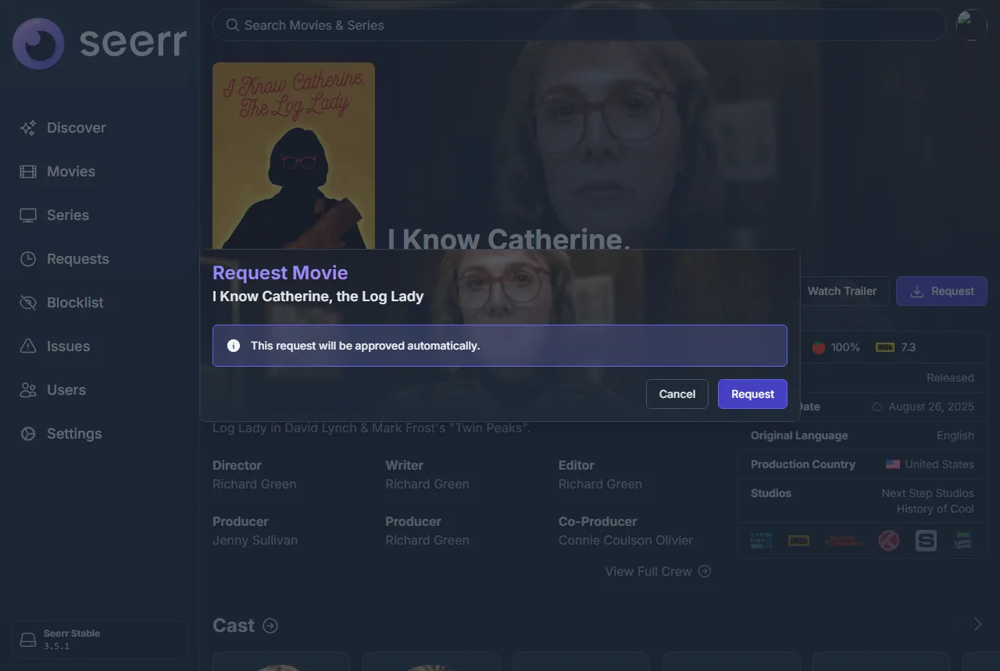
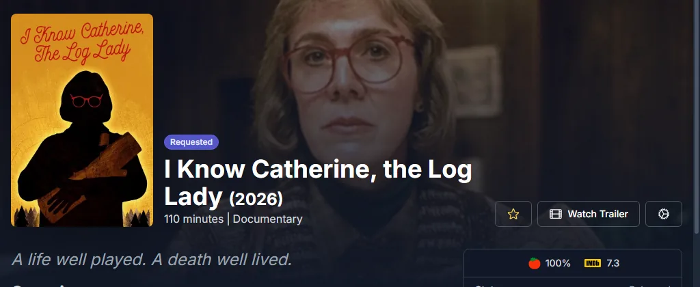
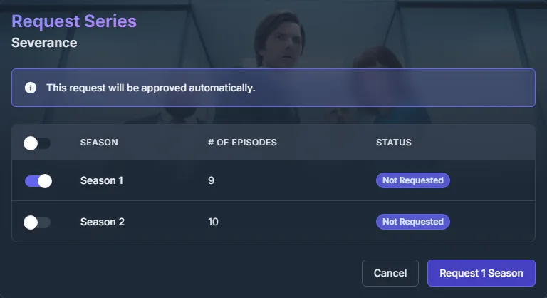
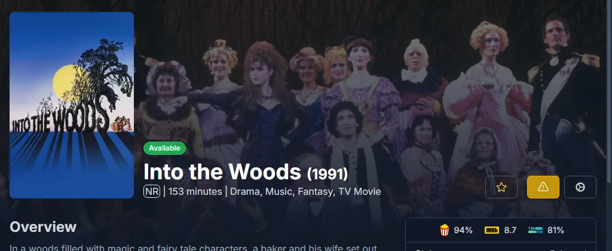

# Seerr through DMM

Add DMM to [Seerr](https://github.com/seerr-team/seerr) as its Radarr and Sonarr. Every
request approved in Seerr then lands on your [DMM wanted list](../zurg/guides/dmm-wanted.md), and your
zurg fetches it. There is no real Radarr or Sonarr to run, and Seerr only has to reach
debridmediamanager.com, not your zurg. Overseerr and Jellyseerr work the same way.

It is for sponsors: Seerr signs in to DMM with your DMM API key.

## What you need

- zurg reading your wanted list: `dmm_api_key` in `config.yml`, as set up in
  [Fetch what you want from DMM](../zurg/guides/dmm-wanted.md#what-you-need).
- Seerr set up with your Plex or Jellyfin server. Seerr learns from it which episodes you
  already have.

## Add DMM as Radarr

In Seerr, open **Settings → Services** and press **Add Radarr Server**. Fill it in like this:

| Field | Value |
|---|---|
| Default Server | ticked |
| 4K Server | unticked |
| Server Name | `DMM`, or any name |
| Hostname or IP Address | `debridmediamanager.com` |
| Port | `443` |
| Use SSL | ticked |
| API Key | your DMM API key |
| URL Base | `/api/arr/radarr` |

Press **Test**. When it connects, the two lists below fill in: pick **Any** for Quality
Profile and **/dmm** for Root Folder. Leave Minimum Availability as it is, tick
**Enable Scan**, and press **Add Server**.

If Test fails, check the key: it is the one on DMM's [Settings](https://debridmediamanager.com/settings)
page. DMM also refuses it once your sponsorship has lapsed.

## Add DMM as Sonarr

Press **Add Sonarr Server** and fill it in the same way, with URL Base `/api/arr/sonarr`.
After **Test**, pick **Any** and **/dmm** for both the normal and the anime profile and root
folder, tick **Enable Scan**, and press **Add Server**.

## Requesting

Request as usual. An approved film goes on your wanted list:

For a show, pick the seasons you want. Those seasons go on your list, and a later request
for more seasons adds them. To follow the whole show, new seasons included, press
**Want all seasons** on its DMM page.

Your [wanted list](https://debridmediamanager.com/wanted) shows each title within a few
seconds, and zurg picks it up the next time it reads the list, within a minute.

## What Seerr shows

Seerr reads DMM's list once a day, at its **Radarr Scan** and **Sonarr Scan** jobs. To run
them now, open **Settings → Jobs & Cache** and press **Run Now** next to each.

- **A film** zurg has fetched shows as **Available**.

  

- **A show** stays **Processing** until its episodes reach your Plex or Jellyfin library
  and Seerr's scan of that server finds them. DMM does not know which episodes zurg holds.

## Removing a title

Open the title in Seerr, press the gear button and then **Remove from Radarr** (or
**Remove from Sonarr**). That takes it off your wanted list. What zurg already fetched stays
in your library. **Open in Radarr** next to it opens the title on DMM.

## Seerr through DMM or zurg's own Seerr source

zurg can also read Seerr itself, with a [`seerr` source](../zurg/guides/acquisition.md#configuration).
Use one of the two, not both:

- **Through DMM**, Seerr only needs to reach the internet, the requests show on your
  wanted list next to what you added with **Want**, and Seerr's daily scan marks the films
  zurg fetched as available.
- **zurg's own source** treats a 4K request apart from a 1080p one, but zurg has to be
  able to reach Seerr.
