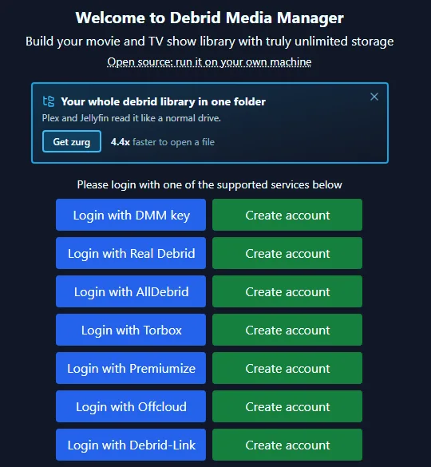

# ¿Qué es DMM y cómo lo uso? {#what-is-dmm-and-how-do-i-use-it}

[Debrid Media Manager](https://debridmediamanager.com) (DMM) es un sitio web gratuito para buscar películas y series y añadirlas a tu cuenta de debrid: Real-Debrid, AllDebrid, TorBox, Premiumize, Offcloud o Debrid-Link. Inicias sesión con esa cuenta, buscas un título y pulsas **Instant RD** (o el botón de tu servicio) en una versión. Enseguida aparece en tu biblioteca, lista para verla desde DMM, en Stremio o Kodi, o en Plex mediante [zurg](../zurg/index.md).

DMM es de código abierto y no forma parte de Real-Debrid ni de ningún otro servicio. Los archivos siguen en tu servicio de debrid.

## Iniciar sesión {#sign-in}

1. Abre [debridmediamanager.com](https://debridmediamanager.com) y pulsa tu servicio: **Login with Real Debrid**, **Login with AllDebrid**, **Login with Torbox**, **Login with Premiumize**, **Login with Offcloud** o **Login with Debrid-Link**.
2. En Real-Debrid, pulsa **Sign in with Real-Debrid**. DMM muestra un código: pulsa **Open real-debrid.com/device**, introduce el código allí y apruébalo. La página de DMM termina sola. También puedes pegar tu [API token](../guides/real-debrid-api-token.md) debajo de **or paste an API key** y pulsar **Save API Key**.
3. Otros servicios: sigue su página de inicio de sesión. Si te pide una API key, cópiala desde tu cuenta en ese servicio, pégala y pulsa **Save API Key**.

¿Tienes otro servicio también? Abre **Debrid services** en la página de inicio de DMM y pulsa su botón **Login**, por ejemplo **AllDebrid Login**.

¿Solo tienes Easynews? Pulsa **Login with Easynews**. Puedes buscar en Easynews y enviarlo a Stremio, pero la biblioteca necesita una cuenta de debrid. Los patrocinadores también pueden entrar con **Login with DMM key**.

## Buscar una película o serie {#search-a-movie-or-show}

1. Escribe un título en **Search movies & shows...** en la página de inicio. Elige uno de las sugerencias, o pulsa **Search** para ver la lista completa.
2. Pulsa el póster. La página del título muestra las versiones que DMM encontró.
3. Pulsa el chip de tu servicio encima de los resultados (**RD**, **PM** y así sucesivamente) para mostrar solo las versiones que ese servicio ya tiene.

## Qué significan los botones de una versión {#what-the-buttons-on-a-release-mean}

| Button | What it does |
|---|---|
| **Instant RD** (**Instant TB**, **Instant AD**, **Instant PM**, **Instant OC**, **Instant DL**) | Tu servicio ya tiene este lanzamiento. Púlsalo y estará en tu biblioteca al momento. |
| **DL with RD** (**DL with TB** y así sucesivamente; **Add to DL** en Debrid-Link) | Tu servicio todavía no lo tiene. Al pulsarlo se añade igualmente y el servicio lo descarga primero. Elige uno **Instant** si quieres verlo ya. [Por qué pasa esto](../guides/torrent-being-downloaded-to-debrid.md). |
| **RD (100%)** (**PM (100%)** y así sucesivamente) | Está en tu biblioteca. El número indica hasta dónde llegó la descarga. Púlsalo para quitarlo de tu biblioteca. |
| **Check RD** (**Check AD**, **Check DL**) | Pregunta a ese servicio si tiene este lanzamiento en caché en este momento. |
| **Cast (RD)** (**Cast (PM)** y así sucesivamente) | Envía el lanzamiento a Stremio. Consulta [DMM en Stremio](stremio.md). |
| **Watch** | Abre una pestaña **Ready to play**. Pulsa **Play** y se abrirá tu reproductor. Elige el reproductor en **Settings** → **Video player**. |
| **Copy** | Copia el enlace magnet del lanzamiento y muestra **Magnet link copied.** Si tienes marcada la opción **Download .magnet files instead of copy** en **Settings**, el botón dirá **Download** y guardará un archivo .magnet. |
| **Report** | Marca un lanzamiento defectuoso: **XXX / Porn Content**, **Incorrect IMDB ID**, **Malware / Executable File** y, en series, **Tagged for Wrong Season**. |

La pestaña **Usenet**, junto a **Torrents**, muestra lanzamientos de Usenet del mismo título. **NZB** descarga uno. Para enviarlos a tu biblioteca necesitas Real-Debrid o TorBox. ¿Tienes Easynews? Añádelo en **Settings** y también se buscará aquí.

## Tu biblioteca {#your-library}

Pulsa **Library** en la página de inicio. Muestra todo lo que hay en las cuentas con las que iniciaste sesión: nombre, tamaño, estado y cuándo se añadió.

- Busca con **search by filename/hash/id, supports regex**, o filtra con **Movies**, **TV shows** y **Others**.
- Pulsa una fila para ver sus detalles y sus botones **Hashlist**, **Delete**, **Cast** y **Copy**. Los iconos al final de cada fila hacen lo mismo.
- **Backup** guarda tu lista en un archivo `.dmm.json`. **RD Restore** (**PM Restore** y así sucesivamente) vuelve a añadir una lista guardada.
- **Share List** convierte lo que se muestra, o lo que hayas seleccionado, en una [hash list](hashlists.md) que otras personas pueden añadir a sus propias cuentas.
- **Delete List** elimina todo lo que se muestra, tras una confirmación con **Yes, delete!**. Busca o selecciona antes.

## Dónde seguir {#where-to-go-next}

- [DMM en Stremio](stremio.md): mira lo que encuentres en Stremio con el addon DMM Cast.
- [Listas de hashes](hashlists.md): añade una biblioteca compartida completa a la tuya, o comparte la tuya.
- [TorBox en DMM](torbox.md): qué hace cada plan de TorBox en DMM, y cómo enviar releases de Usenet a TorBox Pro.
- ["Torrent is being downloaded to debrid"](../guides/torrent-being-downloaded-to-debrid.md): qué significa esa pantalla en Stremio y cómo DMM muestra lo que está en caché.
- [Botones de DMM en Safari](safari.md): la extensión del navegador añade un botón de DMM a IMDb, Trakt y otros sitios de películas y series.

DMM también da servicio a los otros proyectos:

- **zurg** le pregunta a DMM qué película o episodio es cada archivo. Un patrocinador obtiene la clave API de DMM desde [gatekeeper](https://gatekeeper.debridmediamanager.com/). Sin ella, zurg se basa en los nombres de archivo y coinciden menos títulos. [rex con zurg](../rex/with-zurg.md#why-dmm-places-the-files) explica la diferencia.
- **Sonarr Radarr y Prowlarr** pueden buscar en DMM como indexador de torrents Torznab o indexador de Usenet Newznab. Ambos requieren una patrocinio activo y la clave API de DMM. Configúralos en las páginas [Torznab](https://debridmediamanager.com/torznab) y [Newznab](https://debridmediamanager.com/newznab).
- **Tu lista de deseados**: pulsa **Want** o sigue una lista de Trakt, MDBList o TMDB. zurg la descarga, y también los episodios nuevos según se emiten. Requiere patrocinio. Consulta [Lista de deseados de DMM](../zurg/guides/dmm-wanted.md).
- **Seerr Overseerr y Jellyseerr** pueden usar DMM como si fuera Radarr y Sonarr. Las solicitudes llegan entonces a tu lista de deseados para que zurg las descargue. Requiere patrocinio. Consulta [Seerr a través de DMM](seerr.md).
- **rex-direct** le da a un rex reclamado su propia dirección y certificado. Consulta [rex-direct](../rex/any-source.md#rex-direct).

Todo lo que abre un patrocinio y dónde se configura cada cosa está en [Lo que te da un patrocinio](../guides/sponsorship.md).

## Cuando algo va mal {#when-something-is-wrong}

| Lo que ves | Qué hacer |
|---|---|
| **Real-Debrid rechazó esa clave de API.** | El token que pegaste no funciona. Cópialo de nuevo desde [real-debrid.com/apitoken](https://real-debrid.com/apitoken), o pulsa **Sign in with Real-Debrid** en su lugar. Más información en [Tu token de API de Real-Debrid](../guides/real-debrid-api-token.md). |
| **That code expired before it was approved. Try again.** | El código de Real-Debrid caducó. Pulsa **Sign in with Real-Debrid** otra vez y aprueba el código nuevo más rápido. |
| **Your TorBox account is on the free plan, which has no API access. DMM needs a paid TorBox plan.** | El plan gratuito de TorBox no se puede usar con DMM. Mejora tu plan, o inicia sesión con otro servicio. |
| Only **DL with RD** buttons, no **Instant RD** | Tu servicio no tiene ninguno de estos lanzamientos en caché. Pulsa uno y espera a que se descargue, o prueba con otro lanzamiento. |

¿Te atascas? Pregunta en el foro **dmm-support** de [Discord](https://discord.com/invite/7u4YjMThXP). [Pedir ayuda](../guides/remote-help.md) explica qué incluir.

## Preguntas {#questions}

### ¿Qué es DMM exactamente? {#what-actually-is-dmm}

Un buscador para tu cuenta de debrid. Encuentra versiones de una película o serie, te dice cuáles ya tiene tu servicio y añade a tu cuenta la que elijas. DMM no guarda archivos por sí mismo.

### ¿Cómo lo uso? {#how-do-i-use-it}

Inicia sesión con tu servicio de debrid, busca un título, ábrelo y pulsa **Instant RD** (o el botón **Instant** de tu servicio) en una versión. Luego pulsa **Watch**, envíalo a Stremio o deja que zurg lo meta en Plex.

### ¿DMM lo hace Real-Debrid? {#is-dmm-made-by-real-debrid}

No. DMM es un proyecto de código abierto que funciona con Real-Debrid y otros cinco servicios. La gente suele buscarlo como "Real-Debrid Media Manager".

### ¿Es gratis? {#is-it-free}

Sí. Necesitas tu propia cuenta de debrid, que es un servicio de pago. Un patrocinio de DMM añade extras como la lista de deseados y los indexadores: consulta [Qué te da un patrocinio](../guides/sponsorship.md).

### ¿Qué servicios funcionan? {#which-services-work}

Real-Debrid, AllDebrid, TorBox (planes de pago), Premiumize, Offcloud y Debrid-Link. Easynews funciona para buscar y para enviar al reproductor, pero no para la biblioteca.
