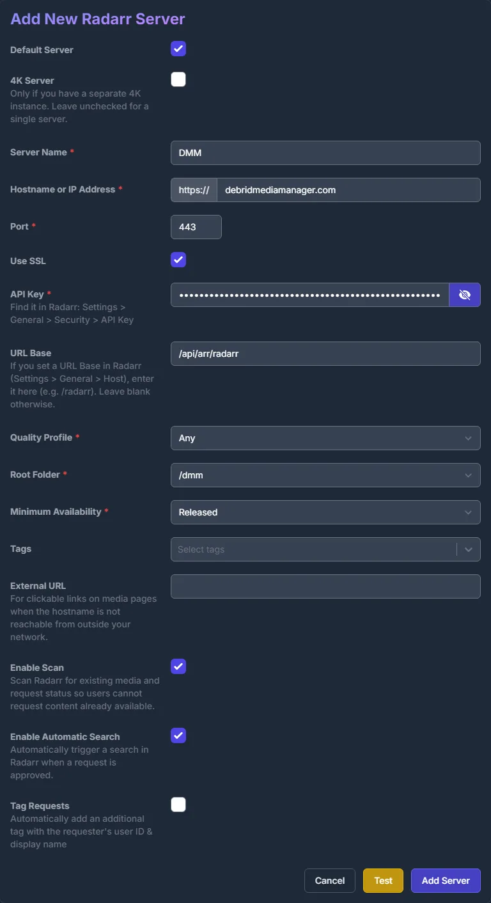
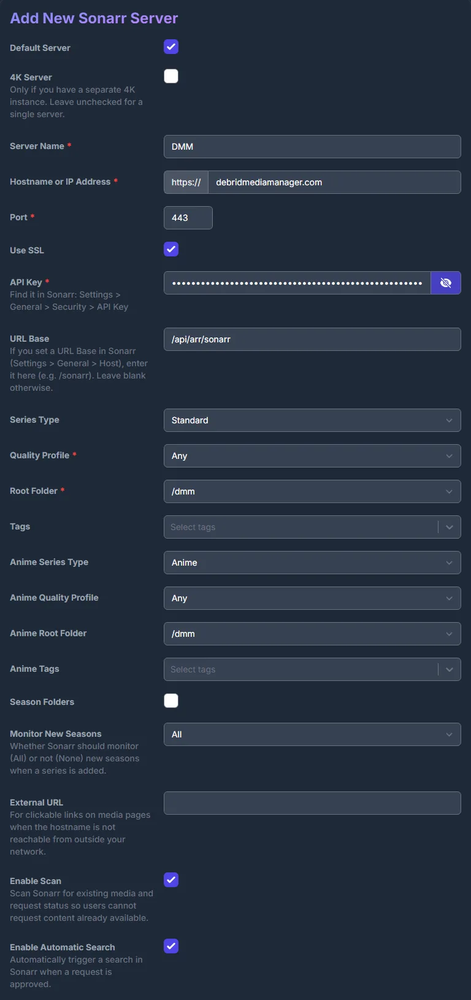
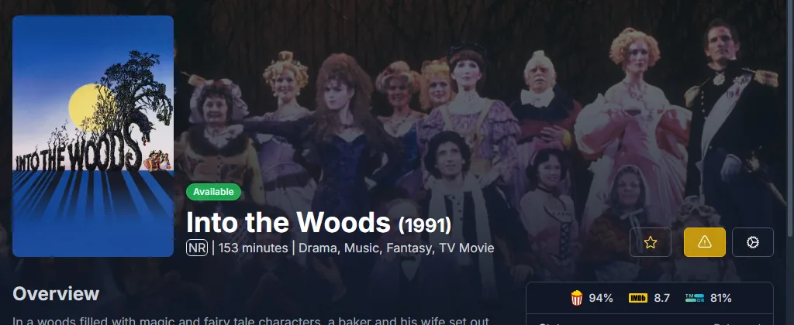

# Seerr a través de DMM {#seerr-through-dmm}

Añade DMM a [Seerr](https://github.com/seerr-team/seerr) como si fuera Radarr y Sonarr. Las solicitudes aprobadas acaban en tu [lista de deseados de DMM](../zurg/guides/dmm-wanted.md) para que zurg las busque. No necesitas Radarr ni Sonarr. Seerr solo necesita llegar a debridmediamanager.com. Overseerr y Jellyseerr funcionan igual.

Es para patrocinadores. Seerr inicia sesión con la clave de API de DMM que obtienes en [gatekeeper](https://gatekeeper.debridmediamanager.com/).

## Lo que necesitas {#what-you-need}

- zurg leyendo tu lista de deseados con `dmm_api_key` en `config.yml`. Mira [Fetch what you want from DMM](../zurg/guides/dmm-wanted.md#what-you-need).
- Seerr configurado con tu servidor de Plex, Jellyfin o Emby para que sepa qué episodios tienes.

## Añadir DMM como Radarr {#add-dmm-as-radarr}

En Seerr, abre **Settings → Services** y pulsa **Add Radarr Server**. Rellénalo así:

| Field | Value |
|---|---|
| Default Server | marcada |
| 4K Server | desmarcada |
| Server Name | `DMM`, o el nombre que quieras |
| Hostname or IP Address | `debridmediamanager.com` |
| Port | `443` |
| Use SSL | marcada |
| API Key | tu clave API de DMM |
| URL Base | `/api/arr/radarr` |

Pulsa **Test**. Cuando conecte, elige **Any** en Quality Profile y **/dmm** en Root Folder.
Deja Minimum Availability como está. Marca **Enable Scan** y pulsa **Add Server**.

Si Test falla, revisa la clave: es la que aparece en la página [Settings](https://debridmediamanager.com/settings) de DMM. Además, DMM la rechaza cuando tu patrocinio ha vencido.

## Añadir DMM como Sonarr {#add-dmm-as-sonarr}

Pulsa **Add Sonarr Server** y usa URL Base `/api/arr/sonarr`. Después de **Test**, elige **Any** y `/dmm` tanto para los perfiles como para las carpetas raíz. Marca **Enable Scan** y pulsa **Add Server**.

## Solicitar {#requesting}

Solicita como de costumbre. Una película aprobada pasa a tu lista de deseados:

Para una serie, elige las temporadas que quieras. Una solicitud posterior puede añadir más. Para seguir la serie completa, incluidas las nuevas temporadas, pulsa **Want all seasons** en su página de DMM.

Tu [lista de deseados](https://debridmediamanager.com/wanted) muestra cada título en cuestión de segundos. zurg lo recoge en menos de un minuto.

## Lo que muestra Seerr {#what-seerr-shows}

Seerr lee la lista de DMM una vez al día en **Radarr Scan** y **Sonarr Scan**. Para ejecutarlos ahora, abre **Settings → Jobs & Cache** y pulsa **Run Now** junto a cada uno.

- **Una película**: cuando zurg la ha descargado, aparece como **Available**.

  

- **Una serie** sigue en **Processing** hasta que sus episodios llegan a tu biblioteca de Plex, Jellyfin o Emby y el escaneo de Seerr en ese servidor los encuentra. DMM no sabe qué episodios tiene zurg.

## Eliminar un título {#removing-a-title}

Abre el título en Seerr, pulsa el botón de engranaje y luego **Remove from Radarr** (o **Remove from Sonarr**). Eso lo quita de tu lista de deseados. Lo que zurg ya descargó se queda en tu biblioteca. **Open in Radarr** junto a él abre el título en DMM.

¿Te atascas? Pregunta en el foro **dmm-support** de [Discord](https://discord.com/invite/7u4YjMThXP). [Getting help](../guides/remote-help.md) explica qué incluir.

## Seerr a través de DMM o la propia fuente de Seerr de zurg {#seerr-through-dmm-or-zurgs-own-seerr-source}

zurg también puede leer Seerr directamente, con una [fuente `seerr`](../zurg/guides/acquisition.md#configuration).
Usa una de las dos opciones, no ambas:

- **A través de DMM**, Seerr solo necesita tener acceso a internet. Las solicitudes aparecen en tu lista de deseados junto a lo que añadiste con **Want**, y el escaneo diario de Seerr marca como disponibles las películas que zurg ha obtenido.
- **La fuente propia de zurg** trata una solicitud en 4K de forma distinta a una en 1080p, pero zurg tiene que poder acceder a Seerr.
