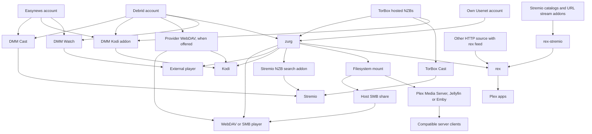
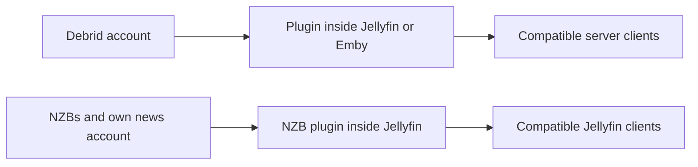
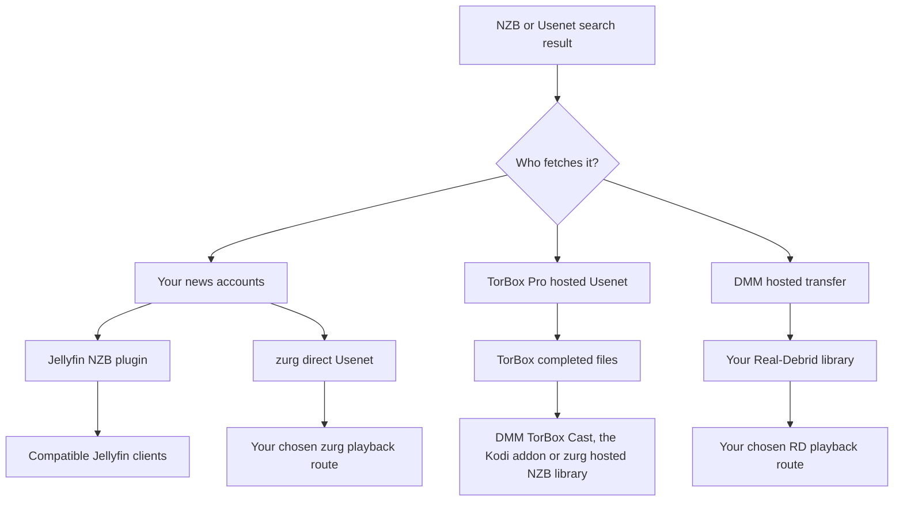

# ¿Qué configuración debería usar? {#which-setup-should-i-use}

**[Encuentra tu configuración con el cuestionario interactivo](https://debridmediamanager.com/choose-your-setup).** Responde a unas cuantas preguntas sobre tus cuentas de reproductor y tu alojamiento. Te devuelve rutas, requisitos y enlaces de configuración. No necesitas iniciar sesión.

**Empieza por la app en la que quieres ver el contenido.** No necesitas todas las piezas. DMM te ayuda a elegir los lanzamientos. Un proveedor aporta los archivos. zurg puede convertirlos en una biblioteca compartida. rex presenta una biblioteca a las apps de Plex. Algunas rutas se saltan alguna pieza.

Este mapa cubre las rutas compatibles verificadas el **10 de noviembre de 2026**. Incluye alternativas externas que eliminan un paso. Los complementos y dispositivos de terceros aún pueden diferir. Sigue la guía enlazada y sus límites probados.

## Elige según lo que ya usas {#pick-by-what-you-already-use}

En el móvil, desliza una tabla de lado para ver todas sus columnas.

| Tengo / quiero… | Elige esta ruta | ¿Por qué elegirla? | Lo que asumes |
|---|---|---|---|
| Stremio y una cuenta de debrid o Easynews; sin servidor que mantener | **DMM Cast → Stremio**, o tu addon de streams de siempre | Ves contenido con tu cuenta sin ejecutar zurg, rex ni un servidor de medios | El addon y el proveedor tienen que dar un stream reproducible; el dispositivo se encarga de la reproducción |
| Kodi y una cuenta de debrid, Easynews o TorBox Pro | **Addon de Kodi de DMM → tu cuenta** | Explora, busca y reproduce dentro de Kodi; vincula desde tu móvil. La biblioteca de TorBox del addon incluye descargas NZB alojadas | Kodi hace la reproducción. La lista Wanted de un sponsor todavía necesita zurg para atender las solicitudes |
| Una película para ver en mi reproductor habitual | **DMM Watch → reproductor externo** | No hace falta un servidor de biblioteca | Instala un reproductor compatible y elige un archivo que pueda reproducir |
| Infuse, Kodi u otro reproductor WebDAV | **WebDAV del proveedor** sin host; **zurg → reproductor WebDAV** cuando puedas mantener un host encendido | Explora una biblioteca en la nube sin Plex, Jellyfin, Emby ni rex | Real-Debrid, AllDebrid, Premiumize, TorBox y Debrid-Link sirven su propio WebDAV, con su propia estructura de carpetas. Offcloud no tiene, así que necesita zurg. zurg necesita un host que siga encendido mientras ves contenido |
| Servidor Plex Media ya funcionando | **zurg → carpeta montada → Plex Media Server → app de Plex** | Conservas tu servidor, sus bibliotecas y tus flujos de trabajo actuales | Ejecuta zurg y un montaje del sistema de archivos junto al servidor; los escaneos leen archivos remotos |
| Apps de Plex, pero sin ganas de mantener una biblioteca montada | **zurg → rex → app de Plex** | zurg proporciona la biblioteca a rex sin montaje ni Plex Media Server | Ambos servicios siguen en marcha; revisa la compatibilidad de rex con apps y la guía sobre cuentas |
| Addons de Stremio, pero prefiero las apps de Plex | **Addons → rex-stremio → rex → app de Plex** | Convierte los catálogos de addons en bibliotecas de Plex; zurg es opcional | Ejecuta rex y rex-stremio; los addons de streams tienen que devolver URL reproducibles, no torrents sin procesar |
| Jellyfin es como mis reproductores acceden a la biblioteca | **Plugin del proveedor dentro de Jellyfin → cliente compatible** | Sin servicio zurg aparte ni montaje | Jellyfin 12 y el/los plugin(s) correspondiente(s); los plugins tienen sus propios límites de archivo |
| Emby es como mis reproductores acceden a la biblioteca | **Plugin del proveedor dentro de Emby → cliente compatible** | Todo se queda dentro de tu servidor Emby actual | Usa una versión de Emby compatible; estos seis plugins cubren debrid, no Usenet directo |
| Jellyfin/Emby más consumidores que necesitan acceso propio al sistema de archivos/WebDAV | **zurg → montaje → Jellyfin/Emby** | Una misma biblioteca puede servir a más de un consumidor | Mantén el montaje y las rutas del servidor; los demás consumidores pueden usar zurg directamente |
| Archivos NZB, mi propia cuenta de Usenet y Jellyfin | **Plugin NZB dentro de Jellyfin → cliente compatible** | Reproduce NZB sin un servicio zurg aparte | Acceso NNTP y una versión de Jellyfin compatible; el plugin excluye los miembros de archivos comprimidos o cifrados y no repara con PAR2 |
| Un reproductor de hardware que lee recursos compartidos SMB | **zurg → montaje → recurso compartido SMB del host → reproductor** | Conservas el explorador de archivos nativo del reproductor y su reproducción | El host proporciona SMB; zurg en sí proporciona WebDAV, no un servidor SMB |
| Mi propia cuenta de Usenet y Stremio | **Indexador Newznab → addon de Stremio de zurg → Stremio** | Buscas en el momento de reproducir y transmites a través de tu cuenta de noticias | Un zurg en marcha, acceso al indexador y credenciales NNTP; otro dispositivo necesita una dirección HTTPS accesible del addon |
| Un dispositivo Android/Google TV, sin otro ordenador | **zurg+rex en Android → reproductor en ese dispositivo, o las apps de Plex en él y en tu casa** | Ejecuta zurg y rex en un dispositivo Android, tu propio servidor Plex en el móvil o en la caja de TV, para esa pantalla y las apps de Plex de tu casa | Acceso de sponsor, sideloading y funcionamiento en segundo plano; Usenet necesita Android de 64 bits; los NZB alojados de TorBox no están disponibles en Android |
| Un dispositivo Android/Google TV y addons de Stremio, YouTube, Spotify o archivos en un NAS | **rex para Android → las apps de Plex en él y en tu casa** | rex y sus addons en el dispositivo, gratis y sin ordenador | Sideloading y funcionamiento en segundo plano; los addons de streams tienen que devolver URL reproducibles, no torrents sin procesar; los archivos en un NAS necesitan un addon que escribas tú. Para tu biblioteca de debrid y Usenet, los sponsors usan zurg+rex (la fila de arriba) |
| Archivos que ya tienes en un disco/NAS | **Servidor de medios existente o reproductor de red**; **fuente HTTP → rex** si quieres rex | Sigues usando los archivos que tienes; no necesitas cuenta de debrid ni de Usenet | rex necesita metadatos enviados por su API de feed y acceso HTTP a los archivos; el productor del feed y el servidor de archivos pueden ser distintos. rex no escanea discos |
| Medios HTTP en streaming o mi propio servidor HTTP | **Fuente HTTP + feed de rex → rex → apps de Plex**, o un reproductor compatible directamente | Usa una fuente existente sin debrid ni zurg | rex necesita un productor de feed que envíe la identidad y los datos del medio; una URL sola no proporciona esos metadatos |

Empieza aquí: [DMM Cast](https://debridmediamanager.com/stremio/) · [Kodi](https://debridmediamanager.com/kodi) · [DMM Settings](https://debridmediamanager.com/settings) · [configuración de zurg](../zurg/setup/index.md) · [rex con zurg](../rex/with-zurg.md) · [rex con addons de Stremio](../rex/stremio.md) · [plugins de Jellyfin](https://debridmediamanager.com/jellyfin) · [plugins de Emby](https://debridmediamanager.com/emby) · [addon de Stremio de zurg](../zurg/guides/stremio.md) · [zurg+rex en Android](../zurg/guides/android.md) · [rex para Android](../rex/android.md) · [rex con cualquier fuente](../rex/any-source.md).

El enlace de Cast empieza con Real-Debrid. Usa la página de configuración de [TorBox](https://debridmediamanager.com/stremio-torbox/), [AllDebrid](https://debridmediamanager.com/stremio-alldebrid/), [Premiumize](https://debridmediamanager.com/stremio-premiumize/), [Offcloud](https://debridmediamanager.com/stremio-offcloud/), [Debrid-Link](https://debridmediamanager.com/stremio-debridlink/) o [Easynews](https://debridmediamanager.com/stremio-easynews/) cuando uses esa cuenta. Cast aquí significa el **addon de DMM**. No se refiere a Chromecast ni a la duplicación de pantalla.

## El mapa de reproducción {#the-playback-map}

Las flechas significan “suministra una biblioteca o un stream reproducible a”. No son un diagrama de enrutamiento de paquetes: según la ruta, el reproductor puede obtener los datos del proveedor o el servidor puede transportar los bytes.

[Abre el mapa de reproducción a tamaño completo](../assets/setup-routes/playback.svg) para ampliarlo o guardarlo.

La rama de búsqueda de NZB de Stremio necesita una cuenta NZB (`nzb`, o `torbox_nzb` para los lanzamientos que TorBox ya tiene) y un indexador Newznab. Los NZB alojados en TorBox también se reproducen mediante TorBox Cast o el addon de Kodi sin zurg. La rama de montaje a SMB necesita un recurso compartido aparte configurado en el host.

Hay dos rutas más pequeñas que conviene mantener separadas:

[Abre el mapa de plugins a tamaño completo](../assets/setup-routes/plugins.svg).

Los plugins son integraciones independientes. “zurg” en el nombre de un plugin **no** significa que tengas que ejecutar la aplicación zurg. Tampoco promete las mismas funciones. La biblioteca de torrents del plugin de TorBox es independiente del backend de NZB alojado de zurg.

## Elige de dónde vienen los archivos {#choose-where-the-files-come-from}

Un **indexador** encuentra releases. Un **torrent o NZB** describe cómo descargar uno. Un **proveedor** suministra los bytes. Un **reproductor** los decodifica. Tener acceso a uno no incluye a los demás.

| Entrada | ¿Quién obtiene/sirve el video? | Lo que necesitas | Cuándo es útil |
|---|---|---|---|
| Torrent en caché, magnet o archivo torrent | Tu proveedor de debrid | Una cuenta compatible con la integración que elijas | Suele ser la espera más corta cuando el release exacto ya está disponible |
| Torrent sin caché | El proveedor de debrid lo descarga primero | Una cuenta que acepte el torrent, fuentes disponibles y espacio dentro de sus límites | Un release que quieres no está en caché; prepárate para esperar y para posibles fallos |
| NZB, usando tus propias cuentas de noticias | El backend **direct Usenet** de zurg, o el plugin NZB de Jellyfin, lee los artículos según se necesitan | NZBs, acceso NNTP y la integración que elijas; acceso a un indexador si quieres buscar | Elige tus proveedores/backbones, usa cuentas de respaldo y evita guardar videos completos en local |
| NZB, usando el servicio alojado de TorBox | **TorBox lo descarga y lo repara**, y luego sirve los archivos completos | TorBox Pro; envía desde DMM o desde el backend **TorBox hosted NZB** de zurg | Quieres usar NZBs sin gestionar credenciales de servidores de noticias ni decodificar en local |
| Resultado Usenet de DMM enviado a Real-Debrid | El servicio de transferencia alojado de DMM lo descarga y lo pasa a **tu biblioteca de Real-Debrid** | Real-Debrid y una cuota de transferencia de DMM disponible | Ya ves contenido con RD y quieres que ese release esté ahí; no necesitas una cuenta NNTP personal |
| Resultado de búsqueda de Easynews | Easynews sirve una descarga/stream HTTP directo | Tu propia cuenta de Easynews | Ver o usar Cast desde DMM, o usar la ruta Easynews Cast/Kodi, sin crear una biblioteca de NZB |
| Enlace de descarga HTTP(S) directo | Un reproductor/fuente HTTP compatible, o un proveedor que soporte esa descarga | Acceso a la URL real del medio; una cuenta de proveedor adecuada si lo importas o desbloqueas allí | Ya tienes la URL de un archivo en lugar de un torrent/NZB |
| Archivos en tu disco o NAS | Tu servidor de archivos/medios | Almacenamiento local y un reproductor que pueda acceder a él | Tener los archivos sin conexión, videos caseros o conservar una colección que ya tienes |

zurg soporta **Real-Debrid, AllDebrid, TorBox, Premiumize, Offcloud y Debrid-Link**. Puedes combinar cuentas en una misma biblioteca. Aun así, las cuotas de caché y la disponibilidad de los archivos siguen siendo distintas. Un badge de caché es una pista, no una garantía de reproducción. Consulta [proveedores](../zurg/providers/index.md).

### «Usenet sin cuenta de Usenet»: ¿qué ruta? {#usenet-without-a-usenet-account-which-route}

[Abrir el mapa de Usenet a tamaño completo](../assets/setup-routes/usenet.svg).

**Elige NZB alojados en TorBox** si quieres que TorBox descargue y repare. DMM envía el NZB allí. Las nightly actuales de zurg usan el tipo de proveedor `torbox_nzb` y aceptan NZB desde el directorio de vigilancia y la interfaz de SABnzbd. [Usenet alojado en TorBox](../zurg/providers/torbox-nzb.md) tiene su configuración de zurg. Una falta de caché debe terminar antes de que se reproduzca. Las descargas comparten ranuras con los torrents. Los archivos conservados pueden caducar, y zurg no promete volver a buscar una versión caducada. Guarda el NZB por si hay que volver a buscarla.

**Elige Usenet directo** si quieres que zurg lea a través de tus propias cuentas de noticias, incluidas las cuentas de respaldo o de bloque. Usa `nzb` con credenciales NNTP. Un inicio de sesión de servidor de noticias de TorBox también va aquí. Es independiente de los NZB alojados en TorBox. Consulta [NNTP de TorBox](../zurg/providers/torbox-news-server.md) y [sus planes](https://torbox.app/pricing).

**Una instancia de zurg usa `nzb` o `torbox_nzb`, pero no ambos.** Las dos se apropian del directorio de vigilancia de NZB. Si quieres ejecutar las dos, usa instancias separadas con directorios de trabajo distintos. Con `dmm_api_key` en ambas, [desactiva la fuente `dmm-wanted` en una de ellas](../zurg/guides/dmm-wanted.md#two-zurgs-on-one-key), o cada título de Wanted se descargará dos veces. Cualquiera de las dos puede convivir con proveedores de torrents. El addon de Stremio de zurg envía su elección a la cuenta NZB que tenga la instancia. Con `torbox_nzb`, solo arranca un lanzamiento que TorBox ya tiene, dentro de la espera del addon, y únicamente cuando no hay otro envío NZB en cola.

**Elige DMM → Real-Debrid** si quieres que el lanzamiento esté en tu biblioteca de RD. Es una transferencia alojada con colas y cuotas. Un trabajo no cacheado tarda. No añade soporte NNTP nativo a Real-Debrid ni a otros proveedores debrid. El resultado de DMM y la [página de Transfers](https://debridmediamanager.com/transfers) muestran el progreso.

Easynews **Watch** y **Cast** reproducen sus archivos HTTP, y **Download NZB** guarda el NZB del lanzamiento. **Send to zurg** pone ese NZB en tu lista Wanted de patrocinador. Para eso hace falta un backend NZB configurado. Un inicio de sesión de Easynews en DMM no configura la cuenta NZB de zurg.

### ¿Y qué pasa con los enlaces HTTP? {#what-about-http-links}

DMM en su diálogo **Add** de TorBox acepta enlaces HTTP(S) directos como descargas web. zurg los muestra en `__downloads__`. Un elemento que aparece ahí no es automáticamente un elemento identificado de la biblioteca de rex. Las descargas sin restricciones de Real-Debrid también pueden aparecer allí. DMM TorBox Cast incluye descargas web y de Usenet completadas, además de torrents. Una página web puede necesitar otra integración debido a inicios de sesión, URLs que caducan, DRM o su propio reproductor.

**rex admite medios HTTP(S) transmitibles a través de su API de feed.** Una [fuente o addon](../rex/any-source.md) envía la dirección del medio y los metadatos. Luego rex lo pone disponible en las apps de Plex. El servidor de archivos y el productor del feed pueden estar separados. No se necesita una cuenta de zurg ni de debrid. [rex-stremio](../rex/stremio.md) hace esto para addons de Stremio compatibles. Los magnets sin procesar y los streams que solo son torrent no funcionan. HLS necesita la configuración de FFmpeg de rex. rex usa la identidad que le proporciona su fuente.

## Decide cómo se añaden los títulos {#decide-how-titles-get-added}

La adquisición y la reproducción son decisiones separadas. Puedes cambiar cómo se pide un título sin reemplazar la app en la que lo ves.

| Cómo eliges los títulos | Ruta | ¿Por qué usarla? |
|---|---|---|
| Elige la release exacta | DMM búsqueda/biblioteca → proveedor; o un NZB → tu backend NZB seleccionado | Controlas tú mismo la edición, el tamaño y la release |
| Pulsa Want, o sigue una lista de Trakt/MDBList | [DMM Wanted](../zurg/guides/dmm-wanted.md) → adquisición en zurg | Películas y nuevos episodios automáticos sin ejecutar Sonarr/Radarr; requiere patrocinio |
| Peticiones familiares en Seerr/Overseerr/Jellyseerr | [Seerr a través de DMM](../dmm/seerr.md) → Wanted → zurg | Interfaz de peticiones conocida sin servidor arr; requiere patrocinio. Seerr necesita un servidor Plex, Jellyfin o Emby al que conectarse |
| Ya tienes watchlists de Plex o una pila de peticiones | [adquisición en zurg](../zurg/guides/acquisition.md) | Mantienes tu fuente de peticiones actual; configuras sus destinos de búsqueda y de proveedor |
| Quieres monitorización detallada y perfiles de calidad en Sonarr/Radarr | DMM o tus indexadores → arr → interfaz de cliente de descarga de zurg → biblioteca | Mantienes las decisiones y el flujo de importación de arr; más servicios y configuración de rutas |
| Quieres elegir solo al pulsar Play | DMM Cast/Kodi, otro addon de streaming, o la búsqueda de Stremio de zurg | No necesitas preconstruir una biblioteca gestionada con todos los títulos |

Para la ruta arr recomendada de DMM + zurg, **DMM es el indexador y zurg es el cliente de descarga**. DMM ofrece [Torznab](https://debridmediamanager.com/torznab) y [Newznab](https://debridmediamanager.com/newznab). Ambos requieren patrocinio activo. Prowlarr es opcional. zurg proporciona interfaces [qBittorrent](../zurg/guides/sonarr-radarr-torrents.md) y [SABnzbd](../zurg/guides/sonarr-radarr.md). No necesitas esas apps de descarga junto a zurg. [zurg también puede buscar para arr](../zurg/guides/sonarr-radarr-fetch.md).

Si quieres **copias locales completas**, descarga los archivos desde tu proveedor o desde zurg. También puedes usar la función de descarga sin conexión de un reproductor, o un gestor de descargas normal y una biblioteca en disco. Revisa las cuotas y reproduce los archivos guardados sin red. Los archivos virtuales de zurg, los enlaces `.strm` y los [catálogos debrid locales](../zurg/guides/local-libraries.md) no son copias sin conexión. Los catálogos locales solo guardan registros. La reproducción sigue dependiendo del proveedor.

## Las compensaciones que importan antes de instalar {#the-tradeoffs-that-matter-before-installing}

| Pregunta | Qué cambia tu elección |
|---|---|
| ¿Debe seguir encendida otra máquina? | Las rutas alojadas de Cast/Kodi, el WebDAV del proveedor y DMM Watch no necesitan tu propio servidor. zurg, rex, rex-stremio y los plugins de servidor multimedia sí necesitan su host mientras ves contenido. En un dispositivo Android, zurg+rex ejecuta zurg y rex, y rex para Android ejecuta rex con sus addons, incluidos los addons de Stremio; rex-stremio y los plugins de servidor multimedia siguen necesitando un host normal. Un host alquilado o gestionado cambia quién lo ejecuta, no la ruta en sí. |
| ¿Mi TV reproducirá el archivo? | Las rutas WebDAV y de addons dependen de los códecs, el audio y los subtítulos del reproductor. zurg sirve bytes; no es un transcodificador de vídeo. Plex Media Server, Jellyfin, Emby o rex con FFmpeg pueden convertir cuando haga falta, con el hardware adecuado y las capacidades del servidor/app necesarias. |
| ¿Cuánto espacio en disco? | El streaming evita guardar toda la colección. Reserva espacio para bases de datos, carátulas, cachés y cualquier trabajo de reparación, transcodificación o descarga sin conexión. «Sin descarga completa previa» no significa cero uso de disco. |
| ¿Quién paga el ancho de banda? | Los límites de tráfico del proveedor siguen aplicando. Un proxy en el servidor transporta el tráfico de reproducción y usa su ancho de banda de salida; la reproducción directa traslada la conexión al espectador. El análisis de la biblioteca también puede leer archivos remotos. |
| ¿Funcionará fuera de casa? | Los addons alojados evitan exponer tu propio servidor. Los servicios autoalojados necesitan una dirección accesible de forma segura; una dirección LAN por sí sola no funcionará en remoto. Consulta [acceso remoto a rex](../rex/any-source.md#use-it-outside-your-home-optional) y la [guía de HTTPS de Stremio](../zurg/guides/stremio.md#installing-it-on-another-device). |
| ¿Puede la familia usarlo a la vez? | Revisa las reglas de IP/concurrencia de tu proveedor y el modelo de uso compartido del servidor. El uso de Real-Debrid debe mantenerse en una sola IP pública; los enlaces directos a hogares distintos pueden incumplir esto incluso cuando una biblioteca central los proporcionó. No actives las redirecciones sin entender de dónde provienen las descargas. |
| ¿Qué estoy pagando? | Mantén separadas las suscripciones a proveedores, el acceso a indexadores, el patrocinio de DMM, el alojamiento y las compras de reproductor/servidor. El sitio básico de DMM y rex para uso personal son gratis; también lo es [rex para Android](../rex/android.md). zurg+rex, que además conecta tu biblioteca de debrid y Usenet con rex en Android, es para patrocinadores. Las nightly actuales de zurg y la distribución de plugins de DMM son ventajas para patrocinadores; Wanted y las APIs de indexadores de DMM también requieren patrocinio. rex-stremio no lo requiere. [Lo que te da un patrocinio](sponsorship.md) enumera todas las ventajas y dónde configurarlas. |
| ¿Que un título aparezca en el catálogo garantiza la reproducción? | No. Los catálogos de addons describen títulos; los archivos en la nube pueden caducar; los torrents pueden no tener fuentes; los artículos de Usenet pueden faltar. Elige la ruta cuyo comportamiento ante fallos y esperas te resulte cómodo. |

Un cliente de servidor compatible también puede ser una app de terceros. [Infuse se conecta a Plex, Emby y Jellyfin](https://support.firecore.com/hc/en-us/articles/360006462093-Streaming-from-Plex-Emby-and-Jellyfin). Quizá no necesites un montaje zurg aparte. Revisa el plugin y el cliente juntos.

Infuse admite [WebDAV y otros recursos compartidos de red](https://support.firecore.com/hc/en-us/articles/215090977-Streaming-From-a-Mac-PC-or-NAS). Un archivo `.strm` le da a un reproductor compatible, como Kodi, una URL. No sustituye a un montaje universal. Revisa el cliente y espera un comportamiento distinto de proxy y de conmutación por error. No uses `.strm` como configuración normal de Plex Media Server.

También existe una [versión antigua y gratuita de zurg](https://github.com/debridmediamanager/zurg-public/releases). Solo es para Real-Debrid y usa otro formato de configuración. Las rutas multiproveedor de Usenet y Android de aquí usan las nightly para patrocinadores.

**rex tiene su propio límite de compatibilidad.** Es un servidor de apps de Plex independiente. No es Plex Media Server ni un plugin de Plex. Usa su [FAQ](../rex/faq.md) para ver los dispositivos probados, la transcodificación en uso remoto y la recomendación de cuenta nueva. Un servidor Plex tradicional puede funcionar junto a rex.

## Necesidades que pueden cambiar la ruta {#needs-that-can-change-the-route}

| También necesito… | Qué elegir o revisar |
|---|---|
| Archivos locales y títulos en la nube juntos | Mantén tu servidor Plex/Jellyfin/Emby actual y añade el mount o el plugin correspondiente. rex puede combinar varias fuentes de feed, incluida una fuente HTTP para archivos locales; aun así necesita sus metadatos. |
| Archivos de subtítulos automáticos | Los subtítulos que ofrece el reproductor o los incrustados pueden bastar. Si usas un flujo de arr, [Bazarr con zurg](../zurg/guides/subtitles.md) escribe archivos de subtítulos locales junto a los vídeos virtuales; esos archivos no llegan a DMM Cast, al addon de Kodi, a DMM Watch ni al addon de Stremio de zurg; sí llegan a Kodi como fuente WebDAV de zurg. rex también tiene Search Subtitles sin Bazarr. |
| Mi historial de visualización al cambiar de servidor | Lee [cómo pasar desde Plex](../rex/from-plex.md) y [importar el estado de visualización](../rex/import-watched.md) antes de cambiar; cambiar la fuente no migra automáticamente el historial de cada app. |
| Compartir una selección con alguien que tiene su propia cuenta | Las hashlists de DMM comparten las versiones elegidas para que otros las añadan a sus cuentas. No transfieren tus credenciales ni alojan la reproducción. Compartir un servidor es otra vía, sujeta a sus reglas de uso compartido y del proveedor. |
| Un VPS o host remoto con ancho de banda limitado | Revisa si la ruta hace proxy o redirige la reproducción. [La configuración de descarga directa de rex](../rex/direct-download.md) explica sus opciones; las redirecciones cambian la IP pública del downloader y pueden exponer las URLs del proveedor. |

## Otros medios y configuraciones existentes {#other-media-and-existing-setups}

- **Música:** [DMM Music](https://debridmediamanager.com/music/) ofrece reproducción y descargas en el navegador desde Real-Debrid. [Las fuentes de música de rex](../rex/music.md) alimentan Plexamp y las apps de Plex compatibles. Una fuente puede ser un addon o zurg configurado para música. No des por hecho que un addon de películas o series también trae música.
- **TV en directo:** [la ruta de TV en directo de rex](../rex/live-tv.md) ofrece canales y una guía en las apps documentadas. Los canales en directo de rex-stremio forman en cambio una biblioteca de canales; no es la misma interfaz de guía. Comprueba si tu fuente está disponible. rex no ofrece grabación DVR.
- **Vídeos caseros, grabaciones y fotos:** usa un servidor multimedia que ya tengas, o una [fuente de rex que controles tú](../rex/addons.md). El [tutorial de vídeos caseros](../rex/addon-home-videos.md) muestra esta última opción. zurg también puede enviar cómics a rex como fotos; el soporte en cada app varía.
- **Addons de Kodi/Stremio que ya tienes:** si el tuyo ya te da la experiencia que quieres, quédate con él. DMM puede servir para seleccionar y gestionar lanzamientos sin reemplazar tu reproductor. El soporte de proveedores, Usenet y HTTP varía según el addon; la ruta de DMM no garantiza compatibilidad con todos los addons.
- **Otro montaje/descargador de debrid ya instalado:** consulta [las opciones de migración](../zurg/migrate/index.md) antes de cambiar. Una configuración que funciona no necesita otra capa solo porque exista.
- **Apps nativas en desarrollo:** Usenet TV no es una configuración publicada en la tienda de apps que recomendemos aquí. Yomu TV es un proyecto aparte de lectura/audiolibros, no una ruta para este stack de películas y series. Ninguna de las dos es necesaria para las rutas de arriba.

## Cinco puntos de partida comunes {#five-common-starting-points}

1. **“Tengo Stremio y RD.”** Empieza con DMM Cast. Añade zurg solo cuando quieras una biblioteca compartida, automatización u otro cliente que lo necesite.
2. **“Tengo TorBox Pro y quiero los NZB de ese post.”** Envía el NZB a TorBox a través de DMM. Usa TorBox Cast para ver en Stremio, el addon de Kodi para ver en Kodi, o el backend NZB alojado de zurg para alimentar la ruta de biblioteca o reproductor que elijas.
3. **“Ya tengo Jellyfin.”** Empieza con el plugin de tu proveedor. Elige zurg por separado cuando necesites su sistema de archivos compartido, automatización o capacidades de backend más amplias.
4. **“Quiero apps de Plex, sin montajes y con mis addons actuales.”** Usa rex-stremio con rex. Usa zurg como fuente en su lugar cuando lo que quieras exponer sea tu biblioteca gestionada de debrid o Usenet. Ambas fuentes pueden alimentar el mismo rex.
5. **“Tengo cuentas de Usenet y quiero Sonarr/Radarr.”** Usa DMM Newznab o tus indexadores actuales, la ruta NZB/SABnzbd de zurg y una ruta de reproducción de la primera tabla. Para archivos locales permanentes, elige un descargador normal o guarda copias completas de forma explícita; las importaciones virtuales por sí solas no son archivos sin conexión.

¿Sigues sin estar seguro? Dinos tu dispositivo o reproductor, tus cuentas existentes, si un host puede mantenerse encendido y si quieres reproducción bajo demanda o una biblioteca automática. Esas respuestas suelen decidir la ruta. [Cómo pedir ayuda](remote-help.md) explica dónde preguntar.
