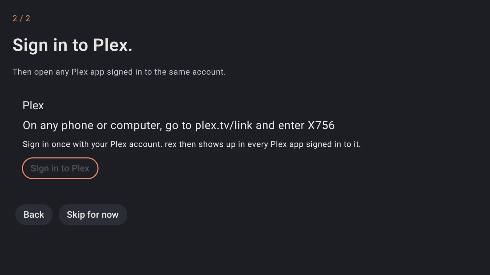

# rex para Android {#rex-for-android}

rex es un servidor de medios para las apps de Plex que no posee ningún archivo. rex para Android lo ejecuta en un teléfono, tablet, Android TV, Google TV o Fire TV, sin necesidad de ordenador. Las apps de Plex en tus dispositivos lo encuentran como cualquier servidor de Plex y reproducen desde él.

Lo que se reproduce viene de **addons**. Empieza con las películas de dominio público del Internet Archive. Más addons, como tus addons de Stremio, YouTube y Spotify, se instalan desde dentro de la app una vez que añades su repositorio.

rex para Android es gratis. ¿Quieres también tus cuentas de debrid y Usenet? zurg+rex, un servidor de Plex en tu teléfono con zurg integrado, viene con un patrocinio: consulta [zurg+rex para Android](../zurg/guides/android.md).

## Antes de empezar {#before-you-start}

| Necesitas | Por qué |
|---|---|
| Un dispositivo con Android 8.0 o más reciente | Teléfono, tablet, Android TV, Google TV o Fire TV. Los Fire TV con Vega OS, como el Fire TV Stick 4K Select, no ejecutan aplicaciones de Android |
| Una cuenta de Plex | rex aparece en las apps de Plex con las que has iniciado sesión. Una cuenta gratuita es suficiente |
| Una app de Plex en el dispositivo en el que vas a ver el contenido | Plex para Android, Android TV, iPhone, un smart TV, Plex Web, Plexamp |

## Paso 1. Consigue la app {#step-1-get-the-app}

Elige una forma. Cada una mantiene rex actualizado a su manera.

| Forma | Ideal para |
|---|---|
| Google Play | Teléfonos, tabletas, Android TV y Google TV. Próximamente |
| Amazon Appstore | Fire TV y tabletas Fire. Próximamente |
| [Obtainium](#with-obtainium) | Teléfonos y tabletas. Te avisa cuando sale una actualización |
| [Downloader](#with-downloader-on-fire-tv) | Fire TV y cajas de TV |
| [El archivo de GitHub](#the-file-from-github) | Cualquier dispositivo. Tú instalas las actualizaciones |

**Las formas no se mezclan.** Google Play, Amazon Appstore y el archivo de GitHub (que Obtainium y Downloader también instalan) están firmados de forma distinta, así que una no puede actualizar a otra. Para cambiar, desinstala rex, repite los Pasos 2 y 3 y vuelve a instalar tus addons.

**Empiezan con addons distintos.** El archivo de GitHub empieza con el repositorio [rex-addons](https://github.com/debridmediamanager/rex-addons) ya agregado. Las versiones de la tienda empiezan solo con el addon de Internet Archive; agrega rex-addons tú mismo (consulta [Complementos](#addons)) si lo quieres.

### Con Obtainium {#with-obtainium}

[Obtainium](https://obtainium.imranr.dev/) instala apps desde GitHub y las mantiene actualizadas.

1. Instala Obtainium y ábrelo una vez.
2. En el mismo dispositivo, abre [rex.debridmediamanager.com/obtainium](https://rex.debridmediamanager.com/es/obtainium). Obtainium se abre y pregunta por **Import app**. Pulsa **Continue**.
3. Pulsa **rex** y luego **Install**. Obtainium elige el archivo para el procesador de tu dispositivo.
4. La primera vez, Android abre **Install unknown apps** para Obtainium. Activa **Allow from this source** y vuelve atrás.
5. Pulsa **Install**. Si Play Protect dice **App scan recommended**, pulsa **Scan app** y luego **Install**.

Cuando sale una versión nueva, Obtainium muestra **Update** junto a rex.

### Con Downloader en Fire TV {#with-downloader-on-fire-tv}

1. En el Fire TV, instala **Downloader** de AFTVnews desde la Appstore.
2. Ábrelo, selecciona la caja de la dirección y escribe el código `6291659` (o `rex.debridmediamanager.com/tv`). Pulsa **Next**. Se descarga `rex-android-armeabi-v7a.apk`.
3. Pulsa **Install**. La primera vez, el Fire TV abre **Developer options** en su lugar. Selecciona **Install unknown apps** y luego **Downloader** para que diga **ON**. Pulsa Atrás dos veces y vuelve a pulsar **Install**.
4. Pulsa **Install** y luego **Open**.

Para actualizar, repite los pasos 2 a 4.

### El archivo de GitHub {#the-file-from-github}

En el dispositivo, descarga el archivo para su procesador. Cada enlace siempre apunta a la versión más reciente:

| Tu dispositivo | Descarga |
|---|---|
| La mayoría de teléfonos, tabletas y cajas de TV (64 bits) | [rex-android-arm64-v8a.apk](https://github.com/debridmediamanager/rex-android/releases/latest/download/rex-android-arm64-v8a.apk) |
| Fire TV, y cajas más antiguas o baratas de 32 bits | [rex-android-armeabi-v7a.apk](https://github.com/debridmediamanager/rex-android/releases/latest/download/rex-android-armeabi-v7a.apk) |
| Emuladores en una PC | [rex-android-x86_64.apk](https://github.com/debridmediamanager/rex-android/releases/latest/download/rex-android-x86_64.apk) |

Todas las versiones y sus cambios están en [la página de releases](https://github.com/debridmediamanager/rex-android/releases). ¿No estás seguro? Prueba primero con `arm64-v8a`. Un solo archivo funciona igual en teléfonos y en TV.

Abre el archivo descargado. Android dice que **no está permitido instalar apps desconocidas desde esta fuente**. Pulsa **Settings**, activa **Allow from this source**, vuelve atrás y pulsa **Install**.

Para actualizar, instala el archivo nuevo encima del viejo. rex se vuelve a iniciar solo y tu inicio de sesión y tus addons se mantienen.

**Lo que deberías ver.** **rex** en tu lista de apps.

## Paso 2. Inicia rex {#step-2-start-rex}

**rex**'ı açın. İlk ekranda **Welcome to rex.** yazar.

Bu da Spanish... wait, I must write in Spanish.

**rex**'ı abre. La primera pantalla dice **Welcome to rex.**

1. Pulse **Allow notifications** y luego **Allow**. rex se ejecuta en segundo plano con una notificación con la que puedes detenerlo.
2. Pulse **Let rex keep running in the background**. En la lista que se abre, elija **rex** y seleccione **Don't optimize**. En Android más nuevos es **Allow background usage** y luego **Unrestricted**. Vuelva a rex. Ahora ambos botones empiezan con un ✓.
3. **Name** es el nombre que las apps de Plex muestran para este servidor. Cámbielo si quiere.
4. Deje **Port** en `32400`. Si otro servidor de Plex ya se ejecuta en este dispositivo, rex muestra **Another app here already uses this port, maybe a Plex server. Try 32500.** Escriba `32500`.
5. Pulse **Start rex**.

**Qué debería ver.** **2 / 2** y **Sign in to Plex.**

| La primera pantalla | La página de la película en la app de Plex (paso 4) |
|---|---|
|  |  |

## Paso 3. Inicia sesión en Plex {#step-3-sign-in-to-plex}

Pulsa **Sign in to Plex**. rex muestra un código: **On any phone or computer, go to plex.tv/link and enter** it.

- **En un teléfono o tableta** tu navegador también abre una página de Plex que dice **rex for Android would like to sign in to your Plex account**. Inicia sesión ahí.
- **En una TV** ve a [plex.tv/link](https://plex.tv/link) desde tu teléfono o computadora, inicia sesión e introduce el código.

Usa la cuenta con la que tienes sesión iniciada en tus apps de Plex. Puedes pulsar **Skip for now** e iniciar sesión más tarde desde **Status**.

**Qué deberías ver.** **Signed in. rex shows up in the Plex apps as** el nombre de tu servidor. Pulsa **Done**. **Status** dice **RUNNING** y **Ready for the Plex apps.**

## Paso 4. Mira en una app de Plex {#step-4-watch-in-a-plex-app}

Abre cualquier app de Plex con la misma cuenta. Si Plex está en este dispositivo, **Status** tiene un botón **Open Plex**.

En Plex para Android abre **Libraries**, luego **All Libraries** y después **Movies** bajo el nombre de tu servidor. Las demás apps de Plex también lo muestran bajo el nombre del servidor.

La primera sincronización de Internet Archive tarda un rato: unos treinta minutos en nuestro dispositivo de prueba, mientras rex revisa cada película. **Status** muestra **Syncing** hasta que termina y luego el recuento, como **Ready · 97 titles**. Pulsa play en cualquier película.

## Complementos {#addons}

**Addons** muestra lo que has instalado. Cada uno muestra sus títulos y cuándo se sincronizó por última vez. Sus botones son **Sync now**, **Settings**, **Log** y **Remove**; en el teléfono, desliza la fila de botones hacia los lados para verlos todos. El interruptor **Enabled** desactiva un addon sin eliminarlo.

Los addons vienen de **repositories**: repositorios de git que contienen addons. El addon de Internet Archive viene instalado. Para más, añade [rex-community-addons](https://github.com/debridmediamanager/rex-community-addons) (consulta **Add a repository** más abajo), que ofrece:

| Addon | Qué aporta |
|---|---|
| Stremio addons | Los catálogos de películas y series de tus addons de Stremio, reproducidos desde los streams que te dan tus addons de streams |
| YouTube | Tus listas de reproducción de YouTube. Inicias sesión con un código |
| Spotify | Tu biblioteca de Spotify como música para Plex y Plexamp. Necesita el addon de YouTube, con sesión iniciada |

**Instalar uno.** En **Repositories**, pulsa **Addons** junto a un repositorio y luego **Install** debajo del addon. rex muestra a qué sitios web puede acceder y te pregunta una vez más, y después empieza a sincronizarlo.

**Iniciar sesión.** Un addon que necesita tu cuenta dice **Sign in to start.** Pulsa su botón **Sign in**: ve a la página que indica en cualquier dispositivo e introduce el código que aparece.

**Añadir un repositorio.** En **Add a repository**, escribe su enlace (`github.com/user/repo` basta) y pulsa **Add**. Instala solo de personas en las que confíes. Para escribir tu propio addon, consulta [rex-addons](https://github.com/debridmediamanager/rex-addons).

## Mira en otros dispositivos de tu casa {#watch-on-other-devices-at-home}

Cada app de Plex que haya iniciado sesión con la misma cuenta encuentra rex en tu red doméstica por su nombre: tu TV, otro móvil, Plex Web en un ordenador. **Status** muestra la dirección de rex en casa, como `http://192.168.1.20:32400`.

Si quieres que tu familia vea contenido con sus propias cuentas de Plex, consulta [Comparte rex con familia y amigos](sharing.md).

## Mantenlo en funcionamiento {#keep-it-running}

- rex se ejecuta mientras el dispositivo está encendido. El botón **Stop** de la notificación lo detiene; **Status** tiene **Start**, **Stop** y **Restart**.
- En **Settings**, activa **Start when this device turns on**. Si no, abre rex y pulsa **Start** después de reiniciar.
- Algunos teléfonos siguen deteniendo las apps en segundo plano. [Don't kill my app](https://dontkillmyapp.com/) explica lo que necesita la tuya.
- Para cambiar el nombre del servidor, abre **Settings**, **General** en una app de Plex y cambia **Friendly name**.

## Límites {#limits}

- **Funciona en casa.** Fuera de casa, las apps de Plex necesitan una dirección HTTPS que llegue al dispositivo, lo que requiere un reenvío de puertos en tu router hacia él. Consulta [Usarlo fuera de tu casa](any-source.md#use-it-outside-your-home-optional).
- **El dispositivo es el servidor.** Mantenlo encendido, conectado por Wi-Fi o Ethernet, y enchufado. Convertir vídeo para un reproductor que no puede reproducir un archivo usa el hardware del propio dispositivo y puede ir lento en una caja barata.
- **Solo lo que traen los addons.** No tiene una biblioteca de archivos en el propio dispositivo.

## Solución de problemas {#troubleshooting}

| Lo que ves | Qué hacer |
|---|---|
| **App not installed as app isn't compatible with your phone.** | Elegiste el archivo equivocado para el procesador. Prueba con el otro de la tabla en [El archivo de GitHub](#the-file-from-github) |
| **Another app here already uses this port, maybe a Plex server. Try 32500.** | Escribe `32500` como puerto |
| **Use a number from 1024 to 65535** | El puerto tiene que ser un número de ese rango |
| El servidor no aparece en la app de Plex | Inicia sesión en la app de Plex con la misma cuenta que usaste en el Paso 3, y mantén los dos dispositivos en la misma red doméstica |
| La biblioteca está vacía | La primera sincronización sigue en marcha: espera hasta que **Status** muestre un número de títulos |
| **Sign in needed** en un addon | Pulsa su botón **Sign in** e introduce el código |
| **Needs an update** en un addon | Esta versión de la app ya no puede ejecutar esa copia del addon. Actualiza su repositorio y pulsa **Update**. Mientras tanto, sus títulos se mantienen |
| **That isn't a repository link. Try github.com/user/repo.** | Escribe el enlace del repositorio, como `github.com/user/repo` |
| **no public git repository there (it asks for a login)** | El enlace es incorrecto o el repositorio es privado. Compruébalo en un navegador |
| rex se detiene cuando la pantalla se apaga | Vuelve a hacer la opción de segundo plano del Paso 2, y mira [Don't kill my app](https://dontkillmyapp.com/) |

**Logs** muestra lo que rex y los addons dijeron recientemente, con las claves y contraseñas ocultas. Si el soporte te pide los logs, pulsa **Send logs to support**: verás todo antes de que se envíe nada, luego pulsa **Send** y publica el código que recibas.

Lo que envía la app y dónde se guarda está en su [política de privacidad](android-privacy.md).

¿Te quedaste atascado? Pregunta en el foro **rex-support** de [Discord](https://discord.com/invite/7u4YjMThXP).
