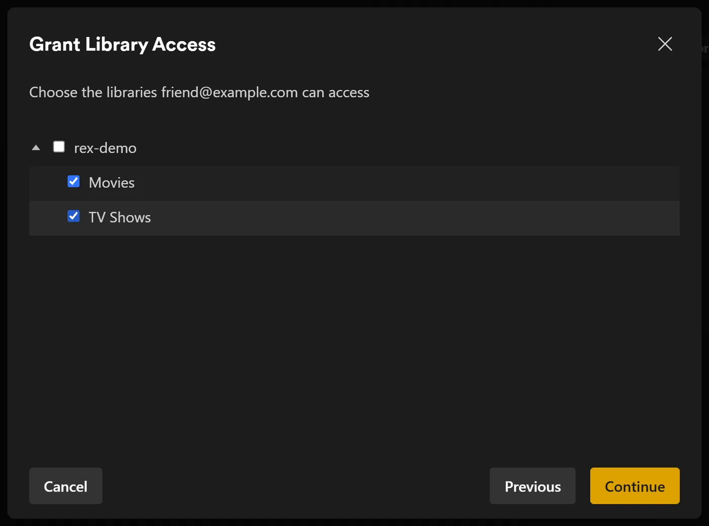
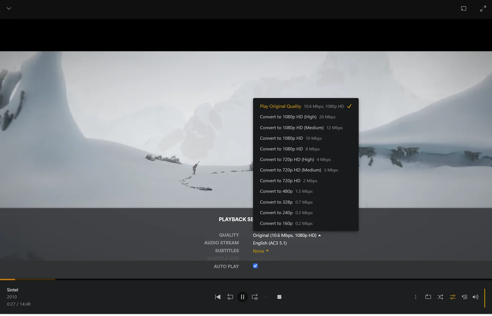
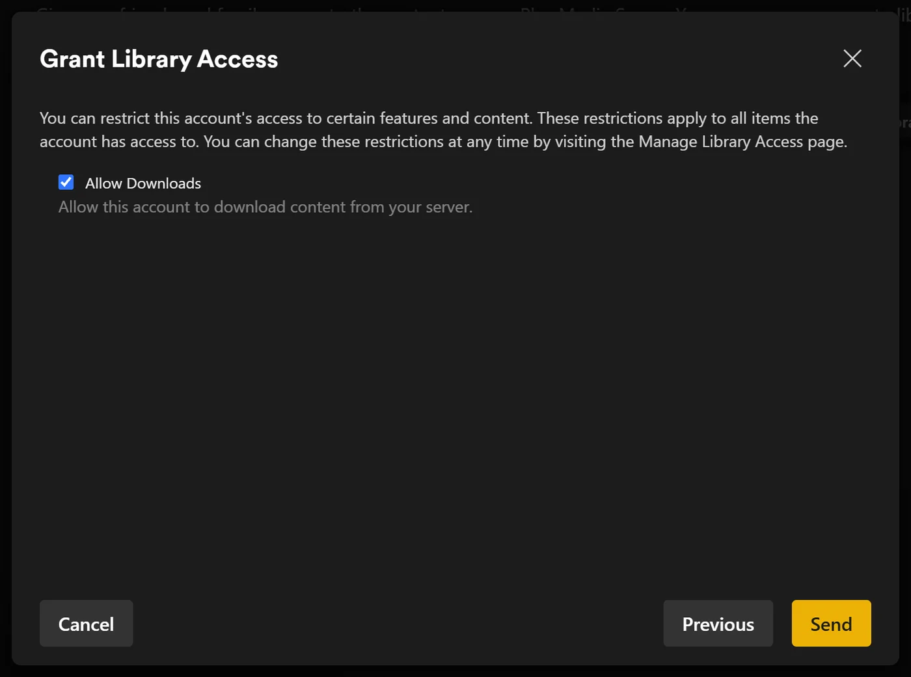
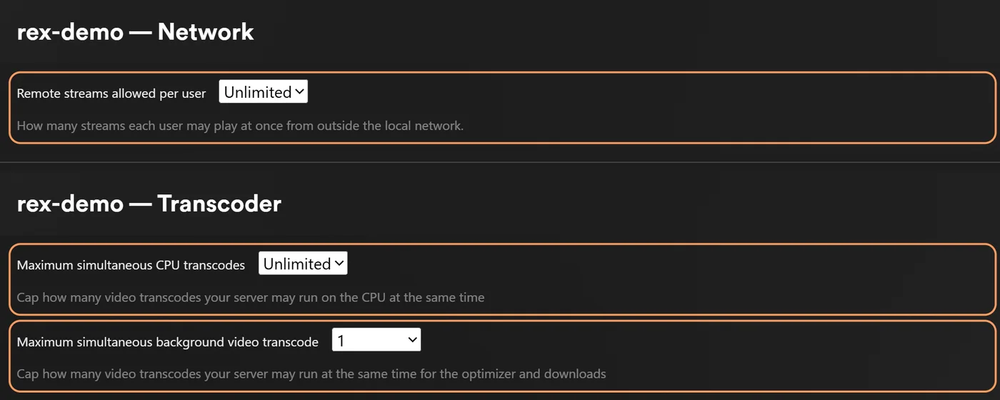

# Comparte rex con familia y amigos {#share-rex-with-family-and-friends}

Comparte rex desde su cuenta registrada mediante **Manage Library Access** de Plex. Cada persona inicia sesión en Plex con su propia cuenta y ve rex junto a sus otros servidores, con su propio historial de reproducción.

Configura primero rex en una cuenta nueva de Plex. Usa [rex con tu propia app](any-source.md), [rex con tus complementos de Stremio](stremio.md) o [rex con zurg](with-zurg.md). Más abajo, **el propietario** hace referencia a esa cuenta.

## Quién es quién {#who-is-who}

| Cuenta | Para qué sirve |
|---|---|
| El propietario, la cuenta nueva en la que está registrado rex | Compartir, ajustes, **Fix Match** y borrar. Solo inicias sesión con ella para eso |
| Tu propia cuenta | Donde ves el contenido. rex se comparte con ella igual que con cualquier otra persona |
| Familia y amigos | Sus propias cuentas de Plex, o usuarios gestionados para niños (más abajo) |

Tu propia cuenta no recibe más que cualquier otra persona con la que compartes. Motivo: [¿Corre riesgo mi cuenta de Plex?](faq.md#is-my-plex-account-at-risk)

## Invita a alguien {#invite-someone}

1. Inicia sesión en [app.plex.tv](https://app.plex.tv) **como propietario**, luego abre **Settings** (la llave inglesa), **Manage Library Access** y **Grant Library Access**.
2. Escribe el nombre de usuario o el correo de Plex de la persona, elige el servidor de rex y las bibliotecas que quieres compartir, y envía la invitación.
3. La persona la acepta con su propia cuenta. Le llega por correo y aparece en app.plex.tv. Cada invitación se acepta por separado.

**Una biblioteca que añades después** (una que declara una fuente, como una biblioteca **Anime** o la de un catálogo de rex-stremio, o una creada con **Add Library**) todavía no está en el recurso compartido de nadie. Añádela a cada recurso compartido en Manage Library Access.

**Qué deberían ver.** Con su propia cuenta, sus apps de Plex muestran rex junto a sus propios servidores. En casa con eso basta. Fuera de casa, sigue leyendo.

## En casa y fuera {#at-home-and-away}

**En casa**, las apps de Plex encuentran rex en tu red por sí solas cuando rex usa el puerto 32400.

**Fuera de casa**, que es siempre el caso de un amigo en otra casa, sus apps necesitan la dirección HTTPS de rex. rex no tiene relay. Lo más sencillo es rex-direct: reenvía el puerto 32400 de tu router a la máquina de rex. Si no tienes IPv4 pública pero sí IPv6, [permítelo por IPv6](any-source.md#rex-direct-over-ipv6) en su lugar; entonces la red de tu amigo también necesita IPv6. [Usarlo fuera de tu casa](any-source.md#use-it-outside-your-home-optional) lo explica junto con las demás opciones.

**Tu velocidad de subida es el límite.** Cada stream que se ve fuera de casa sale por la subida de tu conexión doméstica, a la tasa de bits propia del archivo a menos que se convierta, así que dos personas viendo a la vez necesitan la subida para ambas. Tres cosas ayudan:

- **Menor calidad.** Una persona que elige una calidad inferior a Original en el reproductor recibe un stream convertido, que es más pequeño. Eso necesita FFmpeg en la máquina de rex ([Convertir vídeo](any-source.md#converting-video-optional)). Las apps de Plex para teléfono con datos móviles limitan la calidad a 720p y 4 Mbps, así que sin FFmpeg un título en 1080p allí se rechaza hasta que pongan la calidad móvil en Original.
  

- **Las apps descargan del proveedor.** Plezy y Plex para Android pueden obtener un archivo del enlace que da tu fuente, como el de tu servicio debrid, así que tu conexión no carga nada de eso: [Las apps descargan del proveedor](direct-download.md). Tu proveedor entonces ve que cada persona descarga desde su propia dirección, así que revisa las normas de tu proveedor antes de compartir de esa forma.
- **Un límite por persona** (abajo).

**No necesitas Plex Pass.** Tus amigos no necesitan Plex Pass ni Remote Watch Pass para ver fuera de casa. Esto se comprobó en Plex Web con cuentas gratuitas en ambos lados; otras apps no se han probado fuera de casa.

## Niños: usuarios gestionados {#children-managed-users}

Si el dueño tiene una **Plex Home** con usuarios administrados, un usuario administrado funciona en rex igual que en un servidor de Plex. Compártele rex desde Manage Library Access como a cualquier otra persona y luego limita lo que ve (más abajo). Tendrán su propio historial de reproducción. rex se probó con un usuario administrado que solo tenía acceso a Movies, solo a títulos calificados como G y PG, y sin descargas.

## Qué puede ver y hacer cada persona {#what-each-person-may-see-and-do}

Los eliges por persona, en su parte de Manage Library Access, como en cualquier servidor de Plex. rex los respeta en todas partes: en las listas de bibliotecas, en la búsqueda, en las filas de la pantalla de inicio y en las páginas de los títulos.

| Setting | What it does on rex |
|---|---|
| Libraries | Solo ven las bibliotecas que compartiste. Las demás no existen para ellos |
| Ratings | Solo títulos con las clasificaciones que permites, como G y PG. Un título sin clasificación también se oculta |
| Labels | Oculta los títulos a los que pusiste una etiqueta, o muestra solo esos |
| Downloads | Si sus apps de Plex pueden descargar para verlo sin conexión |

Plex muestra **Ratings** y **Labels** en un compartido solo cuando la cuenta propietaria tiene Plex Pass. En una cuenta gratuita nueva, el compartido ofrece solo **Allow Downloads**; los límites propios de rex que aparecen abajo establecen clasificaciones y etiquetas sin ello.

rex se entera de los cambios por plex.tv en cuanto los haces. Si uno no aparece, reinicia rex.

rex también puede mantener restricciones propias para un compartido, además de las de Plex. Solo pueden reducir lo que Plex permite. Se configuran con un comando en lugar de en una app de Plex: [Local owner controls](https://github.com/debridmediamanager/rex/blob/main/docs/setup.md#local-owner-controls).

## Quién puede hacer qué {#who-can-do-what}

| | El propietario | Todos los demás, incluido tú |
|---|---|---|
| Ver, con su propio estado de visto, Continuar viendo, valoraciones y listas de reproducción | Sí | Sí |
| Descargar para ver sin conexión | Sí | Si su compartido lo permite |
| **Fix Match** y editar un título | Sí | No |
| Eliminar un título (se borra en el origen, para todos) | Sí | No |
| Ajustes del servidor, y quién está viendo ahora | Sí | No |

Las colecciones y los pósteres son del servidor, así que todos ven los mismos.

## Trae el historial de cada persona {#bring-each-persons-history}

Cualquiera con quien compartas puede copiar lo que vio y valoró en otro servidor de Plex, cada uno con sus propios tokens: [Trae tu historial de visualización](import-watched.md). Ejecutarlo no cambia el historial de nadie más.

## Cuántos a la vez {#how-many-at-once}

rex no pone ningún límite propio al número de personas que ven contenido a la vez. Lo fijan tu velocidad de subida, tu máquina y tu fuente. Cada conversión ejecuta FFmpeg en la máquina de rex, y cuántas a la vez aguanta la tuya depende de la máquina; dos a la vez no se han medido. Un vídeo copiado (solo se convierte el sonido) apenas cuesta nada.

Para poner límites, inicia sesión como propietario y abre los ajustes del servidor:

| Ajuste | Dónde | Por defecto |
|---|---|---|
| **Remote streams allowed per user** | Network, en los ajustes avanzados | 0, sin límite. Cuenta las reproducciones fuera de casa |
| **Maximum simultaneous CPU transcodes** | Transcoder | 0, sin límite. Cuenta cada conversión de vídeo, también la de la tarjeta gráfica. Un vídeo copiado nunca se cuenta |

rex rechaza una reproducción que supere el límite.

