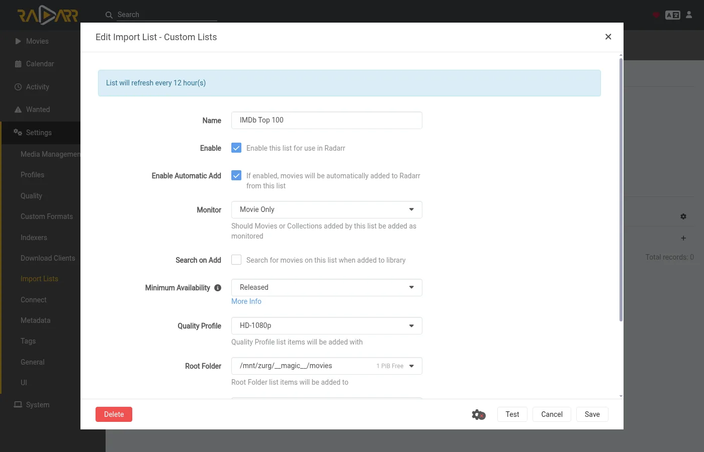

# Deja que zurg busque lo que Sonarr y Radarr quieren {#let-zurg-fetch-what-sonarr-and-radarr-want}

Hay tres formas de usar Sonarr y Radarr con zurg. La elección real es quién busca: zurg o los \*arrs. [Cuál elegir](#which-one-to-pick) las compara.

| Guía | Quién busca | zurg actúa como | Necesitas |
|---|---|---|---|
| [Usenet](sonarr-radarr.md) | Sonarr y Radarr | un SABnzbd | una cuenta de Usenet (o TorBox Pro para el backend `torbox_nzb`) y indexers de Usenet en Prowlarr o en los \*arrs |
| [Torrents](sonarr-radarr-torrents.md) | Sonarr y Radarr | un qBittorrent | una cuenta de debrid y indexers de torrents en Prowlarr o en los \*arrs |
| [Búsquedas de zurg](sonarr-radarr-fetch.md) | zurg | ningún cliente de descargas | una cuenta de Usenet, TorBox Pro o debrid, e indexers Newznab o Torznab en la propia configuración de zurg |

Las dos primeras pueden funcionar al mismo tiempo. Comparten la misma carpeta `__magic__`.

### Cuál elegir {#which-one-to-pick}

| | zurg busca | Sonarr y Radarr buscan |
|---|---|---|
| Los indexadores van en | el `config.yml` de zurg, y un cambio necesita un reinicio | Prowlarr o los \*arr, como siempre |
| Los \*arr necesitan | carpetas raíz dentro de `__magic__`, nada más | zurg como cliente de descarga, con la carpeta de descargas y las carpetas raíz en un mismo volumen |
| El primer archivo es | el más rápido que confirmas que tu perfil permite, y luego se mejora hasta el cutoff | el que el \*arr clasifica mejor en tu perfil |
| Anime, programas diarios y especiales | gestionados a partir de la nightly del 5 de noviembre de 2026 | gestionados |
| Búsqueda manual, cola, historial, lista de bloqueo | ninguno. El archivo aparece y el \*arr vuelve a escanear | funcionan como siempre |
| [`exclude_words`](acquisition.md#excluding-releases-by-name) de zurg | se aplica | no se aplica. Bloquea las mismas palabras en el \*arr |

Ambos comprueban una versión antes de que el \*arr la importe. Una publicación de Usenet muerta o un torrent que tu cuenta no tiene ya nunca se colocan.

En una instalación nueva, empieza con la búsqueda de zurg. Hay menos que configurar y no hay que acertar con ningún diseño de volúmenes. Usa la ruta del cliente de descarga si quieres elegir las versiones a mano. Si prefieres esperar a la mejor versión de tu perfil en lugar de conformarte con un primer archivo rápido, activa [`best_first`](acquisition.md#taking-the-profiles-best-first).

Radarr y Sonarr mantienen la lista y la biblioteca. zurg se encarga de la descarga. Añade una película o una serie como lo haces siempre y zurg encuentra una versión en tus indexadores. Comprueba que un NZB siga en los servidores de noticias (en una cuenta `torbox_nzb`, que TorBox lo haya obtenido), o que tu cuenta de debrid ya tenga el torrent. Después coloca el archivo en su carpeta dentro de `__magic__` y pide a Radarr o Sonarr que escaneen de nuevo. No se descarga nada para importar y no se copia nada.

Radarr y Sonarr no necesitan indexadores ni cliente de descarga para esto. Nunca buscan ni capturan. Tu perfil de calidad sigue decidiendo lo que zurg puede tomar.

Las capturas de pantalla provienen de la build de zurg que se distribuye como nightly del 26 de septiembre de 2026, con Radarr 6.3.0.10514 y Sonarr 4.0.20.3014 en Docker. Ambos veían el montaje de zurg en `/mnt/zurg` dentro de sus contenedores. No se alteró nada en ellas.

## Antes de empezar {#before-you-start}

1. **zurg tiene una cuenta de Usenet o de debrid y al menos un indexador Newznab o Torznab.** Los indexadores van en la configuración de zurg bajo `acquisition.indexers`. La página [Watchlist y Seerr](acquisition.md) explica ese bloque.
2. **`magic.enabled` está en `true`.** Las fuentes de Radarr y Sonarr no arrancan sin él y así lo indican en el log. Consulta [`__magic__`](magic.md).
3. **Radarr y Sonarr pueden ver el montaje de zurg.** Instaladas como aplicaciones normales, cada una tiene un inconveniente, indicado en [la guía de Usenet](sonarr-radarr.md#before-you-start). En Docker sobre un host Linux, hay que montar el volumen dentro de sus contenedores. Monta el directorio padre del montaje una sola vez y accede a todo a través de él. Si además toman las descargas de zurg como cliente de descarga, usar dos volúmenes para la carpeta de descargas y las carpetas raíz hace que cada importación se copie. Consulta [un solo volumen](sonarr-radarr.md#one-volume-for-the-download-folder-and-the-root-folders).
4. **Usas una nightly de 26 de septiembre de 2026 o posterior.** Las versiones anteriores no conocen las fuentes `radarr` ni `sonarr`.

## 1. Indica a zurg dónde están Radarr y Sonarr {#1-tell-zurg-about-radarr-and-sonarr}

Añade una fuente `radarr` y una fuente `sonarr` bajo `acquisition` en `config.yml` y reinicia zurg. Todavía no hay un formulario en el panel para este bloque. Deja fuera la que no uses.

```yaml
acquisition:
  quality: best
  indexers:
    - name: my-indexer
      url: https://indexer.example
      api_key: YOUR_INDEXER_API_KEY
  sources:
    - name: radarr
      type: radarr
      enabled: true
      url: http://radarr:7878         # http://localhost:7878 when Radarr is an ordinary app beside zurg
      api_key: YOUR_RADARR_API_KEY
      library_path: /mnt/zurg/__magic__
      check_every_secs: 30
    - name: sonarr
      type: sonarr
      enabled: true
      url: http://sonarr:8989         # http://localhost:8989 likewise
      api_key: YOUR_SONARR_API_KEY
      library_path: /mnt/zurg/__magic__
      check_every_secs: 30
```

`url` y `api_key` son los de la propia app. La clave API está en **Settings > General** en ambas. `check_every_secs` es cada cuánto tiempo zurg le pregunta a las apps qué quieren. Cada consulta es una sola petición para la lista. Los mismos indexadores sirven a ambas fuentes.

`library_path` es la ruta donde la app ve el directorio `__magic__` de zurg. zurg lo necesita para convertir una carpeta de Radarr en un lugar dentro de `__magic__`. Con la configuración de arriba, una película que Radarr guarda en `/mnt/zurg/__magic__/movies/Heat (1995)` se coloca en `movies/Heat (1995)` dentro del `__magic__` de zurg. Las rutas de Windows como `Z:\__magic__` funcionan igual. Deja `library_path` fuera solo cuando la app se ejecuta en el mismo host que zurg y ve el montaje donde zurg lo monta.

`concurrency` es cuántos títulos trabaja zurg a la vez, y por defecto son ocho. Una lista grande funciona bien con el valor por defecto. Solo tarda más.

## 2. Pon las carpetas raíz dentro de `__magic__` {#2-put-the-root-folders-inside-__magic__}

La carpeta raíz tiene que estar dentro de `__magic__` y un nivel más abajo. `/mnt/zurg/__magic__/movies` para Radarr y `/mnt/zurg/__magic__/tv` para Sonarr es el formato que debes copiar (`/Volumes/Zurg/__magic__/movies` en macOS, `Z:\__magic__\movies` en Windows). No `__magic__` en sí, ni `__magic__/__all__`. Un título cuya carpeta esté en otro lugar se omite, y zurg lo indica una vez en su log.

En Radarr, abre **Settings > Media Management** y añade la carpeta raíz.


Sonarr tiene la misma página. Añade su carpeta raíz en **Root Folders**.


**Season Folder Format** en la página de Sonarr es el nombre que zurg da a una nueva carpeta de temporada. Una temporada que ya tiene archivos conserva la carpeta en la que están. El espacio libre que muestra cualquiera de las dos apps es el que informa el montaje. Ninguna de las dos apps escribe nunca ahí.

## 3. Añade títulos con la búsqueda desactivada {#3-add-titles-with-search-off}

Añade películas y series como ya lo haces. A mano, desde una lista o desde una app de peticiones. Lo único que hay que cambiar es la búsqueda. zurg es el que busca, así que los arrs no deben hacerlo.

### Radarr

Este tutorial usa una lista de importación. Abre **Settings > Import Lists** y añade o edita la tuya.


En la configuración de la lista, deja **Enable Automatic Add** activado y desactiva **Search on Add**. Elige el perfil de calidad y la carpeta raíz del paso 2. Pon **Minimum Availability** en lo que quieras. zurg espera a que Radarr marque una película como disponible antes de buscarla.



Cuando añadas una sola película a mano, el interruptor se llama **Start search for missing movie**. Déjalo desactivado también.

### Sonarr

Cuando añadas una serie a mano, deja sin marcar **Start search for missing episodes** y **Start search for cutoff unmet episodes**. **Monitor** decide qué busca zurg. Esta serie está configurada en su primera temporada.


Una lista de importación en Sonarr tiene el mismo interruptor en sus ajustes. Desactívalo también.

## 4. Deja los indexadores y los clientes de descarga vacíos {#4-leave-indexers-and-download-clients-empty}

Con eso ya está todo el setup del lado de los arr. La página de indexers puede quedarse vacía.


Lo mismo con la página de download clients.


Sonarr es igual. Si cualquiera de las dos apps ya tiene indexers y un download client de un setup anterior, seguirán funcionando. Pero en ese caso la app buscaría y descargaría junto con zurg para los mismos títulos. Desactiva Automatic Search en esos indexers o elimínalos para los títulos que zurg gestiona.

## 5. Mira cómo funciona {#5-watch-it-work}

Abre el dashboard de zurg. **Acquisition** es una entrada nueva en los accesos rápidos.


La página muestra cada título en el que zurg está trabajando y lo que está haciendo en este momento. Los mismos datos están en `/acquisition/status.json` si quieres leerlos desde un script.

### Películas {#movies}

Esta es una lista de diez películas unos treinta segundos después de que Radarr las añadiera. Cinco ya tienen su archivo y Radarr está siendo informado de ellas. El resto ya están listas.


Cada fila es una película. **State** indica en qué estado está. **Stage** es lo que zurg está haciendo con ella en este momento. Primero consulta los indexadores. Luego evalúa los candidatos. Después lee el NZB de una publicación y comprueba la publicación con los servidores de noticias. Por último, coloca el archivo. **Release** es la publicación que zurg tomó y lo que el parser de Radarr entendió de ella. **Placed at** es la ruta dentro de `__magic__` donde ahora está el video. Si un título ya no está disponible en los servidores de noticias, pasa al siguiente candidato de inmediato. Si un título no tiene nada utilizable, se aparta y se muestra el motivo.

Un minuto después, todo está terminado.


### Series

Las temporadas de Sonarr aparecen en la misma página. Cada fila es una temporada o un archivo de episodio que zurg está actualizando. Aquí hay dos series con su primera temporada monitorizada media hora después de añadirlas. Ambas temporadas ya habían terminado de emitirse y no tenían archivos, así que zurg intentó un pack de temporada para cada una. El pack de Severance está en su carpeta de temporada y Sonarr está siendo informado. El pack de Only Murders se está comprobando con los servidores de noticias.


Unos dos minutos después de añadirlas, ambas temporadas están terminadas. El pack de Only Murders le faltaban piezas en los servidores de noticias. zurg lo dejó a un lado y bajó los diez episodios uno por uno. Su fila muestra el último episodio colocado.


## 6. Qué muestran Radarr y Sonarr {#6-what-radarr-and-sonarr-show}

Las bibliotecas se van llenando a medida que llegan los escaneos. Cada película de esta lista ya tiene su archivo.


La página de una película muestra el archivo dentro de su carpeta en `__magic__`, con la calidad que Radarr leyó del nombre.


En Sonarr, los diez episodios tienen su archivo en la carpeta de la temporada, con la calidad que Sonarr leyó del nombre de cada uno.


**Activity** queda vacío en ambos. No hay ninguna entrada en la cola ni eventos de grab o import, porque no se descargó nada. El archivo simplemente apareció en la carpeta y el escaneo que zurg pidió lo recogió.


De eso se deducen dos cosas. La lista de bloqueo de los arrs nunca se escribe. zurg lleva su propio registro de los posts que los servidores de noticias ya no tienen y no vuelve a elegirlos. Y un título que borres en Radarr o Sonarr no se elimina de tu cuenta. El archivo vuelve a aparecer en `__all__` como cualquier otro release.

## Cómo elige zurg una versión {#how-zurg-picks-a-release}

Tu perfil de calidad es el filtro. Cada release que zurg está a punto de tomar pasa primero por el parser propio de la app. Tiene que ser el título correcto. Su calidad tiene que estar permitida por el perfil. Su puntuación de formato personalizado tiene que alcanzar el mínimo del perfil. Su tamaño tiene que encajar dentro de los límites en **Settings > Quality**. Un release que falle cualquiera de esas condiciones no se toma.

### Películas {#movies-1}

Entre las versiones que permite el perfil, zurg elige la primera que sea más rápida de confirmar. Las publicaciones que contienen un único archivo de vídeo van primero porque son las que con más frecuencia siguen completas en los servidores de noticias. Las versiones web van antes que las Blu-ray por la misma razón. Los conjuntos de archivos multivolumen son la opción de respaldo.

El orden de preferencia del perfil se aplica con las mejoras. Cuando el perfil permite mejoras y el archivo colocado está por debajo del corte, zurg busca una versión mejor una vez que la película la tiene. Solo una versión estrictamente mejor reemplaza al archivo. Nunca se coge una calidad inferior.

Una película con fecha futura espera hasta que Radarr la marque como disponible. Una búsqueda que devuelve la película equivocada se rechaza, porque Radarr no relaciona el título con ninguna película de tu biblioteca.

### Series

Una temporada es una unidad de trabajo. Cuando faltan todos los episodios de una temporada y la temporada ya terminó de emitirse, zurg intenta primero un pack de temporada. Si no, busca los episodios que faltan uno por uno. Una temporada que ya tiene algunos de sus archivos nunca recibe un pack, porque eso pondría una segunda copia de esos episodios en la carpeta.

Una release tiene que ser de esta serie y de esta temporada. Un pack tiene que ser la temporada completa. Una release de episodio tiene que contener solo ese episodio. El límite de tamaño se refiere a la duración de los episodios que contiene la release.

Cuando un episodio de una temporada no tiene nada que zurg pueda tomar todavía, pero el resto sí se coloca, Sonarr se entera de los demás enseguida. El episodio que falta se vuelve a buscar más adelante, según el calendario de reintentos habitual.

Un archivo de episodio por debajo del cutoff es una mejora cuando el perfil permite mejoras. Por debajo del cutoff significa por debajo del cutoff de calidad o por debajo del cutoff de puntuación de formato personalizado. zurg cuenta ambos igual que lo hace la regla de mejora de Sonarr. La lista **Cutoff Unmet** de Sonarr solo muestra el primero. Una mejora reemplaza únicamente su propio episodio, y el resto de la carpeta de la temporada se queda donde está.

## Cosas que debes saber {#things-to-know}

- **Cualquier cambio en el bloque `acquisition` de `config.yml` requiere un reinicio.** zurg solo lee el archivo cuando arranca.
- **El rescan es el último paso y se pone en cola detrás del trabajo propio de la app.** Justo después de que una lista añade muchas películas, Radarr primero actualiza cada una de ellas. Los archivos ya están en su sitio mientras eso se ejecuta.
- **Analyse video files lee el inicio de cada archivo a través del montaje.** Funciona. También es la parte más lenta de una lista grande. Déjalo activado a menos que sepas que no quieres la información de los medios.
- **Los títulos sin monitorizar se dejan en paz.** Eso incluye películas, series, temporadas y episodios. También se dejan en paz los títulos cuya carpeta está fuera de `__magic__`.
- **Los anime, los programas diarios y los especiales necesitan un nightly del 5 de noviembre de 2026 o posterior.** Los episodios de un programa diario se encuentran por el día en que se emitieron, los de un anime por el número con el que la serie los cuenta (`Jujutsu Kaisen - 30` es el sexto de la segunda temporada), y los especiales se buscan como temporada 00. Un archivo colocado para un anime o un programa diario se nombra `JUJUTSU KAISEN - S02E06 - <the release's own name>`, porque el rescan de Sonarr lee un archivo solo por su nombre y lo colocaría en la temporada 1 como `2nd Season - 06`. Un especial nombrado solo por su título, sin `S00Exx`, no se puede emparejar, tampoco por Sonarr. En una versión anterior, cada una de estas series se omite con una sola línea en el log.

La descripción completa de ambas fuentes está en [Lista de seguimiento y Seerr](acquisition.md).
