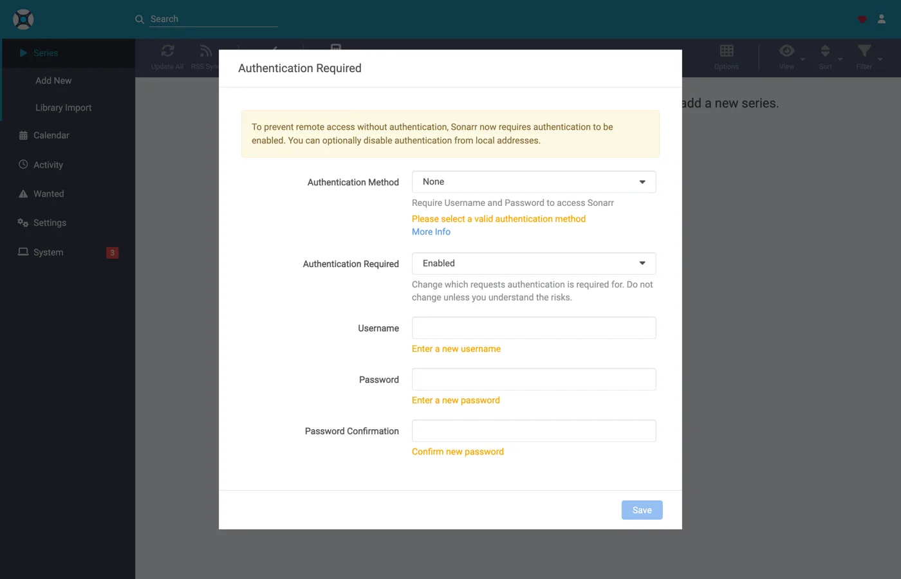
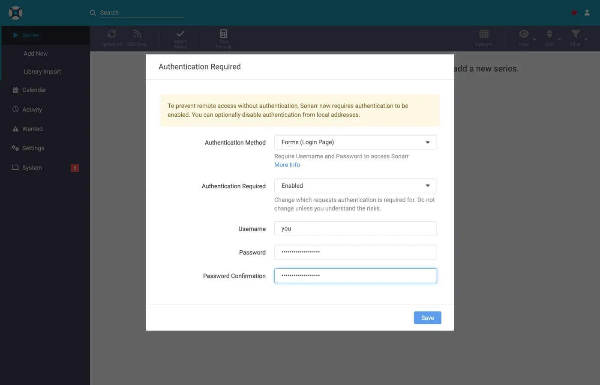

# Sonarr y Radarr con torrents, paso a paso {#sonarr-and-radarr-with-torrents-step-by-step}

Hay tres formas de usar Sonarr y Radarr con zurg. La verdadera elección es quién busca, zurg o los \*arrs: [cuál elegir](sonarr-radarr-fetch.md#which-one-to-pick) las compara.

| Guía | Quién busca | zurg actúa como | Necesitas |
|---|---|---|---|
| [Usenet](sonarr-radarr.md) | Sonarr y Radarr | un SABnzbd | una cuenta de Usenet (o TorBox Pro para el backend `torbox_nzb`) e indexadores de Usenet en Prowlarr o en los \*arrs |
| [Torrents](sonarr-radarr-torrents.md) | Sonarr y Radarr | un qBittorrent | una cuenta de debrid e indexadores de torrents en Prowlarr o en los \*arrs |
| [Búsquedas de zurg](sonarr-radarr-fetch.md) | zurg | ningún cliente de descargas | una cuenta de Usenet, TorBox Pro o debrid, e indexadores Newznab o Torznab en la configuración propia de zurg |

Las dos primeras pueden funcionar a la vez. Comparten la misma carpeta `__magic__`.

La [guía anterior](sonarr-radarr.md) apuntaba los \*arrs a zurg para Usenet, con zurg respondiendo como un SABnzbd. Esta es la otra mitad: zurg responde como un **qBittorrent**, los \*arrs le pasan un magnet o un `.torrent` en lugar de un NZB, y la publicación se añade a una cuenta de debrid en lugar de a un servidor de noticias. La importación es el mismo truco: un renombrado dentro de `__magic__`, nada que descargar para importar, nada copiado.

**Cuál de los dos envía el \*arr no es un detalle menor.** Un `.torrent` normalmente se sube a la cuenta como archivo; solo un magnet se añade únicamente por su info hash. En el modo solo-caché, el predeterminado, TorBox y Debrid-Link reciben el info hash en su lugar, porque así rechazan una publicación no cacheada sin añadirla. Un magnet hace que la cuenta deduzca qué contiene el torrent a partir del hash, y el hash de un tracker privado no tiene un swarm público del que deducirlo: Real-Debrid falla en `magnet_error` sin archivos, y TorBox lo acepta y luego se queda en `checking` sin lista de archivos, sin tamaño y con una estimación de cien días, así que la descarga ni falla ni termina. El archivo `.torrent` usa el hash para buscar directamente en la caché de la cuenta, así que el contenido que la cuenta ya tiene se añade de inmediato, sin ninguna resolución de magnet. Por eso funcionan aquí los indexadores privados: sus publicaciones se pueden añadir exactamente cuando la cuenta ya tiene el contenido, que para cualquier cosa que comparte una comunidad es lo habitual. Apunta el \*arr a un indexador que entregue archivos `.torrent` en lugar de magnets; los privados lo hacen.

Todo lo que aparece a continuación se capturó con zurg `2026.08.30.0459-nightly-73-g5b4c9790`, Sonarr `4.0.19.2979`, Radarr `6.3.0.10514` y Prowlarr `2.5.2.5491`, en una instalación en vivo con una cuenta real de AllDebrid. Los nombres de host y de usuario se han cambiado por `you@zurg-server`. Los nombres de los indexadores son `my-indexer`. Las claves de API y los recuentos de biblioteca son ilustrativos. No se alteró nada más de la salida capturada.

## Antes de empezar {#before-you-start}

Tienen que cumplirse tres cosas. Compruébalas ahora: si alguna falla, más adelante se verá como un problema que no tiene nada que ver.

1. **zurg necesita una cuenta que pueda añadir torrents**: Real-Debrid, AllDebrid, TorBox, Premiumize, Debrid-Link u Offcloud. Las seis aceptan el archivo `.torrent` subido, y eso es lo que permite añadir el lanzamiento de un tracker privado. Una cuenta de Usenet no acepta torrents de ninguna de las dos formas: una instalación cuyo único proveedor es `nzb` acepta todas las capturas y luego las rechaza. zurg lo indica al arrancar.
2. **`magic.enabled` vale `true`.** Sin esto, la ruta de guardado no existe y todas las importaciones fallan. Consulta [`__magic__`](magic.md).
3. **El montaje es visible para el \*arr** en la ruta que informa zurg. Si el \*arr se ejecuta en un contenedor, lee el [paso 8](#8-if-your-arr-is-in-docker) antes de configurar nada. Si está instalado como una aplicación normal en la misma máquina, ve el montaje donde zurg lo monta, con una advertencia en cada sistema:
   - **Linux:** un \*arr que se ejecute con un usuario distinto al de zurg ve una carpeta vacía hasta que se active `user_allow_other`. Consulta [Configuración en Linux](../setup/linux.md#1-install-fuse-3).
   - **macOS:** ejecútalo con el mismo usuario que zurg. El montaje está en `/Volumes/Zurg` salvo que hayas cambiado `mount_path`.
   - **Windows:** ejecuta Sonarr y Radarr como aplicación de bandeja, que es lo que ofrece su instalador, y no como servicio de Windows. La unidad `Z:` de zurg pertenece a la sesión en la que has iniciado sesión, y un servicio se ejecuta fuera de ella, así que no la ve. Consulta [las reglas de sesión](../setup/windows.md#keeping-it-running-the-session-rules).

Comprueba los dos primeros directamente en el archivo de configuración, en el directorio de trabajo de zurg. En Windows, abre `config.yml` en el Bloc de notas.

```bash
$ grep -A3 '^providers:' config.yml
providers:
- type: alldebrid
  token: <redacted>

$ grep -A3 '^magic:' config.yml
magic:
  enabled: true
  allow_delete: false
```

**Aquí el orden de la lista `providers:` importa.** Una captura se ofrece a todas las cuentas que aceptan torrents, en ese orden, y si una cuenta la rechaza o se queda bloqueada, se descarta y se prueba la siguiente. Si tienes dos cuentas, pon primero la que prefieras gastar.

Dos claves sacan una cuenta de ese orden. `watchlist: true` pone una cuenta la primera, esté donde esté en el archivo; `add_torrents: false` la saca de la rotación por completo, de modo que sigue sirviendo y leyendo su biblioteca mientras no se le añade nada nuevo: por ejemplo, una cuenta de archivo, o una cuyo cupo ya está comprometido. Una cuenta de Usenet nunca recibe un torrent, con ninguna de las dos claves. Ambas están explicadas en [la referencia de configuración](../reference/config.md#accounts).

## 1. Activa el endpoint {#1-turn-the-endpoint-on}

Dos formas, mismo resultado. Ambas escriben en `config.yml` y ambas necesitan reiniciar: las rutas que sirven `__magic__` y el endpoint de qBittorrent se registran una sola vez, cuando zurg arranca.

### Opción A — el panel {#option-a--the-dashboard}

Abre el panel de zurg, haz clic en **Config** y desplázate hasta **\_\_magic\_\_ & Download Clients**. Activa **Serve \_\_magic\_\_** y **qBittorrent Endpoint**.


**Config** es donde está la opción; **Magic** es donde verás llegar más adelante las peticiones de descarga.


Deja **qBittorrent Save Path** vacío, a menos que tu \*arr monte zurg en una ruta distinta a la de zurg. Consulta el [paso 8](#8-if-your-arr-is-in-docker). El chip naranja **Restart Required** dice la verdad: nada de esto se aplica hasta que reinicies zurg.

### Opción B — `config.yml` {#option-b--configyml}

Añade el bloque a mano y reinicia zurg.

```yaml
magic:
  enabled: true

qbittorrent:
  enabled: true
  api_key: ""                   # empty = zurg generates one and keeps it
  categories: [tv-sonarr, radarr]
  save_path: ""                 # empty = <mount_path>/__magic__/__all__
  cached_only: true             # the default: only take what an account already holds
```

**Las categorías no son carpetas.** Todas apuntan al mismo sitio: la carpeta propia del release dentro de `__magic__/__all__`. La lista solo crea las categorías por adelantado: el **Test** de un cliente crea cualquier categoría que le falte, y zurg la guarda en `data/qbittorrent-categories.json`. Prowlarr, si lo usas, necesita `prowlarr`; consulta el [paso 10](#10-prowlarr-manual-grabs).

Reinicia zurg y luego confirma que el endpoint se registró y que el proveedor se cargó:


Una sola fila `alldebrid` basta para el endpoint: vale cualquiera de los seis tipos con soporte de torrents.

El log de arranque dice lo mismo, y conviene leerlo una vez:

```
INFO  router.qbittorrent  qBittorrent API on /api/v2 and /qbittorrent/api/v2, save path /mnt/zurg_qbt/__magic__/__all__, categories tv-sonarr, radarr
INFO  router.qbittorrent  qBittorrent: cached-only, so a grab is only accepted onto an account that already holds the content; anything else is refused and the *arr takes its next release. Set qbittorrent.cached_only: false to let accounts download
INFO  router.qbittorrent  qBittorrent: torrents are offered to alldebrid, in that order
```

## 2. Busca la API key {#2-find-the-api-key}

La clave de API es toda la autenticación de este endpoint, así que configúrala bien una vez y no la pegues en ningún sitio público.

**Si dejaste `api_key` vacío**, zurg generó una en el primer arranque y la guardó en `data/qbittorrent-apikey`:

```bash
$ cat data/qbittorrent-apikey
fedcba9876543210fedcba9876543210

```

Clave de ejemplo: la tuya será distinta. El archivo sobrevive a los reinicios, así que la clave se mantiene estable una vez generada.

**Si tú mismo definiste `api_key`**, está en `config.yml` y no se escribe ningún archivo.

**Este endpoint queda fuera de la autenticación básica de zurg.** Los \*arrs se autentican ante un cliente de descarga a su manera, y su capa HTTP convierte un 401 de autenticación básica en "unable to connect" sin nada útil en el mensaje, así que zurg exime `/api/v2` a propósito. La clave de API es la única barrera. Trata el puerto como el resto de zurg: en una red de confianza, o detrás de algo que lo sea.

Hay tres formas de presentar la clave, todas aceptadas:

- **`Authorization: Bearer <key>`**: lo que envía el cliente cuando su campo **API Key** está rellenado. Es la recomendada, porque se salta el inicio de sesión por completo.
- **La clave como contraseña** en `auth/login`, con cualquier nombre de usuario. Úsala si prefieres rellenar Username y Password.
- **El usuario y la contraseña del propio panel de zurg**, si `username:` y `password:` están definidos en `config.yml`.

(Una traducción anterior fue rechazada: los fragmentos de código no coincidían. Mantén la estructura exactamente.)

## 3. Comprueba que responde {#3-prove-it-answers}

Haz esto antes de tocar Sonarr. Diez segundos, y te dice si el fallo está en zurg o en el \*arr durante el resto de la configuración.

+++ Linux and macOS

```bash
$ KEY=fedcba9876543210fedcba9876543210
$ ZURG=192.168.88.244:9995

$ curl -s "http://$ZURG/api/v2/app/webapiVersion"
Forbidden

$ curl -s -H "Authorization: Bearer $KEY" "http://$ZURG/api/v2/app/webapiVersion"
2.11.2

$ curl -s -H "Authorization: Bearer $KEY" "http://$ZURG/api/v2/app/version"
v5.0.4

$ curl -s -H "Authorization: Bearer $KEY" "http://$ZURG/api/v2/app/preferences" | jq .save_path
"/mnt/zurg_qbt/__magic__/__all__"
```

+++ Windows

En PowerShell. Escribe `curl.exe`, no `curl`: el `curl` de Windows PowerShell es otro comando.

```powershell
PS> $KEY = "fedcba9876543210fedcba9876543210"
PS> $ZURG = "192.168.88.244:9995"

PS> curl.exe -s "http://$ZURG/api/v2/app/webapiVersion"
Forbidden

PS> curl.exe -s -H "Authorization: Bearer $KEY" "http://$ZURG/api/v2/app/webapiVersion"
2.11.2

PS> curl.exe -s -H "Authorization: Bearer $KEY" "http://$ZURG/api/v2/app/version"
v5.0.4

PS> (Invoke-RestMethod "http://$ZURG/api/v2/app/preferences" -Headers @{ Authorization = "Bearer $KEY" }).save_path
Z:/__magic__/__all__
```

+++

**La respuesta `Forbidden` a secas es la correcta.** La primera prueba de los clientes es un `GET /api/v2/app/webapiVersion` *sin autenticar*, y qBittorrent real responde `403` cuando la API está disponible pero nadie ha iniciado sesión. Por eso eso es lo que responde zurg, y el cliente lo interpreta como «v2 soportado, autentícate ahora». Un **404** simple, en cambio, significa que `qbittorrent.enabled` sigue en false o que no has reiniciado zurg desde que lo cambiaste.

Luego comprueba que una clave incorrecta se rechaza de verdad:

+++ Linux and macOS

```bash
$ curl -s -o /dev/null -w "%{http_code}\n" -H "Authorization: Bearer wrongkey" \
    "http://$ZURG/api/v2/torrents/info"
403
```

+++ Windows

```powershell
PS> curl.exe -s -o NUL -w "%{http_code}\n" -H "Authorization: Bearer wrongkey" "http://$ZURG/api/v2/torrents/info"
403
```

+++

`save_path` es la ruta que zurg entregará a los clientes; comprueba ahora que es una ruta que *ellos* pueden abrir.

Ambas formas de URL funcionan, así que cualquiera sirve en el campo **URL Base** del cliente:

| Ruta | URL Base in Sonarr / Radarr | Responde |
|---|---|---|
| `/api/v2/…` | *(déjalo vacío)* | sí |
| `/qbittorrent/api/v2/…` | `/qbittorrent` | sí |

## 4. Crea las carpetas raíz {#4-make-the-root-folders}

Créalas antes de añadirlas, porque el diálogo Add Root Folder de los *arr examina el sistema de archivos en vivo y no ofrecerá una carpeta que no exista.

+++ Linux y macOS

```bash
$ mkdir -p /mnt/zurg_qbt/__magic__/tv /mnt/zurg_qbt/__magic__/movies

$ ls -d /mnt/zurg_qbt/__magic__/tv /mnt/zurg_qbt/__magic__/movies
/mnt/zurg_qbt/__magic__/movies
/mnt/zurg_qbt/__magic__/tv
```

+++ Windows

```powershell
PS> New-Item -ItemType Directory -Force Z:\__magic__\tv, Z:\__magic__\movies
```

O crea las dos carpetas en el Explorador.

+++

Sustituye `/mnt/zurg_qbt` por tu propio `mount_path`. Si no lo defines, será `/mnt/zurg` en Linux, `/Volumes/Zurg` en macOS y `Z:` en Windows.

**La carpeta raíz va junto a la ruta de guardado, no en ella ni por encima de ella.** Es la misma regla que en la guía de Usenet, por el mismo motivo: zurg informa `__magic__/__all__` como ruta de guardado, ambos clientes lanzan un aviso de comprobación de estado cuando una carpeta raíz *es* la carpeta de salida del cliente de descargas, Radarr también lo lanza cuando una carpeta raíz *contiene* esa carpeta, y las carpetas hermanas no activan ninguno de los dos. [Esa guía](sonarr-radarr.md#4-make-the-root-folders) tiene las capturas de lo que pasa si lo haces mal.

Hay una segunda razón, específica de los torrents: un movimiento cuyo destino está fuera de `__magic__` es un movimiento entre dos sistemas de archivos, y eso es una copia. Y una copia desde un montaje debrid lee toda la release de vuelta por la red. Dejar `Remove Completed` activado ([más abajo](#if-the-import-copies-instead-of-moving)) hace que la importación sea un renombrado; una carpeta raíz fuera del espacio de nombres anularía eso de todos modos.

Un movimiento entre dos volúmenes también es una copia. Esto importa en Docker. El paso 8 lo cubre.

## 5. Añade el cliente en Sonarr {#5-add-the-client-in-sonarr}

Una instalación nueva de Sonarr bloquea todo detrás de una pantalla de primer inicio. Elige **Forms (Login Page)**, define un nombre de usuario y una contraseña, y haz clic en **Save**.



No te dejará pasar hasta que **Authentication Method** tenga un valor distinto de None.



Después de Save se cierra tu sesión una vez y llegas a la página de inicio de sesión.


### Settings → Download Clients

Ve a **Settings → Download Clients**. En una instalación nueva no hay nada aquí salvo la tarjeta **+**.


Haz clic en el **+** de "Download Clients", no en el que está más abajo en "Remote Path Mappings".

Elige **qBittorrent** en la columna **Torrents**.


zurg imita específicamente a qBittorrent, así que nada más de esta lista funcionará. Las dos columnas indican qué guía estás siguiendo: SABnzbd está bajo Usenet, qBittorrent bajo Torrents.

El diálogo se abre con los valores por defecto de qBittorrent: `localhost`, puerto `8080`, sin clave.


### Qué poner en cada campo {#what-to-put-in-each-field}

| Campo | Valor | Por qué |
|---|---|---|
| Name | `zurg (torrents)` | Lo que quieras. Es solo una etiqueta. |
| Enable | on | Déjalo marcado. |
| Host | `192.168.88.244` | El host donde corre zurg, tal como lo ve *the \*arr*. `localhost` si el \*arr es una app normal en la misma máquina. En Docker, mira la advertencia de abajo. |
| Port | `9995` | El puerto normal de zurg — `9999` en una instalación por defecto. |
| Use SSL | off | Solo si tú mismo pones zurg detrás de TLS. |
| URL Base | vacío | `/qbittorrent` también funciona — mira el paso 3. |
| API Key | del paso 2 | Es lo que protege todo. Se envía como bearer token. |
| Username / Password | vacío | Déjalos vacíos los dos — la clave los reemplaza. |
| Category | `tv-sonarr` | El valor por defecto de *the \*arr*. zurg ya la lista, y **Test** crea cualquier categoría que no exista. |
| Initial State / Sequential / First-Last | por defecto | Aquí no hay enjambre; ninguna de estas opciones hace nada. |
| **Remove Completed** | **on** | **La que importa** — mira [Si la importación copia en lugar de mover](#if-the-import-copies-instead-of-moving). |


La clave API que se muestra es de ejemplo — pega la tuya.

**En Docker, "localhost" y el nombre de host engañan.** Dentro de un contenedor, `localhost` es el propio contenedor, y el nombre de host de la máquina normalmente se resuelve a `127.0.1.1` — que también es el contenedor. El host de este equipo se llama `zurg-server`, y `zurg-server` dentro del contenedor de Sonarr se resolvía a `127.0.1.1`, mientras que ese mismo nombre funcionaba desde la shell del host. Usa la **IP de la LAN o de Tailscale** del host, nunca `localhost` ni el nombre de host a secas.

Haz clic en **Test**. Una marca verde significa que pasaron las comprobaciones del cliente — versión de la API, autenticación, la categoría y la lista de torrents.


Ahora haz clic en **Save**.


## 6. Añade la carpeta raíz en Sonarr {#6-add-the-root-folder-in-sonarr}

Ve a **Settings → Media Management** y baja hasta el final.


Haz clic en **Add Root Folder**. Se abre un explorador de archivos sobre el sistema de archivos de Sonarr, que en Docker es el del contenedor.


Escribe la ruta o navega hasta ella. Si el mount es realmente visible para Sonarr, `__magic__` se abre y muestra lo que creaste en el paso 4, junto al `__all__` que zurg crea por su cuenta. Es la prueba más rápida de que el bind mount está bien configurado.


Si esto sale vacío o da error, detente y arregla el mount antes de seguir.


Termina la ruta en `__magic__/tv` (`Z:\__magic__\tv` en Windows) y haz clic en **Ok**.


Que **Free Space** muestre `1 PiB` es zurg reportando un sistema de archivos virtual, no un disco. Es lo esperado, y es lo que cumple la comprobación de espacio libre de los \*arr antes de enviar una descarga.

## 7. Haz lo mismo en Radarr {#7-do-the-same-in-radarr}

Idéntico, con dos valores cambiados: la categoría es `radarr` y la carpeta raíz es `__magic__/movies`.


La primera ejecución de Radarr funciona igual: configura la autenticación Forms y luego inicia sesión.


**Settings → Download Clients → +**, y luego **qBittorrent** en Torrents.


Mismo host, mismo puerto, misma clave. Solo **Category** cambia: `radarr`, no `tv-sonarr`.

**Test**, marca verde, **Save**.


Después ve a **Settings → Media Management → Root Folders → Add Root Folder** y añade `/mnt/zurg_qbt/__magic__/movies`.

**Un zurg, dos clientes, una cola.** La lista de torrents que ve cada cliente se filtra solo por categoría y nada más. Dos Sonarr que usen `tv-sonarr` verán las descargas del otro; Sonarr en `tv-sonarr` y Radarr en `radarr` no se verán. Si usas un cliente por categoría, esto nunca te dará problemas.

## 8. Si tu \*arr está en Docker {#8-if-your-arr-is-in-docker}

Este paso es para Docker en un host Linux. En macOS y Windows, instala los \*arrs como aplicaciones normales, tal como describe [Antes de empezar](#before-you-start). El paso 8 de la guía de Usenet explica el motivo.

Hay los mismos tres problemas que en la guía de Usenet, con las mismas soluciones. El montaje es el mismo, así que aquí va la versión corta. [El paso 8 de esa guía](sonarr-radarr.md#8-if-your-arr-is-in-docker) tiene el detalle.

**La ruta que zurg reporta debe ser una ruta que el cliente pueda abrir.** Si el contenedor monta la biblioteca en un lugar distinto al de zurg, cada importación fallará con *download doesn't contain intermediate path* o con una comprobación de estado de ruta remota (remote-path health check). Define `qbittorrent.save_path` con la ruta que *el cliente* ve, o añade un remote path mapping:

```yaml
qbittorrent:
  save_path: "/data/zurg/__magic__/__all__"   # what the *arr sees, not what zurg sees
```

**Un solo volumen para la ruta de guardado y las carpetas raíz.** No le des al contenedor `__magic__/__all__` y `__magic__/tv` como dos volúmenes. El renombrado entre ambos falla dentro del contenedor. Entonces el cliente copia cada importación desde tu cuenta y la escribe en el disco de zurg sin avisarte. Dale un solo volumen que contenga todo el montaje de zurg y accede a ambas carpetas a través de él. El bind de abajo es ese volumen.

**Monta el padre del montaje, no el punto de montaje.** Al reiniciar zurg, se desmonta y vuelve a montar. Si un contenedor montó el punto de montaje en sí, conserva la conexión fuse muerta y cada lectura posterior responde `Socket not connected`. Como ambos clientes comprueban el espacio libre antes de cada descarga, *cada release se rechaza en silencio*. Monta el padre con `rslave` y el nuevo montaje llega como un evento de submontaje que el contenedor sigue. Los contenedores de este equipo se iniciaron antes de que zurg montara nada, y aun así el montaje apareció dentro de ellos:

```bash
$ docker exec sonarr df -h /mnt/zurg_qbt
Filesystem      Size  Used Avail Use% Mounted on
zurg{8amax}:    1.0P     0  1.0P   0% /mnt/zurg_qbt
```

## 9. Sigue una descarga de principio a fin {#9-watch-one-grab-go-through}

Añade una cosa, descárgala a mano y sigue el proceso de principio a fin. Todo lo que aparece abajo es una descarga real a través de la configuración de arriba: *Ghost in the Shell (1995)*, obtenida a mano desde un indexador.

### Pídelo {#grab-it}

Abre la película, haz clic en **Interactive Search** y elige una versión.


La columna **Source** muestra `torrent`, que es el protocolo que usa este endpoint. Haz clic en el botón de flecha circular al final de la fila para enviarla. Si el cliente te pide confirmar primero el mapeo:


**Override and Grab** aparece cuando la versión no coincide del todo. Revisa el mapeo y haz clic en **Grab Release**. Una descarga normal nunca muestra esto.

### La cuenta lo toma {#the-account-takes-it}

Tres líneas en el log de zurg componen todo el proceso de añadido: la cuenta que lo recibe, el trabajo que se registra y `finished`. La captura de abajo es de una versión anterior que solo registraba las dos últimas:

```
INFO  router.qbittorrent  qBittorrent: [Polarwindz] Ghost in the Shell (1995) (BD 1080p HEVC FLAC) (0c5e4077…) added to alldebrid as 720824192
INFO  router.qbittorrent  qBittorrent: [Polarwindz] Ghost in the Shell (1995) (BD 1080p HEVC FLAC) (0c5e4077…) finished on alldebrid
```

El hash es el info hash que envió el cliente. `added … as 720824192` es el id que la propia cuenta asigna a ese trabajo. Esta release ya estaba en caché en la cuenta, así que `finished` aparece en un segundo más o menos. Si no está en caché, pasa un rato entre las dos líneas mientras la cuenta la descarga. Lo que hace la cuenta en ese intervalo es lo que muestra la cola del cliente:

| Lo que hace la cuenta | La cola muestra |
|---|---|
| Averiguando a qué se refiere el magnet | *Loading metadata*, sin nada medido todavía |
| En espera en la cola de la propia cuenta | *Queued* |
| Descargando: la velocidad, el swarm y el tiempo restante son cifras de la propia cuenta | *Downloading*, con una barra de progreso real |
| Todas las cuentas han rechazado o agotado el tiempo de espera | Una **advertencia**, con el motivo; consulta [Solución de problemas](#troubleshooting) |
| En la biblioteca, carpeta lista para importar | *Completed* |

Un swarm parado aparece como **Downloading** con la velocidad y el número de seeds en cero, en vez de como una advertencia de bloqueo. `stalledDL` es un estado que los \*arrs usan para gestionar las descargas fallidas, y un swarm sin seeds no significa que la release esté muerta.

El magnet completo llega a la cuenta. zurg pasa el nombre que el cliente usó al capturarlo y los trackers que indicó. En un indexador que solo publica magnets, ese nombre es el único lugar donde aparece el nombre de la release. Sin él, TorBox muestra una descarga sin resolver con su hash de cuarenta caracteres mientras los metadatos sigan sin resolverse. Un `.torrent` ya trae su propio nombre y sus trackers, así que no se le añade nada. La excepción es el modo solo caché (el predeterminado) en TorBox y Debrid-Link, a los que se pregunta solo por el hash, ya que un acierto en caché vuelve con su nombre real.

### Ocurre la importación {#the-import-happens}

**Activity → Queue**, luego **Activity → History**. Dos eventos, con segundos de diferencia: **Grabbed** y luego **Movie Imported**:


Expande la fila importada y lee las rutas. **Source** es `/mnt/zurg_qbt/__magic__/__all__/[Polarwindz] …/[Polarwindz] ….mkv` e **Imported To** es `/mnt/zurg_qbt/__magic__/movies/Ghost in the Shell (1995)/…`. El archivo nunca sale de `__magic__`, y por eso la importación es solo un cambio de nombre. La captura se tomó antes de que la biblioteca se moviera a `__all__`, así que su ruta de origen está un nivel más arriba de lo que verás tú.

Una descarga que el cliente decide no importar se queda en la cola como advertencia. La de la fila de cola de esta captura es una actualización que el perfil de calidad rechazó: se ve, está a un clic de *Remove* y no libera nada por sí sola:


**Status: Downloaded, Size 17.2 GiB**, y no se descargó nada para que eso sea cierto. Los bytes se leen de la cuenta cuando algo reproduce el archivo.

### Comprueba que el archivo es real {#prove-the-file-is-real}

El import movió el archivo a la carpeta raíz. Lee los dos extremos de uno y pídele a ffprobe que te diga qué es:

+++ Linux y macOS

Si tu shell no encuentra `ffprobe`, usa `~/zurg/bin/ffprobe`: el setup pone su propia copia ahí cuando no hay ninguna instalada.

```bash
$ F="/mnt/zurg_qbt/__magic__/tv/One Piece/Season 23/[AnoZu] One Piece S23E21 1080p CR WEB-DL AAC 2.0 H.264.mkv"

$ ls -la "$F"
-rw-rw-r-- 1 you users 1446325722 Aug 31 00:44 …mkv

$ dd if="$F" bs=1M count=1 >/dev/null
1048576 bytes (1.0 MB, 1.0 MiB) copied, 0.00592934 s, 177 MB/s

$ ffprobe -v error -show_entries format=duration,size,format_name \
    -of default=noprint_wrappers=1 "$F"
format_name=matroska,webm
duration=1415.808000
size=1446325722
```

+++ Windows

En PowerShell, desde la carpeta de zurg. El setup dejó `bin\ffprobe.exe` ahí a menos que ya hubiera un `ffprobe` en tu PATH; en ese caso escribe `ffprobe` directamente:

```powershell
PS> $F = Get-Item -LiteralPath "Z:\__magic__\tv\One Piece\Season 23\[AnoZu] One Piece S23E21 1080p CR WEB-DL AAC 2.0 H.264.mkv"
PS> $F.Length
1446325722

PS> bin\ffprobe.exe -v error -show_entries format=duration,size,format_name -of default=noprint_wrappers=1 $F.FullName
format_name=matroska,webm
duration=1415.808000
size=1446325722
```

+++

Ese es una descarga de Sonarr: un episodio bajado de la misma forma e importado en `tv/One Piece/Season 23/`. Un Matroska de 23 minutos, leído directamente de la cuenta de debrid. Los bytes llegan cuando algo los lee, no cuando *arr los importa.

### Desde Sonarr se ve igual {#from-sonarr-it-looks-the-same}


Los mismos dos eventos del historial, la misma importación por renombrado, y una cola que se vacía en cuanto se completa la importación: un lanzamiento en caché pasa de grab a importado en unos pocos segundos, por eso aquí no hay ninguna captura a mitad de la descarga.

## 10. Prowlarr, descargas manuales {#10-prowlarr-manual-grabs}

Prowlarr habla con el mismo endpoint (comparte el código de cliente qBittorrent con los otros dos), pero no es un importador. No tiene biblioteca y nunca importa nada. Lo que sí puede hacer es **enviar un release a la cuenta a mano**, que es justo para lo que sirve su cliente de descarga.

El primer inicio de Prowlarr muestra la misma pantalla de autenticación Forms que los otros dos.


**Settings → Download Clients → +**, y luego **qBittorrent**. En el selector de Prowlarr, todos los clientes aparecen en una sola lista alfabética, en lugar de las dos columnas que usan los \*arr. Mismo host, puerto y clave de API. Hay dos campos que cambian respecto a los \*arr:


| Campo | Valor | Por qué |
|---|---|---|
| Default Category | `prowlarr` | Es la categoría por defecto de Prowlarr, y vale la pena leer su texto de ayuda: *adding a category specific to Prowlarr avoids conflicts with unrelated non-Prowlarr downloads*. Su **Test** crea la categoría en zurg, así que no hace falta añadir nada a `qbittorrent.categories`. |
| Priority | `Last` | No hay nada a lo que aplicarlo. |


**Test**, marca verde, **Save**.


Después, **Search**, escribe lo que quieras y envía una fila al cliente:


El release se añade a la cuenta exactamente igual que una descarga de un \*arr: mismo camino de añadido, mismas categorías, misma carpeta `__magic__`. Y este quedó en caché, `finished` en menos de un segundo. Pero nada lo importa. Se queda en la cuenta y se sirve desde el montaje, que es justo el objetivo: el envío de Prowlarr sirve para *pon esto en mi cuenta de debrid ahora mismo*, no para el flujo automático de descargar, importar y limpiar. Para eso, deja Sonarr y Radarr apuntando al endpoint y deja que Prowlarr gestione los indexadores.

## 11. Añadir un release a mano {#11-adding-a-release-by-hand}

El panel de zurg no tiene botón para añadir. Aun así, puedes pasarle tú mismo un release a zurg y enviarlo al Sonarr o Radarr correcto. Añádelo a través de este endpoint con la categoría de esa app. Cada app solo mira su propia categoría. Cuatro apps con cuatro categorías solo ven sus propios añadidos.

+++ Linux y macOS

```bash
KEY=your-qbittorrent-api-key
curl -H "Authorization: Bearer $KEY" http://localhost:9999/api/v2/torrents/add \
  -F 'urls=magnet:?xt=urn:btih:<hash>&dn=Movie.Title.2012.1080p.WEB-DL' \
  -F category=radarr4k
```

+++ Windows

En PowerShell, con `curl.exe` en lugar de `curl`:

```powershell
$KEY = "your-qbittorrent-api-key"
curl.exe -H "Authorization: Bearer $KEY" http://localhost:9999/api/v2/torrents/add `
  -F 'urls=magnet:?xt=urn:btih:<hash>&dn=Movie.Title.2012.1080p.WEB-DL' `
  -F category=radarr4k
```

+++

También funciona un archivo `.torrent`. Envíalo como `-F 'torrents=@Movie.Title.2012.1080p.WEB.torrent'` en lugar de `urls`.

Cuatro cosas deciden si la app lo importa.

1. **La película o serie tiene que estar ya en esa app.** Solo importa lo que puede asociar con algo que gestiona.
2. **El nombre tiene que decir qué es.** El nombre de un magnet es su `dn`. El nombre de un archivo `.torrent` es su nombre de archivo. zurg ignora el campo `rename` de qBittorrent. Radarr no pudo interpretar `Sintel` y lo dejó como *Unable to parse download*. `Sintel.2010.1080p.WEB-DL` sí se importó. Ponle un año al nombre.
3. **Corrige el nombre antes de que la app lo vea por primera vez.** Una vez que Radarr marca una descarga como no interpretable, mantiene ese veredicto hasta que se reinicia. Añadirla otra vez con un nombre mejor no lo cambió. Tras reiniciar, sí se importó.
4. **La categoría es solo una etiqueta.** Una categoría que no está en `qbittorrent.categories` se acepta. Simplemente no aparece en la lista de categorías. Más adelante puedes mover un release a otra app. La app que es dueña de la nueva categoría lo importa en su siguiente comprobación.

```bash
curl -H "Authorization: Bearer $KEY" http://localhost:9999/api/v2/torrents/setCategory \
  -F hashes=<hash> -F category=radarr
```

En Windows, eso es `curl.exe` en una sola línea, con `$KEY` definida como antes.

Un release que ya está en tu cuenta funciona igual. Eso incluye uno que enviaste desde DMM. zurg ve que ya está en la biblioteca y lo registra bajo la categoría sin añadirlo dos veces. Un release que nunca añades a través de este endpoint sigue siendo invisible para Sonarr y Radarr. zurg solo les muestra lo que llegó por él.

Medido el 2026-10-04 en una cuenta de AllDebrid con Radarr 6.3. Cada película se importó por renombrado a `__magic__/movies` y no se copió nada. Un Radarr configurado con otra categoría nunca la vio. Sonarr no se probó.

## 12. Plex lee un único conjunto de carpetas {#12-plex-reads-one-set-of-folders}

Una importación no saca un lanzamiento de las carpetas propias de zurg. Una película que Radarr colocó en `__magic__/movies` sigue estando en `movies` y en `__all__`. Por eso Plex tiene que leer un solo conjunto de carpetas y nunca los dos.

| Plex lee | Obtienes |
|---|---|
| `movies` y `shows` | Todo lo que hay en tus cuentas de debrid. Las descargas hechas por los \*arrs aparecen ahí también. Los nombres son los que tenga el lanzamiento. |
| `__magic__/movies` y `__magic__/tv` | Solo lo que importaron Sonarr y Radarr. Los nombres y las carpetas son los que eligieron los \*arrs. |

Si tus bibliotecas de Plex ya apuntan a `movies` y `shows`, déjalas así. Las descargas de los \*arrs aparecen ahí sin ningún cambio. Añade las carpetas `__magic__` a Plex solo si quieres una biblioteca hecha únicamente de importaciones de los \*arrs, y en ese caso quita las otras carpetas. Si Plex lee las dos, encontrará cada título dos veces.

Tampoco añadas nunca la raíz de `__magic__`. Contiene `__magic__/__all__`, que es toda la biblioteca otra vez.

## 13. Indexadores, y DMM para patrocinadores {#13-indexers-and-dmm-for-sponsors}

Sonarr y Radarr buscan a través de Prowlarr. Cualquier indexador de torrents público sirve aquí, porque zurg añade el magnet a tu cuenta de debrid. Algunos sitios públicos están detrás de Cloudflare, y Prowlarr se niega a añadirlos sin FlareSolverr. Sáltatelos.

Si patrocinas zurg, DMM también es un indexador. Busca en toda la biblioteca de DMM y pone arriba lo que tu cuenta de debrid ya tiene. Esas descargas son instantáneas.

1. Consigue tu clave de API de DMM en [gatekeeper](https://gatekeeper.debridmediamanager.com): pulsa **Connect GitHub** y, si patrocinas en Patreon, vincula Patreon después. Copia la **DMM API key** que aparece. No es la clave de zurg del [paso 2](#2-find-the-api-key), y es la misma clave que usa el indexador Usenet de DMM, que se configura en [debridmediamanager.com/newznab](https://debridmediamanager.com/newznab).
2. En Prowlarr abre **Indexers → Add Indexer** y elige **Generic Torznab**.
3. Pon la URL de tu cuenta y la clave. Deja API Path en `/api`.

| Tu cuenta | URL |
|---|---|
| Real-Debrid | `https://debridmediamanager.com/api/torznab/rd` |
| AllDebrid | `https://debridmediamanager.com/api/torznab/ad` |
| TorBox | `https://debridmediamanager.com/api/torznab/tb` |
| Premiumize | `https://debridmediamanager.com/api/torznab/pm` |

TorBox y Premiumize necesitan que primero vincules en DMM tu clave de ese servicio. La página de DMM te indica dónde. Añade `/cached` al final de la URL si quieres dejar fuera lo que tu cuenta todavía no tiene.

Prowlarr prueba el indexador al guardarlo. Si la clave se rechaza, la patrocinio ha caducado o la clave es incorrecta, y el error te lo dice. Después, Prowlarr pasa DMM a Sonarr y Radarr por su cuenta. Una clave permite 20 búsquedas por minuto entre todas tus aplicaciones.

## 14. Tu watchlist de Plex {#14-your-plex-watchlist}

Sonarr y Radarr pueden seguir tu watchlist de Plex. Todo lo que añadas en Plex se agrega, se busca y llega a través de zurg como cualquier otra descarga.

En cada app abre **Settings → Import Lists → + → Plex Watchlist** y pulsa **Authenticate with Plex.tv**. Pon la root folder en tu carpeta `__magic__` y activa la búsqueda al añadir. Radarr recoge las películas de la lista y Sonarr recoge las series.

zurg tiene una [watchlist propia](plex-watchlist.md) que descarga desde indexers que le das directamente a zurg. Usa una u otra. Si usas las dos, el mismo título se descarga dos veces.

Para seguir otras listas, como una lista de géneros, mira [Lists in Sonarr & Radarr](import-lists.md).

## Si la importación copia en vez de mover {#if-the-import-copies-instead-of-moving}

Todo lo de arriba depende de que la importación sea un **rename** (renombrado). Dos cosas lo deciden. Una es cómo llega el contenedor al mount, y eso solo lo puedes cambiar tú. Una ruta de guardado y las carpetas raíz en dos volúmenes copian cada importación sin importar lo demás que esté configurado. [Paso 8](#8-if-your-arr-is-in-docker) lo explica. La otra es una opción en el \*arr.

El cliente solo mueve un archivo importado si cree que puede borrar la descarga después, y eso requiere tres cosas a la vez: **Remove Completed** activado, un torrent terminado y pausado, y un límite de seed que el cliente pueda ver que se ha alcanzado. zurg informa de las dos últimas exactamente como tienen que ser: cada torrent completado aparece pausado, con ratio 0 frente a un límite de ratio de 0. **Remove Completed** es la que te toca a ti.

Si está desactivado, el cliente copia en su lugar, y en un mount de debrid copiar significa leer cada byte de la release por la red y escribirlo en el disco local. La release del paso 9 pasaría de ser un rename que no movió nada a una descarga de 17 GiB para importar un archivo que ya estaba ahí.

**zurg lo vuelve a activar** cuando tiene la API key del \*arr, a través de una fuente [Radarr o Sonarr](acquisition.md) (basta con una con `enabled: false`) o del banner del dashboard que la pide. Lo comprueba al arrancar, cada diez minutos y cuando el \*arr llama a zurg por primera vez, y activa **Remove Completed** mediante la API propia del \*arr. Un cliente que falla su propio **Test** no se puede cambiar, y zurg mantiene un aviso con el motivo.

**El \*arr no dice nada si ha copiado.** La importación se marca como correcta en cualquiera de los dos casos. Un move aparece como una línea `MOVE __magic__` en el log de zurg. Una copia a través del propio mount de zurg cae en `data/local`, y zurg la encuentra allí en unos dos minutos, la convierte de nuevo en una colocación, borra la copia y registra `A client copied …` con un banner en el dashboard. Una copia a través de un mount propio es un `PUT` con el número total de bytes de la release, y zurg lo rechaza. Los bytes de la descarga que costó la copia no se pueden recuperar.

**Use Hardlinks instead of Copy** no es un sustituto: el cliente solo lo consulta una vez que ya ha decidido copiar, así que no puede convertir una copia en un move.

## Timeouts y modo solo-cacheado {#timeouts-and-cached-only-mode}

```yaml
qbittorrent:
  cached_only: true
  download_timeout_mins: 15
```

| Ajuste | Qué hace |
|---|---|
| `cached_only: true` | Es el valor por defecto. Un envío solo se acepta en una cuenta que ya tenga el contenido en caché, y si no, se rechaza directamente. `download_timeout_mins` no se usa. |
| `cached_only: false` | Un envío no cacheado se descarga en la cuenta. Si pasan `download_timeout_mins` (por defecto quince) sin que avance, se descarta y se prueba la siguiente cuenta. Un tiempo de espera negativo nunca se rinde. |

**Configuraciones antiguas.** Antes de que existiera `cached_only`, el modo solo en caché se escribía como `download_timeout_mins: 0`. Una configuración que escribe `download_timeout_mins` y no `cached_only` mantiene ese significado: `0` es solo en caché y cualquier otro valor descarga. Si se escriben los dos y no coinciden, `cached_only` gana y zurg muestra una advertencia al arrancar.

**Qué cuenta como avance** es un cambio de etapa o un aumento del progreso, medido por la fracción en bruto que informa la cuenta y no por porcentaje entero. Un uno por ciento de una release de 100 GB son mil millones de bytes, es decir, un gigabyte. Una release que la cuenta está descomprimiendo no cuenta para el reloj: esa etapa se queda en la misma cifra todo el tiempo que haga falta.

**Quince se midió, no se eligió.** AllDebrid deja un trabajo sano en su propia cola con todos los contadores a cero. En dos pruebas de dos, el trabajo se quedó ahí 580 y 622 segundos antes de descargarse en segundos y terminar. Un valor por defecto de diez minutos los habría descartado a los dos. Las capturas, y la tabla que relaciona las palabras propias de cada cuenta con los cinco estados que entienden los \*arrs, están en [Ciclo de vida del torrent](../internals/torrent-lifecycle.md).

**Qué borra un tiempo de espera.** La instancia de esa cuenta, y solo esa: el borrado alcanza únicamente a una instancia que zurg añadió por sí mismo para este envío y que nunca terminó, y a nada más. Cuando no queda ninguna cuenta, el envío se marca con error y el motivo nombra cada cuenta y lo que hizo.

**Un torrent que borras a mano en la cuenta** pasa el envío a la siguiente cuenta de inmediato. Los seis servicios indican claramente cuándo un torrent ya no existe.

**Todo el añadido tiene un presupuesto de 75 segundos.** Los \*arrs cancelan un `torrents/add` a los 100 segundos y notifican la expiración como un fallo de conexión, sin forma de aumentarlo. Todas las cuentas comparten ese único plazo, así que tres cuentas caben cómodamente y una cuarta recibe lo que las tres anteriores no gastaron.

**El modo solo en caché** rechaza dentro del añadido, y ese rechazo es la única señal a la que reaccionan los \*arrs: fallan el envío y pasan a la siguiente release de la lista. Todo lo que ocurre después del añadido les llega como una advertencia de descarga en curso, y esperan. Así se pregunta a cada cuenta:

| Cuenta | Cómo lo pregunta zurg |
|---|---|
| TorBox | Un magnet con `add_only_if_cached=true`, así que un fallo no añade nada. Aun así gasta una de las 60 adiciones no cacheadas por hora de TorBox. |
| Debrid-Link | El info hash desnudo, que Debrid-Link rechaza sin añadir nada cuando no tiene el contenido. |
| AllDebrid, Offcloud | La propia adición responde: el servicio indica en la respuesta si ya tenía el contenido, y si no lo tenía, se borra enseguida. |
| Real-Debrid, Premiumize | Se añade el torrent, se seleccionan sus archivos y se vigila durante hasta cinco segundos. El contenido en caché termina casi al instante (entre 0.4 y 1.5 segundos después de seleccionar los archivos en Real-Debrid). Lo que siga en marcha a los cinco segundos es una descarga real y se borra. |

zurg no consulta `checkcached` de TorBox ni las demás búsquedas de caché. Esas indican si el servicio tiene el contenido, no si tu cuenta acaba teniendo una copia utilizable.

## Qué funciona y qué no {#what-works-and-what-does-not}

Funciona:

- La prueba de conexión en los tres clientes: versión de la API, autenticación, la categoría y la lista de torrents.
- Capturar, cola, historial, importación por renombrado y la limpieza posterior a la importación, en Sonarr y Radarr.
- Volver a capturar un release que la cuenta ya tiene. El \*arr recibe de nuevo el torrent terminado y lo importa; la cuenta conserva una sola copia.
- Varias cuentas: una captura se ofrece a cada una en el orden de `providers:`, y si una la rechaza o se queda parada, pasa a la siguiente.
- Enviar un release a mano desde Prowlarr.

No funciona:

- **La interfaz web de qBittorrent.** Esto es solo la API; no hay ninguna página que abrir.
- **Seeding, cola y prioridades.** No hay swarm. Pausar, forzar el inicio, cambiar prioridades, verificar, mover y los límites de compartición se aceptan, pero no hacen nada.
- **Fallo como estado de primera clase.** La API de qBittorrent no permite indicar que una descarga ha fallado, así que un release que ninguna cuenta acepta llega al \*arr como *warning*, nunca como entrada en la lista de bloqueo. Se ve en la cola con el motivo adjunto, a un clic de *Remove → Blocklist and Search*, pero no se limpia solo y nada vuelve a capturarlo sin intervención. Esta es la diferencia real con el endpoint de SABnzbd, que sí puede informar de un trabajo fallido y hacer que el cliente reaccione.
- **Añadir por URL HTTP directa.** `torrents/add` acepta magnets y archivos `.torrent` subidos. Ambos \*arr envían uno de esos; una `http://…/x.torrent` sin más se rechaza.
- **El desafío de inicio de sesión del dashboard de zurg en el endpoint.** No se aplica; el endpoint acepta la clave de API (como token bearer, la contraseña de inicio de sesión o una cabecera Basic) o el usuario y la contraseña del dashboard de zurg.

**Una captura sí desaparece de la cola en lugar de mostrar un aviso.** Si ninguna cuenta llegó a aceptar el release —ninguna tiene el hash y ninguna lo está descargando— se marca como errored tras diez minutos y se elimina de la lista de torrents al cabo de un día. No hay descarga de la que informar un estado, y una entrada en la cola de algo que no existe es peor que no tener ninguna. Todos los demás fallos siguen visibles.

**Nombres de release bloqueados, solo en Real-Debrid.** RD rechaza algunos releases solo por el nombre. Desde el 14 de octubre de 2026 son once cadenas. `WEB-DL`, `WEB.x264` y `WEB.H264` solo cuentan en ese formato exacto, así que `web-dl`, `Web-Dl` y el `WEB.h264` de la escena están bien. `WEBRip`, `BDRip`, `HDRip`, `DVDRip`, `HDTV.x264`, `HDTV.XviD`, `BluRay.x264` y `p.BluRay.DTS` cuentan en cualquier mayúscula o minúscula. Este último necesita una p justo delante, como en `1080p.BluRay.DTS`. Un release `2002.BluRay.DTS` está bien. zurg conoce los patrones y salta Real-Debrid para ese nombre sin preguntarle, ofreciendo la captura a la siguiente cuenta. Si solo tienes Real-Debrid, la captura se rechaza de inmediato y el cliente pasa a su siguiente release. En TorBox y AllDebrid, el mismo release se añade con normalidad.

## Solución de problemas {#troubleshooting}

| Lo que dice el \*arr | Qué significa |
|---|---|
| "Unable to connect to qBittorrent" | zurg no es accesible en ese host y puerto, o algo delante de él respondió con un código distinto de 200. Revisa `qbittorrent.enabled`: mientras esté desactivado, `/api/v2` devuelve un simple 404. En Docker, comprueba que no usaste `localhost` ni el nombre de host a secas. |
| La prueba pasa, pero las descargas fallan con *Download client failed to add torrent* | El cliente llegó a zurg y zurg rechazó la adición. zurg registra cada rechazo: busca en el log `qBittorrent: refusing`. La línea indica el motivo y cada cuenta en la que se intentó. |
| `every account that takes torrents refused or timed out` en el log de zurg | Ninguna cuenta aceptó el release. Si indica un límite de uso (rate limit) donde esperabas una cuenta sana, cuenta las *otras* instancias de zurg que usan el mismo token: la primera descarga de este equipo falló justo así mientras una segunda instancia de zurg, con la misma cuenta de Real-Debrid, recorría una biblioteca grande y ambas compartían un mismo presupuesto de API. |
| "Category … does not exist" | El cliente todavía no la ha creado. Haz clic en **Test** en el cliente de descargas, lo que crea la categoría en zurg. |
| Una descarga se queda en *Downloading* mucho tiempo | La cuenta la está descargando de verdad. La cola muestra la velocidad y el tiempo restante de la cuenta cuando los proporciona; un release sin seeds aparece con cero en ambos, y eso no es un error. |
| Una descarga completada queda en la cola como advertencia | O bien el cliente decidió no importarla (una mejora que el perfil no acepta), o bien todas las cuentas la rechazaron. La fila de la cola indica el motivo. No se borra sola: elimínala a mano, y usa *Blocklist and Search* si el release está en mal estado. |
| "Download client zurg places downloads in …/__magic__/__all__ but Radarr cannot see this directory" | zurg todavía no terminó de cargar la biblioteca. La parte superior del mount aparece en la lista, pero `__all__` y `__magic__/__all__` no, y Plex tampoco ve nada. Busca en el log de zurg `rejected the API key`. La causa habitual es una cuenta cuya clave o plan dejó de funcionar. Consulta [TorBox](../providers/torbox.md#when-it-goes-wrong) para el plan gratuito. La advertencia desaparece cuando la biblioteca termina de cargar. |
| "Downloads in root folder" / "Remote path mapping" | Las mismas reglas de carpeta raíz y de rutas que en el endpoint de Usenet: consulta [pasos 4](#4-make-the-root-folders) y [8](#8-if-your-arr-is-in-docker). |
| El explorador de carpetas raíz muestra el mount de zurg vacío, o no aparece ninguna unidad `Z:` | El \*arr no puede ver el mount. En Linux se ejecuta con otro usuario sin `user_allow_other`; en Windows se ejecuta como servicio. Consulta [Antes de empezar](#before-you-start). |
| Todas las versiones rechazadas, y nada en el log | Un bind mount obsoleto. Ejecuta `docker exec <client> df -h <mount>`; si dice `Socket not connected`, monta el padre con `rslave` y recrea el contenedor. |
| Las importaciones funcionan, pero cada una descarga el release completo | El \*arr está copiando en lugar de renombrar. zurg registra `A client copied …` y muestra un aviso en su panel. Puede que **Remove Completed** esté desactivado en el cliente de descargas, o que el contenedor tenga la ruta de guardado y las carpetas raíz en dos volúmenes. Consulta [Si la importación copia en lugar de mover](#if-the-import-copies-instead-of-moving) y [paso 8](#8-if-your-arr-is-in-docker). |

¿Sigues atascado? Pregunta en el foro **zurg-support** de [Discord](https://discord.com/invite/7u4YjMThXP). [Pedir ayuda](../../guides/remote-help.md) explica qué incluir.

## Dónde se guarda el estado {#where-the-state-lives}

| Ruta | Qué es |
|---|---|
| `data/qbittorrent-apikey` | Una clave de API generada. No se escribe cuando `qbittorrent.api_key` está definida. |
| `data/qbittorrent-jobs.json` | Los trabajos que los clientes le han entregado al endpoint: qué cuenta tiene cada uno, bajo qué categoría y cada cuenta que ya se probó. |
| `data/magic.json` | La tabla `__magic__`: cada ubicación y lápida que crearon las importaciones. |

La página `__magic__` del panel de zurg muestra los resultados de las importaciones: las ubicaciones son los archivos que movieron los clientes, las lápidas son las carpetas de trabajo que borraron después, y las releases que tomó el endpoint aparecen como filas junto a las carpetas de las que se importaron.


La [referencia](../reference/config.md#qbittorrent-the-torrent-download-client-sonarr-and-radarr-see) tiene cada clave `qbittorrent:`, y [el contrato del cliente](../internals/qbittorrent-client-contract.md) —escrito a partir del código fuente de Sonarr y Radarr— es la especificación a la que responde el endpoint, con el archivo y la línea de cada afirmación.
