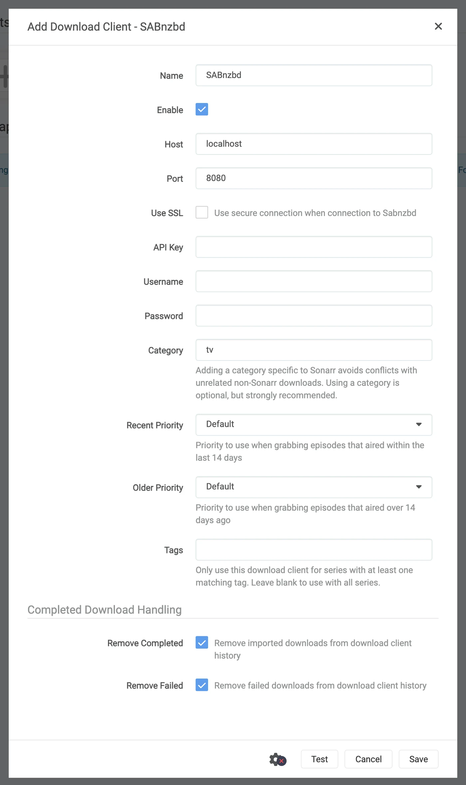

# Sonarr y Radarr, paso a paso {#sonarr-and-radarr-step-by-step}

Hay tres formas de usar Sonarr y Radarr con zurg. Elige quién busca en zurg o en los \*arr. Mira [cuál elegir](sonarr-radarr-fetch.md#which-one-to-pick).

| Guía | Quién busca | zurg actúa como | Lo que necesitas |
|---|---|---|---|
| [Usenet](sonarr-radarr.md) | Sonarr y Radarr | un SABnzbd | una cuenta de Usenet (o TorBox Pro para el backend `torbox_nzb`) y indexadores de Usenet en Prowlarr o en los \*arr |
| [Torrents](sonarr-radarr-torrents.md) | Sonarr y Radarr | un qBittorrent | una cuenta de debrid y indexadores de torrents en Prowlarr o en los \*arr |
| [Búsquedas de zurg](sonarr-radarr-fetch.md) | zurg | ningún cliente de descarga | una cuenta de Usenet, TorBox Pro o debrid, e indexadores Newznab o Torznab en la configuración propia de zurg |

Las dos primeras pueden funcionar a la vez. Comparten la misma carpeta `__magic__`.

Apunta Sonarr y Radarr a zurg para obtener contenido de Usenet sin ningún cliente. No se descarga ni se descomprime ningún vídeo completo durante una captura. Los NZB y las cachés sí usan disco. Esta página trata sobre Usenet. El endpoint de torrents usa los mismos clientes y comparte la carpeta. Mira [Sonarr y Radarr para torrents](sonarr-radarr-torrents.md).

Todo lo que aparece abajo se capturó con zurg `nightly-993-g99bcf9a4`, Sonarr `4.0.19.2979` y Radarr `6.3.0.10514`, en una instalación real con una cuenta de Usenet real. Los nombres de host y de usuario se han cambiado a `you@zurg-server`. Los nombres de indexadores son `my-indexer`. Las claves de API y los recuentos de biblioteca son ilustrativos. No se alteró nada más de la salida capturada. Las líneas de log de `torbox_nzb` se leyeron del código fuente de zurg el 2026-11-09, no se capturaron en directo.

## Antes de empezar {#before-you-start}

Tienen que cumplirse tres cosas. Revísalas todas ahora; si alguna falla, más adelante se verá como un problema que no tiene nada que ver.

1. **zurg tiene un proveedor `nzb`, o uno `torbox_nzb` (TorBox Pro).** Sin uno, no hay nada que lea lo que escribe el endpoint, y cada trabajo aparece como Failed después de 30 minutos, cuando zurg deja de esperar a que aparezca en la biblioteca. Consulta [Usenet](usenet.md), o [TorBox hosted Usenet](../providers/torbox-nzb.md) para `torbox_nzb`.
2. **`magic.enabled` está en `true`.** Sin eso, el directorio de completados no existe y todas las importaciones fallan. Consulta [`__magic__`](magic.md).
3. **El montaje debe ser visible para el \*arr en la ruta que informa zurg.** Si Sonarr se ejecuta en un contenedor, lee el [paso 8](#8-if-your-arr-is-in-docker) antes de configurar nada. Si está instalado como una aplicación normal en la misma máquina, ve el montaje donde zurg lo monta, con una advertencia en cada sistema:
   - **Linux:** un \*arr que se ejecuta con un usuario distinto al de zurg ve una carpeta vacía hasta que se active `user_allow_other`. Consulta [Configuración en Linux](../setup/linux.md#1-install-fuse-3).
   - **macOS:** ejecútalo con el mismo usuario que zurg. El montaje es `/Volumes/Zurg` a menos que hayas cambiado `mount_path`.
   - **Windows:** ejecuta Sonarr y Radarr como aplicación de bandeja, que ofrece su instalador, y no como servicio de Windows. La unidad `Z:` de zurg pertenece a la sesión en la que has iniciado sesión, y un servicio se ejecuta fuera de ella, así que no ve la unidad. Consulta [las reglas de sesión](../setup/windows.md#keeping-it-running-the-session-rules).

Revisa los dos primeros directamente en el archivo de configuración, en el directorio de trabajo de zurg. En Windows, abre `config.yml` en Notepad en su lugar.

```bash
$ grep -A6 '^providers:' config.yml
providers:
- type: nzb
  nntp:
    host: news.example.com
    port: 563
    tls: true
    username: <redacted>
    password: <redacted>

$ grep -A4 '^magic:' config.yml
magic:
  enabled: true
  allow_delete: false
  sidecar_max_mb: 32
  sidecar_budget_mb: 2048
```

`allow_delete: false` es el valor por defecto seguro y no afecta a las importaciones: borrar algo dentro de `__magic__` solo oculta la entrada, en lugar de eliminar contenido de la cuenta.

## 1. Activa el endpoint {#1-turn-the-endpoint-on}

Dos formas, mismo resultado. Ambas escriben en `config.yml` y ambas necesitan un reinicio: las rutas que sirven `__magic__` y el endpoint de SABnzbd se registran una sola vez, cuando zurg arranca.

### Opción A — el panel {#option-a--the-dashboard}

Abre el dashboard de zurg, haz clic en **Config** y desplázate hasta **\_\_magic\_\_ & Download Clients**. Activa **Serve \_\_magic\_\_** y **SABnzbd Endpoint**, y luego pon **SABnzbd Categories** en `tv, movies`.


**Config** es donde está el ajuste; **Magic** es donde verás llegar las descargas más adelante.


Deja **SABnzbd Completed Directory** vacío, a menos que tu \*arr monte zurg en una ruta distinta a la de zurg. Consulta el [paso 8](#8-if-your-arr-is-in-docker). El chip naranja **Restart Required** dice la verdad: nada de esto surte efecto hasta que reinicies zurg.

### Opción B — `config.yml` {#option-b--configyml}

Añade el bloque a mano y reinicia zurg.

```yaml
magic:
  enabled: true

sabnzbd:
  enabled: true
  api_key: ""          # empty = zurg generates one and keeps it
  categories: [tv, movies]
  complete_dir: ""     # empty = <mount_path>/__magic__/__all__
```

**Las categorías no son carpetas.** Todas apuntan al mismo sitio: la carpeta de un trabajo es la carpeta propia de la release dentro de `__magic__/__all__`. La lista sirve solo para que Sonarr y Radarr dejen de avisar de una categoría que no encuentran. Si la categoría de Sonarr es `tv`, `tv` tiene que estar en esta lista.

Reinicia zurg y luego confirma que el proveedor se ha cargado:


Con una sola fila `nzb` o `torbox_nzb` basta para el endpoint.

## 2. Busca la API key {#2-find-the-api-key}

La clave de API es toda la autenticación de este endpoint, así que configúrala bien una vez y no la pegues en ningún sitio público.

**Si dejaste `api_key` vacío**, zurg generó una en el primer arranque y la guardó en `data/sabnzbd-apikey`:

```bash
$ cat data/sabnzbd-apikey
0123456789abcdef0123456789abcdef

```

Clave de ejemplo; la tuya será diferente. El archivo sobrevive a los reinicios, así que la clave es estable una vez generada.

**Si tú mismo configuraste `api_key`**, está en `config.yml` y no se escribe ningún archivo. El panel te indica en cuál de los dos casos estás, al final del bloque del paso 1. Dice *pinned in config.yml under `sabnzbd.api_key`* o *generated and kept in `data/sabnzbd-apikey`*.

**Este endpoint queda fuera de la autenticación básica de zurg.** Ni Sonarr ni Radarr envían nunca autenticación básica a un cliente de descargas, y su capa HTTP convierte un 401 en "unable to connect" sin nada útil que te ayude a resolverlo. Por eso zurg deja `/api` exento a propósito. La clave de API es la única barrera. Trata el puerto como tratas el resto de zurg: en una red de confianza, o detrás de algo que lo sea.

## 3. Comprueba que responde {#3-prove-it-answers}

Haz esto antes de tocar Sonarr. Tarda diez segundos y te permite saber desde el principio si el fallo está en zurg o en el \*arr durante el resto de la configuración.

+++ Linux y macOS

```bash
$ SAB=0123456789abcdef0123456789abcdef
$ ZURG=192.168.88.245:9996

$ curl -s "http://$ZURG/api?mode=version&apikey=$SAB&output=json"
{"version":"4.5.1"}

$ curl -s "http://$ZURG/api?mode=get_config&apikey=$SAB&output=json" \
    | jq '.config.misc.complete_dir, [.config.categories[].name]'
"/mnt/zurg_usenet/__magic__/__all__"
[ "*", "tv", "movies" ]
```

+++ Windows

En PowerShell. Escribe `curl.exe`, no `curl`: el `curl` de Windows PowerShell es otro comando.

```powershell
PS> $SAB = "0123456789abcdef0123456789abcdef"
PS> $ZURG = "192.168.88.245:9996"

PS> curl.exe -s "http://$ZURG/api?mode=version&apikey=$SAB&output=json"
{"version":"4.5.1"}

PS> (Invoke-RestMethod "http://$ZURG/api?mode=get_config&apikey=$SAB&output=json").config.misc.complete_dir
Z:/__magic__/__all__
```

+++

`complete_dir` es la ruta que zurg entregará a los clientes. Comprueba ahora que es una ruta que *ellos* pueden abrir.

Después, comprueba que una clave incorrecta se rechaza de verdad (en Windows, usa `curl.exe` con las mismas URLs):

```bash
$ curl -s "http://$ZURG/api?mode=queue&apikey=wrongkey&output=json"
{"status":false,"error":"API Key Incorrect"}

$ curl -s "http://$ZURG/api?mode=queue&output=json"
{"status":false,"error":"API Key Required"}
```

**`mode=version` no es una prueba de autenticación.** Responde `{"version":"4.5.1"}` incluso con una clave incorrecta. Así se comporta el SABnzbd real, y zurg lo copia. Usa `mode=queue` o `mode=get_config` si lo que quieres probar es la clave.

Las dos formas de URL funcionan, así que cualquiera sirve en el campo **URL Base** del cliente:

| Ruta | URL Base en Sonarr / Radarr | Responde |
|---|---|---|
| `/api` | *(déjalo vacío)* | sí |
| `/sabnzbd/api` | `/sabnzbd` | sí |

Si `/api` devuelve un **404** normal, `sabnzbd.enabled` sigue en false o no has reiniciado zurg después de cambiarlo.

## 4. Crea las carpetas raíz {#4-make-the-root-folders}

Créalas antes de añadirlas, porque el diálogo Add Root Folder de los \*arr examina el sistema de archivos en vivo y no ofrecerá una carpeta que no exista.

+++ Linux y macOS

```bash
$ mkdir -p /mnt/zurg_usenet/__magic__/tv /mnt/zurg_usenet/__magic__/movies

$ ls -d /mnt/zurg_usenet/__magic__/tv /mnt/zurg_usenet/__magic__/movies
/mnt/zurg_usenet/__magic__/movies
/mnt/zurg_usenet/__magic__/tv
```

+++ Windows

```powershell
PS> New-Item -ItemType Directory -Force Z:\__magic__\tv, Z:\__magic__\movies
```

O crea las dos carpetas en el Explorador de Windows.

+++

Sustituye `/mnt/zurg_usenet` por tu propio `mount_path`. Si no lo defines, será `/mnt/zurg` en Linux, `/Volumes/Zurg` en macOS y `Z:` en Windows. Los nombres de las carpetas los eliges tú; `tv` y `movies` solo coinciden con las categorías.

**La carpeta raíz va al lado del directorio de completados, ni en él ni por encima.** zurg entrega a los clientes `__magic__/__all__`, que es tu biblioteca tal como la lista `__all__`. Tus carpetas raíz van junto a ella, en `__magic__/tv` y `__magic__/movies`. **No** `__magic__/__all__`, **ni** `__magic__` en sí, **ni** `/mnt/zurg_usenet`. Ambos clientes muestran un aviso de health check cuando una carpeta raíz *es* la carpeta de salida del cliente de descargas, y Radarr también lo muestra cuando una carpeta raíz *contiene* esa carpeta. Las carpetas hermanas no activan ninguno de los dos avisos, y una importación manual apuntada al directorio de completados tiene entonces una sola release que revisar en lugar de toda tu biblioteca.

Así es como se ve el error. Ambas capturas son reales, de los dos clientes. Se tomaron antes de que el directorio de completados bajara a `__magic__/__all__`, así que las rutas que aparecen están un nivel por encima de las tuyas; las dos reglas que muestran son las mismas:


Sonarr con el propio directorio de completados añadido como carpeta raíz: avisa porque la carpeta raíz *es* la carpeta de salida.


Radarr con `/mnt/zurg_usenet` añadido: avisa también por el padre, cosa que Sonarr no hace. Mueve la carpeta raíz al lado del directorio de completados y ambos avisos desaparecen.

## 5. Añade el cliente en Sonarr {#5-add-the-client-in-sonarr}

Un Sonarr recién instalado bloquea todo detrás de una pantalla de primer inicio. Elige **Forms (Login Page)**, define un nombre de usuario y una contraseña, y haz clic en **Save**.


No te dejará pasar hasta que **Authentication Method** tenga un valor distinto de None.


Después de Save se cerrará tu sesión una vez y llegarás a la página de inicio de sesión.


### Settings → Download Clients

Ve a **Settings → Download Clients**. En una instalación nueva no hay nada aquí más que la tarjeta **+**.


Haz clic en el **+** de "Download Clients", no en el que está más abajo en "Remote Path Mappings".

Elige **SABnzbd** de la columna **Usenet**.


zurg imita a SABnzbd en concreto, así que nada más de esta lista funcionará.

El diálogo se abre con los valores por defecto de SABnzbd: `localhost`, puerto `8080`, sin key.



### Qué poner en cada campo {#what-to-put-in-each-field}

| Field | Value | Why |
|---|---|---|
| Name | `zurg (Usenet)` | Lo que quieras. Es solo una etiqueta. |
| Enable | on | Déjalo marcado. |
| Host | `192.168.88.245` | El host donde corre zurg, tal como lo ve *el \*arr*. `localhost` si el \*arr es una app normal en la misma máquina. En Docker, mira la advertencia de abajo. |
| Port | `9996` | El puerto normal de zurg: `9999` en una instalación por defecto. |
| Use SSL | off | Solo si pones zurg detrás de TLS por tu cuenta. |
| API Key | from step 2 | Es lo que controla el acceso. |
| Username | empty | Excluyente con la clave. Solo se acepta la clave. |
| Password | empty | Igual. |
| Category | `tv` | Debe aparecer en `sabnzbd.categories`. |
| Recent / Older Priority | Default | zurg no tiene nada a lo que aplicar una prioridad. |
| Remove Completed | on | Deja que el cliente limpie sus propios registros de trabajos. Déjalo activado. |
| Remove Failed | on | Igual. |


La API key mostrada es solo un ejemplo — pega la tuya.

**En Docker, "localhost" y el nombre de host engañan.** Dentro de un contenedor, `localhost` es el propio contenedor, y el hostname de la máquina normalmente resuelve a `127.0.1.1`, que también es el contenedor. Usa la **IP de LAN o de Tailscale** del host, nunca `localhost` ni el hostname a secas, aunque ambos funcionen bien desde tu shell.

Haz clic en **Test**. Una marca verde significa que pasaron las cuatro comprobaciones del cliente: versión, API key, configuración global y la categoría.


Ahora haz clic en **Save**.


## 6. Añade la carpeta raíz en Sonarr {#6-add-the-root-folder-in-sonarr}

Ve a **Settings → Media Management** y desplázate hasta abajo.


Haz clic en **Add Root Folder**. Se abre un explorador de archivos sobre el sistema de archivos de Sonarr, que en Docker es el del contenedor.


Escribe la ruta en el cuadro de arriba. Si el montaje es realmente visible para Sonarr, lo que hay dentro de `__magic__` aparece mientras escribes: `__all__` con todas las releases, y lo que hayas creado junto a él. Es la prueba más rápida que vas a tener de que el bind mount está bien.


Si esto sale vacío o da error, para y arregla el montaje antes de seguir.


Termina la ruta en `__magic__/tv` (`Z:\__magic__\tv` en Windows) y haz clic en **Ok**.


Si **Free Space** muestra un número razonable, Sonarr puede leer el montaje; **Unmapped Folders** cuenta las releases que ya están ahí.

## 7. Haz lo mismo en Radarr {#7-do-the-same-in-radarr}

Idéntico, con dos valores cambiados: la categoría es `movies` y la root folder es `__magic__/movies`.


El primer arranque de Radarr funciona igual: activa Forms auth y luego inicia sesión.


**Settings → Download Clients → +**, y luego **SABnzbd** dentro de Usenet.


Mismo host, mismo puerto, misma clave. Solo cambia **Category**: `movies`, no `tv`.


**Test**, tick verde, **Save**.


Luego ve a **Settings → Media Management → Root Folders → Add Root Folder** y añade `/mnt/zurg_usenet/__magic__/movies`.

**Un zurg, dos clientes, una sola cola.** La cola y el historial de zurg se filtran solo por categoría y por nada más. Dos Sonarr usando `tv` verán los trabajos del otro; Sonarr en `tv` y Radarr en `movies` no. Con un cliente por categoría, este problema nunca aparece.

## 8. Si tu \*arr está en Docker {#8-if-your-arr-is-in-docker}

Este paso es para Docker en un host Linux. Docker Desktop en macOS y Windows ejecuta los contenedores dentro de una máquina virtual. El bind `rslave` de abajo depende de la propagación de montajes de Linux (ver [Docker setup](../setup/docker.md)), y pasarle el montaje de zurg a un contenedor en esos sistemas no se ha probado. En macOS y Windows instala Sonarr y Radarr como aplicaciones normales, tal como describe [Before you start](#before-you-start).

Tres problemas distintos. El segundo te cuesta una descarga en cada importación. El tercero no te afecta hasta la primera vez que se reinicia zurg.

### La ruta que zurg informa tiene que ser una ruta que el cliente pueda abrir {#the-path-zurg-reports-must-be-a-path-the-client-can-open}

Si el contenedor monta la biblioteca en una ruta distinta a la de zurg, cada importación falla con *download doesn't contain intermediate path* o con una comprobación de salud de remote-path. Puedes arreglarlo de cualquiera de las dos formas, ambas valen:

- **Configura `sabnzbd.complete_dir`** con la ruta que *el cliente* ve. Es lo más sencillo cuando hay un solo cliente, o varios que coinciden, y montan la biblioteca en el mismo sitio.
- **Añade un remote path mapping** en el \*arr. Úsalo cuando los distintos clientes la montan de forma diferente.

```yaml
sabnzbd:
  complete_dir: "/data/zurg/__magic__/__all__"   # what the *arr sees, not what zurg sees
```

Para la segunda opción, ve a **Settings → Download Clients** y usa el **+** bajo **Remote Path Mappings**, el de abajo de la página, no el que usaste en el paso 5.


**Host** debe ser exactamente la misma cadena de host que escribiste en el cliente de descargas. **Remote Path** es lo que informa zurg; **Local Path** es donde lo ve el cliente.

### Un solo volumen para la carpeta de descargas y las carpetas raíz {#one-volume-for-the-download-folder-and-the-root-folders}

Mover un archivo de `__magic__/__all__` a `__magic__/tv` no cuesta nada porque es un renombrado. Un renombrado solo funciona dentro de un mismo montaje. Si le das al contenedor las dos carpetas como dos volúmenes, ve dos sistemas de archivos. Ambos son el montaje de zurg por debajo y aun así no importa.

```yaml
    volumes:                                        # do not do this
      - /mnt/zurg_usenet/__magic__/__all__:/downloads
      - /mnt/zurg_usenet/__magic__/tv:/tv
```

El kernel rechaza el renombrado dentro del contenedor. Sonarr y Radarr entonces copian el archivo y borran el original sin avisar. Cada importación descarga la release completa desde tu cuenta y la escribe en el disco de zurg. La importación sigue teniendo éxito, solo que es lenta. Un episodio de 1.46 GB tardó 50 segundos y generó 2.9 GB de tráfico de esta forma. Con un solo volumen tardó un segundo y no leyó nada.

Dale al contenedor un solo volumen que contenga todo el montaje de zurg. Accede a la carpeta de descargas y a las carpetas raíz a través de él. El bind de la siguiente sección hace exactamente eso. Un Remote Path Mapping o `complete_dir` después apunta el cliente a `__all__` dentro de ese mismo volumen.

Una importación manual con **Hardlink/Copy Files** también copia. Elige **Move Files**.

### Monta el padre del punto de montaje, no el punto de montaje {#bind-the-mounts-parent-not-the-mountpoint}

Esta es la que cuesta una tarde. También es el único volumen que la sección de arriba pide. Reiniciar zurg desmonta `/mnt/zurg_usenet` y lo vuelve a montar. Un contenedor que enlazó **el propio punto de montaje** conserva la conexión fuse con la que se inició, que ahora está muerta. Cada lectura responde `Socket not connected`, y como ambos clientes comprueban el espacio libre en la carpeta raíz antes de capturar, *cada release se rechaza en silencio*:

```
FreeSpaceSpecification: Socket not connected
```

Ningún mensaje de los clientes dice que el montaje está obsoleto, la carpeta sigue apareciendo dentro del contenedor, y una captura interactiva enviada directamente al cliente sigue funcionando. Lo que se ve es un \*arr que ha dejado de buscar sin avisar.

Enlaza el **directorio padre** con `rslave`, y el nuevo montaje llega como un evento de submontaje que el contenedor sigue:

```yaml
    volumes:
      - type: bind
        source: /mnt          # the parent, not /mnt/zurg_usenet
        target: /mnt
        bind:
          propagation: rslave
```

Revisa un contenedor después de cada reinicio de zurg. Lo que quieres ver es un tamaño, no un error:

```bash
$ docker exec radarr df -h /mnt/zurg_usenet
Filesystem      Size  Used Avail Use% Mounted on
zurg{PGSq4}:    1.0P     0  1.0P   0% /mnt/zurg_usenet
```

El petabyte es zurg mostrando un sistema de archivos virtual, no un disco. Es lo esperado, y es lo que satisface la comprobación de espacio libre del \*arr.

## 9. Sigue una descarga de principio a fin {#9-watch-one-grab-go-through}

Añade una sola cosa, tráela a mano y sigue todo el proceso de principio a fin. Lo que aparece abajo es una descarga real hecha con la configuración de arriba.

### Pídelo {#grab-it}

Abre una película (o un episodio), haz clic en **Interactive Search** y elige un release.


La columna **Source** muestra `nzb`, que es el protocolo que zurg puede usar.

Haz clic en el botón de flecha circular al final de la fila para agarrarlo. Si el release no coincide bien, el cliente te pide que confirmes primero el mapeo:


**Override and Grab** aparece cuando el cliente quiere que confirmes qué es el release. Revisa el mapeo y haz clic en **Grab Release**. Una descarga automática normal nunca muestra esto.

### Llega a la cola {#it-lands-in-the-queue}


**Activity → Queue** justo después de la captura. Fíjate en la barra de progreso: está llena, y **Time Left** muestra un guion. No hay ninguna descarga que medir, así que un trabajo está en cola o completado, y no hay nada en medio. *Las otras filas de aquí pertenecen a un segundo Radarr apuntando al mismo zurg y a la misma categoría*: mira la nota del paso 7.

### zurg escribe el NZB y lo lee {#zurg-writes-the-nzb-and-reads-it}

```
Aug 25 14:44:03 zurg-server zurg[3034965]: INFO  nzb  Loaded NZB
  Last.Week.Tonight.with.John.Oliver.S13E22.480p.WEB.x264-RMTeam.nzb: 4 files
Aug 25 14:50:28 zurg-server zurg[3034965]: INFO  nzb  Loaded NZB
  Untold.The.Testimony.of.Vince.Young.2026.1080p.NF.WEB-DL.DD+5.1.Atmos.H.264-playWEB.nzb: 9 files
```

`Loaded NZB … : N files` es la línea que indica que el NZB se analizó bien. Si un trabajo aparece como Failed después de 30 minutos, cuando zurg deja de esperar a que aparezca en la biblioteca, lo que falta es esta línea.

### Ocurre la importación {#the-import-happens}


**Activity → History**. Dos eventos, con segundos de diferencia: **Grabbed** y, después, **Movie Imported**.


**Status: Downloaded**, **Size 4.7 GiB**, y no se descargó nada.

### Comprueba que el archivo es real {#prove-the-file-is-real}

La importación movió el archivo a la carpeta raíz. Lee los dos extremos del archivo y pregúntale a ffprobe qué es:

+++ Linux y macOS

Si tu shell no encuentra `ffprobe`, usa `~/zurg/bin/ffprobe`: el setup pone su propia copia ahí cuando no había ninguna instalada.

```bash
$ ls -la "/mnt/zurg_usenet/__magic__/movies/Untold - The Testimony of Vince Young (2026)/"
-rw-r--r-- 1 you you 4920958828 Aug 25 14:53 Untold.The.Testimony…playWEB.mkv

$ dd if="$F" bs=1M count=1 >/dev/null
1048576 bytes (1.0 MB, 1.0 MiB) copied, 0.0429446 s, 24.4 MB/s

$ ffprobe -v error -show_entries format=duration,size,format_name \
    -of default=noprint_wrappers=1 "$F"
format_name=matroska,webm
duration=4709.440000
size=4920958828
```

+++ Windows

En PowerShell, desde la carpeta de zurg. El setup puso `bin\ffprobe.exe` ahí a menos que ya hubiera un `ffprobe` en tu PATH; en ese caso escribe `ffprobe`:

```powershell
PS> $F = Get-Item "Z:\__magic__\movies\Untold - The Testimony of Vince Young (2026)\*.mkv"
PS> $F.Length
4920958828

PS> bin\ffprobe.exe -v error -show_entries format=duration,size,format_name -of default=noprint_wrappers=1 $F.FullName
format_name=matroska,webm
duration=4709.440000
size=4920958828
```

+++

Un Matroska de 78 minutos, transmitido desde artículos de Usenet bajo demanda. Los bytes llegan cuando algo los lee, no cuando el \*arr importa.

## 10. Añadir un lanzamiento manualmente {#10-adding-a-release-by-hand}

A veces Sonarr o Radarr nunca toma el release que quieres. Los indexadores que busca quizá no lo tienen, o un perfil de calidad o un formato personalizado lo descarta. Puedes pasarle tú mismo el NZB a zurg, bajo la categoría de la app que debería importarlo. Esa app lo importa como si lo hubiera tomado ella.

Si el release está en un indexador que la app busca, prueba primero con la app. **Interactive Search** también muestra los releases rechazados. Tomar uno lo envía a zurg como cualquier otra descarga. Radarr tomó un release IMAX que su perfil había rechazado, con una puntuación de 0 frente a un formato personalizado obligatorio, y lo importó.

+++ Linux y macOS

```bash
$ SAB=0123456789abcdef0123456789abcdef
$ ZURG=192.168.88.245:9996

# an NZB file you already have (the upload field is called name, as in SABnzbd)
$ curl -s "http://$ZURG/api?mode=addfile&apikey=$SAB&cat=movies" \
    -F 'name=@Movie.Title.2024.1080p.WEB-DL.nzb'
{"status":true,"nzo_ids":["SABnzbd_nzo_…"]}

# or a link to one, which zurg downloads itself
$ curl -s -G "http://$ZURG/api" \
    --data-urlencode mode=addurl --data-urlencode "apikey=$SAB" --data-urlencode cat=movies \
    --data-urlencode 'name=https://indexer.example/getnzb/<id>?r=<indexer-key>' \
    --data-urlencode nzbname=Movie.Title.2024.1080p.WEB-DL
{"status":true,"nzo_ids":["SABnzbd_nzo_…"]}
```

+++ Windows

En PowerShell, con `curl.exe` en lugar de `curl`. Cada uno responde `{"status":true,"nzo_ids":[…]}` como arriba.

```powershell
$SAB = "0123456789abcdef0123456789abcdef"
$ZURG = "192.168.88.245:9996"

# an NZB file you already have (the upload field is called name, as in SABnzbd)
curl.exe -s "http://$ZURG/api?mode=addfile&apikey=$SAB&cat=movies" -F "name=@Movie.Title.2024.1080p.WEB-DL.nzb"

# or a link to one, which zurg downloads itself
curl.exe -s -G "http://$ZURG/api" `
  --data-urlencode mode=addurl --data-urlencode "apikey=$SAB" --data-urlencode cat=movies `
  --data-urlencode "name=https://indexer.example/getnzb/<id>?r=<indexer-key>" `
  --data-urlencode nzbname=Movie.Title.2024.1080p.WEB-DL
```

+++

`--data-urlencode` mantiene el `?` y el `&` del propio enlace dentro de `name`. El trabajo aparece en la cola de la app en su siguiente revisión, en menos de un minuto.

Cinco cosas deciden qué pasa después.

1. **La película o serie tiene que estar ya en esa app.** Solo importa lo que puede asociar con algo que gestiona.
2. **El nombre tiene que indicar qué es.** El trabajo toma el nombre de archivo del NZB, o `nzbname` si lo pasas. Sin `nzbname`, `addurl` usa el nombre de archivo que sirve el indexador. Ponle un año al nombre.
3. **La categoría elige la app.** `cat=movies` llega al Radarr cuyo cliente de descarga usa `movies`. Cada app solo mira su propia categoría.
4. **El perfil de calidad no bloquea la importación. El archivo que ya tienes sí puede.** Radarr no comprueba ni las calidades permitidas ni una puntuación mínima de formato personalizado al importar. Importó un 720p BluRay con puntuación 0 en un perfil que solo permite 2160p y exige una puntuación de 100. También importó un 1080p WEBRip en una película cuyo perfil solo permite 720p. Luego tomó un 1080p BluRay encima como mejora y borró el WEBRip. Un WEB-DL añadido después se detuvo en Activity como *Not an upgrade for existing movie file*. **Activity → Queue → Manual Import** lo importa de todos modos y reemplaza el archivo.
5. **Los fallos los limpias tú.** La app nunca pone en la lista negra ni elimina una descarga que no tomó ella. Un release cuyos artículos ya habían caducado en los servidores de noticias volvió de zurg como Failed y se quedó en la cola de Radarr como *Download has failed wasn't grabbed by Radarr, skipping automatic download handling*. Quítalo de la cola y elige otro release.

Medido el 2026-10-10 con Radarr 6.3, usando tanto `addfile` como `addurl`, incluido un perfil que exige un formato personalizado creado a partir de un nombre de release. Cada importación fue un renombrado a `__magic__/movies` y no se copió nada. Sonarr no se probó.

Gracias a **.telmen** en Discord por preguntar cómo hacer esto con Usenet.

## Ver desde el lado de zurg {#watching-from-zurgs-side}

La página `/magic/` de zurg muestra todos los NZB que el endpoint ha recibido alguna vez. Sonarr y Radarr eliminan los trabajos que han capturado, y el registro se conserva una semana después, para que una consulta que coincida con un borrado responda igual las dos veces. Un trabajo **Failed** o **Stuck** (en cola durante más de una hora) que ningún cliente vaya a eliminar nunca, por ejemplo después de dejar de usar zurg como cliente de descargas, se puede limpiar aquí manteniendo pulsado su botón **Clear**. Al limpiarlo se borra su NZB, a menos que una importación todavía lo esté usando.


**Placements** son los archivos que los clientes han movido; **tombstones** son las carpetas de trabajo que borraron después. Si un cliente copia en lugar de mover, la página muestra una tabla roja **Imports that were copies**. zurg convierte esas copias de nuevo en placements y las borra, pero cada una de ellas fue una descarga completa, así que revisa los volúmenes.


**State** lo dice todo: **Queued** significa que zurg todavía no ha terminado con la release, ya sea porque la biblioteca no la ha listado, porque sus tamaños de archivo no se han estabilizado o porque sus artículos no se han comprobado. **Completed** significa que está lista para importar, y **Release** indica la carpeta desde la que el cliente importa.

La columna **Release** se lee de la biblioteca en cada consulta, no se guarda. Si renombras la release en el panel de zurg, si una reparación la reconstruye o si zurg añade un sufijo porque dos releases comparten nombre, el trabajo la sigue.

## Qué funciona y qué no {#what-works-and-what-does-not}

**Funciona:**

- La prueba de conexión, las cuatro comprobaciones, en ambos clientes.
- Enviar, cola, historial, importar por renombrado y la limpieza posterior a la importación.
- Volver a enviar el mismo release. Cada envío posterior obtiene su propio job id, así el cliente actúa sobre él y no reutiliza el resultado del job anterior. El release de fondo sigue siendo el mismo. Un nuevo envío de un release que una importación anterior ya vació se muestra como **Failed**. Su carpeta bajo `__magic__/__all__` no tiene nada que importar, y Failed hace que el cliente lo añada a la lista negra y pruebe otro. El envío que lo vació sigue mostrando Completed hasta que el cliente lo borre.
- Quitar un job de la cola, con o sin borrar el NZB.
- `mode=addurl`, para una persona o una automatización que pasa una URL en lugar de subir el archivo. Ninguno de los \*arr lo usa.

No hace:

- **No hay progreso.** Un job está en cola o completado; no hay un porcentaje intermedio, porque no hay descarga que medir. La cola muestra el tamaño declarado del NZB para que la fila no quede en blanco.
- **No hay pausa, reanudación, límite de velocidad, prioridad ni script posterior al procesado.** SABnzbd tiene todo esto; zurg no tiene nada a lo que aplicarlo.
- **`del_files` en el borrado del historial de un job terminado se ignora.** (Para un job Failed borra el NZB cuando no se importó nada de él.) El cliente quiere decir "la carpeta del job vuelve a ser tuya", pero el archivo que acaba de importar sigue sirviéndose desde ese NZB. La carpeta que quería eliminar ya está eliminada: la borró ella misma, a través del mount.
- **La autenticación básica no puede proteger este endpoint.** La clave de API es la única barrera.

**La señal de fallo.** Un release sin nada importable se muestra como **Failed**, y ambos clientes lo añaden a la lista negra y envían una alternativa. Eso incluye un release cuyos archivos están todos rotos, borrados o filtrados; uno que solo contiene `.par2`, `.sfv` y archivos auxiliares; uno cuyos archivos son todos de un formato que nada reproduce, que es lo que parece una publicación ofuscada que nombra su conjunto RAR como `.z001`…`.z133`; y un archivo que ya se abrió y resultó no contener medios. Un conjunto RAR es contenido, no andamiaje: zurg transmite el vídeo directamente desde él. Si un release contiene algo para lo que zurg no tiene extensión, amplía `addl_playable_extensions` en lugar de añadirlo a la lista negra.

**Los artículos se comprueban antes de que un job se dé por terminado.** zurg espera a que la biblioteca liste el release y a que sus tamaños de archivo se estabilicen. Después pregunta a los servidores de noticias por el inicio y el final de cada archivo de contenido: los primeros dieciséis artículos y el último. También descarga el primer artículo de cada archivo. Son hasta sesenta y cuatro, más unos pocos en un release con solo unos cuantos archivos. Algunos servidores de noticias siguen diciendo que un artículo existe después de que su contenido fue retirado, y solo una descarga lo demuestra. Un artículo descargado también indica si pertenece a esta publicación y no a otra subida. El job se mantiene en **Queued** hasta que eso dé una respuesta. El daño que la muestra no alcanza no se detecta aquí; aparece en la lectura que sí lo alcanza. Un release cuyos artículos faltan recibe primero una reparación con PAR2 y se vuelve a comprobar cuando la reparación termina. Si queda completo, sigue adelante. Si todavía le faltan artículos, o si nada puede repararlo, se muestra como **Failed** con un recuento de lo que falta. Es un fallo de *descarga*, que es el que los clientes atienden: lo añaden a la lista negra y buscan una alternativa sin intervención, en lugar de importar algo que no va a reproducirse. Con `torbox_nzb` no hay servidores de noticias ni comprobaciones de artículos: un envío se verifica según si TorBox lo ha descargado.

**Una comprobación que no puede terminar no espera para siempre.** A veces la comprobación no puede completarse: el pool de conexiones puede estar caído, la cuenta limitada o el recorrido fuera de tiempo. Eso no es una respuesta. El job se mantiene en **Queued** y se vuelve a preguntar un minuto después. zurg cuenta los intentos del job para que un reinicio no los olvide. Tras treinta intentos fallidos seguidos que abarquen al menos tres horas, el job pasa al historial como **Failed**. El mensaje incluye el recuento, el periodo y el último error. Una caída con rechazos continuos llega a treinta en menos de una hora y no bloquea la cola por eso.

**Un release que sale de la biblioteca hace fallar su job.** Un release puede borrarse desde el dashboard, puede eliminarse su NZB del directorio vigilado o puede ser descartado por todas las cuentas. Su job se mantiene en **Queued** durante quince minutos y después pasa al historial como **Failed**. El cliente lo añade a la lista negra y envía otro. La espera existe por los reinicios: la biblioteca desvincula todos los releases mientras se carga, y eso no debe interpretarse como un borrado. Nada falla por este motivo en los primeros quince minutos tras arrancar zurg. Un job cuyo release la biblioteca nunca listó no se ve afectado, porque todavía está llegando.

## Solución de problemas {#troubleshooting}

| Lo que dice el \*arr | Lo que significa |
|---|---|
| "Unable to connect to SABnzbd" | zurg no es accesible en ese host y puerto, o algo delante de él respondió con un código distinto de 200. Revisa `sabnzbd.enabled`: mientras esté desactivado, `/api` devuelve un simple 404. En Docker, comprueba que no usaste `localhost` ni el nombre de host a secas. |
| "API Key Incorrect" / "API Key Required" | La clave no coincide. Está en `config.yml` si la configuraste, o en `data/sabnzbd-apikey` si zurg la generó. |
| "Test was aborted due to an error" | Algo distinto de un fallo de autenticación. zurg registra cada petición que rechazó: busca `SABnzbd:` en el log con grep. |
| "Category … does not exist" | La categoría del \*arr no está en `sabnzbd.categories`. Añádela y reinicia zurg. |
| "Downloads in root folder" | Una carpeta raíz está en o por encima del directorio de completados. Muévela al lado de él: `__magic__/tv`, no `__magic__/__all__`, ni `__magic__` ni `/mnt/zurg_usenet`. |
| "Remote path mapping" / "download doesn't contain intermediate path" | La ruta que informa zurg no es una ruta que el cliente pueda abrir. Consulta el [paso 8](#8-if-your-arr-is-in-docker). |
| Los imports se completan pero tardan lo mismo que una descarga, y la página `/magic/` de zurg los lista en **Imports that were copies** | El cliente está copiando desde `__magic__/__all__` en lugar de renombrar. Su contenedor tiene la carpeta de descargas y las carpetas raíz en dos volúmenes distintos. O bien un import manual estaba configurado para copiar. Consulta [un volumen para la carpeta de descargas y las carpetas raíz](#one-volume-for-the-download-folder-and-the-root-folders). |
| El explorador de carpetas raíz muestra el montaje de zurg vacío, o no aparece ninguna unidad `Z:` | El \*arr no puede ver el montaje. En Linux se ejecuta con otro usuario sin `user_allow_other`; en Windows se ejecuta como servicio. Consulta [Antes de empezar](#before-you-start). |
| Todas las releases rechazadas, y nada en el log | Un bind mount obsoleto. Ejecuta `docker exec <client> df -h <mount>`; si dice `Socket not connected`, monta el padre con `rslave` y recrea el contenedor. |
| Un trabajo sigue en cola durante una consulta o dos después de que aparece la release | Es lo esperado, y se resuelve una vez por release. Un NZB no indica cuánto dura un archivo; la estimación se sustituye por la longitud exacta del índice PAR2 o por la cabecera de un artículo. Reportar Completed antes de tiempo es lo que hace que el cliente lance *File move incomplete, data loss may have occurred*. Un trabajo `torbox_nzb` no lee artículos ni consulta a los servidores de noticias; sigue en cola hasta que TorBox termine de obtener la release, durante como máximo 30 minutos (ver la siguiente fila). |
| "zurg accepted the NZB but it never appeared in the library" | La release no había aparecido en la biblioteca 30 minutos después del grab o del inicio de zurg, lo que sea más tarde, así que zurg dejó de esperar y marcó el trabajo como **Failed**. Comprueba que hay configurado al menos un proveedor `nzb` o `torbox_nzb`, y luego busca el NZB en el log. Una cuenta `nzb` escribe `Loaded NZB <name>: N files` cuando lo parsea. Una release `torbox_nzb` solo aparece cuando TorBox ha terminado con ella, así que su trabajo falla de esta forma siempre que TorBox tarde más de 30 minutos: una descarga lenta, una espera a que haya un hueco libre o un atasco detrás del envío de uno por minuto de zurg. Una cuenta `torbox_nzb` escribe `TorBox Usenet: posting <name>` y luego la respuesta de TorBox. `TorBox answered <name> with download <id>` significa que TorBox lo está obteniendo o ya lo tiene. `TorBox queued <name> as <id> for want of a free slot` significa que la cuenta no tiene hueco libre; el envío espera hasta que se libere uno. |
| "The Usenet account could not fetch the NZB" aparece al instante y el trabajo falla | La cuenta a la que se envió el NZB se rindió con él, así que zurg no espera los 30 minutos. Con `torbox_nzb`, `TorBox refused <name>, …` en el log termina con el motivo de TorBox, y ese NZB no se vuelve a enviar hasta que se reinicie zurg o cambie el archivo. |
| "The release holds no files that can be imported" | La biblioteca tiene la release, pero no contiene nada que un cliente pueda importar. Un NZB formado solo por volúmenes de recuperación es exactamente esto, y también lo es una publicación ofuscada cuyo conjunto RAR se llama `.z001`…`.z133`. Amplía `addl_playable_extensions` si la release realmente trae contenido para el que zurg no tiene extensión. |
| Las releases terminadas se quedan en cola durante una ráfaga grande | Hay más de sesenta trabajos listos a la vez. Sonarr y Radarr solo piden las sesenta entradas más recientes del historial, así que zurg retiene el excedente en la cola y pasa uno al historial cada vez que un import libera un hueco. Es lo esperado, y se vacía solo. |
| "The release could not be checked against the news servers" | El chequeo de artículos falló treinta veces seguidas durante al menos tres horas. No se encontró nada que falte. No se pudo consultar la cuenta de noticias. El mensaje incluye el último error. Revisa primero la cuenta y vuelve a pedir la release cuando responda. Una cuenta `torbox_nzb` no tiene servidores de noticias ni chequeos de artículos, así que su grab se verifica según si TorBox la obtuvo. |
| "The release was in the library and has since been removed from it" | La biblioteca listó la release una vez y no la ha listado durante quince minutos. Algo la borró y el log dice `Release <name> is gone from every account`. El cliente la añade a la lista de bloqueados y pide otra en lugar de esperar una carpeta que no va a volver. |

¿Sigues atascado? Pregunta en el foro **zurg-support** de [Discord](https://discord.com/invite/7u4YjMThXP). [Obtener ayuda](../../guides/remote-help.md) explica qué incluir.

### Dónde se guarda el estado {#where-the-state-lives}

| Ruta | Qué es |
|---|---|
| `nzbs/<name>.nzb` | El NZB en sí, con un nombre que se asigna una vez y nunca se cambia. El backend de Usenet deriva la identidad del release a partir de ese nombre de archivo, así que si lo renombras, el release queda huérfano y también todas las ubicaciones creadas a partir de él. |
| `data/sabnzbd-jobs.json` | Qué NZB se descargaron, en qué categoría y cuándo. |
| `data/sabnzbd-apikey` | Una clave de API generada. No se escribe cuando `sabnzbd.api_key` está configurado. |
| `data/magic.json` | La tabla `__magic__`: cada ubicación y cada lápida que crearon las importaciones. |
