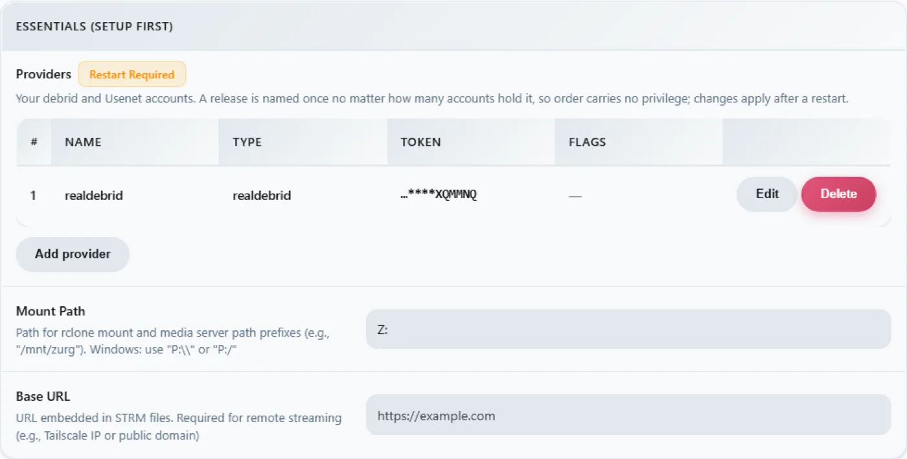

# Windows, el binario, desde cero {#windows-the-binary-from-scratch}

## Opción de una sola línea {#one-line-option}

Ejecuta el bootstrap de patrocinador opcional desde PowerShell. Instala WinFsp mediante UAC, descarga zurg y ejecuta el selector de proveedor y el diagnóstico:

```powershell
irm https://raw.githubusercontent.com/debridmediamanager/zurg-site/main/public/install.ps1 | iex
```

Usa el inicio de sesión de GitHub en el navegador e instala en `$HOME\zurg`. Los binarios y las configuraciones existentes se mantienen en su sitio. Sigue abajo para la ruta manual.

Sin Docker, sin WSL: el `.exe` de zurg en una carpeta, un `config.yml` que escribes una sola vez y una unidad `Z:` en el Explorador.
Esta página recorre todo el proceso en dos pasadas: primero **RealDebrid con el endpoint de qBittorrent** y luego un reinicio completo y **Usenet con el endpoint de SABnzbd**. Elegí estas dos porque son las instalaciones que la gente realmente hace, y porque ejercitan mitades distintas de zurg.

Todo lo que aparece abajo se capturó en una instalación real: Windows 11 Pro 23H2 (build 22631), PowerShell 5.1, WinFsp 2.0.23075, zurg `2026.08.30.0459-nightly-73-g5b4c9790` y una cuenta de Real-Debrid más una cuenta de noticias Usenet. Los nombres de usuario se cambiaron. Las claves de API y los conteos de biblioteca son ilustrativos, igual que cualquier credencial.

## Lo que necesitas {#what-you-need}

- **zurg.exe** — desde las [releases de sponsors](https://github.com/debridmediamanager/zurg/releases). Hazte sponsor en [gatekeeper](https://gatekeeper.debridmediamanager.com/) para dar acceso a tu cuenta de GitHub. Esta página asume que ya lo has descargado.
- **WinFsp** — zurg monta la biblioteca a través de rclone, y rclone necesita WinFsp para usar una letra de unidad en Windows. Instálalo en silencio, o desde el [instalador](https://github.com/winfsp/winfsp/releases):

  ```powershell
  $url = "https://github.com/winfsp/winfsp/releases/download/v2.1/winfsp-2.1.25156.msi"
  Invoke-WebRequest -Uri $url -OutFile "$env:TEMP\winfsp.msi" -UseBasicParsing
  Start-Process msiexec.exe -ArgumentList "/i", "$env:TEMP\winfsp.msi", "/qn", "/norestart" -Wait
  ```

- **Una cuenta** — un token de API de Real-Debrid para la primera parte, y un servidor de noticias para la segunda.

Nada más. El instalador integrado descarga rclone, y ffprobe también, a menos que ya esté en tu PATH.

## Recomendado: deja que zurg termine la configuración {#recommended-let-zurg-finish-the-setup}

Crea una carpeta, mete `zurg.exe` dentro y ejecuta el instalador desde PowerShell:

```powershell
New-Item -ItemType Directory -Force "$HOME\zurg" | Out-Null
Set-Location "$HOME\zurg"
# Copy the downloaded zurg.exe here, then:
.\zurg.exe setup
.\zurg.exe doctor
```

`setup` te pregunta qué proveedores quieres configurar. Elige uno o varios de Real-Debrid, TorBox, AllDebrid, Usenet, Premiumize, Debrid-Link y Offcloud, en orden de prioridad. Solo pide las credenciales de los seleccionados. Después:

1. Crea y valida `config.yml`.
2. Restringe su ACL a tu usuario, SYSTEM y Administrators.
3. Descarga `bin\rclone.exe`, y `bin\ffprobe.exe` a menos que ya haya un ffprobe en tu PATH (en ese caso, `config.yml` dice `ffprobe_binary: ffprobe`).
4. Activa el montaje de rclone en `Z:`.
5. Registra `\Zurg\zurg` como tarea de inicio de sesión interactiva y la arranca cuando haya un usuario de escritorio con sesión iniciada.

Si hace falta, elige otra letra de unidad libre:

```powershell
.\zurg.exe setup --mount-path "Y:"
```

Puedes volver a ejecutar `setup` sin problema. Actualiza la tarea generada, pero no reemplaza un `config.yml` existente.

La tarea interactiva es intencionada. Los montajes de unidad de WinFsp pertenecen a la sesión de inicio de Windows que los crea. Un servicio normal de Windows se ejecuta en la sesión 0 y su unidad es invisible para Plex y el Explorador en el escritorio. Este comportamiento del instalador se verificó en Windows 11 el 4 de septiembre de 2026.

La guía de abajo muestra los archivos y la configuración que hay detrás del instalador y después construye las configuraciones de cliente de descarga para Real-Debrid y Usenet. La primera ejecución manual y la receta de tarea programada son útiles si quieres montar esas piezas tú mismo.

## 1. Primer arranque manual: zurg crea su propia carpeta {#1-manual-first-run-zurg-builds-its-own-home}

Crea una carpeta, pon el binario dentro y ejecútalo una vez sin archivo de configuración:

```powershell
PS C:\Users\you> mkdir C:\Users\you\zurg
PS C:\Users\you\zurg> .\zurg.exe
```

zurg crea una configuración predeterminada neutral respecto al proveedor, te indica qué hacer a continuación y se cierra:

```
INFO  setup  Config file not found, creating default from config.simple.yml
INFO  zurg   Default config created at config.yml
INFO  zurg   Run zurg setup to choose provider(s), or add a providers block to config.yml, then rerun zurg.
```

Ejecuta `.\zurg.exe setup` para seleccionar los proveedores y descargar los auxiliares. Después de setup, la carpeta queda así:

```
C:\Users\you\zurg\
├── bin\                rclone.exe, and ffprobe.exe unless ffprobe was on your PATH
├── data\               library cache, keys, the __magic__ table
├── dump\
├── logs\               zurg.log, rclone.log
├── nzbs\               the Usenet watch directory (second pass)
├── strm\
├── config.yml
└── zurg.exe
```

El `config.yml` generado empieza con una lista de proveedores vacía y dos filtros de directorios. Setup llena la lista según tus elecciones. Los ejemplos manuales de abajo reemplazan esa configuración por la de cada tutorial.

## 2. La pasada de RealDebrid {#2-the-realdebrid-pass}

### La configuración {#the-config}

Sobrescribe `config.yml` con esto: un token de Real-Debrid, el endpoint de qBittorrent activado y el montaje como `Z:`:

```yaml
zurg: v1
providers:
  - type: realdebrid
    token: YOUR_RD_API_TOKEN

directories:
  shows:
    group: media
    group_order: 10
    filters:
      - has_episodes: true
  movies:
    group: media
    group_order: 20
    only_show_the_biggest_file: true

ffprobe_binary: bin\ffprobe.exe   # or ffprobe, if that is what setup wrote
rclone_binary: bin\rclone.exe

rclone_enabled: true
mount_path: "Z:"
rclone_extra_args:
  - "--links"

magic:
  enabled: true

qbittorrent:
  enabled: true
  api_key: ""          # empty = zurg generates one and keeps it
  categories: [tv-sonarr, radarr]
```

Hay tres detalles específicos de Windows:

- **`--links` es opcional, pero conviene mantenerlo.** zurg sirve la biblioteca como una unión de rclone entre una mitad local y una remota, y WinFsp pregunta a la raíz del montaje si es un enlace simbólico en cuanto aparece la unidad. Sin el flag, rclone responde a esa consulta con `ERROR : symlinks not supported without the --links flag: /` y monta igualmente. Medido el 2026-08-31 con zurg `2026.08.31.0443-nightly` y rclone 1.74.2 y 1.75.0: la unidad, ambas mitades de la unión y una escritura en `__magic__` se comportaron de forma idéntica con y sin el flag. Con el flag, la misma consulta registra en su lugar `NOTICE: union root '': Symlinks support enabled`, y rclone manejará enlaces simbólicos reales si algún día pones alguno dentro de `data\local`. Si lo mantienes, el log queda limpio.
- **`mount_path: "Z:"`** aquí es una letra de unidad, no una ruta POSIX. Sirve cualquier letra libre.
- **Mantén `magic.enabled: true`** si algún día quieres que Sonarr o Radarr importen desde esta máquina. Una importación es un renombrado dentro de `__magic__`; sin esta opción, cada importación se convierte en una descarga completa. Lo mismo aplica al paso de Usenet de más abajo.

### Arráncalo y lee el log {#start-it-and-read-the-log}

Inicia zurg de la forma sencilla por ahora: una ventana de PowerShell en la carpeta:

```powershell
PS C:\Users\you\zurg> .\zurg.exe --config config.yml
```

Lo primero que hace es la prueba de red de Real-Debrid: desbloquea enlaces de prueba en cada región de descarga y mide la latencia, lo que tarda unos veinte segundos. Después vienen las líneas importantes:

```
INFO  network_test  Network test completed!
INFO  zurg          Provider realdebrid ready (type=realdebrid)
INFO  router        __magic__ serves sidecar files from data\local\__magic__
INFO  router.qbittorrent  qBittorrent API on /api/v2 and /qbittorrent/api/v2, save path Z:/__magic__/__all__, categories tv-sonarr, radarr
INFO  router.qbittorrent  qBittorrent: generated an API key in data/qbittorrent-apikey — paste it into Sonarr or Radarr's API Key field, or pin one as qbittorrent.api_key in config.yml
INFO  zurg          Starting server on http://[::]:9999
INFO  rclone        rclone started with mount Z:, union local C:\Users\you\zurg\data\local
```

El log nunca muestra la clave en sí. Está en `data\qbittorrent-apikey`. Luego empieza el recorrido por la biblioteca: el primer inicio lee todos los torrents de la cuenta, y en una cuenta grande eso tarda un rato. El recorrido comparte el presupuesto de API del proveedor con todo lo demás de la cuenta. **Mientras recorre la biblioteca, `__magic__` responde *Library is still loading***; es lo esperado, no un fallo.

Puede que veas una advertencia, conocida y no fatal:

| Warning | What it is |
|---|---|
| `Debug logging is enabled` | La configuración generada es detallada por defecto. Añade `log_level: INFO` para silenciarla. |


### El panel {#the-dashboard}

`http://localhost:9999/` — tamaño de la biblioteca subiendo a medida que avanza el recorrido, tráfico servido, memoria. Los **Quick Links** son toda la interfaz: Torrent Manager, Config, Directories, Magic, Logs.


**Config** es donde está todo después de la primera ejecución. El bloque de providers muestra la única cuenta:



El bloque de download-client, con los mismos interruptores que configuras en `config.yml`, editable aquí, y cada cambio marcado con **Restart Required**, que es literal: ambos endpoints registran sus rutas una sola vez al arrancar.


Y el bloque de mount, que muestra la letra de unidad y la supervisión de rclone:


### La unidad Z: {#the-z-drive}

Cuando zurg se ejecuta, `Z:` es un sistema de archivos de escala petabyte en el Explorador:


**Pero solo si zurg se ejecuta donde el Explorador puede verlo, y esa es la única regla realmente propia de Windows en esta configuración.** Un montaje con letra de unidad pertenece a la *sesión de inicio de sesión* que lo creó. Si inicias zurg desde una conexión SSH o desde un servicio, el montaje existe, funciona y tu escritorio no lo ve. Esto no es un error de WinFsp ni de rclone; es la forma en que Windows gestiona las letras de unidad. [La última sección](#keeping-it-running-the-session-rules) tiene la receta que funciona, una tarea programada interactiva, y lo que se midió al probar las alternativas.

### Comprueba el endpoint de qBittorrent {#prove-the-qbittorrent-endpoint}

Las mismas pruebas que en cualquier plataforma, desde cualquier PowerShell:

```powershell
PS> $KEY = Get-Content data\qbittorrent-apikey
PS> Invoke-WebRequest "http://localhost:9999/api/v2/app/webapiVersion"

# the healthy unauthenticated answer is a 403 — "the API is here, log in"
PS> Invoke-RestMethod "http://localhost:9999/api/v2/app/version" -Headers @{ Authorization = "Bearer $KEY" }
v5.0.4
PS> (Invoke-RestMethod "http://localhost:9999/api/v2/app/preferences" -Headers @{ Authorization = "Bearer $KEY" }).save_path
Z:/__magic__/__all__
```

Y añade un torrent. Un archivo `.torrent` se sube con `curl.exe -F` (el `curl` normal en Windows PowerShell es `Invoke-WebRequest`, que no tiene `-F`), o cualquier cliente lo hace por ti:

```
INFO  router.qbittorrent  qBittorrent: added op1176 (dc98af37…) to realdebrid as W7FRRMVJWUOMS
```

La release que capturó esta instalación no estaba en caché en la cuenta, así que la cola del \*arr mostró una descarga real: el progreso subió 2% → 10% → 50% → 75% → 99% en unos seis minutos, con la velocidad que reportó Real-Debrid, y luego:

```
INFO  router.qbittorrent  qBittorrent: op1176 (dc98af37…) finished on realdebrid
```

con el torrent indicando que terminó y una carpeta desde la que importar:

```
"content_path": "Z:/__magic__/__all__/[NanakoRaws] One Piece S01E1176 (THK TV 1080p HEVC AAC)"
```

Leer el archivo a través de `Z:` trajo un megabyte en milisegundos. El read-ahead de VFS de rclone se adelanta al proveedor, así que las lecturas en caliente son tan rápidas como un disco local y los artículos se transmiten por detrás.

Un rechazo que conviene conocer: la primera release que probó esta instalación se llamaba `…WEBRip…`, y Real-Debrid bloquea algunos nombres de release directamente. zurg conoce los patrones y rechaza la petición antes de gastar un slot de añadido:

```
WARN  router.qbittorrent  qBittorrent: realdebrid will not take op1176: it refuses that name outright, so the next account is tried
```

Elige una release con otro nombre y pasará. La [guía de torrents](../guides/sonarr-radarr-torrents.md) explica todo el endpoint a fondo (timeouts, modo solo caché, comportamiento ante fallos), y los ajustes del cliente son los mismos que allí, con dos notas para Windows: **Host** `localhost` si el \*arr corre en la misma máquina, y el \*arr debe correr en la misma sesión de inicio de sesión que zurg para que vea `Z:`. Consulta [las reglas de sesión](#keeping-it-running-the-session-rules).

## 3. Reinicio {#3-reset}

Cambiar la instalación de Real-Debrid a Usenet implica un borrado completo: detén zurg, elimina todo lo que creó la primera configuración y conserva el binario y `bin\` para que las descargas de los auxiliares no se repitan.

```powershell
PS> cd C:\Users\you\zurg
PS> .\zurg.exe service uninstall      # removes the task setup made; or Unregister-ScheduledTask zurg for the manual one, or close the console window
PS> taskkill /IM zurg.exe /F ; taskkill /IM rclone.exe /F
PS> Get-ChildItem -Exclude zurg.exe, bin | Remove-Item -Recurse -Force
PS> Get-ChildItem

bin
zurg.exe
```

Ese `Get-ChildItem -Exclude … | Remove-Item` es todo el reinicio: `config.yml`, `data\`, `logs\`, `nzbs\`, todo. Lo que sobrevive es exactamente lo que necesita una instalación nueva.

## 4. La pasada de Usenet {#4-the-usenet-pass}

### La configuración {#the-config-1}

Misma estructura, distinto proveedor: una cuenta de noticias en lugar de un token de debrid, y el endpoint de SABnzbd en lugar del de qBittorrent:

```yaml
zurg: v1
providers:
  - type: nzb
    nntp:
      host: news.example.usenet.com
      port: 563
      tls: true
      username: YOUR_NEWS_USERNAME
      password: YOUR_NEWS_PASSWORD
      connections: 8

directories:
  shows:
    group: media
    group_order: 10
    filters:
      - has_episodes: true
  movies:
    group: media
    group_order: 20
    only_show_the_biggest_file: true

ffprobe_binary: bin\ffprobe.exe   # or ffprobe, if that is what setup wrote
rclone_binary: bin\rclone.exe

rclone_enabled: true
mount_path: "Z:"
rclone_extra_args:
  - "--links"

magic:
  enabled: true

sabnzbd:
  enabled: true
  api_key: ""          # empty = zurg generates one and keeps it
  categories: [tv, movies]
```

Ocho conexiones son más que suficientes para streaming; el plan de la cuenta indica su propio límite.

### Arráncalo {#start-it}

```powershell
PS C:\Users\you\zurg> .\zurg.exe --config config.yml
```

El contraste con la primera pasada es inmediato: no hay recorrido. Una biblioteca NZB empieza vacía, no hay nada que buscar en ningún sitio hasta que metas un NZB, así que el arranque es la prueba de red, las líneas de los endpoints y la conexión al servidor de news:

```
INFO  nzb       NZB articles are kept in memory for the life of the process (nzb_segments: resident)
INFO  zurg      Provider nzb ready (type=nzb)
INFO  router    __magic__ serves sidecar files from data\local\__magic__
INFO  router.sabnzbd  SABnzbd API on /api and /sabnzbd/api, completed directory Z:/__magic__/__all__, categories tv, movies
INFO  router.sabnzbd  SABnzbd: generated an API key in data/sabnzbd-apikey — paste it into Sonarr or Radarr, or pin one as sabnzbd.api_key in config.yml
INFO  zurg      Starting server on http://[::]:9999
INFO  rclone    rclone started with mount Z:, union local C:\Users\you\zurg\data\local
INFO  zurg      Usenet account nzb connected: nntps://news.example.com:563 (8 connections)
```

zurg se conecta al servidor de news en cuanto arranca y mantiene las conexiones abiertas, TLS incluido. La clave de SABnzbd se guarda en `data\sabnzbd-apikey`.


El panel ahora muestra una biblioteca vacía, y es lo correcto:


El bloque de providers tiene la cuenta de news, y el bloque de download-client ya muestra la parte de SABnzbd:


### Suelta un NZB {#drop-an-nzb-in}

El directorio `nzbs\` es toda la entrada. Pon ahí un NZB, descargado de cualquier indexador, y zurg lo recoge:

```powershell
PS> Copy-Item .\lanterns.nzb C:\Users\you\zurg\nzbs\
```

```
INFO  nzb  Loaded NZB lanterns.nzb: 8 files
```

Esa es la línea que indica que el NZB se analizó bien. La publicación aparece como una carpeta dentro de `__magic__\__all__` en el montaje. Como una publicación de Usenet nombra sus archivos como le apetece al que la subió, el archivo interno puede llamarse, por ejemplo, `J8AZfuVQCD4yPpRIF566Bv0xKoEpYa3M.mkv`. La carpeta de la publicación lleva el nombre del NZB, y los archivos llevan el nombre que les puso el que la subió:


En este punto no se ha descargado nada, y no se descargará nada hasta que algo lea un archivo. La primera lectura del episodio (162 MB) trajo solo los artículos que cubren el rango pedido, los decodificó con yEnc y respondió. Las lecturas siguientes fueron instantáneas porque el VFS ya había leído por adelantado alrededor de ellas. Un remux de 60 GB no ocupa nada de disco, ni en Usenet ni en debrid.

El endpoint de SABnzbd responde a las mismas pruebas de siempre:

```powershell
PS> $KEY = Get-Content data\sabnzbd-apikey
PS> Invoke-RestMethod "http://localhost:9999/api?mode=version&apikey=$KEY&output=json"
{"version":"4.5.1"}
PS> (Invoke-RestMethod "http://localhost:9999/api?mode=get_config&apikey=$KEY&output=json").config.misc.complete_dir
Z:/__magic__/__all__
```

Una clave incorrecta se rechaza en el cuerpo de la respuesta, con un HTTP 200. Así se comporta el propio SABnzbd, y zurg lo copia:

```powershell
PS> Invoke-RestMethod "http://localhost:9999/api?mode=queue&apikey=wrong&output=json"
{"status":false,"error":"API Key Incorrect"}
```

Para el lado del cliente (Sonarr, Radarr, categorías, carpetas raíz bajo `Z:\__magic__`), la [guía paso a paso de Usenet con Sonarr y Radarr](../guides/sonarr-radarr.md) te explica todo. Cada ruta de esa guía se traduce simplemente reemplazando `/mnt/zurg/__magic__` por `Z:\__magic__`. La [guía de Usenet](../guides/usenet.md) cubre las cuentas de bloque, la retención y la reparación.

## Mantenerlo en marcha: las reglas de la sesión {#keeping-it-running-the-session-rules}

| Cómo se inició zurg | El montaje |
|---|---|
| Una ventana de PowerShell que abriste | `Z:` en tu escritorio |
| SSH (`ssh you@machine … zurg.exe`) | Funciona y sirve, pero es **invisible en el escritorio**: la sesión de inicio de sesión de SSH no es la tuya |
| `Invoke-CimMethod Win32_Process Create` desde SSH | Lo mismo: el nuevo proceso hereda la sesión de inicio de sesión del que lo llama |
| PsExec `-i 1` | Proceso en la sesión interactiva, pero en su **propia** sesión de inicio de sesión: el montaje sigue invisible para el escritorio |
| **Una tarea programada interactiva** | **`Z:` en tu escritorio** |

`zurg setup` crea automáticamente la tarea interactiva que funciona. Gestiónala desde el directorio de zurg:

```powershell
.\zurg.exe service status
.\zurg.exe service restart
.\zurg.exe service stop
.\zurg.exe service start
.\zurg.exe service uninstall
```

Detener y reiniciar primero le piden a zurg que se apague de forma ordenada, para que su proceso hijo rclone libere la unidad. `uninstall` elimina la tarea, pero deja el binario, la configuración, los datos, los logs y la caché.

El equivalente manual es una tarea programada que se ejecuta con tu usuario solo cuando tienes la sesión iniciada:

```powershell
$wdir = "C:\Users\you\zurg"
Set-Content "$wdir\start-zurg.cmd" "@echo off`ncd /d $wdir`nzurg.exe --config config.yml"

$action    = New-ScheduledTaskAction -Execute "cmd.exe" -Argument "/c $wdir\start-zurg.cmd"
$trigger   = New-ScheduledTaskTrigger -Once -At (Get-Date).AddSeconds(5)
$principal = New-ScheduledTaskPrincipal -UserId $env:USERNAME -LogonType Interactive
$settings  = New-ScheduledTaskSettingsSet -AllowStartIfOnBatteries -ExecutionTimeLimit ([TimeSpan]::Zero)
Register-ScheduledTask -TaskName "zurg" -Action $action -Trigger $trigger `
  -Principal $principal -Settings $settings -Force
Start-ScheduledTask -TaskName "zurg"
```

Un **desencadenador de inicio de sesión** (`New-ScheduledTaskTrigger -AtLogOn`) en lugar de `-Once` hace que la tarea vuelva a arrancar tras reiniciar el equipo. `ExecutionTimeLimit ([TimeSpan]::Zero)` es importante: sin él, Task Scheduler mata la tarea tras 72 horas.

Dos trampas que medimos en esta máquina:

- **Una consola con `-NoExit` bloquea la ranura de la tarea.** Si el lanzador deja una ventana abierta tras detenerse zurg, el programador considera que la tarea sigue en ejecución y cada `Start-ScheduledTask` posterior se rechaza con `0x800710E0`. Ejecuta `Stop-ScheduledTask zurg` antes de volver a iniciarla, o ejecuta el binario directamente como se indicó arriba para que la tarea termine cuando termine zurg.
- **`Get-PSDrive` en una ventana no desmiente el montaje.** La unidad es visible para los procesos de la *misma sesión de inicio de sesión* (tus aplicaciones de escritorio), no para todas las ventanas de PowerShell que abras. Si `Z:` no aparece en una ventana, comprueba de dónde viene la sesión de esa ventana antes de concluir que el montaje se cayó.

Si no necesitas Explorer en absoluto (una máquina sin interfaz, o clientes que hablan HTTP), nada de esto importa: ejecuta zurg como quieras y apunta a `http://localhost:9999/dav/` o a los endpoints. La regla de sesiones solo afecta a la letra de la unidad.

## Acceder a zurg desde otra máquina {#reaching-zurg-from-another-machine}

Los programas en este PC llegan a zurg en `localhost`. El Firewall de Windows bloquea todo lo demás de tu red hasta que lo permitas. Para Sonarr, Radarr, un servidor multimedia o un navegador en otra máquina, ejecuta esto una vez en PowerShell como administrador (si tienes otro `port:` en `config.yml`, usa ese número):

```powershell
New-NetFirewallRule -DisplayName zurg -Protocol TCP -LocalPort 9999
```

La otra máquina debe usar la dirección IPv4 de este PC, que muestra `ipconfig`, en lugar de `localhost`.

Si sigue sin recibir respuesta, busca una regla que bloquee zurg. Hacer clic en Cancelar en la ventana de Windows para permitir zurg.exe crea una, y una regla de bloqueo tiene prioridad sobre la regla de arriba. Esto elimina esas reglas para `zurg.exe` en `$HOME\zurg`, también como administrador (cambia la ruta si zurg está en otro lugar):

```powershell
Get-NetFirewallApplicationFilter -Program "$HOME\zurg\zurg.exe" | Get-NetFirewallRule | Where-Object Action -eq Block | Remove-NetFirewallRule
```

## Mantener la caché pequeña {#keeping-the-cache-small}

El montaje guarda en disco cada archivo que reproduce, completo, en `data\rclone-cache` dentro de la carpeta de zurg (`$HOME\zurg\data\rclone-cache` si usaste la instalación de una línea). Conserva esos archivos después de que termine la reproducción y puede crecer hasta 256G por defecto.

No cuentes con el límite de antigüedad de 72h para limpiarlo. Las tareas programadas de Plex leen los archivos en caché cada noche, lo que reinicia su antigüedad, así que nunca caducan. El límite de tamaño es el que realmente funciona.

Para usar menos disco, baja el límite en `config.yml`. `rclone_extra_args` es una sola lista, así que añade las nuevas líneas debajo de `--links` que ya tienes, en lugar de escribir un segundo `rclone_extra_args:`:

```yaml
rclone_extra_args:
  - "--links"
  - "--vfs-cache-max-size"
  - "50G"
  - "--vfs-cache-min-free-space"
  - "20G"
```

`--vfs-cache-min-free-space` hace que rclone deje de guardar en caché cuando el disco se acerca a esa cantidad de espacio libre. Después, reinicia zurg:

```powershell
.\zurg.exe service restart
```

rclone recorta la caché hasta el nuevo límite tras el reinicio. Para vaciarla de inmediato, detén zurg primero:

```powershell
.\zurg.exe service stop
Remove-Item -Recurse -Force .\data\rclone-cache\vfs\*, .\data\rclone-cache\vfsMeta\* -ErrorAction SilentlyContinue
.\zurg.exe service start
```

Para comprobar cuánto espacio ocupa realmente, abre las Propiedades de la carpeta `rclone-cache` y lee **Size on disk**. Los archivos descargados parcialmente son dispersos, así que **Size** muestra mucho más de lo que realmente ocupa el disco.

Más detalles en [Disk the mount uses](../reference/config.md#disk-the-mount-uses).

## Actualizar zurg {#updating-zurg}

A sponsor build se reemplaza a sí mismo:

```powershell
cd $HOME\zurg
.\zurg.exe update
.\zurg.exe service restart
```

`update` toma la nightly más reciente, comprueba que la descarga reporta la versión que esperaba antes de reemplazar nada, y mueve el `zurg.exe` en ejecución a un lado para que Windows deje entrar el nuevo. Cuando la build instalada ya es la más reciente, lo indica y no cambia nada. El reinicio ejecuta la build nueva.

En una build demasiado antigua para tener el comando, el instalador hace el mismo trabajo:

```powershell
$env:ZURG_INSTALL_MODE = "update"; irm https://raw.githubusercontent.com/debridmediamanager/zurg-site/main/public/install.ps1 | iex
```

## Solución de problemas {#troubleshooting}

| Lo que ves | Qué significa |
|---|---|
| `Z:` no aparece en el Explorador | La regla de sesión — ver [arriba](#keeping-it-running-the-session-rules). Es probable que el montaje esté bien; revisa primero `http://localhost:9999/http/`. |
| `zurg doctor` dice que la tarea está lista pero no se está ejecutando | No hay ningún usuario interactivo con sesión iniciada. Inicia sesión en el escritorio y ejecuta `.\zurg.exe service start`. |
| `symlinks not supported without the --links flag` | Falta `--links` en `rclone_extra_args`. Es solo cosmético: rclone responde una vez, al subir la unidad, a la prueba de enlaces simbólicos de WinFsp sobre la raíz del montaje. El montaje funciona sin él; añade la opción para silenciar la línea. |
| `Library is still loading` en `__magic__` o `/http/` | La primera ejecución de Real-Debrid recorre la cuenta. Espera. Con una cuenta grande puede tardar casi una hora. Una biblioteca NZB nunca muestra esto: empieza vacía. |
| `realdebrid will not take <name>: it refuses that name outright` | Real-Debrid bloquea algunos nombres de release (`WEBRip` y similares). Usa una release con otro nombre; la configuración está bien. |
| Una adición falla con `could not read back id=…` o con texto de límite de peticiones | Se ha agotado el presupuesto de API de la cuenta. El primer recorrido de la biblioteca puede agotarlo. Otro zurg con el mismo token también puede hacerlo. Deja que el recorrido termine. No compartas un mismo token entre instancias. |
| Inicio de la tarea rechazado, `0x800710E0` | La tarea sigue "running": una ventana del lanzador nunca se cerró. Ejecuta `Stop-ScheduledTask zurg` y luego inicia la tarea. |
| `Get-PSDrive` no muestra `Z:` desde una sesión SSH | Es lo esperado: es otra sesión de inicio. Mira la tabla de sesiones. |
| `data\rclone-cache` no deja de crecer | Es la caché de reproducción del montaje, limitada a 256G por defecto. Mira [Mantener la caché pequeña](#keeping-the-cache-small). |

¿Sigues atascado? Pregunta en el foro **zurg-support** de [Discord](https://discord.com/invite/7u4YjMThXP). [Cómo pedir ayuda](../../guides/remote-help.md) explica qué incluir.

## PowerShell por SSH, para los más orientados a remoto {#powershell-over-ssh-for-the-remote-minded}

Windows PowerShell interpreta mal algunos hábitos de POSIX, y SSH complica el entrecomillado. `&&` no es un separador; `2>/dev/null` no es una redirección; `$_.Property` dentro de un `-Command` en línea llega deformado. Para cualquier cosa no trivial, guárdalo en un `.ps1`, cópialo y ejecuta `powershell -ExecutionPolicy Bypass -File C:\path\script.ps1`. Todo el montaje de esta página se hizo exactamente así.

## Ver también {#see-also}

- [Linux](linux.md), [Docker](docker.md) y [macOS](macos.md): la misma instalación en otras plataformas
- [Sonarr y Radarr para torrents](../guides/sonarr-radarr-torrents.md): el endpoint de qBittorrent de principio a fin, incluidos los ajustes del cliente
- [Sonarr y Radarr](../guides/sonarr-radarr.md): el endpoint de SABnzbd, lo mismo
- [Usenet](../guides/usenet.md): cuentas de noticias, retención, reparación, el backend `nzb` en detalle
- [`__magic__`](../guides/magic.md): el directorio desde el que importan ambos endpoints
