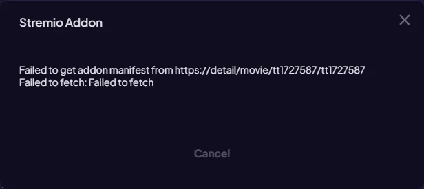

# Utiliser DMM dans Stremio avec DMM Cast {#use-dmm-in-stremio-with-dmm-cast}

DMM Cast est l'addon Stremio de Debrid Media Manager. C'est comme ça que DMM apparaît dans Stremio : tu choisis une release sur DMM, tu appuies sur **Cast**, et Stremio la liste comme un flux qui se lance depuis ton propre compte debrid ou Easynews. En bref : connecte-toi sur DMM, ouvre la page Cast de ton fournisseur, installe l'addon dans Stremio, puis appuie sur **Cast** sur n'importe quel film ou série.

Cast ici désigne l'addon DMM. Ce n'est pas Chromecast ni la mise en miroir de l'écran.

## Ce dont vous avez besoin {#what-you-need}

- Une connexion à DMM avec Real-Debrid, TorBox, AllDebrid, Premiumize, Offcloud, Debrid-Link ou Easynews.
- Stremio. [Stremio Web](https://web.stremio.com) fonctionne sans compte Stremio.

Aucun sponsoring n'est nécessaire.

## Le configurer {#set-it-up}

1. Connecte-toi sur [debridmediamanager.com](https://debridmediamanager.com) avec ton fournisseur. Easynews se connecte depuis **Settings**.
2. Sur la page d'accueil de DMM, appuie sur **Cast for RD**, **Cast for TB** et ainsi de suite. Si tu es connecté à plusieurs comptes, il y a une seule ligne **Cast** avec un bouton par fournisseur. Chaque fournisseur a sa propre page Cast :

   | Fournisseur | Page Cast |
   |---|---|
   | Real-Debrid | [debridmediamanager.com/stremio](https://debridmediamanager.com/stremio) |
   | TorBox | [debridmediamanager.com/stremio-torbox](https://debridmediamanager.com/stremio-torbox) |
   | AllDebrid | [debridmediamanager.com/stremio-alldebrid](https://debridmediamanager.com/stremio-alldebrid) |
   | Premiumize | [debridmediamanager.com/stremio-premiumize](https://debridmediamanager.com/stremio-premiumize) |
   | Offcloud | [debridmediamanager.com/stremio-offcloud](https://debridmediamanager.com/stremio-offcloud) |
   | Debrid-Link | [debridmediamanager.com/stremio-debridlink](https://debridmediamanager.com/stremio-debridlink) |
   | Easynews | [debridmediamanager.com/stremio-easynews](https://debridmediamanager.com/stremio-easynews) |

   

3. Appuie sur **Install (web)**. Stremio Web s'ouvre avec l'addon. Appuie ensuite sur **Install**.

   

   Pour une autre installation de Stremio, copie l'adresse affichée sous les boutons et ajoute-la là-bas. Dans Stremio Web, c'est **Addons** → **Add addon** → colle → **Add** → **Install**. L'adresse est privée et liée à ton compte : ne la partage jamais.

4. Retourne sur DMM, cherche un film ou une série et ouvre-le. Les releases déjà disponibles chez ton fournisseur ont un bouton **Cast** : **Cast (RD)**, **Cast (TB)**, **Cast (AD)**, **Cast (PM)**, **Cast (OC)** ou **Cast (DL)**. Appuie dessus. DMM affiche **Cast started in Stremio** (pour une série, **Casting succeeded.** et le nombre d'épisodes envoyés) et essaie d'ouvrir le titre dans ton app Stremio.

   

5. Ouvre le titre dans Stremio. Ton cast apparaît sous le nom **DMM Cast PM (Yours)** (RD, TB et ainsi de suite pour les autres fournisseurs). Appuie dessus pour lancer la lecture.

   

## Ce que vous obtenez d'autre dans Stremio {#what-else-you-get-in-stremio}

- **DMM Cast PM ✨ · Cast a file inside a torrent** sur chaque film et chaque épisode. Il ouvre ce titre sur DMM, pour que vous puissiez caster une release depuis là.
- Jusqu'à cinq flux supplémentaires provenant des casts d'autres personnes et des releases que votre fournisseur a déjà. Réglez le nombre sous **Other streams limit** sur la page Cast. Les sponsors peuvent le monter à dix.
- Lignes dans le Board de Stremio : **DMM PM Movies** et **DMM PM TV Shows** contiennent vos casts. **DMM PM Library** contient tout ce qui se trouve dans votre compte, et chaque élément s'ouvre avec ses fichiers. Easynews n'a pas de ligne Library.
- Vous ne voulez pas de ces lignes ? Installez plutôt l'addon avec **Without catalogs** → **Install (web)**. Les flux s'affichent quand même.
- **Manage Casted Links** sur la page Cast liste vos casts. Cochez ceux à supprimer (ou **Select All**) et appuyez sur **Delete Selected** pour les retirer de Stremio.
- **Hide "Cast a file inside a torrent" option** sur la page Cast retire la ligne ✨.

Sur Debrid-Link, caster ajoute la release à votre compte. Une release que Debrid-Link n'a pas encore démarre un vrai téléchargement et utilise l'un de vos 50 torrents du jour.

## Quand quelque chose ne va pas {#when-something-is-wrong}

| Ce que tu vois | Quoi faire |
|---|---|
| Après avoir appuyé sur **Cast**, Stremio affiche **Failed to get addon manifest from https://detail/movie/…** et **Failed to fetch: Failed to fetch** | Ton cast a été enregistré. Stremio a pris le lien de DMM vers le titre pour un addon à installer. Appuie sur **Cancel**, ouvre le titre dans Stremio toi-même, et choisis le flux **(Yours)**. |
| Seul **DMM Cast PM ✨ · Cast a file inside a torrent** (RD, TB…) s'affiche, aucun autre flux | Rien n'a encore été casté pour ce titre. Appuie sur cette ligne : elle ouvre le titre sur DMM. Appuie sur **Cast** sur une release, puis rouvre le titre dans Stremio. |
| **⚠️ DMM Cast · Set up DMM Cast for Premiumize again** (ou ton provider) comme seul flux | L'addon dans Stremio ne correspond plus à ta connexion DMM. Appuie dessus pour ouvrir ta page Cast, connecte-toi, puis supprime l'ancien addon de Stremio et réinstalle-le depuis cette page. |
| **Real-Debrid Required. You must be logged in with Real-Debrid to use the Stremio Cast feature.** (ou TorBox, Easynews…) | Tu n'es pas connecté à ce provider sur DMM, ou tu as ouvert la page Cast d'un autre provider. Appuie sur **Login with …**, ou utilise le bouton **Cast for …** sur la page d'accueil de DMM. |
| **No episodes in this release on Premiumize** | DMM n'a pas pu associer les fichiers de cette release à des épisodes. Cast une autre release. |
| L'adresse de l'addon collée dans la barre de recherche en haut de Stremio Web ne fait rien | Cette barre ne sert qu'à chercher. Utilise **Addons** → **Add addon**. |

Bloqué ? Demande sur le forum **dmm-cast-support** sur [Discord](https://discord.com/invite/7u4YjMThXP). [Obtenir de l'aide](../guides/remote-help.md) indique ce qu'il faut inclure.

## Questions

### Puis-je chercher DMM dans Stremio ? {#can-i-search-dmm-in-stremio}

Non. DMM Cast n'ajoute aucune recherche à Stremio, et la recherche de Stremio n'affiche rien venant de lui. Cherche sur [debridmediamanager.com](https://debridmediamanager.com) et appuie sur **Cast**. Depuis un titre déjà ouvert dans Stremio, la ligne ✨ te mène à ce titre sur DMM.

### Ça marche sur ma TV, Fire TV ou mon téléphone ? {#does-it-work-on-my-tv-fire-tv-or-phone}

Les casts sont conservés sur DMM, et non sur l'appareil depuis lequel vous castez. Chaque Stremio qui utilise votre adresse d'addon les affiche. Castez depuis votre téléphone ou votre ordinateur, puis choisissez le flux **(Yours)** dans Stremio là où vous regardez.

### Quels fournisseurs fonctionnent ? {#which-providers-work}

Real-Debrid, TorBox, AllDebrid, Premiumize, Offcloud, Debrid-Link et Easynews. Chacun a sa propre page Cast et son propre addon. Installez-en un pour chaque compte que vous voulez dans Stremio.

### Pourquoi Stremio n'affiche que Cast et aucun stream ? {#why-does-stremio-show-only-cast-and-no-stream}

Rien n'a encore été casté pour ce titre. Appuyez sur la ligne ✨, castez une release sur DMM, puis ouvrez à nouveau le titre dans Stremio.

### Puis-je lire toute ma bibliothèque debrid dans Stremio ? {#can-i-play-my-whole-debrid-library-in-stremio}

Oui. La ligne **DMM Library** sur le Board de Stremio liste tout ce qui se trouve dans ton compte (pas sur Easynews). Ouvre un élément pour voir ses fichiers.

### Ai-je besoin d'un sponsoring ? {#do-i-need-a-sponsorship}

Non. Pour DMM Cast, un parrainage augmente seulement la **Other streams limit** de cinq à dix. Récupère ta clé API DMM sur [gatekeeper](https://gatekeeper.debridmediamanager.com/) et colle-la dans les **Settings** de DMM.
