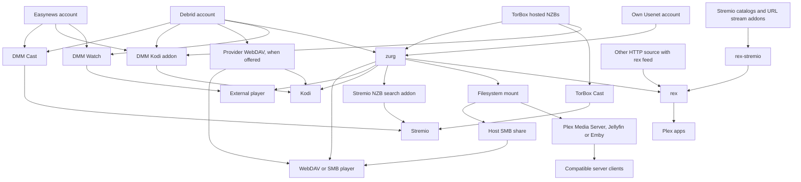
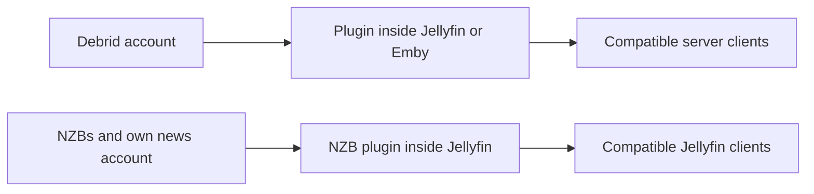
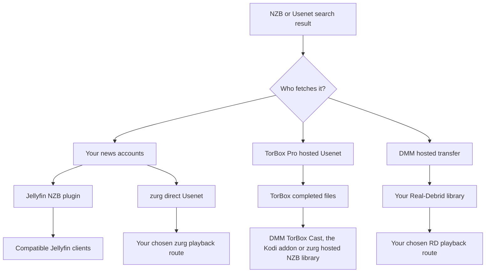

# Quelle configuration dois-je utiliser ? {#which-setup-should-i-use}

**[Trouvez votre configuration avec le questionnaire interactif](https://debridmediamanager.com/choose-your-setup).** Répondez à quelques questions sur vos comptes de lecteur et votre hébergement. Il vous indique les routes, les prérequis et les liens de configuration. Aucune connexion nécessaire.

**Commencez par l'application dans laquelle vous voulez regarder.** Vous n'avez pas besoin de tout. DMM vous aide à choisir les versions. Un fournisseur fournit les fichiers. zurg peut les transformer en une bibliothèque partagée. rex présente une bibliothèque aux applications Plex. Certaines routes sautent une étape.

Cette carte couvre les routes prises en charge, vérifiées le **10 novembre 2026**. Elle inclut des alternatives externes qui suppriment une étape. Les addons et appareils tiers peuvent toujours différer. Suivez le guide lié et ses limites testées.

## Choisissez selon ce que vous utilisez déjà {#pick-by-what-you-already-use}

Sur un téléphone, fais défiler un tableau de côté pour voir toutes ses colonnes.

| J'ai / je veux… | Choisis ce parcours | Pourquoi le choisir ? | Ce que tu prends en charge |
|---|---|---|---|
| Stremio et un compte debrid ou Easynews ; pas de serveur à maintenir | **DMM Cast → Stremio**, ou ton addon de flux existant | Regarde via ton compte sans faire tourner zurg, rex ni un serveur média | L'addon et le fournisseur doivent fournir un flux lisible ; l'appareil gère la lecture |
| Kodi et un compte debrid, Easynews ou TorBox Pro | **Addon Kodi de DMM → ton compte** | Parcours, recherche et lecture dans Kodi ; associe depuis ton téléphone. La bibliothèque TorBox de l'addon inclut les téléchargements NZB hébergés | Kodi gère la lecture. La liste Wanted d'un sponsor a encore besoin de zurg pour traiter les demandes |
| Un seul film à regarder dans mon lecteur habituel | **DMM Watch → lecteur externe** | Pas besoin de serveur de bibliothèque | Installe un lecteur compatible et choisis un fichier qu'il peut lire |
| Infuse, Kodi ou un autre lecteur WebDAV | **WebDAV du fournisseur** sans hôte ; **zurg → lecteur WebDAV** quand un hôte peut rester allumé | Parcours une bibliothèque cloud sans Plex, Jellyfin, Emby ni rex | Real-Debrid, AllDebrid, Premiumize, TorBox et Debrid-Link servent leur propre WebDAV, avec leur propre organisation de dossiers. Offcloud n'en a pas, donc il a besoin de zurg. zurg a besoin d'un hôte qui reste allumé pendant que tu regardes |
| Serveur Plex Media Server déjà fonctionnel | **zurg → dossier monté → Plex Media Server → appli Plex** | Garde ton serveur, ses bibliothèques et tes habitudes de travail | Fais tourner zurg et un montage de système de fichiers à côté du serveur ; les analyses lisent les fichiers distants |
| Applis Plex, mais pas envie de maintenir une bibliothèque montée | **zurg → rex → appli Plex** | zurg fournit la bibliothèque à rex sans montage ni Plex Media Server | Les deux services restent en marche ; vérifie la compatibilité des applis de rex et les consignes sur les comptes |
| Addons Stremio, mais je préfère les applis Plex | **Addons → rex-stremio → rex → appli Plex** | Transforme les catalogues d'addons en bibliothèques Plex ; zurg est facultatif | Fais tourner rex et rex-stremio ; les addons de flux doivent renvoyer des URL lisibles, pas des torrents bruts |
| Jellyfin est la façon dont mes lecteurs accèdent à la bibliothèque | **Plugin du fournisseur dans Jellyfin → client compatible** | Pas de service zurg séparé ni de montage | Jellyfin 12 et le(s) plugin(s) correspondant(s) ; les plugins ont leurs propres limites d'archives |
| Emby est la façon dont mes lecteurs accèdent à la bibliothèque | **Plugin du fournisseur dans Emby → client compatible** | Tout reste dans ton serveur Emby existant | Utilise une version d'Emby prise en charge ; ces six plugins couvrent le debrid, pas Usenet direct |
| Jellyfin/Emby plus des clients qui ont besoin de leur propre accès filesystem/WebDAV | **zurg → montage → Jellyfin/Emby** | Une seule bibliothèque peut servir plusieurs clients | Maintiens le montage et les chemins du serveur ; les autres clients peuvent utiliser zurg directement |
| Fichiers NZB, mon propre compte Usenet et Jellyfin | **Plugin NZB dans Jellyfin → client compatible** | Diffuse les NZB sans service zurg séparé | Accès NNTP et version de Jellyfin prise en charge ; le plugin exclut les membres d'archives compressées/chiffrées et ne répare pas avec PAR2 |
| Un lecteur matériel qui lit des partages SMB | **zurg → montage → partage SMB de l'hôte → lecteur** | Garde le navigateur de fichiers natif du lecteur et sa lecture | L'hôte fournit SMB ; zurg lui-même fournit du WebDAV, pas un serveur SMB |
| Mon propre compte Usenet et Stremio | **Indexeur Newznab → addon Stremio de zurg → Stremio** | Recherche au moment de la lecture et diffuse via ton compte de news | zurg en marche, accès à l'indexeur et identifiants NNTP ; un autre appareil a besoin d'une adresse HTTPS d'addon joignable |
| Un appareil Android/Google TV, sans autre ordinateur | **zurg+rex Android → lecteur sur cet appareil, ou les applis Plex dessus et autour de ta maison** | Fais tourner zurg et rex sur un appareil Android, ton propre serveur Plex sur ton téléphone ou ta box TV, pour cet écran et les applis Plex de ta maison | Accès sponsor, sideloading et fonctionnement en arrière-plan ; Usenet nécessite Android 64 bits ; les NZB hébergés TorBox ne sont pas disponibles sur Android |
| Fichiers déjà sur un disque/NAS | **Serveur média existant ou lecteur réseau** ; **source HTTP → rex** si tu veux rex | Continue d'utiliser les fichiers que tu possèdes ; pas besoin de compte debrid ni Usenet | rex a besoin de métadonnées envoyées via son API de flux et d'un accès HTTP aux fichiers ; le producteur de flux et le serveur de fichiers peuvent être séparés. rex ne scanne pas les disques |
| Média HTTP diffusable ou mon propre serveur HTTP | **Source HTTP + flux rex → rex → applis Plex**, ou un lecteur compatible directement | Utilise une source existante sans debrid ni zurg | rex a besoin d'un producteur de flux qui envoie l'identité et les détails du média ; une simple URL ne fournit pas ces métadonnées |

Pour commencer : [DMM Cast](https://debridmediamanager.com/stremio/) · [Kodi](https://debridmediamanager.com/kodi) · [Réglages DMM](https://debridmediamanager.com/settings) · [Configuration de zurg](../zurg/setup/index.md) · [rex avec zurg](../rex/with-zurg.md) · [rex avec les addons Stremio](../rex/stremio.md) · [Plugins Jellyfin](https://debridmediamanager.com/jellyfin) · [Plugins Emby](https://debridmediamanager.com/emby) · [Addon Stremio de zurg](../zurg/guides/stremio.md) · [Android](../zurg/guides/android.md) · [rex avec n'importe quelle source](../rex/any-source.md).

Le lien Cast commence par Real-Debrid. Utilise la page de configuration pour [TorBox](https://debridmediamanager.com/stremio-torbox/), [AllDebrid](https://debridmediamanager.com/stremio-alldebrid/), [Premiumize](https://debridmediamanager.com/stremio-premiumize/), [Offcloud](https://debridmediamanager.com/stremio-offcloud/), [Debrid-Link](https://debridmediamanager.com/stremio-debridlink/) ou [Easynews](https://debridmediamanager.com/stremio-easynews/) quand tu utilises ce compte. Cast ici désigne l'**addon DMM**. Cela ne veut pas dire Chromecast ni duplication d'écran.

## La carte de lecture {#the-playback-map}

Les flèches signifient « fournit une bibliothèque ou un flux lisible à ». Ce ne sont pas des schémas de routage de paquets : selon la route, le lecteur peut récupérer les données auprès du fournisseur, ou le serveur peut transporter les octets lui-même.

[Ouvrir la carte de lecture en grand format](../assets/setup-routes/playback.svg) pour zoomer ou l'enregistrer.

La branche de recherche NZB de Stremio a besoin d'un compte NZB (`nzb`, ou `torbox_nzb` pour les releases que TorBox possède déjà) et d'un indexeur Newznab. Les NZB hébergés sur TorBox peuvent aussi être lus via TorBox Cast ou l'addon Kodi, sans zurg. La branche mount-to-SMB nécessite un partage séparé configuré sur l'hôte.

Deux routes plus petites méritent d'être gardées à part :

[Ouvrir la carte des plugins en grand format](../assets/setup-routes/plugins.svg).

Les plugins sont des intégrations séparées. Le mot « zurg » dans le nom d'un plugin ne veut **pas** dire que tu dois faire tourner l'application zurg. Il ne promet pas non plus les mêmes fonctionnalités. La bibliothèque de torrents du plugin TorBox est séparée du backend NZB hébergé de zurg.

## Choisissez d'où viennent les fichiers {#choose-where-the-files-come-from}

Un **indexeur** trouve les releases. Un **torrent ou NZB** décrit comment en récupérer une. Un **fournisseur** fournit les données. Un **lecteur** les décode. L'accès à l'un ne donne pas accès aux autres.

| Entrée | Qui obtient/sert la vidéo ? | Ce qu'il te faut | Quand c'est utile |
|---|---|---|---|
| Torrent en cache, magnet ou fichier torrent | Ton fournisseur debrid | Un compte pris en charge par l'intégration que tu as choisie | Souvent l'attente la plus courte quand la release exacte est déjà disponible |
| Torrent non mis en cache | Le fournisseur debrid le télécharge d'abord | Un compte qui accepte le torrent, des sources disponibles et de la place dans ses limites | Une release qui te plaît n'est pas en cache ; attends-toi à un délai et à un échec possible |
| NZB, avec tes propres comptes news | Le backend **Usenet direct** de zurg, ou le plugin NZB de Jellyfin, lit les articles au besoin | Des NZB, un accès NNTP et l'intégration que tu as choisie ; un accès indexeur si tu veux faire des recherches | Choisis tes fournisseurs/backbones, utilise des comptes de secours, évite de stocker les vidéos entières en local |
| NZB, via le service hébergé de TorBox | **TorBox le récupère et le répare**, puis sert les fichiers terminés | TorBox Pro ; envoie via DMM ou le backend **TorBox hosted NZB** de zurg | Tu veux des NZB sans gérer les identifiants de ton serveur news ni le décodage en local |
| Résultat Usenet de DMM envoyé à Real-Debrid | Le service de transfert hébergé de DMM le récupère et le transmet à **ta bibliothèque Real-Debrid** | Real-Debrid et un quota de transfert DMM disponible | Tu regardes déjà via RD et tu veux cette release là-bas ; pas besoin de compte NNTP personnel |
| Résultat de recherche Easynews | Easynews sert un téléchargement/flux HTTP direct | Ton propre compte Easynews | Regarder ou caster depuis DMM, ou utiliser la route Easynews Cast/Kodi, sans construire une bibliothèque NZB |
| Lien de téléchargement HTTP(S) direct | Une source HTTP ou un lecteur compatible, ou un fournisseur qui prend en charge ce téléchargement | Accès à l'URL média réelle ; un compte fournisseur adapté si tu l'importes ou la débloques là-bas | Tu as déjà une URL de fichier plutôt qu'un torrent/NZB |
| Fichiers sur ton disque ou NAS | Ton serveur de fichiers/médias | Stockage local et un lecteur qui peut y accéder | Propriété hors ligne, vidéos personnelles, ou conservation d'une collection existante |

zurg prend en charge **Real-Debrid, AllDebrid, TorBox, Premiumize, Offcloud et Debrid-Link**. Tu peux combiner plusieurs comptes dans une même bibliothèque. Les quotas de cache et la disponibilité des fichiers restent différents. Un badge « en cache » est une indication, pas une garantie de lecture. Voir [fournisseurs](../zurg/providers/index.md).

### « Usenet sans compte Usenet » : quelle voie ? {#usenet-without-a-usenet-account-which-route}

[Ouvre la carte Usenet en taille réelle](../assets/setup-routes/usenet.svg).

**Choisis TorBox hosted NZBs** quand tu veux que TorBox télécharge et répare. DMM lui envoie le NZB. Les nightlies actuelles de zurg utilisent le type de provider `torbox_nzb` et acceptent les NZB du répertoire de surveillance et de l'interface SABnzbd. [TorBox hosted Usenet](../zurg/providers/torbox-nzb.md) explique sa configuration dans zurg. Un cache miss doit finir avant la lecture. Les téléchargements partagent les slots avec les torrents. Les fichiers conservés peuvent expirer, et zurg ne promet pas de récupérer à nouveau une release expirée. Garde le NZB pour une future récupération.

**Choisis direct Usenet** quand zurg doit lire via tes propres comptes de news, y compris les comptes de secours ou de blocs. Il utilise `nzb` avec des identifiants NNTP. Un identifiant de serveur de news TorBox va aussi ici. C'est séparé de TorBox hosted NZBs. Voir [TorBox NNTP](../zurg/providers/torbox-news-server.md) et [ses offres](https://torbox.app/pricing).

**Une instance zurg utilise soit `nzb`, soit `torbox_nzb`.** Les deux gèrent le répertoire de surveillance des NZB. Lance les deux avec des instances et des répertoires de travail séparés. Avec `dmm_api_key` sur les deux, [désactive la source `dmm-wanted` sur l'une](../zurg/guides/dmm-wanted.md#two-zurgs-on-one-key), sinon chaque titre Wanted est récupéré deux fois. Les deux peuvent cohabiter avec des providers torrent. L'addon Stremio de zurg envoie son choix vers le compte NZB que l'instance possède. Avec `torbox_nzb`, seule une release déjà détenue par TorBox démarre pendant l'attente de l'addon, et seulement si aucun autre envoi NZB n'attend.

**Choisis DMM → Real-Debrid** quand tu veux la release dans ta bibliothèque RD. C'est un transfert hébergé avec files d'attente et quotas. Un job non mis en cache prend du temps. Cela n'ajoute pas de support NNTP natif à Real-Debrid ni aux autres providers debrid. Le résultat DMM et [la page Transfers](https://debridmediamanager.com/transfers) affichent la progression.

Avec Easynews, **Watch** et **Cast** lisent ses fichiers HTTP, et **Download NZB** enregistre le NZB de la release. **Send to zurg** envoie ce NZB sur ta liste Wanted de sponsor. Cela demande un backend NZB configuré. Un login Easynews dans DMM ne configure pas le compte NZB de zurg.

### Et les liens HTTP ? {#what-about-http-links}

DMM dans la boîte de dialogue **Add** de TorBox accepte les liens HTTP(S) directs comme téléchargements web. zurg les expose dans `__downloads__`. Un élément présent là-bas n'est pas automatiquement un élément de bibliothèque rex identifié. Les téléchargements non restreints de Real-Debrid peuvent aussi y apparaître. DMM TorBox Cast inclut les téléchargements web et Usenet terminés, ainsi que les torrents. Une page web peut quand même nécessiter une autre intégration, à cause des connexions, des URL qui expirent, du DRM ou de son propre lecteur.

**rex prend en charge les médias HTTP(S) diffusables via son API de flux.** Une [source ou un addon](../rex/any-source.md) envoie l'adresse du média et ses métadonnées. rex les rend ensuite disponibles dans les applications Plex. Le serveur de fichiers et le producteur de flux peuvent être séparés. Aucun compte zurg ou debrid n'est nécessaire. [rex-stremio](../rex/stremio.md) fait cela pour les addons Stremio compatibles. Les magnets bruts et les flux torrent uniquement ne fonctionnent pas. HLS nécessite la configuration FFmpeg de rex. rex utilise l'identité fournie par sa source.

## Décidez comment les titres sont ajoutés {#decide-how-titles-get-added}

Acquisition et lecture sont deux choix séparés. Vous pouvez changer la façon dont un titre est demandé sans remplacer l'application que vous utilisez pour regarder.

| Comment vous choisissez les titres | Itinéraire | Pourquoi l'utiliser ? |
|---|---|---|
| Choisir la version exacte | recherche/bibliothèque DMM → fournisseur ; ou un NZB → votre backend NZB sélectionné | Vous contrôlez vous-même l'édition, la taille et la version |
| Appuyer sur Want, ou suivre une liste Trakt/MDBList | [DMM Wanted](../zurg/guides/dmm-wanted.md) → acquisition zurg | Films et nouveaux épisodes automatiques sans faire tourner Sonarr/Radarr ; sponsoring requis |
| Demandes familiales dans Seerr/Overseerr/Jellyseerr | [Seerr via DMM](../dmm/seerr.md) → Wanted → zurg | Interface de demande familière sans serveur arr ; sponsoring requis. Seerr a besoin d'un serveur Plex, Jellyfin ou Emby pour être configuré |
| Vous avez déjà des listes de suivi Plex ou une pile de demandes | [acquisition zurg](../zurg/guides/acquisition.md) | Gardez votre source de demandes existante ; configurez ses cibles de recherche et de fournisseur |
| Vous voulez un suivi détaillé et des profils de qualité dans Sonarr/Radarr | DMM ou vos indexeurs → arr → interface de client de téléchargement zurg → bibliothèque | Gardez les décisions et le flux d'import d'arr ; plus de services et de configuration des chemins |
| Vous voulez choisir uniquement au moment d'appuyer sur Play | DMM Cast/Kodi, un autre addon de streaming, ou la recherche Stremio de zurg | Pas besoin de préconstruire une bibliothèque gérée de tous les titres |

Pour la route arr recommandée avec DMM + zurg, **DMM est l'indexeur et zurg est le client de téléchargement**. DMM propose [Torznab](https://debridmediamanager.com/torznab) et [Newznab](https://debridmediamanager.com/newznab). Les deux nécessitent un sponsoring actif. Prowlarr est facultatif. zurg fournit les interfaces [qBittorrent](../zurg/guides/sonarr-radarr-torrents.md) et [SABnzbd](../zurg/guides/sonarr-radarr.md). Vous n'avez pas besoin de ces applications de téléchargement en plus de zurg. [zurg peut aussi lancer des recherches pour arr](../zurg/guides/sonarr-radarr-fetch.md).

Si vous voulez des **copies locales complètes**, téléchargez les fichiers depuis votre fournisseur ou zurg. Vous pouvez aussi utiliser la fonction de téléchargement hors ligne d'un lecteur ou un téléchargeur classique avec une bibliothèque sur disque. Vérifiez vos quotas, puis lisez les fichiers sauvegardés sans réseau. Les fichiers virtuels `.strm` de zurg et les [catalogues debrid locaux](../zurg/guides/local-libraries.md) ne sont pas des copies hors ligne. Les catalogues locaux ne stockent que des enregistrements. La lecture dépend toujours du fournisseur.

## Les compromis importants avant l'installation {#the-tradeoffs-that-matter-before-installing}

| Question | Ce qui change ton choix |
|---|---|
| Faut-il qu'une autre machine reste allumée ? | Les routes Cast/Kodi hébergées, le WebDAV des fournisseurs et DMM Watch n'ont pas besoin de ton propre serveur. zurg, rex, rex-stremio et les plugins de serveur multimédia ont besoin de leur hôte pendant que tu regardes. zurg+rex Android peut faire d'un appareil Android l'hôte de zurg et rex ; rex-stremio et les plugins de serveur multimédia ont toujours besoin d'un hôte classique. Un hébergement loué ou géré change qui le fait tourner, pas la route elle-même. |
| Ta TV pourra-t-elle lire le fichier ? | Les routes WebDAV et addons dépendent des codecs, de l'audio et des sous-titres du lecteur. zurg envoie les octets ; ce n'est pas un transcodeur vidéo. Plex Media Server, Jellyfin, Emby ou rex avec FFmpeg peuvent convertir si besoin, avec le matériel et les capacités du serveur ou de l'application adéquats. |
| Combien d'espace disque ? | Le streaming évite de stocker toute la collection. Prévois de la place pour les bases de données, les visuels, les caches et tout travail de réparation, de transcodage ou de téléchargement hors ligne. « Pas de téléchargement complet au départ » ne veut pas dire zéro utilisation du disque. |
| Qui paie la bande passante ? | Les quotas de trafic des fournisseurs s'appliquent toujours. Un proxy serveur transporte le trafic de lecture et utilise sa bande passante sortante ; la lecture directe reporte la connexion sur le spectateur. L'analyse de la bibliothèque peut aussi lire des fichiers distants. |
| Est-ce que ça marchera hors de chez toi ? | Les addons hébergés évitent d'exposer ton propre serveur. Les services auto-hébergés ont besoin d'une adresse accessible de manière sécurisée ; une adresse LAN seule ne fonctionnera pas à distance. Voir [accès distant à rex](../rex/any-source.md#use-it-outside-your-home-optional) et les [consignes HTTPS pour Stremio](../zurg/guides/stremio.md#installing-it-on-another-device). |
| La famille peut-elle l'utiliser en même temps ? | Vérifie les règles d'IP et de simultanéité de ton fournisseur, ainsi que le modèle de partage du serveur. L'utilisation de Real-Debrid doit rester sur une seule IP publique ; des liens directs vers des foyers différents peuvent enfreindre cette règle, même lorsqu'une bibliothèque centrale les a fournis. N'active pas les redirections sans comprendre d'où viennent les téléchargements. |
| Pour quoi paies-tu ? | Garde séparés les abonnements aux fournisseurs, l'accès aux indexeurs, le parrainage DMM, l'hébergement et les achats de lecteur ou de serveur. Le site de base de DMM et rex pour un usage personnel sont gratuits ; il en va de même pour [rex pour Android](https://github.com/debridmediamanager/rex-android). Les nightlies actuelles de zurg et la distribution des plugins de DMM sont des avantages du parrainage ; Wanted et les API d'indexeurs de DMM nécessitent aussi un parrainage. rex-stremio n'en a pas besoin. [Ce que donne un parrainage](sponsorship.md) liste chaque avantage et indique où le configurer. |
| Une entrée de catalogue garantit-elle la lecture ? | Non. Les catalogues d'addons décrivent les titres ; les fichiers cloud peuvent expirer ; les torrents peuvent manquer de sources ; les articles Usenet peuvent être absents. Choisis la route dont le comportement en cas d'échec et d'attente te convient. |

Un client compatible peut aussi être une application tierce. [Infuse se connecte à Plex, Emby et Jellyfin](https://support.firecore.com/hc/en-us/articles/360006462093-Streaming-from-Plex-Emby-and-Jellyfin). Tu n'as peut-être pas besoin d'un montage zurg séparé. Vérifie le plugin et le client ensemble.

Infuse prend en charge le [WebDAV et d'autres partages réseau](https://support.firecore.com/hc/en-us/articles/215090977-Streaming-From-a-Mac-PC-or-NAS). Un fichier `.strm` donne à un lecteur compatible, comme Kodi, une URL. Ce n'est pas un remplacement universel du montage. Vérifie le client et attends-toi à un comportement de proxy et de basculement différent. N'utilise pas `.strm` comme configuration habituelle de Plex Media Server.

Il existe aussi une [ancienne version gratuite de zurg](https://github.com/debridmediamanager/zurg-public/releases). Elle ne fonctionne qu'avec Real-Debrid et utilise un format de configuration différent. Les routes multi-fournisseurs Usenet et Android décrites ici utilisent les nightlies réservées aux parrains.

**rex a ses propres limites de compatibilité.** C'est un serveur d'application Plex indépendant. Ce n'est ni Plex Media Server ni un plugin Plex. Consulte sa [FAQ](../rex/faq.md) pour les appareils testés, le transcodage à distance et la recommandation de compte neuf. Un serveur Plex classique peut tourner à côté de rex.

## Besoins qui peuvent changer la voie {#needs-that-can-change-the-route}

| J'ai aussi besoin de… | Quoi choisir ou vérifier |
|---|---|
| Fichiers locaux et titres cloud ensemble | Garde ton serveur Plex/Jellyfin/Emby existant et ajoute le mount ou le plugin correspondant. rex peut combiner plusieurs sources de flux, y compris une source HTTP pour les fichiers locaux ; il a toujours besoin de leurs métadonnées. |
| Fichiers de sous-titres automatiques | Les sous-titres fournis par le lecteur ou intégrés peuvent suffire. Pour un workflow arr, [Bazarr avec zurg](../zurg/guides/subtitles.md) écrit des fichiers sidecar locaux à côté des vidéos virtuelles ; ces sidecars n'arrivent pas jusqu'à DMM Cast, l'addon Kodi, DMM Watch ou l'addon Stremio de zurg ; ils arrivent jusqu'à Kodi comme source WebDAV de zurg. rex propose aussi Search Subtitles sans Bazarr. |
| Mon historique de visionnage lors d'un changement de serveur | Lis [passer depuis Plex](../rex/from-plex.md) et [importer l'état de visionnage](../rex/import-watched.md) avant de changer ; changer de source ne migre pas automatiquement l'historique de chaque app. |
| Partager une sélection avec quelqu'un qui a son propre compte | Les hashlists DMM partagent des choix de releases que d'autres peuvent ajouter à leurs comptes. Elles ne transfèrent pas tes identifiants et n'hébergent pas la lecture. Partager un serveur est une autre démarche, soumise à ses règles de partage et à celles du fournisseur. |
| Un VPS ou un hôte distant à bande passante limitée | Vérifie si la route fait proxy ou redirige la lecture. [Les paramètres de téléchargement direct de rex](../rex/direct-download.md) expliquent ses options ; les redirections changent l'IP publique du downloader et peuvent exposer les URL des fournisseurs. |

## Autres médias et configurations existantes {#other-media-and-existing-setups}

- **Musique :** [DMM Music](https://debridmediamanager.com/music/) fournit la lecture et les téléchargements dans le navigateur via Real-Debrid. Les [sources musicales de rex](../rex/music.md) alimentent Plexamp et les applications Plex compatibles. Une source peut être un addon ou zurg configuré pour la musique. Ne supposez pas qu'un addon films/séries fournit aussi de la musique.
- **TV en direct :** la [route TV en direct de rex](../rex/live-tv.md) fournit des chaînes et un guide dans les applications documentées. Les chaînes en direct de rex-stremio forment plutôt une bibliothèque de chaînes ; ce n'est pas la même interface de guide. Vérifiez la disponibilité des sources. rex ne fournit pas d'enregistrement DVR.
- **Vidéos personnelles, enregistrements et photos :** utilisez un serveur multimédia existant, ou une [source rex que vous contrôlez](../rex/addons.md). Le [tutoriel vidéos personnelles](../rex/addon-home-videos.md) montre cette seconde option. zurg peut aussi fournir des bandes dessinées à rex sous forme de photos ; le support varie selon les applications.
- **Addons Kodi/Stremio existants :** si le vôtre vous offre déjà l'expérience souhaitée, gardez-le. DMM peut servir à sélectionner et gérer les versions sans remplacer votre lecteur. Le support des fournisseurs, de Usenet et de HTTP varie selon les addons ; la route DMM ne garantit pas la compatibilité avec tous les addons.
- **Un autre montage/téléchargeur debrid déjà installé :** consultez les [choix de migration](../zurg/migrate/index.md) avant de changer. Une configuration qui fonctionne n'a pas besoin d'une couche supplémentaire simplement parce qu'elle existe.
- **Applications natives en développement :** Usenet TV n'est pas une configuration publiée sur un store d'applications que nous recommandons ici. Yomu TV est un projet séparé de lecture et de livres audio, pas une route pour cette pile films/séries. Aucune des deux n'est nécessaire pour les routes ci-dessus.

## Cinq points de départ courants {#five-common-starting-points}

1. **« J'ai Stremio et RD. »** Commencez par DMM Cast. N'ajoutez zurg que si vous voulez une bibliothèque partagée, de l'automatisation ou un autre client qui en a besoin.
2. **« J'ai TorBox Pro et je veux les NZB de ce post. »** Envoyez le NZB à TorBox via DMM. Utilisez TorBox Cast pour regarder dans Stremio, l'addon Kodi pour regarder dans Kodi, ou le backend NZB hébergé de zurg pour alimenter la voie bibliothèque/lecteur que vous avez choisie.
3. **« J'ai déjà Jellyfin. »** Commencez par le plugin de votre fournisseur. Choisissez zurg séparé si vous avez besoin de son système de fichiers partagé, de l'automatisation ou de ses capacités de backend plus larges.
4. **« Je veux les applis Plex, pas de montages, et mes addons existants. »** Utilisez rex-stremio avec rex. Utilisez plutôt zurg comme source si ce que vous voulez exposer est votre bibliothèque debrid/Usenet gérée. Les deux sources peuvent alimenter le même rex.
5. **« J'ai des comptes news et je veux Sonarr/Radarr. »** Utilisez DMM Newznab ou vos indexeurs existants, la voie NZB/SABnzbd de zurg, et une voie de lecture du premier tableau. Pour des fichiers locaux permanents, choisissez un téléchargeur classique ou enregistrez explicitement des copies complètes ; les imports virtuels seuls ne sont pas des fichiers hors ligne.

Toujours dans le doute ? Dites-nous **votre appareil ou lecteur, vos comptes existants, si un hôte peut rester allumé, et si vous voulez une lecture à la demande ou une bibliothèque automatique**. Ces réponses déterminent en général la voie à suivre. [Obtenir de l'aide](remote-help.md) indique où poser vos questions.
