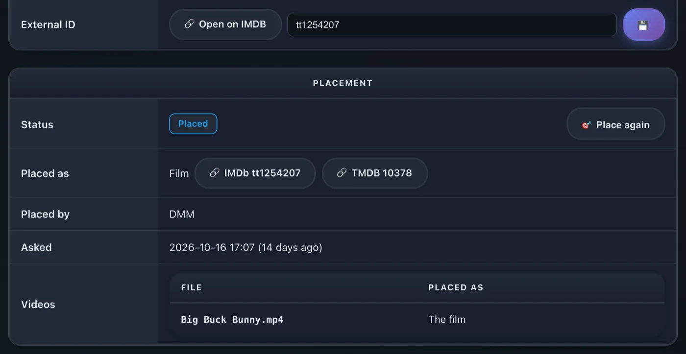

# rex avec zurg {#rex-with-zurg}

[rex](https://rex.debridmediamanager.com/fr/) est un serveur multimédia pour les applications Plex officielles, et il ne possède aucun fichier. Les applications Plex officielles le voient comme un serveur Plex normal. N'importe quelle application peut le alimenter ([rex avec ta propre application](any-source.md)). Cette page le configure avec zurg, qui lui envoie ta bibliothèque debrid. Quand tu appuies sur lecture, rex diffuse le fichier directement depuis zurg. Rien n'est téléchargé au préalable.

Cette page te guide de zéro jusqu'à la lecture d'un film, étape par étape. Chaque étape indique ce qu'elle fait, pourquoi elle compte et ce que tu dois voir avant de passer à la suivante. Si ce que tu vois ne correspond pas, arrête-toi là : l'étape suivante ne corrigera pas le problème.


Quatre choses à savoir avant de commencer :

- **zurg est la partie qui communique avec ton service debrid.** Il liste ce qui se trouve dans ton compte et sert les fichiers.
- **rex est la partie avec laquelle tes applications Plex communiquent.** Il ne conserve aucun fichier et n'a pas besoin de disque pour les médias. Il n'a pas besoin de rclone ni de montage.
- **zurg indique à rex son adresse.** Tu donnes à zurg l'adresse de rex, et zurg s'occupe du reste. Tu ne saisis jamais les détails de zurg dans rex.
- **zurg et DMM décident de ce qu'est chaque fichier ; Plex le décrit.** zurg demande à DMM quel film ou quel épisode correspond à chaque fichier. rex affiche ensuite ce titre avec les affiches et les résumés que les métadonnées de Plex lui donnent, une fois que rex est connecté à un compte Plex. rex ne devine jamais à partir d'un nom de fichier.

rex est gratuit pour un usage personnel (PolyForm Noncommercial) : pas de niveau sponsor et pas de compte nécessaire pour le télécharger. La version nightly de zurg, utilisée dans ce guide, reste une version réservée aux sponsors. [rex avec ta propre application](any-source.md) fait fonctionner rex sans elle. Tu n'as qu'un téléphone ou une box TV ? zurg+rex, un serveur Plex sur ton téléphone, fait tourner zurg et rex ensemble sur celui-ci : voir le [guide Android](../zurg/guides/android.md).

## Avant de commencer {#before-you-start}

| Il vous faut | Pourquoi |
|---|---|
| Une machine qui reste allumée : Linux (Ubuntu 22.04 ou plus récent), macOS, ou Windows (64 bits). Un LXC Proxmox convient, non privilégié c'est très bien, à condition d'avoir activé FUSE pour lui (Options > Features > FUSE) : l'installateur de zurg s'arrête sans `/dev/fuse` | rex et zurg sont des serveurs : vos applis Plex les contactent dès que vous appuyez sur lecture. Quand les commandes changent d'un système à l'autre, chaque étape a un onglet par système. [Docker](#run-rex-in-docker) est plus bas sur la page, pour Linux |
| 1 GB de RAM | Avec 4,062 films et 656 séries (34,678 épisodes), rex a utilisé moins de 500 MB au démarrage et environ 730 MB pendant la navigation dans la bibliothèque ; la conversion vidéo en demande davantage. zurg en demande peu |
| Un compte debrid (Real-Debrid, TorBox, AllDebrid, Premiumize, Debrid-Link, Offcloud) ou Usenet | C'est là que vivent vraiment vos films et séries |
| Un compte GitHub avec accès aux releases sponsor de zurg | La nightly de zurg est une release GitHub privée. [gatekeeper](https://gatekeeper.debridmediamanager.com/) vous donne accès à votre compte quand vous sponsorisez. L'installateur de zurg vous connecte une seule fois |
| Votre clé API DMM, à récupérer sur [gatekeeper](https://gatekeeper.debridmediamanager.com/) une fois que vous sponsorisez (facultatif) | zurg demande à DMM ce qu'est chaque fichier. Sans elle, zurg le déduit du nom de la release, via la recherche de titres gratuite de DMM : moins de titres correspondent, et un animé numéroté sur toute la série reste dans l'ordre des fichiers |
| Un compte Plex tout neuf, créé juste pour rex | rex récupère chaque titre, affiche, résumé et nom d'épisode depuis Plex une fois qu'il est [ajouté à un compte Plex](#step-3-add-it-to-a-plex-account). Jusque-là, les titres gardent leurs noms de fichiers et n'ont pas d'affiches |

Cette page nécessite rex nightly **2026.10.25 ou plus récent** et zurg nightly **2026.10.27 ou plus récent**.

## Étape 1. Installer zurg {#step-1-install-zurg}

**À quoi ça sert.** Télécharge zurg, te demande ton compte debrid et lance zurg comme service, qui redémarre tout seul après un redémarrage.

**Pourquoi c'est important.** Tout ce que rex affiche vient de zurg. Si zurg ne voit pas ta bibliothèque, rex ne la verra jamais.

**Sous Windows et macOS, installe zurg avec l'installeur ci-dessous, pas dans Docker Desktop.** rex lit chaque fichier depuis l'adresse que zurg lui donne, et il ne peut pas atteindre un zurg qui tourne dans Docker Desktop : les titres apparaîtraient, mais rien ne se lancerait.

+++ Linux
```bash
curl -fsSL https://raw.githubusercontent.com/debridmediamanager/zurg-site/main/public/install.sh | bash
sudo loginctl enable-linger "$USER"
```

zurg va dans `~/zurg`. La deuxième ligne garde tes services en marche quand tu te déconnectes.
+++ macOS
```bash
curl -fsSL https://raw.githubusercontent.com/debridmediamanager/zurg-site/main/public/install.sh | bash
```

zurg va dans `~/zurg`. L'installeur installe aussi macFUSE, que macOS peut te demander d'autoriser dans **System Settings**, **Privacy & Security**, suivi d'un redémarrage : [zurg sur macOS](../zurg/setup/macos.md).
+++ Windows
Dans PowerShell :

```powershell
irm https://raw.githubusercontent.com/debridmediamanager/zurg-site/main/public/install.ps1 | iex
```

zurg va dans `$HOME\zurg` (`C:\Users\you\zurg`). L'installeur installe aussi WinFsp, en demandant l'approbation de l'administrateur, et lance zurg à chaque connexion à Windows : [zurg sous Windows](../zurg/setup/windows.md).
+++

L'installeur te demande quels services tu utilises (tape `1` pour Real-Debrid), puis ton token API. Le token est masqué pendant que tu le colles.

**À quoi tu dois t'attendre.** L'installeur se termine par une liste de lignes `PASS` et par `==> zurg is installed in`, suivi du dossier de zurg. zurg charge ensuite ta bibliothèque : quelques secondes pour un petit compte, environ dix minutes pour un compte avec mille releases sur Real-Debrid. Ouvre le tableau de bord de zurg à `http://<this machine>:9999` : **Library Size** affiche le nombre de tes éléments une fois le chargement terminé.

Tu as déjà lancé zurg ? Mets-le à jour et redémarre-le avec `cd ~/zurg && ./zurg update && ./zurg service restart` (sous Windows, `cd $HOME\zurg; .\zurg.exe update; .\zurg.exe service restart`).

## Étape 2. Installer rex {#step-2-install-rex}

**Ce que ça fait.** Télécharge rex dans `~/rex` (`$HOME\rex` sous Windows) et le lance comme service, avec tout ce dont les étapes suivantes ont besoin. Les étapes suivantes ne demandent pas de redémarrage ; seules les sections facultatives plus bas en demandent un.

**Pourquoi c'est important.** rex est ce à quoi vos applications Plex se connectent. Le premier démarrage crée `rex.db`, qui contient vos bibliothèques, tout ce que zurg envoie et votre historique de visionnage.

Sous Linux, vous pouvez plutôt lancer zurg et rex dans Docker : voir [Lancer rex dans Docker](#run-rex-in-docker).

+++ Linux et macOS
```bash
mkdir -p ~/rex && cd ~/rex
TAG=$(curl -fsSL 'https://api.github.com/repos/debridmediamanager/rex/releases?per_page=1' | sed -n 's/.*"tag_name": *"\([^"]*\)".*/\1/p' | head -1)
P=$(uname -s | tr A-Z a-z)-$(uname -m | sed 's/x86_64/amd64/;s/aarch64/arm64/')
curl -fL "https://github.com/debridmediamanager/rex/releases/download/$TAG/rex-$TAG-$P.tar.gz" | tar xz --strip-components=1
```
+++ Windows
En PowerShell :

```powershell
New-Item -ItemType Directory -Force $HOME\rex | Out-Null; cd $HOME\rex
$tag = (Invoke-RestMethod 'https://api.github.com/repos/debridmediamanager/rex/releases?per_page=1')[0].tag_name
curl.exe -fLO "https://github.com/debridmediamanager/rex/releases/download/$tag/rex-$tag-windows-amd64.zip"
tar -xf "rex-$tag-windows-amd64.zip" --strip-components=1; Remove-Item "rex-$tag-windows-amd64.zip"
```
+++

Cette commande télécharge la version la plus récente de rex pour votre machine, généralement une nightly.

Trouvez l'adresse LAN de rex, son adresse sur votre réseau domestique. Sous Linux, `hostname -I` en affiche plusieurs : prenez celle de votre réseau domestique, pas celle qui commence par `172.17.` (Docker) ou `100.` (Tailscale). Sous macOS, `ipconfig getifaddr en0` l'affiche (`en1` si cette commande ne renvoie rien). Sous Windows, `ipconfig` l'indique sous **IPv4 Address**, dans la section de votre adaptateur Wi-Fi ou Ethernet. **Cette page écrit partout `192.168.1.20` : remplacez-le par la vôtre.** Les applications Plex, zurg et vos propres commandes joignent rex à cette adresse.

**Plex Media Server tourne sur la même machine ?** Terminez la commande de démarrage de rex ci-dessous par `--port 32500`, et utilisez `32500` partout où une commande ou un réglage indique `32400`, y compris dans la règle du pare-feu Windows. Plex occupe déjà le port 32400 et les ports que les applications utilisent pour trouver les serveurs. Sur un autre port, rex ne touche pas à ces ports, qui restent à Plex. Vos applications affichent alors deux serveurs portant le nom de la machine : rex est celui partagé avec vous, accompagné du nom du compte tout neuf. Une fois rex rattaché à son compte Plex ([étape 3](#step-3-add-it-to-a-plex-account)), vous pouvez le renommer : connecté à Plex avec ce compte, ouvrez **Settings** de rex, **General**, modifiez **Friendly name** et enregistrez, puis redémarrez rex comme indiqué ci-dessous. Les applications Plex l'affichent sous le nouveau nom après le redémarrage.

Maintenant, faites-en un service :

+++ Linux
Créez `~/.config/systemd/user/rex.service` :

```bash
mkdir -p ~/.config/systemd/user
nano ~/.config/systemd/user/rex.service
```

```ini
[Unit]
Description=rex
After=network-online.target

[Service]
WorkingDirectory=%h/rex
EnvironmentFile=-%h/rex/rex.env
ExecStart=%h/rex/rex
Restart=always
RestartSec=5

[Install]
WantedBy=default.target
```

```bash
systemctl --user daemon-reload
systemctl --user enable --now rex
journalctl --user -u rex -f
```

La **commande de démarrage** de rex est la ligne `ExecStart`, et les clés vont dans `~/rex/rex.env`, une ligne `NAME=value` par clé. Après une modification, `systemctl --user daemon-reload && systemctl --user restart rex` redémarre rex. `journalctl --user -u rex -f` affiche son journal.
+++ macOS
`run.sh` lance rex dans son dossier, et un LaunchAgent lance `run.sh` à votre connexion :

```bash
cp ~/rex/examples/run.sh.example ~/rex/run.sh
mkdir -p ~/Library/LaunchAgents
cat > ~/Library/LaunchAgents/com.rex.plist <<PLIST
<?xml version="1.0" encoding="UTF-8"?>
<!DOCTYPE plist PUBLIC "-//Apple//DTD PLIST 1.0//EN" "http://www.apple.com/DTDs/PropertyList-1.0.dtd">
<plist version="1.0"><dict>
  <key>Label</key><string>com.rex</string>
  <key>ProgramArguments</key><array><string>/bin/bash</string><string>$HOME/rex/run.sh</string></array>
  <key>RunAtLoad</key><true/><key>KeepAlive</key><true/>
  <key>StandardOutPath</key><string>$HOME/rex/rex.log</string>
  <key>StandardErrorPath</key><string>$HOME/rex/rex.log</string>
</dict></plist>
PLIST
launchctl load ~/Library/LaunchAgents/com.rex.plist
tail -F ~/rex/rex.log
```

La **commande de démarrage** de rex est la dernière ligne de `~/rex/run.sh`, et les clés vont dans `~/rex/rex.env`, une ligne `NAME=value` par clé. Après une modification, `launchctl kickstart -k gui/$(id -u)/com.rex` redémarre rex. `tail -f ~/rex/rex.log` affiche son journal.

rex tourne tant que vous êtes connecté au Mac. Pour un Mac qui redémarre tout seul, activez la connexion automatique (**System Settings**, **Users & Groups**). Si le pare-feu macOS est activé, autorisez rex quand macOS le demande, ou ajoutez `~/rex/rex` dans les **Options** du pare-feu.
+++ Windows
Ouvrez PowerShell **en tant qu'administrateur** et allez dans le dossier de rex avec `cd $HOME\rex`. Créez d'abord `run.cmd`, qui lance rex dans son dossier et écrit son journal dans `rex.log`. Le Bloc-notes propose de créer le fichier :

```powershell
notepad run.cmd
```

```bat
@echo off
cd /d "%~dp0"
rex.exe 2>> rex.log
```

Enregistrez. Puis autorisez votre réseau à travers le pare-feu Windows pour le port de rex et les deux ports de découverte, et lancez rex maintenant et à chacune de vos connexions :

```powershell
New-NetFirewallRule -DisplayName rex -Protocol TCP -LocalPort 32400
New-NetFirewallRule -DisplayName "rex discovery" -Protocol UDP -LocalPort 32410,32414
$settings = New-ScheduledTaskSettingsSet -ExecutionTimeLimit 0 -AllowStartIfOnBatteries -DontStopIfGoingOnBatteries
Register-ScheduledTask rex -Action (New-ScheduledTaskAction -Execute "$HOME\rex\run.cmd") -Trigger (New-ScheduledTaskTrigger -AtLogOn -User $env:USERNAME) -Settings $settings
Start-ScheduledTask rex; Start-Sleep 3
Get-Content rex.log -Wait
```

La **commande de démarrage** de rex est la ligne `rex.exe` de `run.cmd`, et les clés vont au-dessus, une ligne `set NAME=value` par clé. Après une modification, `Stop-Process -Name rex; Start-Sleep 1; Start-ScheduledTask rex` redémarre rex. `Get-Content $HOME\rex\rex.log -Wait` affiche son journal.

Vous avez lancé rex à la main dans PowerShell ? Alors son journal n'existe que dans cette fenêtre, sans `rex.log`, et aucune tâche ne le relance après un redémarrage. rex garde sa base de données et sa liaison dans le dossier où il démarre : un rex lancé depuis un autre dossier est donc un nouveau serveur, sans liaison. Arrêtez-le avec Ctrl+C, puis relancez-le depuis le dossier de rex avec les mêmes options, ou mieux, mettez en place la tâche ci-dessus.

rex tourne tant que vous êtes connecté à Windows, dans sa propre fenêtre : laissez-la ouverte. Dans PowerShell, tapez `curl.exe` partout où cette page écrit `curl` : la commande `curl` de Windows PowerShell est une autre commande.
+++

**Ce que vous devriez voir.** Parmi les premières lignes :

```
INFO    seeded rex.db: an empty library named yourhost, machine=...
INFO    no source yet: a source registers itself once pointed at this server (PUT /rex/sources/{name}, docs/feed-api.md)
INFO    claim state: unclaimed
INFO    rex on http://192.168.1.20:32400  machine=...  items=0  parts=proxy
```

rex se nomme d'après la machine ; vos applications Plex affichent ce nom. `no source yet` est normal : zurg n'a pas encore été configuré pour rex. Laissez le journal ouvert.

## Étape 3. L'ajouter à un compte Plex {#step-3-add-it-to-a-plex-account}

**Ce que ça fait.** Enregistre rex sur un compte Plex, comme vous le feriez avec un vrai Plex Media Server, et le partage avec votre propre compte.

**Pourquoi c'est important.** rex récupère le nom, l'affiche, le résumé et les noms des épisodes de chaque titre à partir des métadonnées de Plex elles-mêmes, et il ne peut interroger Plex qu'une fois rattaché à un compte. Les titres envoyés par zurg avant l'enregistrement sont nommés dès qu'il est effectif. Cela permet aussi à Fix Match de fonctionner, supprime l'avis « unclaimed » et est nécessaire avant d'[utiliser rex en dehors de chez vous](#use-it-outside-your-home-optional).

**Utilisez un compte Plex neuf pour cette étape, pas le vôtre.** rex n'est pas fourni par Plex, et Plex pourrait prendre des mesures contre un compte qui enregistre rex. Gardez votre compte habituel, avec son historique de visionnage, ses amis et tout Plex Pass éventuel, à l'abri : créez un nouveau compte gratuit sur [plex.tv](https://www.plex.tv) avec une adresse e-mail que vous n'utilisez nulle part ailleurs, enregistrez rex sur celui-ci, puis partagez rex avec votre propre compte. Vous regardez ensuite connecté avec votre compte habituel, comme vous le feriez sur le serveur d'un ami. rex ne lit rien tant que cette étape n'est pas terminée.

### Enregistrer rex sur le nouveau compte {#register-rex-on-the-fresh-account}

1. Connecte-toi à [plex.tv](https://www.plex.tv) **avec le compte tout neuf**, ouvre [plex.tv/claim](https://www.plex.tv/claim) et copie le code. Il expire au bout d'environ cinq minutes.
2. Sur la machine rex (`curl.exe` sous Windows) :

   ```bash
   curl -X POST "http://192.168.1.20:32400/myplex/claim?token=claim-xxxxxxxxxxxx"
   curl -s http://192.168.1.20:32400/identity
   ```

**Ce que tu devrais voir.** La deuxième commande affiche `claimed="1"`, et `claim_state.json` existe dans le dossier de rex. Fais une sauvegarde de ce fichier : sans lui, il faut refaire une revendication avec un nouveau code. Tant qu'il existe, rex refuse une deuxième revendication.

### Le partager avec votre propre compte {#share-it-with-your-own-account}

1. Toujours connecté avec le compte neuf, ouvre [app.plex.tv](https://app.plex.tv), puis **Settings** (la clé à molette), **Manage Library Access** et **Grant Library Access**.
2. Saisis le nom d'utilisateur ou l'e-mail de ton propre compte, choisis le serveur rex et les deux bibliothèques, **Movies** et **TV Shows**, puis envoie l'invitation.
3. Déconnecte-toi, connecte-toi avec **ton propre compte**, et accepte l'invitation. Elle arrive par e-mail et dans app.plex.tv.


**Ce que tu dois voir.** Une fois connecté avec ton compte, les applications Plex affichent le serveur rex à côté de tes propres serveurs, avec les deux bibliothèques, vides jusqu'à l'étape suivante. Ton historique de visionnage sur rex t'appartient : il est séparé de celui du compte neuf. Partage-le de la même façon avec les autres personnes de ton foyer.

## Étape 4. Connecter zurg à rex {#step-4-connect-zurg-to-rex}

**Ce que ça fait.** Indique à zurg où se trouve rex. zurg se présente à rex, lui envoie toute sa bibliothèque, lit les détails vidéo et audio de chaque fichier et les envoie aussi, puis envoie chaque changement au fur et à mesure.

**Pourquoi c'est important.** C'est le seul lien entre les deux. rex n'a aucun réglage pour zurg : si `rex_url` manque, rex reste vide. `rex_url` est toujours l'adresse `http://` simple de rex sur ton réseau, jamais une adresse HTTPS de [Utiliser hors de chez toi](#use-it-outside-your-home-optional) : rex n'accepte les envois de zurg que depuis tes propres réseaux ([Garder le port privé](#keep-the-port-private)). Ta clé DMM permet à zurg de demander à DMM quel film ou quel épisode correspond à chaque fichier ; sans clé, zurg le devine à partir du nom, et moins de titres correspondent.

zurg ne démarre pas deux fois avec la même clé, et le tableau de bord de zurg écrit `dmm_api_key` dans sa configuration quand tu y saisis ta clé. Sans clé DMM, ne mets pas `dmm_api_key`.

+++ Linux et macOS
Commence par vérifier si la configuration de zurg contient déjà l'une de ces lignes :

```bash
grep -n '^rex_url:\|^dmm_api_key:' ~/zurg/config.yml
```

Si une ligne s'affiche, cette clé est déjà définie : modifie-la là avec `nano ~/zurg/config.yml` et ne l'inclus pas dans le `printf` ci-dessous.

```bash
printf '\nrex_url: http://192.168.1.20:32400\ndmm_api_key: your_dmm_key\n' >> ~/zurg/config.yml
cd ~/zurg && ./zurg service restart
```
+++ Windows
Ouvre la configuration de zurg avec `notepad $HOME\zurg\config.yml`. Si elle contient déjà une ligne `rex_url:` ou `dmm_api_key:`, modifie cette ligne ; ajoute les autres à la fin :

```yaml
rex_url: http://192.168.1.20:32400
dmm_api_key: your_dmm_key
```

Enregistre-le et redémarre zurg :

```powershell
cd $HOME\zurg; .\zurg.exe service restart
```
+++

**Ce que tu dois voir.** Une fois que zurg a de nouveau chargé la bibliothèque, le journal de zurg (`~/zurg/logs/zurg.log`, sous Windows `$HOME\zurg\logs\zurg.log`) affiche `DMM placed N releases` (sans clé DMM : `Placed N releases by their names (no DMM sponsor key)`) et le journal de rex affiche :

```
INFO    SOURCES zurg registered at http://192.168.1.20:9999/dav
INFO    SOURCES PUT /rex/sources/zurg -> 200
INFO    FEED zurg upsert: 0 created, 0 updated, 200 held, 0 unchanged, 0 rejected
INFO    FEED identified "Sintel.mp4" -> movie tmdb:45745 (placed)
INFO    FEED zurg upsert: 2 created, 0 updated, 0 held, 0 unchanged, 0 rejected
```

rex lit chaque fichier à l'adresse indiquée dans la ligne `registered at`, il doit donc pouvoir atteindre zurg à cette adresse. rex réécrit cette ligne seulement quand l'adresse change.

`held` signifie que zurg n'a pas encore lu les détails de ce fichier. zurg commence à les lire dès que sa bibliothèque est chargée, une release à la fois, et les épisodes d'un pack de saison arrivent ensemble. Avec une clé DMM, jusqu'à environ 20 releases par minute viennent des détails stockés chez DMM. Une grande bibliothèque se remplit en plusieurs heures. Chaque titre apparaît dans rex au fur et à mesure que ses détails arrivent. Tout ce que tu ajoutes plus tard à ton compte debrid apparaît tout seul une fois que zurg l'a lu.

**Si ce n'est pas le cas.**

- Rien du tout dans le journal de rex : zurg charge encore sa bibliothèque, zurg est périmé (mets-le à jour comme à l'[étape 1](#step-1-install-zurg)), ou `rex_url` contient une faute de frappe. `grep 'rex feed' ~/zurg/logs/zurg.log | tail -n 5` affiche le côté de zurg (sous Windows, `Select-String 'rex feed' $HOME\zurg\logs\zurg.log | Select-Object -Last 5`) : sans ligne `rex feed: pushing the library to ...`, zurg n'a pas lu `rex_url`, et `rex feed: snapshot failed, retrying in ...` signifie qu'il ne peut pas atteindre rex à cette adresse.
- Un titre reste `held` et zurg écrit `Cannot probe file ...` : la première lecture depuis le service debrid a échoué. zurg réessaie tout seul ; **Analyze & Tag Library** sous **Utilities** sur le tableau de bord de zurg relance la tentative immédiatement.

  

- Les titres arrivent mais aucune ligne `identified` : zurg n'a pas pu les associer par nom, et avec `dmm_api_key` défini il écrit `DMM refused the API key for placement` quand la clé n'est pas celle d'un sponsor. zurg associe alors par nom et réessaie la clé un jour plus tard, ou tout de suite au redémarrage.
- Les titres apparaissent mais rien ne se lance : rex ne peut pas atteindre zurg à l'adresse `registered at`. La ligne `upstream failed` de [Quand quelque chose ne va pas](#when-something-is-wrong) permet de le vérifier.

Tu fais tourner plusieurs zurg (un par service debrid) ? Donne à chacun son propre nom avec une ligne supplémentaire, `rex_source: rd`, `rex_source: tb`, etc. Ils remplissent les mêmes bibliothèques.

### Pourquoi DMM place les fichiers {#why-dmm-places-the-files}

Les noms de fichiers numérotent souvent les épisodes différemment des listes d'épisodes affichées par les apps Plex. DMM sait où chaque fichier appartient vraiment :

| Release | Nommé | Où il est vraiment |
|---|---|---|
| `[Erai-raws] Hibike Euphonium 3 - 01` | saison 1, épisode 1 | Sound! Euphonium saison 3, épisode 1 |
| `[HorribleSubs] One Piece - 486` | épisode 486 | saison 13, épisode 486 |
| `Firefly.S01E02.The.Train.Job` (ordre DVD) | épisode 2 | épisode 1, « The Train Job » |

Un fichier que zurg ne peut pas placer reste non associé : un film intitulé comme son fichier, ou un épisode d'une série nommée d'après sa release, numéroté dans l'ordre des fichiers. Si vous avez une clé DMM, zurg redemande à DMM un jour plus tard. Vous pouvez aussi corriger vous-même avec **Fix Match** dans une app Plex, connecté avec le nouveau compte qui possède rex (rex le refuse aux comptes avec lesquels il est partagé). Un titre que vous avez corrigé avec Fix Match reste tel que vous l'avez défini.


Le tableau de bord de zurg montre ce qu'il a fait de chaque release : ouvrez la release dans **Torrent Manager** et regardez **Placement**. **Place again** demande une nouvelle fois à DMM, et un identifiant IMDb saisi dans **External ID** place la release grâce à cet identifiant.



## Étape 5. Regarder quelque chose {#step-5-watch-something}

**Ce que ça fait.** Ouvre rex dans une appli Plex, comme tu ouvrirais n'importe quel serveur Plex.

**Pourquoi c'est important.** C'est le but de toute la configuration. Ça valide aussi le dernier maillon : rex lit un fichier depuis zurg pendant que tu regardes.

Ouvre une appli Plex (pas un navigateur web) sur un téléphone, une TV ou un ordinateur **sur le même réseau domestique**. rex apparaît sous le nom de la machine, avec **Movies** et **TV Shows**. Choisis un film et appuie sur lecture.


À la maison, rien d'autre n'est nécessaire : les applis Plex trouvent rex grâce à la découverte locale de Plex et se connectent via ton réseau. Il faut que l'appareil soit sur le même réseau que rex (pas un Wi-Fi invité ni un VLAN séparé). La découverte utilise les ports UDP 32410 et 32414, donc un pare-feu sur la machine de rex doit les laisser passer (sous Windows, les règles de pare-feu de l'étape 2 s'en chargent). rex répond à la découverte quand il utilise le port 32400. Si tu as déplacé rex sur 32500 parce que Plex tourne sur la même machine, la découverte est laissée à ce Plex, et les applis trouvent rex via le compte Plex [avec lequel il est partagé](#share-it-with-your-own-account). app.plex.tv dans un navigateur web fonctionne aussi à la maison, via l'adresse HTTPS que [rex-direct](#rex-direct) donne à rex une fois revendiqué (rex nightly 2026.11.02 ou plus récent). La première fois, Chrome demande si app.plex.tv peut accéder aux appareils de ton réseau local : autorise-le. `http://192.168.1.20:32400/web` n'est pas Plex Web : rex n'a pas d'appli web à lui, et cette page indique seulement si rex est revendiqué et où regarder.

**Ce que tu devrais voir.** Affiches, titres et années comme sur n'importe quel serveur Plex, et le film se lance.

Tu peux rencontrer deux choses :

- **« yourhost server is unclaimed and not secure ».** Une appli Plex dit ça de tout serveur qui n'est pas sur un compte Plex, et rex ne lit rien tant qu'il n'y est pas. Fais l'[étape 3](#step-3-add-it-to-a-plex-account). N'appuie pas sur **Claim it now** en étant connecté avec ton propre compte : ça enregistre rex sur ton compte.
- **« This server is not powerful enough to convert video ».** Si chaque titre échoue sur chaque appareil, regarde le journal de rex juste après avoir appuyé sur Lecture : `upstream failed` ou `502` là signifie que rex ne peut pas joindre zurg, et FFmpeg n'y changera rien. La ligne `upstream failed` de [Quand quelque chose ne va pas](#when-something-is-wrong) dit quoi faire. Si seuls certains fichiers échouent, souvent seulement dans un navigateur web, l'appareil ne peut pas les lire tels quels, souvent à cause du son AC3 ou DTS. Les applis Plex sur TV et téléphones lisent la plupart des fichiers tels quels. Pour tout lire partout, configure la [Conversion vidéo](#converting-video-optional).

Les dossiers de zurg autres que `movies` et `shows`, comme `anime`, ne demandent rien : chaque fichier va dans **Movies** ou **TV Shows** selon ce que zurg dit qu'il est. Un fichier que zurg ne peut pas identifier comme épisode reste dans **Movies**.

Pour donner à l'un de ces dossiers ses propres bibliothèques, ajoute `rex_movies` sous lui dans le `config.yml` de zurg pour un dossier de films, `rex_shows` pour un dossier de séries, et les deux seulement s'il contient les deux, à côté de ses filtres, puis redémarre zurg comme à l'[étape 4](#step-4-connect-zurg-to-rex). Chacune crée une bibliothèque, même vide, donc un dossier de films avec `rex_shows` obtient une bibliothèque TV vide. DMM place certains fichiers d'un dossier comme films et d'autres comme épisodes, et le type sans titre propre va dans **Movies** ou **TV Shows** :

```yaml
directories:
  anime:
    rex_shows: Anime
    rex_movies: Anime Movies
  films:
    rex_movies: Films
```

Une fois zurg chargé, rex crée **Anime**, **Anime Movies** et **Films** et y déplace ce qu'il montrait déjà depuis `anime`, tel quel : historique de visionnage, Fix Match et modifications compris. Une page Plex Web ouverte les liste tout de suite sous **More** dans sa barre latérale, où tu peux les épingler. Partage-les avec ton propre compte comme à l'[étape 3](#share-it-with-your-own-account). Renomme-les comme tu veux dans une appli Plex. Si tu en supprimes une, elle reste supprimée, ses fichiers retournant dans **Movies** ou **TV Shows**, jusqu'à ce que tu la rajoutes avec **Add Library**, dont la liste de dossiers montre ceux de zurg. Retirer `rex_shows` ou `rex_movies` de la config de zurg plus tard garde la bibliothèque créée par rex pour lui, vide ou non : supprime-la dans une appli Plex, connecté avec le compte dédié. Si une bibliothèque n'apparaît pas, le journal de zurg ou celui de rex dit pourquoi.


!!!warning Supprimer dans une appli Plex supprime de ton compte debrid
Connecté avec le compte dédié, **Delete** sur un film ou un épisode supprime aussi son fichier chez zurg, et zurg retire le torrent de ton compte debrid dès qu'il ne reste plus aucun de ses fichiers. Les comptes avec lesquels rex est partagé, le tien compris, ne peuvent pas supprimer. Pour désactiver la suppression : dans app.plex.tv avec le compte dédié, ouvre **Settings**, la **Library** du serveur rex, **Show Advanced**, décoche **Allow media deletion** et enregistre. rex refuse alors toute suppression.
!!!


Un titre qui quitte ton compte debrid d'une autre façon, retiré là-bas ou par zurg, va dans la corbeille de la bibliothèque dans rex, comme dans Plex : il reste, indisponible, avec son historique de visionnage, et revient tel quel si zurg le récupère à nouveau. **Empty Trash** sur la bibliothèque le supprime définitivement, et **Empty trash automatically after every scan** (Settings, Library) le fait tout seul ; cette option est désactivée par défaut.

**Sauvegarde** `rex.db` dans le dossier de rex (il contient ta bibliothèque, l'historique de visionnage et la connexion à zurg, donc garde-le privé) et, une fois qu'ils existent, `claim_state.json` et `rex-direct.json` (la revendication, et la clé de certificat de rex-direct) :

+++ Linux et macOS
```bash
sudo apt install -y sqlite3    # once, on Linux; macOS has it
mkdir -p ~/rex-backup
sqlite3 ~/rex/rex.db ".backup $HOME/rex-backup/rex.db"
cp ~/rex/*.json ~/rex-backup/
```
+++ Windows
Windows n'a pas `sqlite3`, donc arrête rex un instant et copie `rex.db` avec les deux fichiers à côté qui commencent pareil :

```powershell
Stop-Process -Name rex; Start-Sleep 1
New-Item -ItemType Directory -Force $HOME\rex-backup | Out-Null
Copy-Item $HOME\rex\rex.db*, $HOME\rex\*.json $HOME\rex-backup
Start-ScheduledTask rex
```
+++

Avec Docker, les fichiers sont dans `~/rex/config`, lisibles par root seulement. Sauvegarde depuis l'intérieur du conteneur avec `docker exec rex sqlite3 /config/rex.db ".backup /config/rex.db.bak"`, puis `mkdir -p ~/rex-backup && sudo cp ~/rex/config/rex.db.bak ~/rex/config/*.json ~/rex-backup/`.

[Restaurer une sauvegarde](#restore-a-backup) les remet en place.

Tu as fini. Les sections ci-dessous sont facultatives.

## Utiliser rex hors de chez vous (facultatif) {#use-it-outside-your-home-optional}

**Ce que ça fait.** Donne à rex une adresse HTTPS que les applis Plex utilisées hors de chez vous peuvent atteindre, et la déclare à plex.tv.

**Pourquoi c'est important.** Hors de chez vous, app.plex.tv ne se connecte qu'à une adresse HTTPS, et les autres applis Plex préfèrent ce type d'adresse. Un vrai serveur Plex peut se rabattre sur le relais de Plex ; rex ne le peut pas, donc c'est à vous de choisir comment il est accessible. rex doit d'abord être [claimed](#step-3-add-it-to-a-plex-account), et un proxy exposé à Internet doit bloquer `/rex/` ([Keep the port private](#keep-the-port-private)).

**Plex Pass.** Plex Web lit hors de chez vous sans Plex Pass ni Remote Watch Pass sur aucun des deux comptes. Les autres applis Plex n'ont pas été testées hors de chez vous.

Quelle que soit l'option choisie, chaque octet que vous regardez hors de chez vous sort par le débit en **upload** de votre connexion domestique. Un upload de 20 Mbit/s suffit confortablement pour un 1080p WEB-DL, mais pas pour un remux.

### Lequel utiliser {#which-one-to-use}

| Votre situation | Utiliser | Pourquoi |
|---|---|---|
| Votre routeur a une IP publique et vous pouvez rediriger un port | **[rex-direct](#rex-direct)** (le plus simple) | Activé par défaut : une seule redirection de port. DMM donne à rex un nom et un certificat, et garde ce nom pointé vers votre IP domestique |
| Vous pouvez installer Tailscale sur les appareils sur lesquels vous regardez | **[Tailscale serve](#tailscale-serve)** (le meilleur) | Rien à ouvrir sur votre routeur, et ça marche derrière n'importe quelle connexion Internet. Le certificat se renouvelle tout seul, et personne en dehors de votre tailnet ne peut atteindre rex |
| Appareils sans Tailscale (la TV d'un ami, un hôtel), et votre routeur a une IP publique | **[Caddy](#caddy)** avec votre propre domaine, ou avec un nom `sslip.io` gratuit | Une connexion directe sans intermédiaire, et un certificat gratuit qui se renouvelle tout seul. Vous redirigez le port 443 |
| Votre connexion n'a pas d'IPv4 publique (CGNAT ou DS-Lite, courant avec le câble, le mobile et certains opérateurs fibre) mais a l'IPv6 | **[rex-direct over IPv6](#rex-direct-over-ipv6)** | Pas de redirection de port et rien à louer : vous laissez passer le port 32400 en IPv6. Les appareils sur lesquels vous regardez doivent aussi avoir l'IPv6, ce que la plupart des réseaux mobiles proposent |
| Votre connexion n'a aucune IP publique, ou vous regardez sur des réseaux sans IPv6, et des appareils sans Tailscale | **[Un petit VPS](#a-small-vps)** | rex n'a pas de relais et n'en aura pas. Un VPS loué a l'IP publique et un tunnel fait passer tout le trafic jusqu'à rex, à la pleine bande passante du VPS |

Non recommandé :

- **Cloudflare tunnel.** Chaque octet passe par Cloudflare, qui supprime aussi le `Range` de la première lecture d'un fichier, donc chaque démarrage de lecture télécharge tout le fichier depuis votre service debrid.
- **Tailscale Funnel, ngrok et autres tunnels hébergés.** Ils limitent la bande passante ou le volume mensuel de données, qu'un film consomme vite. Tailscale Funnel publie aussi tout rex, y compris l'API vers laquelle zurg pousse : n'importe qui sur Internet pourrait ajouter ou supprimer des éléments de cette bibliothèque.
- **Rediriger le port 32400 sans rex-direct ni certificat à vous.** Les applications Plex recevraient une adresse HTTP simple, que app.plex.tv refuse.

### rex-direct

rex-direct est la réponse de DMM à plex.direct, et il est activé par défaut. Sur votre routeur, redirigez le port 32400 (TCP) vers la machine rex. C'est tout, rien à redémarrer.

Une fois réclamé, rex reçoit deux noms de DMM : `<hash>.rex-direct.debridmediamanager.com`, pointant vers l'IP publique de votre domicile, et `lan.<hash>.rex-direct.debridmediamanager.com`, pointant vers l'IP LAN de rex, avec un certificat pour les deux. Le premier certificat prend quelques minutes ; le journal de rex indique qu'il est en cours d'émission, puis affiche chaque nom dans une ligne `rex-direct:`. Une nouvelle IP domestique et les renouvellements de certificat sont pris en compte automatiquement. Un seul compte Plex peut contenir jusqu'à dix noms rex-direct. À la maison, les applications Plex, y compris app.plex.tv, peuvent utiliser le nom `lan.`, qui atteint rex directement via votre réseau ; la redirection de port ne sert donc qu'en dehors de la maison. Dans app.plex.tv, autorisez l'accès aux appareils du réseau local quand Chrome le demande, sinon l'application revient au nom public, qui nécessite la redirection de port. [Ce que vous devriez voir](#what-you-should-see) vérifie les deux noms.

Si votre routeur redirige vers rex un port externe différent, ajoutez la clé `REX_DIRECT_PORT=<that port>` comme le montre [l'étape 2](#step-2-install-rex) pour votre système, puis redémarrez rex. La redirection de port n'ouvre pas l'API que zurg envoie : voir [Garder le port privé](#keep-the-port-private).

### rex-direct sur IPv6 {#rex-direct-over-ipv6}

Pour une connexion sans IPv4 publique (CGNAT ou DS-Lite) mais avec IPv6. Une fois que DMM s'est connecté à rex via son adresse IPv6 et a trouvé le même serveur là-bas, il pointe aussi le nom rex-direct de rex vers cette adresse. Il te faut rex nightly 2026.11.08 ou plus récent, et, avec Docker, le réseau host.

L'IPv6 n'a pas de redirection de port, ni de mapping de port : rex doit utiliser le même port à l'intérieur et à l'extérieur, donc laisse `REX_DIRECT_PORT` non défini. Dans le pare-feu de ton routeur, autorise les connexions TCP entrantes sur le port 32400 vers la machine qui fait tourner rex, en IPv6. rex publie son IPv6 une minute après son démarrage (ou après avoir été réclamé), puis toutes les 6 heures. Ajoute donc la règle avant de démarrer rex, ou redémarre rex après l'avoir ajoutée. Une minute environ plus tard, son journal affiche les deux adresses :

```
rex-direct: https://<hash>.rex-direct.debridmediamanager.com:32400 -> <IPv4> and <IPv6>
```

Si aucune ligne avec `and <IPv6>` n'apparaît au bout de quelques minutes, DMM n'a pas pu joindre rex en IPv6. Vérifie la règle du pare-feu, et que rex dans Docker utilise bien le réseau host. Sous Windows, rex publie l'adresse IPv6 temporaire de Windows, que Windows remplace environ une fois par jour. Désactive les adresses temporaires avec `netsh interface ipv6 set privacy state=disabled` dans un PowerShell en administrateur, puis redémarre rex pour qu'il publie l'adresse stable. Le `<IPv4>` de cette ligne est l'adresse partagée de ton fournisseur et n'atteint pas rex. Les appareils depuis lesquels tu regardes doivent donc aussi avoir l'IPv6. La plupart des réseaux mobiles l'ont. Un hôtel ou un bureau en IPv4 seulement ne pourra pas joindre rex de cette façon.

### Tailscale serve

Installez [Tailscale](https://tailscale.com/download) sur la machine où tourne rex, ainsi que sur les appareils sur lesquels vous regardez, et connectez-vous au même compte. Ensuite, sur la machine rex :

```bash
sudo tailscale serve --bg 32400
```

Sous Windows, lancez-la dans PowerShell en tant qu'administrateur, sans `sudo`. Sous macOS, utilisez l'[outil en ligne de commande](https://tailscale.com/kb/1080/cli) de l'application Tailscale, sans `sudo`.

Elle affiche l'adresse, par exemple `https://myhost.tailnet.ts.net`. Donnez-la à rex en ajoutant `:443` : ajoutez à la fin de la commande de démarrage de rex, décrite à l'[étape 2](#step-2-install-rex), l'option `--announce-url https://myhost.tailnet.ts.net:443`, puis redémarrez rex.

Tailscale relie directement vos appareils entre eux. Le flux ne passe donc pas par les serveurs de Tailscale, sauf sur les réseaux qui bloquent cette connexion directe.

### Caddy

Tu dois rediriger le port 443 de ton routeur vers la machine qui fait tourner rex, et avoir un nom pour l'adresse IP de ta maison :

- **Ton propre domaine :** un enregistrement `A` comme `rex.example.com` qui pointe vers ton IP domestique.
- **Pas de domaine :** utilise `1-2-3-4.sslip.io` avec les chiffres de ton IP publique (`curl -s ifconfig.me` l'affiche). Ce nom correspond toujours à cette IP. Si ton IP change, mets le nom à jour.

Installe [Caddy](https://caddyserver.com/docs/install) et donne-lui ce Caddyfile (`/etc/caddy/Caddyfile` avec le paquet Linux de Caddy ; sur macOS et Windows, un fichier nommé `Caddyfile` dans son propre dossier, que `caddy run` lit depuis ce dossier) :

```
rex.example.com {
	respond /rex/* 403
	reverse_proxy 192.168.1.20:32400
}
```

`respond /rex/* 403` empêche l'API vers laquelle zurg envoie ses requêtes d'être accessible depuis Internet. zurg peut toujours l'atteindre à `http://192.168.1.20:32400`. Ensuite, recharge Caddy (`sudo systemctl reload caddy` avec le paquet Linux). Sur macOS et Windows, lance plutôt `caddy run` dans son dossier et garde-le en marche comme [l'étape 2](#step-2-install-rex) le fait pour rex ; sous Windows, autorise aussi le port TCP 443 dans le pare-feu, comme l'étape 2 le fait pour le 32400.

Caddy récupère un certificat au chargement du fichier et le renouvelle tout seul. Termine la commande de démarrage de rex par `--announce-url https://rex.example.com:443`, puis redémarre rex.

### Un petit VPS {#a-small-vps}

Pour une connexion sans aucune IP publique, ou lorsque vous regardez depuis des réseaux sans IPv6 : le VPS transporte alors tous les flux, à la place de [rex-direct via IPv6](#rex-direct-over-ipv6). rex n'a pas de relais et n'en aura pas, donc un serveur que vous louez fait office de votre routeur : il possède l'IP publique, et un tunnel depuis la machine rex achemine tout jusqu'à rex. N'importe quel VPS avec une IPv4 publique convient, pour quelques euros par mois. **Choisissez-en un dont le trafic mensuel couvre ce que vous regardez hors de chez vous :** chaque octet passe par lui, et une offre avec un petit quota de données sera vite épuisée.

Il vous faut l'IP du VPS (`1.2.3.4` ci-dessous), les ports 443, 80 et 7000 ouverts sur celui-ci, et une longue chaîne aléatoire pour le tunnel (`openssl rand -hex 32`).

**Sur le VPS**, installez [frp](https://github.com/fatedier/frp/releases) (le programme `frps`) et [Caddy](https://caddyserver.com/docs/install). Créez `frps.toml` :

```toml
bindPort = 7000
auth.token = "your-long-random-string"
proxyBindAddr = "127.0.0.1"
```

`proxyBindAddr` garde l'extrémité du tunnel sur la boucle locale (loopback) du VPS, si bien qu'Internet n'atteint rex qu'à travers Caddy. Créez `/etc/caddy/Caddyfile`, avec l'IP du VPS sous la forme `1-2-3-4.sslip.io` (un nom gratuit qui pointe toujours vers cette IP) ou avec votre propre domaine pointant vers elle :

```
1-2-3-4.sslip.io {
	respond /rex/* 403
	reverse_proxy 127.0.0.1:32400
}
```

`respond /rex/* 403` empêche l'API vers laquelle zurg pousse d'être accessible depuis Internet. Lancez `frps -c frps.toml` en tant que service, puis exécutez `sudo systemctl reload caddy`.

**Sur la machine rex**, installez aussi frp (le programme `frpc`) et créez `frpc.toml` :

```toml
serverAddr = "1.2.3.4"
serverPort = 7000
auth.token = "your-long-random-string"

[[proxies]]
name = "rex"
type = "tcp"
localIP = "192.168.1.20"
localPort = 32400
remotePort = 32400
```

Lancez-le comme service : sous Linux, par exemple avec `~/.config/systemd/user/frpc.service`, `ExecStart=%h/frp/frpc -c %h/frp/frpc.toml` et `Restart=always` ; sous macOS et Windows, démarrez `frpc -c frpc.toml` de la même façon que [l'étape 2](#step-2-install-rex) démarre rex. Terminez ensuite la commande de démarrage de rex par `--announce-url https://1-2-3-4.sslip.io:443`, ajoutez la clé `REX_DIRECT_URL=off` (derrière un CGNAT, l'IPv4 du nom rex-direct n'atteint pas rex, donc plex.tv ne doit pas le lister), puis redémarrez rex. app.plex.tv à la maison passe alors aussi par le VPS ; les autres applications Plex à la maison se connectent toujours directement à rex.

### Ce que vous devriez voir {#what-you-should-see}

```bash
curl -s https://lan.<hash>.rex-direct.debridmediamanager.com:32400/identity
```

affiche une courte page XML avec le `machineIdentifier` de rex sur un ordinateur à la maison ; `curl` n'affiche rien si l'adresse ou son certificat est incorrect. Utilisez votre propre adresse : rex l'affiche au démarrage sous la forme `rex-direct: https://lan.<hash>.rex-direct.debridmediamanager.com:32400 -> 192.168.1.20 (LAN)` (avec `REX_DIRECT_URL=off`, il n'y en a aucune). Ouvrez votre adresse externe avec `/identity` ajouté dans le navigateur d'un téléphone, Wi-Fi désactivé : avec rex-direct, c'est l'autre ligne `rex-direct:` de rex, et avec Tailscale serve `https://myhost.tailnet.ts.net`, que le téléphone n'ouvre qu'avec Tailscale activé. Elle affiche une courte page XML, sans avertissement de certificat.

Si le téléphone échoue, le port n'est pas redirigé (ou, [en IPv6](#rex-direct-over-ipv6), pas autorisé), votre connexion est derrière un CGNAT sans IPv6, rex n'est joignable qu'en IPv6 et le réseau du téléphone n'en a pas, ou le certificat de rex-direct est encore en cours d'émission (le journal de rex l'indique tant que c'est le cas).

Le journal de rex indique les adresses qu'il annonce :

```
INFO    heartbeat every 600s for machine ... -> https://myhost.tailnet.ts.net:443,http://192.168.1.20:32400
```

rex affiche cela à chaque démarrage. Un problème apparaît plus tard sous la forme `heartbeat failed` ou `announced but NOT visible`. Sinon, le serveur liste ces adresses sur plex.tv, et une application Plex hors de la maison choisit celle qu'elle peut joindre. Si rex affiche `waiting for a claim`, faites d'abord l'[étape 3](#step-3-add-it-to-a-plex-account).

## Votre historique de visionnage depuis un autre serveur Plex (facultatif) {#your-watch-history-from-another-plex-server-optional}

Vous avez déjà regardé sur un autre serveur Plex ? Une fois votre bibliothèque dans rex, [Importez votre historique de visionnage](import-watched.md) copie ce que vous avez regardé, l'endroit où vous vous êtes arrêté et vos notes en étoiles, pour chaque personne séparément.

## Sonarr, Radarr et Bazarr (facultatif) {#sonarr-radarr-and-bazarr-optional}

rex n'a pas besoin de montage, mais Sonarr et Radarr en ont besoin : ils importent dans le montage de zurg, sous `__magic__`. Configurez-les avec zurg comme l'indiquent [Sonarr et Radarr pour les torrents](../zurg/guides/sonarr-radarr-torrents.md) ou [pour Usenet](../zurg/guides/sonarr-radarr.md) ; ce qu'ils récupèrent arrive à rex par zurg, comme tout le reste. Les sous-titres que Bazarr enregistre à côté de ces imports apparaissent dans rex en une minute environ : [Sous-titres avec Bazarr](../zurg/guides/subtitles.md). Un même zurg peut regrouper votre compte debrid et Usenet dans une seule bibliothèque ([Usenet](../zurg/guides/usenet.md)), et deux copies d'un même film n'en font qu'un dans rex, avec une version pour chacune.

## Convertir la vidéo (facultatif) {#converting-video-optional}

**À quoi ça sert.** Permet à rex de convertir ce qu'un appareil ne peut pas lire, comme le fait Plex.

**Pourquoi c'est important.** Sans cela, un appareil qui ne peut pas lire un fichier tel quel affiche « This server is not powerful enough to convert video ». Les navigateurs web sont les plus touchés, par exemple avec le son AC3 ou DTS. Si chaque titre échoue sur chaque appareil, la cause est ailleurs : voir [étape 5](#step-5-watch-something).

Installez **jellyfin-ffmpeg** 8, et non le `ffmpeg` proposé par votre système : c'est la version avec laquelle rex est mesuré, et la seule qui convertit tous les fichiers Dolby Vision, applique le tonemapping du HDR sur la puce graphique et dessine les sous-titres à cet endroit. Un autre FFmpeg convertit les vidéos ordinaires, et le journal de rex indique ce qui lui manque (celui d'Ubuntu 22.04 se décale aussi de quelques secondes lors des recherches). rex le trouve tout seul.

+++ Linux
Le paquet est placé dans `/usr/lib/jellyfin-ffmpeg`, à côté de tout autre FFmpeg. La première ligne choisit la version adaptée à votre système : il existe des versions pour Ubuntu 22.04, 24.04 et 26.04 et Debian 12 et 13, en amd64 ou arm64. Sur tout autre système, `curl` s'arrête avec une erreur.

```bash
DEB=jellyfin-ffmpeg8_8.1.3-1-$(. /etc/os-release; echo "$VERSION_CODENAME")_$(dpkg --print-architecture).deb
curl -fLO "https://github.com/jellyfin/jellyfin-ffmpeg/releases/download/v8.1.3-1/$DEB"
sudo apt install -y "./$DEB" && rm "$DEB"
systemctl --user restart rex
```

Sur une autre distribution Linux, décompressez la version portable de jellyfin-ffmpeg dans `~/rex/ffmpeg`, où rex la cherche, puis redémarrez rex. Elle utilise le pilote graphique de votre système : sur un système plus ancien, la conversion se fait donc uniquement sur le processeur. Utilisez le paquet partout où il existe.

```bash
B=$( [ "$(uname -m)" = aarch64 ] && echo linuxarm64 || echo linux64 )
mkdir -p ~/rex/ffmpeg && curl -fL "https://github.com/jellyfin/jellyfin-ffmpeg/releases/download/v8.1.3-1/jellyfin-ffmpeg_8.1.3-1_portable_${B}-gpl.tar.xz" | tar xJ -C ~/rex/ffmpeg
```

Avec une puce graphique Intel ou AMD, exécutez aussi `sudo usermod -aG render "$USER"` et redémarrez l'ordinateur pour que le service obtienne le groupe ; dans un LXC, transmettez le GPU. La puce rend la conversion rapide ; sans elle, rex utilise le processeur. Sans puce Intel ni AMD, rex essaie aussi l'encodeur d'une carte NVIDIA. Sur Intel, `sudo apt install intel-opencl-icd` permet aussi de convertir le HDR et le Dolby Vision sur la puce, à peu près en temps réel pour la 4K sur un petit Intel ; sans lui, ils sont convertis par le processeur, qu'un Intel basse consommation ne peut pas faire en temps réel en 4K.
+++ macOS
La version portable se place dans `~/rex/ffmpeg`, où rex la cherche :

```bash
B=$( [ "$(uname -m)" = arm64 ] && echo macarm64 || echo mac64 )
mkdir -p ~/rex/ffmpeg && curl -fL "https://github.com/jellyfin/jellyfin-ffmpeg/releases/download/v8.1.3-1/jellyfin-ffmpeg_8.1.3-1_portable_${B}-gpl.tar.xz" | tar xJ -C ~/rex/ffmpeg
launchctl kickstart -k gui/$(id -u)/com.rex
```

Sur un Mac, rex convertit toujours avec le processeur : il n'a aucun moyen d'utiliser la puce graphique d'un Mac.
+++ Windows
La version portable se place dans un dossier `ffmpeg` situé dans le dossier de rex, où rex la cherche :

```powershell
cd $HOME\rex
curl.exe -fLO https://github.com/jellyfin/jellyfin-ffmpeg/releases/download/v8.1.3-1/jellyfin-ffmpeg_8.1.3-1_portable_win64-clang-gpl.zip
Expand-Archive jellyfin-ffmpeg_8.1.3-1_portable_win64-clang-gpl.zip ffmpeg
Remove-Item jellyfin-ffmpeg_8.1.3-1_portable_win64-clang-gpl.zip
Stop-Process -Name rex; Start-Sleep 1; Start-ScheduledTask rex
```

Sous Windows, rex convertit avec l'encodeur d'une carte NVIDIA quand il y en a une, et avec le processeur sinon.
+++

**Ce que vous devriez voir.** Le journal de rex affiche une ligne `transcoder:` qui indique le FFmpeg et le matériel trouvés (`hardware none` signifie le processeur) ; `transcoder off` au démarrage signifie qu'aucun n'a été trouvé. Un fichier qui échouait auparavant se lit maintenant ; le journal montre ce qui a été converti, par exemple `video=copy h264 audio=ac3->aac 6ch`.

Sous-titres dans un fichier converti : un sous-titre image est incrusté dans l'image, et un sous-titre que vous avez envoyé est conservé. Plex pour Android et iOS garde aussi un sous-titre texte comme piste ; les autres applications le dessinent dans l'image. Les téléchargements hors ligne convertis n'incluent toujours pas les sous-titres texte.

## Sous-titres {#subtitles}

**Ce que ça fait.** La recherche de sous-titres dans une application Plex trouve des sous-titres grâce au fournisseur de Plex une fois que rex est revendiqué. rex vérifie celui que vous choisissez par rapport au fichier et corrige son timing lorsqu'il est en retard ou qu'il a été fait pour une autre cadence d'images. Quand votre compte Plex est configuré pour afficher les sous-titres et qu'un titre n'en a pas dans votre langue, rex en cherche un pendant jusqu'à 3 secondes avant de démarrer.

**Pourquoi c'est important.** Le premier résultat proposé par Plex est souvent décalé par rapport au fichier.


Il n'y a rien à configurer. rex vérifie un sous-titre par rapport au sous-titre texte intégré du fichier lorsqu'il en a un. Un fichier sans sous-titre texte est vérifié par rapport à son son au moment où vous appuyez sur lecture, ce qui nécessite d'avoir configuré [Converting video](#converting-video-optional) et lit six morceaux de 90 secondes du fichier.

**Ce que vous devriez voir.** Le journal de rex contient une ligne `SUBTITLE measured` pour chaque sous-titre vérifié, et `SUBTITLE applied ... corrected by` lorsqu'il en a corrigé un.

## Capacités films et séries {#movie-and-tv-capabilities}

Les téléchargements, le saut de l'intro et des génériques, les miniatures de recherche et les autres paramètres du serveur sont décrits dans le [guide d'installation de rex](https://github.com/debridmediamanager/rex/blob/main/docs/setup.md#movie-and-tv-capabilities). La musique et la TV en direct proviennent de sources qui les envoient ([limites de rex](https://github.com/debridmediamanager/rex#limits)), comme [rex-live-sports](https://github.com/debridmediamanager/rex-live-sports) pour les chaînes en direct. Il n'y a pas de DVR, donc rien n'est enregistré. Les photos viennent uniquement d'une source qui envoie des images : zurg envoie les bandes dessinées depuis un dossier avec [`rex_photos`](../zurg/reference/config.md#directory-options). Plex Web les affiche ; Plex pour Android n'affiche aucune bibliothèque de photos.

Garde le mode proxy par défaut pour la lecture partagée via le debrid. Real-Debrid suit l'adresse IP publique de chaque téléchargeur ; utiliser plusieurs IP avec un même compte déclenche un avertissement de partage, même quand les téléchargements réussissent. Les URL de téléchargement de TorBox contiennent la clé API complète : rediriger donne donc accès à chaque client et à chaque compte utilisateur partagé, y compris la suppression. Lis les [risques de la redirection et sa configuration](direct-download.md#before-you-start) avant de laisser les applications télécharger depuis le fournisseur.

## Exécuter rex dans Docker {#run-rex-in-docker}

La même configuration avec zurg et rex dans des conteneurs sur une seule machine Linux. Les étapes sont identiques à celles ci-dessus ; seule la façon de lancer chaque partie change. Sous macOS et Windows, Docker Desktop fait tourner les conteneurs dans une machine virtuelle. Le réseau host, la découverte LAN et la carte graphique ne fonctionnent donc pas comme sous Linux, et rex ne peut pas atteindre zurg dans ce cas ([étape 1](#step-1-install-zurg)) : utilisez plutôt les étapes ci-dessus.

### D1. Installer zurg dans Docker {#d1-install-zurg-in-docker}

**Ce que ça fait.** Lance zurg dans un conteneur dont le point de montage apparaît sur la machine à `/zurg_mnt/zurg`.

**Pourquoi c'est important.** Comme à l'étape 1, tout ce que rex affiche vient de zurg.

Suis [la configuration Docker de zurg](../zurg/setup/docker.md). L'installeur d'une ligne fait tout, et il peut d'abord te demander d'approuver les scopes `read:packages` et `repo` pour ta connexion GitHub, avec un code à usage unique dans ton navigateur. Les étapes manuelles de la même page font la même chose à la main.

**Ce que tu devrais voir.** `docker compose exec zurg /app/zurg doctor --working-dir /config` se termine par des lignes `PASS` (`WARN service zurg is not installed` est normal : Docker redémarre zurg, pas systemd), et

```bash
ls /zurg_mnt/zurg/movies /zurg_mnt/zurg/shows
```

affiche ta bibliothèque.

Tu fais déjà tourner zurg dans Docker ? Mets-le à jour : `cd ~/zurg && docker compose pull zurg && docker compose up -d zurg`. Si `ZURG_TAG` dans `~/zurg/.env` désigne un build daté, mets-le d'abord à `latest`.

### D2. Démarrer rex dans Docker {#d2-start-rex-in-docker}

**Ce que ça fait.** Lance rex depuis son image, en gardant tout ce qu'il enregistre dans un dossier à côté du fichier compose.

**Pourquoi c'est important.** C'est l'[étape 2](#step-2-install-rex) dans un seul fichier : l'image est le programme, et Docker le fait tourner en continu.

Si `docker ps` affiche permission denied, mets `sudo` devant chaque commande `docker` de cette page.

Crée un dossier, par exemple `~/rex`, avec ce `compose.yml` :

```yaml
services:
  rex:
    image: ghcr.io/debridmediamanager/rex:nightly
    container_name: rex
    restart: unless-stopped
    network_mode: host
    volumes:
      - ./config:/config
```

- `network_mode: host` permet aux applications Plex de ton réseau de trouver rex toutes seules, et permet à rex d'atteindre le conteneur de zurg.
- Processeur graphique Intel ou AMD ? Ajoute `devices: ["/dev/dri:/dev/dri"]` pour que rex convertisse la vidéo avec lui.
- `./config` reçoit `rex.db` et, plus tard, `claim_state.json`. Seul root peut les lire, parce que `rex.db` contient le identifiant de connexion de zurg.
- Plex Media Server sur la même machine ? Ajoute `command: --port 32500` et utilise `32500` partout où une commande ou un réglage indique `32400`.

```bash
docker compose up -d
docker compose logs -f rex
```

**Ce que tu devrais voir.** Les mêmes lignes que dans l'[étape 2](#step-2-install-rex), avec `seeded /config/rex.db` et `no source yet`. Laisse le journal ouvert.

### D3. L'ajouter à un compte Plex {#d3-add-it-to-a-plex-account}

**Ce que ça fait.** [Étape 3](#step-3-add-it-to-a-plex-account) pour le conteneur, à faire avant que zurg n'envoie quoi que ce soit, pour que les titres arrivent avec leurs affiches.

Suis l'étape 3 : ses commandes `curl` fonctionnent telles quelles sur cette machine. `claim_state.json` apparaît dans `~/rex/config`.

### D4. Connecter zurg à rex {#d4-connect-zurg-to-rex}

**Ce que ça fait.** Identique à [étape 4](#step-4-connect-zurg-to-rex). La config de zurg se trouve dans le dossier compose de zurg et appartient à root. Vérifiez-la d'abord, comme à l'étape 4 :

```bash
cd ~/zurg
sudo grep -n '^rex_url:\|^dmm_api_key:' config.yml
```

Si elle affiche une ligne, modifiez cette clé avec `sudo nano config.yml` et laissez-la en dehors du `printf`. Ensuite :

```bash
printf '\nrex_url: http://192.168.1.20:32400\ndmm_api_key: your_dmm_key\n' | sudo tee -a config.yml >/dev/null
docker compose restart zurg
```

**Ce que vous devriez voir.** `SOURCES PUT /rex/sources/zurg -> 200` dans le log de rex, et `curl -s http://192.168.1.20:32400/rex/sources` affiche zurg à l'adresse de son **conteneur**, par exemple `http://172.18.0.2:9999/dav`. Sous Linux, c'est normal : rex tourne sur la même machine et atteint le conteneur directement.

**zurg et rex sur des machines différentes ?** rex ne peut pas atteindre cette adresse de conteneur. Donnez au conteneur zurg `network_mode: host` (et supprimez ses lignes `ports:`) pour qu'il enregistre à la place l'IP LAN de la machine.

### D5. Regarder {#d5-watch}

rex journalise chaque titre tel que zurg le lit, comme dans [étape 4](#step-4-connect-zurg-to-rex). Ouvrez une application Plex sur votre réseau comme dans [étape 5](#step-5-watch-something).

**Ce que vous devriez voir.** Les titres apparaissent dans **Movies** et **TV Shows**, et `docker compose restart rex` les fait revenir avec `state file /config/rex.db: restored` et `source zurg: registered`.

### D6. Mettre à jour {#d6-update}

```bash
cd ~/rex && docker compose pull && docker compose up -d
```

rex revient avec la même bibliothèque. Pour zurg, voir [Managing and updating zurg](../zurg/setup/docker.md#managing-and-updating-zurg).

L'image embarque jellyfin-ffmpeg, donc [converting video](#converting-video-optional) demande seulement de transmettre la puce graphique. HTTPS fonctionne comme ci-dessus : Tailscale, Caddy et frp tournent sur la machine elle-même, et `--announce-url ...` va dans le `command:` du fichier compose.

## Garder le port privé {#keep-the-port-private}

Le feed API de rex, celui vers lequel zurg pousse, ne demande aucun mot de passe. Il ne répond qu'aux connexions venant de cette machine, de ton réseau domestique et de Tailscale. Donc, transférer le port de rex pour [rex-direct](#rex-direct), ou le laisser entrer via IPv6, ne l'ouvre pas. Un routeur qui donne aux visiteurs extérieurs sa propre adresse les fait paraître locaux, et cela ouvre le feed à Internet. Un proxy sur la machine rex paraît local pour rex, donc garde `/rex/*` bloqué dans tout proxy exposé à Internet, comme le fait l'exemple [Caddy](#caddy).

## Mise à jour {#updating}

- **zurg :** comme dans [étape 1](#step-1-install-zurg).
- **rex :** rex ne se met jamais à jour tout seul. Relance le bloc de téléchargement de [étape 2](#step-2-install-rex) (il remplace le programme et `data/`, et laisse `rex.db`, tes clés, `claim_state.json` et `rex-direct.json` tranquilles), puis redémarre rex comme l'étape 2 le montre. Sous Windows, lance `Stop-Process -Name rex` avant le bloc de téléchargement, car Windows ne permet pas de remplacer un `rex.exe` en cours d'exécution, et `Start-ScheduledTask rex` après. Si rex quitte ensuite avec `unrecognized arguments`, supprime de la commande de démarrage de rex les options qu'il nomme : rex ne les accepte plus.

## Plus tard : restaurer, déplacer, supprimer {#later-restore-move-remove}

### Restaurer une sauvegarde {#restore-a-backup}

Arrête rex, supprime `rex.db` ainsi que les fichiers `rex.db-wal` et `rex.db-shm` qui se trouvent à côté, copie les fichiers de ta sauvegarde dans le dossier de rex, puis relance rex. Si tu laisses l'ancien `rex.db-wal` en place, la restauration est annulée.

+++ Linux
```bash
systemctl --user stop rex
rm -f ~/rex/rex.db ~/rex/rex.db-wal ~/rex/rex.db-shm
cp ~/rex-backup/* ~/rex/
systemctl --user start rex
```
+++ macOS
```bash
launchctl unload ~/Library/LaunchAgents/com.rex.plist
rm -f ~/rex/rex.db ~/rex/rex.db-wal ~/rex/rex.db-shm
cp ~/rex-backup/* ~/rex/
launchctl load ~/Library/LaunchAgents/com.rex.plist
```
+++ Windows
```powershell
Stop-Process -Name rex; Start-Sleep 1
Remove-Item $HOME\rex\rex.db*
Copy-Item $HOME\rex-backup\* $HOME\rex
Start-ScheduledTask rex
```
+++ Docker
```bash
cd ~/rex && docker compose down
sudo rm -f config/rex.db config/rex.db-wal config/rex.db-shm
sudo cp ~/rex-backup/rex.db.bak config/rex.db && sudo cp ~/rex-backup/*.json config/
docker compose up -d
```
+++

### Déplacer rex vers une autre machine {#move-rex-to-another-machine}

Sauvegarde comme dans [étape 5](#step-5-watch-something), puis arrête rex définitivement sur l'ancienne machine, comme le fait le premier bloc de [Supprimer rex](#remove-rex). Sur la nouvelle, suis l'[étape 2](#step-2-install-rex), mais copie les fichiers de ta sauvegarde dans le dossier de rex avant de le mettre en service. C'est le même serveur pour tes applis Plex, toujours réclamé et partagé. Ensuite :

- Mets la nouvelle IP LAN dans `rex_url` de zurg et redémarre zurg ([étape 4](#step-4-connect-zurg-to-rex)).
- Déplace la redirection de port de ton routeur vers la nouvelle machine, ou sa règle de pare-feu IPv6, avant que rex ne démarre là-bas. Le nom rex-direct reste le même et suit tout seul une nouvelle IP publique. Tailscale serve et Caddy sont à reconfigurer sur la nouvelle machine.

### Déplacer rex vers un autre compte Plex {#move-rex-to-another-plex-account}

Si le compte avec lequel rex est revendiqué est perdu ou banni, ou si vous voulez utiliser rex avec un autre compte, créez un nouveau compte neuf, arrêtez rex, supprimez `claim_state.json` dans le dossier de rex, démarrez rex et refaites l'[étape 3](#step-3-add-it-to-a-plex-account) : revendiquez-le, puis partagez-le à nouveau avec tout le monde. Si vous pouvez encore vous connecter à l'ancien compte, retirez aussi rex là-bas : dans app.plex.tv, ouvrez **Settings**, **Authorized Devices**, filtrez par **Servers** et supprimez-le. Ces deux étapes constituent à elles seules toute la procédure de désrevendication. rex n'a pas de déconnexion : la requête de déconnexion de Plex (`DELETE /myplex/account`) répond 200 et laisse rex revendiqué. La bibliothèque, Fix Match, les modifications et le nom rex-direct restent en place, et l'historique de visionnage de chaque personne revient une fois rex à nouveau partagé avec son compte.

### Quel rex dois-je lancer ? {#which-rex-do-i-run}

rex n'a pas de commande de version. La date du nightly se trouve dans le nom du téléchargement (`2026.10.30.0040-nightly`), et le fichier du programme porte la même date : `ls -l ~/rex/rex` (sous Windows, `(Get-Item $HOME\rex\rex.exe).LastWriteTime`). La version de Plex affichée dans vos applis n'est pas celle de rex : rex affiche volontairement la version actuelle de Plex Media Server, pour que les applis la considèrent à jour, et **Check for Updates** indique toujours que c'est le cas.

### Recommencer depuis le début {#start-over}

Pour remplir à nouveau la bibliothèque depuis zurg, en gardant le claim et les partages : supprime zurg comme source (`curl -s -X DELETE http://192.168.1.20:32400/rex/sources/zurg`, puis un `DELETE` sur le chemin `confirm` qu'il renvoie, dans les cinq minutes) et redémarre zurg. Ça supprime l'historique de visionnage de ce que zurg a envoyé. Pour repartir de zéro, arrête rex, supprime `rex.db`, `rex.db-wal`, `rex.db-shm`, `claim_state.json` et `rex-direct.json`, relance rex, supprime l'ancien serveur du compte neuf comme indiqué ci-dessous, puis fais l'[étape 3](#step-3-add-it-to-a-plex-account) et redémarre zurg.

### Supprimer rex {#remove-rex}

Arrêtez définitivement rex :

+++ Linux
```bash
systemctl --user disable --now rex && rm ~/.config/systemd/user/rex.service
```
+++ macOS
```bash
launchctl unload ~/Library/LaunchAgents/com.rex.plist && rm ~/Library/LaunchAgents/com.rex.plist
```
+++ Windows
Dans PowerShell en tant qu'administrateur :

```powershell
Unregister-ScheduledTask rex -Confirm:$false; Stop-Process -Name rex
Remove-NetFirewallRule -DisplayName rex, "rex discovery"
```
+++ Docker
```bash
cd ~/rex && docker compose down
```
+++

Supprimez ensuite la ligne `rex_url` du fichier `config.yml` de zurg, puis redémarrez zurg. Sur app.plex.tv, avec le compte tout neuf, ouvrez **Settings**, puis **Authorized Devices**, filtrez par **Servers** et supprimez rex. Supprimez la redirection de port de votre routeur (ou la règle de pare-feu IPv6), puis effacez le dossier de rex.

### Obtenir de l'aide {#getting-help}

Demandez sur le forum **rex-support** du [Discord](https://discord.com/invite/7u4YjMThXP) de DMM : [Obtenir de l'aide](../guides/remote-help.md) indique ce qu'il faut inclure, ainsi que la manière dont les sponsors reçoivent une aide à distance.

## Quand quelque chose ne va pas {#when-something-is-wrong}

| Ce que tu vois | Quoi faire |
|---|---|
| `/rex/sources` reste à `{"size":0}` | zurg est périmé, `rex_url` est faux, ou la bibliothèque de zurg charge encore. Mets zurg à jour comme à l'[étape 1](#step-1-install-zurg) et regarde la fin du journal de zurg ([étape 4](#step-4-connect-zurg-to-rex)) |
| Le journal de rex affiche `held ... no media_info yet` et la bibliothèque reste vide | zurg n'a pas encore lu les fichiers. Attends que sa bibliothèque se charge ; si zurg journalise `segmentation fault`, mets-le à jour et redémarre-le comme à l'[étape 1](#step-1-install-zurg) |
| Les titres affichent les noms de fichiers et pas d'affiches | rex n'est pas associé à un compte Plex : fais l'[étape 3](#step-3-add-it-to-a-plex-account). Si tu l'as revendiqué après que zurg les a envoyés, ils se nomment d'eux-mêmes une fois la revendication prise en compte |
| Un film porte le nom de son fichier, ou un épisode se trouve dans une série portant le nom de sa release | zurg n'a pas pu le placer. Sans `dmm_api_key`, c'est un nom que sa recherche de titre n'a pas trouvé ; avec, DMM ne l'a pas encore placé et zurg redemande un jour plus tard. Le tableau de bord de zurg indique lequel : la page de la release dans **Torrent Manager** a une ligne **Placement** (**Unplaced**, **Not asked yet**) et **Place again**, et une release non placée peut recevoir son id IMDb là. **Fix Match** le corrige à la main |
| Un titre est dans la mauvaise série ou associé au mauvais film | DMM l'a mal placé. Avec `dmm_api_key` défini, zurg redemande à DMM une fois par semaine, ce qui aide une fois que DMM a mieux appris. D'ici là, et toujours sans clé, utilise **Fix Match** dans une app Plex, connecté avec le nouveau compte qui possède rex ; rex le refuse (403) aux comptes avec lesquels il est partagé |
| Chaque titre échoue sur chaque appareil, souvent avec « This server is not powerful enough to convert video », et le journal de rex affiche `upstream failed` ou `502` juste après que tu appuies sur Play (avec FFmpeg installé, `TRANSCODE ... exited` avec une connexion refusée ou expirée) | rex ne peut pas joindre zurg à l'adresse que zurg lui a donnée, et FFmpeg ne règle pas ça. `curl -s http://192.168.1.20:32400/rex/sources` affiche cette adresse comme `url` de zurg. Sur la machine de rex, lance `curl -I` dessus : toute réponse HTTP, `401` compris, est bonne ; `Failed to connect` signifie que rex ne peut pas joindre zurg là-bas. Une adresse `172.` est celle d'un conteneur. zurg dans Docker Desktop sous Windows ou macOS : supprime-le et installe zurg comme à l'[étape 1](#step-1-install-zurg). zurg dans Docker sous Linux avec rex sur une autre machine : donne à son conteneur `network_mode: host` comme en [D4](#d4-connect-zurg-to-rex). Les builds récents le disent clairement : rex journalise `SOURCES zurg: cannot reach ... from this machine`, et zurg journalise `rex feed: rex cannot reach zurg at ...` |
| Le journal de rex affiche `upstream failed: no source ... configured` | rex n'a aucun enregistrement de zurg. Redémarre zurg ([étape 4](#step-4-connect-zurg-to-rex)) pour qu'il s'enregistre à nouveau |
| Le journal de rex affiche `part ... is unavailable upstream` | zurg n'a plus ce fichier : il charge encore sa bibliothèque, ou la release a quitté ton compte debrid |
| Rien ne se lit et le journal de rex affiche `PART ... upstream 401` ou `403` | zurg a été refusé à sa propre connexion. Redémarre zurg ([étape 4](#step-4-connect-zurg-to-rex)) pour qu'il envoie à rex la connexion actuelle |
| Seuls certains fichiers échouent avec « This server is not powerful enough to convert video », souvent seulement dans un navigateur web | L'appareil ne peut pas lire le fichier tel quel. Essaie une app Plex sur une TV ou un téléphone, ou installe [Converting video](#converting-video-optional) |
| Un fichier Dolby Vision échoue et le journal de rex affiche `DoVi (Profile 5) color space is not supported` | rex n'a pas de FFmpeg, ou un qui n'est pas jellyfin-ffmpeg. Installe jellyfin-ffmpeg comme l'indique [Converting video](#converting-video-optional), et laisse **Enable HDR tone mapping** activé (Settings, Transcoder) |
| rex s'arrête avec `cannot bind ...:32400 (another rex or Plex on this port? ...)` | Un autre programme occupe le port. Plex Media Server sur cette machine : utilise `--port 32500` comme l'indique l'[étape 2](#step-2-install-rex). Un autre rex, par exemple un lancé à la main : arrête celui-là |
| Un appareil à la maison ne peut pas se connecter, et la ligne `heartbeat ... ->` de rex n'affiche pas `http://192.168.1.20:32400` | rex annonce l'adresse privée du réseau par lequel il atteint Internet ; derrière un VPN ou un nœud de sortie Tailscale, ce n'est pas ton réseau domestique. Ajoute `--announce-url http://192.168.1.20:32400` à la fin de la commande de démarrage de rex ([étape 2](#step-2-install-rex)) et redémarre rex |
| À la maison, app.plex.tv n'atteint pas rex, et l'adresse `lan.` de [Ce que tu dois voir](#what-you-should-see) ne répond pas | Certains routeurs et filtres DNS bloquent un nom public qui pointe vers une adresse domestique (protection DNS rebind). Autorise `rex-direct.debridmediamanager.com` là-bas, comme les utilisateurs de Plex autorisent `plex.direct` |
| Une autre machine ne peut pas joindre rex sous Windows, bien que les règles de pare-feu de l'étape 2 existent | Si tu as déjà cliqué sur **Cancel** quand Windows a demandé s'il fallait autoriser rex, Windows a enregistré une règle qui le bloque, et elle l'emporte sur les règles de port. Supprime-la dans PowerShell en administrateur : <code>Get-NetFirewallApplicationFilter -Program "$HOME\rex\rex.exe" &#124; Get-NetFirewallRule &#124; Where-Object Action -eq Block &#124; Remove-NetFirewallRule</code> (si rex est ailleurs, utilise son propre chemin) |
| rex n'est pas dans les apps Plex hors de chez toi | Non revendiqué, ou l'appareil ne peut pas joindre l'adresse HTTPS (une adresse réservée au tailnet nécessite Tailscale sur cet appareil ; [rex-direct over IPv6](#rex-direct-over-ipv6) nécessite IPv6 sur le réseau de cet appareil) |
| Le journal affiche `waiting for a claim` | Fais l'[étape 3](#step-3-add-it-to-a-plex-account) |
| rex s'arrête avec `argument --announce-url: '...' is not an http:// or https:// address` | Donne à `--announce-url` l'adresse seule, par exemple `https://myhost.tailnet.ts.net:443` : sans crochets, guillemets ni lien autour |
| zurg s'arrête quand tu te déconnectes | Sous Linux, lance `sudo loginctl enable-linger "$USER"` (étape 1) |
| zurg ne démarre plus après que tu as modifié `config.yml` | La clé était déjà dans le fichier et zurg signale `mapping key "..." already defined` : supprime l'une des deux |
