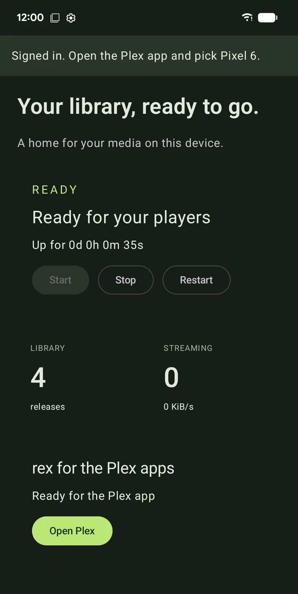

# zurg+rex pour Android et Google TV {#zurgrex-for-android-and-google-tv}

zurg+rex est un serveur Plex sur ton téléphone. zurg relie tes comptes debrid et ton Usenet, et rex les sert à toutes les apps Plex de ta maison, avec les affiches, les saisons et la progression du visionnage. Il tourne sur un téléphone, une tablette, Android TV, Google TV ou Fire TV, sans ordinateur.

Il nécessite un sponsoring. Pas de sponsoring ? [rex pour Android](../../rex/android.md) est gratuit et lit ce que ses addons apportent.

| L'app | Dans l'app Plex | Dans n'importe quelle autre app Plex |
|---|---|---|
|  |  |  |

## Avant de commencer {#before-you-start}

| Vous avez besoin de | Pourquoi |
|---|---|
| Un appareil avec Android 8.0 ou plus récent | Téléphone, tablette, Android TV, Google TV ou Fire TV. Usenet nécessite un appareil 64 bits |
| Un sponsoring avec votre compte GitHub lié | L'application et son moteur se téléchargent depuis le dépôt du sponsor. Devenez sponsor et liez GitHub sur [gatekeeper](https://gatekeeper.debridmediamanager.com/) |
| Un compte debrid ou un compte Usenet | Ce que zurg récupère. Les NZB hébergés par TorBox (`torbox_nzb`) ne sont pas disponibles sur Android |
| Un compte Plex | rex apparaît dans les applications Plex connectées à ce compte. Un compte gratuit suffit |
| Votre clé API DMM, depuis gatekeeper (facultatif) | Avec elle, davantage de titres obtiennent leur nom et leur affiche |

## Étape 1. Téléchargez-le {#step-1-download-it}

Sur l'appareil, ouvrez la [page de téléchargement](https://zurg.debridmediamanager.com/fr/download.html#android), connecté à GitHub avec votre compte sponsor, puis choisissez le fichier correspondant à son processeur :

| Votre appareil | Fichier |
|---|---|
| La plupart des téléphones, tablettes et boîtiers TV (64 bits) | `android-arm64-v8a.apk` |
| Anciens téléphones 32 bits et clés TV | `android-armeabi-v7a.apk` |
| Chromebooks et émulateurs | `android-x86_64.apk` |

Un seul fichier fonctionne aussi bien sur les téléphones que sur les TV.

**GitHub affiche 404 ?** Le compte avec lequel vous êtes connecté n'a pas encore accès au sponsor. Si vous venez de devenir sponsor, [acceptez l'invitation](https://github.com/debridmediamanager/zurg/invitations) d'abord. Les invitations sont envoyées dans un délai de 15 minutes.

## Étape 2. Installez-le {#step-2-install-it}

Ouvrez le fichier téléchargé et autorisez l'installation depuis l'application qui l'a ouvert. Android ou Play Protect peuvent vous demander de confirmer.

**Ce que vous devriez voir.** **zurg+rex** dans la liste de vos applications.

## Étape 3. Connectez-vous à GitHub et installez le moteur {#step-3-sign-in-to-github-and-install-the-engine}

Ouvrez l'application. Elle affiche **Welcome to zurg+rex.**

1. Appuyez sur **Sign in with GitHub**. L'application affiche un code : appuyez sur **Open GitHub**, saisissez le code et validez. GitHub demande l'accès `repo` parce que les versions réservées aux sponsors sont privées.
2. **Installez le moteur.** Le moteur, c'est zurg et rex eux-mêmes, dans un paquet à part pour qu'ils se mettent à jour indépendamment de l'application. Appuyez sur **Install**. Android demande une confirmation avant l'installation : autorisez-la.

**Ce que vous devriez voir.** **Add your providers.**

## Étape 4. Ajoutez vos fournisseurs {#step-4-add-your-providers}

1. Appuie sur **Add an account** et choisis le fournisseur.
2. Pour un compte debrid, colle son token dans **Provider token**. Pour Usenet, remplis **NNTP server**, **Port**, **Username**, **Password** et **Connections**.
3. Appuie sur **Test account**, puis sur **Add provider**.

Ajoute autant de comptes que tu en as ; **Account name** permet de distinguer deux comptes chez un même fournisseur. La limite de connexions d'un compte Usenet compte toutes les autres applis et tous les autres appareils qui l'utilisent.

## Étape 5. Démarrez votre bibliothèque {#step-5-start-your-library}

1. Choisissez **Phone**, **Tablet**, **TV box** ou **TV stick**. Les choix plus petits utilisent moins de mémoire et de caches plus réduits.
2. Autorisez les notifications et laissez l'application tourner en arrière-plan. Activez **Start after reboot** si cet appareil doit toujours servir votre bibliothèque.
3. Appuyez sur **Start my library**.

**Ce que vous devriez voir.** **Status** affiche **Ready for your players** et compte vos releases. Le premier chargement d'un grand compte peut prendre plusieurs minutes.

## Étape 6. Connectez-vous à Plex {#step-6-sign-in-to-plex}

Sur **Status**, sous **rex for the Plex apps**, appuyez sur **Sign in to Plex**.

- **Sur un téléphone ou une tablette**, votre navigateur ouvre la page de connexion de Plex. Connectez-vous là.
- **Sur une TV**, l'application affiche **On any device, go to plex.tv/link and enter** suivi d'un code. Saisissez-le sur votre téléphone ou votre ordinateur.

Utilisez le compte avec lequel vos applications Plex sont connectées.

**Ce que vous devriez voir.** **Ready for the Plex app**, avec un bouton **Open Plex** lorsque Plex est sur cet appareil.

## Étape 7. Regardez dans une application Plex {#step-7-watch-in-a-plex-app}

Ouvrez n'importe quelle application Plex connectée au même compte : sur cet appareil, sur votre téléviseur, sur un autre téléphone ou sur un ordinateur à la maison. Votre serveur apparaît sous le nom de cet appareil, avec les bibliothèques **Debrid Movies** et **Debrid TV**. Lancez la lecture.

rex convertit ce que le lecteur ne peut pas lire, en utilisant l'encodeur vidéo de l'appareil lui-même.

## Obtenir d'autres titres nommés {#get-more-titles-named}

Ouvrez **Settings**, **Library** et collez votre clé API DMM dans **Dmm api key**, puis enregistrez. zurg demande ensuite à DMM ce qu'est chaque fichier. Sans la clé, zurg le déduit à partir du nom de la release, et moins de titres obtiennent leur nom et leur affiche.

Un titre qui semble toujours faux peut être corrigé dans une application Plex : ouvrez son menu **⋯** et choisissez **Fix Match**.

Le champ est présent dans les versions nightly à partir du 14 novembre 2026. Dans une version plus ancienne, ajoutez `dmm_api_key: YOUR_DMM_API_KEY` dans **Settings**, **Advanced**. La même clé permet aussi de lire votre [liste de souhaits DMM](dmm-wanted.md).

## Modules complémentaires {#addons}

Les addons ajoutent du contenu à regarder dans rex, en plus de ta bibliothèque. Ouvre **Addons** : l'addon Internet Archive est déjà installé et ajoute des films du domaine public, et le dépôt [rex-addons](https://github.com/debridmediamanager/rex-addons) est déjà listé. Ajoute un autre dépôt avec son lien, ouvre-le et installe ce qu'il propose.

Chaque addon indique les sites web qu'il peut atteindre, et une mise à jour qui en atteint de nouveaux te demande d'abord ton accord. Installe uniquement des addons venant de personnes en qui tu as confiance. Un addon qui a besoin de ton compte affiche un code à saisir sur son site web ; la connexion qu'il obtient reste sur cet appareil. **Log** affiche ce qu'un addon a fait récemment. Supprimer un addon retire seulement ses titres.

## Autres lecteurs sur cet appareil {#other-players-on-this-device}

Vous n'avez pas besoin d'une application Plex pour regarder.

- **Library** parcourt vos dossiers et lance un fichier dans le lecteur que vous choisissez. **More** propose un autre lecteur et les actions de la version : repair, rename, tags, show all files et delete. Elles s'appliquent à toute la version, et delete demande d'abord confirmation avant de la supprimer de votre compte fournisseur.
- L'application **Files** et les sélecteurs de documents affichent la même bibliothèque sous la racine de zurg. Ouvrez votre lecteur une fois et terminez sa configuration avant de le choisir depuis Files.
- Les lecteurs WebDAV comme VLC, Kodi et Nova utilisent `http://127.0.0.1:9999/dav/` comme source. **Status** affiche l'adresse si vous avez changé le port.

Sur une TV, déplacez-vous avec le D-pad et Select, revenez en arrière avec Back, et ouvrez les actions d'une version avec Menu ou **More**. Sélectionnez un champ de texte pour y écrire, puis appuyez sur Back pour continuer.

## Partager avec d'autres lecteurs à la maison {#share-with-other-players-at-home}

Les apps Plex à la maison n'ont besoin de rien d'autre : elles trouvent rex toutes seules. Pour un lecteur WebDAV sur un autre appareil, ouvrez **Settings**, **Connection** et activez **Expose on local network**. zurg crée un nom d'utilisateur et un mot de passe, et affiche l'adresse à saisir dans ce lecteur.

Utilisez cette option sur un réseau de confiance : le mot de passe circule sans chiffrement. Elle est désactivée par défaut, il faut l'activer vous-même.

## Gardez-le en marche {#keep-it-running}

- La notification affiche l'état du serveur et contient **Stop**. Une tuile des Réglages rapides le démarre et l'arrête aussi.
- Certains téléphones arrêtent quand même les applications en arrière-plan. [Don't kill my app](https://dontkillmyapp.com/) explique ce dont la tienne a besoin.
- **Updates** vérifie s'il existe une nouvelle application et un nouveau moteur ; ils se mettent à jour séparément. Si une nouvelle nightly se comporte mal sur ton appareil, appuie sur **Show engine versions** et installe celle qui fonctionnait. Arrête d'abord ta bibliothèque sur **Status**.
- **Settings** contient **Create backup** et **Restore backup**. Une sauvegarde contient tes mots de passe et tes tokens, garde-la donc privée. Arrête ta bibliothèque avant de restaurer.
- Désactive rex dans **Settings**, **Connection**, **rex for the Plex apps**. zurg arrête alors de l'alimenter.

## Ce que l'application envoie et où {#what-the-app-sends-and-where}

zurg+rex n'a ni pub ni analytics. Voici tout ce qui quitte ton appareil :

| Où | Quoi | Quand |
|---|---|---|
| GitHub | Ta connexion, puis des requêtes pour les releases des sponsors | Quand tu te connectes et quand **Updates** vérifie les mises à jour |
| Tes fournisseurs | Ton token de compte ou ton login Usenet, et des requêtes pour ta bibliothèque et tes fichiers | Pendant que ta bibliothèque tourne |
| debridmediamanager.com | Les noms de tes releases, pour savoir ce que chacune est, avec ta clé API DMM si tu en as saisi une | Pendant que ta bibliothèque tourne avec rex activé |
| plex.tv et le service de métadonnées de Plex | Une demande de code de connexion ; puis le nom du serveur, son adresse et les ids de tes titres, pour récupérer les affiches et les descriptions | Quand tu te connectes à Plex, et pendant que rex tourne connecté |
| debridmediamanager.com (rex-direct) | L'identifiant de rex, le token de serveur que Plex lui a donné, ses adresses IP et son port, pour que les applis Plex puissent le joindre en HTTPS | Une fois connecté à Plex, puis toutes les 6 heures |
| Les sites de chaque addon et les dépôts que tu ajoutes | Ce que l'addon demande | Quand un addon se synchronise ou qu'un titre se lance |
| logs.debridmediamanager.com | Versions, modèle d'appareil, les logs de l'app et du moteur, et ta config, avec les clés, mots de passe et tokens remplacés par `[redacted]` | Seulement quand tu appuies sur **Send** sous **Send logs to support**, après avoir tout vu. Supprimé au bout de 7 jours |

Ton token GitHub est stocké chiffré sur l'appareil. Désinstaller l'app supprime tout ce qu'elle a gardé.

## Limites {#limits}

- **L'appareil est le serveur.** Garde-le allumé, connecté et branché sur secteur. La conversion vidéo est lente sur un boîtier bas de gamme.
- **Ça marche à la maison.** En dehors de chez toi, les applis Plex ont besoin d'une adresse HTTPS qui atteint l'appareil, ce qui demande une redirection de port sur ton routeur. Voir [Utiliser en dehors de chez toi](../../rex/with-zurg.md#use-it-outside-your-home-optional).
- **Usenet nécessite Android 64 bits.** Un appareil 32 bits ne fait tourner que les bibliothèques debrid.
- **Pas sur Google Play.** Il se met à jour depuis l'appli elle-même, sous **Updates**.

## Dépannage {#troubleshooting}

| Ce que vous voyez | Quoi faire |
|---|---|
| GitHub répond 404 sur la page de téléchargement | Connectez-vous à GitHub avec votre compte sponsor et [acceptez l'invitation](https://github.com/debridmediamanager/zurg/invitations). Pas encore sponsor : [gatekeeper](https://gatekeeper.debridmediamanager.com/) |
| **No engine is installed. zurg needs one before it can serve your library.** | Appuie sur **Install an engine** et autorise Android à l'installer |
| **No engine is available in the sponsor releases for this device yet.** | La dernière nightly n'a pas de moteur pour ton processeur. Demande sur le support |
| **This is a 32-bit device. Debrid libraries are supported; Usenet needs 64-bit Android.** | Ajoute un compte debrid, ou utilise un appareil 64 bits pour Usenet |
| **The Plex code expired. Ask for a new one.** | Appuie à nouveau sur **Sign in to Plex** et saisis le nouveau code dans les 10 minutes |
| Le serveur n'apparaît pas dans l'app Plex | Connecte l'app Plex au compte utilisé à l'étape 6, et garde les deux appareils sur le même réseau domestique |
| Les titres affichent un nom de fichier et pas d'affiche | Saisis ta clé API DMM (voir [Get more titles named](#get-more-titles-named)), ou utilise **Fix Match** dans une app Plex |
| **Needs an update** sous un addon | Cette version de l'app ne peut plus faire tourner cette copie de l'addon. Actualise son dépôt et appuie sur **Update**. Ses titres restent en attendant |
| Ça s'arrête quand l'écran est éteint | Autorise à nouveau l'utilisation en arrière-plan et consulte [Don't kill my app](https://dontkillmyapp.com/) |
| Une mise à jour laisse l'app sans moteur | Installe un moteur depuis **Updates** une seule fois. Tes fournisseurs et tes réglages restent |

Si le support demande des logs, ouvre **Logs** et appuie sur **Send logs to support**. Tu vois tout avant l'envoi, puis appuie sur **Send** et publie le code que tu reçois.

Bloqué ? Demande sur le forum **zurg-support** sur [Discord](https://discord.com/invite/7u4YjMThXP).
