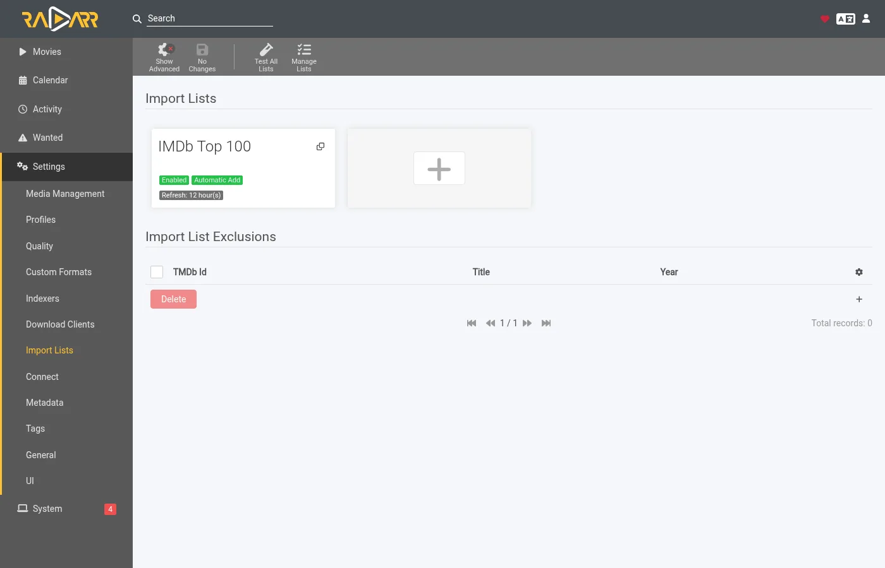
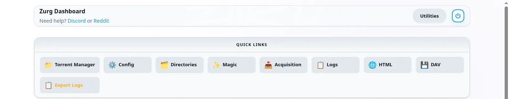
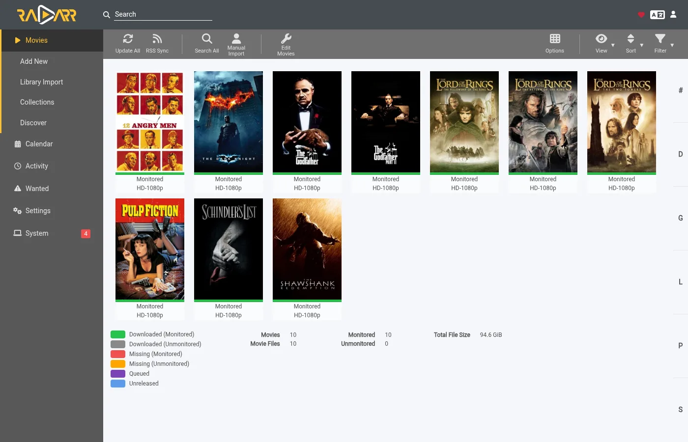

# Laissez zurg récupérer ce que Sonarr et Radarr demandent {#let-zurg-fetch-what-sonarr-and-radarr-want}

Il y a trois façons d'utiliser Sonarr et Radarr avec zurg. Le vrai choix, c'est qui fait la recherche : zurg ou les \*arrs. [Lequel choisir](#which-one-to-pick) compare les deux.

| Guide | Qui cherche | zurg agit comme | Il te faut |
|---|---|---|---|
| [Usenet](sonarr-radarr.md) | Sonarr et Radarr | un SABnzbd | un compte Usenet (ou TorBox Pro pour le backend `torbox_nzb`) et des indexeurs Usenet dans Prowlarr ou les \*arrs |
| [Torrents](sonarr-radarr-torrents.md) | Sonarr et Radarr | un qBittorrent | un compte debrid et des indexeurs torrent dans Prowlarr ou les \*arrs |
| [zurg cherche](sonarr-radarr-fetch.md) | zurg | aucun client de téléchargement | un compte Usenet, TorBox Pro ou debrid, et des indexeurs Newznab ou Torznab dans la config propre de zurg |

Les deux premiers peuvent tourner côte à côte. Ils partagent le même dossier `__magic__`.

### Lequel choisir {#which-one-to-pick}

| | zurg fait les recherches | Sonarr et Radarr font les recherches |
|---|---|---|
| Les indexeurs se mettent | dans le `config.yml` de zurg, et un changement demande un redémarrage | dans Prowlarr ou dans les \*arrs, comme d'habitude |
| Les \*arrs ont besoin de | de root folders dans `__magic__`, rien d'autre | de zurg comme client de téléchargement, avec le dossier de téléchargement et les root folders sur un même volume |
| Le premier fichier est | le plus rapide à valider avec votre profil, mis à niveau vers le cutoff plus tard | celui que l'\*arr classe en tête dans votre profil |
| Anime, émissions quotidiennes et spéciaux | gérés à partir du nightly du 5 novembre 2026 | gérés |
| Manual search, queue, history, blocklist | aucun. Le fichier apparaît et l'\*arr relit le dossier | fonctionnent comme d'habitude |
| [`exclude_words`](acquisition.md#excluding-releases-by-name) de zurg | s'applique | ne s'applique pas. Bloquez les mêmes mots dans l'\*arr |

Les deux vérifient une release avant que l'\*arr l'importe. Un post Usenet mort, ou un torrent que votre compte ne possède pas déjà, n'est jamais placé.

Sur une installation neuve, commencez par la recherche de zurg. Il y a moins de choses à configurer et pas de disposition de volumes à bien régler. Utilisez la route par client de téléchargement si vous voulez choisir les releases à la main. Si vous préférez attendre la meilleure release de votre profil plutôt que d'avoir un premier fichier rapidement, activez [`best_first`](acquisition.md#taking-the-profiles-best-first).

Radarr et Sonarr gardent la liste et la bibliothèque. zurg s'occupe de la récupération. Ajoutez un film ou une série comme vous le faites déjà, et zurg trouve une release chez vos indexeurs. Il vérifie qu'un NZB est encore disponible sur les serveurs de news (pour un compte `torbox_nzb`, que TorBox l'a bien récupéré), ou que votre compte debrid possède déjà le torrent. Ensuite, il place le fichier dans son dossier à l'intérieur de `__magic__` et demande à Radarr ou Sonarr de relire le dossier. Rien n'est téléchargé pour être importé et rien n'est copié.

Radarr et Sonarr n'ont besoin ni d'indexeurs ni de client de téléchargement pour ça. Ils ne cherchent jamais et ne récupèrent jamais rien. Votre profil de qualité décide toujours de ce que zurg a le droit de prendre.

Les captures d'écran viennent de la build de zurg publiée dans le nightly du 26 septembre 2026, avec Radarr 6.3.0.10514 et Sonarr 4.0.20.3014 dans Docker. Les deux voyaient le montage de zurg à `/mnt/zurg` dans leurs conteneurs. Rien n'a été modifié dans ces captures.

## Avant de commencer {#before-you-start}

1. **zurg a un compte Usenet ou debrid et au moins un indexeur Newznab ou Torznab.** Les indexeurs vont dans le bloc `acquisition.indexers` de la config de zurg. La page [Watchlist et Seerr](acquisition.md) décrit ce bloc.
2. **`magic.enabled` vaut `true`.** Les sources Radarr et Sonarr ne démarrent pas sans lui, et le log le signale. Voir [`__magic__`](magic.md).
3. **Radarr et Sonarr voient le montage de zurg.** Installées comme des applications classiques, chacune a un piège, décrit dans [le guide Usenet](sonarr-radarr.md#before-you-start). Avec Docker sur un hôte Linux, il faut monter le montage dans leurs conteneurs. Montez le parent du montage une seule fois et passez par lui pour tout atteindre. Si elles reçoivent aussi les téléchargements de zurg comme client de téléchargement, deux volumes pour le dossier de téléchargement et les dossiers racines copient chaque import. Voir [un seul volume](sonarr-radarr.md#one-volume-for-the-download-folder-and-the-root-folders).
4. **Vous utilisez une nightly du 26 septembre 2026 ou plus récente.** Les versions plus anciennes ne connaissent pas les sources `radarr` ou `sonarr`.

## 1. Indiquez à zurg Radarr et Sonarr {#1-tell-zurg-about-radarr-and-sonarr}

Ajoute une source `radarr` et une source `sonarr` sous `acquisition` dans `config.yml`, puis redémarre zurg. Il n'existe pas encore de formulaire dans le tableau de bord pour ce bloc. Omets celui que tu n'utilises pas.

```yaml
acquisition:
  quality: best
  indexers:
    - name: my-indexer
      url: https://indexer.example
      api_key: YOUR_INDEXER_API_KEY
  sources:
    - name: radarr
      type: radarr
      enabled: true
      url: http://radarr:7878         # http://localhost:7878 when Radarr is an ordinary app beside zurg
      api_key: YOUR_RADARR_API_KEY
      library_path: /mnt/zurg/__magic__
      check_every_secs: 30
    - name: sonarr
      type: sonarr
      enabled: true
      url: http://sonarr:8989         # http://localhost:8989 likewise
      api_key: YOUR_SONARR_API_KEY
      library_path: /mnt/zurg/__magic__
      check_every_secs: 30
```

`url` et `api_key` appartiennent à l'application. La clé API se trouve sous **Settings > General** dans les deux. `check_every_secs` correspond à la fréquence à laquelle zurg demande à l'application ce qu'elle veut. Chaque interrogation consiste en une seule requête pour la liste. Les mêmes indexeurs servent les deux sources.

`library_path` correspond à l'emplacement où l'application voit le répertoire `__magic__` de zurg. zurg en a besoin pour transformer un dossier de Radarr en un emplacement à l'intérieur de `__magic__`. Avec la configuration ci-dessus, un film que Radarr garde dans `/mnt/zurg/__magic__/movies/Heat (1995)` est placé dans `movies/Heat (1995)` à l'intérieur du `__magic__` de zurg. Les chemins Windows comme `Z:\__magic__` fonctionnent de la même façon. Ne mets `library_path` de côté que si l'application tourne sur la même machine que zurg et voit le point de montage là où zurg le monte.

`concurrency` correspond au nombre de titres que zurg traite en même temps, et vaut huit par défaut. Une grande liste reste sans problème avec la valeur par défaut. Elle prend simplement plus de temps.

## 2. Placez les dossiers racines dans `__magic__` {#2-put-the-root-folders-inside-__magic__}

Le dossier racine doit se trouver dans `__magic__`, à un niveau de profondeur. `/mnt/zurg/__magic__/movies` pour Radarr et `/mnt/zurg/__magic__/tv` pour Sonarr est le modèle à copier (`/Volumes/Zurg/__magic__/movies` sur macOS, `Z:\__magic__\movies` sur Windows). Ni `__magic__` lui-même, ni `__magic__/__all__`. Un titre dont le dossier se trouve ailleurs est ignoré, et zurg le signale une fois dans son journal.

Dans Radarr, ouvre **Settings > Media Management** et ajoute le dossier racine.


Sonarr a la même page. Ajoute son dossier racine sous **Root Folders**.


**Season Folder Format** sur la page de Sonarr correspond au nom que zurg donne à un nouveau dossier de saison. Une saison qui a déjà des fichiers garde le dossier dans lequel ils se trouvent. L'espace libre affiché par l'une ou l'autre appli est celui que rapporte le montage. Aucune des deux applis n'écrit jamais dedans.

## 3. Ajoutez les titres avec la recherche désactivée {#3-add-titles-with-search-off}

Ajoutez des films et des séries comme vous le faites déjà. À la main, depuis une liste ou depuis une application de requêtes. La seule chose à changer, c'est la recherche. C'est zurg qui fait la recherche, donc les arrs ne doivent pas la faire.

### Radarr

Ce guide utilise une liste d'importation. Ouvrez **Settings > Import Lists** et ajoutez ou modifiez la vôtre.



Dans les paramètres de la liste, laissez **Enable Automatic Add** activé et désactivez **Search on Add**. Choisissez le profil de qualité et le dossier racine de l'étape 2. Réglez **Minimum Availability** selon vos besoins. zurg attend que Radarr considère un film comme disponible avant de le chercher.


Quand vous ajoutez un seul film à la main, le même interrupteur s'appelle **Start search for missing movie**. Désactivez-le aussi.

### Sonarr

Lorsque vous ajoutez une série manuellement, laissez **Start search for missing episodes** et **Start search for cutoff unmet episodes** décochés. **Monitor** détermine ce que zurg va chercher. Cette série est réglée sur sa première saison.


Une liste d'importation dans Sonarr possède le même interrupteur dans ses paramètres. Désactivez aussi sa recherche.

## 4. Laissez les indexeurs et les clients de téléchargement vides {#4-leave-indexers-and-download-clients-empty}

C'est tout le réglage côté arr. La page Indexers peut rester vide.


Pareil pour la page Download clients.


Sonarr, c'est pareil. Si l'une des deux applis a déjà des indexers et un download client d'une ancienne installation, elles continuent de fonctionner. Mais l'appli chercherait alors en parallèle de zurg pour les mêmes titres. Désactive Automatic Search sur ces indexers, ou supprime-les pour les titres que zurg gère.

## 5. Regardez-le fonctionner {#5-watch-it-work}

Ouvre le tableau de bord de zurg. **Acquisition** est une nouvelle entrée dans les liens rapides.



La page affiche chaque titre sur lequel zurg travaille et ce qu'il est en train de faire en ce moment. Les mêmes données sont disponibles dans `/acquisition/status.json` si tu veux les lire depuis un script.

### Films {#movies}

Voici une liste de dix films, environ une demi-minute après que Radarr les a ajoutés. Cinq ont déjà leur fichier et Radarr en est informé. Les autres sont terminés.


Chaque ligne correspond à un film. **State** indique où il en est. **Stage** indique ce que zurg fait pour lui à cet instant. Il consulte d'abord les indexeurs. Puis il évalue les candidats. Puis il lit le NZB d'une publication et vérifie l'article auprès des serveurs de news. Enfin, il place le fichier. **Release** correspond à la publication retenue par zurg et à ce que l'analyseur de Radarr en a tiré. **Placed at** est le chemin à l'intérieur de `__magic__` où se trouve maintenant la vidéo. Un titre que les serveurs de news ne possèdent plus passe immédiatement au candidat suivant. Un titre sans rien d'utilisable est mis de côté, avec la raison affichée.

Une minute plus tard, tout est terminé.


### Séries {#series}

Les saisons de Sonarr apparaissent sur la même page. Une ligne correspond à une saison ou à un fichier d'épisode que zurg est en train d'améliorer. Voici deux séries dont la première saison a été surveillée une demi-minute après leur ajout. Les deux saisons étaient terminées et n'avaient aucun fichier, donc zurg a essayé un pack de saison pour chacune. Le pack de Severance est dans son dossier de saison et Sonarr en est informé. Le pack de Only Murders est en cours de vérification auprès des serveurs de news.


Environ deux minutes après leur ajout, les deux saisons sont terminées. Le pack de Only Murders avait des morceaux manquants sur les serveurs de news. zurg l'a mis de côté et a récupéré les dix épisodes un par un à la place. Sa ligne indique le dernier épisode placé.


## 6. Ce que Radarr et Sonarr affichent {#6-what-radarr-and-sonarr-show}

Les bibliothèques se remplissent au fur et à mesure que les rescans aboutissent. Chaque film de cette liste a son fichier.



La page d'un film montre le fichier dans son dossier à l'intérieur de `__magic__`, avec la qualité que Radarr a lue dans le nom.


Dans Sonarr, les dix épisodes ont leur fichier dans le dossier de la saison, avec la qualité que Sonarr a lue dans le nom de chacun.


**Activity** reste vide dans les deux. Il n'y a aucune entrée dans la file d'attente et aucun événement de grab ou d'import, parce que rien n'a été pris. Le fichier est simplement apparu dans le dossier, et le rescan que zurg a demandé s'en est chargé.


Deux conséquences en découlent. La blocklist des arrs n'est jamais remplie. zurg garde sa propre liste des posts que les serveurs de news ne possèdent plus et ne les reprend pas. Et un titre que vous supprimez dans Radarr ou Sonarr n'est pas supprimé de votre compte. Le fichier redevient listé sous `__all__` comme n'importe quelle autre release.

## Comment zurg choisit une version {#how-zurg-picks-a-release}

Votre profil de qualité est le gatekeeper. Chaque release que zurg est sur le point de prendre passe d'abord par le parseur de l'application. Il faut que ce soit le bon titre. Sa qualité doit être autorisée par le profil. Son score de format personnalisé doit atteindre le minimum du profil. Sa taille doit respecter les limites sous **Settings > Quality**. Une release qui ne remplit pas l'un de ces critères n'est pas prise.

### Films {#movies-1}

Parmi les releases autorisées par le profil, zurg prend d'abord celle qui est la plus rapide à vérifier. Les posts qui ne contiennent qu'un seul fichier vidéo passent en premier, car ce sont ceux qui sont le plus souvent encore complets sur les serveurs de news. Les releases Web passent avant les Blu-ray, pour la même raison. Les ensembles d'archives multi-volumes servent de solution de repli.

L'ordre de préférence du profil est en revanche appliqué par les mises à niveau. Quand le profil autorise les mises à niveau et que le fichier placé est sous le seuil, zurg cherche une meilleure release une fois que le film en a une. Seule une release strictement meilleure remplace le fichier. Une qualité inférieure n'est jamais prise.

Un film daté dans le futur attend que Radarr le déclare disponible. Une recherche qui trouve le mauvais film est refusée, car Radarr ne fait correspondre le titre à aucun film de ta bibliothèque.

### Séries {#series-1}

Une saison forme un seul ensemble. Quand tous les épisodes d'une saison manquent et que la saison est terminée, zurg essaie d'abord un pack de saison. Sinon, il prend les épisodes manquants un par un. Une saison qui a déjà certains de ses fichiers ne prend jamais de pack. Cela mettrait une deuxième copie de ces épisodes dans le dossier.

Une release doit correspondre à cette série et à cette saison. Un pack doit être la saison complète. Une release d'épisode doit contenir uniquement cet épisode. La limite de taille s'applique à la durée des épisodes contenus dans la release.

Quand un épisode d'une saison n'a aucune release que zurg peut prendre pour le moment, les autres épisodes sont quand même placés, et Sonarr en est informé tout de suite. L'épisode manquant est recherché à nouveau plus tard, selon le calendrier habituel de nouvelles tentatives.

Un fichier d'épisode en dessous du seuil est une amélioration quand le profil autorise les améliorations. En dessous du seuil signifie en dessous du seuil de qualité ou en dessous du seuil de score de format personnalisé. zurg compte les deux de la même façon que la règle d'amélioration de Sonarr. La liste **Cutoff Unmet** de Sonarr n'affiche que le premier. Une amélioration remplace uniquement son propre épisode, et le reste du dossier de la saison reste à sa place.

## Points à savoir {#things-to-know}

- **Tout changement dans le bloc `acquisition` de `config.yml` demande un redémarrage.** zurg ne lit le fichier qu'au démarrage.
- **Le rescan est la dernière étape, et il attend derrière le travail propre de l'application.** Juste après qu'une liste ajoute beaucoup de films, Radarr rafraîchit chacun d'eux d'abord. Les fichiers sont déjà en place pendant ce temps.
- **Analyse video files lit le début de chaque fichier via le montage.** Ça fonctionne. C'est aussi la partie la plus lente d'une grosse liste. Laisse-le activé, sauf si tu sais que tu ne veux pas des infos média.
- **Les titres non surveillés sont laissés tranquilles.** Ça couvre les films, les séries, les saisons et les épisodes. Idem pour les titres dont le dossier est en dehors de `__magic__`.
- **Les animés, les émissions quotidiennes et les spéciaux demandent un nightly du 5 novembre 2026 ou plus récent.** Les épisodes d'une émission quotidienne sont trouvés par leur date de diffusion, ceux d'un animé par le numéro que la série leur donne (`Jujutsu Kaisen - 30` correspond au sixième épisode de la deuxième saison), et les spéciaux sont recherchés comme saison 00. Un fichier placé pour un animé ou une émission quotidienne est nommé `JUJUTSU KAISEN - S02E06 - <the release's own name>`, parce que le rescan de Sonarr lit un fichier uniquement d'après son nom et rangerait `2nd Season - 06` dans la saison 1. Un spécial qui n'est nommé que par son titre, sans `S00Exx`, ne peut pas être associé, pas même par Sonarr. Sur une version plus ancienne, chaque série de ce type est ignorée, avec une seule ligne dans le journal.

La description complète des deux sources se trouve dans [Watchlist et Seerr](acquisition.md).
