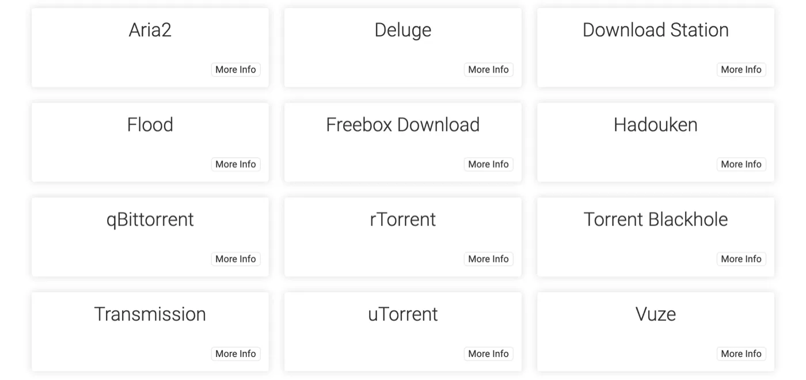
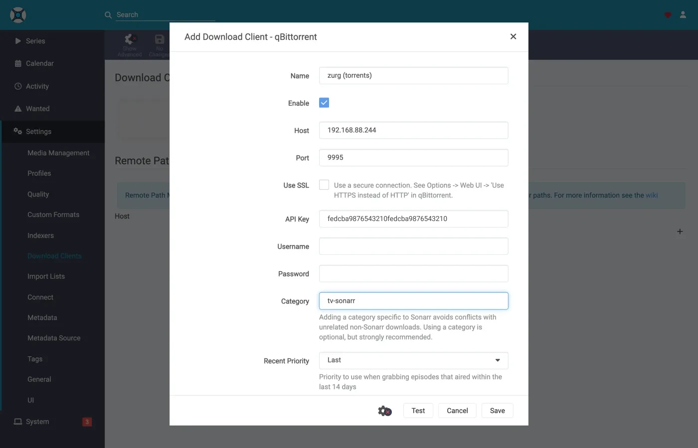
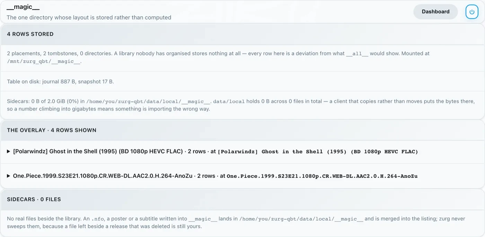

# Sonarr et Radarr avec des torrents, étape par étape {#sonarr-and-radarr-with-torrents-step-by-step}

Il existe trois façons d'utiliser Sonarr et Radarr avec zurg. Le vrai choix porte sur qui fait les recherches : zurg ou les \*arrs. [Lequel choisir](sonarr-radarr-fetch.md#which-one-to-pick) compare les deux.

| Guide | Qui cherche | zurg agit comme | Il faut |
|---|---|---|---|
| [Usenet](sonarr-radarr.md) | Sonarr et Radarr | un SABnzbd | un compte Usenet (ou TorBox Pro pour le backend `torbox_nzb`) et des indexeurs Usenet dans Prowlarr ou dans les \*arrs |
| [Torrents](sonarr-radarr-torrents.md) | Sonarr et Radarr | un qBittorrent | un compte debrid et des indexeurs torrent dans Prowlarr ou dans les \*arrs |
| [Recherches par zurg](sonarr-radarr-fetch.md) | zurg | aucun client de téléchargement | un compte Usenet, TorBox Pro ou debrid, et des indexeurs Newznab ou Torznab dans la propre config de zurg |

Les deux premières peuvent tourner côte à côte. Elles partagent le même dossier `__magic__`.

Le [guide précédent](sonarr-radarr.md) orientait les \*arrs vers zurg pour Usenet, zurg répondant comme un SABnzbd. Voici l'autre moitié : zurg répond comme un **qBittorrent**, les \*arrs lui transmettent un magnet ou un `.torrent` au lieu d'un NZB, et la release part sur un compte debrid au lieu d'un serveur de news. L'import repose sur la même astuce : un renommage dans `__magic__`, rien à télécharger pour importer, rien de copié.

**Lequel des deux le \*arr envoie n'est pas anodin.** Un `.torrent` est en général envoyé au compte tel quel, sous forme de fichier ; seul un magnet est ajouté à partir de son info hash seul. En mode cached-only, le mode par défaut, TorBox et Debrid-Link reçoivent l'info hash à la place, car c'est ainsi qu'ils refusent une release non mise en cache sans l'ajouter. Un magnet oblige le compte à deviner le contenu du torrent à partir du hash, et le hash d'un tracker privé n'a pas de swarm public pour le faire. Real-Debrid échoue alors avec `magnet_error` sans aucun fichier, et TorBox accepte le magnet puis reste bloqué sur `checking` sans liste de fichiers, sans taille et avec une estimation de cent jours : la grab ne échoue pas et ne se termine pas non plus. Le fichier `.torrent` fait directement la recherche de cache du compte par hash, donc le contenu déjà présent sur le compte est ajouté immédiatement, sans aucune résolution de magnet. C'est ce qui rend les indexeurs privés utilisables ici : leurs releases sont ajoutables exactement quand le compte possède déjà le contenu, ce qui, pour tout ce que la communauté partage, est le cas le plus courant. Pointe le \*arr vers un indexeur qui fournit des fichiers `.torrent` plutôt que des magnets. Les indexeurs privés le font.

Tout ce qui suit a été capturé avec zurg `2026.08.30.0459-nightly-73-g5b4c9790`, Sonarr `4.0.19.2979`, Radarr `6.3.0.10514` et Prowlarr `2.5.2.5491`, sur une installation réelle avec un vrai compte AllDebrid. Les noms d'hôte et d'utilisateur ont été remplacés par `you@zurg-server`. Les indexeurs s'appellent `my-indexer`. Les clés d'API et les nombres de bibliothèque sont fictifs. Rien d'autre dans la sortie capturée n'a été modifié.

## Avant de commencer {#before-you-start}

**zurg a un compte qui peut ajouter des torrents** : Real-Debrid, AllDebrid, TorBox, Premiumize, Debrid-Link ou Offcloud. Les six acceptent le fichier `.torrent` lui-même, ce qui permet d'ajouter la release d'un tracker privé. Un compte Usenet n'accepte un torrent sous aucune de ces formes : une installation dont le seul fournisseur est `nzb` accepte chaque grab, puis le refuse. zurg le signale au démarrage.
2. **`magic.enabled` vaut `true`.** Sans cela, le chemin de sauvegarde n'existe pas et chaque import échoue. Voir [`__magic__`](magic.md).
3. **Le montage est visible par le \*arr au chemin que zurg indique.** Si le \*arr tourne dans un conteneur, lis [l'étape 8](#8-if-your-arr-is-in-docker) avant de configurer quoi que ce soit. Installé comme une application classique sur la même machine, il voit le montage là où zurg le monte, avec une précaution par système :
   - **Linux :** un \*arr qui tourne sous un autre utilisateur que zurg voit un dossier vide tant que `user_allow_other` n'est pas activé. Voir [Configuration Linux](../setup/linux.md#1-install-fuse-3).
   - **macOS :** lance-le avec le même utilisateur que zurg. Le montage est `/Volumes/Zurg`, sauf si tu as modifié `mount_path`.
   - **Windows :** lance Sonarr et Radarr en application de la zone de notification, comme le propose leur installeur, et non en service Windows. Le lecteur `Z:` de zurg appartient à la session dans laquelle tu es connecté, et un service s'exécute en dehors de cette session, donc il ne voit pas le lecteur. Voir [les règles de session](../setup/windows.md#keeping-it-running-the-session-rules).

Vérifie les deux premiers directement dans le fichier de configuration, dans le répertoire de travail de zurg. Sous Windows, ouvre `config.yml` dans Notepad à la place.

```bash
$ grep -A3 '^providers:' config.yml
providers:
- type: alldebrid
  token: <redacted>

$ grep -A3 '^magic:' config.yml
magic:
  enabled: true
  allow_delete: false
```

**L'ordre de la liste `providers:` compte ici.** Une demande de grab est proposée à chaque compte qui accepte les torrents, dans cet ordre. Un compte qui refuse ou bloque dessus est abandonné, et le suivant est essayé. Si tu as deux comptes, mets en premier celui que tu préfères dépenser en premier.

Deux clés sortent un compte de cet ordre. `watchlist: true` place un compte en premier, peu importe sa position dans le fichier. `add_torrents: false` le retire complètement de la rotation : il continue de servir et de lire sa bibliothèque, mais plus rien de nouveau ne lui est ajouté. C'est le cas d'un compte d'archive, ou d'un compte dont le quota est déjà réservé. Un compte Usenet ne se voit jamais proposer de torrent, dans aucun des deux cas. Les deux clés sont décrites dans [la référence de configuration](../reference/config.md#accounts).

## 1. Activer l'endpoint {#1-turn-the-endpoint-on}

Deux méthodes, même résultat. Les deux écrivent dans `config.yml` et nécessitent toutes les deux un redémarrage : les routes qui servent `__magic__` et le point de terminaison qBittorrent ne sont enregistrées qu'une fois, au démarrage de zurg.

### Option A — le tableau de bord {#option-a--the-dashboard}

Ouvre le tableau de bord de zurg, clique sur **Config**, puis fais défiler jusqu'à **\_\_magic\_\_ & Download Clients**. Active **Serve \_\_magic\_\_** et **qBittorrent Endpoint**.


**Config**, c'est là que se trouve le réglage ; **Magic**, c'est là que tu verras arriver les grabs plus tard.


Laisse **qBittorrent Save Path** vide, sauf si ton \*arr monte zurg à un autre endroit que celui où zurg se trouve lui-même — voir [étape 8](#8-if-your-arr-is-in-docker). Le petit badge orange **Restart Required** dit vrai : rien de ce qui se trouve ici ne prend effet tant que zurg n'a pas redémarré.

### Option B — `config.yml`

Ajoute le bloc à la main et redémarre zurg.

```yaml
magic:
  enabled: true

qbittorrent:
  enabled: true
  api_key: ""                   # empty = zurg generates one and keeps it
  categories: [tv-sonarr, radarr]
  save_path: ""                 # empty = <mount_path>/__magic__/__all__
  cached_only: true             # the default: only take what an account already holds
```

**Les catégories ne sont pas des dossiers.** Elles pointent toutes vers le même endroit : le dossier propre à la release sous `__magic__/__all__`. La liste ne sert qu'à créer les catégories à l'avance : un **Test** depuis un client crée celles qui manquent, et zurg les garde dans `data/qbittorrent-categories.json`. Prowlarr, si tu l'utilises, veut `prowlarr` — voir [étape 10](#10-prowlarr-manual-grabs).

Redémarre zurg, puis vérifie que l'endpoint est bien enregistré et que le provider a été pris en compte :


Une seule ligne `alldebrid` suffit pour l'endpoint — n'importe lequel des six types compatibles torrent.

Le journal de démarrage dit la même chose, et ça vaut le coup de le lire une fois :

```
INFO  router.qbittorrent  qBittorrent API on /api/v2 and /qbittorrent/api/v2, save path /mnt/zurg_qbt/__magic__/__all__, categories tv-sonarr, radarr
INFO  router.qbittorrent  qBittorrent: cached-only, so a grab is only accepted onto an account that already holds the content; anything else is refused and the *arr takes its next release. Set qbittorrent.cached_only: false to let accounts download
INFO  router.qbittorrent  qBittorrent: torrents are offered to alldebrid, in that order
```

## 2. Trouver la clé API {#2-find-the-api-key}

La clé API est toute l'authentification de ce point d'accès. Réglez-la donc une bonne fois et ne la collez nulle part en public.

**Si vous avez laissé `api_key` vide**, zurg en a généré une au premier démarrage et l'a écrite dans `data/qbittorrent-apikey` :

```bash
$ cat data/qbittorrent-apikey
fedcba9876543210fedcba9876543210

```

Clé d'exemple : la vôtre sera différente. Le fichier survit aux redémarrages, donc la clé reste stable une fois générée.

**Si vous avez défini `api_key` vous-même**, elle se trouve dans `config.yml` et aucun fichier n'est écrit.

**Ce point d'accès est en dehors de l'authentification de base de zurg.** Les \*arrs s'authentifient auprès d'un client de téléchargement à leur façon, et leur couche HTTP transforme un 401 de l'authentification de base en « unable to connect », sans aucune information exploitable. C'est pourquoi zurg exempte volontairement `/api/v2`. La clé API est à elle seule le verrou. Traitez ce port comme le reste de zurg : sur un réseau de confiance, ou derrière quelque chose qui l'est.

Trois façons de présenter la clé, toutes acceptées :

- **`Authorization: Bearer <key>`** — ce que le client envoie lorsque son champ **API Key** est rempli. C'est la méthode recommandée : elle évite complètement la connexion.
- **La clé comme mot de passe** sur `auth/login`, avec n'importe quel nom d'utilisateur. Utilisez cette méthode si vous préférez remplir les champs Username et Password.
- **Le nom d'utilisateur et le mot de passe du tableau de bord de zurg**, si `username:` et `password:` sont définis dans `config.yml`.

## 3. Vérifier qu'elle répond {#3-prove-it-answers}

Commence par ça, avant de toucher à Sonarr. Dix secondes suffisent, et ça te permet de savoir tout de suite si le problème vient de zurg ou du \*arr.

+++ Linux et macOS

```bash
$ KEY=fedcba9876543210fedcba9876543210
$ ZURG=192.168.88.244:9995

$ curl -s "http://$ZURG/api/v2/app/webapiVersion"
Forbidden

$ curl -s -H "Authorization: Bearer $KEY" "http://$ZURG/api/v2/app/webapiVersion"
2.11.2

$ curl -s -H "Authorization: Bearer $KEY" "http://$ZURG/api/v2/app/version"
v5.0.4

$ curl -s -H "Authorization: Bearer $KEY" "http://$ZURG/api/v2/app/preferences" | jq .save_path
"/mnt/zurg_qbt/__magic__/__all__"
```

+++ Windows

Dans PowerShell. Tape `curl.exe`, et non `curl` : la commande `curl` de Windows PowerShell est une autre commande.

```powershell
PS> $KEY = "fedcba9876543210fedcba9876543210"
PS> $ZURG = "192.168.88.244:9995"

PS> curl.exe -s "http://$ZURG/api/v2/app/webapiVersion"
Forbidden

PS> curl.exe -s -H "Authorization: Bearer $KEY" "http://$ZURG/api/v2/app/webapiVersion"
2.11.2

PS> curl.exe -s -H "Authorization: Bearer $KEY" "http://$ZURG/api/v2/app/version"
v5.0.4

PS> (Invoke-RestMethod "http://$ZURG/api/v2/app/preferences" -Headers @{ Authorization = "Bearer $KEY" }).save_path
Z:/__magic__/__all__
```

+++

**Le simple `Forbidden` est la bonne réponse.** Le premier test des clients est un `GET /api/v2/app/webapiVersion` *non authentifié*. Un vrai qBittorrent répond `403` quand l'API est là mais que personne n'est connecté. zurg répond donc la même chose, et le client comprend « v2 prise en charge, authentifie-toi maintenant ». Un **404** simple signifie au contraire que `qbittorrent.enabled` est toujours à false, ou que zurg n'a pas été redémarré depuis que tu as fait le changement.

Vérifie ensuite qu'une mauvaise clé est bien refusée :

+++ Linux et macOS

```bash
$ curl -s -o /dev/null -w "%{http_code}\n" -H "Authorization: Bearer wrongkey" \
    "http://$ZURG/api/v2/torrents/info"
403
```

+++ Windows

```powershell
PS> curl.exe -s -o NUL -w "%{http_code}\n" -H "Authorization: Bearer wrongkey" "http://$ZURG/api/v2/torrents/info"
403
```

+++

`save_path` est le chemin que zurg donnera aux clients. Vérifie maintenant que c'est un chemin qu'*eux* peuvent ouvrir.

Les deux formes d'URL fonctionnent, donc tu peux utiliser l'une ou l'autre dans le champ **URL Base** du client :

| Chemin | URL Base dans Sonarr / Radarr | Répond |
|---|---|---|
| `/api/v2/…` | *(laisser vide)* | oui |
| `/qbittorrent/api/v2/…` | `/qbittorrent` | oui |

## 4. Créer les dossiers racines {#4-make-the-root-folders}

Créez-les avant de les ajouter, car la boîte de dialogue Add Root Folder de l'\*arr parcourt le système de fichiers en direct et ne proposera pas un dossier qui n'existe pas.

+++ Linux et macOS

```bash
$ mkdir -p /mnt/zurg_qbt/__magic__/tv /mnt/zurg_qbt/__magic__/movies

$ ls -d /mnt/zurg_qbt/__magic__/tv /mnt/zurg_qbt/__magic__/movies
/mnt/zurg_qbt/__magic__/movies
/mnt/zurg_qbt/__magic__/tv
```

+++ Windows

```powershell
PS> New-Item -ItemType Directory -Force Z:\__magic__\tv, Z:\__magic__\movies
```

Ou créez les deux dossiers dans Explorer.

+++

Remplacez `/mnt/zurg_qbt` par votre propre `mount_path`. Si rien n'est défini, il vaut `/mnt/zurg` sous Linux, `/Volumes/Zurg` sous macOS et `Z:` sous Windows.

**Le dossier racine doit se trouver à côté du chemin de sauvegarde, ni dedans ni au-dessus.** C'est la même règle que dans le guide Usenet, pour la même raison : zurg indique `__magic__/__all__` comme chemin de sauvegarde. Les deux clients lèvent une vérification de santé si un dossier racine *est* le dossier de sortie du client de téléchargement. Radarr en lève aussi une si un dossier racine *contient* ce dossier. Les dossiers frères ne déclenchent aucune des deux. [Ce guide](sonarr-radarr.md#4-make-the-root-folders) montre des captures d'écran de l'erreur.

Il y a une deuxième raison, propre aux torrents : un déplacement vers une destination située hors de `__magic__` est un déplacement entre deux systèmes de fichiers, donc une copie. Or une copie depuis un montage debrid relit toute la version sur le réseau. Garder `Remove Completed` activé ([voir ci-dessous](#if-the-import-copies-instead-of-moving)) fait de l'import un simple renommage. Un dossier racine situé hors de l'espace de noms annulerait cet effet de toute façon.

Un déplacement entre deux volumes est aussi une copie. Cela compte avec Docker. L'étape 8 l'explique.

## 5. Ajouter le client dans Sonarr {#5-add-the-client-in-sonarr}

Une nouvelle installation de Sonarr bloque tout derrière un écran de premier démarrage. Choisis **Forms (Login Page)**, définis un nom d'utilisateur et un mot de passe, puis clique sur **Save**.


Il ne te laissera pas passer tant que **Authentication Method** n'est pas réglé sur autre chose que None.


Après Save, tu es déconnecté une fois et tu arrives sur la page de connexion.


### Settings → Download Clients

Allez dans **Settings → Download Clients**. Sur une installation fraîche, il n'y a rien d'autre que la carte **+**.


Cliquez sur le **+** sous « Download Clients », pas celui plus bas sous « Remote Path Mappings ».

Choisissez **qBittorrent** dans la colonne **Torrents**.



zurg imite qBittorrent en particulier, donc rien d'autre dans cette liste ne fonctionnera. Les deux colonnes indiquent quel guide vous suivez : SABnzbd est sous Usenet, qBittorrent sous Torrents.

La fenêtre s'ouvre avec les valeurs par défaut de qBittorrent : `localhost`, port `8080`, pas de clé.


### Ce qu'il faut mettre dans chaque champ {#what-to-put-in-each-field}

| Champ | Valeur | Pourquoi |
|---|---|---|
| Name | `zurg (torrents)` | Ce que vous voulez. C'est juste une étiquette. |
| Enable | on | Laissez coché. |
| Host | `192.168.88.244` | L'hôte où tourne zurg, tel que *le \*arr* peut l'atteindre. `localhost` lorsque le \*arr est une application ordinaire sur la même machine. Dans Docker, voir l'avertissement ci-dessous. |
| Port | `9995` | Le port normal de zurg — `9999` sur une installation par défaut. |
| Use SSL | off | Seulement si vous placez zurg derrière TLS vous-même. |
| URL Base | vide | `/qbittorrent` fonctionne aussi — voir l'étape 3. |
| API Key | de l'étape 2 | C'est le point clé de tout. Envoyée comme jeton bearer. |
| Username / Password | vides | Laissez les deux vides — la clé les remplace. |
| Category | `tv-sonarr` | La valeur par défaut de *\*arr*. zurg la liste déjà, et **Test** crée toute catégorie qui n'existe pas. |
| Initial State / Sequential / First-Last | valeurs par défaut | Il n'y a pas d'essaim ici ; aucun de ces réglages ne fait quoi que ce soit. |
| **Remove Completed** | **on** | **Celui qui compte** — voir [Si l'import copie au lieu de déplacer](#if-the-import-copies-instead-of-moving). |



La clé API affichée est fictive — collez la vôtre.

**Dans Docker, « localhost » et le nom d'hôte sont tous les deux trompeurs.** Dans un conteneur, `localhost` désigne le conteneur lui-même, et le nom d'hôte de la machine se résout généralement en `127.0.1.1` — qui est aussi le conteneur. L'hôte de cette installation s'appelle `zurg-server` ; `zurg-server` dans le conteneur Sonarr se résolvait en `127.0.1.1`, alors que le même nom fonctionnait depuis le shell de l'hôte. Utilisez l'**IP du LAN ou de Tailscale** de l'hôte, jamais `localhost` ni le nom d'hôte seul.

Cliquez sur **Test**. Une coche verte signifie que les vérifications du client ont réussi — version de l'API, authentification, catégorie et liste des torrents.


Cliquez maintenant sur **Save**.


## 6. Ajouter le dossier racine dans Sonarr {#6-add-the-root-folder-in-sonarr}

Allez dans **Settings → Media Management** et faites défiler jusqu'en bas.


Cliquez sur **Add Root Folder**. Un explorateur de fichiers s'ouvre sur le système de fichiers de Sonarr, qui, avec Docker, est celui du conteneur.


Tapez le chemin ou naviguez jusqu'à lui. Si le montage est bien visible pour Sonarr, `__magic__` s'ouvre et affiche ce que vous avez créé à l'étape 4, à côté du `__all__` que zurg crée lui-même. C'est la preuve la plus rapide que le bind mount est correct.


Si ce dossier est vide ou affiche une erreur, arrêtez-vous et corrigez le montage avant de continuer.


Terminez le chemin par `__magic__/tv` (`Z:\__magic__\tv` sous Windows) puis cliquez sur **Ok**.


**Free Space** affichant `1 PiB`, c'est zurg qui indique un système de fichiers virtuel, et non un disque. C'est normal : cela satisfait la vérification d'espace libre des \*arr avant un téléchargement.

## 7. Faire de même dans Radarr {#7-do-the-same-in-radarr}

Identique, avec deux valeurs changées : la catégorie est `radarr` et le dossier racine est `__magic__/movies`.


Le premier lancement de Radarr fonctionne de la même façon : active Forms auth, puis connecte-toi.


**Settings → Download Clients → +**, puis **qBittorrent** sous Torrents.


Même hôte, même port, même clé. Seule **Category** change : `radarr`, et non `tv-sonarr`.

**Test**, coche verte, **Save**.


Ensuite, va dans **Settings → Media Management → Root Folders → Add Root Folder** et ajoute `/mnt/zurg_qbt/__magic__/movies`.

**Un seul zurg, deux clients, une seule file.** La liste des torrents que voit chaque client est filtrée uniquement par catégorie. Deux Sonarr qui utilisent tous les deux `tv-sonarr` verront les téléchargements de l'autre ; Sonarr sur `tv-sonarr` et Radarr sur `radarr` ne se verront pas. Avec un seul client par catégorie, ce problème n'arrive jamais.

## 8. Si votre \*arr tourne dans Docker {#8-if-your-arr-is-in-docker}

Cette étape concerne Docker sur un hôte Linux. Sur macOS et Windows, installez plutôt les \*arrs comme des applications classiques, comme le décrit [Avant de commencer](#before-you-start). L'étape 8 du guide Usenet explique pourquoi.

Ce sont les mêmes trois problèmes que dans le guide Usenet, avec les mêmes solutions : le montage reste le montage. Voici donc la version courte. [L'étape 8 de ce guide](sonarr-radarr.md#8-if-your-arr-is-in-docker) donne le détail.

**Le chemin que zurg signale doit être un chemin que le client peut ouvrir.** Si le conteneur monte la bibliothèque à un autre endroit que zurg, chaque import échoue avec *download doesn't contain intermediate path* ou avec une vérification de santé du chemin distant. Définissez `qbittorrent.save_path` sur le chemin que *le client* voit, ou ajoutez un mappage de chemin distant :

```yaml
qbittorrent:
  save_path: "/data/zurg/__magic__/__all__"   # what the *arr sees, not what zurg sees
```

**Un seul volume pour le chemin de sauvegarde et les dossiers racines.** Ne donnez pas au conteneur `__magic__/__all__` et `__magic__/tv` comme deux volumes. Le renommage entre les deux échoue à l'intérieur du conteneur. Le client copie alors chaque import depuis votre compte et l'écrit sur le disque de zurg, sans le signaler. Donnez-lui un seul volume qui contient tout le montage de zurg, et accédez aux deux dossiers par ce volume. Le bind ci-dessous est ce volume.

**Montez le parent du montage, pas le point de montage.** Redémarrer zurg démonte puis remonte le montage. Un conteneur qui a monté le point de montage lui-même garde la connexion fuse morte, et toutes les lectures suivantes répondent `Socket not connected`. Comme les deux clients vérifient l'espace libre avant d'envoyer une requête, *chaque release est silencieusement rejetée*. Montez le parent avec `rslave` : le remontage arrive alors comme un événement de sous-montage, que le conteneur suit. Les conteneurs de ce rig ont été lancés avant que zurg ne monte quoi que ce soit, et le montage est tout de même apparu à l'intérieur :

```bash
$ docker exec sonarr df -h /mnt/zurg_qbt
Filesystem      Size  Used Avail Use% Mounted on
zurg{8amax}:    1.0P     0  1.0P   0% /mnt/zurg_qbt
```

## 9. Suivre un envoi du début à la fin {#9-watch-one-grab-go-through}

Ajoute un seul élément, récupère-le à la main, et suis-le jusqu'au bout. Tout ce qui suit est une vraie récupération via la configuration ci-dessus : *Ghost in the Shell (1995)*, récupéré à la main depuis un indexeur.

### Lancer le téléchargement {#grab-it}

Ouvre le film, clique sur **Interactive Search** et choisis une release.


La colonne **Source** affiche `torrent` : c'est le protocole que ce point d'accès accepte. Clique sur le bouton avec la flèche circulaire à la fin de la ligne pour la lancer. Si Radarr te demande de confirmer le mappage d'abord :


**Override and Grab** apparaît quand la release ne correspond pas parfaitement. Vérifie le mappage et clique sur **Grab Release**. Un lancement normal n'affiche jamais cette boîte de dialogue.

### Le compte le prend en charge {#the-account-takes-it}

Trois lignes du journal de zurg composent l'ajout complet : le compte qui le prend, la tâche déposée, et `finished`. La capture ci-dessous vient d'une version plus ancienne qui n'enregistrait que les deux dernières :

```
INFO  router.qbittorrent  qBittorrent: [Polarwindz] Ghost in the Shell (1995) (BD 1080p HEVC FLAC) (0c5e4077…) added to alldebrid as 720824192
INFO  router.qbittorrent  qBittorrent: [Polarwindz] Ghost in the Shell (1995) (BD 1080p HEVC FLAC) (0c5e4077…) finished on alldebrid
```

Le hash est l'info hash envoyé par le client. `added … as 720824192` est l'identifiant propre au compte pour cette tâche. Cette release était déjà en cache sur le compte, donc `finished` arrive environ une seconde plus tard. Pour une release non mise en cache, il y a un délai entre les deux lignes, le temps que le compte la télécharge. Ce que fait le compte pendant ce délai apparaît dans la file du client :

| Ce que fait le compte | La file affiche |
|---|---|
| Détermine à quoi renvoie le magnet | *Loading metadata*, rien encore mesuré |
| En attente dans la file propre au compte | *Queued* |
| Téléchargement — le débit, le swarm et le temps restant sont les chiffres propres au compte | *Downloading*, avec une vraie barre de progression |
| Tous les comptes ont refusé ou expiré | Un **avertissement**, avec la raison — voir [Dépannage](#troubleshooting) |
| Dans la bibliothèque, dossier prêt à importer | *Completed* |

Un swarm bloqué affiche **Downloading** avec le débit et le nombre de seeds à zéro, plutôt qu'un avertissement de blocage. `stalledDL` est un état que les \*arrs utilisent pour gérer les téléchargements échoués, et un swarm sans seeds ne dit rien de la validité de la release.

Le magnet complet arrive jusqu'au compte. zurg transmet le nom d'affichage sous lequel le client l'a récupéré, ainsi que les trackers qu'il a indiqués. Sur un indexeur qui ne publie que des magnets, le nom d'affichage est le seul endroit où le nom de la release existe. Sans lui, TorBox liste une demande non résolue sous son hash de quarante caractères tant que les métadonnées restent non résolues. Un `.torrent` porte déjà son propre nom et ses trackers, donc rien n'y est ajouté. L'exception est le mode cached-only (le mode par défaut) sur TorBox et Debrid-Link, qui sont interrogés par hash seul, car un résultat en cache revient sous son vrai nom.

### L'import se fait {#the-import-happens}

**Activity → Queue**, puis **Activity → History**. Deux événements, à quelques secondes d'écart : **Grabbed**, puis **Movie Imported** :


Développe la ligne importée et regarde les chemins. **Source** est `/mnt/zurg_qbt/__magic__/__all__/[Polarwindz] …/[Polarwindz] ….mkv` et **Imported To** est `/mnt/zurg_qbt/__magic__/movies/Ghost in the Shell (1995)/…`. Le fichier n'a jamais quitté `__magic__`, et c'est pour ça que l'import est un simple renommage. La capture d'écran a été prise avant que la bibliothèque ne soit déplacée dans `__all__`, donc son chemin source est d'un niveau plus haut que celui que tu verras.

Une release récupérée que le client décide de ne pas importer reste dans la file d'attente, avec un avertissement. Celle de la ligne de file d'attente de cette capture est une mise à niveau que le profil de qualité a refusée. Elle est visible, à un clic de **Remove**, et elle ne libère rien par elle-même :


**Status : Downloaded, Size 17.2 GiB**, et rien n'a été téléchargé pour que ce soit vrai. Les octets sont lus depuis ton compte au moment où quelque chose lit le fichier.

### Vérifier que le fichier est réel {#prove-the-file-is-real}

L'import a déplacé le fichier dans le dossier racine. Lis les deux extrémités d'un fichier et demande à ffprobe ce que c'est :

+++ Linux et macOS

Si ton shell ne trouve pas `ffprobe`, utilise `~/zurg/bin/ffprobe` : le setup y place sa propre copie quand aucune n'était installée.

```bash
$ F="/mnt/zurg_qbt/__magic__/tv/One Piece/Season 23/[AnoZu] One Piece S23E21 1080p CR WEB-DL AAC 2.0 H.264.mkv"

$ ls -la "$F"
-rw-rw-r-- 1 you users 1446325722 Aug 31 00:44 …mkv

$ dd if="$F" bs=1M count=1 >/dev/null
1048576 bytes (1.0 MB, 1.0 MiB) copied, 0.00592934 s, 177 MB/s

$ ffprobe -v error -show_entries format=duration,size,format_name \
    -of default=noprint_wrappers=1 "$F"
format_name=matroska,webm
duration=1415.808000
size=1446325722
```

+++ Windows

Dans PowerShell, depuis le dossier de zurg. Le setup a placé `bin\ffprobe.exe` là, sauf si un `ffprobe` était déjà dans ton PATH ; dans ce cas, tape `ffprobe` à la place :

```powershell
PS> $F = Get-Item -LiteralPath "Z:\__magic__\tv\One Piece\Season 23\[AnoZu] One Piece S23E21 1080p CR WEB-DL AAC 2.0 H.264.mkv"
PS> $F.Length
1446325722

PS> bin\ffprobe.exe -v error -show_entries format=duration,size,format_name -of default=noprint_wrappers=1 $F.FullName
format_name=matroska,webm
duration=1415.808000
size=1446325722
```

+++

Celui-là est un grab de Sonarr : un épisode récupéré de la même façon, importé dans `tv/One Piece/Season 23/`. Un Matroska de 23 minutes, lu directement depuis le compte debrid. Les octets arrivent quand quelque chose les lit, et non quand le \*arr importe.

### Depuis Sonarr, le rendu est identique {#from-sonarr-it-looks-the-same}


Les deux mêmes événements d'historique, le même import par renommage, et une file d'attente qui se vide dès que l'import est terminé. Une release en cache passe de grab à importée en quelques secondes, c'est pour ça qu'il n'y a pas de capture d'écran pendant le téléchargement ici.

## 10. Prowlarr, téléchargements manuels {#10-prowlarr-manual-grabs}

Prowlarr utilise le même point d'accès et partage le code client qBittorrent avec les deux autres, mais ce n'est pas un importateur. Il n'a pas de bibliothèque et n'importe jamais rien. Ce qu'il peut faire, c'est **envoyer une release sur le compte manuellement**, et c'est précisément à cela que sert son client de téléchargement.

Le premier lancement de Prowlarr affiche le même écran d'authentification Forms que les deux autres.


**Settings → Download Clients → +**, puis **qBittorrent**. Dans le sélecteur de Prowlarr, tous les clients figurent dans une seule liste alphabétique, et non dans les deux colonnes utilisées par les \*arrs. Même hôte, même port et même clé API. Deux champs diffèrent des \*arrs :


| Champ | Valeur | Pourquoi |
|---|---|---|
| Default Category | `prowlarr` | C'est la valeur par défaut de Prowlarr, et son texte d'aide vaut la peine d'être lu : *adding a category specific to Prowlarr avoids conflicts with unrelated non-Prowlarr downloads*. Son **Test** crée la catégorie dans zurg, donc rien n'est à ajouter dans `qbittorrent.categories`. |
| Priority | `Last` | Rien à lui appliquer. |


**Test**, coche verte, **Save**.


Ensuite, cliquez sur **Search**, tapez ce que vous voulez, et envoyez une ligne vers le client :


La release arrive sur le compte exactement comme un grab d'\*arr : même chemin d'ajout, mêmes catégories, même dossier `__magic__`. Celle-ci est arrivée en cache, `finished` en moins d'une seconde. Mais rien ne l'importe. Elle reste sur le compte et se lit depuis le mount, et c'est bien le but : l'envoi de Prowlarr sert à *mettre ceci sur mon compte debrid maintenant*, pas à faire tourner le pipeline automatisé grab-import-clean. Pour cela, gardez Sonarr et Radarr pointés vers le point d'accès et laissez Prowlarr gérer les indexeurs.

## 11. Ajouter une release à la main {#11-adding-a-release-by-hand}

Le tableau de bord de zurg n'a pas de bouton d'ajout. Tu peux quand même donner toi-même une release à zurg et l'envoyer vers le bon Sonarr ou Radarr. Ajoute-la via ce point de terminaison avec la catégorie de cette app. Chaque app ne regarde que sa propre catégorie. Quatre apps avec quatre catégories ne voient chacune que leurs propres ajouts.

+++ Linux et macOS

```bash
KEY=your-qbittorrent-api-key
curl -H "Authorization: Bearer $KEY" http://localhost:9999/api/v2/torrents/add \
  -F 'urls=magnet:?xt=urn:btih:<hash>&dn=Movie.Title.2012.1080p.WEB-DL' \
  -F category=radarr4k
```

+++ Windows

En PowerShell, avec `curl.exe` et non `curl` :

```powershell
$KEY = "your-qbittorrent-api-key"
curl.exe -H "Authorization: Bearer $KEY" http://localhost:9999/api/v2/torrents/add `
  -F 'urls=magnet:?xt=urn:btih:<hash>&dn=Movie.Title.2012.1080p.WEB-DL' `
  -F category=radarr4k
```

+++

Un fichier `.torrent` fonctionne aussi. Envoie-le comme `-F 'torrents=@Movie.Title.2012.1080p.WEB.torrent'` à la place de `urls`.

Quatre choses déterminent si l'app l'importe.

1. **Le film ou la série doit déjà être dans cette app.** Elle n'importe que ce qu'elle peut associer à quelque chose qu'elle gère.
2. **Le nom doit dire de quoi il s'agit.** Le nom d'un magnet est son `dn`. Le nom d'un fichier `.torrent` est son nom de fichier. zurg ignore le champ `rename` de qBittorrent. Radarr n'a pas pu analyser `Sintel` et l'a gardé en attente avec *Unable to parse download*. `Sintel.2010.1080p.WEB-DL` a été importé. Donne au nom une année.
3. **Corrige le nom avant que l'app ne le voie pour la première fois.** Une fois que Radarr a jugé un téléchargement non analysable, il garde ce verdict jusqu'au redémarrage de Radarr. Le rajouter avec un meilleur nom n'a rien changé. Après un redémarrage, il a été importé.
4. **La catégorie n'est qu'une étiquette.** Une catégorie absente de `qbittorrent.categories` est acceptée. Elle n'apparaît simplement pas dans la liste des catégories. Tu peux plus tard transférer une release vers une autre app. L'app qui possède la nouvelle catégorie l'importe à sa prochaine vérification.

```bash
curl -H "Authorization: Bearer $KEY" http://localhost:9999/api/v2/torrents/setCategory \
  -F hashes=<hash> -F category=radarr
```

Sous Windows, c'est `curl.exe` sur une seule ligne, avec `$KEY` défini comme ci-dessus.

Une release déjà présente sur ton compte fonctionne de la même façon. Cela inclut une release que tu as envoyée depuis DMM. zurg voit qu'elle est déjà dans la bibliothèque et l'enregistre sous la catégorie sans l'ajouter une deuxième fois. Une release que tu n'ajoutes jamais via ce point de terminaison reste invisible pour Sonarr et Radarr. zurg ne leur montre que ce qui est passé par lui.

Mesuré le 2026-10-04 sur un compte AllDebrid avec Radarr 6.3. Chaque film a été importé par renommage dans `__magic__/movies`, rien n'a été copié. Un Radarr réglé sur une autre catégorie ne l'a jamais vu. Sonarr n'a pas été testé.

## 12. Plex lit un seul jeu de dossiers {#12-plex-reads-one-set-of-folders}

Un import ne retire pas une release des dossiers propres à zurg. Un film que Radarr place dans `__magic__/movies` se trouve toujours dans `movies` et dans `__all__`. Plex doit donc lire un seul ensemble de dossiers, jamais les deux.

| Plex lit | Tu obtiens |
|---|---|
| `movies` et `shows` | Tout ce qui se trouve sur tes comptes debrid. Les téléchargements lancés par les \*arr apparaissent aussi ici. Les noms sont ceux de la release. |
| `__magic__/movies` et `__magic__/tv` | Uniquement ce que Sonarr et Radarr ont importé. Les noms et les dossiers sont ceux choisis par les \*arr. |

Si tes bibliothèques Plex pointent déjà vers `movies` et `shows`, laisse-les comme elles sont. Les téléchargements des \*arr apparaissent là sans rien changer. Ajoute les dossiers `__magic__` à Plex seulement si tu veux une bibliothèque composée uniquement des imports des \*arr, et retire alors les autres dossiers. Avec les deux ensembles, Plex trouve chaque titre en double.

N'ajoute jamais non plus la racine de `__magic__`. Elle contient `__magic__/__all__`, qui correspond de nouveau à toute la bibliothèque.

## 13. Indexeurs, et DMM pour les sponsors {#13-indexers-and-dmm-for-sponsors}

Sonarr et Radarr font leurs recherches via Prowlarr. N'importe quel indexeur torrent public fonctionne ici, car zurg ajoute le magnet à ton compte debrid. Certains sites publics sont derrière Cloudflare, et Prowlarr refuse de les ajouter sans FlareSolverr. Passe-les.

Si tu sponsorises zurg, DMM devient aussi un indexeur. Il cherche dans toute la bibliothèque de DMM et place en tête ce que ton compte debrid possède déjà. Ces téléchargements sont instantanés.

1. Récupère ta DMM API key sur [gatekeeper](https://gatekeeper.debridmediamanager.com) : clique sur **Connect GitHub**, et si tu sponsorises sur Patreon, lie ensuite Patreon. Copie la **DMM API key** affichée. Ce n'est pas la clé zurg de l'[étape 2](#2-find-the-api-key), et c'est la même clé que pour l'indexeur Usenet de DMM, à configurer sur [debridmediamanager.com/newznab](https://debridmediamanager.com/newznab).
2. Dans Prowlarr, ouvre **Indexers → Add Indexer** et choisis **Generic Torznab**.
3. Entre l'URL de ton compte et la clé. Laisse API Path à `/api`.

| Ton compte | URL |
|---|---|
| Real-Debrid | `https://debridmediamanager.com/api/torznab/rd` |
| AllDebrid | `https://debridmediamanager.com/api/torznab/ad` |
| TorBox | `https://debridmediamanager.com/api/torznab/tb` |
| Premiumize | `https://debridmediamanager.com/api/torznab/pm` |

TorBox et Premiumize ont besoin que ta clé du service soit d'abord liée dans DMM. La page DMM indique où. Ajoute `/cached` à la fin de l'URL pour exclure ce que ton compte ne possède pas encore.

Prowlarr teste l'indexeur quand tu l'enregistres. Une clé refusée signifie que le sponsoring a expiré ou que la clé est fausse, et l'erreur indique laquelle. Ensuite, Prowlarr transmet DMM à Sonarr et Radarr tout seul. Une clé permet 20 recherches par minute, toutes applications confondues.

## 14. Votre watchlist Plex {#14-your-plex-watchlist}

Sonarr et Radarr peuvent suivre ta liste de suivi Plex. Tout ce que tu ajoutes sur Plex est ajouté, recherché et arrive via zurg comme n'importe quel autre téléchargement.

Dans chaque application, ouvre **Settings → Import Lists → + → Plex Watchlist** et appuie sur **Authenticate with Plex.tv**. Règle le root folder sur ton dossier `__magic__` et active la recherche à l'ajout (search on add). Radarr récupère les films de la liste et Sonarr les séries.

zurg a [sa propre liste de suivi](plex-watchlist.md) qui télécharge depuis les indexeurs que tu lui donnes directement. Utilise l'une ou l'autre. Avec les deux, le même titre est téléchargé deux fois.

Pour suivre d'autres listes, comme une liste par genre, voir [Lists in Sonarr & Radarr](import-lists.md).

## Si l'import copie au lieu de déplacer {#if-the-import-copies-instead-of-moving}

Tout ce qui précède repose sur le fait que l'import soit un **renommage**. Deux éléments le déterminent. Le premier est la façon dont le conteneur accède au montage, et seul toi peux le changer. Un chemin de sauvegarde et des dossiers racines sur deux volumes copient chaque import, quel que soit le reste de la configuration. [Étape 8](#8-if-your-arr-is-in-docker) explique comment faire. Le second est un réglage dans l'\*arr.

Le client ne déplacera un fichier importé que s'il pense pouvoir supprimer le téléchargement ensuite. Cela suppose trois conditions à la fois : **Remove Completed** activé, un torrent terminé et en pause, et une limite de partage qu'il peut voir comme atteinte. zurg signale les deux dernières exactement comme il faut : chaque torrent terminé revient en pause, avec un ratio de 0 pour une limite de ratio de 0. **Remove Completed** est le seul réglage qui te revient.

Avec ce réglage désactivé, le client copie à la place. Sur un montage debrid, une copie signifie lire chaque octet de la release via le réseau, puis l'écrire sur le disque local. La release de l'étape 9 passerait d'un renommage qui ne déplaçait rien à un téléchargement de 17 GiB, pour importer un fichier qui était déjà là.

**zurg réactive le réglage** quand il dispose de la clé d'API de l'\*arr, via une source [Radarr ou Sonarr](acquisition.md) (une source avec `enabled: false` suffit) ou via la bannière du tableau de bord qui la demande. Il vérifie au démarrage, toutes les dix minutes et lorsque l'\*arr appelle zurg pour la première fois. Il active alors **Remove Completed** via l'API propre à l'\*arr. Un client qui échoue à son propre **Test** ne peut pas être modifié, et zurg conserve un avertissement avec la raison.

**L'\*arr n'indique jamais qu'il a copié.** L'import est signalé comme réussi dans les deux cas. Un déplacement se traduit par une ligne `MOVE __magic__` dans le journal de zurg. Une copie passant par le montage propre à zurg atterrit dans `data/local`. zurg la retrouve là-bas en environ deux minutes, la transforme en placement, supprime la copie et journalise `A client copied …`, avec une bannière sur le tableau de bord. Une copie passant par un montage à toi est un `PUT` portant le nombre total d'octets de la release, et zurg le refuse. Le téléchargement effectué pour la copie ne peut pas être rendu.

**Use Hardlinks instead of Copy** ne peut pas le remplacer : le client ne consulte ce réglage qu'une fois qu'il a déjà décidé de copier, donc il ne peut pas transformer une copie en déplacement.

## Délais d'attente et mode cached-only {#timeouts-and-cached-only-mode}

Par défaut, zurg n'accepte un grab que si le compte le détient déjà en cache. Si vous désactivez cette option, un grab non mis en cache se télécharge sur le compte. S'il cesse d'avancer, il est retiré de ce compte et proposé au suivant.

```yaml
qbittorrent:
  cached_only: true
  download_timeout_mins: 15
```

| Paramètre | Ce qu'il fait |
|---|---|
| `cached_only: true` | Par défaut. Un grab n'est accepté que sur un compte qui détient déjà le contenu, et refusé net sinon. `download_timeout_mins` n'est pas utilisé. |
| `cached_only: false` | Un grab non mis en cache se télécharge sur le compte. S'il reste `download_timeout_mins` (quinze par défaut) sans avancer, on abandonne et on essaie le compte suivant. Un délai négatif n'abandonne jamais. |

**Anciennes configurations.** Avant l'apparition de `cached_only`, le mode cache seul s'écrivait `download_timeout_mins: 0`. Une configuration qui écrit `download_timeout_mins` sans `cached_only` garde ce sens : `0` signifie cache seul, toute autre valeur signifie téléchargement. Si les deux sont écrits et ne concordent pas, `cached_only` l'emporte et zurg affiche un avertissement au démarrage.

**Ce qui compte comme avancer** : un changement d'étape ou une hausse de la progression, évalués sur la fraction brute que le compte renvoie et non sur le pourcentage entier. Un pour cent d'une release de 100 Go représente un gigaoctet. Une release que le compte est en train de décompresser n'est pas soumise au chronomètre : cette étape reste à la même valeur tant qu'il le faut.

**Quinze a été mesuré, pas choisi.** AllDebrid place un job sain dans sa propre file d'attente avec tous les compteurs à zéro. Sur deux essais, deux, le job est resté là pendant 580 et 622 secondes avant de se télécharger en quelques secondes et de se terminer. Un délai par défaut de dix minutes les aurait abandonnés tous les deux. Les captures, ainsi que le tableau qui fait correspondre les formulations propres à chaque compte aux cinq états compris par les \*arrs, se trouvent dans [Torrent lifecycle](../internals/torrent-lifecycle.md).

**Ce que supprime un délai dépassé.** L'instance sur ce compte, et seulement celle-là. La suppression ne touche qu'une instance que zurg a ajoutée lui-même pour ce grab et qui n'a jamais abouti, rien d'autre. Lorsqu'il ne reste plus aucun compte, le grab est signalé en erreur, avec une raison qui nomme chaque compte et ce qu'il a fait.

**Un torrent que vous supprimez à la main sur le compte** fait passer le grab au compte suivant immédiatement. Les six services indiquent clairement quand un torrent a disparu.

**L'ajout complet est limité à 75 secondes.** Les \*arrs annulent un `torrents/add` au bout de 100 secondes et signalent l'expiration comme un échec de connexion, sans possibilité de changer ce délai. Tous les comptes partagent une seule échéance : trois comptes tiennent donc largement, et un quatrième reçoit ce que les trois premiers n'ont pas consommé.

**Le mode cache seul** refuse pendant l'ajout, et ce refus est le seul signal sur lequel agissent les \*arrs : ils font échouer le grab et passent à la release suivante de la liste. Tout ce qui vient après l'ajout leur parvient sous forme d'avertissement sur un téléchargement en cours, qu'ils attendent. Voici comment chaque compte est interrogé :

| Compte | Comment zurg interroge le compte |
|---|---|
| TorBox | Un magnet avec `add_only_if_cached=true`, donc un échec n'ajoute rien. Cela consomme tout de même une des 60 ajouts non mis en cache de TorBox par heure. |
| Debrid-Link | Le info hash nu, que Debrid-Link refuse sans rien ajouter quand il ne détient pas le contenu. |
| AllDebrid, Offcloud | L'ajout lui-même répond : le service indique dans la réponse s'il avait déjà le contenu, et un échec est supprimé aussitôt. |
| Real-Debrid, Premiumize | Le torrent est ajouté, ses fichiers sont sélectionnés, puis il est surveillé pendant cinq secondes au maximum. Le contenu en cache se termine presque aussitôt (0,4 à 1,5 seconde après la sélection des fichiers sur Real-Debrid). Tout ce qui est encore en cours à cinq secondes est un vrai téléchargement et il est supprimé. |

zurg n'interroge pas le `checkcached` de TorBox ni les autres recherches de cache. Elles indiquent si le service possède le contenu, pas si votre compte finit par détenir une copie utilisable.

## Ce qui fonctionne, et ce qui ne fonctionne pas {#what-works-and-what-does-not}

**Fonctionne :**

- Le test de connexion dans les trois clients : version de l'API, authentification, la catégorie et la liste des torrents.
- La récupération, la file d'attente, l'historique, l'import par renommage et le nettoyage après import, dans Sonarr et Radarr.
- La récupération d'une release que le compte possède déjà. Le \*arr récupère le torrent terminé et l'importe ; le compte garde une seule copie.
- Plusieurs comptes : une récupération est proposée à chaque compte dans l'ordre de `providers:`, et un refus ou un blocage passe au suivant.
- L'envoi manuel d'une release depuis Prowlarr.

**Ne fait pas :**

- **L'interface Web de qBittorrent.** Il s'agit uniquement de l'API ; il n'y a pas de page à ouvrir.
- **Le seeding, la file d'attente et les priorités.** Il n'y a pas d'essaim. Pause, démarrage forcé, changement de priorité, revérification, déplacement et limites de partage sont acceptés, mais ne font rien.
- **L'échec comme état à part entière.** L'API de qBittorrent ne permet pas d'indiquer qu'un téléchargement a échoué. Ainsi, une release qu'aucun compte n'accepte arrive dans le \*arr sous forme d'*avertissement*, jamais comme entrée de liste de blocage. Elle est visible dans la file d'attente avec la raison associée, à un clic de *Remove → Blocklist and Search*, mais elle ne se retire pas d'elle-même et rien ne la récupère à nouveau sans intervention. C'est la vraie différence avec le point de terminaison SABnzbd, qui peut signaler une tâche échouée et permettre au client d'y réagir.
- **L'ajout par URL HTTP simple.** `torrents/add` accepte les magnets et les fichiers `.torrent` envoyés. Les deux \*arrs envoient l'un de ces formats ; une simple `http://…/x.torrent` est refusée.
- **Le défi de connexion au tableau de bord de zurg sur le point de terminaison.** Il n'est pas appliqué ; le point de terminaison accepte la clé API (en jeton bearer, comme mot de passe de connexion ou en en-tête Basic) ou le nom d'utilisateur et le mot de passe du tableau de bord de zurg.

**Une récupération disparaît de la file d'attente au lieu d'afficher un avertissement.** Si aucun compte n'a jamais pris la release, c'est-à-dire qu'aucun ne possède le hash et qu'aucun ne la récupère, elle est signalée en erreur après dix minutes, puis retirée de la liste des torrents après un jour. Il n'y a aucun téléchargement dont signaler l'état, et une entrée de file pour un élément qui n'existe pas est pire que pas d'entrée du tout. Tous les autres échecs restent visibles.

**Noms de release bloqués, Real-Debrid uniquement.** RD refuse certaines releases sur le seul nom. Depuis le 14 octobre 2026, il s'agit de onze chaînes. `WEB-DL`, `WEB.x264` et `WEB.H264` ne comptent que s'ils sont écrits exactement dans cette casse, donc `web-dl`, `Web-Dl` et la version scene `WEB.h264` passent. `WEBRip`, `BDRip`, `HDRip`, `DVDRip`, `HDTV.x264`, `HDTV.XviD`, `BluRay.x264` et `p.BluRay.DTS` comptent quelle que soit la casse. Ce dernier nécessite un p juste avant, comme dans `1080p.BluRay.DTS`. Une release `2002.BluRay.DTS` passe. zurg connaît ces motifs et ignore Real-Debrid pour un tel nom sans le lui demander, en proposant la récupération au compte suivant. Avec Real-Debrid seul, la récupération est refusée immédiatement et le client passe à sa release suivante. Sur TorBox et AllDebrid, la même release est ajoutée normalement.

## Dépannage {#troubleshooting}

| Ce que dit le \*arr | Ce que ça signifie |
|---|---|
| "Unable to connect to qBittorrent" | zurg n'est pas joignable à cet hôte et ce port, ou quelque chose devant lui a répondu avec un code autre que 200. Vérifiez `qbittorrent.enabled` : tant que c'est désactivé, `/api/v2` renvoie simplement une 404. Sous Docker, vérifiez que vous n'avez pas utilisé `localhost` ni le nom d'hôte seul. |
| Le test passe, mais les grabs échouent avec *Download client failed to add torrent* | Le client a bien joint zurg, et zurg a refusé l'ajout. zurg journalise chaque refus : cherchez `qBittorrent: refusing` dans le log. La ligne indique la raison et chaque compte sur lequel l'ajout a été tenté. |
| `every account that takes torrents refused or timed out` dans le log de zurg | Aucun compte n'a accepté la release. Si le message mentionne une limite de débit alors que vous vous attendiez à un compte en bonne santé, comptez les *autres* instances de zurg utilisant le même token : sur ce rig, le premier grab a échoué exactement de cette façon, pendant qu'une seconde instance de zurg sur le même compte Real-Debrid parcourait une grosse bibliothèque, les deux partageant le même quota d'API. |
| "Category … does not exist" | Le client ne l'a pas encore créée. Cliquez sur **Test** dans le download client : cela crée la catégorie dans zurg. |
| Un grab reste *Downloading* très longtemps | Le compte est vraiment en train de le télécharger. La file affiche le débit et le temps restant du compte lorsqu'il les fournit ; une release sans seeds affiche zéro pour les deux, ce qui n'est pas une erreur. |
| Une release terminée reste dans la file avec un avertissement | Soit le client a décidé de ne pas l'importer (une mise à niveau que le profil refuse), soit tous les comptes l'ont refusée. La ligne de la file indique la raison. Elle ne disparaît pas toute seule : supprimez-la à la main, et utilisez *Blocklist and Search* si la release est mauvaise. |
| "Download client zurg places downloads in …/__magic__/__all__ but Radarr cannot see this directory" | zurg n'a pas fini de charger la bibliothèque. Le haut du montage se liste, mais `__all__` et `__magic__/__all__` ne se listent pas, et Plex ne voit rien non plus. Cherchez `rejected the API key` dans le log de zurg. Un compte dont la clé ou le plan ne fonctionne plus est la cause habituelle. Voir [TorBox](../providers/torbox.md#when-it-goes-wrong) pour le plan gratuit. L'avertissement disparaît une fois la bibliothèque chargée. |
| "Downloads in root folder" / "Remote path mapping" | Mêmes règles de dossier racine et de correspondance de chemins que pour l'endpoint Usenet : voir [l'étape 4](#4-make-the-root-folders) et [l'étape 8](#8-if-your-arr-is-in-docker). |
| Le navigateur de dossiers racine affiche le montage de zurg vide, ou aucun lecteur `Z:` du tout | Le \*arr ne voit pas le montage. Sous Linux, il tourne sous un autre utilisateur sans `user_allow_other` ; sous Windows, il tourne en tant que service. Voir [Avant de commencer](#before-you-start). |
| Chaque release est rejetée, rien dans le log | Un bind mount périmé. Lancez `docker exec <client> df -h <mount>` ; si la sortie indique `Socket not connected`, faites un bind du parent avec `rslave` puis recréez le conteneur. |
| Les imports réussissent, mais chacun télécharge la release entière | Le \*arr copie au lieu de renommer. zurg journalise `A client copied …` et affiche une bannière sur son tableau de bord. Soit **Remove Completed** est désactivé sur le download client, soit le conteneur a le chemin de sauvegarde et les dossiers racines sur deux volumes différents. Voir [Si l'import copie au lieu de déplacer](#if-the-import-copies-instead-of-moving) et [l'étape 8](#8-if-your-arr-is-in-docker). |

Toujours bloqué ? Demandez sur le forum **zurg-support** du [Discord](https://discord.com/invite/7u4YjMThXP). [Obtenir de l'aide](../../guides/remote-help.md) explique quoi inclure.

## Où sont stockés les états {#where-the-state-lives}

| Chemin | Ce que c'est |
|---|---|
| `data/qbittorrent-apikey` | Une clé API générée. Elle n'est pas écrite quand `qbittorrent.api_key` est défini. |
| `data/qbittorrent-jobs.json` | Les tâches que les clients ont confiées au point de terminaison : quel compte détient chacune, sous quelle catégorie, et chaque compte déjà essayé. |
| `data/magic.json` | La table `__magic__` : chaque placement et chaque tombstone créés par les imports. |

La page `__magic__` du tableau de bord de zurg affiche les résultats des imports : les placements sont les fichiers que les clients ont déplacés, les tombstones sont les dossiers de tâches qu'ils ont supprimés ensuite, et les releases prises par le point de terminaison sont listées en lignes, rattachées aux dossiers d'où elles ont été importées.




La [référence](../reference/config.md#qbittorrent-the-torrent-download-client-sonarr-and-radarr-see) couvre chaque clé `qbittorrent:`, et [le contrat client](../internals/qbittorrent-client-contract.md), rédigé à partir du code source de Sonarr et Radarr, est la spécification à laquelle le point de terminaison répond, avec le fichier et la ligne de chaque affirmation.
