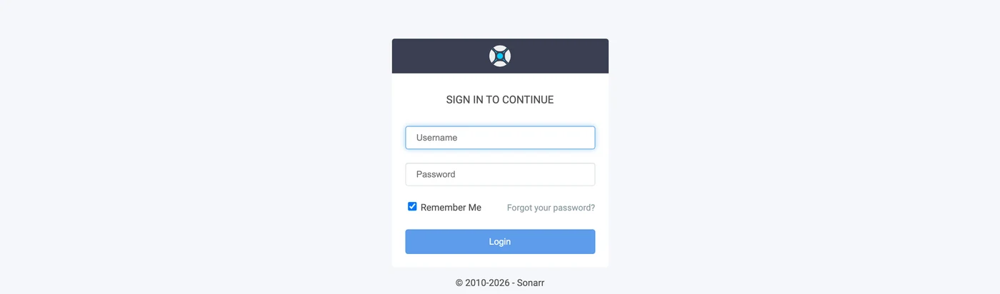
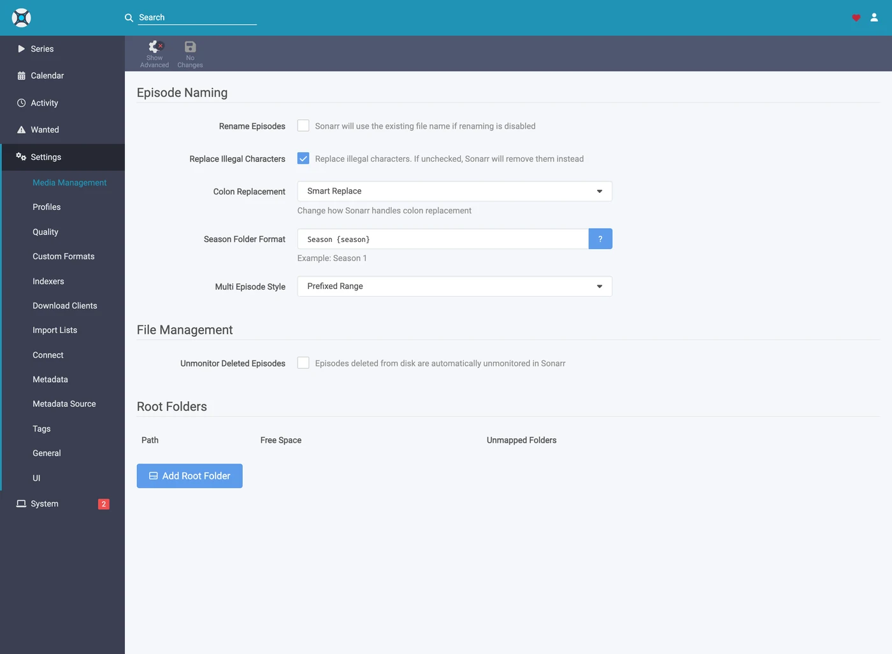

# Sonarr et Radarr, étape par étape {#sonarr-and-radarr-step-by-step}

Il existe trois façons d'utiliser Sonarr et Radarr avec zurg. Choisis qui cherche sur zurg ou les \*arrs. Voir
[lequel choisir](sonarr-radarr-fetch.md#which-one-to-pick).

| Guide | Qui cherche | zurg joue le rôle de | Il te faut |
|---|---|---|---|
| [Usenet](sonarr-radarr.md) | Sonarr et Radarr | un SABnzbd | un compte Usenet (ou TorBox Pro pour le backend `torbox_nzb`) et des indexeurs Usenet dans Prowlarr ou les \*arrs |
| [Torrents](sonarr-radarr-torrents.md) | Sonarr et Radarr | un qBittorrent | un compte debrid et des indexeurs torrent dans Prowlarr ou les \*arrs |
| [Recherches via zurg](sonarr-radarr-fetch.md) | zurg | aucun client de téléchargement | un compte Usenet, TorBox Pro ou debrid, et des indexeurs Newznab ou Torznab dans la config propre de zurg |

Les deux premières peuvent tourner côte à côte. Elles partagent le même dossier `__magic__`.

Configure Sonarr et Radarr pour pointer vers zurg afin de récupérer depuis Usenet sans client. Aucune vidéo complète n'est téléchargée ni décompressée
pendant une récupération. Les NZB et les caches utilisent quand même du disque. Cette page couvre Usenet. Le endpoint torrent utilise les mêmes clients et partage le dossier. Voir
[Sonarr et Radarr pour les torrents](sonarr-radarr-torrents.md).

Tout ce qui suit a été capturé avec zurg `nightly-993-g99bcf9a4`, Sonarr `4.0.19.2979` et Radarr `6.3.0.10514`, sur une installation en conditions réelles avec un vrai compte Usenet. Les noms d'hôte et d'utilisateur ont été remplacés par `you@zurg-server`. Les noms d'indexeurs sont `my-indexer`. Les clés API et les nombres de bibliothèque sont fictifs. Rien d'autre dans la sortie capturée n'a été modifié. Les lignes de log `torbox_nzb` ont été lues dans le code source de zurg le 2026-11-09, et non capturées en direct.

## Avant de commencer {#before-you-start}

Trois choses doivent être vraies. Vérifie les trois maintenant : chacune d'elles échoue plus tard sous la forme de quelque chose qui semble sans rapport.

1. **zurg a un fournisseur `nzb`, ou un `torbox_nzb` (TorBox Pro).** Sans l'un des deux, rien ne peut lire ce que l'endpoint écrit, et chaque tâche est signalée comme Failed au bout de 30 minutes, quand zurg abandonne l'attente de son apparition dans la bibliothèque. Voir [Usenet](usenet.md), ou [Usenet hébergé par TorBox](../providers/torbox-nzb.md) pour `torbox_nzb`.
2. **`magic.enabled` vaut `true`.** Sans cela, le dossier terminé n'existe pas et chaque import échoue. Voir [`__magic__`](magic.md).
3. **Le montage est visible par les \*arr au chemin que zurg indique.** Si Sonarr tourne dans un conteneur, lis [l'étape 8](#8-if-your-arr-is-in-docker) avant de configurer quoi que ce soit. Installé comme une application classique sur la même machine, il voit le montage là où zurg le monte, avec un piège sur chaque système :
   - **Linux :** un \*arr lancé sous un autre utilisateur que zurg voit un dossier vide tant que `user_allow_other` n'est pas activé. Voir [Installation sous Linux](../setup/linux.md#1-install-fuse-3).
   - **macOS :** lance-le avec le même utilisateur que zurg. Le montage est `/Volumes/Zurg`, sauf si tu as modifié `mount_path`.
   - **Windows :** lance Sonarr et Radarr comme application dans la zone de notification, ce que propose leur installateur, et non comme service Windows. Le lecteur `Z:` de zurg appartient à la session dans laquelle tu es connecté, et un service s'exécute en dehors de cette session, donc il ne voit pas le lecteur. Voir [les règles de session](../setup/windows.md#keeping-it-running-the-session-rules).

Vérifie les deux premiers directement dans le fichier de configuration, dans le répertoire de travail de zurg. Sous Windows, ouvre plutôt `config.yml` dans Bloc-notes.

```bash
$ grep -A6 '^providers:' config.yml
providers:
- type: nzb
  nntp:
    host: news.example.com
    port: 563
    tls: true
    username: <redacted>
    password: <redacted>

$ grep -A4 '^magic:' config.yml
magic:
  enabled: true
  allow_delete: false
  sidecar_max_mb: 32
  sidecar_budget_mb: 2048
```

`allow_delete: false` est la valeur sûre par défaut et n'affecte pas les imports : une suppression dans `__magic__` masque l'entrée au lieu de retirer du contenu du compte.

## 1. Activer l'endpoint {#1-turn-the-endpoint-on}

Deux méthodes, même résultat. Les deux écrivent dans `config.yml` et nécessitent toutes deux un redémarrage : les routes qui servent `__magic__` et l'endpoint SABnzbd sont enregistrées une seule fois, au démarrage de zurg.

### Option A — le tableau de bord {#option-a--the-dashboard}

Ouvre le tableau de bord de zurg, clique sur **Config**, puis fais défiler jusqu'à **\_\_magic\_\_ & Download Clients**. Active **Serve \_\_magic\_\_** et **SABnzbd Endpoint**, puis règle **SABnzbd Categories** sur `tv, movies`.


**Config** est l'endroit où se trouve le réglage ; **Magic** est l'endroit où tu verras arriver les grabs plus tard.


Laisse **SABnzbd Completed Directory** vide, sauf si ton \*arr monte zurg à un autre endroit que zurg lui-même — voir [étape 8](#8-if-your-arr-is-in-docker). La pastille orange **Restart Required** dit vrai : rien de ce qui se trouve ici ne prend effet tant que zurg n'a pas redémarré.

### Option B — `config.yml`

Ajoute le bloc à la main, puis redémarre zurg.

```yaml
magic:
  enabled: true

sabnzbd:
  enabled: true
  api_key: ""          # empty = zurg generates one and keeps it
  categories: [tv, movies]
  complete_dir: ""     # empty = <mount_path>/__magic__/__all__
```

**Les catégories ne sont pas des dossiers.** Elles mènent toutes au même endroit : le dossier d'une tâche est le dossier propre de la release sous `__magic__/__all__`. La liste sert seulement à ce que Sonarr et Radarr arrêtent d'avertir au sujet d'une catégorie qu'ils ne trouvent pas. Si la catégorie de Sonarr est `tv`, `tv` doit figurer dans cette liste.

Redémarre zurg, puis vérifie que le provider a bien été pris en compte :


Une seule ligne `nzb` ou `torbox_nzb` suffit pour le endpoint.

## 2. Trouver la clé API {#2-find-the-api-key}

La clé API est toute l'authentification de cet endpoint. Récupère-la correctement une fois, et ne la colle nulle part en public.

**Si tu as laissé `api_key` vide**, zurg en a généré une au premier démarrage et l'a écrite dans `data/sabnzbd-apikey` :

```bash
$ cat data/sabnzbd-apikey
0123456789abcdef0123456789abcdef

```

Clé d'exemple, la tienne sera différente. Le fichier survit aux redémarrages, donc la clé reste stable une fois générée.

**Si tu as défini `api_key` toi-même**, elle se trouve dans `config.yml` et aucun fichier n'est écrit. Le tableau de bord t'indique dans quel cas tu te trouves, en bas du bloc de l'étape 1. Il affiche soit *pinned in config.yml under `sabnzbd.api_key`*, soit *generated and kept in `data/sabnzbd-apikey`*.

**Cet endpoint n'est pas couvert par l'authentification basique de zurg.** Ni Sonarr ni Radarr n'envoient jamais d'authentification basique à un client de téléchargement, et leur couche HTTP transforme un 401 en « unable to connect », sans rien d'exploitable. zurg exempte donc volontairement `/api`. La clé API est le seul verrou. Traite ce port comme le reste de zurg : sur un réseau de confiance, ou derrière quelque chose qui l'est.

## 3. Vérifier qu'elle répond {#3-prove-it-answers}

Fais ça avant de toucher à Sonarr. Ça prend dix secondes et ça permet de savoir, pour le reste de la configuration, si le problème vient de zurg ou du \*arr.

+++ Linux et macOS

```bash
$ SAB=0123456789abcdef0123456789abcdef
$ ZURG=192.168.88.245:9996

$ curl -s "http://$ZURG/api?mode=version&apikey=$SAB&output=json"
{"version":"4.5.1"}

$ curl -s "http://$ZURG/api?mode=get_config&apikey=$SAB&output=json" \
    | jq '.config.misc.complete_dir, [.config.categories[].name]'
"/mnt/zurg_usenet/__magic__/__all__"
[ "*", "tv", "movies" ]
```

+++ Windows

Dans PowerShell. Tape `curl.exe`, et non `curl` : dans Windows PowerShell, `curl` est une autre commande.

```powershell
PS> $SAB = "0123456789abcdef0123456789abcdef"
PS> $ZURG = "192.168.88.245:9996"

PS> curl.exe -s "http://$ZURG/api?mode=version&apikey=$SAB&output=json"
{"version":"4.5.1"}

PS> (Invoke-RestMethod "http://$ZURG/api?mode=get_config&apikey=$SAB&output=json").config.misc.complete_dir
Z:/__magic__/__all__
```

+++

`complete_dir` est le chemin que zurg donnera aux clients. Vérifie maintenant que c'est un chemin qu'*eux* peuvent ouvrir.

Ensuite, vérifie qu'une mauvaise clé est bien refusée (sous Windows, `curl.exe` avec les mêmes URL) :

```bash
$ curl -s "http://$ZURG/api?mode=queue&apikey=wrongkey&output=json"
{"status":false,"error":"API Key Incorrect"}

$ curl -s "http://$ZURG/api?mode=queue&output=json"
{"status":false,"error":"API Key Required"}
```

**`mode=version` ne sert pas à tester l'authentification.** Il répond `{"version":"4.5.1"}` même avec une mauvaise clé. C'est le comportement de SABnzbd, et zurg le reproduit. Utilise `mode=queue` ou `mode=get_config` si ce que tu veux vraiment tester, c'est la clé.

Les deux formes d'URL fonctionnent, donc tu peux utiliser l'une ou l'autre dans le champ **URL Base** du client :

| Chemin | URL Base dans Sonarr / Radarr | Répond |
|---|---|---|
| `/api` | *(laisser vide)* | oui |
| `/sabnzbd/api` | `/sabnzbd` | oui |

Si `/api` renvoie un simple **404**, c'est que `sabnzbd.enabled` est toujours à false, ou que zurg n'a pas été redémarré depuis que tu l'as modifié.

## 4. Créer les dossiers racines {#4-make-the-root-folders}

Crée-les avant de les ajouter, car la fenêtre Add Root Folder du \*arr parcourt le système de fichiers en direct et ne proposera pas un dossier qui n'existe pas.

+++ Linux et macOS

```bash
$ mkdir -p /mnt/zurg_usenet/__magic__/tv /mnt/zurg_usenet/__magic__/movies

$ ls -d /mnt/zurg_usenet/__magic__/tv /mnt/zurg_usenet/__magic__/movies
/mnt/zurg_usenet/__magic__/movies
/mnt/zurg_usenet/__magic__/tv
```

+++ Windows

```powershell
PS> New-Item -ItemType Directory -Force Z:\__magic__\tv, Z:\__magic__\movies
```

Ou crée les deux dossiers dans l'Explorateur.

+++

Remplace `/mnt/zurg_usenet` par ton propre `mount_path`. Si rien n'est défini, il vaut `/mnt/zurg` sur Linux, `/Volumes/Zurg` sur macOS et `Z:` sous Windows. Les noms des dossiers sont à toi de choisir ; `tv` et `movies` correspondent simplement aux catégories.

**Le dossier racine doit être à côté du dossier completed, ni dedans ni au-dessus.** zurg donne aux clients `__magic__/__all__`, c'est-à-dire ta bibliothèque telle que `__all__` la liste. Tes dossiers racine se trouvent juste à côté, dans `__magic__/tv` et `__magic__/movies`. **Pas** `__magic__/__all__`, **pas** `__magic__` lui-même et **pas** `/mnt/zurg_usenet`. Les deux clients affichent une vérification de santé quand un dossier racine *est* le dossier de sortie du client de téléchargement, et Radarr en affiche aussi une quand un dossier racine *contient* ce dossier. Les dossiers frères ne déclenchent aucun des deux, et un import manuel pointé vers le dossier completed n'a alors qu'une seule release à examiner au lieu de toute ta bibliothèque.

Voici à quoi ressemble une erreur. Les deux captures sont réelles, prises sur les deux clients. Elles datent d'avant que le dossier completed ne descende vers `__magic__/__all__`, donc les chemins affichés sont d'un niveau plus haut que les tiens ; les deux règles qu'elles montrent sont les mêmes :


Sonarr avec le dossier completed lui-même ajouté comme dossier racine : il avertit parce que le dossier racine *est* le dossier de sortie.


Radarr avec `/mnt/zurg_usenet` ajouté : il avertit aussi pour le parent, ce que Sonarr ne fait pas. Déplace le dossier racine à côté du dossier completed et les deux avertissements disparaissent.

## 5. Ajouter le client dans Sonarr {#5-add-the-client-in-sonarr}

Une nouvelle installation de Sonarr bloque tout derrière un écran de premier lancement. Choisis **Forms (Login Page)**, définis un nom d'utilisateur et un mot de passe, puis clique sur **Save**.


Tu ne pourras pas passer tant que **Authentication Method** n'est pas réglé sur autre chose que None.


Après Save, tu es déconnecté une fois et tu arrives sur la page de connexion.



### Settings → Download Clients

Rendez-vous dans **Settings → Download Clients**. Sur une installation fraîche, il n'y a rien ici à part la carte **+**.


Cliquez sur le **+** sous « Download Clients », et non celui plus bas, sous « Remote Path Mappings ».

Choisissez **SABnzbd** dans la colonne **Usenet**.


zurg imite spécifiquement SABnzbd, donc rien d'autre dans cette liste ne fonctionnera.

La fenêtre s'ouvre avec les valeurs par défaut de SABnzbd : `localhost`, port `8080`, sans clé.


### Ce qu'il faut mettre dans chaque champ {#what-to-put-in-each-field}

| Field | Value | Why |
|---|---|---|
| Name | `zurg (Usenet)` | N'importe quoi. C'est juste une étiquette. |
| Enable | on | Laisse la case cochée. |
| Host | `192.168.88.245` | L'hôte sur lequel tourne zurg, accessible depuis *le \*arr*. `localhost` si le *\*arr* est une appli classique sur la même machine. Avec Docker, voir l'avertissement ci-dessous. |
| Port | `9996` | Le port normal de zurg : `9999` sur une installation par défaut. |
| Use SSL | off | Seulement si tu mets zurg derrière TLS toi-même. |
| API Key | depuis l'étape 2 | Le vrai verrou. |
| Username | empty | Incompatible avec la clé. Seule la clé est acceptée. |
| Password | empty | Idem. |
| Category | `tv` | Doit apparaître dans `sabnzbd.categories`. |
| Recent / Older Priority | Default | zurg n'a rien auquel appliquer une priorité. |
| Remove Completed | on | Laisse le client nettoyer ses propres enregistrements de tâches. Laisse-le activé. |
| Remove Failed | on | Idem. |


La clé API affichée est un exemple : colle la tienne.

**Dans Docker, « localhost » et le nom d'hôte mentent tous les deux.** Dans un conteneur, `localhost` désigne le conteneur lui-même, et le nom d'hôte de la machine correspond en général à `127.0.1.1`, qui est aussi le conteneur. Utilise l'**IP LAN ou Tailscale** de l'hôte, jamais `localhost` ni le nom d'hôte seul, même si les deux fonctionnent très bien depuis ton shell.

Clique sur **Test**. Une coche verte signifie que les quatre vérifications du client ont réussi : version, clé API, configuration globale et catégorie.


Clique maintenant sur **Save**.


## 6. Ajouter le dossier racine dans Sonarr {#6-add-the-root-folder-in-sonarr}

Allez dans **Settings → Media Management** et faites défiler jusqu'en bas.



Cliquez sur **Add Root Folder**. Un explorateur de fichiers s'ouvre sur le système de fichiers de Sonarr, qui, avec Docker, est celui du conteneur.


Saisissez le chemin dans la zone en haut. Si le montage est bien visible pour Sonarr, le contenu de `__magic__` s'affiche pendant que vous tapez : `__all__` avec toutes les releases, ainsi que tout ce que vous avez créé à côté. C'est la preuve la plus rapide que le bind mount est correct.


Si le dossier est vide ou si une erreur apparaît, arrêtez-vous et corrigez le montage avant de continuer.


Terminez le chemin par `__magic__/tv` (`Z:\__magic__\tv` sous Windows) et cliquez sur **Ok**.


Si **Free Space** affiche un nombre plausible, Sonarr peut lire les informations du montage. **Unmapped Folders** compte les releases qui se trouvent déjà à cet endroit.

## 7. Faire de même dans Radarr {#7-do-the-same-in-radarr}

Identique, avec deux valeurs modifiées : la catégorie est `movies` et le dossier racine est `__magic__/movies`.


La première exécution de Radarr fonctionne de la même façon : active Forms auth, puis connecte-toi.


**Settings → Download Clients → +**, puis **SABnzbd** sous Usenet.


Même hôte, même port, même clé. Seule la **Category** change : `movies`, et non `tv`.


**Test**, coche verte, **Save**.


Ensuite, va dans **Settings → Media Management → Root Folders → Add Root Folder** et ajoute `/mnt/zurg_usenet/__magic__/movies`.

**Un seul zurg, deux clients, une seule file d'attente.** La file d'attente et l'historique de zurg sont filtrés uniquement par catégorie. Deux Sonarr utilisant `tv` verront les tâches de l'autre ; Sonarr sur `tv` et Radarr sur `movies` ne se verront pas. Avec un seul client par catégorie, ce problème n'arrive jamais.

## 8. Si votre \*arr tourne dans Docker {#8-if-your-arr-is-in-docker}

Cette étape concerne Docker sur un hôte Linux. Docker Desktop sur macOS et Windows exécute les conteneurs dans une machine virtuelle. Le montage `rslave` ci-dessous repose sur la propagation de montage de Linux (voir [Docker setup](../setup/docker.md)), et le fait de transmettre le montage de zurg à un conteneur sur ces systèmes n'a pas été testé. Sur macOS et Windows, installez plutôt Sonarr et Radarr comme applications classiques, comme le décrit [Before you start](#before-you-start).

Trois problèmes distincts. Le deuxième coûte un téléchargement à chaque import. Le troisième ne se manifeste qu'à la première fois que zurg redémarre.

### Le chemin que zurg signale doit être un chemin que le client peut ouvrir {#the-path-zurg-reports-must-be-a-path-the-client-can-open}

Si le conteneur monte la bibliothèque à un autre endroit que zurg, chaque import échoue avec *download doesn't contain intermediate path* ou avec un health check de remote path. Vous pouvez corriger ça de l'une ou l'autre façon, les deux conviennent :

- **Définissez `sabnzbd.complete_dir`** avec le chemin que *le client* voit. C'est le plus simple quand il n'y a qu'un seul client, ou plusieurs qui montent la bibliothèque au même endroit.
- **Ajoutez un remote path mapping** dans le \*arr. Utilisez cette option quand différents clients la montent différemment.

```yaml
sabnzbd:
  complete_dir: "/data/zurg/__magic__/__all__"   # what the *arr sees, not what zurg sees
```

Pour la seconde, allez dans **Settings → Download Clients** et cliquez sur le **+** sous **Remote Path Mappings**, celui du bas de la page, pas celui utilisé à l'étape 5.


**Host** doit être exactement la chaîne d'hôte que vous avez saisie dans le download client. **Remote Path** est le chemin que zurg indique ; **Local Path** est l'endroit où le client le voit.

### Un seul volume pour le dossier de téléchargement et les dossiers racines {#one-volume-for-the-download-folder-and-the-root-folders}

Un import depuis `__magic__/__all__` vers `__magic__/tv` ne coûte rien, car c'est un simple renommage. Un renommage ne fonctionne qu'à l'intérieur d'un même montage. Si vous donnez au conteneur les deux dossiers comme deux volumes, il voit deux systèmes de fichiers. Les deux sont pourtant le montage de zurg en dessous, et ça ne change rien.

```yaml
    volumes:                                        # do not do this
      - /mnt/zurg_usenet/__magic__/__all__:/downloads
      - /mnt/zurg_usenet/__magic__/tv:/tv
```

Le noyau refuse le renommage dans le conteneur. Sonarr et Radarr copient alors le fichier puis suppriment l'original, sans rien dire. Chaque import télécharge toute la release depuis votre compte et l'écrit sur le disque de zurg. L'import réussit quand même. Il est juste lent. Un épisode de 1.46 GB a pris 50 secondes et 2.9 GB de trafic de cette façon. Avec un seul volume, ça a pris une seconde et rien n'a été lu.

Donnez au conteneur un seul volume qui contient tout le montage de zurg. Accédez au dossier de téléchargement et aux dossiers racine à travers lui. Le bind de la section suivante fait exactement cela. Un remote path mapping ou `complete_dir` pointe ensuite le client vers `__all__` dans ce même volume.

Un import manuel réglé sur **Hardlink/Copy Files** copie aussi. Choisissez **Move Files**.

### Monter le parent du point de montage, pas le point de montage lui-même {#bind-the-mounts-parent-not-the-mountpoint}

C'est celui qui coûte un après-midi. C'est aussi le seul volume que la section ci-dessus demande. Redémarrer zurg démonte `/mnt/zurg_usenet` puis le remonte. Un conteneur qui a monté **le point de montage lui-même** garde la connexion fuse avec laquelle il a démarré, et celle-ci est maintenant morte. Chaque lecture répond alors `Socket not connected`, et comme les deux clients vérifient l'espace libre sur le dossier racine avant de lancer un téléchargement, **chaque release est silencieusement rejetée** :

```
FreeSpaceSpecification: Socket not connected
```

Rien dans aucun des deux clients n'indique que le montage est périmé. Le dossier apparaît toujours dans le conteneur, et un grab interactif envoyé directement au client fonctionne encore. Ce que ça donne, c'est un \*arr qui a discrètement cessé de chercher.

Monte le **parent** avec `rslave`, et le remontage arrive comme un événement de sous-montage que le conteneur suit :

```yaml
    volumes:
      - type: bind
        source: /mnt          # the parent, not /mnt/zurg_usenet
        target: /mnt
        bind:
          propagation: rslave
```

Vérifie un conteneur après chaque redémarrage de zurg. Tu veux voir une taille, pas une erreur :

```bash
$ docker exec radarr df -h /mnt/zurg_usenet
Filesystem      Size  Used Avail Use% Mounted on
zurg{PGSq4}:    1.0P     0  1.0P   0% /mnt/zurg_usenet
```

Le pétaoctet, c'est zurg qui signale un système de fichiers virtuel, pas un disque. C'est normal, et c'est précisément ce qui satisfait la vérification d'espace libre du \*arr.

## 9. Suivre un envoi du début à la fin {#9-watch-one-grab-go-through}

Ajoute une seule chose, lance-la à la main et suis-la jusqu'au bout. Tout ce qui suit est un vrai grab fait avec la configuration décrite plus haut.

### Lancer le téléchargement {#grab-it}

Ouvrez un film (ou un épisode), cliquez sur **Interactive Search**, puis choisissez une release.


La colonne **Source** affiche `nzb`, c'est le protocole que zurg peut prendre en charge.

Cliquez sur le bouton avec la flèche circulaire à la fin de la ligne pour lancer le téléchargement. Si la release ne correspond pas proprement, le client vous demande d'abord de confirmer le mapping :


**Override and Grab** apparaît quand le client veut que vous confirmiez ce qu'est la release. Vérifiez le mapping puis cliquez sur **Grab Release**. Un grab automatique normal n'affiche jamais cette fenêtre.

### Il arrive dans la file d'attente {#it-lands-in-the-queue}


**Activité → File d'attente** juste après la prise. Remarquez la barre de progression : elle est pleine, et **Time Left** affiche un tiret. Il n'y a aucun téléchargement à mesurer, donc une tâche est soit en file d'attente, soit terminée, et il n'y a rien entre les deux. *Les autres lignes ici appartiennent à un second Radarr pointé vers le même zurg, sur la même catégorie* — voir la note à l'étape 7.

### zurg écrit le NZB puis le lit {#zurg-writes-the-nzb-and-reads-it}

```
Aug 25 14:44:03 zurg-server zurg[3034965]: INFO  nzb  Loaded NZB
  Last.Week.Tonight.with.John.Oliver.S13E22.480p.WEB.x264-RMTeam.nzb: 4 files
Aug 25 14:50:28 zurg-server zurg[3034965]: INFO  nzb  Loaded NZB
  Untold.The.Testimony.of.Vince.Young.2026.1080p.NF.WEB-DL.DD+5.1.Atmos.H.264-playWEB.nzb: 9 files
```

`Loaded NZB … : N files` est la ligne qui indique que le NZB a été analysé. Si un job est signalé Failed après 30 minutes, quand zurg abandonne l'attente de son apparition dans la bibliothèque, c'est cette ligne qui manque.

### L'import se fait {#the-import-happens}


**Activity → History**. Deux événements, à quelques secondes d'écart : **Grabbed**, puis **Movie Imported**.


**Status: Downloaded**, **Size 4.7 GiB**, et pourtant rien n'a été téléchargé.

### Vérifier que le fichier est réel {#prove-the-file-is-real}

L'import a déplacé le fichier dans le dossier racine. Vérifie les deux extrémités du fichier et demande à ffprobe ce que c'est :

+++ Linux et macOS

Si ton shell ne trouve pas `ffprobe`, utilise `~/zurg/bin/ffprobe` : le setup y place sa propre copie quand aucune n'est installée.

```bash
$ ls -la "/mnt/zurg_usenet/__magic__/movies/Untold - The Testimony of Vince Young (2026)/"
-rw-r--r-- 1 you you 4920958828 Aug 25 14:53 Untold.The.Testimony…playWEB.mkv

$ dd if="$F" bs=1M count=1 >/dev/null
1048576 bytes (1.0 MB, 1.0 MiB) copied, 0.0429446 s, 24.4 MB/s

$ ffprobe -v error -show_entries format=duration,size,format_name \
    -of default=noprint_wrappers=1 "$F"
format_name=matroska,webm
duration=4709.440000
size=4920958828
```

+++ Windows

Dans PowerShell, depuis le dossier de zurg. Le setup y a placé `bin\ffprobe.exe`, sauf si un `ffprobe` était déjà dans ton PATH ; dans ce cas, tape `ffprobe` à la place :

```powershell
PS> $F = Get-Item "Z:\__magic__\movies\Untold - The Testimony of Vince Young (2026)\*.mkv"
PS> $F.Length
4920958828

PS> bin\ffprobe.exe -v error -show_entries format=duration,size,format_name -of default=noprint_wrappers=1 $F.FullName
format_name=matroska,webm
duration=4709.440000
size=4920958828
```

+++

Un Matroska de 78 minutes, streamé à partir d'articles Usenet à la demande. Les octets arrivent quand quelque chose les lit, pas quand les \*arr importent.

## 10. Ajouter une release à la main {#10-adding-a-release-by-hand}

Parfois Sonarr ou Radarr ne récupère jamais la release que vous voulez. Les indexeurs qu'il interroge ne l'ont peut-être pas, ou un profil de qualité ou un format personnalisé la refuse. Vous pouvez donner vous-même le NZB à zurg, sous la catégorie de l'application qui doit l'importer. Cette application l'importe alors comme si elle l'avait récupérée elle-même.

Si la release se trouve sur un indexeur que l'application interroge, essayez d'abord l'application. **Interactive Search** affiche aussi les releases rejetées. En en récupérant une, elle part vers zurg comme n'importe quelle autre récupération. Radarr a récupéré une release IMAX que son profil avait rejetée, avec un score de 0 par rapport à un format personnalisé requis, et l'a importée.

+++ Linux et macOS

```bash
$ SAB=0123456789abcdef0123456789abcdef
$ ZURG=192.168.88.245:9996

# an NZB file you already have (the upload field is called name, as in SABnzbd)
$ curl -s "http://$ZURG/api?mode=addfile&apikey=$SAB&cat=movies" \
    -F 'name=@Movie.Title.2024.1080p.WEB-DL.nzb'
{"status":true,"nzo_ids":["SABnzbd_nzo_…"]}

# or a link to one, which zurg downloads itself
$ curl -s -G "http://$ZURG/api" \
    --data-urlencode mode=addurl --data-urlencode "apikey=$SAB" --data-urlencode cat=movies \
    --data-urlencode 'name=https://indexer.example/getnzb/<id>?r=<indexer-key>' \
    --data-urlencode nzbname=Movie.Title.2024.1080p.WEB-DL
{"status":true,"nzo_ids":["SABnzbd_nzo_…"]}
```

+++ Windows

En PowerShell, avec `curl.exe` et non `curl`. Chacune répond `{"status":true,"nzo_ids":[…]}` comme ci-dessus.

```powershell
$SAB = "0123456789abcdef0123456789abcdef"
$ZURG = "192.168.88.245:9996"

# an NZB file you already have (the upload field is called name, as in SABnzbd)
curl.exe -s "http://$ZURG/api?mode=addfile&apikey=$SAB&cat=movies" -F "name=@Movie.Title.2024.1080p.WEB-DL.nzb"

# or a link to one, which zurg downloads itself
curl.exe -s -G "http://$ZURG/api" `
  --data-urlencode mode=addurl --data-urlencode "apikey=$SAB" --data-urlencode cat=movies `
  --data-urlencode "name=https://indexer.example/getnzb/<id>?r=<indexer-key>" `
  --data-urlencode nzbname=Movie.Title.2024.1080p.WEB-DL
```

+++

`--data-urlencode` garde le `?` et le `&` du lien à l'intérieur de `name`. La tâche apparaît dans la file de l'application lors de sa prochaine vérification, dans la minute.

Cinq éléments déterminent la suite.

1. **Le film ou la série doit déjà être dans cette application.** Elle n'importe que ce qu'elle peut associer à un élément qu'elle gère.
2. **Le nom doit indiquer de quoi il s'agit.** La tâche prend le nom de fichier du NZB, ou `nzbname` si vous le passez. Sans `nzbname`, `addurl` utilise le nom de fichier servi par l'indexeur. Ajoutez une année au nom.
3. **La catégorie choisit l'application.** `cat=movies` atteint le Radarr dont le client de téléchargement utilise `movies`. Chaque application ne regarde que sa propre catégorie.
4. **Le profil de qualité ne bloque pas l'import. Le fichier que vous avez déjà peut le bloquer.** Radarr ne vérifie ni les qualités autorisées ni le score minimum de format personnalisé à l'import. Il a importé un BluRay 720p avec un score de 0 dans un profil qui n'autorise que le 2160p et exige un score de 100. Il a aussi importé un WEBRip 1080p dans un film dont le profil n'autorise que le 720p. Il a ensuite pris un BluRay 1080p à la place, comme mise à niveau, et supprimé le WEBRip. Un WEB-DL ajouté après cela s'est arrêté dans Activity avec *Not an upgrade for existing movie file*. **Activity → Queue → Manual Import** l'importe quand même et remplace le fichier.
5. **Un échec, c'est à vous de le régler.** L'application ne met jamais sur liste noire et ne supprime jamais un téléchargement qu'elle n'a pas récupéré elle-même. Une release dont les articles avaient disparu des serveurs de news est revenue en Failed depuis zurg et est restée dans la file de Radarr avec *Download has failed wasn't grabbed by Radarr, skipping automatic download handling*. Retirez-la de la file et choisissez une autre release.

Mesuré le 2026-10-10 avec Radarr 6.3, en utilisant `addfile` et `addurl`, y compris un profil qui exige un format personnalisé construit à partir d'un nom de release. Chaque import était un renommage vers `__magic__/movies` et rien n'a été copié. Sonarr n'a pas été testé.

Merci à **.telmen** sur Discord d'avoir demandé comment faire cela avec Usenet.

## Suivre les choses du côté de zurg {#watching-from-zurgs-side}

La page `/magic/` de zurg liste chaque NZB qui a déjà été envoyé à l'endpoint. Sonarr et Radarr suppriment les jobs qu'ils ont récupérés, et l'enregistrement est conservé une semaine après, pour qu'un poll qui arrive en même temps qu'une suppression réponde toujours la même chose. Un job **Failed** ou **Stuck** (en file d'attente depuis plus d'une heure) qu'aucun client ne supprimera jamais, par exemple après avoir arrêté d'utiliser zurg comme client de téléchargement, peut être nettoyé ici en maintenant son bouton **Clear** enfoncé. Le nettoyage d'un job supprime son NZB, sauf si un import l'utilise encore.


Les **Placements** sont les fichiers que les clients ont déplacés ; les **tombstones** sont les dossiers de jobs qu'ils ont supprimés ensuite. Si un client copie au lieu de déplacer, la page affiche un tableau rouge **Imports that were copies**. zurg transforme ces copies en placements et les supprime, mais chacune était quand même un téléchargement complet, donc corrige les volumes.


**State** résume tout : **Queued** veut dire que zurg n'a pas encore fini avec la release, que ce soit parce que la bibliothèque ne l'a pas encore listée, que ses tailles de fichiers ne sont pas stabilisées ou que ses articles n'ont pas encore été vérifiés ; **Completed** veut dire qu'elle est prête à être importée ; et **Release** indique le dossier depuis lequel le client importe.

La colonne **Release** est lue depuis la bibliothèque à chaque poll, elle n'est pas stockée. Renomme la release dans le dashboard de zurg, laisse une réparation la reconstruire, ou laisse zurg ajouter un suffixe parce que deux releases portent le même nom : le job suit le changement.

## Ce qui fonctionne, et ce qui ne fonctionne pas {#what-works-and-what-does-not}

Fonctionne :

- Le test de connexion, les quatre vérifications, dans les deux clients.
- La récupération, la file d'attente, l'historique, l'import par renommage et le nettoyage après import.
- Relancer la même release. Chaque nouvelle récupération reçoit son propre identifiant de tâche, pour que le client agisse dessus au lieu de réutiliser le résultat de l'ancienne tâche. La release sous-jacente reste la même. Une nouvelle récupération d'une release qu'un import précédent a déjà vidée est signalée **Failed**. Son dossier sous `__magic__/__all__` n'a plus rien à importer, et Failed fait que le client la met sur liste noire et en essaie une autre. La récupération qui a vidé le dossier affiche toujours Completed jusqu'à ce que le client la supprime.
- Retirer une tâche de la file d'attente, avec ou sans suppression du NZB.
- `mode=addurl`, pour une personne ou une automatisation qui transmet une URL au lieu d'envoyer un fichier. Aucun des \*arr ne l'utilise.

Ne fait pas :

- **Pas de progression.** Une tâche est en attente ou terminée ; il n'y a pas de pourcentage entre les deux, car il n'y a pas de téléchargement à mesurer. La file d'attente affiche la taille déclarée du NZB pour que la ligne ne soit pas vide.
- **Pas de pause, de reprise, de limite de vitesse, de priorité ni de script de post-traitement.** SABnzbd propose tout cela ; zurg n'a rien à leur appliquer.
- **`del_files` lors de la suppression d'une tâche terminée dans l'historique est ignoré.** (Pour une tâche Failed, il supprime le NZB si rien n'a été importé à partir de celui-ci.) Le client veut dire « le dossier de la tâche est de nouveau à vous », mais le fichier qui vient d'être importé continue d'être servi à partir de ce NZB. Le dossier que le client voulait voir disparaître a disparu : il l'a supprimé lui-même, via le montage.
- **L'authentification de base ne peut pas protéger ce point d'accès.** La clé API est le seul verrou.

**Le signal d'échec.** Une release qui ne contient rien d'importable est signalée **Failed**, et les deux clients la mettent sur liste noire et récupèrent une alternative. Cela couvre une release dont tous les fichiers sont cassés, supprimés ou filtrés ; une release ne contenant que des `.par2`, des `.sfv` et des fichiers annexes ; une release dont chaque fichier a un format qu'aucun lecteur ne gère, ce qui correspond à un post obfusqué qui nomme son jeu RAR `.z001`…`.z133` ; et une archive déjà ouverte dont on a constaté qu'elle ne contient aucun média. Un jeu RAR est du contenu, pas un simple échafaudage : zurg diffuse la vidéo directement à partir de celui-ci. Si une release contient vraiment quelque chose pour lequel zurg n'a pas d'extension, élargissez `addl_playable_extensions` plutôt que de la mettre sur liste noire.

**Les articles sont vérifiés avant qu'une tâche soit signalée comme terminée.** zurg attend que la bibliothèque liste la release et que la taille de ses fichiers se soit stabilisée. Il interroge ensuite les serveurs de news sur le début et la fin de chaque fichier de contenu, soit les seize premiers articles et le dernier. Il télécharge aussi le premier article de chaque fichier. Cela représente jusqu'à soixante-quatre articles, plus quelques-uns pour une release qui ne comporte que quelques fichiers. Certains serveurs de news indiquent encore qu'un article existe alors que son contenu a été retiré, et seul un téléchargement le révèle. Un article téléchargé montre aussi qu'il appartient bien à ce post et non à un autre envoi. La tâche reste **Queued** tant que cette vérification n'a pas abouti. Les dommages que l'échantillon n'atteint pas ne sont pas détectés ici ; ils apparaissent lors de la lecture qui les atteint. Une release dont les articles sont absents reçoit d'abord une réparation PAR2, puis est vérifiée à nouveau une fois la réparation effectuée. Si elle est de nouveau complète, elle continue. Si elle manque encore des articles, ou si rien ne peut la réparer, elle est signalée **Failed** avec le nombre d'éléments manquants. C'est un échec de *téléchargement*, celui sur lequel les clients agissent : ils mettent la release sur liste noire et en récupèrent une autre sans intervention, plutôt que d'importer quelque chose qui ne se lira pas. Avec `torbox_nzb`, il n'y a ni serveurs de news ni vérification d'articles : une récupération est vérifiée uniquement par le fait que TorBox a récupéré le NZB.

**Une vérification qui ne peut pas aboutir n'attend pas indéfiniment.** Parfois, la vérification ne peut pas se terminer du tout. Le pool de connexions peut être hors service, le compte peut être limité ou le délai peut être dépassé. Ce n'est pas une réponse. La tâche reste **Queued** et est interrogée à nouveau une minute plus tard. zurg compte les tentatives sur la tâche, pour qu'un redémarrage ne les oublie pas. Après trente échecs consécutifs sur une période d'au moins trois heures, la tâche passe dans l'historique avec le statut **Failed**. Le message indique le nombre de tentatives, la durée et la dernière erreur. Une panne faite uniquement de refus explicites atteint trente tentatives en moins d'une heure et ne fait pas échouer la file d'attente pour autant.

**Une release qui quitte la bibliothèque fait échouer sa tâche.** Une release peut être supprimée depuis le tableau de bord, voir son NZB retiré du répertoire surveillé, ou être abandonnée par tous les comptes. Sa tâche reste **Queued** pendant quinze minutes, puis passe dans l'historique avec le statut **Failed**. Le client met la release sur liste noire et en récupère une autre. Cette attente existe pour les redémarrages : la bibliothèque retire toutes les releases pendant son chargement, et cela ne doit pas être interprété comme une suppression. Rien n'échoue pour ce motif pendant les quinze premières minutes après le démarrage de zurg. Une tâche dont la release n'a jamais été listée par la bibliothèque n'est pas concernée, car elle est encore en cours d'arrivée.

## Dépannage {#troubleshooting}

| Ce que dit le \*arr | Ce que ça signifie |
|---|---|
| "Unable to connect to SABnzbd" | zurg n'est pas joignable à cet hôte et ce port, ou quelque chose devant lui a répondu avec un code autre que 200. Vérifiez `sabnzbd.enabled` : tant qu'il est désactivé, `/api` renvoie une simple 404. Avec Docker, vérifiez que vous n'avez pas utilisé `localhost` ni le nom d'hôte seul. |
| "API Key Incorrect" / "API Key Required" | La clé ne correspond pas. Elle se trouve dans `config.yml` si vous en avez défini une, ou dans `data/sabnzbd-apikey` si zurg l'a générée. |
| "Test was aborted due to an error" | Il s'agit d'une erreur autre qu'un échec d'authentification. zurg journalise chaque requête qu'il a refusée : cherchez `SABnzbd:` dans le journal. |
| "Category … does not exist" | La catégorie du \*arr n'est pas dans `sabnzbd.categories`. Ajoutez-la puis redémarrez zurg. |
| "Downloads in root folder" | Un dossier racine se trouve au niveau du dossier des téléchargements terminés ou au-dessus. Déplacez-le à côté : `__magic__/tv`, pas `__magic__/__all__`, pas `__magic__` et pas `/mnt/zurg_usenet`. |
| "Remote path mapping" / "download doesn't contain intermediate path" | Le chemin que zurg signale n'est pas un chemin auquel le client peut accéder. Voir [étape 8](#8-if-your-arr-is-in-docker). |
| Les imports réussissent mais prennent autant de temps qu'un téléchargement, et la page `/magic/` de zurg les liste sous **Imports that were copies** | Le client copie depuis `__magic__/__all__` au lieu de renommer. Son conteneur a le dossier de téléchargement et les dossiers racines sur deux volumes différents. Ou alors un import manuel a été réglé sur la copie. Voir [un seul volume pour le dossier de téléchargement et les dossiers racines](#one-volume-for-the-download-folder-and-the-root-folders). |
| Le navigateur de dossiers racines affiche le point de montage de zurg vide, ou pas de lecteur `Z:` du tout | Le \*arr ne voit pas le point de montage. Sous Linux, il tourne avec un autre utilisateur sans `user_allow_other` ; sous Windows, il tourne en tant que service. Voir [Avant de commencer](#before-you-start). |
| Chaque release est rejetée, rien dans le journal | Un bind mount périmé. Exécutez `docker exec <client> df -h <mount>` ; si la sortie indique `Socket not connected`, faites un bind du dossier parent avec `rslave` puis recréez le conteneur. |
| Une tâche reste en file d'attente pendant un ou deux cycles après l'apparition de la release | Comportement normal, et cela se règle une fois par release. Un NZB n'indique pas la durée d'un fichier ; l'estimation est remplacée par la longueur exacte tirée de l'index PAR2 ou de l'en-tête propre d'un article. Passer à Completed trop tôt est ce qui fait afficher au client *File move incomplete, data loss may have occurred*. Une tâche `torbox_nzb` ne lit aucun article et ne sollicite aucun serveur de news ; elle reste en file d'attente jusqu'à ce que TorBox ait fini de récupérer la release, pendant 30 minutes au maximum (voir la ligne suivante). |
| "zurg accepted the NZB but it never appeared in the library" | La release n'était pas apparue dans la bibliothèque 30 minutes après le grab ou après le démarrage de zurg, selon ce qui arrive le plus tard. zurg a donc cessé d'attendre et a marqué la tâche **Failed**. Vérifiez d'abord qu'un fournisseur `nzb` ou `torbox_nzb` est bien configuré, puis cherchez le NZB dans le journal. Un compte `nzb` écrit `Loaded NZB <name>: N files` une fois le fichier analysé. Une release `torbox_nzb` n'apparaît qu'une fois que TorBox a fini de la traiter, donc la tâche échoue ainsi chaque fois que TorBox met plus de 30 minutes : récupération lente, attente d'un emplacement libre, ou file d'attente derrière le rythme d'une publication par minute de zurg. Un compte `torbox_nzb` écrit `TorBox Usenet: posting <name>` puis la réponse de TorBox. `TorBox answered <name> with download <id>` signifie que TorBox est en train de la récupérer ou la possède déjà. `TorBox queued <name> as <id> for want of a free slot` signifie que le compte n'a pas d'emplacement libre ; la publication attend qu'un emplacement se libère. |
| Une tâche échoue immédiatement avec "The Usenet account could not fetch the NZB" | Le compte auquel le NZB a été publié a renoncé, donc zurg n'attend pas les 30 minutes. Avec `torbox_nzb`, la ligne `TorBox refused <name>, …` dans le journal se termine par la raison donnée par TorBox, et ce NZB ne sera pas republié tant que zurg n'aura pas redémarré ou que le fichier n'aura pas changé. |
| "The release holds no files that can be imported" | La bibliothèque contient la release, mais rien dedans ne peut être importé par un client. Un NZB ne contenant que des volumes de récupération est exactement ce cas, tout comme une publication obfusquée dont le jeu RAR s'appelle `.z001`…`.z133`. Élargissez `addl_playable_extensions` si la release contient vraiment un contenu dont zurg ne connaît pas l'extension. |
| Les releases terminées restent en file d'attente lors d'une grosse rafale | Plus de soixante tâches sont prêtes en même temps. Sonarr et Radarr ne demandent que les soixante entrées d'historique les plus récentes, donc zurg garde le surplus en file d'attente et en fait passer un dans l'historique à chaque fois qu'un import libère une place. Comportement normal, cela se résorbe tout seul. |
| "The release could not be checked against the news servers" | La vérification des articles n'a pas abouti trente fois de suite sur au moins trois heures. Rien n'a été trouvé manquant : le compte news n'a tout simplement pas pu être interrogé. Le message contient la dernière erreur. Commencez par vérifier le compte, puis relancez le grab de la release une fois qu'il répond. Un compte `torbox_nzb` n'a ni serveurs de news ni vérification d'articles : son grab est vérifié par le fait que TorBox a bien récupéré la release. |
| "The release was in the library and has since been removed from it" | La bibliothèque a listé la release une fois et ne l'a plus listée depuis quinze minutes. Quelque chose l'a supprimée, et le journal indique `Release <name> is gone from every account`. Le client la place sur la liste de blocage et en prend une autre au lieu d'attendre un dossier qui ne reviendra pas. |

Toujours bloqué ? Posez la question dans le forum **zurg-support** sur [Discord](https://discord.com/invite/7u4YjMThXP). [Obtenir de l'aide](../../guides/remote-help.md) indique quoi inclure.

### Où sont stockés les états {#where-the-state-lives}

| Chemin | Ce que c'est |
|---|---|
| `nzbs/<name>.nzb` | Le NZB lui-même, nommé une seule fois et jamais renommé. Le backend Usenet tire l'identité de la release à partir de ce nom de fichier. Le renommer rend donc la release orpheline, ainsi que chaque placement créé à partir d'elle. |
| `data/sabnzbd-jobs.json` | Les NZB qui ont été récupérés, sous quelle catégorie et à quel moment. |
| `data/sabnzbd-apikey` | Une clé API générée. Elle n'est pas écrite quand `sabnzbd.api_key` est défini. |
| `data/magic.json` | La table `__magic__`, avec chaque placement et tombstone créés par les imports. |
