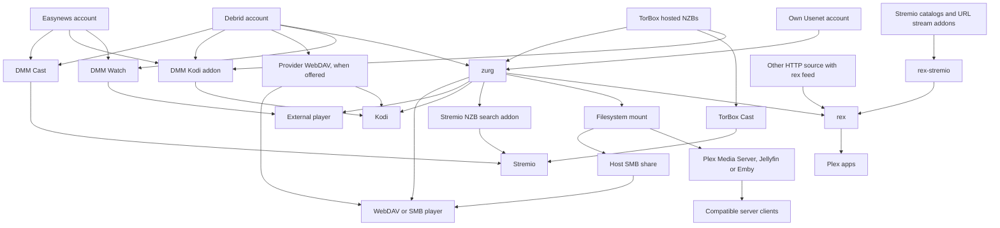
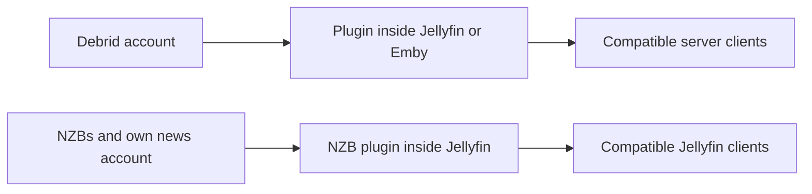
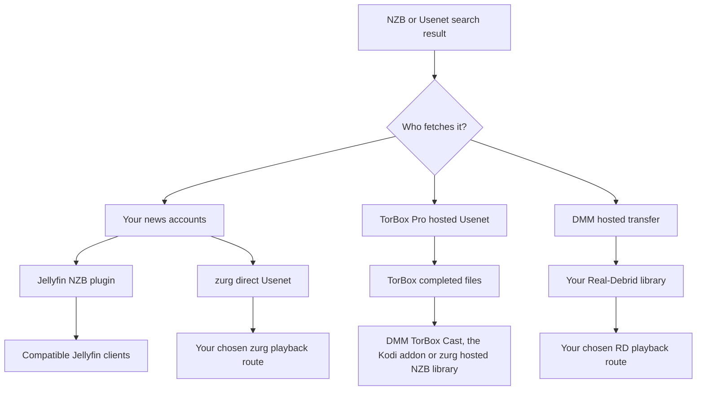

# Which setup should I use?

**[Find your setup with the interactive questionnaire](https://debridmediamanager.com/choose-your-setup).** Answer a few questions about your player accounts and hosting. It returns routes requirements and setup links. No login needed.

**Start with the app you want to watch in.** You do not need every piece. DMM helps you choose releases. A provider supplies the files. zurg can turn them into a shared library. rex presents a library to Plex apps. Some routes skip a piece.

This map covers supported routes checked on **10 November 2026**. It includes outside alternatives that remove a step. Third-party addons and devices can still differ. Follow the linked guide and its tested limits.

## Pick by what you already use

On a phone, swipe a table sideways to see all its columns.

| I have / want… | Choose this route | Why choose it? | What you take on |
|---|---|---|---|
| Stremio and a debrid or Easynews account; no server to maintain | **DMM Cast → Stremio**, or your existing stream addon | Watch through your account without running zurg, rex or a media server | The addon and provider must supply a playable stream; the device handles playback |
| Kodi and a debrid, Easynews or TorBox Pro account | **DMM's Kodi addon → your account** | Browse, search and play inside Kodi; pair from your phone. The addon's TorBox library includes hosted NZB downloads | Kodi does the playback. A sponsor's Wanted list still needs zurg to fulfil requests |
| One movie to watch in my usual player | **DMM Watch → external player** | No library server needed | Install a supported player and choose a file it can play |
| Infuse, Kodi or another WebDAV player | **Provider WebDAV** with no host; **zurg → WebDAV player** when a host can stay on | Browse a cloud library without Plex, Jellyfin, Emby or rex | Real-Debrid, AllDebrid, Premiumize, TorBox and Debrid-Link serve their own WebDAV, with their own folder layout. Offcloud has none, so it needs zurg. zurg needs a host that stays on while you watch |
| Plex Media Server already working | **zurg → mounted folder → Plex Media Server → Plex app** | Keep your server, its libraries and existing workflows | Run zurg and a filesystem mount alongside the server; scans read remote files |
| Plex apps, but no wish to maintain a mounted library | **zurg → rex → Plex app** | zurg supplies the library to rex without a mount or Plex Media Server | Both services stay running; check rex's app compatibility and account guidance |
| Stremio addons, but I prefer Plex apps | **Addons → rex-stremio → rex → Plex app** | Turn addon catalogs into Plex libraries; zurg is optional | Run rex and rex-stremio; stream addons must return playable URLs, not raw torrents |
| Jellyfin is how my players access the library | **Provider plugin inside Jellyfin → compatible client** | No separate zurg service or mount | Jellyfin 12 and the matching plugin(s); plugins have their own archive limits |
| Emby is how my players access the library | **Provider plugin inside Emby → compatible client** | Keep everything inside the existing Emby server | Use the supported Emby version; these six plugins cover debrid, not direct Usenet |
| Jellyfin/Emby plus consumers needing their own filesystem/WebDAV access | **zurg → mount → Jellyfin/Emby** | One library can serve more than one consumer | Maintain the mount and server paths; other consumers can use zurg directly |
| NZB files, my own Usenet account and Jellyfin | **NZB plugin inside Jellyfin → compatible client** | Stream NZBs without a separate zurg service | NNTP access and the supported Jellyfin version; the plugin excludes compressed/encrypted archive members and does not repair with PAR2 |
| A hardware player that reads SMB shares | **zurg → mount → host's SMB share → player** | Keep the player's native file browser and playback | The host supplies SMB; zurg itself supplies WebDAV, not an SMB server |
| My own Usenet account and Stremio | **Newznab indexer → zurg's Stremio addon → Stremio** | Search at playback time and stream through your news account | A running zurg, indexer access and NNTP credentials; another device needs a reachable HTTPS addon address |
| An Android/Google TV device, without another computer | **zurg+rex Android → player on that device, or the Plex apps on it and around your home** | Run zurg and rex on an Android device, your own Plex server on your phone or TV box, for that screen and the Plex apps around your home | Sponsor access, sideloading and background operation; Usenet needs 64-bit Android; TorBox hosted NZBs are not available on Android |
| An Android/Google TV device and Stremio addons, YouTube, Spotify or files on a NAS | **rex for Android → the Plex apps on it and around your home** | rex and its addons on the device, free and with no computer | Sideloading and background operation; stream addons must return playable URLs, not raw torrents; files on a NAS need an addon you write |
| Files already on a disk/NAS | **Existing media server or network player**; **HTTP source → rex** if you want rex | Keep using the files you own; no debrid or Usenet account needed | rex needs metadata submitted through its feed API and HTTP access to the files; the feed producer and file server can be separate. rex does not scan disks |
| Streamable HTTP media or my own HTTP server | **HTTP source + rex feed → rex → Plex apps**, or a compatible player directly | Use an existing source without debrid or zurg | rex needs a feed producer to submit identity and media details; a bare URL does not provide that metadata |

Start here: [DMM Cast](https://debridmediamanager.com/stremio/) · [Kodi](https://debridmediamanager.com/kodi) · [DMM Settings](https://debridmediamanager.com/settings) · [zurg setup](../zurg/setup/index.md) · [rex with zurg](../rex/with-zurg.md) · [rex with Stremio addons](../rex/stremio.md) · [Jellyfin plugins](https://debridmediamanager.com/jellyfin) · [Emby plugins](https://debridmediamanager.com/emby) · [zurg's Stremio addon](../zurg/guides/stremio.md) · [zurg+rex on Android](../zurg/guides/android.md) · [rex for Android](../rex/android.md) · [rex with any source](../rex/any-source.md).

The Cast link starts with Real-Debrid. Use the setup page for [TorBox](https://debridmediamanager.com/stremio-torbox/) or [AllDebrid](https://debridmediamanager.com/stremio-alldebrid/) or [Premiumize](https://debridmediamanager.com/stremio-premiumize/) or [Offcloud](https://debridmediamanager.com/stremio-offcloud/) or [Debrid-Link](https://debridmediamanager.com/stremio-debridlink/) or [Easynews](https://debridmediamanager.com/stremio-easynews/) when you use that account. Cast here means the **DMM addon**. It does not mean Chromecast or screen mirroring.

## The playback map

Arrows mean “supplies a library or playable stream to.” They are not a packet-routing diagram: depending on the route, the player may fetch from the provider or the server may carry the bytes.

[Open the playback map full size](../assets/setup-routes/playback.svg) to zoom or save it.

The Stremio NZB search branch needs an NZB account (`nzb`, or `torbox_nzb` for releases TorBox already holds) and a Newznab indexer; TorBox hosted NZBs also play through TorBox Cast or the Kodi addon without zurg. The mount-to-SMB branch needs a separate share configured on the host.

Two smaller routes are worth keeping separate:

[Open the plugin map full size](../assets/setup-routes/plugins.svg).

The plugins are separate integrations. “zurg” in a plugin name does **not** mean you must run the zurg application. It also does not promise the same features. The TorBox plugin's torrent library is separate from zurg's hosted NZB backend.

## Choose where the files come from

An **indexer** finds releases. A **torrent or NZB** describes how to fetch one. A **provider** supplies the bytes. A **player** decodes them. Access to one does not include the others.

| Input | What obtains/serves the video? | What you need | When it is useful |
|---|---|---|---|
| Cached torrent, magnet or torrent file | Your debrid provider | An account supported by your chosen integration | Often the shortest wait when the exact release is already available |
| Uncached torrent | The debrid provider downloads it first | An account that accepts the torrent, available sources and room within its limits | A release you want is not cached; expect a wait and possible failure |
| NZB, using your own news accounts | zurg's **direct Usenet** backend, or Jellyfin's NZB plugin, reads articles as needed | NZBs, NNTP access and your chosen integration; indexer access if you want search | Choose your providers/backbones, use fallback accounts, avoid storing whole videos locally |
| NZB, using TorBox's hosted service | **TorBox fetches and repairs it**, then serves the completed files | TorBox Pro; submit through DMM or zurg's **TorBox hosted NZB** backend | You want NZBs without managing news-server credentials or local decoding |
| DMM Usenet result sent to Real-Debrid | DMM's hosted transfer service fetches it and passes it to **your Real-Debrid library** | Real-Debrid and an available DMM transfer allowance | You already watch through RD and want that release there; no personal NNTP account required |
| Easynews search result | Easynews serves a direct HTTP download/stream | Your own Easynews account | Watch or Cast from DMM, or use its Easynews Cast/Kodi route, without building an NZB library |
| Direct HTTP(S) download link | A compatible player/HTTP source, or a provider supporting that download | Access to the actual media URL; a suitable provider account if importing/unrestricting it there | You already have a file URL rather than a torrent/NZB |
| Files on your disk or NAS | Your file/media server | Local storage and a player that can reach it | Offline ownership, home videos, or keeping an existing collection |

zurg supports **Real-Debrid, AllDebrid, TorBox, Premiumize, Offcloud and Debrid-Link**. You can combine accounts in one library. Caches quotas and file availability still differ. A cached badge is evidence, not a playback guarantee. See [providers](../zurg/providers/index.md).

### “Usenet without a Usenet account”: which route?

[Open the Usenet map full size](../assets/setup-routes/usenet.svg).

**Choose TorBox hosted NZBs** when you want TorBox to download and repair. DMM sends the NZB there. Current zurg nightlies use provider type `torbox_nzb` and accept NZBs from the watch directory acquisition and SABnzbd interface. [TorBox hosted Usenet](../zurg/providers/torbox-nzb.md) has its zurg setup. A cache miss must finish before it plays. Downloads share slots with torrents. Retained files can expire, and zurg does not promise to fetch an expired release again. Keep the NZB for another fetch.

**Choose direct Usenet** when zurg should read through your own news accounts including fallback or block accounts. It uses `nzb` with NNTP credentials. A TorBox news-server login belongs here too. It is separate from TorBox hosted NZBs. See [TorBox NNTP](../zurg/providers/torbox-news-server.md) and [its plans](https://torbox.app/pricing).

**One zurg instance uses either `nzb` or `torbox_nzb`.** Both own the NZB watch directory. Run both with separate instances and working directories. With `dmm_api_key` on both, [turn the `dmm-wanted` source off on one](../zurg/guides/dmm-wanted.md#two-zurgs-on-one-key), or every Wanted title is fetched twice. Either can sit beside torrent providers. zurg's Stremio addon posts its pick to whichever NZB account the instance has. With `torbox_nzb` only a release TorBox already holds starts within the addon's wait, and only when no other NZB post is waiting.

**Choose DMM → Real-Debrid** when you want the release in your RD library. It is a hosted transfer with queues and allowances. An uncached job takes time. It does not add native NNTP support to Real-Debrid or to other debrid providers. The DMM result and [Transfers page](https://debridmediamanager.com/transfers) show progress.

Easynews **Watch** and **Cast** play its HTTP files, and **Download NZB** saves the release's NZB. **Send to zurg** puts that NZB on your sponsor Wanted list. That needs a configured NZB backend. An Easynews login in DMM does not configure zurg's NZB account.

### What about HTTP links?

DMM's TorBox **Add** dialog accepts direct HTTP(S) links as web downloads. zurg exposes them in `__downloads__`. An item there is not automatically an identified rex library item. Real-Debrid unrestricted downloads can appear there too. DMM TorBox Cast includes completed web and Usenet downloads and torrents. A web page may still need another integration because of logins expiring URLs DRM or its own player.

**rex supports streamable HTTP(S) media through its feed API.** A [source or addon](../rex/any-source.md) sends the media address and metadata. rex then makes it available in Plex apps. The file server and feed producer can be separate. No zurg or debrid account is required. [rex-stremio](../rex/stremio.md) does this for compatible Stremio addons. Raw magnets and torrent-only streams do not work. HLS needs rex's FFmpeg setup. rex uses the identity its source supplies.

## Decide how titles get added

Acquisition and playback are separate choices. You can change how a title is requested without replacing the app you watch in.

| How you choose titles | Route | Why use it? |
|---|---|---|
| Pick the exact release | DMM search/library → provider; or an NZB → your selected NZB backend | Control the edition, size and release yourself |
| Press Want, or follow a Trakt/MDBList list | [DMM Wanted](../zurg/guides/dmm-wanted.md) → zurg acquisition | Automatic films and new episodes without running Sonarr/Radarr; sponsorship required |
| Family requests in Seerr/Overseerr/Jellyseerr | [Seerr through DMM](../dmm/seerr.md) → Wanted → zurg | Familiar request UI without an arr server; sponsorship required. Seerr needs a Plex, Jellyfin or Emby server to be set up against |
| Already have Plex watchlists or a request stack | [zurg acquisition](../zurg/guides/acquisition.md) | Keep the existing request source; configure its search and provider targets |
| Want detailed monitoring and quality profiles in Sonarr/Radarr | DMM or your indexers → arr → zurg download-client interface → library | Keep arr's decisions and import workflow; more services and path setup |
| Want to choose only when pressing Play | DMM Cast/Kodi, another stream addon, or zurg's Stremio search | No need to pre-build a managed library of every title |

For the recommended DMM + zurg arr route **DMM is the indexer and zurg is the download client**. DMM offers [Torznab](https://debridmediamanager.com/torznab) and [Newznab](https://debridmediamanager.com/newznab). Both need active sponsorship. Prowlarr is optional. zurg provides [qBittorrent](../zurg/guides/sonarr-radarr-torrents.md) and [SABnzbd](../zurg/guides/sonarr-radarr.md) interfaces. You do not need those downloader apps beside zurg. [zurg can also search for arr](../zurg/guides/sonarr-radarr-fetch.md).

If you want **complete local copies** download the files from your provider or zurg. You can also use a player's offline-download feature or a normal downloader and disk library. Check quotas and play the saved files without the network. zurg virtual files `.strm` links and [local debrid catalogs](../zurg/guides/local-libraries.md) are not offline copies. Local catalogs store records only. Playback still depends on the provider.

## The tradeoffs that matter before installing

| Question | What changes your choice |
|---|---|
| Must another machine stay on? | Hosted Cast/Kodi routes, provider WebDAV and DMM Watch do not need your own server. zurg, rex, rex-stremio and media-server plugins do need their host while you watch. On an Android device, zurg+rex runs zurg and rex, and rex for Android runs rex with its addons, Stremio addons included; rex-stremio and media-server plugins still need a normal host. A rented/managed host changes who runs it, not the underlying route. |
| Will my TV play the file? | WebDAV and addon routes depend on the player's codecs, audio and subtitles. zurg serves bytes; it is not a video transcoder. Plex Media Server, Jellyfin, Emby or rex with FFmpeg can convert when needed, with appropriate hardware and server/app capabilities. |
| How much disk space? | Streaming avoids storing the whole collection. Allow space for databases, artwork, caches and any repair, transcode or offline-download work. “No full download first” does not mean zero disk use. |
| Who pays for bandwidth? | Provider traffic quotas still apply. A server proxy carries playback traffic and uses its outgoing bandwidth; direct playback shifts the connection to the viewer. Library analysis can read remote files too. |
| Will it work away from home? | Hosted addons avoid exposing your own server. Self-hosted services need a securely reachable address; a LAN address alone will not work remotely. See [rex remote access](../rex/any-source.md#use-it-outside-your-home-optional) and the [Stremio HTTPS guidance](../zurg/guides/stremio.md#installing-it-on-another-device). |
| Can family use it simultaneously? | Check your provider's IP/concurrency rules and the server's sharing model. Real-Debrid use must stay on one public IP; direct links to different households can violate that even when a central library supplied them. Do not enable redirects without understanding where the downloads originate. |
| What do I pay for? | Keep provider subscriptions, indexer access, DMM sponsorship, hosting and player/server purchases separate. DMM's basic website and rex for personal use are free; so is [rex for Android](../rex/android.md). Current zurg nightlies and DMM's plugin distribution are sponsor benefits; Wanted and DMM's indexer APIs also need sponsorship. rex-stremio does not require it. [What a sponsorship gives you](sponsorship.md) lists every perk and where to set it up. |
| Does a catalog entry guarantee playback? | No. Addon catalogs describe titles; cloud files can expire; torrents can lack sources; Usenet articles can be missing. Pick the route whose failure and waiting behavior you are comfortable with. |

A compatible server client can also be a third-party app. [Infuse connects to Plex Emby and Jellyfin](https://support.firecore.com/hc/en-us/articles/360006462093-Streaming-from-Plex-Emby-and-Jellyfin). You may not need a separate zurg mount. Check the plugin and client together.

Infuse supports [WebDAV and other network shares](https://support.firecore.com/hc/en-us/articles/215090977-Streaming-From-a-Mac-PC-or-NAS). A `.strm` file gives a compatible player such as Kodi a URL. It is not a universal mount replacement. Check the client and expect different proxy and failover behavior. Do not use `.strm` as the normal Plex Media Server setup.

There is also a [legacy free zurg release](https://github.com/debridmediamanager/zurg-public/releases). It is Real-Debrid only with a different config format. The multi-provider Usenet and Android routes here use sponsor nightlies.

**rex has its own compatibility boundary.** It is an independent Plex app server. It is not Plex Media Server or a Plex plugin. Use its [FAQ](../rex/faq.md) for tested devices transcoding remote use and the fresh-account recommendation. A traditional Plex server can run beside rex.

## Needs that can change the route

| I also need… | What to choose or check |
|---|---|
| Local files and cloud titles together | Keep your existing Plex/Jellyfin/Emby server and add the mount or matching plugin. rex can combine multiple feed sources, including an HTTP source for local files; it still needs their metadata. |
| Automatic subtitle files | Player-provided or embedded subtitles may be enough. For an arr workflow, [Bazarr with zurg](../zurg/guides/subtitles.md) writes local sidecars beside virtual videos; those sidecars do not reach DMM Cast, the Kodi addon, DMM Watch or zurg's Stremio addon; they do reach Kodi as a zurg WebDAV source. rex also has Search Subtitles without Bazarr. |
| My watched history when changing servers | Read [moving from Plex](../rex/from-plex.md) and [importing watched state](../rex/import-watched.md) before switching; changing the source does not automatically migrate every app's history. |
| Share a selection with someone who has their own account | DMM hashlists share release choices for others to add to their accounts. They do not transfer your credentials or host playback. Sharing a server is a different route, subject to its sharing and provider rules. |
| A VPS or remote host with limited bandwidth | Check whether the route proxies or redirects playback. [rex direct-download settings](../rex/direct-download.md) explain its options; redirects change the downloader's public IP and can expose provider URLs. |

## Other media and existing setups

- **Music:** [DMM Music](https://debridmediamanager.com/music/) provides Real-Debrid browser playback/downloads. [rex music sources](../rex/music.md) feed Plexamp and supported Plex apps. A source can be an addon or zurg configured for music. Do not assume a movie/TV addon supplies music too.
- **Live TV:** [rex's Live TV route](../rex/live-tv.md) provides channels and a guide in the documented apps. Live channels from rex-stremio instead form a library of channels; that is not the same guide interface. Check source availability. rex does not provide DVR recording.
- **Home videos, recordings and photos:** use an existing media server, or a [rex source you control](../rex/addons.md). The [home-video tutorial](../rex/addon-home-videos.md) shows the latter. zurg can also supply comic books as photos to rex; app support differs.
- **Existing Kodi/Stremio addons:** if yours already gives the experience you want, keep it. DMM can be the place you select and manage releases without replacing your player. Addon support for providers, Usenet and HTTP varies; the DMM route is not a compatibility promise for all addons.
- **Another debrid mount/downloader already installed:** see [migration choices](../zurg/migrate/index.md) before switching. A working setup does not need another layer solely because it exists.
- **Native apps in development:** Usenet TV is not a released app-store setup to recommend here. Yomu TV is a separate reading/audiobook project, not a route for this movie/TV stack. Neither is required for the routes above.

## Five common starting points

1. **“I have Stremio and RD.”** Start with DMM Cast. Add zurg only when you want a shared library, automation or another consumer that needs it.
2. **“I have TorBox Pro and want the NZBs in that post.”** Send the NZB to TorBox through DMM. Use TorBox Cast to watch in Stremio, the Kodi addon to watch in Kodi, or zurg's hosted NZB backend to feed your chosen library/player route.
3. **“I already have Jellyfin.”** Start with the plugin for your provider. Choose separate zurg when you need its shared filesystem, automation or broader backend capabilities.
4. **“I want Plex apps, no mounts, and my existing addons.”** Use rex-stremio with rex. Use zurg as a source instead when the thing you want to expose is your managed debrid/Usenet library. Both sources can feed the same rex.
5. **“I have news accounts and want Sonarr/Radarr.”** Use DMM Newznab or your existing indexers, zurg's NZB/SABnzbd route and a playback route from the first table. For permanent local files, choose a normal downloader or explicitly save complete copies; virtual imports alone are not offline files.

Still unsure? Tell us **your device or player, existing accounts, whether a host can stay on, and whether you want on-demand playback or an automatic library**. Those answers usually decide the route. [Getting help](remote-help.md) says where to ask.
