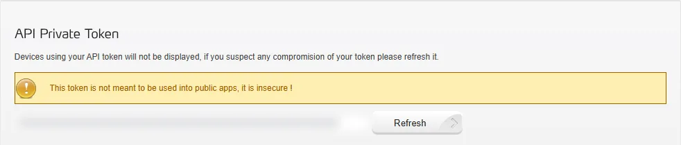

# Your Real-Debrid API token: where to get it and what the errors mean

Your Real-Debrid API token is on [real-debrid.com/apitoken](https://real-debrid.com/apitoken). Sign in to Real-Debrid, open that page and copy the code under **API Private Token**. Paste it into DMM or zurg. When an app says `bad_token`, the token it has is wrong or incomplete: copy it again from that page.

## Get your token

1. Sign in on [real-debrid.com](https://real-debrid.com). Signed out, the token page only shows **403-Forbidden**.
2. Open [real-debrid.com/apitoken](https://real-debrid.com/apitoken).
3. Copy the whole code under **API Private Token**. It's 52 capital letters and digits.



Treat it like a password. It doesn't expire, and anyone who has it can use your whole account. Real-Debrid's own warning on that page: **This token is not meant to be used into public apps, it is insecure !**

**Refresh** on that page gives you a new token. Real-Debrid suggests it if you think someone else has yours. After a refresh, paste the new token into every app that used the old one.

## Put it in DMM

1. On [debridmediamanager.com](https://debridmediamanager.com), press **Login with Real Debrid**.
2. Under **or paste an API key**, paste the token into **API Key** and press **Save API Key**. **Get API Key from Real-Debrid** opens the token page for you.


DMM doesn't need the token at all: **Sign in with Real-Debrid** shows a code you approve at real-debrid.com/device. That gives DMM its own sign-in, which renews itself. More in [What is DMM and how do I use it?](../dmm/index.md#sign-in)

## Put it in zurg

In `config.yml`, under `providers`:

```yaml
zurg: v1
providers:
  - type: realdebrid
    token: YOUR_RD_API_TOKEN
```

Or in zurg's Dashboard at `http://localhost:9999`: open **Config**, press **Edit** on the realdebrid row under **Providers**, paste the token into **Token** and press **Save**. Restart zurg either way. [Real-Debrid with zurg](../zurg/providers/realdebrid.md) has the rest, including Docker's `TOKEN` setting.

To check what zurg thinks of it:

```bash
curl -sS -X POST http://localhost:9999/api/providers/realdebrid/test
```

A token Real-Debrid refuses answers `account connection check failed; verify credentials and network`.

## Check a token yourself

```bash
curl -H "Authorization: Bearer YOUR_RD_API_TOKEN" https://api.real-debrid.com/rest/1.0/user
```

On Windows type `curl.exe` instead of `curl`. A working token prints your account: `username`, `"type": "premium"` and the `expiration` date. A wrong one prints:

```json
{
	"error": "bad_token",
	"error_code": 8
}
```

## When something is wrong

Real-Debrid errors come with a name and a number. zurg shows both, like `bad_token (status code: 401) (code: 8)`.

| What you see | What it means and what to do |
|---|---|
| `bad_token`, code 8. In zurg: `Failed to get user information: api response error: bad_token (status code: 401) (code: 8) trying again in 30s` | Real-Debrid doesn't know that token. It was copied wrong, cut short or replaced. Copy it again from [real-debrid.com/apitoken](https://real-debrid.com/apitoken), the whole thing with nothing before or after it, and restart zurg. |
| zurg: `Account realdebrid refused zurg (credential rejected)` | Same as `bad_token`. Your other accounts keep working and zurg asks Real-Debrid again every 10 minutes. |
| DMM: **Real-Debrid rejected that API key.** | Same as `bad_token`. Copy it again, or press **Sign in with Real-Debrid** instead. |
| `permission_denied`, code 9. In zurg: `RD Permission denied (code=9)` | Real-Debrid refused the account rather than the token. Its docs name a locked account, and on some requests an account without premium. Sign in on real-debrid.com and check the account and its **Premium** days. If both look fine, press **Refresh** on the token page and paste the new token, as zurg's message says. |
| `ip_not_allowed`, code 22. In zurg: `RD refused link generation from this IP (code=22, ip_not_allowed)` | Not the token. Real-Debrid won't make download links for server and VPS addresses. Run it from a home connection, or buy Remote Traffic from Real-Debrid. |
| `service_unavailable`, code 25 | Real-Debrid itself is having trouble. Nothing to change on your side. Check [Is Real-Debrid down or just me?](https://debridmediamanager.com/is-real-debrid-down-or-just-me) and try later. |
| **403-Forbidden** on real-debrid.com/apitoken | You're not signed in to Real-Debrid. Sign in and open the page again. |

Every code is listed in [Real-Debrid's API docs](https://api.real-debrid.com/), at the bottom.

## Questions

### Where do I find my Real-Debrid API token?

At [real-debrid.com/apitoken](https://real-debrid.com/apitoken), while signed in. Copy the code under **API Private Token**.

### My token works in another app but zurg says it's invalid. Why?

Your account has one API token. Many apps don't use it at all: they sign in with a code instead, like DMM's **Sign in with Real-Debrid**. So the other app working doesn't mean zurg has the right token. Copy it again from the token page into zurg, with nothing before or after it, and restart zurg.

### Does the token expire?

No, the API token has no end date. A sign-in through an app is different: it gets that app its own credentials, which renew themselves.

### Is it safe to give my token to an addon or website?

Only to ones you trust. The token opens your whole account, and Real-Debrid says it isn't meant for public apps. Where an app offers a sign-in with a code, use that instead.
