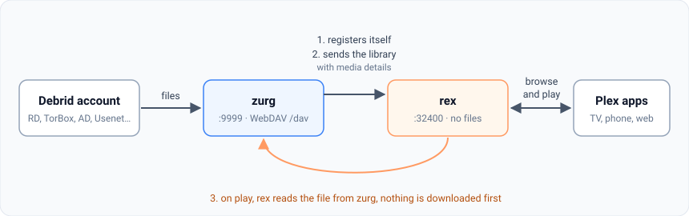
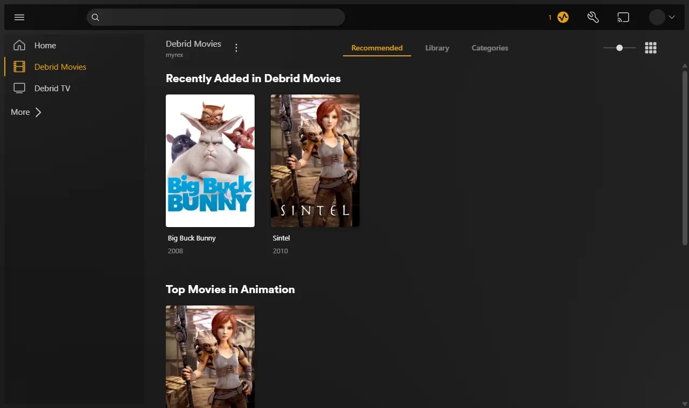
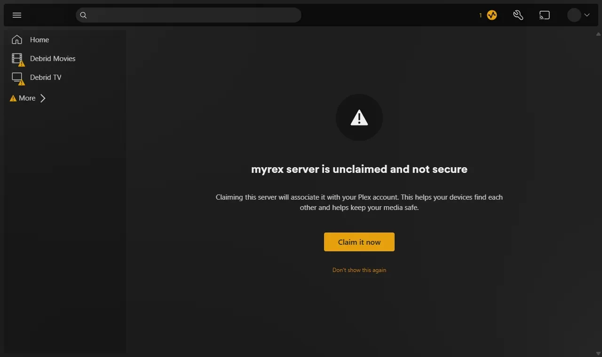

# rex with zurg

[rex](https://rex.debridmediamanager.com) is a Plex Media Server that owns no files. The official Plex apps see it as a normal Plex server. zurg sends it your debrid library, and when you press play rex streams the file straight from zurg. Nothing is downloaded first.

This page takes you from nothing to playing a movie, one step at a time. Every step says what it does, why it matters and what you should see before you move on. If what you see does not match, stop there: the next step will not fix it.



Three things to know before you start:

- **zurg is the part that talks to your debrid service.** It lists what is in your account and serves the files.
- **rex is the part your Plex apps talk to.** It keeps no files and needs no disk for media. It does not need rclone or a mount.
- **zurg tells rex about itself.** You give zurg one line, the address of rex, and zurg does the rest. You never type zurg's details into rex.

rex opens as a closed beta for sponsors on October 15 and reaches the public on October 31. See [rex.debridmediamanager.com](https://rex.debridmediamanager.com) for access.

## Before you start

| You need | Why |
|---|---|
| A Linux machine that stays on (Ubuntu 22.04 or newer). A Proxmox LXC works, unprivileged is fine | rex and zurg are servers: your Plex apps reach them whenever you press play. macOS and Windows work too; this page shows Linux, and [Docker](#run-rex-in-docker) is further down |
| About 4 cores, 8 GB of RAM and a 64 GB disk for a library of 10,000 items | rex keeps the library in memory and uses the most while it fills for the first time. zurg needs little |
| A debrid account (Real-Debrid, TorBox, AllDebrid, Premiumize, Debrid-Link, Offcloud) or Usenet | That is where your movies and shows actually live |
| A GitHub account with access to zurg's and rex's sponsor releases | Both are private GitHub releases. The zurg installer signs you in once and rex's download reuses that sign-in |
| A free TMDB API key from [themoviedb.org/settings/api](https://www.themoviedb.org/settings/api) (the **API Key**, not the long token) | rex uses it to recognise each file and fetch posters, summaries and episode titles |

You do **not** need your Plex token, your Plex username or the machine's IP address.

## Step 1. Install zurg

**What it does.** Downloads zurg, asks for your debrid account and starts zurg as a service that comes back after a reboot.

**Why it matters.** Everything rex shows comes from zurg. If zurg cannot see your library, rex never will.

```bash
curl -fsSL https://zurg.debridmediamanager.com/install.sh | bash
loginctl enable-linger "$USER"
```

The installer asks which services you use (type `1` for Real-Debrid) and then for your API token. The token is hidden while you paste it. zurg goes into `~/zurg`. The second line keeps your services running when you log out.

**What you should see.** The installer ends with a list of `PASS` lines and `==> zurg is installed in /home/you/zurg`. zurg then loads your library: a few seconds for a small account, about ten minutes for one with a thousand releases. Open zurg's dashboard at `http://<this machine>:9999`: **Library size** counts your items once it is done.

Already run zurg? `zurg update` and restart it. You need nightly **2026.10.17 or later**.

## Step 2. Install rex

**What it does.** Downloads rex into `~/rex`, stores your TMDB key and starts rex as a service.

**Why it matters.** rex is what your Plex apps talk to. The first start creates `rex.db`, which holds your libraries, everything zurg sends and your watch history.

```bash
mkdir -p ~/rex && cd ~/rex
PATH="$PATH:$HOME/zurg/bin" gh release download -R debridmediamanager/rex -p '*-linux-amd64.tar.gz'
tar xzf rex-*-linux-amd64.tar.gz --strip-components=1 && rm rex-*-linux-amd64.tar.gz
echo 'TMDB_KEY=paste_your_key_here' > rex.env && chmod 600 rex.env
```

On an ARM machine (Raspberry Pi, Ampere) use `linux-arm64`. Sponsors can add two lines to `rex.env` so rex reads posters and episode lists from DMM first, where most shows are already cached; `TMDB_KEY` then becomes optional:

```bash
REX_METADATA_URL=https://debridmediamanager.com
REX_METADATA_KEY=<your DMM key>
```

Now make it a service. Create `~/.config/systemd/user/rex.service`:

```bash
mkdir -p ~/.config/systemd/user
nano ~/.config/systemd/user/rex.service
```

```ini
[Unit]
Description=rex
After=network-online.target

[Service]
WorkingDirectory=%h/rex
EnvironmentFile=%h/rex/rex.env
ExecStart=%h/rex/rust/target/release/rex --catalog rex.db
Restart=always
RestartSec=5

[Install]
WantedBy=default.target
```

**Plex Media Server runs on the same machine?** End the `ExecStart` line with `--port 32500 --gdm off` and use `32500` wherever this page says `32400`: Plex already holds port 32400 and the ports apps use to find servers.

```bash
systemctl --user daemon-reload
systemctl --user enable --now rex
journalctl --user -u rex -f
```

**What you should see.**

```
INFO    seeded rex.db: an empty library named yourhost at /mnt/zurg, machine=...
INFO    no source yet: one registers at PUT /rex/sources/{name} (docs/feed-api.md)
INFO    claim state: unclaimed
INFO    rex on http://yourhost:32400  machine=...  items=0  parts=proxy
```

rex names itself after the machine; your Plex apps show that name. `no source yet` is right: zurg has not been told about rex. Leave the log open.

## Step 3. Connect zurg to rex

**What it does.** Tells zurg where rex is. zurg introduces itself to rex, sends its whole library, reads each file's video and audio details and sends those too, then every change as it happens.

**Why it matters.** This is the only link between the two. rex has no setting for zurg: if this line is missing, rex stays empty.

```bash
echo 'rex_url: http://127.0.0.1:32400' >> ~/zurg/config.yml
systemctl --user restart zurg
```

**What you should see.** Once zurg has loaded the library again, rex's log prints:

```
INFO    SOURCES PUT /rex/sources/zurg -> 200
INFO    FEED zurg upsert: 0 created, 0 updated, 200 held, 0 unchanged, 0 rejected
INFO    FEED identified "Sintel.mp4" -> single tt1727587 (tmdb)
INFO    FEED zurg upsert: 2 created, 0 updated, 0 held, 0 unchanged, 0 rejected
```

`held` means zurg has not read that file's details yet. zurg starts reading them as soon as its library has loaded, about 400 files a minute, and each title appears in rex as its details arrive. Anything you add to your debrid account later shows up by itself, usually within half a minute.

**If not.**

- Nothing at all in rex's log: zurg is older than 2026.10.17 (`zurg update`), or `rex_url` has a typo. `journalctl --user -u zurg -n 50` shows zurg's side.
- A title stays `held` and zurg logs `Cannot probe file ...`: the first read from the debrid service failed. zurg tries again by itself; **Analyze & Tag Library** under **Utilities** on zurg's dashboard tries at once.

Two rules for this line:

- `127.0.0.1` is right when zurg and rex are on the same machine. Otherwise use rex's LAN IP, not a Tailscale address.
- Leave `plex_server_url` in zurg's config pointing at your real Plex, or empty. Pointed at rex, zurg learns rex's own matches and a wrong match could never be fixed.

Running several zurgs (one per debrid service)? Give each its own name with an extra line, `rex_source: rd`, `rex_source: tb` and so on. They fill the same two libraries.

### Sponsors: let zurg place every episode

**What it does.** With your DMM sponsor key in zurg's config, zurg asks DMM what each release is and exactly which episode each file is, and tells rex. rex then puts every file where DMM says instead of guessing from its name.

**Why it matters.** File names often number episodes differently from the episode lists Plex apps show:

| Release | Named | Where it really is |
|---|---|---|
| `[SubsPlease] Hibike Euphonium 3 - 01` | season 1, episode 1 | Sound! Euphonium season 3, episode 1 |
| `[HorribleSubs] One Piece - 486` | episode 486 | season 13, episode 486 |
| `Fairy.Tail.E236` | episode 236 | season 6, episode 10 |
| `Firefly.S01E02.The.Train.Job` (DVD order) | episode 2 | episode 1, "The Train Job" |

Without the key rex places files by their names, which is right for most shows and wrong for these.

```bash
echo 'dmm_api_key: your_dmm_key' >> ~/zurg/config.yml
systemctl --user restart zurg
```

**What you should see.** zurg's log says `DMM placed N releases for rex`, and rex's log names each title with `(placed)`:

```
INFO    FEED identified "Firefly.S01.COMPLETE.REPACK.1080p.BRRip.AC3.x264-LESS" -> exact tt0303461 (placed)
```

Episodes rex had already placed move to their right numbers and keep their watch history. A file DMM cannot place is placed by its name as before, and a title you corrected with **Fix Match** stays as you set it.

## Step 4. Watch something

**What it does.** Opens rex in a Plex app, the same way you would open any Plex server.

**Why it matters.** This is the point of the whole setup. It also proves the last link: rex reading a file from zurg while you watch.

Open a Plex app on a phone, TV or computer **on the same home network**. rex shows up on its own under the machine's name, with **Debrid Movies** and **Debrid TV**. Pick a movie and press play.



**What you should see.** Posters, titles and years as on any Plex server. Playback starts within a few seconds.

Two things you may meet:

- **"yourhost server is unclaimed and not secure".** A Plex app says this about any server that is not on a Plex account. Press **Don't show this again**, or do [Add it to your Plex account](#add-it-to-your-plex-account-optional).
- **"This server is not powerful enough to convert video".** The app cannot play the file as it is, often a web browser meeting AC3 or DTS sound. Plex apps on TVs and phones play most files as they are. To play everything everywhere, set up [Converting video](#converting-video-optional).



zurg's folders other than `movies` and `shows`, such as `anime`, need nothing: each file goes to **Debrid Movies** or **Debrid TV** by what it is.

**Back up** `~/rex/rex.db` (it holds your library, watch history and zurg's login, so keep it private) and, once you have one, `claim_state.json`:

```bash
sudo apt install -y sqlite3    # once
sqlite3 ~/rex/rex.db ".backup $HOME/rex/rex.db.bak"
```

You are done. The sections below are optional.

## Add it to your Plex account (optional)

**What it does.** Registers rex on your Plex account, as you would a real Plex server.

**Why it matters.** It removes the "unclaimed" notice, lets rex match titles with Plex's own metadata as well as TMDB's, and is needed before [using rex outside your home](#use-it-outside-your-home-optional).

**At your own risk.** rex is not made by Plex, and Plex could take action against an account that registers it. Without this step rex only answers on your home network.

1. Open [plex.tv/claim](https://www.plex.tv/claim) and copy the code. It expires in four minutes.
2. On the rex machine:

   ```bash
   curl -X POST "http://127.0.0.1:32400/myplex/claim?token=claim-xxxxxxxxxxxx"
   curl -s http://127.0.0.1:32400/identity
   ```

**What you should see.** The second command shows `claimed="1"`, and `~/rex/claim_state.json` exists. Back that file up and never claim the same server twice: if you lose it, you have to claim again.

## Use it outside your home (optional)

**What it does.** Gives rex an HTTPS address and tells plex.tv about it.

**Why it matters.** Plex apps away from home only connect to an HTTPS address they can reach. rex has no relay of its own, so something in front of it has to hold the certificate. It must be [claimed](#add-it-to-your-plex-account-optional) first: a claimed rex checks every request's Plex token, so it works behind any HTTPS proxy.

With Tailscale, one command gives rex an HTTPS address with a certificate Tailscale keeps renewed:

```bash
sudo tailscale serve --bg 32400
```

It prints the address, for example `https://myhost.tailnet.ts.net`. Devices signed in to your tailnet reach it; `sudo tailscale funnel --bg 32400` instead makes it reachable from anywhere. Then add the address to the end of the `ExecStart` line in `rex.service`:

```ini
ExecStart=%h/rex/rust/target/release/rex --catalog rex.db --announce-url https://myhost.tailnet.ts.net
```

and run `systemctl --user daemon-reload && systemctl --user restart rex`.

Own a domain and forward port 443? [Caddy](https://caddyserver.com) does the same with a free certificate: a `Caddyfile` of `rex.example.com { reverse_proxy 127.0.0.1:32400 }`, then `--announce-url https://rex.example.com`.

**What you should see.** rex's log gets `plex.tv` lines without errors, and the server appears in app.plex.tv. If it logs `waiting for a claim`, do the previous section first.

Do not put a Cloudflare tunnel in front of rex. Cloudflare drops the range of the first read, so every play start pulls the whole file from your debrid service.

## Converting video (optional)

**What it does.** Lets rex convert what a device cannot play, the way Plex does.

**Why it matters.** Without it a device that cannot play a file as it is gets "This server is not powerful enough to convert video". Web browsers hit this most, for example with AC3 or DTS sound.

Unpack jellyfin-ffmpeg 8 (Ubuntu's own FFmpeg 4.4 is too old) and point rex at it:

```bash
curl -LO https://github.com/jellyfin/jellyfin-ffmpeg/releases/download/v8.1.3-1/jellyfin-ffmpeg8_8.1.3-1-jammy_amd64.deb
dpkg -x jellyfin-ffmpeg8_8.1.3-1-jammy_amd64.deb ~/rex-ffmpeg && rm jellyfin-ffmpeg8_8.1.3-1-jammy_amd64.deb
J=$HOME/rex-ffmpeg/usr/lib/jellyfin-ffmpeg
printf 'REX_TRANSCODER=%s/ffmpeg\nLD_LIBRARY_PATH=%s/lib\nLIBVA_DRIVERS_PATH=%s/lib/dri\nLIBVA_DRIVER_NAME=iHD\n' "$J" "$J" "$J" >> ~/rex/rex.env
systemctl --user restart rex
```

With an Intel or AMD graphics chip, also run `sudo usermod -aG render "$USER"` and log in again; in an LXC, pass the GPU through. The chip makes conversion fast; without one rex uses the processor.

**What you should see.** rex's log has a `transcoder:` line naming the FFmpeg and the hardware it found (`hardware none` means the processor). A file that failed before now plays; the log shows what was converted, for example `video=copy h264 audio=ac3->aac`.

## Run rex in Docker

The same setup with zurg and rex in containers on one Linux machine. The steps match the ones above; only how you start each part differs.

### D1. Install zurg in Docker

**What it does.** Runs zurg in a container whose mount shows up on the machine at `/zurg_mnt/zurg`.

**Why it matters.** As in step 1, everything rex shows comes from zurg.

Follow [zurg's Docker setup](../setup/docker.md). The one-line installer there does it all, and may first ask you to approve the `read:packages` and `repo` scopes for your GitHub sign-in with a one-time code in your browser. The manual steps on the same page do the same thing by hand.

**What you should see.** `docker compose exec zurg /app/zurg doctor --working-dir /config` ends in `PASS` lines (`WARN service zurg is not installed` is expected: Docker restarts zurg, not systemd), and

```bash
ls /zurg_mnt/zurg/movies /zurg_mnt/zurg/shows
```

lists your library.

### D2. Start rex in Docker

**What it does.** Runs rex from its image with your TMDB key, keeping everything it saves in a folder beside the compose file.

**Why it matters.** It is [step 2](#step-2-install-rex) in one file: the image is the program, the compose file holds the key, and Docker keeps it running.

rex's image is private, like zurg's. Log in once with your GitHub username and a classic personal access token with the `read:packages` and `repo` scopes (the same login zurg's image uses):

```bash
docker login ghcr.io -u YOUR_GITHUB_USERNAME
```

Make a folder, for example `~/rex`, with this `compose.yml`:

```yaml
services:
  rex:
    image: ghcr.io/debridmediamanager/rex:latest
    container_name: rex
    restart: unless-stopped
    network_mode: host
    environment:
      TMDB_KEY: your_tmdb_api_key
    volumes:
      - ./config:/config
```

- `network_mode: host` lets Plex apps on your network find rex by themselves, and lets rex reach zurg's container.
- `./config` gets `rex.db` and, later, `claim_state.json`. They are readable by root only, because `rex.db` holds zurg's login.
- Plex Media Server on the same machine? Add `command: --port 32500 --gdm off`.

```bash
chmod 600 compose.yml
docker compose up -d
docker compose logs -f rex
```

**What you should see.** The same lines as [step 2](#step-2-install-rex), with `seeded /config/rex.db` and `no source yet`. Leave the log open.

### D3. Connect zurg to rex

**What it does.** Same as [step 3](#step-3-connect-zurg-to-rex). zurg's config sits in zurg's compose folder and belongs to root, so:

```bash
cd ~/zurg
echo 'rex_url: http://192.168.1.20:32400' | sudo tee -a config.yml
docker compose restart zurg
```

**What you should see.** `SOURCES PUT /rex/sources/zurg -> 200` in rex's log, and `curl -s http://127.0.0.1:32400/rex/sources` shows zurg at its **container** address, for example `http://192.168.32.2:9999/dav`. That is right: rex runs on the same machine and reaches the container there.

**zurg and rex on different machines?** rex cannot reach that container address. Give the zurg container `network_mode: host` (and remove its `ports:` lines) so it registers the machine's LAN IP instead.

### D4. Watch

rex's log names each title as zurg reads it, as in [step 3](#step-3-connect-zurg-to-rex). Then open a Plex app on your network as in [step 4](#step-4-watch-something).

**What you should see.** The titles appear in **Debrid Movies** and **Debrid TV**, and `docker compose restart rex` brings them back with `state file /config/rex.db: restored` and `source zurg: registered`.

### D5. Update

```bash
cd ~/rex && docker compose pull && docker compose up -d
```

rex comes back with the same library. `latest` follows each release; pin a version such as `ghcr.io/debridmediamanager/rex:0.3.0` to update only when you choose. For zurg, see [Managing and updating zurg](../setup/docker.md#managing-and-updating-zurg).

The image carries no FFmpeg, so [converting video](#converting-video-optional) needs the install without Docker. The claim and HTTPS work as above: the claim is the same `curl` on this machine, `tailscale serve` runs on the machine itself, and `--announce-url ...` goes in `command`.

## Keep the port private

rex takes no password from zurg. Anyone who can reach rex's port can add to its library or remove what zurg sent. Never forward port 32400 (or 32500) on your router without the HTTPS setup above.

## Updating

- **zurg:** `zurg update`, then `systemctl --user restart zurg`.
- **rex:** run the `gh release download` and `tar` lines of [step 2](#step-2-install-rex) again in `~/rex` (they replace the program and `data/`, and leave `rex.db` and `rex.env` alone), then `systemctl --user restart rex`.

## When something is wrong

| What you see | What to do |
|---|---|
| `/rex/sources` stays `{"size":0}` | zurg is older than 2026.10.17, `rex_url` is wrong, or zurg's library is still loading. Run `zurg update` and look at `journalctl --user -u zurg -n 50` |
| rex's log says `held ... no media_info yet` and the library stays empty | zurg has not read the files yet. Wait for its library to load; if zurg logs `segmentation fault`, run `zurg update` and restart it |
| Nothing plays and rex's log shows 502 | rex cannot reach the address zurg gave it. Run `curl` on that URL from the rex machine. In Docker, see the Docker section |
| Nothing plays, 401 or 403 | zurg refused its own login. Restart zurg so it sends rex the current one |
| "This server is not powerful enough to convert video" | The device cannot play the file as it is. Try a Plex app on a TV or phone, or set up [Converting video](#converting-video-optional) |
| rex exits with `unrecognized arguments` | Your `rex.service` or `run.sh` still passes `--sources` or a feed token from an older setup. Remove them |
| rex is not in the Plex apps away from home | Not claimed, no `--announce-url`, or the device cannot reach the HTTPS address (a tailnet-only address needs Tailscale on that device) |
| The log says `waiting for a claim` | Claim it. It announces right away |
| zurg stops when you log out | Run `loginctl enable-linger "$USER"` (step 1) |
| zurg will not start after you edited `config.yml` | A zurg older than 2026.10.17 wrote the file without a final newline, so the added line joined the last one. Put it on its own line |
