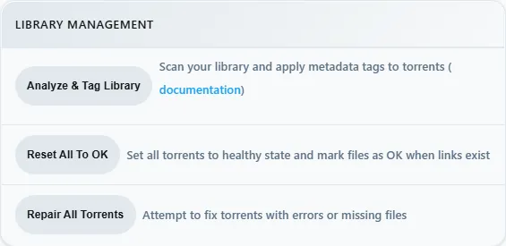

# rex with zurg

[rex](https://rex.debridmediamanager.com) is a Plex Media Server that owns no files. The official Plex apps see it as a normal Plex server. zurg sends it your debrid library, and when you press play rex streams the file straight from zurg. Nothing is downloaded first.

This page takes you from nothing to playing a movie, one step at a time. Every step says what it does, why it matters and what you should see before you move on. If what you see does not match, stop there: the next step will not fix it.


Three things to know before you start:

- **zurg is the part that talks to your debrid service.** It lists what is in your account and serves the files.
- **rex is the part your Plex apps talk to.** It keeps no files and needs no disk for media. It does not need rclone or a mount.
- **zurg tells rex about itself.** You give zurg one line, the address of rex, and zurg does the rest. You never type zurg's details into rex.

rex opens as a closed beta for sponsors on October 15 and reaches the public on October 31. See [rex.debridmediamanager.com](https://rex.debridmediamanager.com) for access.

## Before you start

| You need | Why |
|---|---|
| A Linux machine that stays on (Ubuntu 22.04 or newer). A Proxmox LXC works, unprivileged is fine | rex and zurg are servers: your Plex apps reach them whenever you press play. macOS and Windows work too; this page shows Linux, and [Docker](#run-rex-in-docker) is further down |
| About 4 cores, 8 GB of RAM and a 64 GB disk for a library of 10,000 items | rex keeps the library in memory and uses the most while it fills for the first time. zurg needs little |
| A debrid account (Real-Debrid, TorBox, AllDebrid, Premiumize, Debrid-Link, Offcloud) or Usenet | That is where your movies and shows actually live |
| GitHub access to zurg's and rex's sponsor releases | Both are downloaded from private GitHub releases. The public zurg v1.0.0 cannot feed rex |
| The GitHub CLI, signed in: `gh auth login` | The downloads below use it, because the releases are private |
| A free TMDB API key from [themoviedb.org/settings/api](https://www.themoviedb.org/settings/api) (the **API Key**, not the long token) | rex uses it to recognise each file and fetch posters, summaries and episode titles |
| The machine's LAN IP, e.g. `192.168.1.20` (`hostname -I` shows it) | zurg and your Plex apps reach rex by this address |

You do **not** need your Plex token.

## Step 1. Install zurg

**What it does.** Downloads zurg, asks for your debrid account and starts zurg as a service that comes back after a reboot.

**Why it matters.** Everything rex shows comes from zurg. If zurg cannot see your library, rex never will.

```bash
curl -fsSL https://zurg.debridmediamanager.com/install.sh | bash
```

The installer asks which services you use (type `1` for Real-Debrid) and then for your API token. The token is hidden while you paste it. zurg goes into `~/zurg`; to put it elsewhere, start the line with `ZURG_INSTALL_DIR=/path/you/want` after the `|`.

Then let your services keep running when you log out:

```bash
loginctl enable-linger "$USER"
```

**What you should see.** The installer ends with a list of `PASS` lines (config, ffprobe, rclone, service, HTTP, mount) and `==> zurg is installed in /home/you/zurg`. Then check that zurg sees your library:

```bash
ls /mnt/zurg/movies /mnt/zurg/shows
```

You see a folder for each movie and show in your debrid account. You can also open zurg's dashboard at `http://<LAN IP>:9999`: **Library size** counts your items.

**If not.** A `FAIL` line says which part is wrong. An empty `movies` folder on an account that has movies usually means zurg is still loading a big library: wait a minute and look again.

Already run zurg? Update it with `zurg update` and restart it. You need a nightly from **2026.10.15 or later**; older builds never tell rex where their files are.

## Step 2. Download rex

**What it does.** Puts the rex program in `~/rex`.

**Why it matters.** rex is one program plus a `data/` folder it reads at start. It must be v0.3.0 or newer: v0.2.0 cannot take a library from zurg.

```bash
mkdir -p ~/rex && cd ~/rex
gh release download v0.3.0 -R debridmediamanager/rex -p 'rex-v0.3.0-linux-amd64.tar.gz'
tar xzf rex-v0.3.0-linux-amd64.tar.gz --strip-components=1 && rm rex-v0.3.0-linux-amd64.tar.gz
```

On an ARM machine (Raspberry Pi, Ampere) use `linux-arm64` in both places. Newer versions are listed on [rex's releases](https://github.com/debridmediamanager/rex/releases).

**What you should see.**

```bash
ls ~/rex
```

shows `data  docs  examples  LICENSE  README.md  rust`. The program itself is `~/rex/rust/target/release/rex`. Always start it from `~/rex`.

## Step 3. Give rex your TMDB key

**What it does.** Stores the key in a file only you can read, which rex loads when it starts.

**Why it matters.** Without the key rex cannot tell that `Sintel.mp4` is the 2010 film *Sintel*, so titles show without posters or summaries and Fix Match finds nothing.

```bash
cd ~/rex
echo 'TMDB_KEY=paste_your_key_here' > rex.env
chmod 600 rex.env
```

**What you should see.** `ls -l rex.env` shows `-rw-------`.

Sponsors can add two more lines, so rex reads posters and episode lists from DMM first, where most shows are already cached. `TMDB_KEY` then becomes optional:

```bash
REX_METADATA_URL=https://debridmediamanager.com
REX_METADATA_KEY=<your DMM key>
```

## Step 4. Check zurg's folders

**What it does.** Makes sure every folder zurg sorts your library into has a library in rex.

**Why it matters.** The first time rex starts it creates two libraries: **Debrid Movies** for zurg's `movies` folder and **Debrid TV** for `shows`. A file in any other folder is refused, and rex keeps its libraries from that first start on.

```bash
ls /mnt/zurg
```

**What you should see.** Besides folders that start with `__` and `version.txt`, only `movies` and `shows`. That is what `zurg setup` writes, and you can go straight to step 5.

**If you see more**, for example `anime`, create rex's libraries yourself now, naming every folder:

```bash
cd ~/rex
rust/target/release/rex catalog --seed --name myrex --out rex.db \
  --movies movies --shows shows --shows anime
```

It answers `wrote rex.db: an empty library, machine=...`.

## Step 5. Start rex for the first time

**What it does.** Starts rex in this terminal so you can watch what it does. Step 9 turns it into a service.

**Why it matters.** The first start creates `rex.db`, which holds the libraries, everything zurg sends, and your watch history.

```bash
cd ~/rex
set -a; . ./rex.env; set +a
rust/target/release/rex --catalog rex.db --friendly-name myrex \
  --zurg-mount /mnt/zurg \
  --owner-username <your Plex username> --owner-email <your Plex email>
```

- `--friendly-name` is the server name your Plex apps show.
- `--zurg-mount` is zurg's `mount_path`, `/mnt/zurg` unless you changed it.
- **Plex Media Server runs on the same machine?** Add `--port 32500 --gdm off` and use `32500` wherever this page says `32400`. Plex already holds port 32400 and the ports apps use to find servers.

**What you should see.** rex keeps running and prints:

```
INFO    seeded rex.db: an empty library named myrex at /mnt/zurg, machine=...
INFO    no source yet: one registers at PUT /rex/sources/{name} (docs/feed-api.md)
INFO    claim state: unclaimed
INFO    rex on http://yourhost:32400  machine=...  items=0  parts=proxy
INFO    GDM discovery on udp/32410,32414 (group 239.0.0.250) as 'myrex'
```

`no source yet` is right: zurg has not been told about rex. Leave this terminal open and use a second one for the next steps.

## Step 6. Connect zurg to rex

**What it does.** Tells zurg where rex is. zurg then introduces itself to rex (its address and login) and sends its whole library, then every change as it happens.

**Why it matters.** This is the only link between the two. rex has no setting for zurg: if this line is missing, rex stays empty.

Add one line to the end of zurg's config, with your machine's LAN IP:

```bash
echo 'rex_url: http://192.168.1.20:32400' >> ~/zurg/config.yml
systemctl --user restart zurg
```

**What you should see.** Within a few seconds the rex terminal prints:

```
INFO    SOURCES PUT /rex/sources/zurg -> 200
INFO    FEED zurg held movies/Sintel/Sintel.mp4: no media_info yet
INFO    FEED zurg upsert: 0 created, 0 updated, 2 held, 0 unchanged, 0 rejected
INFO    FEED PUT /rex/feed/zurg/snapshot -> 200
```

and `curl -s http://127.0.0.1:32400/rex/sources` answers with zurg's address:

```
{"size":1,"sources":[{"name":"zurg","url":"http://192.168.1.20:9999/dav","mount":"/mnt/zurg"}]}
```

**`held ... no media_info yet` is expected.** rex lists each file with its video and audio details, the way Plex does after a scan, and zurg has not read them yet. Step 7 does that.

**If not.**

- Nothing at all in rex's terminal: zurg is older than 2026.10.15 (`zurg update`), or `rex_url` has a typo. `journalctl --user -u zurg -n 50` shows zurg's side.
- `rejected` in the upsert line: a zurg folder has no library in rex. Go back to step 4.

Three rules for this line:

- Use the **LAN IP**, not `localhost` and not a Tailscale address.
- Leave `plex_server_url` in zurg's config pointing at your real Plex, or empty. Pointed at rex, zurg learns rex's own matches and a wrong match could never be fixed.
- Running several zurgs (one per debrid service)? Give each its own name with an extra line, `rex_source: rd`, `rex_source: tb` and so on. They fill the same two libraries.

### Sponsors: let zurg place every episode

**What it does.** With your DMM sponsor key in zurg's config, zurg asks DMM what each release is and exactly which episode each file is, and tells rex. rex then puts every file where DMM says instead of guessing from its name.

**Why it matters.** File names often number episodes differently from the episode lists Plex apps show:

| Release | Named | Where it really is |
|---|---|---|
| `[SubsPlease] Hibike Euphonium 3 - 01` | season 1, episode 1 | Sound! Euphonium season 3, episode 1 |
| `[HorribleSubs] One Piece - 486` | episode 486 | season 13, episode 486 |
| `Fairy.Tail.E236` | episode 236 | season 6, episode 10 |
| `Firefly.S01E02.The.Train.Job` (DVD order) | episode 2 | episode 1, "The Train Job" |

Without the key rex places files by their names, which is right for most shows and wrong for these.

Add one line to zurg's config, with the key from your DMM sponsor page, and restart zurg:

```bash
echo 'dmm_api_key: your_dmm_key' >> ~/zurg/config.yml
systemctl --user restart zurg
```

You need zurg nightly 2026.10.16 or later.

**What you should see.** zurg's log says `DMM placed N releases for rex` (`journalctl --user -u zurg -n 50`), and rex's log names each title with `(placed)`:

```
INFO    FEED identified "Firefly.S01.COMPLETE.REPACK.1080p.BRRip.AC3.x264-LESS" -> exact tt0303461 (placed)
```

Episodes rex had already placed move to their right numbers and keep their watch history. A file DMM cannot place is placed by its name as before, and a title you corrected with **Fix Match** stays as you set it.

## Step 7. Fill the library

**What it does.** zurg reads each file's video and audio details with ffprobe and sends them to rex. rex then names each title on TMDB and shows it.

**Why it matters.** A file only appears in rex once its details have arrived. zurg does this by itself for anything you add from now on, and for the rest of your library half an hour after it starts and then once a day. Pressing the button starts it now.

Open zurg's dashboard at `http://<LAN IP>:9999`, press **Utilities**, and under **Library management** press **Analyze & Tag Library**.



**What you should see.** rex's terminal names each title as its details arrive:

```
INFO    FEED identified "Sintel.mp4" -> single tt1727587 (tmdb)
INFO    FEED zurg upsert: 2 created, 0 updated, 0 held, 0 unchanged, 0 rejected
```

A handful of titles take seconds. zurg reads about 50 files a minute, so 10,000 items take a few hours; they appear as they go. If you restart zurg before it finishes, press the button again: it skips what is done.

A title that stays `held` after the pass had its file read fail, usually a slow first read from the debrid service. zurg logs `Cannot probe file ...`. Press the button again: from zurg nightly 2026.10.16 it reads those files again straight away. Older builds wait a day before trying.

From now on anything you add to your debrid account shows up by itself. On our test machine a 14-episode season added on Real-Debrid had its first episode in rex 10 seconds later and all 14 within half a minute.

## Step 8. Watch something

**What it does.** Opens rex in a Plex app, the same way you would open any Plex server.

**Why it matters.** This is the point of the whole setup. It also proves the last link: rex reading a file from zurg while you watch.

Open a Plex app on a phone, TV or computer **on the same home network**. rex shows up on its own as **myrex**, with **Debrid Movies** and **Debrid TV**. Pick a movie and press play.


**What you should see.** Posters, titles and years as on any Plex server. Playback starts within a few seconds.

Two things you may meet:

- **"myrex server is unclaimed and not secure".** A Plex app says this about any server that is not on a Plex account. Press **Don't show this again**, or do [Add it to your Plex account](#add-it-to-your-plex-account-optional).
- **"This server is not powerful enough to convert video".** The app cannot play the file as it is, often a web browser meeting AC3 or DTS sound, and rex has no converter yet. Plex apps on TVs and phones play most files as they are. To play everything everywhere, set up [Converting video](#converting-video-optional).


## Step 9. Keep rex running

**What it does.** Turns the command from step 5 into a service that starts with the machine and restarts if it stops.

**Why it matters.** Until now rex only runs while that terminal is open.

Stop rex in its terminal with `Ctrl+C`; nothing is lost, it saves as it goes. Then make the start script:

```bash
cd ~/rex && cp examples/run.sh.example run.sh && chmod +x run.sh
nano run.sh
```

In `run.sh`:

- Change `myrex`, `your-plex-username` and `you@example.com` to what you used in step 5, and the port if you changed it.
- **Delete the four lines from `ANNOUNCE=()` to `fi`, and the last line, `"${ANNOUNCE[@]}"`.** They are for [using rex outside your home](#use-it-outside-your-home-optional). Left in, rex would announce the example address `rex.example.com` once you add it to your Plex account. Then remove the `\` at the end of the line that is now last.

Create the service file `~/.config/systemd/user/rex.service`:

```bash
mkdir -p ~/.config/systemd/user
nano ~/.config/systemd/user/rex.service
```

```ini
[Unit]
Description=rex
After=network-online.target

[Service]
WorkingDirectory=%h/rex
ExecStart=%h/rex/run.sh
Restart=always
RestartSec=5

[Install]
WantedBy=default.target
```

Start it:

```bash
systemctl --user daemon-reload
systemctl --user enable --now rex
journalctl --user -u rex -n 20
```

**What you should see.**

```
INFO    state file /home/you/rex/rex.db: restored
INFO    source zurg: registered, feed at /rex/feed/zurg/
INFO    rex on http://yourhost:32400  machine=...  items=18  parts=proxy
```

`restored` and `registered` mean it picked up where step 5 left off: same library, same zurg, nothing to redo. `items` counts movies, episodes, shows and seasons.

**Back up** `~/rex/rex.db` (it holds your library, watch history and zurg's login, so keep it private) and, once you have one, `claim_state.json`:

```bash
sudo apt install -y sqlite3    # once
sqlite3 ~/rex/rex.db ".backup $HOME/rex/rex.db.bak"
```

You are done. The sections below are optional.

## Add it to your Plex account (optional)

**What it does.** Registers rex on your Plex account, as you would a real Plex server.

**Why it matters.** It removes the "unclaimed" notice, lets rex match titles with Plex's own metadata as well as TMDB's, and is needed before [using rex outside your home](#use-it-outside-your-home-optional).

**At your own risk.** rex is not made by Plex, and Plex could take action against an account that registers it. Without this step rex only answers on your home network.

1. Open [plex.tv/claim](https://www.plex.tv/claim) and copy the code. It expires in four minutes.
2. On the rex machine:

   ```bash
   curl -X POST "http://127.0.0.1:32400/myplex/claim?token=claim-xxxxxxxxxxxx"
   curl -s http://127.0.0.1:32400/identity
   ```

**What you should see.** The second command shows `claimed="1"`, and `~/rex/claim_state.json` exists. Back that file up and never claim the same server twice: if you lose it, you have to claim again.

## Use it outside your home (optional)

**What it does.** Gives rex an HTTPS address and tells plex.tv about it.

**Why it matters.** app.plex.tv and Plex apps away from home only connect to an HTTPS address that is reachable from the internet. rex has no relay, so it needs a certificate for a host name you own. It must be claimed first.

With Tailscale:

```bash
sudo tailscale cert myhost.tailnet.ts.net
openssl pkcs8 -topk8 -nocrypt -in myhost.tailnet.ts.net.key -out myhost.pkcs8.key
```

Add to the `exec` command in `run.sh`, with your names and LAN IP:

```bash
  --tls-cert myhost.tailnet.ts.net.crt --tls-key myhost.pkcs8.key \
  --announce-url https://myhost.tailnet.ts.net:32400,http://192.168.1.20:32400
```

Then `systemctl --user restart rex`. HTTPS and plain HTTP share the port, so zurg keeps using `http://`.

**What you should see.** rex's log gets `plex.tv` lines without errors, and the server appears in app.plex.tv. If it logs `waiting for a claim`, do the previous section first.

Do not put a Cloudflare tunnel in front of rex. Cloudflare drops the range of the first read, so every play start pulls the whole file from your debrid service.

## Converting video (optional)

**What it does.** Lets rex convert what a device cannot play, the way Plex does.

**Why it matters.** Without it a device that cannot play a file as it is gets "This server is not powerful enough to convert video". Web browsers hit this most, for example with AC3 or DTS sound.

Unpack jellyfin-ffmpeg 8 (Ubuntu's own FFmpeg 4.4 is too old) and point rex at it:

```bash
curl -LO https://github.com/jellyfin/jellyfin-ffmpeg/releases/download/v8.1.3-1/jellyfin-ffmpeg8_8.1.3-1-jammy_amd64.deb
dpkg -x jellyfin-ffmpeg8_8.1.3-1-jammy_amd64.deb ~/rex-ffmpeg && rm jellyfin-ffmpeg8_8.1.3-1-jammy_amd64.deb
J=$HOME/rex-ffmpeg/usr/lib/jellyfin-ffmpeg
printf 'REX_TRANSCODER=%s/ffmpeg\nLD_LIBRARY_PATH=%s/lib\nLIBVA_DRIVERS_PATH=%s/lib/dri\nLIBVA_DRIVER_NAME=iHD\n' "$J" "$J" "$J" >> ~/rex/rex.env
systemctl --user restart rex
```

With an Intel or AMD graphics chip, also run `sudo usermod -aG render "$USER"` and log in again; in an LXC, pass the GPU through. The chip makes conversion fast; without one rex uses the processor.

**What you should see.** rex's log has a `transcoder:` line naming the FFmpeg and the hardware it found (`hardware none` means the processor). A file that failed before now plays; the log shows what was converted, for example `video=copy h264 audio=ac3->aac`.

## Run rex in Docker

The same setup with zurg and rex in containers on one Linux machine. The steps match the ones above; only how you start each part differs.

### D1. Install zurg in Docker

**What it does.** Runs zurg in a container whose mount shows up on the machine at `/zurg_mnt/zurg`.

**Why it matters.** As in step 1, everything rex shows comes from zurg.

Follow [zurg's Docker setup](../setup/docker.md). The one-line installer there does it all, and may first ask you to approve the `read:packages` and `repo` scopes for your GitHub sign-in with a one-time code in your browser. The manual steps on the same page do the same thing by hand.

**What you should see.** `docker compose exec zurg /app/zurg doctor --working-dir /config` ends in `PASS` lines (`WARN service zurg is not installed` is expected: Docker restarts zurg, not systemd), and

```bash
ls /zurg_mnt/zurg/movies /zurg_mnt/zurg/shows
```

lists your library. Check the folders as in [step 4](#step-4-check-zurgs-folders), under `/zurg_mnt/zurg`.

### D2. Start rex in Docker

**What it does.** Runs rex from its image with your TMDB key, keeping everything it saves in a folder beside the compose file.

**Why it matters.** It is steps 2, 3, 5 and 9 in one: the image is the program, the compose file holds the key and the start options, and Docker keeps it running.

rex's image is private, like zurg's. Log in once with your GitHub username and a classic personal access token with the `read:packages` and `repo` scopes (the same login zurg's image uses):

```bash
docker login ghcr.io -u YOUR_GITHUB_USERNAME
```

Make a folder, for example `~/rex`, with this `compose.yml`:

```yaml
services:
  rex:
    image: ghcr.io/debridmediamanager/rex:latest
    container_name: rex
    restart: unless-stopped
    network_mode: host
    environment:
      TMDB_KEY: your_tmdb_api_key
    volumes:
      - ./config:/config
    command: >
      --friendly-name myrex --zurg-mount /zurg_mnt/zurg
      --owner-username <your Plex username> --owner-email <your Plex email>
```

- `network_mode: host` lets Plex apps on your network find rex by themselves, and lets rex reach zurg's container.
- `./config` gets `rex.db` and, later, `claim_state.json`. They are readable by root only, because `rex.db` holds zurg's login.
- Plex Media Server on the same machine? Add `--port 32500 --gdm off` to `command`.
- zurg has more folders than `movies` and `shows`? Before the first start, run `docker compose run --rm rex catalog --seed --name myrex --out /config/rex.db --movies movies --shows shows --shows anime`, naming every folder.

```bash
chmod 600 compose.yml
docker compose up -d
docker compose logs -f rex
```

**What you should see.** The same lines as [step 5](#step-5-start-rex-for-the-first-time), with `seeded /config/rex.db` and `no source yet`. Leave the log open.

### D3. Connect zurg to rex

**What it does.** Same as [step 6](#step-6-connect-zurg-to-rex). zurg's config sits in zurg's compose folder and belongs to root, so:

```bash
cd ~/zurg
echo 'rex_url: http://192.168.1.20:32400' | sudo tee -a config.yml
docker compose restart zurg
```

**What you should see.** `SOURCES PUT /rex/sources/zurg -> 200` in rex's log, and `curl -s http://127.0.0.1:32400/rex/sources` shows zurg at its **container** address, for example `http://192.168.32.2:9999/dav`. That is right: rex runs on the same machine and reaches the container there.

**zurg and rex on different machines?** rex cannot reach that container address. Give the zurg container `network_mode: host` (and remove its `ports:` lines) so it registers the machine's LAN IP instead.

### D4. Fill the library and watch

Exactly [step 7](#step-7-fill-the-library) and [step 8](#step-8-watch-something): press **Analyze & Tag Library** on zurg's dashboard, watch rex's log name each title, then open a Plex app on your network.

**What you should see.** The titles appear in **Debrid Movies** and **Debrid TV**, and `docker compose restart rex` brings them back with `state file /config/rex.db: restored` and `source zurg: registered`.

### D5. Update

```bash
cd ~/rex && docker compose pull && docker compose up -d
```

rex comes back with the same library. `latest` follows each release; pin a version such as `ghcr.io/debridmediamanager/rex:0.3.0` to update only when you choose. For zurg, see [Managing and updating zurg](../setup/docker.md#managing-and-updating-zurg).

The image carries no FFmpeg, so [converting video](#converting-video-optional) needs the install without Docker. The claim and HTTPS work as above: the claim is the same `curl` on this machine, and certificate files go in `./config` with `--tls-cert /config/<name>.crt --tls-key /config/<name>.pkcs8.key --announce-url ...` added to `command`.

## Keep the port private

rex takes no password from zurg. Anyone who can reach rex's port can add to its library or remove what zurg sent. Never forward port 32400 (or 32500) on your router without the HTTPS setup above.

## Updating

- **zurg:** `zurg update`, then `systemctl --user restart zurg`.
- **rex:** download the new release into `~/rex` as in step 2 (it replaces the program and `data/`, and leaves `rex.db`, `rex.env` and `run.sh` alone), then `systemctl --user restart rex`.

## When something is wrong

| What you see | What to do |
|---|---|
| `/rex/sources` stays `{"size":0}` | zurg is older than 2026.10.15, `rex_url` is wrong, or zurg's library is still loading. Run `zurg update` and look at `journalctl --user -u zurg -n 50` |
| rex's log says `held ... no media_info yet` and the library stays empty | zurg has not read the files yet. Press **Analyze & Tag Library** (step 7) |
| `rejected: no movie or show library holds ...` | zurg has a folder rex has no library for. See step 4, or add a library on that folder in Plex |
| Nothing plays and rex's log shows 502 | rex cannot reach the address zurg gave it. Run `curl` on that URL from the rex machine. In Docker, see the Docker section |
| Nothing plays, 401 or 403 | zurg refused its own login. Restart zurg so it sends rex the current one |
| "This server is not powerful enough to convert video" | The device cannot play the file as it is. Try a Plex app on a TV or phone, or set up [Converting video](#converting-video-optional) |
| rex exits with `unrecognized arguments` | Your start script still passes `--sources` or a feed token from an older setup. Remove them |
| rex is not in the Plex apps away from home | Not claimed, no `--announce-url`, or the HTTPS address is not reachable from the internet |
| The log says `waiting for a claim` | Claim it. It announces right away |
| zurg stops when you log out | Run `loginctl enable-linger "$USER"` (step 1) |
