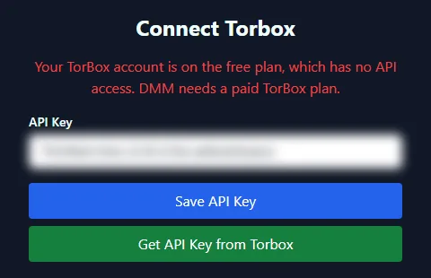

# TorBox di DMM {#torbox-in-dmm}

DMM bekerja dengan paket TorBox berbayar: Essential, Standard, atau Pro. Tempel API key kamu dari [torbox.app/settings](https://torbox.app/settings) di halaman **Connect Torbox** milik DMM, lalu cari: rilis yang sudah ada di TorBox akan mendapat **Instant TB**. Paket gratis tidak punya akses API, jadi DMM tidak bisa menggunakannya, dan mengirim rilis Usenet ke TorBox membutuhkan paket Pro.

## Masuk {#sign-in}

1. Di [debridmediamanager.com](https://debridmediamanager.com), tekan **Login with Torbox**. Sudah login pakai layanan lain? Buka **Debrid services** di halaman utama lalu tekan **Torbox Login**.
2. Tekan **Get API Key from Torbox**. Halaman [torbox.app/settings](https://torbox.app/settings) akan terbuka, dan API key kamu ada di sana.
3. Tempel key ke **API Key** lalu tekan **Save API Key**.

Setelah masuk, halaman utama menampilkan **Cast for TB** dan **Requests**, dan **Debrid services** menampilkan akun TorBox kamu dengan tanda ✓. Tekan itu untuk melihat paket dan kapan masa berlakunya habis, atau untuk **Add another account** atau **Logout**.

## Apa yang bisa dilakukan tiap paket {#what-each-plan-can-do}

| | Free | Essential atau Standard | Pro |
|---|---|---|---|
| Masuk ke DMM | Tidak | Ya | Ya |
| **Instant TB**, **DL with TB**, library, dan **Cast (TB)** | Tidak | Ya | Ya |
| Kirim rilis Usenet ke TorBox | Tidak | Tidak | Ya |
| Unduhan sekaligus (slot aktif TorBox) | 1 | 3 atau 5 | 10 |

Masuk dengan kunci paket gratis dan DMM menampilkan **Your TorBox account is on the free plan, which has no API access. DMM needs a paid TorBox plan.** Halaman [pricing](https://torbox.app/pricing) milik TorBox sendiri mencantumkan akses API tidak termasuk di paket Free, dan Usenet hanya ada di paket Pro.

## Cari yang sudah ada di TorBox {#find-what-torbox-already-has}

1. Cari film atau serial lalu buka.
2. DMM menanyakan ke TorBox rilis mana yang sudah di-cache. Rilis tersebut menampilkan **Instant TB** dan **Cast (TB)** dan ditampilkan paling atas. Chip **TB ✓** di atas hasil pencarian hanya menampilkan rilis-rilis itu. Chip ini menulis `is:tb` di kotak filter; tekan lagi untuk menampilkan semuanya.
3. Tekan **Instant TB**. Rilisnya langsung ada di pustaka TorBox kamu.

Rilis yang tidak ada di TorBox menampilkan **DL with TB**. Jika ditekan, TorBox akan mengunduh rilis itu dulu, dan itu memakai salah satu slot aktif kamu selama proses unduhan berjalan. **No seeders** di samping ukuran berarti tidak ada yang membagikannya saat ini, jadi unduhannya mungkin tidak pernah selesai. TorBox selalu menambahkan seluruh rilis: kamu tidak bisa memilih file tertentu saja.

## Pustaka Anda {#your-library}

Tekan **Library**. Di sini muncul daftar torrent dan web download TorBox kamu.

- **TB Add** membuka **Add to your TB library**. Tempel magnet link, unggah file `.torrent`, atau tempel direct download link, yang akan diambil TorBox sebagai web download.
- **Backup** menyimpan daftar kamu ke sebuah file. **TB Restore** menambahkan kembali daftar yang sudah disimpan.
- Sisanya bekerja seperti untuk layanan lain: lihat [your library](index.md#your-library).

Download Usenet yang kamu kirim ke TorBox tidak ada di library DMM. Kamu bisa menemukannya di situs TorBox, di baris **DMM TB Library** di DMM Cast di Stremio, atau lewat [TorBox hosted Usenet](../zurg/providers/torbox-nzb.md) milik zurg.

## Tonton di Stremio {#watch-in-stremio}

Tekan **Cast for TB** di halaman utama dan pasang addon dari sana. Lalu tekan **Cast (TB)** pada rilis apa pun yang sudah di-cache oleh TorBox. Semua langkahnya ada di [DMM di Stremio](stremio.md).

Di Stremio, addon-nya bernama **DMM Cast for TorBox**. Baris **DMM TB Library**-nya menampilkan torrent TorBox kamu beserta download web dan Usenet yang sudah selesai.

## Kirim rilis Usenet ke TorBox (Pro) {#send-usenet-releases-to-torbox-pro}

1. Buka film atau serial dan tekan tab **Usenet**.
2. Dengan TorBox Pro, daftarnya diberi judul **Send to TorBox** dan setiap rilis punya tombol **TorBox**. Tekan tombol itu.
3. DMM memberi tahu apa yang dilakukan TorBox terhadapnya:
   - **Usenet → TorBox: TorBox already had it, it is ready in your TorBox Usenet downloads.**
   - **Usenet → TorBox: TorBox is downloading it, usually ready within a few minutes.**
   - **Usenet → TorBox: queued, it starts when one of your TorBox active slots frees up.**

Sudah login ke Real-Debrid juga? Daftarnya diberi judul **Send to Real-Debrid or TorBox** dan punya kedua tombol. Ikon file di ujung baris akan menyimpan NZB saja. Baru pertama kali pakai Usenet? Mulai dari [Usenet untuk pemula](../guides/usenet-for-beginners.md).

TorBox menghapus unduhan Usenet 30 hari setelah di-cache. Kirim ulang untuk mendapatkannya kembali.

## Isi permintaan dengan TorBox {#fill-requests-with-torbox}

Pengguna Real-Debrid meminta rilis di [papan permintaan](https://debridmediamanager.com/requests) DMM. Tekan **Requests** di halaman utama, lalu **Fulfil** pada rilis yang sudah di-cache TorBox. Rilis itu dikirim dari TorBox Anda ke Real-Debrid mereka. Setiap 10 pengiriman memberi Anda 7 hari fitur sponsor DMM: lihat [dapatkan tanpa membayar](../guides/sponsorship.md#earn-it-without-paying).

## Ketika ada yang salah {#when-something-is-wrong}

| Yang Anda lihat | Yang harus dilakukan |
|---|---|
| **Your TorBox account is on the free plan, which has no API access. DMM needs a paid TorBox plan.** | Kunci itu ada di paket gratis TorBox. Upgrade atau perpanjang paket di TorBox, lalu masuk lagi. |
| **Failed to refresh torbox: Your TorBox account is on the free plan, which has no API access. DMM needs a paid TorBox plan.** | Paket berbayar Anda sudah habis sejak Anda masuk. Perpanjang di TorBox. |
| **API Error: Request failed with status code 403. Status: 403** | TorBox tidak menerima kunci itu. Salin lagi dari [torbox.app/settings](https://torbox.app/settings), seluruhnya. |
| Tidak ada tombol **TorBox** di tab Usenet | Mengirim rilis Usenet ke TorBox butuh Pro. Essential dan Standard tidak mendapatkan tombol itu. |
| **Usenet → TorBox: TorBox Usenet needs a Pro plan** | TorBox menolak NZB itu karena paketnya bukan Pro. |
| Hanya **DL with TB**, tidak ada **Instant TB** | TorBox tidak punya cache untuk rilis-rilis ini. Tekan salah satu lalu tunggu sampai diunduh, atau pilih rilis lain. |
| Hanya rilis **Instant TB** yang muncul | Chip **TB ✓** sedang aktif (`is:tb` di kotak filter). Tekan lagi, atau tekan **Reset**. |
| **No torrents found yet. Use Want above to have zurg fetch it once one turns up, or try the Usenet tab.** | DMM belum punya torrent untuk judul ini. Episode baru bisa butuh waktu. Coba tab **Usenet** atau kembali nanti. |
| Di Stremio: **⚠️ TorBox refused your account** | TorBox menerima kunci addon, tetapi tidak mau melayani akun itu, biasanya karena paketnya sudah habis. Cek di [torbox.app/settings](https://torbox.app/settings). Tidak ada yang perlu diubah di DMM. |
| zurg: `Acquisition: dmm-torbox refused the search: No TorBox key linked.` | Feed sponsor `tb/cached` di [halaman Torznab](https://debridmediamanager.com/torznab) DMM membutuhkan kunci TorBox Anda yang ditautkan di bagian **Link a provider key** pada halaman itu. Sudah masuk ke TorBox di DMM saja tidak cukup. `api_key` di zurg tetap kunci API DMM Anda. |

Apakah TorBox sedang down? Cek [Apakah TorBox Sedang Down Atau Hanya Saya?](https://debridmediamanager.com/is-torbox-down-or-just-me). Masih buntu? Tanyakan di forum **dmm-support** di [Discord](https://discord.com/invite/7u4YjMThXP). [Cara meminta bantuan](../guides/remote-help.md) menjelaskan apa saja yang perlu disertakan.

## Pertanyaan {#questions}

### Apakah dukungan TorBox tidak ada di paket gratis zurg? {#is-torbox-support-not-on-the-free-tier-of-zurg}

Oke. Build publik gratis dari zurg hanya untuk Real-Debrid. TorBox, layanan lain, dan Usenet ada di build nightly untuk sponsor. Paket TorBox kamu juga harus berbayar, karena zurg tidak bisa membaca akun gratis. Atur dengan [TorBox with zurg](../zurg/providers/torbox.md).

### Zurg memakai paket TorBox yang salah? {#zurg-uses-the-wrong-torbox-plan}

zurg nightly sebelum 3 Oktober 2026 membaca paket Pro TorBox sebagai Standard dan hanya mengizinkan 5 unduhan sekaligus, bukan 10. Perbarui zurg. [Batasan TorBox dengan zurg](../zurg/providers/torbox-limits.md) berisi sisanya.

### Tidak ada hasil pencarian dengan TB? {#no-search-results-with-tb}

DMM Search sama saja apa pun layanan yang kamu pakai untuk login. TorBox hanya menentukan rilis mana yang diberi label **Instant TB**. Kalau kamu tidak melihat apa-apa, cek apakah chip **TB ✓** sudah mati, muat ulang halaman, atau tekan **Show More Results** di bagian bawah. Episode yang baru rilis mungkin belum ada torrent-nya di DMM: coba tab **Usenet**.

### Bisakah saya memakai TorBox dan Real-Debrid bersamaan? {#can-i-use-torbox-and-real-debrid-together}

Ya. Masuk ke keduanya, lalu setiap rilis akan menampilkan tombol untuk kedua layanan. Rilis yang sudah ter-cache di TorBox tetapi belum ada di Real-Debrid akan mendapat tombol **TB → RD**, yang mengirimnya dari TorBox ke Real-Debrid Anda.

### Paket TorBox apa yang saya butuhkan untuk DMM? {#which-torbox-plan-do-i-need-for-dmm}

Paket berbayar apa pun. Pilih Pro jika kamu ingin mengirim rilis Usenet ke TorBox atau ingin 10 unduhan sekaligus.
