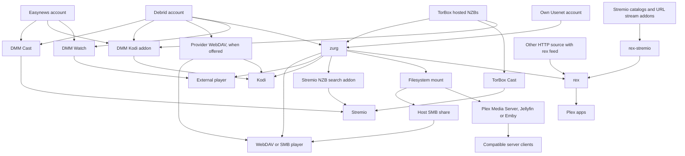
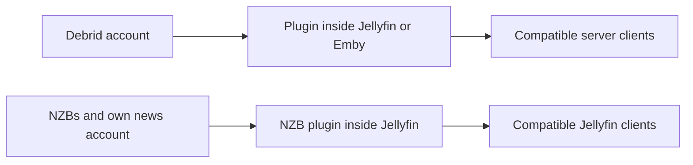
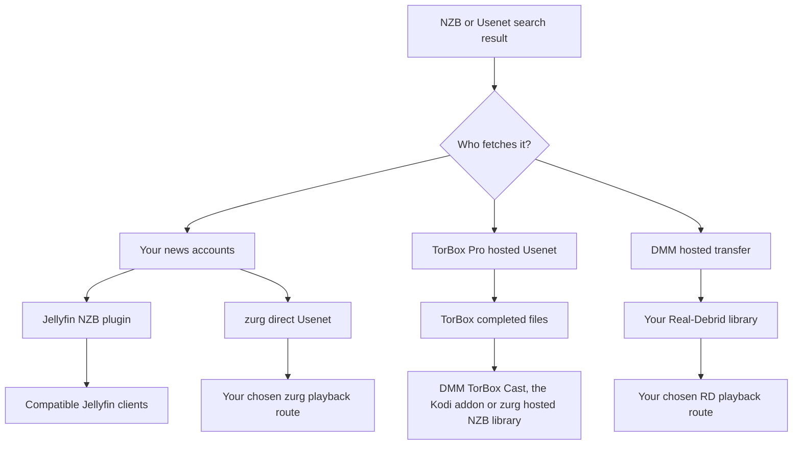

# Setup mana yang sebaiknya saya pakai? {#which-setup-should-i-use}

**[Temukan setup Anda dengan kuesioner interaktif](https://debridmediamanager.com/choose-your-setup).** Jawab beberapa pertanyaan tentang akun pemutar dan hosting Anda. Hasilnya berupa rute, persyaratan, dan tautan setup. Tidak perlu login.

Tidak tahu arti sebuah nama? [Apa fungsi setiap komponen](glossary.md) memuat satu baris untuk tiap istilah.

**Mulai dari aplikasi tempat Anda ingin menonton.** Anda tidak perlu semua komponen. DMM membantu Anda memilih rilis. Penyedia menyediakan file. zurg dapat mengubahnya menjadi pustaka bersama. rex menyajikan pustaka ke aplikasi Plex. Beberapa rute melewati satu komponen.

Peta ini mencakup rute yang didukung yang diperiksa pada **10 November 2026**. Peta ini juga mencakup alternatif pihak luar yang menghapus satu langkah. Addon dan perangkat pihak ketiga tetap bisa berbeda. Ikuti panduan yang ditautkan beserta batas yang telah diuji.

## Pilih berdasarkan yang sudah kamu pakai {#pick-by-what-you-already-use}

On a phone, geser tabel ke samping untuk melihat semua kolomnya.

| Saya punya / mau… | Pilih rute ini | Kenapa pilih ini? | Yang perlu Anda tanggung |
|---|---|---|---|
| Stremio dan akun debrid atau Easynews; tanpa server untuk dirawat | **DMM Cast → Stremio**, atau addon stream Anda yang sudah ada | Menonton lewat akun Anda tanpa menjalankan zurg, rex, atau media server | Addon dan penyedia harus menyediakan stream yang bisa diputar; perangkat yang menangani pemutaran |
| Kodi dan akun debrid, Easynews, atau TorBox Pro | **Addon Kodi DMM → akun Anda** | Jelajahi, cari, dan putar di dalam Kodi; pasangkan dari ponsel Anda. Library TorBox di addon mencakup unduhan NZB yang di-host | Kodi yang melakukan pemutaran. Daftar Wanted dari sponsor tetap butuh zurg untuk memenuhi permintaan |
| Satu film untuk ditonton di pemutar biasa Anda | **DMM Watch → pemutar eksternal** | Tidak perlu server library | Pasang pemutar yang didukung dan pilih file yang bisa diputar olehnya |
| Infuse, Kodi, atau pemutar WebDAV lain | **WebDAV penyedia** tanpa host; **zurg → pemutar WebDAV** kalau ada host yang bisa tetap menyala | Jelajahi library cloud tanpa Plex, Jellyfin, Emby, atau rex | Real-Debrid, AllDebrid, Premiumize, TorBox, dan Debrid-Link menyediakan WebDAV sendiri, dengan susunan folder mereka sendiri. Offcloud tidak punya, jadi butuh zurg. zurg butuh host yang tetap menyala selama Anda menonton |
| Plex Media Server sudah berjalan | **zurg → folder ter-mount → Plex Media Server → aplikasi Plex** | Pertahankan server, library, dan alur kerja yang sudah ada | Jalankan zurg dan mount filesystem berdampingan dengan server; proses pemindaian membaca file remote |
| Aplikasi Plex, tapi tidak mau merawat library yang di-mount | **zurg → rex → aplikasi Plex** | zurg menyediakan library ke rex tanpa mount atau Plex Media Server | Kedua layanan tetap berjalan; cek kompatibilitas aplikasi dan panduan akun rex |
| Addon Stremio, tapi lebih suka aplikasi Plex | **Addon → rex-stremio → rex → aplikasi Plex** | Ubah katalog addon menjadi library Plex; zurg opsional | Jalankan rex dan rex-stremio; addon stream harus mengembalikan URL yang bisa diputar, bukan torrent mentah |
| Jellyfin adalah cara pemutar saya mengakses library | **Plugin penyedia di dalam Jellyfin → klien yang kompatibel** | Tidak perlu layanan zurg terpisah atau mount | Jellyfin 12 dan plugin yang cocok; plugin punya batasan arsip sendiri |
| Emby adalah cara pemutar saya mengakses library | **Plugin penyedia di dalam Emby → klien yang kompatibel** | Semuanya tetap di dalam server Emby yang ada | Gunakan versi Emby yang didukung; keenam plugin ini hanya mencakup debrid, bukan Usenet langsung |
| Jellyfin/Emby plus konsumen yang butuh akses filesystem/WebDAV sendiri | **zurg → mount → Jellyfin/Emby** | Satu library bisa melayani lebih dari satu konsumen | Rawat mount dan path server; konsumen lain bisa memakai zurg langsung |
| File NZB, akun Usenet sendiri, dan Jellyfin | **Plugin NZB di dalam Jellyfin → klien yang kompatibel** | Stream NZB tanpa layanan zurg terpisah | Akses NNTP dan versi Jellyfin yang didukung; plugin mengecualikan anggota arsip terkompresi/terenkripsi dan tidak melakukan perbaikan dengan PAR2 |
| Pemutar perangkat keras yang membaca share SMB | **zurg → mount → share SMB host → pemutar** | Pertahankan penjelajah file dan pemutaran asli pemutar | Host yang menyediakan SMB; zurg sendiri menyediakan WebDAV, bukan server SMB |
| Akun Usenet sendiri dan Stremio | **Indexer Newznab → addon Stremio zurg → Stremio** | Cari saat pemutaran dan stream lewat akun berita Anda | zurg yang berjalan, akses indexer, dan kredensial NNTP; perangkat lain butuh alamat addon HTTPS yang bisa dijangkau |
| Perangkat Android/Google TV, tanpa komputer lain | **zurg+rex Android → pemutar di perangkat itu, atau aplikasi Plex di perangkat itu dan di sekitar rumah Anda** | Jalankan zurg dan rex di perangkat Android, server Plex Anda sendiri di ponsel atau TV box Anda, untuk layar itu dan aplikasi Plex di sekitar rumah Anda | Akses sponsor, sideloading, dan operasi di latar belakang; Usenet butuh Android 64-bit; NZB yang di-host TorBox tidak tersedia di Android |
| Perangkat Android/Google TV dan addon Stremio, YouTube, Spotify, atau file di NAS | **rex untuk Android → aplikasi Plex di perangkat itu dan di sekitar rumah Anda** | rex dan addonnya berjalan di perangkat, gratis, dan tanpa komputer | Sideloading dan operasi di latar belakang; addon stream harus mengembalikan URL yang bisa diputar, bukan torrent mentah; file di NAS butuh addon yang Anda tulis sendiri. Untuk library debrid dan Usenet Anda, sponsor memakai zurg+rex (baris di atas) |
| File sudah ada di disk/NAS | **Server media yang ada atau pemutar jaringan**; **sumber HTTP → rex** kalau Anda mau rex | Tetap pakai file yang Anda miliki; tidak butuh akun debrid atau Usenet | rex butuh metadata yang dikirim lewat API feed-nya dan akses HTTP ke file; pembuat feed dan server file bisa terpisah. rex tidak memindai disk |
| Media HTTP yang bisa di-stream atau server HTTP saya sendiri | **Sumber HTTP + feed rex → rex → aplikasi Plex**, atau pemutar yang kompatibel langsung | Pakai sumber yang sudah ada tanpa debrid atau zurg | rex butuh pembuat feed untuk mengirim identitas dan detail media; URL polos tidak menyediakan metadata itu |

Mulai di sini: [DMM Cast](https://debridmediamanager.com/stremio/) · [Kodi](https://debridmediamanager.com/kodi) · [DMM Settings](https://debridmediamanager.com/settings) · [setup zurg](../zurg/setup/index.md) · [rex dengan zurg](../rex/with-zurg.md) · [rex dengan addon Stremio](../rex/stremio.md) · [plugin Jellyfin](https://debridmediamanager.com/jellyfin) · [plugin Emby](https://debridmediamanager.com/emby) · [addon Stremio zurg](../zurg/guides/stremio.md) · [zurg+rex di Android](../zurg/guides/android.md) · [rex untuk Android](../rex/android.md) · [rex dengan sumber apa pun](../rex/any-source.md).

Link Cast mulai dengan Real-Debrid. Gunakan halaman setup untuk [TorBox](https://debridmediamanager.com/stremio-torbox/) atau [AllDebrid](https://debridmediamanager.com/stremio-alldebrid/) atau [Premiumize](https://debridmediamanager.com/stremio-premiumize/) atau [Offcloud](https://debridmediamanager.com/stremio-offcloud/) atau [Debrid-Link](https://debridmediamanager.com/stremio-debridlink/) atau [Easynews](https://debridmediamanager.com/stremio-easynews/) saat Anda memakai akun itu. Cast di sini berarti **addon DMM**. Itu tidak berarti Chromecast atau screen mirroring.

## Peta pemutaran {#the-playback-map}

Panah berarti “menyediakan pustaka atau stream yang bisa diputar ke.” Panah ini bukan diagram rute paket: tergantung rutenya, player mungkin mengambil data langsung dari provider, atau server yang meneruskan byte-nya.

[Buka peta pemutaran ukuran penuh](../assets/setup-routes/playback.svg) untuk memperbesar atau menyimpannya.

Cabang pencarian NZB Stremio membutuhkan akun NZB (`nzb`, atau `torbox_nzb` untuk rilis yang sudah ada di TorBox) dan indexer Newznab. NZB yang di-host TorBox juga bisa diputar lewat TorBox Cast atau addon Kodi tanpa zurg. Cabang mount-ke-SMB membutuhkan share terpisah yang dikonfigurasi di host.

Ada dua rute kecil yang perlu dipisahkan:

[Buka peta plugin ukuran penuh](../assets/setup-routes/plugins.svg).

Plugin adalah integrasi yang terpisah. “zurg” dalam nama plugin **tidak** berarti Anda harus menjalankan aplikasi zurg. Fiturnya juga belum tentu sama. Pustaka torrent dari plugin TorBox terpisah dari backend NZB yang di-host zurg.

## Pilih dari mana file berasal {#choose-where-the-files-come-from}

Sebuah **indexer** mencari rilis. **Torrent atau NZB** menjelaskan cara mengambilnya. **Provider** menyediakan datanya. **Pemutar** men-decode-nya. Akses ke salah satu tidak otomatis mencakup yang lain.

| Input | Apa yang mengambil/menyajikan videonya? | Yang kamu butuhkan | Kapan berguna |
|---|---|---|---|
| Torrent cached, magnet, atau file torrent | Provider debrid kamu | Akun yang didukung integrasi pilihanmu | Sering kali paling cepat jika rilis yang tepat sudah tersedia |
| Torrent uncached | Provider debrid mengunduhnya dulu | Akun yang menerima torrent tersebut, sumber yang tersedia, dan kuota yang masih cukup | Rilis yang kamu mau belum di-cache; siap menunggu dan mungkin gagal |
| NZB, pakai akun news kamu sendiri | Backend **direct Usenet** zurg, atau plugin NZB Jellyfin, membaca artikel sesuai kebutuhan | NZB, akses NNTP, dan integrasi pilihanmu; akses indexer jika mau mencari | Pilih provider/backbone kamu, pakai akun cadangan, dan hindari menyimpan video utuh secara lokal |
| NZB, pakai layanan hosted TorBox | **TorBox mengunduh dan memperbaikinya**, lalu menyajikan file yang sudah selesai | TorBox Pro; kirim lewat DMM atau backend **TorBox hosted NZB** zurg | Kamu mau pakai NZB tanpa mengurus kredensial news server atau decoding lokal |
| Hasil Usenet DMM yang dikirim ke Real-Debrid | Layanan transfer hosted DMM mengambilnya dan meneruskannya ke **library Real-Debrid kamu** | Real-Debrid dan jatah transfer DMM yang masih tersedia | Kamu sudah nonton lewat RD dan mau rilis itu ada di sana; tidak perlu akun NNTP pribadi |
| Hasil pencarian Easynews | Easynews menyajikan unduhan/stream HTTP langsung | Akun Easynews kamu sendiri | Tonton atau Cast dari DMM, atau pakai rute Easynews Cast/Kodi, tanpa membuat library NZB |
| Link unduhan HTTP(S) langsung | Pemutar/sumber HTTP yang kompatibel, atau provider yang mendukung unduhan itu | Akses ke URL media yang sebenarnya; akun provider yang sesuai jika mengimpor atau unrestrict-nya di sana | Kamu sudah punya URL file, bukan torrent/NZB |
| File di disk atau NAS kamu | Server file/media kamu | Penyimpanan lokal dan pemutar yang bisa mengaksesnya | Kepemilikan offline, video rumahan, atau menyimpan koleksi yang sudah ada |

zurg mendukung **Real-Debrid, AllDebrid, TorBox, Premiumize, Offcloud, dan Debrid-Link**. Kamu bisa menggabungkan beberapa akun dalam satu library. Kuota cache dan ketersediaan file tetap berbeda-beda. Badge cached hanyalah indikasi, bukan jaminan bisa diputar. Lihat [penyedia](../zurg/providers/index.md).

### “Usenet tanpa akun Usenet”: jalur yang mana? {#usenet-without-a-usenet-account-which-route}

[Buka peta Usenet ukuran penuh](../assets/setup-routes/usenet.svg).

**Pilih NZB yang di-host TorBox** kalau kamu mau TorBox yang download dan repair. DMM mengirim NZB ke sana. zurg nightly saat ini memakai tipe provider `torbox_nzb` dan menerima NZB dari watch directory acquisition dan antarmuka SABnzbd. [Usenet yang di-host TorBox](../zurg/providers/torbox-nzb.md) punya panduan setup zurg-nya. Kalau cache miss, download harus selesai dulu sebelum bisa diputar. Download berbagi slot dengan torrent. File yang disimpan bisa kedaluwarsa, dan zurg tidak menjanjikan akan mengambil ulang rilis yang sudah kedaluwarsa. Simpan NZB-nya untuk diambil lagi nanti.

**Pilih Usenet langsung** kalau kamu mau zurg membaca lewat akun news kamu sendiri, termasuk akun fallback atau block. Ini memakai `nzb` dengan kredensial NNTP. Login news-server TorBox juga masuk sini. Ini terpisah dari NZB yang di-host TorBox. Lihat [TorBox NNTP](../zurg/providers/torbox-news-server.md) dan [paketnya](https://torbox.app/pricing).

**Satu instance zurg hanya bisa memakai `nzb` atau `torbox_nzb`.** Keduanya memiliki watch directory NZB yang sama. Kalau mau jalankan keduanya, pakai instance terpisah dengan working directory yang berbeda. Kalau `dmm_api_key` dipakai di keduanya, [matikan source `dmm-wanted` di salah satu](../zurg/guides/dmm-wanted.md#two-zurgs-on-one-key), atau setiap judul Wanted akan diambil dua kali. Keduanya bisa berjalan bersama provider torrent. Addon Stremio zurg mengirim pilihannya ke akun NZB mana pun yang dimiliki instance itu. Dengan `torbox_nzb`, hanya rilis yang sudah ada di TorBox yang mulai dalam waktu tunggu addon, dan itu hanya kalau tidak ada post NZB lain yang sedang menunggu.

**Pilih DMM → Real-Debrid** kalau kamu mau rilisnya masuk ke library RD kamu. Ini transfer hosted dengan antrean dan kuota. Job yang belum ada di cache butuh waktu. Ini tidak menambahkan dukungan NNTP native ke Real-Debrid maupun provider debrid lain. Hasil DMM dan [halaman Transfers](https://debridmediamanager.com/transfers) menunjukkan progresnya.

Easynews **Watch** dan **Cast** memutar file HTTP-nya, dan **Download NZB** menyimpan NZB dari rilis itu. **Send to zurg** mengirim NZB tersebut ke daftar Wanted sponsor kamu. Ini butuh backend NZB yang sudah dikonfigurasi. Login Easynews di DMM tidak mengonfigurasi akun NZB milik zurg.

### Bagaimana dengan tautan HTTP? {#what-about-http-links}

Dialog **Add** di TorBox milik DMM menerima tautan HTTP(S) langsung sebagai web download. zurg menampilkannya di `__downloads__`. Item di sana tidak otomatis menjadi item library rex yang sudah teridentifikasi. Unrestricted downloads dari Real-Debrid juga bisa muncul di sana. TorBox Cast di DMM mencakup web dan Usenet download yang sudah selesai, serta torrent. Halaman web mungkin tetap butuh integrasi lain karena login, URL yang kedaluwarsa, DRM, atau player sendiri.

**rex mendukung media HTTP(S) yang bisa di-stream lewat feed API-nya.** [Source atau addon](../rex/any-source.md) mengirim alamat media dan metadatanya. Setelah itu rex membuatnya tersedia di aplikasi Plex. File server dan feed producer boleh terpisah. Tidak perlu akun zurg atau debrid. [rex-stremio](../rex/stremio.md) melakukan ini untuk addon Stremio yang kompatibel. Raw magnet dan stream khusus torrent tidak bisa dipakai. HLS butuh setup FFmpeg di rex. rex memakai identitas yang diberikan oleh source-nya.

## Tentukan cara judul ditambahkan {#decide-how-titles-get-added}

Pemilihan judul dan pemutaran adalah dua hal terpisah. Anda bisa mengubah cara sebuah judul diminta tanpa harus mengganti aplikasi yang Anda pakai untuk menonton.

| Cara memilih judul | Rute | Mengapa memakai ini? |
|---|---|---|
| Pilih rilis yang persis | DMM search/library → provider; atau NZB → backend NZB yang Anda pilih | Atur sendiri edisi, ukuran, dan rilisnya |
| Tekan Want, atau ikuti daftar Trakt/MDBList | [DMM Wanted](../zurg/guides/dmm-wanted.md) → zurg acquisition | Film dan episode baru otomatis tanpa perlu menjalankan Sonarr/Radarr; wajib sponsorship |
| Permintaan keluarga di Seerr/Overseerr/Jellyseerr | [Seerr through DMM](../dmm/seerr.md) → Wanted → zurg | UI permintaan yang sudah familiar tanpa server arr; wajib sponsorship. Seerr butuh server Plex, Jellyfin, atau Emby untuk disiapkan |
| Sudah punya watchlist Plex atau tumpukan permintaan | [zurg acquisition](../zurg/guides/acquisition.md) | Tetap pakai sumber permintaan yang ada; atur target pencarian dan provider-nya |
| Ingin pemantauan detail dan profil kualitas di Sonarr/Radarr | DMM atau indexer Anda → arr → antarmuka download-client zurg → library | Tetap pakai keputusan dan alur impor arr; lebih banyak layanan dan pengaturan path |
| Ingin memilih hanya saat menekan Play | DMM Cast/Kodi, addon stream lain, atau pencarian Stremio zurg | Tidak perlu membangun library terkelola untuk setiap judul sebelumnya |

Untuk rute arr DMM + zurg yang direkomendasikan, **DMM adalah indexer dan zurg adalah download client**. DMM menawarkan [Torznab](https://debridmediamanager.com/torznab) dan [Newznab](https://debridmediamanager.com/newznab). Keduanya butuh sponsorship aktif. Prowlarr opsional. zurg menyediakan antarmuka [qBittorrent](../zurg/guides/sonarr-radarr-torrents.md) dan [SABnzbd](../zurg/guides/sonarr-radarr.md). Anda tidak perlu aplikasi downloader itu di samping zurg. [zurg juga bisa mencari untuk arr](../zurg/guides/sonarr-radarr-fetch.md).

Jika Anda ingin **salinan lokal lengkap**, unduh file dari provider atau zurg Anda. Anda juga bisa memakai fitur offline-download dari player, atau downloader biasa dan library disk. Cek kuota, lalu putar file yang tersimpan tanpa jaringan. File virtual zurg dengan tautan `.strm` dan [katalog debrid lokal](../zurg/guides/local-libraries.md) bukan salinan offline. Katalog lokal hanya menyimpan catatan saja. Pemutaran tetap bergantung pada provider.

## Pertimbangan penting sebelum memasang {#the-tradeoffs-that-matter-before-installing}

| Pertanyaan | Apa yang memengaruhi pilihanmu |
|---|---|
| Harus mesin lain tetap menyala? | Rute Cast/Kodi hosted, WebDAV provider, dan DMM Watch tidak butuh server sendiri. zurg, rex, rex-stremio, dan plugin media-server tetap butuh host-nya saat kamu menonton. Di perangkat Android, zurg+rex menjalankan zurg dan rex, dan rex for Android menjalankan rex beserta addon-nya, termasuk addon Stremio; rex-stremio dan plugin media-server tetap butuh host biasa. Host sewaan/terkelola mengubah siapa yang menjalankannya, bukan rute dasarnya. |
| TV-mu bisa memutar file-nya? | Rute WebDAV dan addon bergantung pada codec, audio, dan subtitle pemutar. zurg hanya menyajikan byte; ia bukan transcoder video. Plex Media Server, Jellyfin, Emby, atau rex dengan FFmpeg bisa melakukan konversi bila perlu, dengan hardware dan kemampuan server/aplikasi yang sesuai. |
| Berapa banyak ruang disk? | Streaming menghindari penyimpanan seluruh koleksi. Sisakan ruang untuk database, artwork, cache, dan pekerjaan repair, transcode, atau offline-download apa pun. “Tidak perlu download penuh dulu” tidak berarti penggunaan disk nol. |
| Siapa yang membayar bandwidth? | Kuota trafik provider tetap berlaku. Proxy server membawa trafik pemutaran dan memakai bandwidth keluarnya; pemutaran langsung memindahkan koneksi ke penonton. Analisis library juga bisa membaca file remote. |
| Apakah bisa dipakai di luar rumah? | Addon hosted menghindari membuka server pribadimu. Layanan self-hosted butuh alamat yang bisa dijangkau dengan aman; alamat LAN saja tidak akan berfungsi dari luar. Lihat [akses jarak jauh rex](../rex/any-source.md#use-it-outside-your-home-optional) dan [panduan HTTPS Stremio](../zurg/guides/stremio.md#installing-it-on-another-device). |
| Bisakah keluarga memakainya bersamaan? | Cek aturan IP/concurrency provider dan model berbagi server-mu. Penggunaan Real-Debrid harus tetap di satu IP publik; link langsung ke rumah tangga yang berbeda bisa melanggar aturan itu meski library pusat yang memberikannya. Jangan aktifkan redirect tanpa memahami dari mana unduhan berasal. |
| Apa yang kubayar? | Pisahkan langganan provider, akses indexer, sponsor DMM, hosting, dan pembelian pemutar/server. Website dasar DMM dan rex untuk penggunaan pribadi gratis; begitu juga [rex for Android](../rex/android.md). zurg+rex, yang juga menghubungkan library debrid dan Usenet-mu ke rex di Android, khusus untuk sponsor. Build nightly zurg terbaru dan distribusi plugin DMM adalah benefit sponsor; Wanted dan API indexer DMM juga butuh sponsor. rex-stremio tidak memerlukannya. [Apa yang didapat dari sponsor](sponsorship.md) mencantumkan setiap perk dan cara mengaturnya. |
| Apakah entri katalog menjamin pemutaran? | Tidak. Katalog addon hanya mendeskripsikan judul; file cloud bisa kedaluwarsa; torrent bisa tidak punya sumber; artikel Usenet bisa hilang. Pilih rute yang perilaku kegagalan dan waktu tunggunya kamu terima. |

Klien server yang kompatibel bisa juga berupa aplikasi pihak ketiga. [Infuse terhubung ke Plex, Emby, dan Jellyfin](https://support.firecore.com/hc/en-us/articles/360006462093-Streaming-from-Plex-Emby-and-Jellyfin). Kamu mungkin tidak perlu mount zurg terpisah. Cek plugin dan klien secara bersamaan.

Infuse mendukung [WebDAV dan network share lainnya](https://support.firecore.com/hc/en-us/articles/215090977-Streaming-From-a-Mac-PC-or-NAS). File `.strm` memberi pemutar yang kompatibel seperti Kodi sebuah URL. Itu bukan pengganti mount universal. Cek klien dan perkirakan perilaku proxy dan failover yang berbeda. Jangan gunakan `.strm` sebagai setup Plex Media Server yang normal.

Ada juga [rilis zurg gratis lama](https://github.com/debridmediamanager/zurg-public/releases). Itu hanya Real-Debrid dengan format config yang berbeda. Setup multi-provider Usenet dan Android di sini memakai build nightly sponsor.

**rex punya batasan kompatibilitasnya sendiri.** Ia adalah server aplikasi Plex yang independen. Ia bukan Plex Media Server atau plugin Plex. Gunakan [FAQ](../rex/faq.md) untuk perangkat yang sudah diuji, penggunaan remote dengan transcoding, dan rekomendasi akun baru. Server Plex tradisional bisa berjalan berdampingan dengan rex.

## Kebutuhan yang bisa mengubah jalur {#needs-that-can-change-the-route}

| Saya juga perlu… | Apa yang harus dipilih atau dicek |
|---|---|
| Berkas lokal dan judul cloud sekaligus | Tetap pakai server Plex/Jellyfin/Emby yang sudah ada, lalu tambahkan mount atau plugin yang cocok. rex bisa menggabungkan beberapa sumber feed, termasuk sumber HTTP untuk berkas lokal. Tapi tetap butuh metadata-nya. |
| Berkas subtitle otomatis | Subtitle dari player atau yang sudah tertanam di video mungkin sudah cukup. Untuk alur kerja arr, [Bazarr dengan zurg](../zurg/guides/subtitles.md) menulis sidecar lokal di samping video virtual. Sidecar itu tidak sampai ke DMM Cast, addon Kodi, DMM Watch, atau addon Stremio dari zurg. Tapi sidecar itu sampai ke Kodi lewat sumber WebDAV zurg. rex juga punya Search Subtitles tanpa perlu Bazarr. |
| Riwayat tontonan saat pindah server | Baca [pindah dari Plex](../rex/from-plex.md) dan [mengimpor status tontonan](../rex/import-watched.md) sebelum pindah. Mengganti sumber tidak otomatis memindahkan riwayat setiap aplikasi. |
| Bagikan pilihan ke orang yang punya akun sendiri | Hashlist DMM membagikan pilihan rilis supaya orang lain bisa menambahkannya ke akun mereka. Hashlist tidak mentransfer kredensial kamu dan tidak menjalankan pemutaran. Berbagi server itu cara yang berbeda, dan tunduk pada aturan berbagi serta aturan penyedia. |
| VPS atau host remote dengan bandwidth terbatas | Cek apakah rutenya mem-proxy atau me-redirect pemutaran. [Pengaturan direct-download rex](../rex/direct-download.md) menjelaskan opsinya. Redirect mengubah IP publik downloader dan bisa membuka URL penyedia. |

## Media lain dan setup yang sudah ada {#other-media-and-existing-setups}

- **Musik:** [DMM Music](https://debridmediamanager.com/music/) menyediakan pemutaran dan unduhan browser Real-Debrid. [Sumber musik rex](../rex/music.md) mengirim ke Plexamp dan aplikasi Plex yang didukung. Sumber bisa berupa addon atau zurg yang dikonfigurasi untuk musik. Jangan berasumsi bahwa addon film/TV juga menyediakan musik.

- **TV Langsung:** [rute TV Langsung rex](../rex/live-tv.md) menyediakan saluran dan panduan di aplikasi yang didokumentasikan. Saluran langsung dari rex-stremio justru membentuk pustaka saluran, dan itu bukan antarmuka panduan yang sama. Periksa ketersediaan sumbernya. rex tidak menyediakan perekaman DVR.

- **Video rumahan, rekaman, dan foto:** gunakan media server yang sudah ada, atau [sumber rex yang kamu kendalikan](../rex/addons.md). [Tutorial video rumahan](../rex/addon-home-videos.md) menunjukkan cara yang kedua. zurg juga bisa menyediakan komik sebagai foto untuk rex, tapi dukungan aplikasinya berbeda-beda.

- **Addon Kodi/Stremio yang sudah ada:** kalau addon kamu sudah memberi pengalaman yang kamu mau, pertahankan saja. DMM bisa jadi tempat kamu memilih dan mengelola rilis tanpa mengganti pemutar. Dukungan addon untuk provider, Usenet, dan HTTP berbeda-beda, jadi rute DMM bukan jaminan kompatibilitas untuk semua addon.

- **Mount/downloader debrid lain sudah terpasang:** lihat [pilihan migrasi](../zurg/migrate/index.md) sebelum beralih. Setup yang sudah berjalan tidak perlu lapisan tambahan hanya karena lapisan itu tersedia.

- **Aplikasi native dalam pengembangan:** Usenet TV belum menjadi setup aplikasi yang sudah dirilis di app store, jadi tidak kami rekomendasikan di sini. Yomu TV adalah proyek terpisah untuk membaca dan audiobook, bukan rute untuk tumpukan film/TV ini. Keduanya tidak diperlukan untuk rute di atas.

## Lima titik awal yang umum {#five-common-starting-points}

1. **“Saya punya Stremio dan RD.”** Mulai dengan DMM Cast. Tambahkan zurg hanya jika Anda ingin library bersama, otomasi, atau konsumen lain yang membutuhkannya.
2. **“Saya punya TorBox Pro dan ingin NZB di post itu.”** Kirim NZB ke TorBox lewat DMM. Gunakan TorBox Cast untuk menonton di Stremio, addon Kodi untuk menonton di Kodi, atau backend NZB yang di-host zurg untuk meneruskan ke rute library/player pilihan Anda.
3. **“Saya sudah punya Jellyfin.”** Mulai dengan plugin untuk provider Anda. Pilih zurg terpisah jika Anda membutuhkan shared filesystem-nya, otomasi, atau kemampuan backend yang lebih luas.
4. **“Saya mau aplikasi Plex, tanpa mount, dan addon yang sudah saya pakai.”** Gunakan rex-stremio dengan rex. Gunakan zurg sebagai sumber sebagai gantinya jika yang ingin Anda tampilkan adalah library debrid/Usenet yang Anda kelola. Kedua sumber bisa menyuapi rex yang sama.
5. **“Saya punya akun news dan ingin Sonarr/Radarr.”** Gunakan DMM Newznab atau indexer yang sudah ada, rute NZB/SABnzbd dari zurg, dan rute pemutaran dari tabel pertama. Untuk file lokal permanen, pilih downloader biasa atau simpan salinan lengkap secara eksplisit; impor virtual saja bukan file offline.

Masih ragu? Beri tahu kami **perangkat atau player Anda, akun yang sudah dimiliki, apakah host bisa tetap menyala, dan apakah Anda ingin pemutaran sesuai permintaan atau library otomatis**. Jawaban itu biasanya menentukan rute yang tepat. [Mendapatkan bantuan](remote-help.md) menjelaskan di mana harus bertanya.
