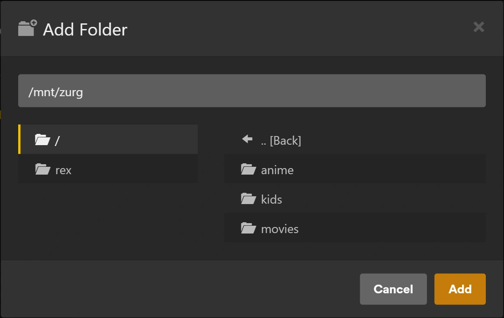

# rex dengan zurg {#rex-with-zurg}

[rex](https://rex.debridmediamanager.com/id/) adalah media server untuk aplikasi Plex resmi yang tidak menyimpan file apa pun. Aplikasi Plex resmi menganggapnya sebagai server Plex biasa. Aplikasi lain juga bisa mengisinya ([rex dengan aplikasi sendiri](any-source.md)). Halaman ini menyiapkannya dengan zurg, yang mengirim perpustakaan debrid kamu ke rex. Saat kamu menekan putar, rex langsung mengalirkan file dari zurg. Tidak ada yang diunduh dulu.

Halaman ini memandu kamu dari nol sampai bisa memutar film, satu langkah demi satu langkah. Setiap langkah menjelaskan apa yang dilakukannya, kenapa penting, dan apa yang seharusnya kamu lihat sebelum lanjut. Kalau yang kamu lihat tidak sesuai, berhenti dulu di situ. Langkah berikutnya tidak akan memperbaikinya.


Ada empat hal yang perlu kamu tahu sebelum mulai:

- **zurg adalah bagian yang berbicara dengan layanan debrid kamu.** Ia mendaftar apa saja yang ada di akunmu dan menyajikan file-filenya.
- **rex adalah bagian yang diajak bicara aplikasi Plex kamu.** Ia tidak menyimpan file dan tidak butuh disk untuk media. Ia juga tidak butuh rclone atau mount.
- **zurg memberi tahu rex tentang dirinya sendiri.** Kamu memberi zurg alamat rex, dan sisanya zurg yang urus. Kamu tidak perlu mengetik detail zurg di rex.
- **zurg dan DMM menentukan file itu apa; Plex yang mendeskripsikannya.** zurg bertanya ke DMM film atau episode mana setiap file itu, lalu rex menampilkan judulnya dengan poster dan ringkasan dari metadata Plex, begitu rex terhubung ke akun Plex. rex tidak pernah menebak dari nama file.

rex gratis untuk penggunaan pribadi (PolyForm Noncommercial): tidak ada tingkat sponsor dan kamu tidak perlu akun untuk mengunduhnya. Rilis nightly zurg yang dipakai panduan ini tetap merupakan rilis sponsor. [rex dengan aplikasi sendiri](any-source.md) menjalankan rex tanpa rilis itu.

## Sebelum kamu mulai {#before-you-start}

| Yang kamu butuhkan | Alasan |
|---|---|
| Mesin yang selalu menyala: Linux (Ubuntu 22.04 atau lebih baru), macOS, atau Windows (64 bit). LXC Proxmox juga bisa, unprivileged tidak masalah, asalkan FUSE sudah dinyalakan untuk LXC itu (Options > Features > FUSE): installer zurg berhenti kalau `/dev/fuse` tidak ada | rex dan zurg adalah server: aplikasi Plex kamu mengaksesnya setiap kali kamu menekan play. Kalau perintahnya berbeda, setiap langkah punya tab untuk tiap sistem. [Docker](#run-rex-in-docker) ada di bawah, untuk Linux |
| RAM 1 GB | Dengan 4,062 film dan 656 serial (34,678 episode), rex memakai di bawah 500 MB saat start dan sekitar 730 MB saat library dijelajahi; mengonversi video memakan lebih banyak. zurg butuh sedikit |
| Akun debrid (Real-Debrid, TorBox, AllDebrid, Premiumize, Debrid-Link, Offcloud) atau Usenet | Di sanalah film dan serial kamu benar-benar tersimpan |
| Akun GitHub yang punya akses ke rilis sponsor zurg | Rilis nightly zurg adalah rilis GitHub privat. [gatekeeper](https://gatekeeper.debridmediamanager.com/) memberi akunmu akses saat kamu menjadi sponsor. Installer zurg akan memintamu masuk sekali |
| Kunci API DMM kamu, dari [gatekeeper](https://gatekeeper.debridmediamanager.com/) setelah kamu menjadi sponsor (opsional) | zurg menanyakan ke DMM apa isi setiap file. Tanpa ini, zurg menebaknya dari nama rilis lewat pencarian judul gratis DMM: lebih sedikit judul yang cocok, dan anime yang penomorannya berlanjut sepanjang seri akan tetap mengikuti urutan file |
| Akun Plex baru, dibuat khusus untuk rex | rex mengambil setiap judul, poster, ringkasan, dan nama episode dari Plex setelah [ditambahkan ke akun Plex](#step-3-add-it-to-a-plex-account). Sampai saat itu judul tetap memakai nama file dan belum punya poster |

Halaman ini membutuhkan rex nightly **2026.10.25 atau lebih baru** dan zurg nightly **2026.10.27 atau lebih baru**.

## Langkah 1. Pasang zurg {#step-1-install-zurg}

**Apa fungsinya.** Mengunduh zurg, meminta akun debrid kamu, dan menjalankan zurg sebagai service yang otomatis hidup lagi setelah reboot.

**Kenapa ini penting.** Semua yang ditampilkan rex berasal dari zurg. Kalau zurg tidak bisa melihat library kamu, rex juga tidak akan pernah bisa.

**Di Windows dan macOS, pasang zurg dengan installer di bawah ini, jangan di Docker Desktop.** rex membaca setiap file dari alamat yang diberikan zurg, dan rex tidak bisa mengakses zurg yang ada di dalam Docker Desktop. Akibatnya judul akan muncul, tapi tidak ada yang bisa diputar.

+++ Linux
```bash
curl -fsSL https://raw.githubusercontent.com/debridmediamanager/zurg-site/main/public/install.sh | bash
sudo loginctl enable-linger "$USER"
```

zurg masuk ke `~/zurg`. Baris kedua menjaga service kamu tetap berjalan saat kamu log out.
+++ macOS
```bash
curl -fsSL https://raw.githubusercontent.com/debridmediamanager/zurg-site/main/public/install.sh | bash
```

zurg masuk ke `~/zurg`. Installer juga memasang macFUSE, yang mungkin meminta kamu mengizinkannya di **System Settings**, **Privacy & Security**, lalu reboot: [zurg di macOS](../zurg/setup/macos.md).
+++ Windows
Di PowerShell:

```powershell
irm https://raw.githubusercontent.com/debridmediamanager/zurg-site/main/public/install.ps1 | iex
```

zurg masuk ke `$HOME\zurg` (`C:\Users\you\zurg`). Installer juga memasang WinFsp, dengan meminta persetujuan administrator, dan menjalankan zurg setiap kali kamu log in ke Windows: [zurg di Windows](../zurg/setup/windows.md).
+++

Installer akan menanyakan layanan apa saja yang kamu pakai (ketik `1` untuk Real-Debrid), lalu meminta API token kamu. Token tidak terlihat saat kamu menempelkannya.

**Yang seharusnya kamu lihat.** Installer selesai dengan daftar baris `PASS` dan `==> zurg is installed in` beserta folder zurg. zurg lalu memuat library kamu: beberapa detik untuk akun kecil, sekitar sepuluh menit untuk akun dengan seribu rilis di Real-Debrid. Buka dashboard zurg di `http://<this machine>:9999`. **Library Size** akan menghitung item kamu setelah proses selesai.

Sudah pernah menjalankan zurg? Perbarui dan restart dengan `cd ~/zurg && ./zurg update && ./zurg service restart` (di Windows, `cd $HOME\zurg; .\zurg.exe update; .\zurg.exe service restart`).

## Langkah 2. Pasang rex {#step-2-install-rex}

**Apa yang dilakukannya.** Mengunduh rex ke `~/rex` (`$HOME\rex` di Windows) dan menjalankannya sebagai service, lengkap dengan semua yang dibutuhkan langkah-langkah berikutnya. Langkah setelah ini tidak perlu restart. Hanya bagian opsional di bawah yang mungkin perlu.

**Kenapa ini penting.** rex adalah bagian yang diajak bicara oleh aplikasi Plex kamu. Start pertama akan membuat `rex.db`, yang menyimpan library kamu, semua yang dikirim zurg, dan riwayat tontonan kamu.

Di Linux, kamu juga bisa menjalankan zurg dan rex di Docker. Lihat [Jalankan rex di Docker](#run-rex-in-docker).

+++ Linux and macOS
```bash
mkdir -p ~/rex && cd ~/rex
TAG=$(curl -fsSL 'https://api.github.com/repos/debridmediamanager/rex/releases?per_page=1' | sed -n 's/.*"tag_name": *"\([^"]*\)".*/\1/p' | head -1)
P=$(uname -s | tr A-Z a-z)-$(uname -m | sed 's/x86_64/amd64/;s/aarch64/arm64/')
curl -fL "https://github.com/debridmediamanager/rex/releases/download/$TAG/rex-$TAG-$P.tar.gz" | tar xz --strip-components=1
```
+++ Windows
Di PowerShell:

```powershell
New-Item -ItemType Directory -Force $HOME\rex | Out-Null; cd $HOME\rex
$tag = (Invoke-RestMethod 'https://api.github.com/repos/debridmediamanager/rex/releases?per_page=1')[0].tag_name
curl.exe -fLO "https://github.com/debridmediamanager/rex/releases/download/$tag/rex-$tag-windows-amd64.zip"
tar -xf "rex-$tag-windows-amd64.zip" --strip-components=1; Remove-Item "rex-$tag-windows-amd64.zip"
```
+++

Ini akan mengambil build terbaru rex, biasanya nightly, yang cocok untuk mesin kamu.

Cari LAN IP rex, yaitu alamatnya di jaringan rumah kamu. Di Linux, `hostname -I` menampilkan beberapa alamat: ambil yang ada di jaringan rumah kamu, bukan yang diawali `172.17.` (Docker) atau `100.` (Tailscale). Di macOS, `ipconfig getifaddr en0` menampilkannya (`en1` kalau yang itu tidak menampilkan apa-apa). Di Windows, `ipconfig` mencantumkannya sebagai **IPv4 Address** di bawah adapter Wi-Fi atau Ethernet kamu. **Halaman ini menulisnya sebagai `192.168.1.20` di mana-mana: ganti dengan alamat kamu sendiri.** Aplikasi Plex, zurg, dan perintah-perintah kamu sendiri akan menghubungi rex lewat alamat itu.

Plex Media Server berjalan di mesin yang sama? Akhiri start command rex di bawah dengan `--port 32500`, dan pakai `32500` di mana pun perintah atau pengaturan menulis `32400`, termasuk aturan firewall Windows. Plex sudah memakai port 32400 dan port yang dipakai aplikasi untuk menemukan server. Di port lain, rex membiarkan port-port itu untuk Plex. Aplikasi Plex kamu nanti akan menampilkan dua server dengan nama mesin yang sama: rex adalah yang dibagikan kepada kamu, dengan nama akun baru di sebelahnya. Setelah rex ada di akun Plex-nya ([langkah 3](#step-3-add-it-to-a-plex-account)), kamu bisa mengganti namanya. Masuk ke Plex sebagai akun itu, buka **Settings** rex, **General**, ubah **Friendly name**, lalu simpan. Setelah itu restart rex seperti di bawah. Aplikasi Plex akan menampilkannya dengan nama baru setelah restart.

Sekarang jadikan ini sebagai service:

+++ Linux
Buat `~/.config/systemd/user/rex.service`:

```bash
mkdir -p ~/.config/systemd/user
nano ~/.config/systemd/user/rex.service
```

```ini
[Unit]
Description=rex
After=network-online.target

[Service]
WorkingDirectory=%h/rex
EnvironmentFile=-%h/rex/rex.env
ExecStart=%h/rex/rex
Restart=always
RestartSec=5

[Install]
WantedBy=default.target
```

```bash
systemctl --user daemon-reload
systemctl --user enable --now rex
journalctl --user -u rex -f
```

Start command rex adalah baris `ExecStart`, dan key ditaruh di `~/rex/rex.env`, satu `NAME=value` per baris. Setelah ada perubahan, jalankan `systemctl --user daemon-reload && systemctl --user restart rex` untuk restart rex. `journalctl --user -u rex -f` menampilkan log-nya.
+++ macOS
`run.sh` menjalankan rex di foldernya, dan LaunchAgent menjalankan `run.sh` saat kamu login:

```bash
cp ~/rex/examples/run.sh.example ~/rex/run.sh
mkdir -p ~/Library/LaunchAgents
cat > ~/Library/LaunchAgents/com.rex.plist <<PLIST
<?xml version="1.0" encoding="UTF-8"?>
<!DOCTYPE plist PUBLIC "-//Apple//DTD PLIST 1.0//EN" "http://www.apple.com/DTDs/PropertyList-1.0.dtd">
<plist version="1.0"><dict>
  <key>Label</key><string>com.rex</string>
  <key>ProgramArguments</key><array><string>/bin/bash</string><string>$HOME/rex/run.sh</string></array>
  <key>RunAtLoad</key><true/><key>KeepAlive</key><true/>
  <key>StandardOutPath</key><string>$HOME/rex/rex.log</string>
  <key>StandardErrorPath</key><string>$HOME/rex/rex.log</string>
</dict></plist>
PLIST
launchctl load ~/Library/LaunchAgents/com.rex.plist
tail -F ~/rex/rex.log
```

Start command rex adalah baris terakhir di `~/rex/run.sh`, dan key ditaruh di `~/rex/rex.env`, satu `NAME=value` per baris. Setelah ada perubahan, jalankan `launchctl kickstart -k gui/$(id -u)/com.rex` untuk restart rex. `tail -f ~/rex/rex.log` menampilkan log-nya.

rex berjalan selama kamu login di Mac. Untuk Mac yang restart sendiri, nyalakan automatic login (**System Settings**, **Users & Groups**). Kalau firewall macOS aktif, izinkan rex saat macOS menanyakannya, atau tambahkan `~/rex/rex` di **Options** firewall.
+++ Windows
Buka PowerShell **sebagai administrator** dan pergi ke folder rex dengan `cd $HOME\rex`. Pertama, buat `run.cmd`, yang menjalankan rex di foldernya dan menulis log-nya ke `rex.log`. Notepad akan menawarkan untuk membuat file-nya:

```powershell
notepad run.cmd
```

```bat
@echo off
cd /d "%~dp0"
rex.exe 2>> rex.log
```

Simpan. Lalu izinkan jaringan kamu lewat Windows Firewall ke port rex dan dua port discovery, dan start rex sekarang serta setiap kali kamu login:

```powershell
New-NetFirewallRule -DisplayName rex -Protocol TCP -LocalPort 32400
New-NetFirewallRule -DisplayName "rex discovery" -Protocol UDP -LocalPort 32410,32414
$settings = New-ScheduledTaskSettingsSet -ExecutionTimeLimit 0 -AllowStartIfOnBatteries -DontStopIfGoingOnBatteries
Register-ScheduledTask rex -Action (New-ScheduledTaskAction -Execute "$HOME\rex\run.cmd") -Trigger (New-ScheduledTaskTrigger -AtLogOn -User $env:USERNAME) -Settings $settings
Start-ScheduledTask rex; Start-Sleep 3
Get-Content rex.log -Wait
```

Start command rex adalah baris `rex.exe` di `run.cmd`, dan key ditaruh di atasnya, satu `set NAME=value` per baris. Setelah ada perubahan, jalankan `Stop-Process -Name rex; Start-Sleep 1; Start-ScheduledTask rex` untuk restart rex. `Get-Content $HOME\rex\rex.log -Wait` menampilkan log-nya.

Menjalankan rex secara manual di PowerShell? Maka log-nya hanya ada di jendela itu, tanpa `rex.log`, dan tidak ada task yang menjalankannya setelah reboot. rex menyimpan database dan klaimnya di folder tempat ia dijalankan, jadi rex yang dijalankan dari folder lain akan menjadi server baru yang belum diklaim. Hentikan dengan Ctrl+C, lalu jalankan lagi dari folder rex dengan flag yang sama. Atau, lebih baik, atur task di atas.

rex berjalan selama kamu login ke Windows, di jendela tersendiri. Biarkan jendela itu terbuka. Di PowerShell, ketik `curl.exe` di mana pun halaman ini menulis `curl`, karena `curl` bawaan Windows PowerShell adalah perintah yang berbeda.
+++

**Yang harus kamu lihat.** Di antara baris-baris pertama:

```
INFO    seeded rex.db: an empty library named yourhost, machine=...
INFO    no source yet: a source registers itself once pointed at this server (PUT /rex/sources/{name}, docs/feed-api.md)
INFO    claim state: unclaimed
INFO    rex on http://192.168.1.20:32400  machine=...  items=0  parts=proxy
```

rex memberi nama dirinya sesuai nama mesin, dan aplikasi Plex kamu akan menampilkan nama itu. `no source yet` itu normal: zurg belum diberi tahu tentang rex. Biarkan log tetap terbuka.

## Langkah 3. Tambahkan ke akun Plex {#step-3-add-it-to-a-plex-account}

**Apa fungsinya.** Mendaftarkan rex ke akun Plex, seperti halnya Plex Media Server sungguhan, lalu membagikannya ke akun Anda sendiri.

**Kenapa ini penting.** rex mendapatkan nama, poster, ringkasan, dan nama episode setiap judul dari metadata Plex sendiri. Ia hanya bisa meminta ke Plex setelah berada di sebuah akun. Judul yang dikirim zurg sebelum klaim akan langsung diberi nama begitu klaim berhasil. Langkah ini juga membuat Fix Match berfungsi, menghapus notifikasi "unclaimed", dan diperlukan sebelum [menggunakan rex di luar rumah Anda](#use-it-outside-your-home-optional).

**Gunakan akun Plex baru untuk ini, bukan akun Anda sendiri.** rex tidak dibuat oleh Plex, dan Plex bisa mengambil tindakan terhadap akun yang mendaftarkannya. Jadi, jauhkan akun asli Anda, beserta riwayat tontonan, teman, dan Plex Pass jika ada, dari risiko ini. Buat akun gratis baru di [plex.tv](https://www.plex.tv) dengan alamat email yang tidak Anda pakai di tempat lain, daftarkan rex di akun itu, lalu bagikan rex ke akun Anda sendiri. Setelah itu, Anda menonton dengan masuk sebagai diri sendiri, seperti saat menonton server milik teman. rex tidak memutar apa pun sampai langkah ini selesai.

### Daftarkan rex di akun baru {#register-rex-on-the-fresh-account}

1. Masuk ke [plex.tv](https://www.plex.tv) **pakai akun baru tadi**, buka [plex.tv/claim](https://www.plex.tv/claim), lalu salin kodenya. Kodenya kedaluwarsa dalam sekitar lima menit.
2. Di mesin rex (`curl.exe` di Windows):

   ```bash
   curl -X POST "http://192.168.1.20:32400/myplex/claim?token=claim-xxxxxxxxxxxx"
   curl -s http://192.168.1.20:32400/identity
   ```

**Hasil yang seharusnya muncul.** Perintah kedua menampilkan `claimed="1"`, dan file `claim_state.json` ada di folder rex. Cadangkan file itu: tanpa file ini, kamu harus klaim ulang dengan kode baru. Selama file itu ada, rex menolak klaim kedua.

### Bagikan ke akun Anda sendiri {#share-it-with-your-own-account}

1. Masih masuk dengan akun baru, buka [app.plex.tv](https://app.plex.tv), lalu **Settings** (ikon kunci inggris), **Manage Library Access**, dan **Grant Library Access**.
2. Masukkan username atau email akun kamu sendiri, pilih server rex dan kedua library, **Movies** dan **TV Shows**, lalu kirim undangannya.
3. Keluar, masuk sebagai **kamu sendiri**, dan terima undangannya. Undangan itu dikirim lewat email dan juga muncul di app.plex.tv.


**Yang harus kamu lihat.** Setelah masuk sebagai diri sendiri, aplikasi Plex menampilkan server rex di samping server milikmu sendiri, lengkap dengan kedua library-nya. Library itu masih kosong sampai langkah berikutnya. Riwayat tontonan kamu di rex itu milik kamu sendiri dan terpisah dari akun baru tadi. Kalau mau berbagi dengan anggota keluarga lain, caranya sama seperti ini.

## Langkah 4. Hubungkan zurg ke rex {#step-4-connect-zurg-to-rex}

**Apa fungsinya.** Memberi tahu zurg di mana rex berada. zurg memperkenalkan diri ke rex, mengirim seluruh library-nya, membaca detail video dan audio tiap file lalu mengirimkannya juga, kemudian mengirim setiap perubahan saat terjadi.

**Kenapa ini penting.** Ini satu-satunya penghubung antara keduanya. rex tidak punya pengaturan untuk zurg: jika `rex_url` tidak ada, rex akan tetap kosong. `rex_url` selalu berupa alamat `http://` biasa di jaringan kamu, bukan alamat HTTPS dari [Gunakan dari luar rumah (opsional)](#use-it-outside-your-home-optional): rex hanya menerima kiriman dari zurg dari jaringan kamu sendiri ([Jaga port tetap privat](#keep-the-port-private)). Kunci DMM kamu memungkinkan zurg bertanya ke DMM film atau episode apa yang ada di tiap file. Tanpa kunci, zurg menebaknya dari nama file, dan lebih sedikit judul yang cocok.

zurg tidak akan berjalan dua kali dengan kunci yang sama, dan dashboard zurg menulis `dmm_api_key` ke config-nya saat kamu memasukkan kunci di sana. Tanpa kunci DMM, jangan tulis `dmm_api_key`.

+++ Linux dan macOS
Pertama, cek apakah config zurg sudah punya salah satu baris ini:

```bash
grep -n '^rex_url:\|^dmm_api_key:' ~/zurg/config.yml
```

Jika muncul satu baris, kunci itu sudah diatur: ubah di sana dengan `nano ~/zurg/config.yml` dan jangan masukkan ke `printf` di bawah.

```bash
printf '\nrex_url: http://192.168.1.20:32400\ndmm_api_key: your_dmm_key\n' >> ~/zurg/config.yml
cd ~/zurg && ./zurg service restart
```
+++ Windows
Buka config zurg dengan `notepad $HOME\zurg\config.yml`. Jika sudah ada baris `rex_url:` atau `dmm_api_key:`, ubah baris itu. Tambahkan yang lain di akhir:

```yaml
rex_url: http://192.168.1.20:32400
dmm_api_key: your_dmm_key
```

Simpan, lalu restart zurg:

```powershell
cd $HOME\zurg; .\zurg.exe service restart
```
+++

**Yang seharusnya kamu lihat.** Setelah zurg memuat ulang library, log zurg (`~/zurg/logs/zurg.log`, di Windows `$HOME\zurg\logs\zurg.log`) menampilkan `DMM placed N releases` (tanpa kunci DMM: `Placed N releases by their names (no DMM sponsor key)`), dan log rex mencetak:

```
INFO    SOURCES zurg registered at http://192.168.1.20:9999/dav
INFO    SOURCES PUT /rex/sources/zurg -> 200
INFO    FEED zurg upsert: 0 created, 0 updated, 200 held, 0 unchanged, 0 rejected
INFO    FEED identified "Sintel.mp4" -> movie tmdb:45745 (placed)
INFO    FEED zurg upsert: 2 created, 0 updated, 0 held, 0 unchanged, 0 rejected
```

rex membaca tiap file dari alamat di baris `registered at`, jadi zurg harus bisa dijangkau di alamat itu. rex hanya mencatat baris itu lagi saat alamatnya berubah.

`held` berarti zurg belum membaca detail file itu. zurg mulai membacanya begitu library-nya selesai dimuat, satu rilis per waktu, dan episode dari sebuah season pack datang bersamaan. Dengan kunci DMM, hingga sekitar 20 rilis per menit datang dari detail yang tersimpan di DMM. Library besar butuh beberapa jam untuk terisi penuh. Setiap judul muncul di rex saat detailnya datang. Apa pun yang kamu tambahkan ke akun debrid nanti akan muncul dengan sendirinya setelah zurg membacanya.

**Jika tidak.**

- Log rex kosong sama sekali: zurg masih memuat library, zurg versinya lama (perbarui seperti di [langkah 1](#step-1-install-zurg)), atau `rex_url` ada salah ketik. `grep 'rex feed' ~/zurg/logs/zurg.log | tail -n 5` menampilkan sisi zurg (di Windows, `Select-String 'rex feed' $HOME\zurg\logs\zurg.log | Select-Object -Last 5`). Tanpa baris `rex feed: pushing the library to ...`, zurg tidak membaca `rex_url`. Baris `rex feed: snapshot failed, retrying in ...` berarti zurg tidak bisa menjangkau rex di alamat itu.
- Judul tetap `held` dan zurg mencatat `Cannot probe file ...`: pembacaan pertama dari layanan debrid gagal. zurg mencoba lagi sendiri. **Analyze & Tag Library** di bawah **Utilities** pada dashboard zurg langsung mencobanya.

  

- Judul masuk tapi tidak ada baris `identified`: zurg tidak bisa mencocokkannya berdasarkan nama. Jika `dmm_api_key` sudah diisi, zurg mencatat `DMM refused the API key for placement` saat kunci itu bukan milik sponsor. zurg kemudian mencocokkan berdasarkan nama dan mencoba kunci lagi sehari kemudian, atau langsung saat restart.
- Judul muncul tapi tidak ada yang bisa diputar: rex tidak bisa menjangkau zurg di alamat `registered at`. Baris `upstream failed` di [Saat ada masalah](#when-something-is-wrong) memeriksanya.

Menjalankan beberapa zurg (satu per layanan debrid)? Beri tiap zurg nama sendiri dengan baris tambahan, seperti `rex_source: rd`, `rex_source: tb`, dan seterusnya. Mereka mengisi library yang sama.

### Mengapa DMM menempatkan file {#why-dmm-places-the-files}

| Rilis | Dinamai | Lokasi sebenarnya |
|---|---|---|
| `[Erai-raws] Hibike Euphonium 3 - 01` | musim 1, episode 1 | Sound! Euphonium musim 3, episode 1 |
| `[HorribleSubs] One Piece - 486` | episode 486 | musim 13, episode 486 |
| `Firefly.S01E02.The.Train.Job` (urutan DVD) | episode 2 | episode 1, "The Train Job" |

File yang tidak bisa ditempatkan zurg akan tetap unmatched: film yang judulnya sama dengan nama filenya, atau episode dari serial yang dinamai sesuai nama rilisnya, dinomori berdasarkan urutan file. Jika kamu punya DMM key, zurg akan menanyakan ulang ke DMM sehari kemudian. Kamu juga bisa memperbaikinya sendiri dengan **Fix Match** di aplikasi Plex, saat login dengan akun baru yang memiliki rex (rex menolaknya untuk akun yang dibagikan kepadanya). Judul yang kamu koreksi dengan Fix Match akan tetap seperti yang kamu atur.


Dashboard zurg menunjukkan apa yang dilakukannya untuk setiap rilis: buka rilis di **Torrent Manager** lalu lihat **Placement**. **Place again** akan menanyakan DMM sekali lagi, dan IMDb id yang diketik di **External ID** akan menempatkannya berdasarkan id tersebut.


## Langkah 5. Tonton sesuatu {#step-5-watch-something}

**Fungsinya.** Membuka rex di aplikasi Plex, sama seperti kamu membuka server Plex lain.

**Kenapa ini penting.** Ini inti dari seluruh setup. Ini juga membuktikan mata rantai terakhir: rex membaca file dari zurg saat kamu sedang menonton.

Buka aplikasi Plex (bukan browser web) di ponsel, TV, atau komputer **yang ada di jaringan rumah yang sama**. rex muncul di bawah nama mesin itu, dengan **Movies** dan **TV Shows**. Pilih film lalu tekan play.


Di rumah, tidak perlu tambahan apa pun: aplikasi Plex menemukan rex lewat fitur penemuan lokal milik Plex dan terhubung melalui jaringanmu. Perangkatnya harus berada di jaringan yang sama dengan rex (bukan Wi-Fi tamu atau VLAN terpisah). Penemuan berjalan di port UDP 32410 dan 32414, jadi firewall di mesin rex harus mengizinkannya (di Windows, aturan firewall di langkah 2 sudah mengurusnya). rex menjawab penemuan saat memakai port 32400. Kalau kamu memindahkan rex ke 32500 karena Plex berjalan di mesin yang sama, penemuan diserahkan ke Plex itu, dan aplikasi menemukan rex lewat akun Plex tempat rex [dibagikan](#share-it-with-your-own-account). app.plex.tv di browser web juga berfungsi di rumah, lewat alamat HTTPS yang diberikan [rex-direct](#rex-direct) ke rex setelah diklaim (rex nightly 2026.11.02 atau lebih baru). Pertama kali, Chrome akan bertanya apakah app.plex.tv boleh mengakses perangkat di jaringan lokal: izinkan. `http://192.168.1.20:32400/web` bukan Plex Web: rex tidak punya aplikasi web sendiri, dan halaman itu hanya memberi tahu apakah rex sudah diklaim dan di mana kamu bisa menonton.

**Yang seharusnya kamu lihat.** Poster, judul, dan tahun seperti di server Plex mana pun, dan filmnya bisa diputar.

Ada dua hal yang mungkin kamu temui:

- **"yourhost server is unclaimed and not secure".** Aplikasi Plex menampilkan ini untuk server mana pun yang belum ada di akun Plex, dan rex tidak akan memutar apa pun sampai server itu masuk ke akun. Lakukan [langkah 3](#step-3-add-it-to-a-plex-account). Jangan tekan **Claim it now** saat kamu login sebagai diri sendiri: itu akan mendaftarkan rex ke akun pribadimu.
- **"This server is not powerful enough to convert video".** Kalau semua judul gagal di semua perangkat, lihat log rex tepat setelah kamu menekan Play: `upstream failed` atau `502` di sana berarti rex tidak bisa menjangkau zurg, dan FFmpeg tidak akan memperbaikinya. Baris `upstream failed` di [When something is wrong](#when-something-is-wrong) menjelaskan apa yang harus dilakukan. Kalau hanya beberapa file yang gagal, sering kali hanya di browser web, berarti perangkatnya tidak bisa memutar file itu apa adanya, biasanya karena suara AC3 atau DTS. Aplikasi Plex di TV dan ponsel memutar sebagian besar file apa adanya. Untuk memutar semuanya di mana saja, atur [Converting video](#converting-video-optional).

Folder zurg selain `movies` dan `shows`, misalnya `anime`, tidak perlu apa-apa: setiap file masuk ke **Movies** atau **TV Shows** sesuai dengan jenis yang dikatakan zurg. File yang tidak bisa dikenali zurg sebagai episode akan menunggu di **Movies**.

Untuk memberi folder-folder itu library sendiri, tambahkan `rex_movies` di bawahnya di `config.yml` zurg untuk folder film, `rex_shows` untuk folder serial, dan keduanya hanya jika folder itu berisi keduanya, di samping filter-nya, lalu restart zurg seperti di [langkah 4](#step-4-connect-zurg-to-rex). Setiap opsi membuat satu library, termasuk library kosong, jadi folder film dengan `rex_shows` akan menghasilkan library TV yang kosong. DMM menempatkan sebagian file dalam sebuah folder sebagai film dan sebagian sebagai episode, dan jenis yang tidak punya judul sendiri akan masuk ke **Movies** atau **TV Shows**:

```yaml
directories:
  anime:
    rex_shows: Anime
    rex_movies: Anime Movies
  films:
    rex_movies: Films
```

Setelah zurg selesai dimuat, rex membuat **Anime**, **Anime Movies**, dan **Films**, lalu memindahkan apa yang sudah ditampilkannya dari `anime` ke dalamnya apa adanya: riwayat tontonan, Fix Match, dan edit ikut terbawa. Plex Web yang terbuka langsung menampilkannya di bawah **More** di sidebar, dan kamu bisa menyematkannya. Bagikan ke akunmu sendiri seperti di [langkah 3](#share-it-with-your-own-account). Kamu bebas mengganti nama library di aplikasi Plex. Kalau kamu menghapus satu library, library itu tetap terhapus, dan file-filenya kembali ke **Movies** atau **TV Shows**, sampai kamu menambahkannya lagi dengan **Add Library**, yang daftar foldernya menampilkan folder-folder zurg. Menghapus `rex_shows` atau `rex_movies` dari config zurg nanti tidak menghapus library yang sudah dibuat rex untuknya, baik kosong maupun tidak: hapus sendiri di aplikasi Plex, dengan login sebagai akun baru. Kalau library tidak muncul, log zurg atau log rex akan menjelaskan alasannya.



!!!warning Menghapus di aplikasi Plex juga menghapus dari akun debrid kamu
Saat login sebagai akun baru, **Delete** pada film atau episode juga menghapus file-nya di zurg, dan zurg menghapus torrent dari akun debrid kamu begitu tidak ada lagi file darinya yang tersisa. Akun yang dibagikan ke rex, termasuk akunmu, tidak bisa menghapus. Untuk mematikan fitur hapus: di app.plex.tv saat login sebagai akun baru, buka **Settings**, **Library** milik server rex, **Show Advanced**, hilangkan centang **Allow media deletion**, lalu simpan. rex kemudian menolak semua penghapusan.
!!!


Judul yang keluar dari akun debrid kamu lewat jalur lain, dihapus di sana atau oleh zurg, akan masuk ke tempat sampah library di rex seperti di Plex: judul itu tetap ada, tidak tersedia, beserta riwayat tontonannya, dan kembali seperti semula kalau zurg memilikinya lagi. **Empty Trash** di library menghapusnya selamanya, dan **Empty trash automatically after every scan** (Settings, Library) melakukannya otomatis; opsi ini dimatikan secara default.

**Backup** `rex.db` di folder rex (berisi library, riwayat tontonan, dan login zurg-mu, jadi jaga kerahasiaannya) dan, setelah kamu punya, `claim_state.json` dan `rex-direct.json` (klaim, dan kunci sertifikat rex-direct):

+++ Linux dan macOS
```bash
sudo apt install -y sqlite3    # once, on Linux; macOS has it
mkdir -p ~/rex-backup
sqlite3 ~/rex/rex.db ".backup $HOME/rex-backup/rex.db"
cp ~/rex/*.json ~/rex-backup/
```
+++ Windows
Windows tidak punya `sqlite3`, jadi hentikan rex sebentar lalu salin `rex.db` bersama dua file di sebelahnya yang namanya diawali sama:

```powershell
Stop-Process -Name rex; Start-Sleep 1
New-Item -ItemType Directory -Force $HOME\rex-backup | Out-Null
Copy-Item $HOME\rex\rex.db*, $HOME\rex\*.json $HOME\rex-backup
Start-ScheduledTask rex
```
+++

Di Docker, file-filenya ada di `~/rex/config`, yang hanya bisa dibaca root. Backup dari dalam container dengan `docker exec rex sqlite3 /config/rex.db ".backup /config/rex.db.bak"`, lalu `mkdir -p ~/rex-backup && sudo cp ~/rex/config/rex.db.bak ~/rex/config/*.json ~/rex-backup/`.

[Restore a backup](#restore-a-backup) mengembalikannya.

Selesai. Bagian-bagian di bawah ini bersifat opsional.

## Gunakan di luar rumah (opsional) {#use-it-outside-your-home-optional}

**Apa fungsinya.** Memberi rex alamat HTTPS yang bisa diakses aplikasi Plex dari luar rumah, dan memberi tahu plex.tv tentang alamat itu.

**Kenapa ini penting.** Saat di luar rumah, app.plex.tv hanya bisa terhubung ke alamat HTTPS, dan aplikasi Plex lain lebih suka alamat seperti itu. Server Plex sungguhan bisa kembali ke relay Plex, tapi rex tidak bisa, jadi kamu yang memilih cara rex diakses. rex harus sudah [di-claim](#step-3-add-it-to-a-plex-account) terlebih dahulu, dan proxy yang menghadap internet harus memblokir `/rex/` ([Jaga agar port tetap privat](#keep-the-port-private)).

**Plex Pass.** Plex Web bisa diputar di luar rumah tanpa Plex Pass atau Remote Watch Pass di kedua akun. Aplikasi Plex lain belum diuji di luar rumah.

Apa pun pilihanmu, setiap byte yang kamu tonton di luar rumah keluar lewat kecepatan **upload** koneksi rumahmu. Upload 20 Mbit/s cukup untuk satu 1080p WEB-DL dengan nyaman, tapi tidak untuk remux.

### Mana yang harus dipakai {#which-one-to-use}

| Situasi kamu | Pakai | Alasannya |
|---|---|---|
| Router kamu punya IP publik dan kamu bisa meneruskan port | **[rex-direct](#rex-direct)** (paling sederhana) | Aktif secara default: cukup satu port forward. DMM memberi rex nama dan sertifikat, dan menjaga nama itu tetap mengarah ke IP rumahmu |
| Kamu bisa memasang Tailscale di perangkat yang dipakai untuk menonton | **[Tailscale serve](#tailscale-serve)** (terbaik) | Tidak ada yang perlu dibuka di router, dan tetap jalan di balik koneksi internet apa pun. Sertifikatnya diperpanjang otomatis, dan tidak ada orang di luar tailnet-mu yang bisa mengakses rex |
| Perangkat tanpa Tailscale (TV teman, hotel), dan router kamu punya IP publik | **[Caddy](#caddy)** dengan domain sendiri, atau dengan nama `sslip.io` gratis | Koneksi langsung tanpa perantara, dan sertifikat gratis yang diperpanjang otomatis. Kamu meneruskan port 443 |
| Koneksimu tidak punya IPv4 publik (CGNAT atau DS-Lite, umum di kabel, seluler, dan beberapa penyedia fiber) tapi punya IPv6 | **[rex-direct over IPv6](#rex-direct-over-ipv6)** | Tidak perlu port forward dan tidak ada yang perlu disewa: kamu cukup mengizinkan port 32400 lewat IPv6. Perangkat yang dipakai menonton juga butuh IPv6, yang sudah dimiliki sebagian besar jaringan seluler |
| Koneksimu sama sekali tidak punya IP publik, atau kamu menonton di jaringan tanpa IPv6, dan perangkatnya tanpa Tailscale | **[VPS kecil](#a-small-vps)** | rex tidak punya relay dan tidak akan punya. VPS yang kamu sewa punya IP publik, dan tunnel membawa semua lalu lintas ke rex, dengan bandwidth penuh dari VPS |

Tidak direkomendasikan:

- **Tunnel Cloudflare.** Setiap byte lewat Cloudflare, yang juga membuang `Range` dari pembacaan pertama sebuah file, sehingga setiap kali play dimulai seluruh file ditarik dari layanan debrid kamu.
- **Tailscale Funnel, ngrok, dan tunnel hosted lainnya.** Mereka membatasi bandwidth atau data bulanan, yang cepat habis oleh satu film. Tailscale Funnel juga mempublikasikan seluruh rex, termasuk API yang didorong oleh zurg: siapa pun di internet bisa menambah atau menghapus isi library itu.
- **Meneruskan port 32400 tanpa rex-direct atau sertifikat sendiri.** Aplikasi Plex akan mendapat alamat HTTP biasa, dan app.plex.tv menolaknya.

### rex-direct

rex-direct adalah jawaban DMM untuk plex.direct, dan fitur ini aktif secara default. Di router Anda, teruskan port 32400 (TCP) ke mesin rex. Hanya itu, dan tidak perlu restart apa pun.

Setelah diklaim, rex mendapat dua nama dari DMM: `<hash>.rex-direct.debridmediamanager.com`, yang mengarah ke IP publik rumah Anda, dan `lan.<hash>.rex-direct.debridmediamanager.com`, yang mengarah ke IP LAN rex, lengkap dengan sertifikat untuk keduanya. Sertifikat pertama membutuhkan beberapa menit; log rex akan memberi tahu bahwa sertifikat sedang diterbitkan lalu menampilkan setiap nama dalam baris `rex-direct:`. IP rumah baru dan perpanjangan sertifikat akan dideteksi dan diterapkan otomatis. Satu akun Plex dapat memegang hingga sepuluh nama rex-direct. Di rumah, aplikasi Plex, termasuk app.plex.tv, dapat memakai nama `lan.`, yang menjangkau rex langsung lewat jaringan Anda, jadi port forward hanya diperlukan saat Anda di luar rumah. Di app.plex.tv, izinkan akses ke perangkat di jaringan lokal saat Chrome memintanya; jika tidak, aplikasi akan kembali memakai nama publik, yang membutuhkan port forward. [What you should see](#what-you-should-see) memeriksa kedua nama tersebut.

Jika router Anda meneruskan port luar yang berbeda ke rex, tambahkan kunci `REX_DIRECT_PORT=<that port>` seperti yang ditunjukkan [step 2](#step-2-install-rex) untuk sistem Anda, lalu restart rex. Port forward tidak membuka API yang didorong zurg: lihat [Keep the port private](#keep-the-port-private).

### rex-direct melalui IPv6 {#rex-direct-over-ipv6}

Untuk koneksi tanpa IPv4 publik (CGNAT atau DS-Lite) yang punya IPv6. Setelah DMM berhasil tersambung ke rex lewat alamat IPv6-nya dan menemukan server yang sama di sana, DMM juga mengarahkan nama rex-direct milik rex ke alamat itu. Kamu butuh rex nightly 2026.11.08 atau yang lebih baru, dan di Docker, pakai host networking.

IPv6 tidak butuh port forward, dan juga tidak butuh port mapping. rex harus memakai port yang sama di dalam dan di luar, jadi biarkan `REX_DIRECT_PORT` tidak diisi. Di firewall router kamu, izinkan koneksi TCP masuk ke port 32400 menuju mesin rex lewat IPv6. rex menawarkan IPv6-nya satu menit setelah mulai (atau setelah diklaim), lalu setiap 6 jam, jadi tambahkan aturan itu sebelum menjalankan rex, atau restart rex setelah menambahkannya. Sekitar satu menit kemudian, log-nya akan menampilkan kedua alamat:

```
rex-direct: https://<hash>.rex-direct.debridmediamanager.com:32400 -> <IPv4> and <IPv6>
```

Kalau tidak ada baris dengan `and <IPv6>` muncul dalam beberapa menit, berarti DMM tidak bisa menjangkau rex lewat IPv6. Cek aturan firewall-nya, dan pastikan rex di Docker memakai host networking. Di Windows, rex menawarkan alamat IPv6 sementara milik Windows, yang diganti Windows sekitar sehari sekali. Matikan alamat sementara dengan `netsh interface ipv6 set privacy state=disabled` di PowerShell yang dijalankan sebagai administrator, lalu restart rex supaya menawarkan alamat yang stabil. `<IPv4>` di baris itu adalah alamat bersama dari provider kamu dan tidak bisa dipakai untuk menjangkau rex, jadi perangkat yang kamu pakai untuk menonton juga perlu IPv6. Sebagian besar jaringan seluler sudah punya IPv6; jaringan hotel atau kantor yang hanya punya IPv4 tidak bisa menjangkau rex dengan cara ini.

### Tailscale serve

Pasang [Tailscale](https://tailscale.com/download) di mesin rex dan di perangkat tempat kamu menonton, lalu masuk dengan akun yang sama. Setelah itu, di mesin rex:

```bash
sudo tailscale serve --bg 32400
```

Di Windows, jalankan di PowerShell sebagai administrator tanpa `sudo`. Di macOS, gunakan [alat baris perintah](https://tailscale.com/kb/1080/cli) dari aplikasi Tailscale tanpa `sudo`.

Perintah itu akan menampilkan alamat, misalnya `https://myhost.tailnet.ts.net`. Berikan alamat itu ke rex dengan menambahkan `:443`: tambahkan `--announce-url https://myhost.tailnet.ts.net:443` di akhir perintah start rex dari [langkah 2](#step-2-install-rex), lalu restart rex.

Tailscale menghubungkan perangkatmu satu sama lain secara langsung, jadi streaming tidak lewat server Tailscale, kecuali di jaringan yang memblokir koneksi langsung itu.

### Caddy

Kamu perlu meneruskan port 443 di router ke mesin rex, dan sebuah nama untuk IP rumahmu:

- **Domain sendiri:** sebuah record `A` seperti `rex.example.com` yang mengarah ke IP rumahmu.
- **Tanpa domain:** pakai `1-2-3-4.sslip.io` dengan angka IP publikmu (`curl -s ifconfig.me` menampilkannya). Nama ini selalu mengarah ke IP tersebut. Kalau IP-mu berubah, perbarui namanya.

Pasang [Caddy](https://caddyserver.com/docs/install) dan berikan Caddyfile ini (`/etc/caddy/Caddyfile` dengan paket Linux Caddy; di macOS dan Windows, file bernama `Caddyfile` di folder tersendiri, yang dibaca oleh `caddy run` di folder itu):

```
rex.example.com {
	respond /rex/* 403
	reverse_proxy 192.168.1.20:32400
}
```

`respond /rex/* 403` membuat API yang didorong zurg tidak bisa diakses dari internet. zurg tetap bisa mengaksesnya di `http://192.168.1.20:32400`. Lalu muat ulang Caddy (`sudo systemctl reload caddy` dengan paket Linux). Di macOS dan Windows, jalankan `caddy run` di folder-nya dan biarkan tetap berjalan seperti cara [langkah 2](#step-2-install-rex) menjaga rex tetap berjalan; di Windows, izinkan juga port TCP 443 lewat firewall seperti yang dilakukan langkah 2 untuk 32400.

Caddy mengambil sertifikat saat memuat file ini dan memperpanjangnya sendiri. Akhiri perintah start rex dengan `--announce-url https://rex.example.com:443`, lalu restart rex.

### VPS kecil {#a-small-vps}

Untuk koneksi yang sama sekali tidak punya IP publik, atau saat kamu menonton di jaringan tanpa IPv6: VPS kemudian membawa semua streaming, menggantikan [rex-direct over IPv6](#rex-direct-over-ipv6). rex tidak punya relay dan tidak akan punya, jadi server yang kamu sewa berperan sebagai router kamu: server itu punya IP publik, dan sebuah tunnel dari mesin rex membawa semuanya ke rex. VPS apa pun dengan IPv4 publik bisa dipakai, biayanya beberapa euro sebulan. **Pilih yang kuota trafik bulanannya cukup untuk apa yang kamu tonton di luar rumah:** setiap byte lewat sana, dan paket dengan batas data kecil akan cepat habis.

Kamu butuh IP VPS (`1.2.3.4` di bawah), port 443, 80 dan 7000 terbuka di sana, serta string acak panjang untuk tunnel (`openssl rand -hex 32`).

**Di VPS**, pasang [frp](https://github.com/fatedier/frp/releases) (program `frps`) dan [Caddy](https://caddyserver.com/docs/install). Buat `frps.toml`:

```toml
bindPort = 7000
auth.token = "your-long-random-string"
proxyBindAddr = "127.0.0.1"
```

`proxyBindAddr` menjaga ujung tunnel tetap di loopback VPS, jadi internet hanya bisa mengakses rex lewat Caddy. Buat `/etc/caddy/Caddyfile`, dengan IP VPS sebagai `1-2-3-4.sslip.io` (nama gratis yang selalu mengarah ke IP itu) atau domainmu sendiri yang diarahkan ke sana:

```
1-2-3-4.sslip.io {
	respond /rex/* 403
	reverse_proxy 127.0.0.1:32400
}
```

`respond /rex/* 403` menjaga API yang didorong zurg tetap tertutup dari internet. Jalankan `frps -c frps.toml` sebagai service, lalu jalankan `sudo systemctl reload caddy`.

**Di mesin rex**, pasang frp juga (program `frpc`) dan buat `frpc.toml`:

```toml
serverAddr = "1.2.3.4"
serverPort = 7000
auth.token = "your-long-random-string"

[[proxies]]
name = "rex"
type = "tcp"
localIP = "192.168.1.20"
localPort = 32400
remotePort = 32400
```

Jalankan sebagai service: di Linux, misalnya `~/.config/systemd/user/frpc.service` dengan `ExecStart=%h/frp/frpc -c %h/frp/frpc.toml` dan `Restart=always`; di macOS dan Windows, jalankan `frpc -c frpc.toml` seperti cara [langkah 2](#step-2-install-rex) menjalankan rex. Lalu akhiri perintah start rex dengan `--announce-url https://1-2-3-4.sslip.io:443`, tambahkan kunci `REX_DIRECT_URL=off` (di balik CGNAT, IPv4 dari nama rex-direct tidak bisa mencapai rex, jadi plex.tv tidak boleh mencantumkannya), dan restart rex. app.plex.tv di rumah kemudian juga lewat VPS; aplikasi Plex lain di rumah tetap terhubung langsung ke rex.

### Yang seharusnya Anda lihat {#what-you-should-see}

```bash
curl -s https://lan.<hash>.rex-direct.debridmediamanager.com:32400/identity
```

menampilkan halaman XML pendek dengan `machineIdentifier` milik rex di komputer di rumah; `curl` tidak menampilkan apa-apa jika alamat atau sertifikatnya salah. Gunakan alamat Anda sendiri: rex mencatatnya saat mulai sebagai `rex-direct: https://lan.<hash>.rex-direct.debridmediamanager.com:32400 -> 192.168.1.20 (LAN)` (dengan `REX_DIRECT_URL=off` tidak ada). Buka alamat luar Anda dengan `/identity` ditambahkan di browser HP dengan Wi-Fi mati: dengan rex-direct, alamatnya adalah baris `rex-direct:` lain milik rex, dan dengan Tailscale serve `https://myhost.tailnet.ts.net`, yang hanya bisa dibuka HP saat Tailscale menyala. Halaman XML pendek akan muncul tanpa peringatan sertifikat.

Jika HP gagal, port belum diteruskan (atau, [lewat IPv6](#rex-direct-over-ipv6), belum diizinkan masuk), koneksi Anda berada di balik CGNAT tanpa IPv6, rex hanya bisa dijangkau lewat IPv6 dan jaringan HP tidak punya IPv6, atau sertifikat rex-direct masih diterbitkan (log rex menyebutkannya selama proses itu berjalan).

Log rex menyebutkan alamat yang diumumkannya:

```
INFO    heartbeat every 600s for machine ... -> https://myhost.tailnet.ts.net:443,http://192.168.1.20:32400
```

rex mencetak ini setiap kali mulai. Masalah akan terlihat nanti sebagai `heartbeat failed` atau `announced but NOT visible`. Selain itu, server mendaftarkan alamat-alamat tersebut di plex.tv, dan aplikasi Plex di luar rumah memilih alamat yang bisa dijangkaunya. Jika rex mencatat `waiting for a claim`, lakukan [langkah 3](#step-3-add-it-to-a-plex-account) dulu.

## Riwayat tontonan Anda dari server Plex lain (opsional) {#your-watch-history-from-another-plex-server-optional}

Pernah nonton di server Plex lain sebelumnya? Setelah library kamu ada di rex, [Bring your watch history](import-watched.md) akan menyalin apa yang sudah kamu tonton, di menit mana kamu berhenti, dan rating bintang dari server itu, untuk setiap orang secara terpisah.

## Sonarr, Radarr dan Bazarr (opsional) {#sonarr-radarr-and-bazarr-optional}

rex tidak butuh mount, tapi Sonarr dan Radarr butuh. Mereka mengimpor ke mount zurg, di bawah `__magic__`. Atur keduanya dengan zurg seperti yang ditunjukkan di [Sonarr & Radarr untuk torrent](../zurg/guides/sonarr-radarr-torrents.md) atau [untuk Usenet](../zurg/guides/sonarr-radarr.md). Apa pun yang mereka ambil akan sampai ke rex lewat zurg, sama seperti file lainnya. Subtitle yang disimpan Bazarr di samping hasil impor itu muncul di rex dalam sekitar satu menit: [Subtitle dengan Bazarr](../zurg/guides/subtitles.md). Satu zurg bisa menampung akun debrid dan Usenet kamu dalam satu library ([Usenet](../zurg/guides/usenet.md)), dan dua salinan dari satu film akan jadi satu judul di rex, dengan satu versi untuk masing-masing.

## Konversi video (opsional) {#converting-video-optional}

**Apa fungsinya.** Membiarkan rex mengonversi apa yang tidak bisa diputar oleh perangkat, seperti yang dilakukan Plex.

**Kenapa penting.** Tanpa ini, perangkat yang tidak bisa memutar file apa adanya akan menampilkan "This server is not powerful enough to convert video". Browser web paling sering kena masalah ini, misalnya dengan suara AC3 atau DTS. Kalau setiap judul gagal di setiap perangkat, penyebabnya ada di tempat lain: lihat [langkah 5](#step-5-watch-something).

Pasang **jellyfin-ffmpeg** 8, bukan `ffmpeg` yang ada di sistemmu. Ini build yang dipakai untuk mengukur rex dan satu-satunya yang bisa mengonversi semua file Dolby Vision, melakukan tonemapping HDR di chip grafis, dan menggambar subtitle di sana. FFmpeg lain bisa mengonversi video biasa, dan log rex akan memberi tahu apa yang kurang (FFmpeg bawaan Ubuntu 22.04 juga meleset beberapa detik saat seek). rex menemukannya sendiri.

+++ Linux
Paketnya ditaruh di `/usr/lib/jellyfin-ffmpeg` di samping FFmpeg lain. Baris pertama memilih build untuk sistemmu: ada build untuk Ubuntu 22.04, 24.04, dan 26.04 serta Debian 12 dan 13, di amd64 atau arm64. Di sistem lain, `curl` akan berhenti dengan error.

```bash
DEB=jellyfin-ffmpeg8_8.1.3-1-$(. /etc/os-release; echo "$VERSION_CODENAME")_$(dpkg --print-architecture).deb
curl -fLO "https://github.com/jellyfin/jellyfin-ffmpeg/releases/download/v8.1.3-1/$DEB"
sudo apt install -y "./$DEB" && rm "$DEB"
systemctl --user restart rex
```

Di Linux lain, ekstrak build portable jellyfin-ffmpeg ke `~/rex/ffmpeg`, tempat rex mencarinya, lalu restart rex. Build ini memakai driver grafis milik sistemmu sendiri, jadi di sistem yang lebih lama konversi hanya dilakukan di processor. Pakai paketnya kalau tersedia.

```bash
B=$( [ "$(uname -m)" = aarch64 ] && echo linuxarm64 || echo linux64 )
mkdir -p ~/rex/ffmpeg && curl -fL "https://github.com/jellyfin/jellyfin-ffmpeg/releases/download/v8.1.3-1/jellyfin-ffmpeg_8.1.3-1_portable_${B}-gpl.tar.xz" | tar xJ -C ~/rex/ffmpeg
```

Dengan chip grafis Intel atau AMD, jalankan juga `sudo usermod -aG render "$USER"` lalu reboot agar service mendapat grup tersebut. Di LXC, teruskan GPU-nya. Chip ini membuat konversi jadi cepat; tanpa chip, rex memakai processor. Tanpa chip Intel atau AMD, rex juga mencoba encoder kartu NVIDIA. Di Intel, `sudo apt install intel-opencl-icd` juga membuat HDR dan Dolby Vision dikonversi di chip, sekitar real time untuk 4K di Intel kecil. Tanpanya keduanya dikonversi di processor, yang tidak bisa dilakukan Intel hemat daya secara real time di 4K.
+++ macOS
Build portable ditaruh di `~/rex/ffmpeg`, tempat rex mencarinya:

```bash
B=$( [ "$(uname -m)" = arm64 ] && echo macarm64 || echo mac64 )
mkdir -p ~/rex/ffmpeg && curl -fL "https://github.com/jellyfin/jellyfin-ffmpeg/releases/download/v8.1.3-1/jellyfin-ffmpeg_8.1.3-1_portable_${B}-gpl.tar.xz" | tar xJ -C ~/rex/ffmpeg
launchctl kickstart -k gui/$(id -u)/com.rex
```

Di Mac, rex selalu mengonversi di processor karena tidak ada cara memakai chip grafis Mac.
+++ Windows
Build portable ditaruh di folder `ffmpeg` di dalam folder rex, tempat rex mencarinya:

```powershell
cd $HOME\rex
curl.exe -fLO https://github.com/jellyfin/jellyfin-ffmpeg/releases/download/v8.1.3-1/jellyfin-ffmpeg_8.1.3-1_portable_win64-clang-gpl.zip
Expand-Archive jellyfin-ffmpeg_8.1.3-1_portable_win64-clang-gpl.zip ffmpeg
Remove-Item jellyfin-ffmpeg_8.1.3-1_portable_win64-clang-gpl.zip
Stop-Process -Name rex; Start-Sleep 1; Start-ScheduledTask rex
```

Di Windows, rex mengonversi memakai encoder kartu NVIDIA kalau ada, dan di processor kalau tidak.
+++

**Yang harus kamu lihat.** Log rex punya baris `transcoder:` yang menyebutkan FFmpeg dan hardware yang ditemukan (`hardware none` berarti processor). `transcoder off` saat start berarti tidak ada yang ditemukan. File yang tadinya gagal sekarang bisa diputar, dan log menunjukkan apa yang dikonversi, misalnya `video=copy h264 audio=ac3->aac 6ch`.

Subtitle di file yang dikonversi: subtitle gambar dibakar ke dalam gambar, dan subtitle yang kamu unggah ikut terbawa. Plex untuk Android dan iOS juga menyimpan subtitle teks sebagai track; aplikasi lain menggambarnya ke dalam gambar. Unduhan offline yang dikonversi tetap tidak menyertakan subtitle teks.

## Subtitle {#subtitles}

**Apa yang dilakukannya.** Search Subtitles di aplikasi Plex akan mencari subtitle dari provider bawaan Plex setelah rex di-claim. rex memeriksa subtitle yang Anda pilih terhadap file dan memperbaiki timing-nya jika terlambat atau dibuat untuk frame rate lain. Jika akun Plex Anda diatur untuk menampilkan subtitle dan sebuah judul tidak punya subtitle dalam bahasa Anda, rex akan mencari satu selama hingga 3 detik sebelum mulai.

**Kenapa ini penting.** Hasil pertama dari Plex sering kali tidak sinkron dengan file-nya.


Tidak ada yang perlu diatur. rex memeriksa subtitle terhadap teks subtitle milik file itu jika ada. File yang tidak punya teks subtitle akan diperiksa terhadap suaranya saat Anda menekan play, yang membutuhkan [Converting video](#converting-video-optional) sudah diatur dan membaca enam potongan 90 detik dari file.

**Apa yang harus Anda lihat.** Log rex punya baris `SUBTITLE measured` untuk setiap subtitle yang diperiksanya, dan `SUBTITLE applied ... corrected by` saat ia memperbaiki satu subtitle.

## Kemampuan film dan serial TV {#movie-and-tv-capabilities}

Unduhan, lewati intro dan credits, thumbnail seek, dan pengaturan server lainnya ada di [panduan setup rex](https://github.com/debridmediamanager/rex/blob/main/docs/setup.md#movie-and-tv-capabilities). Musik dan Live TV berasal dari sumber yang mengirimkannya ([batasan rex](https://github.com/debridmediamanager/rex#limits)), misalnya [rex-live-sports](https://github.com/debridmediamanager/rex-live-sports) untuk saluran live. Tidak ada DVR, jadi tidak ada yang bisa direkam. Foto hanya muncul dari sumber yang mengirim gambar: zurg mengirim komik dari folder dengan [`rex_photos`](../zurg/reference/config.md#directory-options). Plex Web menampilkannya; Plex untuk Android tidak menampilkan pustaka foto.

Tetap gunakan mode proxy bawaan untuk pemutaran debrid bersama. Real-Debrid melacak IP publik setiap pengunduh; penggunaan satu akun dari banyak IP akan memicu peringatan berbagi, meskipun unduhannya berhasil. URL unduhan TorBox memuat API key lengkap, jadi jika diarahkan (redirect), setiap klien dan akun pengguna bersama akan punya akses, termasuk untuk menghapus. Baca [risiko dan setup redirect](direct-download.md#before-you-start) sebelum membiarkan aplikasi mengunduh langsung dari provider.

## Jalankan rex di Docker {#run-rex-in-docker}

Setup yang sama dengan zurg dan rex di dalam container pada satu mesin Linux. Langkahnya sama dengan yang di atas; yang berbeda hanya cara menjalankan tiap bagian. Di macOS dan Windows, Docker Desktop menjalankan container di dalam mesin virtual, jadi host networking, LAN discovery, dan chip grafis tidak bekerja di sana seperti di Linux, dan rex tidak bisa terhubung ke zurg di sana ([langkah 1](#step-1-install-zurg)): gunakan langkah di atas saja.

### D1. Pasang zurg di Docker {#d1-install-zurg-in-docker}

**Apa yang dilakukannya.** Menjalankan zurg di dalam container yang mount-nya muncul di mesin pada `/zurg_mnt/zurg`.

**Kenapa ini penting.** Seperti di langkah 1, semua yang ditampilkan rex berasal dari zurg.

Ikuti [panduan Docker zurg](../zurg/setup/docker.md). Installer satu baris di sana mengerjakan semuanya, dan mungkin lebih dulu meminta kamu menyetujui scope `read:packages` dan `repo` untuk login GitHub kamu dengan kode satu kali di browser. Langkah manual di halaman yang sama melakukan hal yang sama secara manual.

**Yang seharusnya kamu lihat.** `docker compose exec zurg /app/zurg doctor --working-dir /config` diakhiri dengan baris `PASS` (`WARN service zurg is not installed` itu wajar, karena Docker yang me-restart zurg, bukan systemd), dan

```bash
ls /zurg_mnt/zurg/movies /zurg_mnt/zurg/shows
```

akan menampilkan daftar library kamu.

Sudah menjalankan zurg di Docker? Perbarui dengan: `cd ~/zurg && docker compose pull zurg && docker compose up -d zurg`. Kalau `ZURG_TAG` di `~/zurg/.env` menunjuk ke build bertanggal, ganti dulu ke `latest`.

### D2. Jalankan rex di Docker {#d2-start-rex-in-docker}

**Apa fungsinya.** Menjalankan rex dari image-nya, dan semua yang disimpannya tersimpan di folder di sebelah file compose.

**Kenapa penting.** Ini adalah [langkah 2](#step-2-install-rex) dalam satu file: image itu adalah programnya, dan Docker yang menjaganya tetap berjalan.

Jika `docker ps` menampilkan permission denied, tambahkan `sudo` di depan setiap perintah `docker` di halaman ini.

Buat folder, misalnya `~/rex`, lalu isi dengan `compose.yml` berikut:

```yaml
services:
  rex:
    image: ghcr.io/debridmediamanager/rex:nightly
    container_name: rex
    restart: unless-stopped
    network_mode: host
    volumes:
      - ./config:/config
```

- `network_mode: host` membuat aplikasi Plex di jaringan Anda bisa menemukan rex sendiri, dan membuat rex bisa menjangkau container zurg.
- Pakai chip grafis Intel atau AMD? Tambahkan `devices: ["/dev/dri:/dev/dri"]` supaya rex bisa mengonversi video dengan chip tersebut.
- `./config` akan berisi `rex.db` dan, nanti, `claim_state.json`. Keduanya hanya bisa dibaca oleh root, karena `rex.db` menyimpan login zurg.
- Plex Media Server ada di mesin yang sama? Tambahkan `command: --port 32500` dan ganti `32400` dengan `32500` di mana pun sebuah perintah atau pengaturan menyebut `32400`.

```bash
docker compose up -d
docker compose logs -f rex
```

**Apa yang seharusnya Anda lihat.** Baris yang sama seperti di [langkah 2](#step-2-install-rex), dengan `seeded /config/rex.db` dan `no source yet`. Biarkan log tetap terbuka.

### D3. Tambahkan ke akun Plex {#d3-add-it-to-a-plex-account}

**Apa yang dilakukannya.** [Langkah 3](#step-3-add-it-to-a-plex-account) untuk container, dikerjakan sebelum zurg mengirim apa pun supaya judul datang beserta poster-nya.

Ikuti langkah 3: perintah `curl`-nya berfungsi persis seperti tertulis di mesin ini. `claim_state.json` muncul di `~/rex/config`.

### D4. Hubungkan zurg ke rex {#d4-connect-zurg-to-rex}

**Apa fungsinya.** Sama seperti [langkah 4](#step-4-connect-zurg-to-rex). Config zurg ada di folder compose zurg dan milik root. Cek dulu, seperti di langkah 4:

```bash
cd ~/zurg
sudo grep -n '^rex_url:\|^dmm_api_key:' config.yml
```

Kalau keluar satu baris, ubah key itu di sana dengan `sudo nano config.yml` dan jangan masukkan ke `printf`. Lalu:

```bash
printf '\nrex_url: http://192.168.1.20:32400\ndmm_api_key: your_dmm_key\n' | sudo tee -a config.yml >/dev/null
docker compose restart zurg
```

**Yang harus kamu lihat.** `SOURCES PUT /rex/sources/zurg -> 200` di log rex, dan `curl -s http://192.168.1.20:32400/rex/sources` menampilkan zurg di alamat **container**-nya, misalnya `http://172.18.0.2:9999/dav`. Di Linux itu sudah benar: rex jalan di mesin yang sama dan terhubung ke container di sana.

**zurg dan rex di mesin berbeda?** rex tidak bisa menjangkau alamat container itu. Beri container zurg `network_mode: host` (dan hapus baris `ports:`-nya) supaya zurg mendaftarkan IP LAN mesin sebagai gantinya.

### D5. Tonton {#d5-watch}

rex mencatat setiap judul dengan nama yang dibaca zurg, seperti di [langkah 4](#step-4-connect-zurg-to-rex). Buka aplikasi Plex di perangkat jaringan Anda, seperti di [langkah 5](#step-5-watch-something).

**Yang seharusnya Anda lihat.** Judul-judulnya muncul di **Movies** dan **TV Shows**, dan `docker compose restart rex` memunculkannya kembali dengan `state file /config/rex.db: restored` dan `source zurg: registered`.

### D6. Perbarui {#d6-update}

```bash
cd ~/rex && docker compose pull && docker compose up -d
```

rex kembali dengan library yang sama. Untuk zurg, lihat [Mengelola dan memperbarui zurg](../zurg/setup/docker.md#managing-and-updating-zurg).

Image ini sudah membawa jellyfin-ffmpeg, jadi [mengonversi video](#converting-video-optional) hanya perlu graphics chip yang diteruskan ke dalamnya. HTTPS bekerja seperti di atas: Tailscale, Caddy, dan frp berjalan di mesin itu sendiri, dan `--announce-url ...` ditaruh di `command:` pada compose file.

## Jaga port tetap privat {#keep-the-port-private}

rex-nya feed API, yang didorong oleh zurg, tidak memerlukan password. API ini hanya menjawab dari mesin ini, jaringan rumah kamu, dan Tailscale. Jadi, meneruskan port rex untuk [rex-direct](#rex-direct), atau membiarkannya masuk lewat IPv6, tidak membuka API ini. Router yang memberi pengunjung luar alamatnya sendiri akan membuat mereka terlihat seperti perangkat lokal, dan itu membuat feed terbuka ke internet. Proxy di mesin rex terlihat lokal bagi rex, jadi blokir `/rex/*` di proxy mana pun yang menghadap internet, seperti yang ditunjukkan contoh [Caddy](#caddy).

## Memperbarui {#updating}

- **zurg:** seperti di [langkah 1](#step-1-install-zurg).
- **rex:** rex tidak pernah memperbarui dirinya sendiri. Jalankan lagi blok unduh di [langkah 2](#step-2-install-rex) (blok ini mengganti program dan `data/`, dan membiarkan `rex.db`, kunci kamu, `claim_state.json`, dan `rex-direct.json` tetap utuh), lalu mulai ulang rex seperti yang ditunjukkan langkah 2. Di Windows, jalankan `Stop-Process -Name rex` sebelum blok unduh, karena Windows tidak mengizinkan `rex.exe` yang sedang berjalan diganti, dan `Start-ScheduledTask rex` setelah blok unduh. Kalau setelah itu rex berhenti dengan `unrecognized arguments`, hapus flag yang disebutkan dari perintah start rex: rex sudah tidak punya flag tersebut lagi.

## Nanti: pulihkan, pindahkan, hapus {#later-restore-move-remove}

### Pulihkan cadangan {#restore-a-backup}

Hentikan rex, hapus `rex.db` dan `rex.db-wal` serta `rex.db-shm` di sebelahnya, letakkan file cadangan Anda di folder rex, lalu jalankan rex lagi. Membiarkan `rex.db-wal` lama di tempatnya akan membatalkan pemulihan.

+++ Linux
```bash
systemctl --user stop rex
rm -f ~/rex/rex.db ~/rex/rex.db-wal ~/rex/rex.db-shm
cp ~/rex-backup/* ~/rex/
systemctl --user start rex
```
+++ macOS
```bash
launchctl unload ~/Library/LaunchAgents/com.rex.plist
rm -f ~/rex/rex.db ~/rex/rex.db-wal ~/rex/rex.db-shm
cp ~/rex-backup/* ~/rex/
launchctl load ~/Library/LaunchAgents/com.rex.plist
```
+++ Windows
```powershell
Stop-Process -Name rex; Start-Sleep 1
Remove-Item $HOME\rex\rex.db*
Copy-Item $HOME\rex-backup\* $HOME\rex
Start-ScheduledTask rex
```
+++ Docker
```bash
cd ~/rex && docker compose down
sudo rm -f config/rex.db config/rex.db-wal config/rex.db-shm
sudo cp ~/rex-backup/rex.db.bak config/rex.db && sudo cp ~/rex-backup/*.json config/
docker compose up -d
```
+++

### Pindahkan rex ke mesin lain {#move-rex-to-another-machine}

Cadangkan seperti di [langkah 5](#step-5-watch-something), lalu hentikan rex di mesin lama untuk selamanya, seperti blok pertama di [Hapus rex](#remove-rex). Di mesin baru, jalankan [langkah 2](#step-2-install-rex), tapi salin file cadangan Anda ke folder rex sebelum Anda menjadikannya service. Servernya tetap sama untuk aplikasi Plex Anda, masih diklaim dan dibagikan. Lalu:

- Masukkan IP LAN baru ke `rex_url` di zurg dan restart zurg ([langkah 4](#step-4-connect-zurg-to-rex)).
- Pindahkan port forward di router Anda ke mesin baru, atau aturan firewall IPv6-nya sebelum rex dijalankan di sana. Nama rex-direct tetap sama dan akan mengikuti IP publik baru secara otomatis. Tailscale serve dan Caddy diatur ulang di mesin baru.

### Pindahkan rex ke akun Plex lain {#move-rex-to-another-plex-account}

Kalau akun yang dipakai untuk claim rex hilang atau kena banned, atau kamu mau pakai rex di akun lain, buat akun baru, hentikan rex, hapus `claim_state.json` di folder rex, jalankan rex lagi, lalu ulangi [langkah 3](#step-3-add-it-to-a-plex-account): claim, lalu share lagi ke semua orang. Kalau kamu masih bisa login ke akun lama, hapus rex di sana juga: di app.plex.tv buka **Settings**, **Authorized Devices**, filter **by Servers**, lalu hapus rex. Dua langkah itu sudah cukup untuk unclaim. rex tidak punya fitur sign-out: request sign-out Plex (`DELETE /myplex/account`) mengembalikan 200 tapi rex tetap ter-claim. Library, Fix Match, perubahan yang sudah kamu buat, dan nama rex-direct tetap ada. Riwayat tontonan tiap orang akan kembali begitu rex di-share lagi ke akun mereka.

### Rex yang mana yang harus saya jalankan? {#which-rex-do-i-run}

rex tidak punya perintah version. Tanggal nightly ada di nama unduhannya (`2026.10.30.0040-nightly`), dan file program juga membawa tanggal yang sama: `ls -l ~/rex/rex` (di Windows `(Get-Item $HOME\rex\rex.exe).LastWriteTime`). Versi Plex yang ditampilkan aplikasi Anda bukan versi rex: rex sengaja melaporkan versi Plex Media Server yang terbaru, sehingga aplikasi menganggapnya sudah up to date, dan **Check for Updates** selalu menyatakan begitu.

### Mulai dari awal {#start-over}

Untuk mengisi ulang library dari zurg, sambil tetap menyimpan claim dan shares: hapus zurg sebagai sumber (`curl -s -X DELETE http://192.168.1.20:32400/rex/sources/zurg`, lalu `DELETE` ke path `confirm` yang dibalas server, dalam lima menit) dan restart zurg. Ini akan menghapus riwayat tontonan dari apa yang sudah dikirim zurg. Untuk mulai dari nol, hentikan rex, hapus `rex.db`, `rex.db-wal`, `rex.db-shm`, `claim_state.json` dan `rex-direct.json`, jalankan rex lagi, hapus server lama dari akun yang baru seperti di bawah, lalu lakukan [langkah 3](#step-3-add-it-to-a-plex-account) dan restart zurg.

### Hapus rex {#remove-rex}

Hentikan rex untuk selamanya:

+++ Linux
```bash
systemctl --user disable --now rex && rm ~/.config/systemd/user/rex.service
```
+++ macOS
```bash
launchctl unload ~/Library/LaunchAgents/com.rex.plist && rm ~/Library/LaunchAgents/com.rex.plist
```
+++ Windows
Di PowerShell sebagai administrator:

```powershell
Unregister-ScheduledTask rex -Confirm:$false; Stop-Process -Name rex
Remove-NetFirewallRule -DisplayName rex, "rex discovery"
```
+++ Docker
```bash
cd ~/rex && docker compose down
```
+++

Lalu hapus baris `rex_url` dari `config.yml` zurg dan restart zurg. Di app.plex.tv dengan akun baru kamu, buka **Settings**, **Authorized Devices**, filter berdasarkan **Servers** dan hapus rex. Hapus port forward di router kamu (atau aturan firewall IPv6), dan hapus folder rex.

### Mendapatkan bantuan {#getting-help}

Tanyakan di forum **rex-support** [Discord](https://discord.com/invite/7u4YjMThXP) DMM: [Getting help](../guides/remote-help.md) menjelaskan apa saja yang perlu disertakan, dan cara sponsor mendapatkan bantuan jarak jauh.

## Ketika ada yang salah {#when-something-is-wrong}

| Yang kamu lihat | Yang harus dilakukan |
|---|---|
| `/rex/sources` tetap `{"size":0}` | zurg belum diperbarui, `rex_url` salah, atau library zurg masih dimuat. Perbarui zurg seperti di [langkah 1](#step-1-install-zurg) dan lihat bagian akhir log zurg ([langkah 4](#step-4-connect-zurg-to-rex)) |
| Log rex menampilkan `held ... no media_info yet` dan library tetap kosong | zurg belum membaca file-filenya. Tunggu library zurg selesai dimuat. Jika zurg mencatat `segmentation fault`, perbarui dan restart zurg seperti di [langkah 1](#step-1-install-zurg) |
| Judul menampilkan nama file dan tidak ada poster | rex belum ada di akun Plex. Lakukan [langkah 3](#step-3-add-it-to-a-plex-account). Jika kamu mengkliamnya setelah zurg mengirimkan judulnya, judul akan otomatis dinamai sendiri begitu klaim berhasil |
| Film berjudul sesuai nama filenya, atau episode berada di show yang dinamai sesuai rilisnya | zurg tidak bisa menempatkannya. Tanpa `dmm_api_key`, berarti namanya tidak ditemukan oleh pencarian judul. Dengan key tersebut, DMM belum menempatkannya dan zurg akan mencoba lagi sehari kemudian. Dashboard zurg menunjukkan yang mana: di halaman rilis pada **Torrent Manager** ada baris **Placement** (**Unplaced**, **Not asked yet**) dan tombol **Place again**. Rilis yang belum ditempatkan bisa diberi id IMDb di sana. **Fix Match** memperbaikinya secara manual |
| Judul berada di show yang salah atau cocok dengan film yang salah | DMM menempatkannya dengan salah. Jika `dmm_api_key` diatur, zurg meminta DMM lagi seminggu sekali, yang membantu setelah DMM belajar lebih baik. Sampai saat itu, dan selalu tanpa key, gunakan **Fix Match** di aplikasi Plex dengan login sebagai akun baru yang memiliki rex. rex menolaknya (403) untuk akun yang dibagikan kepadanya |
| Setiap judul gagal di semua perangkat, sering dengan "This server is not powerful enough to convert video", dan log rex menampilkan `upstream failed` atau `502` tepat setelah kamu menekan Play (dengan FFmpeg terpasang, `TRANSCODE ... exited` dengan koneksi ditolak atau timeout) | rex tidak bisa menjangkau zurg di alamat yang diberikan zurg, dan FFmpeg tidak memperbaikinya. `curl -s http://192.168.1.20:32400/rex/sources` menampilkan alamat itu sebagai `url` zurg. Di mesin rex, jalankan `curl -I` ke alamat itu: jawaban HTTP apa pun, termasuk `401`, itu tidak masalah. `Failed to connect` berarti rex tidak bisa menjangkau zurg di sana. Alamat `172.` adalah milik container. zurg di Docker Desktop pada Windows atau macOS: hapus, lalu pasang zurg seperti di [langkah 1](#step-1-install-zurg). zurg di Docker pada Linux dengan rex di mesin lain: beri container-nya `network_mode: host` seperti di [D4](#d4-connect-zurg-to-rex). Build yang lebih baru menyebutkannya langsung: log rex menampilkan `SOURCES zurg: cannot reach ... from this machine`, dan log zurg menampilkan `rex feed: rex cannot reach zurg at ...` |
| Log rex menampilkan `upstream failed: no source ... configured` | rex tidak punya registrasi dari zurg. Restart zurg ([langkah 4](#step-4-connect-zurg-to-rex)) agar zurg mendaftar lagi |
| Log rex menampilkan `part ... is unavailable upstream` | zurg sekarang tidak punya file tersebut: library-nya masih dimuat, atau rilisnya sudah keluar dari akun debrid kamu |
| Tidak ada yang diputar dan log rex menampilkan `PART ... upstream 401` atau `403` | zurg ditolak saat login ke dirinya sendiri. Restart zurg ([langkah 4](#step-4-connect-zurg-to-rex)) agar zurg mengirim login yang terbaru ke rex |
| Hanya beberapa file yang gagal dengan "This server is not powerful enough to convert video", sering hanya di web browser | Perangkat tidak bisa memutar file itu apa adanya. Coba aplikasi Plex di TV atau ponsel, atau atur [Converting video](#converting-video-optional) |
| File Dolby Vision gagal dan log rex menampilkan `DoVi (Profile 5) color space is not supported` | rex tidak punya FFmpeg, atau FFmpeg-nya bukan jellyfin-ffmpeg. Pasang jellyfin-ffmpeg seperti yang ditunjukkan di [Converting video](#converting-video-optional), dan biarkan **Enable HDR tone mapping** aktif (Settings, Transcoder) |
| rex keluar dengan `cannot bind ...:32400 (another rex or Plex on this port? ...)` | Program lain memakai port itu. Jika Plex Media Server ada di mesin ini, gunakan `--port 32500` seperti yang dijelaskan di [langkah 2](#step-2-install-rex). Jika rex lain, misalnya yang kamu jalankan manual, hentikan rex itu |
| Perangkat di rumah tidak bisa terhubung, dan baris `heartbeat ... ->` di log rex tidak menampilkan `http://192.168.1.20:32400` | rex mengumumkan alamat privat dari jaringan yang dilewatinya ke internet. Di balik VPN atau Tailscale exit node, itu bukan jaringan rumahmu. Akhiri perintah start rex ([langkah 2](#step-2-install-rex)) dengan `--announce-url http://192.168.1.20:32400`, lalu restart rex |
| Di rumah, app.plex.tv tidak menjangkau rex, dan alamat `lan.` dari [What you should see](#what-you-should-see) tidak merespons | Beberapa router dan filter DNS memblokir nama publik yang mengarah ke alamat rumah (proteksi DNS rebind). Izinkan `rex-direct.debridmediamanager.com` di sana, seperti pengguna Plex mengizinkan `plex.direct` |
| Mesin lain tidak bisa menjangkau rex di Windows, walaupun aturan firewall dari langkah 2 sudah ada | Jika kamu pernah klik **Cancel** saat Windows menanyakan apakah rex boleh diizinkan, Windows menyimpan aturan yang memblokirnya, dan aturan itu lebih kuat daripada aturan port. Hapus aturan itu di PowerShell sebagai administrator: <code>Get-NetFirewallApplicationFilter -Program "$HOME\rex\rex.exe" &#124; Get-NetFirewallRule &#124; Where-Object Action -eq Block &#124; Remove-NetFirewallRule</code> (jika rex ada di tempat lain, gunakan path-nya sendiri) |
| rex tidak muncul di aplikasi Plex saat kamu di luar rumah | Belum diklaim, atau perangkat tidak bisa menjangkau alamat HTTPS. Alamat khusus tailnet butuh Tailscale di perangkat itu, dan [rex-direct over IPv6](#rex-direct-over-ipv6) butuh IPv6 di jaringan perangkat itu |
| Log menampilkan `waiting for a claim` | Lakukan [langkah 3](#step-3-add-it-to-a-plex-account) |
| rex keluar dengan `argument --announce-url: '...' is not an http:// or https:// address` | Berikan `--announce-url` hanya alamatnya, seperti `https://myhost.tailnet.ts.net:443`: tanpa kurung siku, tanda kutip, atau link di sekitarnya |
| zurg berhenti saat kamu logout | Di Linux, jalankan `sudo loginctl enable-linger "$USER"` (langkah 1) |
| zurg tidak mau start setelah kamu mengedit `config.yml` | Key-nya sudah ada di file, dan zurg melaporkan `mapping key "..." already defined`. Hapus salah satu dari dua key tersebut |
