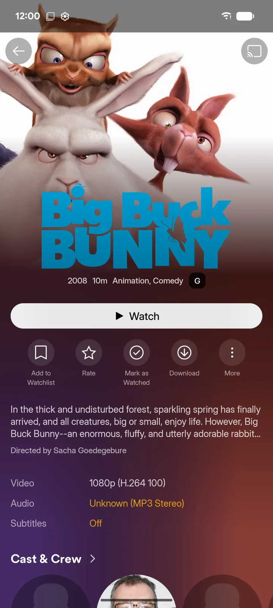

# zurg+rex untuk Android dan Google TV {#zurgrex-for-android-and-google-tv}

zurg+rex adalah server Plex di ponsel kamu. zurg membawa akun debrid dan Usenet kamu, lalu rex menyajikannya ke setiap aplikasi Plex di rumahmu, lengkap dengan poster, musim, dan progres tontonan. Berjalan di ponsel, tablet, Android TV, Google TV, atau Fire TV, tanpa komputer.

Ada sponsornya. Tidak punya sponsor? [rex for Android](../../rex/android.md) gratis dan memutar apa pun yang dibawa oleh addon-nya.

| Aplikasinya | Di aplikasi Plex | Di aplikasi Plex lain |
|---|---|---|
|  |  |  |

## Sebelum kamu mulai {#before-you-start}

| Kebutuhan Anda | Alasannya |
|---|---|
| Perangkat dengan Android 8.0 atau lebih baru | Ponsel, tablet, Android TV, Google TV, atau Fire TV. Usenet membutuhkan perangkat 64-bit |
| Sponsorship dengan akun GitHub Anda yang sudah tertaut | Aplikasi dan mesinnya diunduh dari repositori sponsor. Jadikan sponsor dan tautkan GitHub di [gatekeeper](https://gatekeeper.debridmediamanager.com/) |
| Akun debrid atau akun Usenet | Sumber yang dibawa zurg. NZB yang di-host TorBox (`torbox_nzb`) tidak tersedia di Android |
| Akun Plex | rex muncul di aplikasi Plex yang sudah masuk dengan akun tersebut. Akun gratis sudah cukup |
| API key DMM Anda, dari gatekeeper (opsional) | Dengan ini, lebih banyak judul akan mendapatkan nama dan poster |

## Langkah 1. Unduh {#step-1-download-it}

Di perangkat, buka [halaman unduh](https://zurg.debridmediamanager.com/id/download.html#android), masuk ke GitHub dengan akun sponsor Anda, lalu pilih file sesuai prosesornya:

| Perangkat Anda | File |
|---|---|
| Sebagian besar ponsel, tablet, dan TV box (64-bit) | `android-arm64-v8a.apk` |
| Ponsel 32-bit yang lebih lama dan TV stick | `android-armeabi-v7a.apk` |
| Chromebook dan emulator | `android-x86_64.apk` |

Satu file bisa dipakai di ponsel maupun TV.

**GitHub menampilkan 404?** Akun yang Anda pakai untuk masuk belum punya akses sponsor. Kalau Anda baru saja menjadi sponsor, [terima undangannya](https://github.com/debridmediamanager/zurg/invitations) dulu. Undangan biasanya dikirim dalam 15 menit.

## Langkah 2. Pasang {#step-2-install-it}

Buka file yang sudah diunduh dan izinkan pemasangan dari aplikasi yang membukanya. Android atau Play Protect mungkin meminta Anda untuk mengonfirmasi.

**Yang seharusnya Anda lihat.** **zurg+rex** ada di daftar aplikasi Anda.

## Langkah 3. Masuk ke GitHub dan pasang engine {#step-3-sign-in-to-github-and-install-the-engine}

Buka aplikasinya. Tertulis **Welcome to zurg+rex.**

1. Tekan **Sign in with GitHub**. Aplikasi akan menampilkan sebuah kode: tekan **Open GitHub**, masukkan kodenya, lalu setujui. GitHub meminta akses `repo` karena rilis untuk sponsor bersifat privat.
2. **Pasang engine-nya.** Engine itu adalah zurg dan rex sendiri, disimpan dalam paket tersendiri agar bisa diperbarui terpisah dari aplikasi. Tekan **Install**. Android akan bertanya sebelum memasangnya: izinkan.

**Yang seharusnya kamu lihat.** **Add your providers.**

## Langkah 4. Tambahkan penyedia Anda {#step-4-add-your-providers}

1. Tekan **Add an account** lalu pilih providernya.
2. Untuk akun debrid, tempel token-nya ke **Provider token**. Untuk Usenet, isi **NNTP server**, **Port**, **Username**, **Password** dan **Connections**.
3. Tekan **Test account**, lalu **Add provider**.

Tambahkan akun sebanyak yang kamu punya; **Account name** membedakan dua akun di provider yang sama. Batas koneksi akun Usenet dihitung untuk semua aplikasi dan perangkat lain yang memakainya.

## Langkah 5. Jalankan perpustakaan Anda {#step-5-start-your-library}

1. Pilih **Phone**, **Tablet**, **TV box** atau **TV stick**. Pilihan yang lebih kecil memakai memori dan cache yang lebih kecil.
2. Izinkan notifikasi dan biarkan aplikasi berjalan di latar belakang. Aktifkan **Start after reboot** jika perangkat ini harus selalu melayani library Anda.
3. Tekan **Start my library**.

**Yang seharusnya Anda lihat.** **Status** menampilkan **Ready for your players** dan menghitung rilis Anda. Pemuatan pertama untuk akun yang besar bisa memakan waktu beberapa menit.

## Langkah 6. Masuk ke Plex {#step-6-sign-in-to-plex}

Di **Status**, di bawah **rex for the Plex apps**, tekan **Sign in to Plex**.

- **Di ponsel atau tablet** browser Anda akan membuka halaman sign-in Plex. Login di sana.
- **Di TV** aplikasi akan menampilkan **On any device, go to plex.tv/link and enter** dan sebuah kode. Masukkan kode itu di ponsel atau komputer Anda.

Gunakan akun yang dipakai aplikasi Plex Anda untuk login.

**Yang seharusnya Anda lihat.** **Ready for the Plex app**, dengan tombol **Open Plex** jika Plex ada di perangkat ini.

## Langkah 7. Tonton di aplikasi Plex {#step-7-watch-in-a-plex-app}

Buka aplikasi Plex apa pun yang sudah login ke akun yang sama: di perangkat ini, di TV kamu, di ponsel lain, atau di komputer di rumah. Server kamu akan muncul dengan nama perangkat ini, lengkap dengan library **Debrid Movies** dan **Debrid TV**. Tekan play.

rex mengonversi apa pun yang tidak bisa diputar oleh player, dengan memakai encoder video bawaan perangkat.

## Dapatkan lebih banyak judul bernama {#get-more-titles-named}

Buka **Settings**, **Library** lalu tempel kunci API DMM Anda ke dalam **Dmm api key**, kemudian simpan. zurg lalu bertanya ke DMM tentang setiap file itu apa. Tanpa kunci, zurg menebaknya dari nama rilis, dan lebih sedikit judul yang mendapat nama dan poster.

Judul yang masih terlihat salah bisa diperbaiki di aplikasi Plex: buka menu **⋯** miliknya lalu pilih **Fix Match**.

Kolom ini ada di nightly dari 14 November 2026. Di nightly yang lebih lama, tambahkan `dmm_api_key: YOUR_DMM_API_KEY` di **Settings**, **Advanced**. Kunci yang sama juga dipakai untuk membaca [daftar keinginan DMM](dmm-wanted.md) Anda.

## Add-on {#addons}

Add-on memberi lebih banyak tontonan ke rex, selain pustaka Anda. Buka **Addons**: add-on Internet Archive sudah terpasang dan menambahkan film domain publik, dan repositori [rex-addons](https://github.com/debridmediamanager/rex-addons) sudah tercantum. Tambahkan repositori lain dengan tautannya, buka, lalu pasang apa pun yang ditawarkannya.

Setiap add-on menyebutkan situs web mana saja yang bisa dijangkaunya, dan pembaruan yang menjangkau situs baru akan meminta izin Anda dulu. Pasanglah add-on hanya dari orang yang Anda percaya. Add-on yang membutuhkan akun Anda akan menampilkan kode untuk dimasukkan di situs webnya; sesi login yang didapat tetap tersimpan di perangkat ini. **Log** menampilkan apa saja yang dilakukan add-on belakangan ini. Menghapus add-on hanya menghilangkan judul-judulnya.

## Pemutar lain di perangkat ini {#other-players-on-this-device}

Kamu tidak perlu aplikasi Plex untuk menonton.

- **Library** menelusuri folder kamu dan memutar file di pemutar yang kamu pilih. **More** menawarkan pemutar lain dan aksi untuk rilisan: repair, rename, tags, show all files, dan delete. Aksi ini berlaku untuk seluruh rilisan, dan delete akan bertanya dulu sebelum menghapusnya dari akun penyedia kamu.
- Aplikasi **Files** dan pemilih dokumen menampilkan library yang sama di bawah zurg root. Buka pemutarmu sekali dan selesaikan pengaturannya sebelum memilihnya dari Files.
- Pemutar WebDAV seperti VLC, Kodi, dan Nova menggunakan `http://127.0.0.1:9999/dav/` sebagai sumber. **Status** menampilkan alamatnya jika kamu mengubah port.

Di TV, gerak dengan D-pad dan Select, kembali dengan Back, dan buka aksi rilisan dengan Menu atau **More**. Pilih kolom teks untuk mengetik di dalamnya, lalu tekan Back untuk lanjut.

## Bagikan dengan pemutar lain di rumah {#share-with-other-players-at-home}

Aplikasi Plex di rumah tidak perlu apa-apa lagi: mereka menemukan rex dengan sendirinya. Untuk pemutar WebDAV di perangkat lain, buka **Settings**, **Connection** lalu nyalakan **Expose on local network**. zurg membuat username dan password dan menampilkan alamat yang perlu dimasukkan di pemutar itu.

Gunakan ini hanya di jaringan yang kamu percaya: password dikirim tanpa enkripsi. Fitur ini mati secara default dan hanya aktif kalau kamu menyalakannya.

## Biarkan tetap berjalan {#keep-it-running}

- Notifikasinya menampilkan status server dan ada tombol **Stop**. Sebuah tile Quick Settings juga bisa memulai dan menghentikannya.
- Beberapa ponsel tetap menghentikan aplikasi latar belakang. [Don't kill my app](https://dontkillmyapp.com/) menjelaskan apa saja yang dibutuhkan aplikasimu.
- **Updates** memeriksa aplikasi baru dan engine baru; keduanya diperbarui secara terpisah. Jika nightly baru bermasalah di perangkatmu, tekan **Show engine versions** dan pasang yang sebelumnya berfungsi. Hentikan library-mu di **Status** dulu.
- **Settings** punya **Create backup** dan **Restore backup**. Backup menyimpan kata sandi dan token-mu, jadi jaga kerahasiaannya. Hentikan library-mu sebelum melakukan restore.
- Matikan rex di **Settings**, **Connection**, **rex for the Plex apps**. zurg lalu berhenti mengirim data ke rex.

## Apa yang dikirim aplikasi dan ke mana {#what-the-app-sends-and-where}

| Ke mana | Apa | Kapan |
|---|---|---|
| GitHub | Login kamu, lalu permintaan untuk rilis sponsor | Saat kamu login dan saat **Updates** mengecek pembaruan |
| Penyedia kamu | Token akun atau login Usenet kamu, dan permintaan untuk library dan file kamu | Selama library kamu berjalan |
| debridmediamanager.com | Nama rilis kamu, untuk mengetahui isi tiap rilis, beserta kunci API DMM kamu jika kamu memasukkannya | Selama library berjalan dengan rex aktif |
| plex.tv dan layanan metadata Plex | Permintaan kode login; lalu nama server, alamat, dan id judul kamu, untuk mengambil poster dan deskripsi | Saat kamu login ke Plex, dan selama rex berjalan dalam keadaan login |
| debridmediamanager.com (rex-direct) | Identifier rex, token server yang diberikan Plex, alamat IP dan port-nya, supaya aplikasi Plex bisa terhubung ke sana lewat HTTPS | Setelah login ke Plex, lalu setiap 6 jam |
| Website tiap addon dan repositori yang kamu tambahkan | Apa yang diminta addon | Saat addon melakukan sinkronisasi atau judul diputar |
| logs.debridmediamanager.com | Versi, model perangkat, log aplikasi dan engine, serta config kamu, dengan kunci, kata sandi, dan token diganti dengan `[redacted]` | Hanya saat kamu menekan **Send** di bawah **Send logs to support**, setelah melihat semuanya. Dihapus setelah 7 hari |

Token GitHub kamu disimpan terenkripsi di perangkat. Jika aplikasi dicopot, semua yang disimpannya ikut terhapus.

## Batasan {#limits}

- **Perangkatnya adalah servernya.** Biarkan tetap menyala, terhubung, dan tercolok listrik. Mengonversi video itu lambat di kotak murah.
- **Diputar di rumah.** Di luar rumah, aplikasi Plex membutuhkan alamat HTTPS yang bisa menjangkau perangkat, dan itu butuh port forward di router kamu. Lihat [Gunakan di luar rumah](../../rex/with-zurg.md#use-it-outside-your-home-optional).
- **Usenet butuh Android 64-bit.** Perangkat 32-bit hanya menjalankan library debrid.
- **Tidak ada di Google Play.** Aplikasinya memperbarui diri dari dalam aplikasi, di bawah **Updates**.

## Pemecahan masalah {#troubleshooting}

| Yang Anda lihat | Yang harus dilakukan |
|---|---|
| GitHub menjawab 404 di halaman unduh | Masuk ke GitHub dengan akun sponsor Anda dan [terima undangannya](https://github.com/debridmediamanager/zurg/invitations). Belum jadi sponsor: [gatekeeper](https://gatekeeper.debridmediamanager.com/) |
| **No engine is installed. zurg needs one before it can serve your library.** | Tekan **Install an engine** lalu izinkan Android untuk memasangnya |
| **No engine is available in the sponsor releases for this device yet.** | Nightly terbaru belum punya engine untuk prosesor Anda. Tanyakan di support |
| **This is a 32-bit device. Debrid libraries are supported; Usenet needs 64-bit Android.** | Tambahkan akun debrid, atau gunakan perangkat 64-bit untuk Usenet |
| **The Plex code expired. Ask for a new one.** | Tekan **Sign in to Plex** lagi lalu masukkan kode baru dalam 10 menit |
| Server tidak muncul di aplikasi Plex | Masuk ke aplikasi Plex dengan akun yang Anda pakai di Langkah 6, dan pastikan kedua perangkat berada di jaringan rumah yang sama |
| Judul hanya menampilkan nama file dan tanpa poster | Masukkan API key DMM Anda (lihat [Get more titles named](#get-more-titles-named)), atau gunakan **Fix Match** di aplikasi Plex |
| **Needs an update** di bawah addon | Versi aplikasi ini tidak bisa lagi menjalankan salinan addon tersebut. Segarkan repository-nya lalu tekan **Update**. Judulnya tetap tersimpan sementara itu |
| Aplikasi berhenti saat layar mati | Izinkan penggunaan di latar belakang lagi dan lihat [Don't kill my app](https://dontkillmyapp.com/) |
| Pembaruan membuat aplikasi tidak punya engine | Pasang engine dari **Updates** sekali saja. Penyedia dan pengaturan Anda tetap ada |

Jika support meminta log, buka **Logs** lalu tekan **Send logs to support**. Anda bisa melihat semuanya sebelum apa pun dikirim, lalu tekan **Send** dan kirimkan kode yang Anda dapat.

Masih buntu? Tanyakan di forum **zurg-support** di [Discord](https://discord.com/invite/7u4YjMThXP).
