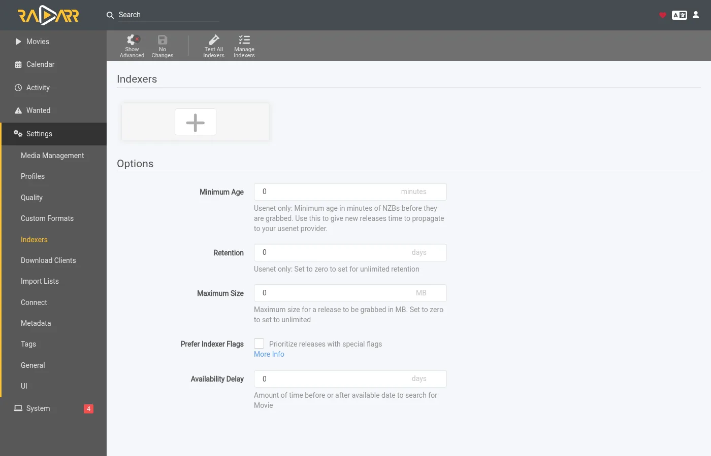

# Biarkan zurg mengambil apa yang diminta Sonarr dan Radarr {#let-zurg-fetch-what-sonarr-and-radarr-want}

Ada tiga cara menggunakan Sonarr dan Radarr dengan zurg. Pilihan utamanya adalah siapa yang mencari: zurg atau \*arrs. [Mana yang harus dipilih](#which-one-to-pick) membandingkan keduanya.

| Panduan | Siapa yang mencari | zurg berperan sebagai | Yang kamu butuhkan |
|---|---|---|---|
| [Usenet](sonarr-radarr.md) | Sonarr dan Radarr | SABnzbd | Akun Usenet (atau TorBox Pro untuk backend `torbox_nzb`) dan indexer Usenet di Prowlarr atau \*arrs |
| [Torrent](sonarr-radarr-torrents.md) | Sonarr dan Radarr | qBittorrent | Akun debrid dan indexer torrent di Prowlarr atau \*arrs |
| [Pencarian zurg](sonarr-radarr-fetch.md) | zurg | tanpa download client sama sekali | Akun Usenet, TorBox Pro, atau debrid, dan indexer Newznab atau Torznab di konfigurasi zurg sendiri |

Dua yang pertama bisa berjalan berdampingan. Keduanya memakai folder `__magic__` yang sama.

### Mana yang harus dipilih {#which-one-to-pick}

| | zurg yang mencari | Sonarr dan Radarr yang mencari |
|---|---|---|
| Indexer dimasukkan ke | `config.yml` milik zurg, dan perubahan butuh restart | Prowlarr atau \*arr, seperti biasa |
| Para \*arr butuh | folder root di dalam `__magic__`, tidak ada yang lain | zurg sebagai download client mereka, dengan folder download dan folder root berada di satu volume |
| File pertama adalah | yang paling cepat dipastikan diizinkan oleh profile kamu, lalu di-upgrade ke cutoff nanti | yang diurutkan paling atas oleh \*arr di profile kamu |
| Anime, acara harian, dan special | ditangani mulai dari nightly 5 November 2026 | ditangani |
| Manual search, queue, history, blocklist | tidak ada. File muncul dan \*arr memindai ulang | berjalan seperti biasa |
| `exclude_words` milik zurg ([`exclude_words`](acquisition.md#excluding-releases-by-name)) | berlaku | tidak berlaku. Blokir kata yang sama di \*arr |

Keduanya memeriksa rilis sebelum \*arr mengimpornya. Post Usenet yang sudah mati, atau torrent yang belum ada di akun kamu, tidak pernah ditempatkan.

Kalau kamu baru pasang, mulai saja dengan zurg yang mencari. Pengaturannya lebih sedikit dan tidak ada layout volume yang harus dibenar-benarkan. Pakai jalur download-client kalau kamu ingin memilih rilis secara manual. Kalau kamu lebih suka menunggu rilis terbaik profile kamu daripada file pertama yang cepat, nyalakan [`best_first`](acquisition.md#taking-the-profiles-best-first).

Radarr dan Sonarr menyimpan daftar dan library. zurg yang mengambil file. Tambahkan film atau serial seperti biasa, dan zurg akan mencari rilis di indexer kamu. Ia memeriksa apakah NZB masih ada di news server (untuk akun `torbox_nzb`, berarti TorBox yang sudah mengambilnya), atau apakah akun debrid kamu sudah punya torrent-nya. Lalu ia menaruh file di folder miliknya di dalam `__magic__` dan meminta Radarr atau Sonarr memindai ulang. Tidak ada yang diunduh untuk diimpor dan tidak ada yang disalin.

Untuk ini Radarr dan Sonarr tidak butuh indexer maupun download client. Mereka tidak pernah mencari dan tidak pernah mengambil. Quality profile kamu tetap menentukan apa yang boleh diambil zurg.

Screenshot-nya diambil dari build zurg yang dirilis sebagai nightly 26 September 2026, dengan Radarr 6.3.0.10514 dan Sonarr 4.0.20.3014 di Docker. Keduanya melihat mount zurg di `/mnt/zurg` di dalam container mereka. Tidak ada yang diubah di dalamnya.

## Sebelum kamu mulai {#before-you-start}

1. **zurg punya akun Usenet atau debrid dan minimal satu indexer Newznab atau Torznab.** Indexer-nya dimasukkan ke config zurg di bawah `acquisition.indexers`. Halaman [Watchlist and Seerr](acquisition.md) menjelaskan blok tersebut.
2. **`magic.enabled` harus `true`.** Sumber Radarr dan Sonarr tidak akan jalan tanpa ini dan log akan memberi tahu kamu. Lihat [`__magic__`](magic.md).
3. **Radarr dan Sonarr bisa melihat mount zurg.** Kalau dipasang sebagai aplikasi biasa, tiap sistem punya satu hal yang perlu diperhatikan, yang dijelaskan di [panduan Usenet](sonarr-radarr.md#before-you-start). Di Docker pada host Linux, artinya kamu perlu mem-bind mount ke dalam container mereka. Bind parent dari mount sekali saja, lalu akses semuanya lewat situ. Kalau mereka juga menerima grab dari zurg sebagai download client, maka dua volume untuk folder download dan root folder akan membuat setiap impor tersalin. Lihat [satu volume](sonarr-radarr.md#one-volume-for-the-download-folder-and-the-root-folders).
4. **Kamu menjalankan nightly dari 26 September 2026 atau lebih baru.** Build yang lebih lama tidak mengenal sumber `radarr` atau `sonarr`.

## 1. Beri tahu zurg tentang Radarr dan Sonarr {#1-tell-zurg-about-radarr-and-sonarr}

Tambahkan source `radarr` dan source `sonarr` di bawah `acquisition` dalam `config.yml` lalu restart zurg. Belum ada form dashboard untuk blok ini. Jangan tulis yang tidak kamu pakai.

```yaml
acquisition:
  quality: best
  indexers:
    - name: my-indexer
      url: https://indexer.example
      api_key: YOUR_INDEXER_API_KEY
  sources:
    - name: radarr
      type: radarr
      enabled: true
      url: http://radarr:7878         # http://localhost:7878 when Radarr is an ordinary app beside zurg
      api_key: YOUR_RADARR_API_KEY
      library_path: /mnt/zurg/__magic__
      check_every_secs: 30
    - name: sonarr
      type: sonarr
      enabled: true
      url: http://sonarr:8989         # http://localhost:8989 likewise
      api_key: YOUR_SONARR_API_KEY
      library_path: /mnt/zurg/__magic__
      check_every_secs: 30
```

`url` dan `api_key` milik aplikasinya sendiri. API key-nya ada di **Settings > General** di kedua aplikasi.

`check_every_secs` adalah seberapa sering zurg menanyakan apa yang mereka inginkan. Setiap poll adalah satu request untuk daftarnya. Indexer yang sama melayani kedua source.

`library_path` adalah tempat aplikasinya melihat direktori `__magic__` milik zurg. zurg membutuhkannya untuk mengubah folder Radarr menjadi lokasi di dalam `__magic__`. Dengan config di atas, film yang disimpan Radarr di `/mnt/zurg/__magic__/movies/Heat (1995)` akan ditempatkan di `movies/Heat (1995)` di dalam `__magic__` milik zurg. Path Windows seperti `Z:\__magic__` bekerja dengan cara yang sama. Jangan isi `library_path` hanya jika aplikasinya berjalan di host yang sama dengan zurg dan melihat mount tempat zurg di-mount.

`concurrency` adalah berapa banyak judul yang dikerjakan zurg sekaligus, defaultnya delapan. Daftar yang besar tetap aman dengan default ini. Hanya saja prosesnya jadi lebih lama.

## 2. Letakkan root folder di dalam `__magic__` {#2-put-the-root-folders-inside-__magic__}

Root folder harus berada di dalam `__magic__` dan satu level di bawahnya. `/mnt/zurg/__magic__/movies` untuk Radarr dan `/mnt/zurg/__magic__/tv` untuk Sonarr adalah bentuk yang sebaiknya kamu contoh (`/Volumes/Zurg/__magic__/movies` di macOS, `Z:\__magic__\movies` di Windows). Jangan pakai `__magic__` itu sendiri dan jangan pakai `__magic__/__all__`. Judul yang foldernya ada di tempat lain akan dilewati, dan zurg akan memberi tahu hal itu sekali di log-nya.

Di Radarr, buka **Settings > Media Management** dan tambahkan root folder-nya.


Sonarr punya halaman yang sama. Tambahkan root folder-nya di bawah **Root Folders**.


**Season Folder Format** di halaman Sonarr adalah nama yang diberikan zurg untuk folder season baru. Season yang sudah punya file akan tetap memakai folder tempat file-file itu berada. Ruang kosong yang dilaporkan kedua aplikasi adalah ruang yang dilaporkan mount. Tidak ada aplikasi yang pernah menulis ke sana.

## 3. Tambahkan judul dengan search dimatikan {#3-add-titles-with-search-off}

Tambahkan film dan serial seperti biasa. Secara manual, dari daftar, atau dari aplikasi request. Satu-satunya yang perlu diubah adalah pencarian. zurg yang melakukan pencarian, jadi arr tidak boleh melakukannya.

### Radarr

Panduan ini memakai import list. Buka **Settings > Import Lists** lalu tambahkan atau edit milik kamu.


Di pengaturan list, biarkan **Enable Automatic Add** tetap aktif dan matikan **Search on Add**. Pilih quality profile dan root folder dari langkah 2. Atur **Minimum Availability** sesuai keinginanmu. zurg menunggu Radarr menganggap film sudah tersedia sebelum mencarinya.


Saat kamu menambahkan satu film secara manual, switch yang sama namanya **Start search for missing movie**. Matikan juga yang ini.

### Sonarr

Saat menambahkan series secara manual, biarkan **Start search for missing episodes** dan **Start search for cutoff unmet episodes** tidak dicentang. **Monitor** yang menentukan apa yang akan dicari zurg. Series ini diatur ke season pertamanya.


Import list di Sonarr punya sakelar yang sama di pengaturannya. Matikan juga pencariannya.

## 4. Biarkan indexer dan download client kosong {#4-leave-indexers-and-download-clients-empty}

Itu sudah semua setup di sisi arr. Halaman indexers boleh dibiarkan kosong.



Halaman download clients juga boleh dibiarkan kosong.


Sonarr sama saja. Kalau salah satu app sudah punya indexers dan download client dari setup sebelumnya, app itu tetap jalan seperti biasa. Tapi app itu lalu akan mengambil file bersamaan dengan zurg untuk judul yang sama. Matikan automatic search di indexers tersebut, atau hapus indexers itu untuk judul-judul yang diurus zurg.

## 5. Lihat cara kerjanya {#5-watch-it-work}

Buka dashboard zurg. **Acquisition** adalah entri baru di quick links.


Halaman ini menampilkan setiap judul yang sedang diproses zurg dan apa yang sedang dilakukannya saat ini. Data yang sama tersedia di `/acquisition/status.json` jika kamu ingin membacanya dari script.

### Movies

Ini adalah daftar sepuluh film sekitar setengah menit setelah Radarr menambahkannya. Lima sudah punya file-nya dan Radarr sedang diberi tahu tentang file itu. Sisanya sudah selesai.


Setiap baris adalah satu film. **State** menunjukkan posisinya. **Stage** adalah apa yang sedang dikerjakan zurg untuk film itu sekarang. Pertama, zurg membaca indexer. Lalu menilai kandidatnya. Lalu membaca NZB dari sebuah rilis dan memeriksa postingannya dengan server berita. Terakhir, menempatkan file-nya. **Release** adalah postingan yang diambil zurg dan hasil parser Radarr darinya. **Placed at** adalah path di dalam `__magic__` tempat video sekarang berada. Judul yang tidak lagi ada di server berita akan langsung pindah ke kandidat berikutnya. Judul yang tidak punya apa-apa yang bisa dipakai akan dikesampingkan, dengan alasannya ditampilkan.

Semenit kemudian semuanya sudah selesai.


### Series

Halaman Sonarr menampilkan season di satu tempat yang sama. Satu baris adalah satu season atau satu file episode yang sedang di-upgrade oleh zurg. Berikut contoh dua serial dengan season pertama yang dimonitor setengah menit setelah ditambahkan. Kedua season sudah selesai tayang dan belum punya file, jadi zurg mencoba season pack untuk masing-masing. Pack Severance sedang berada di folder season-nya dan Sonarr sedang diberi tahu. Pack Only Murders sedang diperiksa dengan news server.


Sekitar dua menit setelah ditambahkan, kedua season sudah selesai. Pack Only Murders kekurangan beberapa bagian di news server. zurg menyisihkannya dan mengambil sepuluh episode satu per satu. Barisnya menampilkan episode terakhir yang sudah ditempatkan.


## 6. Yang ditampilkan Radarr dan Sonarr {#6-what-radarr-and-sonarr-show}

Perpustakaan terisi seiring hasil pemindaian ulang masuk. Setiap film dalam daftar ini sudah punya filenya.


Halaman sebuah film menampilkan file di dalam folder-nya di dalam `__magic__`, lengkap dengan kualitas yang dibaca Radarr dari namanya.


Di Sonarr, semua sepuluh episode sudah punya file-nya di folder musim, lengkap dengan kualitas yang dibaca Sonarr dari setiap nama.


**Activity** di keduanya tetap kosong. Tidak ada entri antrean dan tidak ada peristiwa grab atau import, karena tidak ada yang di-grab. File tersebut muncul begitu saja di folder, dan pemindaian ulang yang diminta zurg yang menangkapnya.


Ada dua hal yang mengikuti dari sini. Blocklist milik arr tidak pernah ditulis. zurg menyimpan catatannya sendiri tentang posting yang sudah tidak ada di news server, dan tidak akan mengambilnya lagi. Lalu, judul yang kamu hapus di Radarr atau Sonarr tidak ikut terhapus dari akunmu. File tersebut kembali tercantum di `__all__` seperti rilis lainnya.

## Cara zurg memilih release {#how-zurg-picks-a-release}

Profil kualitas Anda adalah gerbangnya. Setiap rilis yang akan diambil zurg harus melewati parser bawaan aplikasi terlebih dahulu. Judulnya harus tepat. Kualitasnya harus diizinkan oleh profil. Skor custom format-nya harus mencapai nilai minimum profil. Ukurannya harus sesuai dengan batas di bawah **Settings > Quality**. Rilis yang gagal memenuhi salah satu syarat tersebut tidak akan diambil.

### Movies

Di antara rilis yang diizinkan profil, zurg mengambil yang paling cepat dikonfirmasi. Post yang hanya berisi satu file video didahulukan, karena post seperti itu paling sering masih lengkap di news server. Rilis Web didahulukan dibanding Blu-ray dengan alasan yang sama. Set arsip multi-volume dijadikan cadangan.

Urutan preferensi profil justru dijalankan lewat upgrade. Kalau profil mengizinkan upgrade dan file yang sudah terpasang berada di bawah cutoff, zurg mencari rilis yang lebih baik setelah film tersebut punya rilis itu. Hanya rilis yang benar-benar lebih baik yang akan menggantikan file. Kualitas yang lebih rendah tidak pernah diambil.

Film yang tanggal rilisnya di masa depan akan menunggu sampai Radarr menandainya sebagai tersedia. Pencarian yang menghasilkan film yang salah akan ditolak, karena Radarr tidak mencocokkan judulnya dengan film apa pun di koleksi kamu.

### Series

Satu season dianggap sebagai satu unit kerja. Kalau semua episode dalam satu season belum ada dan season itu sudah selesai tayang, zurg akan mencoba season pack dulu. Kalau tidak, zurg mengambil episode yang hilang satu per satu. Season yang sudah punya sebagian file tidak akan pernah mengambil pack. Kalau diambil, episode yang sudah ada akan jadi duplikat di folder.

Sebuah release harus sesuai dengan series dan season ini. Pack harus berisi seluruh season. Release episode harus hanya berisi satu episode itu saja. Batas ukuran berlaku untuk durasi episode yang ada di dalam release tersebut.

Kalau satu episode dalam season belum ada yang bisa diambil zurg, episode lain tetap ditempatkan dan Sonarr langsung diberi tahu tentang episode-episode tersebut. Episode yang belum ada akan dicari lagi nanti sesuai jadwal coba ulang yang biasa.

File episode di bawah cutoff dianggap upgrade kalau profil mengizinkan upgrade. Di bawah cutoff berarti di bawah kualitas cutoff atau di bawah skor custom format cutoff. zurg menghitung keduanya seperti aturan upgrade Sonarr. Daftar **Cutoff Unmet** milik Sonarr sendiri hanya menampilkan yang pertama. Upgrade hanya menggantikan episode itu sendiri dan sisa folder season tetap di tempatnya.

## Hal yang perlu diketahui {#things-to-know}

- **Perubahan apa pun pada blok `acquisition` di `config.yml` butuh restart.** zurg hanya membaca file saat ia dinyalakan.
- **Rescan adalah langkah terakhir dan ia antre di belakang pekerjaan app itu sendiri.** Tepat setelah sebuah list menambahkan banyak film, Radarr menyegarkan setiap film dulu. File-filenya sudah ada di tempatnya selama proses itu berjalan.
- **Analyse video files membaca bagian awal setiap file lewat mount.** Fitur ini berfungsi. Ini juga bagian paling lambat dari list yang besar. Biarkan menyala kecuali kamu tahu tidak mau info media.
- **Judul yang tidak dimonitor dibiarkan saja.** Ini berlaku untuk film, serial, season, dan episode. Begitu juga judul yang foldernya berada di luar `__magic__`.
- **Anime, acara harian, dan special butuh nightly dari 5 November 2026 atau lebih baru.** Episode acara harian dicari berdasarkan tanggal tayangnya, episode anime berdasarkan nomor yang dipakai show itu untuk menghitungnya (`Jujutsu Kaisen - 30` adalah episode keenam season kedua), dan special dicari sebagai season 00. File yang ditaruh untuk anime atau acara harian diberi nama `JUJUTSU KAISEN - S02E06 - <the release's own name>`, karena rescan Sonarr membaca file hanya dari namanya dan akan memasukkan `2nd Season - 06` ke season 1. Special yang hanya punya judul tanpa `S00Exx` tidak bisa dicocokkan, termasuk oleh Sonarr. Pada build yang lebih lama, setiap seri seperti itu dilewati dengan satu baris di log.

Dokumentasi lengkap kedua sumber ada di [Watchlist dan Seerr](acquisition.md).
