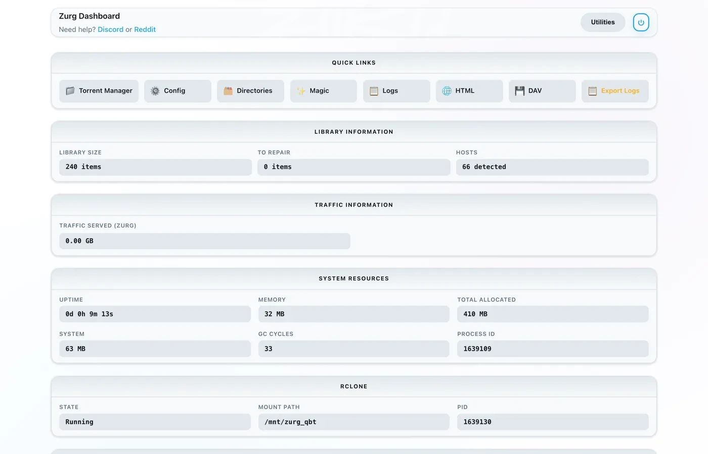
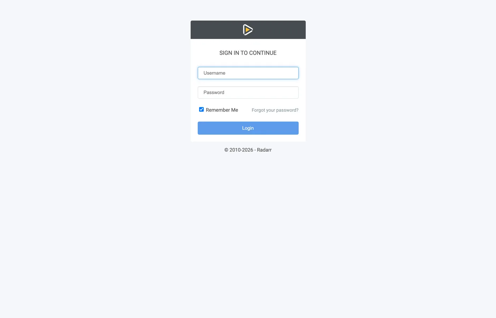
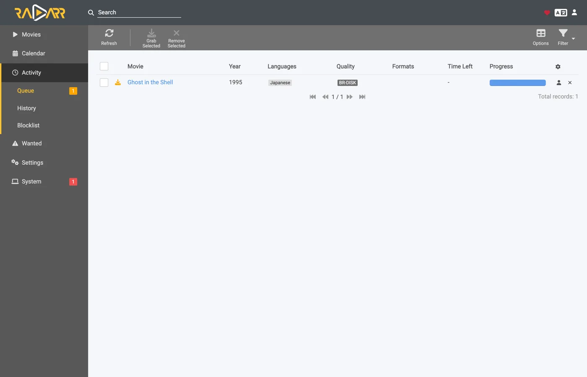

# Sonarr dan Radarr dengan torrent, langkah demi langkah {#sonarr-and-radarr-with-torrents-step-by-step}

Ada tiga cara memakai Sonarr dan Radarr dengan zurg. Pilihan utamanya adalah siapa yang mencari, zurg atau \*arrs: [pilih yang mana](sonarr-radarr-fetch.md#which-one-to-pick) membandingkan keduanya.

| Panduan | Siapa yang mencari | zurg berperan sebagai | Yang kamu butuhkan |
|---|---|---|---|
| [Usenet](sonarr-radarr.md) | Sonarr dan Radarr | SABnzbd | akun Usenet (atau TorBox Pro untuk backend `torbox_nzb`) dan indexer Usenet di Prowlarr atau \*arrs |
| [Torrent](sonarr-radarr-torrents.md) | Sonarr dan Radarr | qBittorrent | akun debrid dan indexer torrent di Prowlarr atau \*arrs |
| [zurg yang mencari](sonarr-radarr-fetch.md) | zurg | tidak ada download client sama sekali | akun Usenet, TorBox Pro, atau debrid, dan indexer Newznab atau Torznab di config zurg sendiri |

Dua yang pertama bisa jalan berdampingan. Keduanya memakai folder `__magic__` yang sama.

[Panduan sebelumnya](sonarr-radarr.md) mengarahkan \*arrs ke zurg untuk Usenet, dengan zurg menjawab sebagai SABnzbd. Ini adalah separuh lainnya: zurg menjawab sebagai **qBittorrent**, \*arrs memberinya magnet atau `.torrent` alih-alih NZB, dan rilisnya masuk ke akun debrid, bukan ke news server. Proses import-nya sama — cukup rename di dalam `__magic__`, tidak ada yang diunduh untuk diimpor, dan tidak ada yang disalin.

**Mana dari keduanya yang dikirim \*arr itu bukan hal sepele.** `.torrent` biasanya diunggah ke akun sebagai file itu sendiri; hanya magnet yang ditambahkan hanya dengan info hash. Dalam mode cached-only, yang menjadi default, TorBox dan Debrid-Link justru menerima info hash, karena begitulah cara mereka menolak rilis yang belum ter-cache tanpa menambahkannya. Magnet membuat akun mencari tahu isi torrent dari hash-nya, dan hash dari private tracker tidak punya swarm publik untuk dipakai mencari tahu itu. Real-Debrid gagal dengan `magnet_error` tanpa file, dan TorBox menerimanya lalu diam di `checking` tanpa daftar file, tanpa ukuran, dan dengan estimasi seratus hari, jadi grab-nya tidak gagal dan tidak selesai. File `.torrent` langsung mencocokkan cache akun berdasarkan hash, jadi konten yang sudah dimiliki akun langsung ditambahkan tanpa resolusi magnet sama sekali. Inilah yang membuat private indexer bisa dipakai di sini: rilisnya hanya bisa ditambahkan kalau akun sudah memiliki kontennya, dan untuk apa pun yang dibagikan komunitas, itu kasus yang paling umum. Arahkan \*arr ke indexer yang memberikan file `.torrent`, bukan magnet — private indexer biasanya begitu.

Semua di bawah ini diambil dengan zurg `2026.08.30.0459-nightly-73-g5b4c9790`, Sonarr `4.0.19.2979`, Radarr `6.3.0.10514`, dan Prowlarr `2.5.2.5491`, pada instalasi langsung dengan akun AllDebrid asli. Nama host dan user sudah diganti menjadi `you@zurg-server`. Nama indexer ditulis `my-indexer`. API key dan jumlah library hanya contoh. Tidak ada bagian lain dari output yang diambil yang diubah.

## Sebelum kamu mulai {#before-you-start}

Tiga hal ini harus benar. Cek sekarang semuanya, karena kalau salah, setiap kegagalannya nanti akan terlihat seperti masalah lain.

1. **zurg punya akun yang bisa menambahkan torrent**: Real-Debrid, AllDebrid, TorBox, Premiumize, Debrid-Link, atau Offcloud. Semua enam menerima file `.torrent` yang diunggah langsung, dan inilah yang membuat rilis dari private tracker bisa ditambahkan. Akun Usenet tidak menerima torrent dalam bentuk apa pun. Instalasi yang hanya punya provider `nzb` akan menerima setiap grab, lalu menolaknya. zurg akan memberi tahu hal ini saat startup.
2. **`magic.enabled` bernilai `true`.** Tanpa ini, path penyimpanan tidak ada dan setiap impor akan gagal. Lihat [`__magic__`](magic.md).
3. **Mount terlihat oleh \*arr di path yang dilaporkan zurg.** Kalau \*arr berjalan di dalam container, baca [langkah 8](#8-if-your-arr-is-in-docker) sebelum mengatur apa pun. Kalau dipasang sebagai aplikasi biasa di mesin yang sama, ia melihat mount di tempat zurg memasangnya, dengan satu catatan untuk tiap sistem:
   - **Linux:** \*arr yang berjalan sebagai user berbeda dari zurg akan melihat folder kosong sampai `user_allow_other` diaktifkan. Lihat [Pengaturan Linux](../setup/linux.md#1-install-fuse-3).
   - **macOS:** jalankan sebagai user yang sama dengan zurg. Mount-nya ada di `/Volumes/Zurg` kecuali kamu mengubah `mount_path`.
   - **Windows:** jalankan Sonarr dan Radarr sebagai aplikasi tray, seperti yang ditawarkan installer-nya, bukan sebagai layanan Windows. Drive `Z:` milik zurg hanya ada di sesi tempat kamu login, dan layanan berjalan di luar sesi itu, jadi layanan tidak akan melihat drive tersebut. Lihat [aturan sesi](../setup/windows.md#keeping-it-running-the-session-rules).

Cek dua poin pertama langsung dari file config, di working directory zurg. Di Windows, buka `config.yml` dengan Notepad.

```bash
$ grep -A3 '^providers:' config.yml
providers:
- type: alldebrid
  token: <redacted>

$ grep -A3 '^magic:' config.yml
magic:
  enabled: true
  allow_delete: false
```

**Urutan daftar `providers:` itu penting di sini.** Sebuah grab ditawarkan ke setiap akun yang menerima torrent, sesuai urutan itu. Kalau sebuah akun menolak atau macet menanganinya, akun itu ditinggalkan dan akun berikutnya dicoba. Kalau kamu punya dua akun, taruh akun yang ingin kamu pakai lebih dulu di posisi pertama.

Ada dua key yang bisa mengeluarkan akun dari urutan itu. `watchlist: true` membuat satu akun didahulukan di mana pun posisinya dalam file. `add_torrents: false` mengeluarkan akun dari rotasi sama sekali, jadi akun itu tetap melayani dan membaca librarynya, tetapi tidak ada torrent baru yang ditaruh di sana. Ini cocok untuk akun arsip, atau akun yang kuotanya sudah dipakai untuk hal lain. Akun Usenet tidak pernah ditawari torrent dengan cara apa pun. Kedua key ini dijelaskan di [referensi konfigurasi](../reference/config.md#accounts).

## 1. Nyalakan endpoint-nya {#1-turn-the-endpoint-on}

Dua cara, hasilnya sama. Keduanya menulis ke `config.yml` dan keduanya perlu di-restart: rute yang melayani `__magic__` dan endpoint qBittorrent didaftarkan sekali saja, saat zurg mulai.

### Opsi A — dashboard {#option-a--the-dashboard}

Buka dashboard zurg, klik **Config**, lalu scroll ke **\_\_magic\_\_ & Download Clients**. Nyalakan **Serve \_\_magic\_\_** dan **qBittorrent Endpoint**.



**Config** adalah tempat setting ini berada; **Magic** adalah tempat kamu akan melihat grab yang masuk nanti.


Biarkan **qBittorrent Save Path** kosong kecuali *arr kamu me-mount zurg di lokasi yang berbeda dari tempat zurg sendiri — lihat [langkah 8](#8-if-your-arr-is-in-docker). Chip oranye **Restart Required** itu benar: tidak ada yang di sini berlaku sampai zurg di-restart.

### Opsi B — `config.yml` {#option-b--configyml}

Tambahkan blok itu secara manual lalu restart zurg.

```yaml
magic:
  enabled: true

qbittorrent:
  enabled: true
  api_key: ""                   # empty = zurg generates one and keeps it
  categories: [tv-sonarr, radarr]
  save_path: ""                 # empty = <mount_path>/__magic__/__all__
  cached_only: true             # the default: only take what an account already holds
```

**Kategori bukan folder.** Semuanya mengarah ke tempat yang sama, yaitu folder rilis itu sendiri di bawah `__magic__/__all__`. Daftar ini hanya membuat kategori di muka: **Test** dari klien akan membuat kategori apa pun yang belum ada, dan zurg menyimpannya di `data/qbittorrent-categories.json`. Prowlarr, kalau kamu pakai, butuh `prowlarr`. Lihat [langkah 10](#10-prowlarr-manual-grabs).

Restart zurg, lalu pastikan endpoint sudah terdaftar dan provider-nya berhasil:


Satu baris `alldebrid` saja sudah cukup untuk endpoint, yang mana pun dari enam tipe yang mendukung torrent.

Log saat startup juga menyampaikan hal yang sama, dan ada baiknya kamu baca sekali:

```
INFO  router.qbittorrent  qBittorrent API on /api/v2 and /qbittorrent/api/v2, save path /mnt/zurg_qbt/__magic__/__all__, categories tv-sonarr, radarr
INFO  router.qbittorrent  qBittorrent: cached-only, so a grab is only accepted onto an account that already holds the content; anything else is refused and the *arr takes its next release. Set qbittorrent.cached_only: false to let accounts download
INFO  router.qbittorrent  qBittorrent: torrents are offered to alldebrid, in that order
```

## 2. Cari API key-nya {#2-find-the-api-key}

Kunci API adalah satu-satunya autentikasi di endpoint ini, jadi pastikan kamu mengaturnya dengan benar sejak awal dan jangan pernah menempelkannya di tempat publik.

**Kalau kamu mengosongkan `api_key`**, zurg akan membuatnya sendiri saat pertama kali dijalankan dan menyimpannya di `data/qbittorrent-apikey`:

```bash
$ cat data/qbittorrent-apikey
fedcba9876543210fedcba9876543210

```

Contoh kunci saja, kunci kamu pasti berbeda. File ini tetap ada setelah restart, jadi kuncinya tidak berubah setelah dibuat.

**Kalau kamu mengisi `api_key` sendiri**, kunci tersebut ada di `config.yml` dan tidak ada file yang dibuat.

**Endpoint ini berada di luar autentikasi basic zurg.** Para \*arrs melakukan autentikasi ke download client dengan cara milik download client itu sendiri. Lapisan HTTP mereka mengubah respons 401 dari basic auth menjadi "unable to connect" tanpa petunjuk yang bisa ditindaklanjuti. Karena itu zurg sengaja mengecualikan `/api/v2`. Kunci API adalah satu-satunya penjaga. Perlakukan port ini sama seperti bagian zurg lainnya: gunakan di jaringan tepercaya, atau letakkan di belakang sesuatu yang melindunginya.

Ada tiga cara untuk mengirim kunci, dan ketiganya diterima:

- **`Authorization: Bearer <key>`**: ini yang dikirim client saat kolom **API Key**-nya sudah diisi. Ini yang direkomendasikan karena kamu tidak perlu login sama sekali.
- **Kunci sebagai password** di `auth/login`, dengan username apa saja. Pakai ini kalau kamu lebih suka mengisi kolom Username dan Password.
- **Username dan password dashboard zurg** sendiri, kalau `username:` dan `password:` sudah diisi di `config.yml`.

## 3. Pastikan ia merespons {#3-prove-it-answers}

Lakukan ini sebelum menyentuh Sonarr. Cuma sepuluh detik, dan ini memisahkan "zurg salah" dari "\*arr salah" untuk sisa proses setup.

+++ Linux dan macOS

```bash
$ KEY=fedcba9876543210fedcba9876543210
$ ZURG=192.168.88.244:9995

$ curl -s "http://$ZURG/api/v2/app/webapiVersion"
Forbidden

$ curl -s -H "Authorization: Bearer $KEY" "http://$ZURG/api/v2/app/webapiVersion"
2.11.2

$ curl -s -H "Authorization: Bearer $KEY" "http://$ZURG/api/v2/app/version"
v5.0.4

$ curl -s -H "Authorization: Bearer $KEY" "http://$ZURG/api/v2/app/preferences" | jq .save_path
"/mnt/zurg_qbt/__magic__/__all__"
```

+++ Windows

Di PowerShell. Ketik `curl.exe`, bukan `curl`: `curl` di Windows PowerShell adalah perintah yang berbeda.

```powershell
PS> $KEY = "fedcba9876543210fedcba9876543210"
PS> $ZURG = "192.168.88.244:9995"

PS> curl.exe -s "http://$ZURG/api/v2/app/webapiVersion"
Forbidden

PS> curl.exe -s -H "Authorization: Bearer $KEY" "http://$ZURG/api/v2/app/webapiVersion"
2.11.2

PS> curl.exe -s -H "Authorization: Bearer $KEY" "http://$ZURG/api/v2/app/version"
v5.0.4

PS> (Invoke-RestMethod "http://$ZURG/api/v2/app/preferences" -Headers @{ Authorization = "Bearer $KEY" }).save_path
Z:/__magic__/__all__
```

+++

**Respons `Forbidden` polos itu tandanya sehat.** Probe pertama dari client adalah `GET /api/v2/app/webapiVersion` yang *tanpa autentikasi*, dan qBittorrent asli menjawabnya dengan `403` kalau API-nya ada tapi belum ada yang login. Jadi itu yang dijawab zurg, dan client membacanya sebagai "v2 didukung, sekarang autentikasi". Kalau yang muncul malah **404** biasa, berarti `qbittorrent.enabled` masih false atau zurg belum di-restart setelah kamu mengubahnya.

Lalu cek bahwa key yang salah benar-benar ditolak:

+++ Linux dan macOS

```bash
$ curl -s -o /dev/null -w "%{http_code}\n" -H "Authorization: Bearer wrongkey" \
    "http://$ZURG/api/v2/torrents/info"
403
```

+++ Windows

```powershell
PS> curl.exe -s -o NUL -w "%{http_code}\n" -H "Authorization: Bearer wrongkey" "http://$ZURG/api/v2/torrents/info"
403
```

+++

`save_path` adalah jalur yang akan diberikan zurg ke client. Cek sekarang bahwa itu jalur yang *mereka* bisa buka.

Kedua bentuk URL itu bisa dipakai, jadi keduanya boleh di kolom **URL Base** client:

| Jalur | URL Base di Sonarr / Radarr | Menjawab |
|---|---|---|
| `/api/v2/…` | *(kosongkan)* | ya |
| `/qbittorrent/api/v2/…` | `/qbittorrent` | ya |

## 4. Buat root folder {#4-make-the-root-folders}

+++ Linux dan macOS

```bash
$ mkdir -p /mnt/zurg_qbt/__magic__/tv /mnt/zurg_qbt/__magic__/movies

$ ls -d /mnt/zurg_qbt/__magic__/tv /mnt/zurg_qbt/__magic__/movies
/mnt/zurg_qbt/__magic__/movies
/mnt/zurg_qbt/__magic__/tv
```

+++ Windows

```powershell
PS> New-Item -ItemType Directory -Force Z:\__magic__\tv, Z:\__magic__\movies
```

Atau buat kedua folder itu lewat Explorer.

+++

Ganti `/mnt/zurg_qbt` dengan `mount_path` milikmu sendiri. Jika tidak diisi, nilainya `/mnt/zurg` di Linux, `/Volumes/Zurg` di macOS, dan `Z:` di Windows.

**Folder root harus berada di samping save path, bukan di save path dan bukan di atasnya.** Aturannya sama dengan panduan Usenet, dengan alasan yang sama: zurg melaporkan `__magic__/__all__` sebagai save path. Kedua client akan memunculkan pemeriksaan kesehatan jika folder root *adalah* folder output download client. Radarr juga memunculkannya jika folder root *berisi* folder tersebut. Folder yang bersaudara tidak memicu keduanya. [Panduan itu](sonarr-radarr.md#4-make-the-root-folders) berisi tangkapan layar tentang kesalahan ini.

Ada alasan kedua yang khusus untuk torrent. Pemindahan yang tujuannya di luar `__magic__` adalah pemindahan antar dua filesystem, yang berarti salinan. Menyalin dari mount debrid akan membaca seluruh rilis lewat jaringan. `Remove Completed` yang tetap aktif ([di bawah](#if-the-import-copies-instead-of-moving)) membuat impor tetap berupa ganti nama. Folder root di luar namespace akan membatalkan itu juga.

Pemindahan antar dua volume juga merupakan salinan. Ini penting di Docker. Langkah 8 membahasnya.

## 5. Tambahkan client di Sonarr {#5-add-the-client-in-sonarr}

Sonarr yang baru dipasang langsung menampilkan layar first-run yang memblokir semua akses. Pilih **Forms (Login Page)**, isi username dan password, lalu klik **Save**.


Kamu tidak bisa lanjut sampai **Authentication Method** diisi dengan selain None.


Setelah Save, kamu akan keluar sekali dan diarahkan ke halaman login.


### Settings → Download Clients

Buka **Settings → Download Clients**. Di instalasi baru, yang ada hanya kartu **+**.


Klik **+** di bawah "Download Clients", bukan yang ada di bagian bawah di bawah "Remote Path Mappings".

Pilih **qBittorrent** dari kolom **Torrents**.


zurg meniru qBittorrent secara khusus, jadi tidak ada yang lain di daftar ini yang akan berfungsi. Kedua kolom ini menjadi petunjuk panduan mana yang sedang kamu ikuti: SABnzbd ada di bawah Usenet, qBittorrent ada di bawah Torrents.

Dialog akan terbuka dengan pengaturan default qBittorrent — `localhost`, port `8080`, tanpa key.


### Apa yang diisi di setiap field {#what-to-put-in-each-field}

| Bidang | Nilai | Alasan |
|---|---|---|
| Name | `zurg (torrents)` | Terserah kamu. Ini hanya label. |
| Enable | on | Biarkan tercentang. |
| Host | `192.168.88.244` | Host tempat zurg berjalan, yang bisa dijangkau oleh *the \*arr*. Pakai `localhost` jika \*arr adalah aplikasi biasa di mesin yang sama. Di Docker, lihat peringatan di bawah. |
| Port | `9995` | Port normal zurg, yaitu `9999` pada instalasi default. |
| Use SSL | off | Hanya jika kamu memasang zurg di belakang TLS sendiri. |
| URL Base | kosong | `/qbittorrent` juga bisa dipakai, lihat langkah 3. |
| API Key | dari langkah 2 | Ini kunci utamanya. Dikirim sebagai bearer token. |
| Username / Password | kosong | Kosongkan keduanya, karena API key menggantikannya. |
| Category | `tv-sonarr` | Default \*arr. zurg sudah mencantumkannya, dan **Test** akan membuat kategori yang belum ada. |
| Initial State / Sequential / First-Last | default | Tidak ada swarm di sini, jadi pengaturan ini tidak berpengaruh apa-apa. |
| **Remove Completed** | **on** | **Yang paling penting**, lihat [Jika impor menyalin alih-alih memindahkan](#if-the-import-copies-instead-of-moving). |


API key yang ditampilkan hanya contoh, jadi tempel API key milikmu sendiri.

**Di Docker, "localhost" dan hostname sama-sama menyesatkan.** Di dalam container, `localhost` mengarah ke container itu sendiri, dan hostname mesin biasanya di-resolve ke `127.0.1.1`, yang juga merupakan container. Host di rig ini bernama `zurg-server`. Di dalam container Sonarr, `zurg-server` di-resolve ke `127.0.1.1`, padahal nama yang sama berfungsi dari shell host. Pakai **IP LAN atau Tailscale** milik host, jangan `localhost`, dan jangan hostname saja.

Klik **Test**. Tanda centang hijau berarti semua pemeriksaan klien lolos, yaitu versi API, autentikasi, kategori, dan daftar torrent.


Sekarang klik **Save**.


## 6. Tambahkan root folder di Sonarr {#6-add-the-root-folder-in-sonarr}

Buka **Settings → Media Management** lalu scroll ke paling bawah.


Klik **Add Root Folder**. Sebuah file browser akan terbuka di filesystem Sonarr, yang di Docker adalah filesystem container.


Ketik path-nya atau navigasi manual. Kalau mount memang terlihat oleh Sonarr, `__magic__` akan terbuka dan menampilkan folder yang kamu buat di langkah 4, berdampingan dengan `__all__` yang dibuat zurg sendiri. Ini bukti tercepat bahwa bind mount-mu sudah benar.


Kalau folder ini kosong atau muncul error, berhenti dulu dan perbaiki mount-nya sebelum lanjut.


Lengkapi path menjadi `__magic__/tv` (`Z:\__magic__\tv` di Windows) lalu klik **Ok**.


**Free Space** yang menunjukkan `1 PiB` itu wajar. Itu angka dari zurg yang melaporkan virtual filesystem, bukan disk sungguhan. Angka ini yang memenuhi pengecekan free space di \*arr sebelum melakukan grab.

## 7. Lakukan hal yang sama di Radarr {#7-do-the-same-in-radarr}

Sama, dengan dua nilai yang diubah: kategorinya `radarr` dan root folder-nya `__magic__/movies`.



Setup pertama Radarr berjalan dengan cara yang sama: atur Forms auth, lalu login.


**Settings → Download Clients → +**, lalu pilih **qBittorrent** di bagian Torrents.


Host, port, dan key sama. Hanya **Category** yang berbeda: `radarr`, bukan `tv-sonarr`.

**Test**, centang hijau, lalu **Save**.


Lalu buka **Settings → Media Management → Root Folders → Add Root Folder**, dan tambahkan `/mnt/zurg_qbt/__magic__/movies`.

**Satu zurg, dua client, satu antrean.** Daftar torrent yang dilihat tiap client hanya difilter berdasarkan kategori, tidak ada yang lain. Dua Sonarr yang sama-sama memakai `tv-sonarr` akan saling melihat grab satu sama lain; Sonarr di `tv-sonarr` dan Radarr di `radarr` tidak akan. Selama tiap kategori hanya dipakai satu client, masalah ini tidak akan pernah muncul.

## 8. Jika \*arr kamu berjalan di Docker {#8-if-your-arr-is-in-docker}

Langkah ini untuk Docker di host Linux. Di macOS dan Windows, install \*arrs sebagai aplikasi biasa, seperti yang dijelaskan di [Sebelum kamu mulai](#before-you-start). Langkah 8 dari panduan Usenet menjelaskan alasannya.

Ada tiga masalah yang sama seperti di panduan Usenet, dengan perbaikan yang sama. Mount tetap mount, jadi ini versi singkatnya. [Langkah 8 di panduan itu](sonarr-radarr.md#8-if-your-arr-is-in-docker) berisi detailnya.

**Path yang dilaporkan zurg harus path yang bisa dibuka client.** Jika container memasang library di lokasi yang berbeda dari zurg, setiap import akan gagal dengan *download doesn't contain intermediate path* atau health check remote-path. Atur `qbittorrent.save_path` ke path yang *dilihat client*, atau tambahkan remote path mapping:

```yaml
qbittorrent:
  save_path: "/data/zurg/__magic__/__all__"   # what the *arr sees, not what zurg sees
```

**Satu volume untuk save path dan root folder.** Jangan beri container `__magic__/__all__` dan `__magic__/tv` sebagai dua volume. Rename di antara keduanya akan gagal di dalam container. Client lalu menyalin setiap import dari akun kamu dan menulisnya ke disk zurg tanpa memberi tahu. Beri satu volume yang berisi seluruh mount zurg, lalu akses kedua folder lewat volume itu. Bind di bawah ini adalah volume tersebut.

**Bind parent mount, bukan mountpoint-nya.** Saat zurg di-restart, mount akan di-unmount lalu di-mount ulang. Container yang mem-bind mountpoint itu sendiri akan tetap memegang fuse connection yang sudah mati, dan setiap read setelahnya akan menjawab `Socket not connected`. Karena kedua client mengecek ruang kosong sebelum grab, *setiap release akan ditolak diam-diam*. Bind parent-nya dengan `rslave` dan mount ulang akan datang sebagai event sub-mount yang diikuti container. Container di rig ini dijalankan sebelum zurg pernah mount, dan mount tetap muncul di dalamnya:

```bash
$ docker exec sonarr df -h /mnt/zurg_qbt
Filesystem      Size  Used Avail Use% Mounted on
zurg{8amax}:    1.0P     0  1.0P   0% /mnt/zurg_qbt
```

## 9. Pantau satu grab sampai selesai {#9-watch-one-grab-go-through}

Tambahkan satu hal, ambil secara manual, lalu ikuti sampai selesai. Semua yang ada di bawah ini adalah proses pengambilan sungguhan melalui pengaturan di atas: *Ghost in the Shell (1995)*, diambil dari indexer secara manual.

### Grab-nya {#grab-it}

Buka film, klik **Interactive Search**, lalu pilih satu release.


Kolom **Source** tertulis `torrent` — itu protokol yang dipakai endpoint ini. Klik tombol panah melingkar di ujung baris untuk mengambil release tersebut. Kalau client minta kamu mengonfirmasi mapping dulu:


**Override and Grab** muncul kalau release tidak cocok dengan rapi. Cek mapping-nya lalu klik **Grab Release**. Grab yang normal tidak pernah menampilkan ini.

### Akun yang mengambilnya {#the-account-takes-it}

Tiga baris di log zurg adalah seluruh proses penambahan: akun yang menerima, job yang didaftarkan, dan `finished`. Tangkapan di bawah berasal dari build lama yang hanya mencatat dua baris terakhir:

```
INFO  router.qbittorrent  qBittorrent: [Polarwindz] Ghost in the Shell (1995) (BD 1080p HEVC FLAC) (0c5e4077…) added to alldebrid as 720824192
INFO  router.qbittorrent  qBittorrent: [Polarwindz] Ghost in the Shell (1995) (BD 1080p HEVC FLAC) (0c5e4077…) finished on alldebrid
```

Hash adalah info hash yang dikirim client. `added … as 720824192` adalah id milik akun untuk torrent tersebut. Rilis ini sudah ada di cache akun, jadi `finished` muncul sekitar satu detik kemudian. Jika belum di-cache, akan ada jeda di antara kedua baris saat akun mengunduhnya. Apa yang dilakukan akun selama jeda itu terlihat di antrean client:

| Yang dilakukan akun | Antrean menampilkan |
|---|---|
| Mencari tahu apa yang dirujuk magnet | *Loading metadata*, belum ada yang terukur |
| Menunggu di antrean akun sendiri | *Queued* |
| Mengunduh — kecepatan, swarm, dan sisa waktu adalah angka milik akun | *Downloading*, dengan progress bar sungguhan |
| Semua akun menolak atau timeout | **Peringatan**, dengan alasannya — lihat [Pemecahan Masalah](#troubleshooting) |
| Sudah di library, folder siap diimpor | *Completed* |

Swarm yang macet akan ditampilkan sebagai **Downloading** dengan kecepatan dan jumlah seed nol, bukan sebagai peringatan stall. `stalledDL` adalah state yang dipakai \*arrs untuk menangani download yang gagal, sedangkan swarm tanpa seed belum tentu berarti rilisnya tidak bisa diunduh.

Seluruh magnet diteruskan ke akun. zurg meneruskan display name yang diambil client beserta tracker yang disebutkan. Pada indexer yang hanya menerbitkan magnet, display name adalah satu-satunya tempat nama rilis berada. Tanpa itu, TorBox menampilkan grab yang belum terselesaikan dengan hash empat puluh karakternya selama metadata belum terselesaikan. File `.torrent` sudah membawa nama dan tracker sendiri, jadi tidak ada yang ditambahkan. Pengecualiannya adalah mode cached-only (default) di TorBox dan Debrid-Link, yang hanya ditanya dengan hash, karena hasil cache akan kembali dengan nama aslinya.

### Proses import terjadi {#the-import-happens}

**Activity → Queue**, lalu **Activity → History**. Ada dua event, selisih beberapa detik — **Grabbed**, lalu **Movie Imported**:


Buka baris yang sudah diimport lalu baca path-nya. **Source** adalah `/mnt/zurg_qbt/__magic__/__all__/[Polarwindz] …/[Polarwindz] ….mkv` dan **Imported To** adalah `/mnt/zurg_qbt/__magic__/movies/Ghost in the Shell (1995)/…` — file-nya tidak pernah keluar dari `__magic__`, dan itulah yang membuat import ini sebenarnya hanya rename. Screenshot ini diambil sebelum library dipindah ke dalam `__all__`, jadi path source-nya satu level lebih atas dibanding yang akan kamu lihat.

Grab yang tidak diimport oleh client akan tetap ada di queue sebagai warning. Yang ada di baris queue pada screenshot ini adalah upgrade yang ditolak quality profile — terlihat jelas, cukup satu klik ke *Remove*, dan tidak membersihkan apa pun dengan sendirinya:




**Status: Downloaded, Size 17.2 GiB** — dan tidak ada yang benar-benar didownload untuk membuat itu terjadi. Byte-nya dibaca dari akun saat ada yang memutar file tersebut.

### Pastikan file-nya asli {#prove-the-file-is-real}

Proses import memindahkan file ke root folder. Baca kedua ujung dari satu file lalu tanyakan ke ffprobe isinya apa:

+++ Linux dan macOS

Kalau shell kamu tidak menemukan `ffprobe`, pakai `~/zurg/bin/ffprobe`: setup otomatis menaruh salinannya di sana kalau belum ada yang terpasang.

```bash
$ F="/mnt/zurg_qbt/__magic__/tv/One Piece/Season 23/[AnoZu] One Piece S23E21 1080p CR WEB-DL AAC 2.0 H.264.mkv"

$ ls -la "$F"
-rw-rw-r-- 1 you users 1446325722 Aug 31 00:44 …mkv

$ dd if="$F" bs=1M count=1 >/dev/null
1048576 bytes (1.0 MB, 1.0 MiB) copied, 0.00592934 s, 177 MB/s

$ ffprobe -v error -show_entries format=duration,size,format_name \
    -of default=noprint_wrappers=1 "$F"
format_name=matroska,webm
duration=1415.808000
size=1446325722
```

+++ Windows

Di PowerShell, dari folder zurg. Setup menaruh `bin\ffprobe.exe` di sana kecuali `ffprobe` sudah ada di PATH kamu. Kalau sudah ada, ketik `ffprobe` saja:

```powershell
PS> $F = Get-Item -LiteralPath "Z:\__magic__\tv\One Piece\Season 23\[AnoZu] One Piece S23E21 1080p CR WEB-DL AAC 2.0 H.264.mkv"
PS> $F.Length
1446325722

PS> bin\ffprobe.exe -v error -show_entries format=duration,size,format_name -of default=noprint_wrappers=1 $F.FullName
format_name=matroska,webm
duration=1415.808000
size=1446325722
```

+++

Yang ini adalah grab dari Sonarr — sebuah episode yang diambil dengan cara yang sama, lalu diimpor ke `tv/One Piece/Season 23/`. Ini Matroska berdurasi 23 menit, dibaca langsung dari akun debrid. Byte-nya baru datang saat ada yang membacanya, bukan saat \*arr melakukan impor.

### Dari Sonarr, tampilannya sama saja {#from-sonarr-it-looks-the-same}


Dua peristiwa riwayat yang sama, impor dengan rename yang sama, dan antrean yang langsung kosong begitu impor selesai. Rilis yang sudah di-cache berpindah dari grab ke imported dalam beberapa detik, jadi itulah alasan tidak ada screenshot saat unduhan masih berjalan di sini.

## 10. Prowlarr, grab manual {#10-prowlarr-manual-grabs}

Prowlarr berbicara ke endpoint yang sama. Ia memakai kode klien qBittorrent yang sama dengan dua aplikasi lainnya, tetapi ia bukan importer. Ia tidak punya library dan tidak pernah mengimpor apa pun. Yang bisa dilakukannya adalah **mendorong sebuah release ke akun secara manual**, dan itulah fungsi download client-nya.

Saat pertama kali dijalankan, Prowlarr menampilkan layar Forms-auth yang sama dengan dua aplikasi lainnya.


**Settings → Download Clients → +**, lalu pilih **qBittorrent**. Di pemilih Prowlarr, semua client ada dalam satu daftar alfabetis, tidak dibagi dua kolom seperti di \*arr. Host, port, dan API key-nya sama. Ada dua kolom yang berbeda dari \*arr:


| Kolom | Nilai | Alasan |
|---|---|---|
| Default Category | `prowlarr` | Ini default Prowlarr sendiri, dan teks bantuannya layak dibaca: *menambahkan kategori khusus Prowlarr menghindari konflik dengan download non-Prowlarr yang tidak terkait*. **Test**-nya membuat kategori di zurg, jadi tidak perlu menambahkan apa pun ke `qbittorrent.categories`. |
| Priority | `Last` | Tidak ada yang perlu diterapkan padanya. |


**Test**, centang hijau, lalu **Save**.


Lalu klik **Search**, ketik apa yang kamu mau, dan dorong sebuah baris ke client:


Release itu masuk ke akun persis seperti grab dari \*arr: jalur add yang sama, kategori yang sama, dan folder `__magic__` yang sama. Yang ini langsung tersedia sebagai cached, `finished` dalam hitungan detik. Tapi tidak ada yang mengimpornya. Release itu tetap di akun dan disajikan dari mount, dan itu memang tujuannya. Push dari Prowlarr untuk *taruh ini di akun debrid saya sekarang*, bukan untuk pipeline otomatis grab-import-clean. Untuk itu, arahkan Sonarr dan Radarr ke endpoint tersebut dan biarkan Prowlarr mengelola indexer.

## 11. Menambahkan release secara manual {#11-adding-a-release-by-hand}

Dashboard zurg tidak punya tombol add. Kamu tetap bisa memberikan rilis ke zurg sendiri dan mengirimkannya ke Sonarr atau Radarr yang tepat. Tambahkan lewat endpoint ini dengan kategori aplikasi tersebut. Setiap aplikasi hanya memeriksa kategorinya sendiri. Empat aplikasi dengan empat kategori masing-masing hanya melihat tambahan miliknya sendiri.

+++ Linux dan macOS

```bash
KEY=your-qbittorrent-api-key
curl -H "Authorization: Bearer $KEY" http://localhost:9999/api/v2/torrents/add \
  -F 'urls=magnet:?xt=urn:btih:<hash>&dn=Movie.Title.2012.1080p.WEB-DL' \
  -F category=radarr4k
```

+++ Windows

Di PowerShell, pakai `curl.exe`, bukan `curl`:

```powershell
$KEY = "your-qbittorrent-api-key"
curl.exe -H "Authorization: Bearer $KEY" http://localhost:9999/api/v2/torrents/add `
  -F 'urls=magnet:?xt=urn:btih:<hash>&dn=Movie.Title.2012.1080p.WEB-DL' `
  -F category=radarr4k
```

+++

File `.torrent` juga bisa. Kirim dengan `-F 'torrents=@Movie.Title.2012.1080p.WEB.torrent'` sebagai pengganti `urls`.

Ada empat hal yang menentukan apakah aplikasi akan mengimpornya.

1. **Film atau serial harus sudah ada di aplikasi itu.** Aplikasi hanya mengimpor yang bisa dicocokkan dengan sesuatu yang dikelolanya.
2. **Namanya harus menjelaskan isinya.** Nama magnet adalah `dn`-nya. Nama file `.torrent` adalah nama filenya. zurg mengabaikan field `rename` milik qBittorrent. Radarr tidak bisa mem-parse `Sintel` dan menahannya sebagai *Unable to parse download*. `Sintel.2010.1080p.WEB-DL` berhasil diimpor. Beri nama itu tahun.
3. **Pastikan namanya benar sebelum aplikasi melihatnya untuk pertama kali.** Begitu Radarr menyatakan sebuah download tidak bisa di-parse, keputusan itu tetap berlaku sampai Radarr di-restart. Menambahkannya lagi dengan nama yang lebih baik tidak mengubahnya. Setelah restart, file itu berhasil diimpor.
4. **Kategori hanyalah label.** Kategori yang tidak ada di `qbittorrent.categories` tetap diterima. Hanya saja tidak muncul di daftar kategori. Kamu bisa memindahkan rilis ke aplikasi lain nanti. Aplikasi pemilik kategori baru akan mengimpornya pada pengecekan berikutnya.

```bash
curl -H "Authorization: Bearer $KEY" http://localhost:9999/api/v2/torrents/setCategory \
  -F hashes=<hash> -F category=radarr
```

Di Windows, itu `curl.exe` dalam satu baris, dengan `$KEY` sudah diatur seperti di atas.

Rilis yang sudah ada di akunmu bekerja dengan cara yang sama. Termasuk yang kamu kirim dari DMM. zurg melihat bahwa rilis itu sudah ada di library dan mencatatnya di bawah kategori tanpa menambahkannya dua kali. Rilis yang tidak pernah kamu tambahkan lewat endpoint ini tidak akan terlihat oleh Sonarr dan Radarr. zurg hanya menampilkan ke mereka apa yang masuk lewat endpoint ini.

Diuji pada 2026-10-04 dengan akun AllDebrid dan Radarr 6.3. Setiap film diimpor dengan rename ke `__magic__/movies` dan tidak ada yang disalin. Radarr yang diatur ke kategori lain tidak pernah melihatnya. Sonarr tidak diuji.

## 12. Plex membaca satu set folder {#12-plex-reads-one-set-of-folders}

| Plex membaca | Yang kamu dapat |
|---|---|
| `movies` dan `shows` | Semua yang ada di akun debrid kamu. Unduhan dari \*arr juga muncul di sini. Namanya sesuai nama rilis aslinya. |
| `__magic__/movies` dan `__magic__/tv` | Hanya yang diimpor oleh Sonarr dan Radarr. Nama dan folder mengikuti yang dipilih \*arr. |

Impor tidak memindahkan rilis dari folder zurg. Film yang Radarr taruh di `__magic__/movies` tetap ada di `movies` dan juga di `__all__`. Karena itu, Plex harus membaca salah satu set folder saja, jangan keduanya.

Kalau pustaka Plex kamu sudah mengarah ke `movies` dan `shows`, biarkan saja. Unduhan dari \*arr akan muncul di sana tanpa perubahan apa pun. Tambahkan folder `__magic__` ke Plex hanya jika kamu ingin pustaka yang isinya hanya impor dari \*arr, lalu hapus folder lainnya. Jika Plex membaca keduanya, setiap judul akan muncul dua kali.

Jangan juga menambahkan root dari `__magic__`. Di dalamnya ada `__magic__/__all__` yang isinya seluruh pustaka lagi.

## 13. Indexer, dan DMM untuk sponsor {#13-indexers-and-dmm-for-sponsors}

Sonarr dan Radarr mencari lewat Prowlarr. Indexer torrent publik apa pun bisa dipakai di sini karena zurg menambahkan magnet ke akun debrid kamu. Beberapa situs publik berada di balik Cloudflare, dan Prowlarr menolak menambahkannya tanpa FlareSolverr. Lewati saja situs-situs itu.

Kalau kamu menyponsori zurg, DMM juga jadi indexer. DMM mencari di seluruh library-nya dan menaruh yang sudah ada di akun debrid kamu di urutan paling atas. Pengambilan dari sini langsung jadi.

1. Ambil API key DMM kamu dari [gatekeeper](https://gatekeeper.debridmediamanager.com): tekan **Connect GitHub**, dan kalau kamu menyponsori lewat Patreon, hubungkan Patreon setelah itu. Salin **DMM API key** yang ditampilkan. Ini bukan zurg key dari [langkah 2](#2-find-the-api-key), dan ini key yang sama untuk indexer Usenet DMM, yang diatur di [debridmediamanager.com/newznab](https://debridmediamanager.com/newznab).
2. Di Prowlarr, buka **Indexers → Add Indexer** lalu pilih **Generic Torznab**.
3. Masukkan URL untuk akun kamu dan key-nya. Biarkan API Path tetap `/api`.

| Akun kamu | URL |
|---|---|
| Real-Debrid | `https://debridmediamanager.com/api/torznab/rd` |
| AllDebrid | `https://debridmediamanager.com/api/torznab/ad` |
| TorBox | `https://debridmediamanager.com/api/torznab/tb` |
| Premiumize | `https://debridmediamanager.com/api/torznab/pm` |

TorBox dan Premiumize perlu key untuk layanan tersebut dihubungkan dulu di DMM. Halaman DMM menunjukkan caranya. Tambahkan `/cached` di akhir URL untuk tidak menyertakan apa pun yang belum ada di akun kamu.

Prowlarr menguji indexer saat kamu menyimpannya. Key yang ditolak berarti sponsorship-nya sudah berakhir atau key-nya salah, dan pesan errornya akan menyebutkan yang mana. Setelah itu Prowlarr otomatis meneruskan DMM ke Sonarr dan Radarr. Satu key mengizinkan 20 pencarian per menit untuk semua aplikasi kamu.

## 14. Watchlist Plex kamu {#14-your-plex-watchlist}

Sonarr dan Radarr bisa mengikuti watchlist Plex kamu. Apa pun yang kamu tambahkan di Plex akan ditambahkan, dicari, dan masuk lewat zurg seperti unduhan biasa lainnya.

Di tiap aplikasi, buka **Settings → Import Lists → + → Plex Watchlist** lalu tekan **Authenticate with Plex.tv**. Atur root folder ke folder `__magic__` kamu dan nyalakan search on add. Radarr akan mengambil film dari daftar itu, dan Sonarr mengambil serial TV.

zurg punya [watchlist sendiri](plex-watchlist.md) yang mengambil dari indexer yang kamu berikan langsung ke zurg. Pakai salah satu saja. Kalau keduanya aktif, judul yang sama akan diunduh dua kali.

Untuk mengikuti daftar lain, misalnya daftar genre, lihat [Daftar di Sonarr & Radarr](import-lists.md).

## Jika import menyalin, bukan memindahkan {#if-the-import-copies-instead-of-moving}

Semua di atas bergantung pada impor yang berupa **rename**. Ada dua hal yang menentukannya. Yang pertama adalah cara container mencapai mount, dan hanya kamu yang bisa mengubahnya. Path save dan root folder yang berada di dua volume akan membuat setiap impor berupa copy, apa pun pengaturan lainnya. [Langkah 8](#8-if-your-arr-is-in-docker) membahasnya. Yang kedua adalah satu pengaturan di \*arr.

Client hanya akan memindahkan file hasil impor jika ia yakin boleh menghapus download setelahnya. Ada tiga syarat yang harus terpenuhi sekaligus: **Remove Completed** aktif, torrent sudah selesai dan di-pause, dan seed limit yang bisa dilihat client sudah tercapai. zurg melaporkan dua syarat terakhir persis seperti yang dibutuhkan: setiap torrent yang sudah selesai kembali dalam keadaan paused, dengan ratio 0 terhadap ratio limit 0. **Remove Completed** adalah yang menjadi tanggung jawabmu.

Dengan pengaturan ini mati, client malah melakukan copy. Dan di mount debrid, copy berarti membaca setiap byte rilis melalui jaringan lalu menulisnya ke disk lokal. Rilis di langkah 9 akan berubah dari rename yang tidak memindahkan apa pun menjadi download 17 GiB, hanya untuk mengimpor file yang sudah ada.

**zurg akan menyalakannya kembali** ketika ia memiliki API key \*arr, lewat [source Radarr atau Sonarr](acquisition.md) (yang memiliki `enabled: false` sudah cukup) atau banner di dashboard yang memintanya. zurg mengecek saat start, setiap sepuluh menit, dan ketika \*arr pertama kali memanggil zurg. Lalu zurg mengaktifkan **Remove Completed** melalui API \*arr itu sendiri. Client yang gagal **Test**-nya sendiri tidak bisa diubah, dan zurg menyimpan peringatan beserta alasannya.

**Tidak ada yang di \*arr menyebutkan bahwa file tadi di-copy.** Impor tetap dilaporkan berhasil di kedua kasus. Move hanya terlihat sebagai satu baris `MOVE __magic__` di log zurg. Copy lewat mount bawaan zurg akan muncul di `data/local`, dan zurg menemukannya dalam sekitar dua menit, mengubahnya kembali menjadi placement, menghapus salinannya, lalu mencatat `A client copied …` dengan banner di dashboard. Copy lewat mount buatanmu sendiri berupa `PUT` yang membawa jumlah byte penuh rilisnya, dan zurg akan menolaknya. Download yang sudah terpakai untuk copy itu tidak bisa dikembalikan.

**Use Hardlinks instead of Copy** bukan pengganti: client hanya memeriksanya setelah ia memutuskan untuk melakukan copy, jadi pengaturan itu tidak bisa mengubah copy menjadi move.

## Timeout, dan mode cached-only {#timeouts-and-cached-only-mode}

Secara default, zurg hanya menerima grab yang sudah ada di cache pada akun. Kalau opsi itu dimatikan, grab yang belum di-cache akan diunduh di akun. Grab yang berhenti bergerak akan dilepas dari akun itu dan ditawarkan ke akun berikutnya.

```yaml
qbittorrent:
  cached_only: true
  download_timeout_mins: 15
```

| Setting | Fungsinya |
|---|---|
| `cached_only: true` | Default. Grab hanya diterima ke akun yang sudah punya kontennya, dan langsung ditolak kalau tidak. `download_timeout_mins` tidak dipakai. |
| `cached_only: false` | Grab yang belum di-cache diunduh di akun. Kalau grab tidak bergerak selama `download_timeout_mins` (default lima belas), grab itu dibatalkan dan akun berikutnya dicoba. Timeout negatif tidak pernah membatalkan. |

**Config lama.** Sebelum `cached_only` ada, mode cached-only ditulis sebagai `download_timeout_mins: 0`. Config yang menulis `download_timeout_mins` tapi tidak `cached_only` tetap punya arti yang sama: `0` berarti cached-only, nilai lain berarti unduh. Kalau keduanya ditulis dan nilainya tidak cocok, `cached_only` yang dipakai dan zurg akan mencatat peringatan saat startup.

**Apa yang dihitung bergerak** adalah perubahan stage atau kenaikan progres. Ini dinilai dari pecahan mentah yang dilaporkan akun, bukan persen bulat. Satu persen dari rilis 100 GB itu satu gigabyte. Rilis yang sedang di-unpack oleh akun dikecualikan dari timer, karena stage itu tetap di satu angka selama proses unpack berjalan.

**Lima belas itu hasil pengukuran, bukan pilihan asal.** AllDebrid menaruh job yang sehat di antrean sendiri dengan semua counter di nol. Dua dari dua percobaan diam di sana selama 580 dan 622 detik, lalu mulai mengunduh dalam hitungan detik dan selesai. Default sepuluh menit akan membatalkan keduanya. Hasil capture-nya, serta tabel yang memetakan kalimat tiap akun ke lima state yang dipahami \*arrs, ada di [Torrent lifecycle](../internals/torrent-lifecycle.md).

**Apa yang dihapus saat timeout.** Hanya instance di akun itu saja. Penghapusan hanya mengenai instance yang ditambahkan zurg sendiri untuk grab ini dan belum selesai. Tidak ada yang lain. Kalau sudah tidak ada akun tersisa, grab dilaporkan error dengan alasan yang menyebut setiap akun dan apa yang dilakukannya.

**Torrent yang kamu hapus manual di akun** langsung memindahkan grab ke akun berikutnya. Keenam layanan menyatakan dengan jelas kapan sebuah torrent sudah hilang.

**Seluruh proses add dibatasi 75 detik.** \*arrs membatalkan `torrents/add` di 100 detik dan melaporkan waktu habis itu sebagai kegagalan koneksi, dan tidak ada cara untuk menaikkannya. Semua akun berbagi satu batas waktu yang sama. Jadi tiga akun muat dengan nyaman, dan akun keempat hanya mendapat sisa waktu yang belum dipakai tiga akun sebelumnya.

**Mode cached-only** menolak di dalam proses add. Penolakan di sana adalah satu-satunya sinyal yang ditindaklanjuti \*arrs: mereka menggagalkan grab dan pindah ke rilis berikutnya di daftar. Semua yang terjadi setelah add sampai ke \*arrs sebagai peringatan tentang download yang sedang berjalan, dan mereka akan menunggunya. Cara setiap akun ditanya:

| Akun | Cara zurg bertanya |
|---|---|
| TorBox | Magnet dengan `add_only_if_cached=true`, sehingga kalau tidak ada di cache tidak ada yang ditambahkan. Tetap memakai satu dari 60 add uncached TorBox per jam. |
| Debrid-Link | Info hash saja. Debrid-Link menolaknya tanpa menambahkan apa pun kalau kontennya tidak ada. |
| AllDebrid, Offcloud | Add itu sendiri sudah menjawab. Layanannya menyebutkan di response apakah mereka sudah punya kontennya, dan kalau tidak ada, torrent langsung dihapus lagi. |
| Real-Debrid, Premiumize | Torrent ditambahkan, file-nya dipilih, lalu dipantau selama maksimal lima detik. Konten yang sudah di-cache selesai hampir seketika (0,4 sampai 1,5 detik setelah pemilihan file di Real-Debrid). Yang masih berjalan di detik kelima adalah download sungguhan, dan itu dihapus lagi. |

zurg tidak memanggil `checkcached` milik TorBox atau pencarian cache lainnya. Pencarian itu hanya memberi tahu apakah layanannya punya kontennya, bukan apakah akunmu akhirnya benar-benar memegang salinan yang bisa dipakai.

## Apa yang berfungsi, dan apa yang tidak {#what-works-and-what-does-not}

Yang berfungsi:

- Tes koneksi di ketiga client: versi API, autentikasi, kategori, dan daftar torrent.
- Grab, antrean, riwayat, import dengan rename, dan pembersihan setelah import di Sonarr dan Radarr.
- Grab ulang rilis yang sudah dipegang akun. \*arr menerima kembali torrent yang sudah selesai dan mengimpornya, dan akun tetap menyimpan satu salinan.
- Banyak akun: sebuah grab ditawarkan ke tiap akun sesuai urutan `providers:`. Jika ditolak atau macet, grab pindah ke akun berikutnya.
- Mengirim rilis secara manual dari Prowlarr.

Yang tidak:

- **Web UI qBittorrent.** Ini hanya API, jadi tidak ada halaman yang bisa dibuka.
- **Seeding, antrean, dan prioritas.** Tidak ada swarm. Pause, force-start, reprioritise, recheck, relocate, dan batas share diterima, tapi tidak melakukan apa-apa.
- **Kegagalan sebagai status kelas satu.** API qBittorrent tidak punya cara untuk menyatakan bahwa download gagal. Karena itu, rilis yang tidak diambil akun mana pun dikirim ke \*arr sebagai *warning*, bukan sebagai entri blocklist. Rilis itu tetap terlihat di antrean beserta alasannya, dan kamu bisa menghapusnya lewat *Remove → Blocklist and Search* dengan satu klik. Tapi statusnya tidak bersih dengan sendirinya, dan tidak ada grab ulang otomatis. Inilah perbedaan nyata dari endpoint SABnzbd, yang bisa melaporkan job gagal sehingga client ikut bereaksi.
- **Menambahkan lewat URL HTTP biasa.** `torrents/add` hanya menerima magnet dan file `.torrent` yang diunggah. Kedua \*arr mengirim salah satu dari itu. URL `http://…/x.torrent` polos akan ditolak.
- **Tantangan login dashboard zurg di endpoint.** Ini tidak diterapkan. Endpoint menerima API key (sebagai bearer token, sebagai password login, atau sebagai header Basic) atau username dan password dashboard zurg.

**Satu grab memang hilang dari antrean, bukan jadi warning.** Jika tidak ada akun yang pernah mengambil rilis itu (tidak ada yang memegang hash-nya dan tidak ada yang sedang mengambilnya), rilis itu dilaporkan error setelah sepuluh menit dan dihapus dari daftar torrent setelah sehari. Tidak ada download yang bisa dilaporkan statusnya, dan entri antrean untuk sesuatu yang tidak ada itu lebih buruk daripada tidak ada sama sekali. Kegagalan lain tetap terlihat.

**Nama rilis yang diblokir, khusus Real-Debrid.** RD menolak beberapa rilis hanya dari namanya. Sejak 14 Oktober 2026, ada sebelas string seperti itu. `WEB-DL`, `WEB.x264`, dan `WEB.H264` hanya berlaku jika penulisannya persis seperti itu, jadi `web-dl`, `Web-Dl`, dan `WEB.h264` dari scene tidak masalah. `WEBRip`, `BDRip`, `HDRip`, `DVDRip`, `HDTV.x264`, `HDTV.XviD`, `BluRay.x264`, dan `p.BluRay.DTS` berlaku di huruf besar atau kecil apa pun. Yang terakhir butuh huruf p tepat sebelumnya, seperti pada `1080p.BluRay.DTS`. Rilis `2002.BluRay.DTS` tidak masalah. zurg mengenal pola-pola ini. Untuk nama seperti itu, zurg melewati Real-Debrid tanpa bertanya ke sana, lalu menawarkan grab ke akun berikutnya. Jika hanya ada Real-Debrid, grab langsung ditolak dan client mengambil rilis berikutnya. Di TorBox dan AllDebrid, rilis yang sama ditambahkan seperti biasa.

## Pemecahan masalah {#troubleshooting}

| Yang dikatakan \*arr | Artinya |
|---|---|
| "Unable to connect to qBittorrent" | zurg tidak bisa dijangkau di host dan port itu, atau ada sesuatu di depannya yang menjawab selain 200. Cek `qbittorrent.enabled`. Selama mati, `/api/v2` cuma 404 biasa. Di Docker, pastikan kamu tidak memakai `localhost` atau hostname saja. |
| Test berhasil, tapi grab gagal dengan *Download client failed to add torrent* | Klien sudah sampai ke zurg, tapi zurg menolak penambahannya. zurg mencatat setiap penolakan. Cari di log dengan grep untuk `qBittorrent: refusing`. Barisnya menyebut alasannya dan setiap akun yang sudah dicoba. |
| `every account that takes torrents refused or timed out` di log zurg | Tidak ada akun yang mau menerima rilis itu. Kalau log menyebut rate limit padahal kamu mengharapkan akun yang sehat, hitung instance zurg *lain* yang memakai token yang sama. Grab pertama di rig ini gagal persis seperti itu, saat zurg kedua di akun Real-Debrid yang sama sedang menelusuri library besar, dan keduanya berbagi satu kuota API. |
| "Category … does not exist" | Klien belum membuatnya. Klik **Test** di download client, dan zurg akan membuatnya. |
| Grab lama di *Downloading* | Akunnya memang sedang mengunduhnya. Antrean menampilkan laju dan sisa waktu dari akun, kalau akun memberikannya. Rilis tanpa seed tampil nol di keduanya. Itu bukan error. |
| Rilis yang sudah selesai tertahan di antrean sebagai warning | Entah klien memutuskan tidak mengimpornya (upgrade yang ditolak profile), atau semua akun menolaknya. Baris antrean menampilkan alasannya. Warning tidak hilang sendiri. Hapus secara manual, dan pakai *Blocklist and Search* kalau rilisnya memang buruk. |
| "Download client zurg places downloads in …/__magic__/__all__ but Radarr cannot see this directory" | zurg belum selesai memuat library. Bagian atas mount tampil, tapi `__all__` dan `__magic__/__all__` tidak, dan Plex juga tidak melihat apa pun. Cari `rejected the API key` di log zurg. Penyebab yang paling sering adalah akun yang key-nya atau paketnya sudah tidak berfungsi. Lihat [TorBox](../providers/torbox.md#when-it-goes-wrong) untuk paket gratis. Warning hilang begitu library selesai dimuat. |
| "Downloads in root folder" / "Remote path mapping" | Aturan root folder dan path sama seperti di endpoint Usenet. Lihat [langkah 4](#4-make-the-root-folders) dan [8](#8-if-your-arr-is-in-docker). |
| Browser root folder menampilkan mount zurg kosong, atau tidak ada drive `Z:` sama sekali | \*arr tidak bisa melihat mount-nya. Di Linux, ia berjalan sebagai user lain tanpa `user_allow_other`. Di Windows, ia berjalan sebagai service. Lihat [Sebelum mulai](#before-you-start). |
| Semua rilis ditolak, log kosong | Bind mount usang. Jalankan `docker exec <client> df -h <mount>`. Kalau outputnya `Socket not connected`, bind parent dengan `rslave` lalu buat ulang container. |
| Impor berhasil, tapi setiap impor mengunduh ulang seluruh rilis | \*arr menyalin, bukan mengganti nama. zurg mencatat `A client copied …` dan menampilkan banner di dashboard-nya. Penyebabnya bisa **Remove Completed** yang mati di download client, atau container yang punya save path dan root folder di dua volume. Lihat [Jika impor menyalin, bukan memindahkan](#if-the-import-copies-instead-of-moving) dan [langkah 8](#8-if-your-arr-is-in-docker). |

Masih buntu? Tanyakan di forum **zurg-support** di [Discord](https://discord.com/invite/7u4YjMThXP). [Cara minta bantuan](../../guides/remote-help.md) menjelaskan apa saja yang perlu disertakan.

## Di mana state disimpan {#where-the-state-lives}

| Path | Apa itu |
|---|---|
| `data/qbittorrent-apikey` | API key yang dibuat otomatis. Tidak ditulis jika `qbittorrent.api_key` sudah diisi. |
| `data/qbittorrent-jobs.json` | Job yang sudah dikirim klien ke endpoint, yaitu akun mana yang memegang tiap job, di bawah kategori apa, dan setiap akun yang sudah dicoba. |
| `data/magic.json` | Tabel `__magic__`, yaitu semua penempatan dan tombstone yang dibuat oleh impor. |

Halaman `__magic__` di dashboard zurg menampilkan hasil impor. Penempatan adalah file yang dipindahkan klien, tombstone adalah folder job yang dihapus klien setelahnya, dan rilis yang diambil endpoint dicantumkan sebagai baris di samping folder tempat rilis itu diimpor.


[Referensi](../reference/config.md#qbittorrent-the-torrent-download-client-sonarr-and-radarr-see) berisi setiap key `qbittorrent:`, dan [kontrak klien](../internals/qbittorrent-client-contract.md) yang ditulis berdasarkan source Sonarr dan Radarr adalah spesifikasi yang harus dipenuhi endpoint, lengkap dengan file dan baris untuk setiap klaim.
