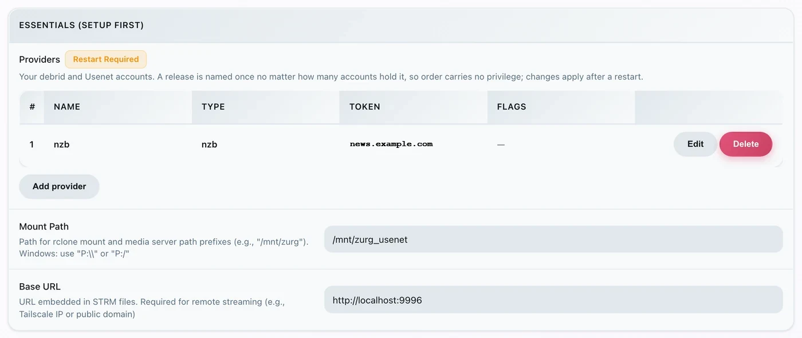
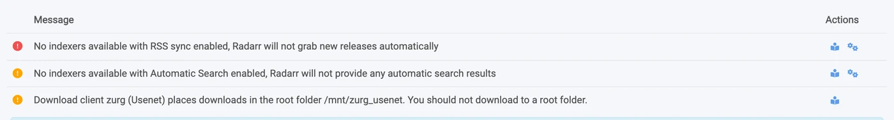
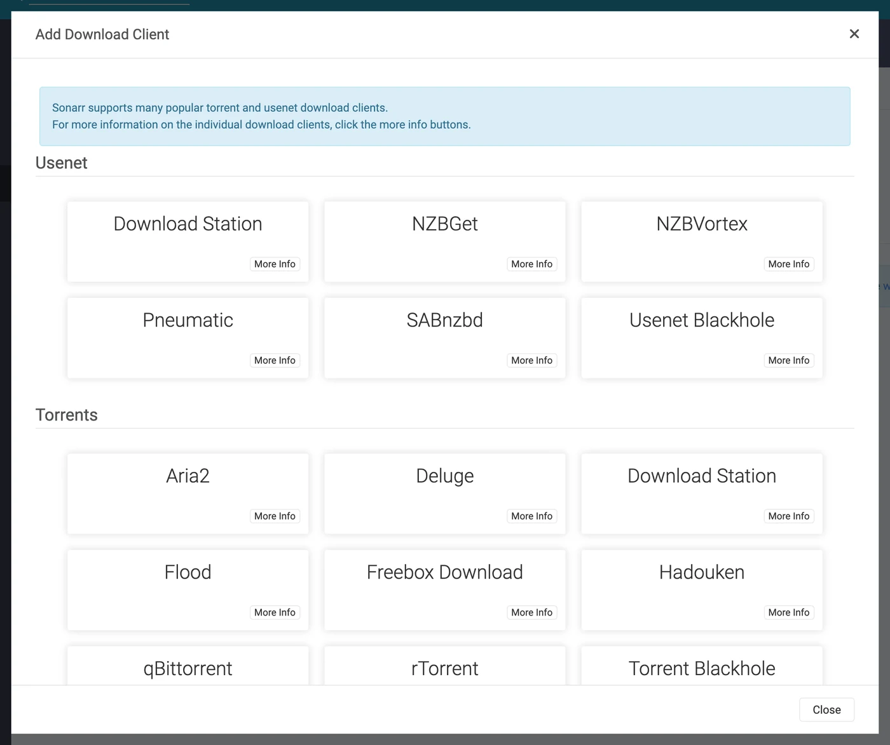
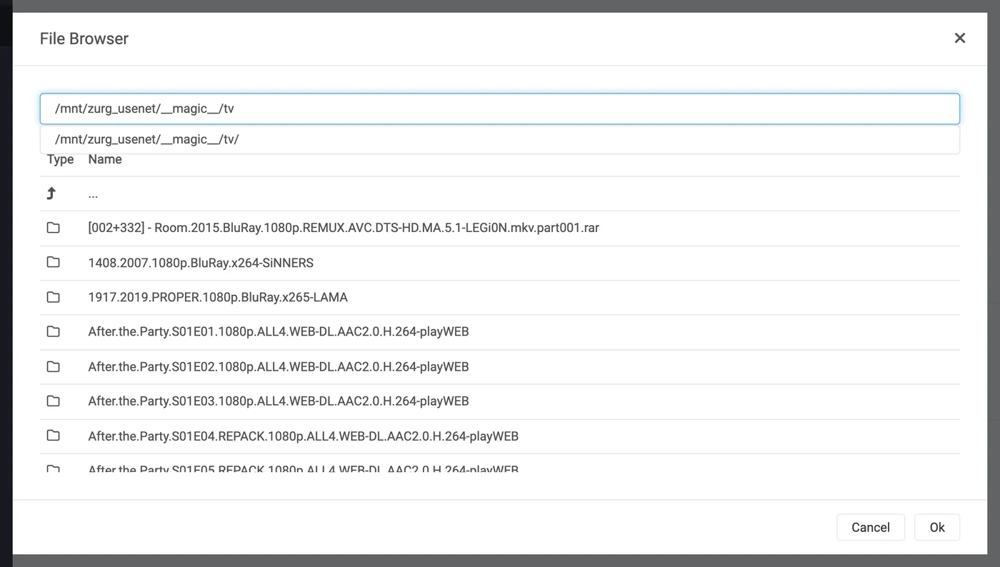
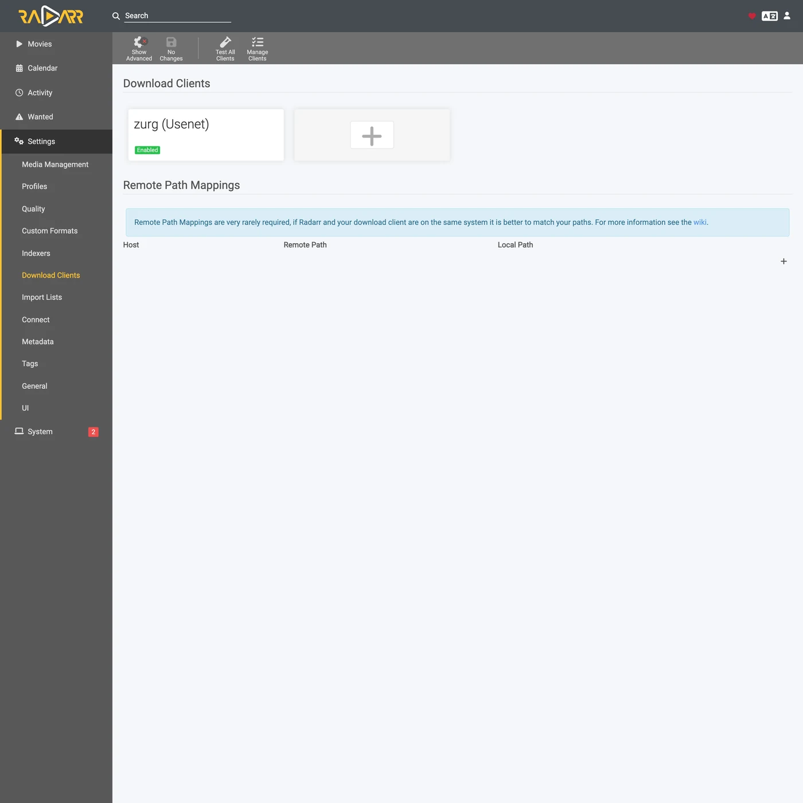
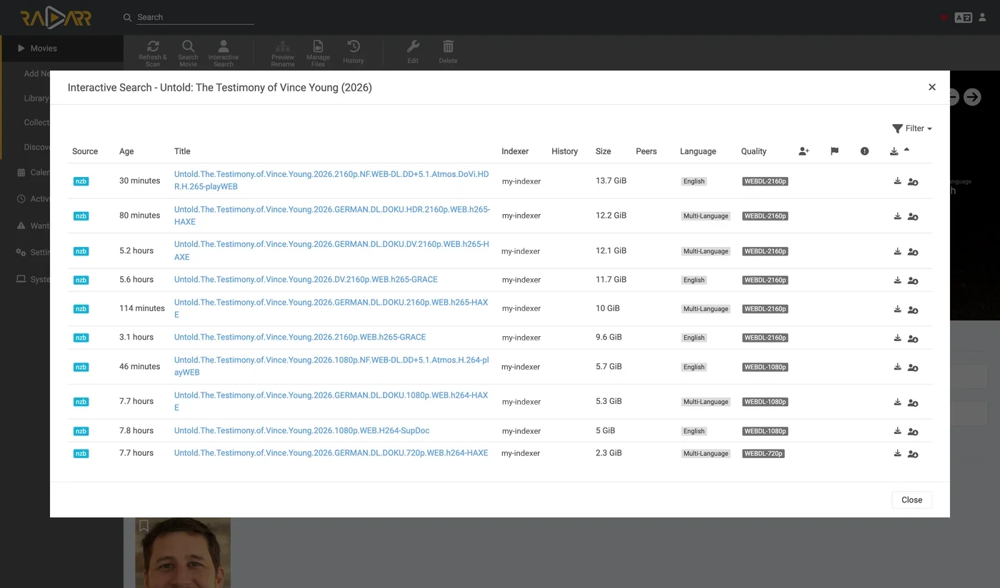
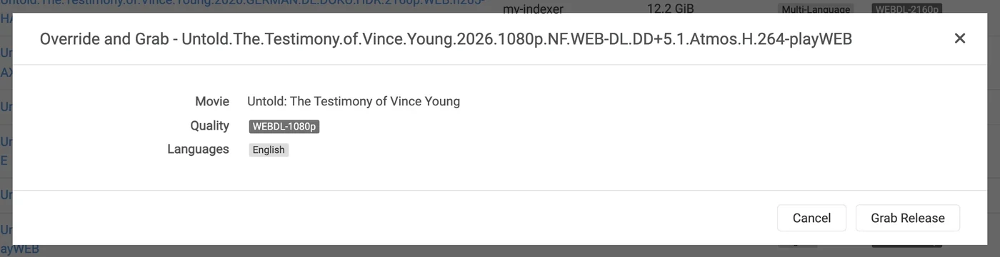

# Sonarr dan Radarr, langkah demi langkah {#sonarr-and-radarr-step-by-step}

Ada tiga cara memakai Sonarr dan Radarr dengan zurg. Pilih siapa yang mencari di zurg atau di \*arrs. Lihat [mana yang harus dipilih](sonarr-radarr-fetch.md#which-one-to-pick).

| Panduan | Siapa yang mencari | zurg berperan sebagai | Yang kamu butuhkan |
|---|---|---|---|
| [Usenet](sonarr-radarr.md) | Sonarr dan Radarr | SABnzbd | Akun Usenet (atau TorBox Pro untuk backend `torbox_nzb`) dan indexer Usenet di Prowlarr atau \*arrs |
| [Torrents](sonarr-radarr-torrents.md) | Sonarr dan Radarr | qBittorrent | Akun debrid dan indexer torrent di Prowlarr atau \*arrs |
| [zurg searches](sonarr-radarr-fetch.md) | zurg | tanpa download client sama sekali | Akun Usenet, TorBox Pro, atau debrid, dan indexer Newznab atau Torznab di konfigurasi zurg sendiri |

Dua cara pertama bisa berjalan berdampingan. Keduanya memakai folder `__magic__` yang sama.

Arahkan Sonarr dan Radarr ke zurg untuk mengambil dari Usenet tanpa client. Tidak ada video penuh yang diunduh atau di-unpack saat proses grab. NZB dan cache tetap memakai disk. Halaman ini membahas Usenet. Endpoint torrent memakai client yang sama dan berbagi folder yang sama. Lihat [Sonarr & Radarr untuk torrent](sonarr-radarr-torrents.md).

Semua yang ada di bawah ini diambil dari zurg `nightly-993-g99bcf9a4`, Sonarr `4.0.19.2979`, dan Radarr `6.3.0.10514`, pada instalasi langsung dengan akun Usenet sungguhan. Nama host dan user sudah diganti menjadi `you@zurg-server`. Nama indexer tertulis `my-indexer`. API key dan jumlah library hanya ilustrasi. Tidak ada bagian lain dari output yang diambil yang diubah. Baris log `torbox_nzb` dibaca dari source code zurg pada 2026-11-09, bukan diambil secara langsung.

## Sebelum kamu mulai {#before-you-start}

Tiga hal ini harus benar. Cek ketiganya sekarang. Setiap masalah nanti akan muncul sebagai error yang kelihatannya tidak berhubungan.

1. **zurg harus punya provider `nzb` atau `torbox_nzb` (TorBox Pro).** Tanpa salah satunya, tidak ada yang membaca apa yang ditulis endpoint, dan setiap job dilaporkan Failed setelah 30 menit, saat zurg menyerah menunggu job itu muncul di library. Lihat [Usenet](usenet.md), atau [Usenet yang di-host TorBox](../providers/torbox-nzb.md) untuk `torbox_nzb`.
2. **`magic.enabled` bernilai `true`.** Tanpa ini, completed directory tidak ada dan setiap impor gagal. Lihat [`__magic__`](magic.md).
3. **Mount terlihat oleh \*arr** di path yang dilaporkan zurg. Kalau Sonarr berjalan di container, baca [langkah 8](#8-if-your-arr-is-in-docker) sebelum mengonfigurasi apa pun. Kalau terpasang sebagai aplikasi biasa di mesin yang sama, ia melihat mount di lokasi zurg memasangnya, dengan satu catatan untuk tiap sistem:
   - **Linux:** \*arr yang berjalan sebagai user berbeda dari zurg akan melihat folder kosong sampai `user_allow_other` diaktifkan. Lihat [pengaturan Linux](../setup/linux.md#1-install-fuse-3).
   - **macOS:** jalankan sebagai user yang sama dengan zurg. Mount-nya ada di `/Volumes/Zurg` kecuali kamu mengubah `mount_path`.
   - **Windows:** jalankan Sonarr dan Radarr sebagai aplikasi tray, yang ditawarkan installer mereka, bukan sebagai layanan Windows. Drive `Z:` milik zurg ada di sesi tempat kamu login, dan layanan berjalan di luar sesi itu, jadi ia tidak melihat drive tersebut. Lihat [aturan sesi](../setup/windows.md#keeping-it-running-the-session-rules).

Cek dua yang pertama langsung dari file config, di working directory zurg. Di Windows, buka `config.yml` di Notepad.

```bash
$ grep -A6 '^providers:' config.yml
providers:
- type: nzb
  nntp:
    host: news.example.com
    port: 563
    tls: true
    username: <redacted>
    password: <redacted>

$ grep -A4 '^magic:' config.yml
magic:
  enabled: true
  allow_delete: false
  sidecar_max_mb: 32
  sidecar_budget_mb: 2048
```

`allow_delete: false` adalah default yang aman dan tidak memengaruhi impor. Delete di dalam `__magic__` hanya menyembunyikan entri, bukan menghapus konten dari akun.

## 1. Nyalakan endpoint-nya {#1-turn-the-endpoint-on}

Ada dua cara, hasilnya sama. Keduanya menulis ke `config.yml` dan keduanya perlu di-restart: rute yang melayani `__magic__` dan endpoint SABnzbd didaftarkan sekali saja, saat zurg dijalankan.

### Opsi A — dashboard {#option-a--the-dashboard}

Buka dashboard zurg, klik **Config**, lalu scroll ke **\_\_magic\_\_ & Download Clients**. Aktifkan **Serve \_\_magic\_\_** dan **SABnzbd Endpoint**, lalu atur **SABnzbd Categories** ke `tv, movies`.


**Config** adalah tempat pengaturannya. **Magic** adalah tempat kamu nanti melihat grab yang masuk.


Kosongkan **SABnzbd Completed Directory** kecuali *arr kamu me-mount zurg di lokasi yang berbeda dari tempat zurg berjalan. Lihat [langkah 8](#8-if-your-arr-is-in-docker). Chip oranye **Restart Required** itu benar. Tidak ada yang di sini berlaku sampai zurg di-restart.

### Opsi B — `config.yml` {#option-b--configyml}

Tambahkan blok itu secara manual lalu restart zurg.

```yaml
magic:
  enabled: true

sabnzbd:
  enabled: true
  api_key: ""          # empty = zurg generates one and keeps it
  categories: [tv, movies]
  complete_dir: ""     # empty = <mount_path>/__magic__/__all__
```

**Kategori bukan folder.** Semuanya mengarah ke tempat yang sama. Folder sebuah job adalah folder rilis itu sendiri di bawah `__magic__/__all__`. Daftar ini hanya ada supaya Sonarr dan Radarr berhenti memberi peringatan tentang kategori yang tidak bisa mereka temukan. Kalau kategori Sonarr kamu `tv`, maka `tv` harus ada di daftar ini.

Restart zurg, lalu pastikan provider-nya sudah terpasang:



Cukup satu baris `nzb` atau `torbox_nzb` saja untuk endpoint itu.

## 2. Cari API key-nya {#2-find-the-api-key}

Kunci API adalah satu-satunya autentikasi di endpoint ini, jadi pastikan benar sejak awal dan jangan pernah menempelkannya di tempat publik.

**Jika kamu mengosongkan `api_key`**, zurg membuat satu saat pertama kali dijalankan dan menyimpannya di `data/sabnzbd-apikey`:

```bash
$ cat data/sabnzbd-apikey
0123456789abcdef0123456789abcdef

```

Contoh saja, kunci kamu akan berbeda. File ini tetap ada setelah restart, jadi kunci tidak berubah setelah dibuat.

**Jika kamu mengisi `api_key` sendiri**, kunci itu ada di `config.yml` dan tidak ada file yang dibuat. Dashboard memberi tahu kamu kondisi yang mana di bagian bawah blok pada langkah 1. Teksnya berupa *pinned in config.yml under `sabnzbd.api_key`* atau *generated and kept in `data/sabnzbd-apikey`*.

**Endpoint ini berada di luar autentikasi dasar zurg.** Sonarr dan Radarr tidak pernah mengirim autentikasi dasar ke download client, dan lapisan HTTP mereka mengubah 401 menjadi "unable to connect" tanpa petunjuk apa pun yang bisa ditindaklanjuti. Karena itu zurg sengaja mengecualikan `/api`. Kunci API adalah satu-satunya penjaga. Perlakukan port ini sama seperti bagian zurg lainnya: pakai di jaringan tepercaya, atau letakkan di balik sesuatu yang melindunginya.

## 3. Pastikan ia merespons {#3-prove-it-answers}

Lakukan ini sebelum menyentuh Sonarr. Hanya butuh sepuluh detik, dan ini memisahkan "zurg yang salah" dari "\*arr yang salah" untuk seluruh proses setup.

+++ Linux dan macOS

```bash
$ SAB=0123456789abcdef0123456789abcdef
$ ZURG=192.168.88.245:9996

$ curl -s "http://$ZURG/api?mode=version&apikey=$SAB&output=json"
{"version":"4.5.1"}

$ curl -s "http://$ZURG/api?mode=get_config&apikey=$SAB&output=json" \
    | jq '.config.misc.complete_dir, [.config.categories[].name]'
"/mnt/zurg_usenet/__magic__/__all__"
[ "*", "tv", "movies" ]
```

+++ Windows

Di PowerShell. Ketik `curl.exe`, bukan `curl`: `curl` di Windows PowerShell adalah perintah yang berbeda.

```powershell
PS> $SAB = "0123456789abcdef0123456789abcdef"
PS> $ZURG = "192.168.88.245:9996"

PS> curl.exe -s "http://$ZURG/api?mode=version&apikey=$SAB&output=json"
{"version":"4.5.1"}

PS> (Invoke-RestMethod "http://$ZURG/api?mode=get_config&apikey=$SAB&output=json").config.misc.complete_dir
Z:/__magic__/__all__
```

+++

`complete_dir` adalah path yang akan diberikan zurg ke client. Cek sekarang bahwa itu path yang *mereka* bisa buka.

Lalu cek apakah key yang salah benar-benar ditolak (di Windows, pakai `curl.exe` dengan URL yang sama):

```bash
$ curl -s "http://$ZURG/api?mode=queue&apikey=wrongkey&output=json"
{"status":false,"error":"API Key Incorrect"}

$ curl -s "http://$ZURG/api?mode=queue&output=json"
{"status":false,"error":"API Key Required"}
```

**`mode=version` bukan tes autentikasi.** Endpoint ini tetap merespons `{"version":"4.5.1"}` meskipun key-nya salah. Begitulah cara SABnzbd asli bekerja, dan zurg meniru hal itu. Pakai `mode=queue` atau `mode=get_config` kalau yang ingin kamu tes memang key-nya.

Kedua bentuk URL ini bisa dipakai, jadi keduanya boleh diisi di field **URL Base** pada client:

| Path | URL Base in Sonarr / Radarr | Merespons |
|---|---|---|
| `/api` | *(kosongkan)* | ya |
| `/sabnzbd/api` | `/sabnzbd` | ya |

Kalau `/api` mengembalikan **404** biasa, berarti `sabnzbd.enabled` masih false atau zurg belum di-restart sejak kamu mengubahnya.

## 4. Buat root folder {#4-make-the-root-folders}

Buat folder-folder itu dulu sebelum menambahkannya, karena dialog Add Root Folder milik \*arr menelusuri filesystem yang sedang berjalan dan tidak akan menawarkan folder yang belum ada.

+++ Linux dan macOS

```bash
$ mkdir -p /mnt/zurg_usenet/__magic__/tv /mnt/zurg_usenet/__magic__/movies

$ ls -d /mnt/zurg_usenet/__magic__/tv /mnt/zurg_usenet/__magic__/movies
/mnt/zurg_usenet/__magic__/movies
/mnt/zurg_usenet/__magic__/tv
```

+++ Windows

```powershell
PS> New-Item -ItemType Directory -Force Z:\__magic__\tv, Z:\__magic__\movies
```

Atau buat kedua folder itu di Explorer.

+++

Ganti `mount_path` dengan path Anda sendiri, bukan `/mnt/zurg_usenet`. Jika tidak diatur, nilainya `/mnt/zurg` di Linux, `/Volumes/Zurg` di macOS, dan `Z:` di Windows. Nama folder bebas Anda pilih; `tv` dan `movies` hanya menyesuaikan kategorinya.

**Root folder harus berada di samping direktori completed, bukan di dalamnya dan bukan di atasnya.** zurg memberikan klien `__magic__/__all__`, yaitu pustaka Anda seperti yang tercantum di `__all__`. Root folder Anda berada di samping folder itu, yaitu di `__magic__/tv` dan `__magic__/movies`. **Bukan** `__magic__/__all__`, **bukan** `__magic__` itu sendiri, dan **bukan** `/mnt/zurg_usenet`. Kedua klien akan memunculkan health check jika root folder *adalah* folder output download client, dan Radarr juga memunculkannya jika root folder *berisi* folder output tersebut. Folder yang bersaudara tidak memicu keduanya, dan impor manual yang diarahkan ke direktori completed hanya akan memiliki satu rilis untuk dilihat, bukan seluruh pustaka Anda.

Begini tampilannya jika salah. Keduanya nyata, diambil dari dua klien tersebut. Keduanya diambil sebelum direktori completed dipindahkan ke `__magic__/__all__`, jadi path di dalam gambar satu tingkat lebih tinggi dari milik Anda. Kedua aturan yang ditampilkan sama dengan aturan di atas:


Sonarr dengan direktori completed itu sendiri ditambahkan sebagai root folder. Sonarr memberi peringatan karena root folder *adalah* folder output.



Radarr dengan `/mnt/zurg_usenet` ditambahkan. Radarr juga memberi peringatan untuk induk folder itu, yang tidak dilakukan Sonarr. Pindahkan root folder ke samping direktori completed, dan kedua peringatan akan hilang.

## 5. Tambahkan client di Sonarr {#5-add-the-client-in-sonarr}

Sonarr yang baru dipasang langsung menampilkan layar first-run yang menghalangi semua hal. Pilih **Forms (Login Page)**, isi username dan password, lalu klik **Save**.


Kamu tidak bisa lanjut sampai **Authentication Method** diisi dengan selain None.


Setelah Save, kamu akan keluar sekali dan diarahkan ke halaman login.


### Settings → Download Clients

Buka **Settings → Download Clients**. Di instalasi baru, tidak ada apa-apa di sini selain kartu **+**.


Klik **+** di bawah "Download Clients", bukan yang ada lebih bawah di "Remote Path Mappings".

Pilih **SABnzbd** dari kolom **Usenet**.



zurg meniru SABnzbd secara khusus, jadi tidak ada yang lain di daftar ini yang akan berfungsi.

Dialog akan terbuka dengan pengaturan default SABnzbd sendiri — `localhost`, port `8080`, tanpa key.


### Apa yang diisi di setiap field {#what-to-put-in-each-field}

| Kolom | Nilai | Alasan |
|---|---|---|
| Name | `zurg (Usenet)` | Bebas. Ini cuma label. |
| Enable | on | Biarkan dicentang. |
| Host | `192.168.88.245` | Host tempat zurg berjalan, yang bisa dijangkau oleh *the \*arr*. Pakai `localhost` kalau *the \*arr* adalah aplikasi biasa di mesin yang sama. Kalau pakai Docker, lihat peringatan di bawah. |
| Port | `9996` | Port normal zurg. `9999` pada instalasi default. |
| Use SSL | off | Hanya kalau kamu memasang zurg di belakang TLS sendiri. |
| API Key | dari langkah 2 | Ini satu-satunya gerbang. |
| Username | kosong | Tidak bisa dipakai bersama kunci API. Hanya kunci yang diterima. |
| Password | kosong | Sama seperti Username. |
| Category | `tv` | Harus ada di `sabnzbd.categories`. |
| Recent / Older Priority | Default | zurg tidak punya apa pun untuk diberi prioritas. |
| Remove Completed | on | Membiarkan client membersihkan catatan job-nya sendiri. Biarkan aktif. |
| Remove Failed | on | Sama seperti Remove Completed. |


API key yang ditampilkan itu contoh saja. Pakai API key kamu sendiri.

**Di Docker, "localhost" dan hostname sama-sama menyesatkan.** Di dalam container, `localhost` itu containernya sendiri. Hostname mesin biasanya mengarah ke `127.0.1.1`, yang juga containernya sendiri. Pakai **IP LAN atau IP Tailscale** host, jangan pernah `localhost` dan jangan hostname saja, meskipun keduanya terlihat jalan dengan baik dari shell kamu.

Klik **Test**. Tanda centang hijau berarti keempat pengecekan client lolos: versi, API key, konfigurasi global, dan category.


Sekarang klik **Save**.


## 6. Tambahkan root folder di Sonarr {#6-add-the-root-folder-in-sonarr}

Buka **Settings → Media Management** lalu scroll ke paling bawah.


Klik **Add Root Folder**. Browser file akan terbuka dan menampilkan filesystem milik Sonarr. Di Docker, itu adalah filesystem di dalam container.


Ketik path-nya di kotak di bagian atas. Kalau mount memang terlihat oleh Sonarr, isi dari `__magic__` akan muncul saat kamu mengetik: `__all__` dengan semua rilisan di dalamnya, dan apa pun yang kamu buat di sebelahnya. Ini cara tercepat untuk memastikan bind mount-mu sudah benar.


Kalau hasilnya kosong atau muncul error, berhenti dulu dan perbaiki mount-nya sebelum lanjut.



Lengkapi path-nya menjadi `__magic__/tv` (`Z:\__magic__\tv` di Windows), lalu klik **Ok**.


Kalau **Free Space** menampilkan angka yang masuk akal, berarti Sonarr bisa membaca mount-nya. **Unmapped Folders** menghitung rilisan yang sudah ada di folder tersebut.

## 7. Lakukan hal yang sama di Radarr {#7-do-the-same-in-radarr}

Sama persis, dengan dua nilai yang diubah: kategorinya `movies` dan root folder-nya `__magic__/movies`.


Setup pertama Radarr caranya sama: atur Forms auth, lalu login.


**Settings → Download Clients → +**, lalu **SABnzbd** di bagian Usenet.


Host, port, dan kuncinya sama. Yang beda cuma **Category**: `movies`, bukan `tv`.


**Test**, tanda centang hijau, **Save**.



Lalu buka **Settings → Media Management → Root Folders → Add Root Folder**, dan tambahkan `/mnt/zurg_usenet/__magic__/movies`.

**Satu zurg, dua client, satu antrean.** Antrean dan riwayat zurg hanya difilter berdasarkan kategori, tidak ada yang lain. Dua Sonarr yang sama-sama pakai `tv` akan saling melihat job satu sama lain, tapi Sonarr di `tv` dan Radarr di `movies` tidak. Kalau kamu pakai satu client per kategori, masalah ini tidak akan pernah muncul.

## 8. Jika \*arr kamu berjalan di Docker {#8-if-your-arr-is-in-docker}

Langkah ini untuk Docker di host Linux. Docker Desktop di macOS dan Windows menjalankan container di dalam mesin virtual. Bind `rslave` di bawah bergantung pada mount propagation Linux (lihat [Docker setup](../setup/docker.md)), dan meneruskan mount zurg ke container di sistem tersebut belum pernah diuji. Di macOS dan Windows, pasang Sonarr dan Radarr sebagai aplikasi biasa, seperti yang dijelaskan di [Before you start](#before-you-start).

Ada tiga masalah yang terpisah. Masalah kedua membuat satu unduhan terulang di setiap impor. Masalah ketiga baru muncul saat zurg restart pertama kali.

### Path yang dilaporkan zurg harus berupa path yang bisa dibuka oleh client {#the-path-zurg-reports-must-be-a-path-the-client-can-open}

Kalau container memasang library di tempat yang berbeda dari tempat zurg memasangnya, setiap import akan gagal dengan *download doesn't contain intermediate path* atau pemeriksaan kesehatan remote-path. Kamu bisa memperbaikinya dengan salah satu cara berikut, dua-duanya boleh:

- **Atur `sabnzbd.complete_dir`** ke path yang *dilihat client*. Ini paling simpel kalau cuma ada satu client, atau beberapa client yang memasang library di lokasi yang sama.
- **Tambahkan remote path mapping** di \*arr. Pakai cara ini kalau tiap client memasang library dengan cara yang berbeda.

```yaml
sabnzbd:
  complete_dir: "/data/zurg/__magic__/__all__"   # what the *arr sees, not what zurg sees
```

Untuk cara kedua, buka **Settings → Download Clients** lalu klik **+** di bawah **Remote Path Mappings**. Yang dipakai adalah yang paling bawah di halaman, bukan yang kamu pakai di langkah 5.


**Host** harus persis sama dengan string host yang kamu ketik di download client. **Remote Path** adalah yang dilaporkan zurg, sedangkan **Local Path** adalah tempat client melihatnya.

### Satu volume untuk folder download dan root folder {#one-volume-for-the-download-folder-and-the-root-folders}

Impor dari `__magic__/__all__` ke `__magic__/tv` itu gratis karena itu sebuah rename. Rename hanya bisa jalan di dalam satu mount. Kalau container kamu kasih dua folder sebagai dua volume, container akan melihatnya sebagai dua filesystem. Keduanya sama-sama mount zurg di bawahnya, tapi tetap tidak berpengaruh.

```yaml
    volumes:                                        # do not do this
      - /mnt/zurg_usenet/__magic__/__all__:/downloads
      - /mnt/zurg_usenet/__magic__/tv:/tv
```

Kernel menolak rename di dalam container. Sonarr dan Radarr lalu menyalin file dan menghapus yang asli tanpa memberi tahu. Setiap impor jadi mengunduh seluruh release dari akun kamu dan menulisnya ke disk zurg. Impornya tetap berhasil, hanya lambat. Satu episode 1.46 GB butuh 50 detik dan 2.9 GB traffic dengan cara ini. Dengan satu volume, prosesnya butuh satu detik dan tidak membaca apa-apa.

Berikan container satu volume yang berisi seluruh mount zurg. Akses folder download dan root folder lewat volume itu. Bind di bagian berikutnya melakukan hal itu persis. Remote path mapping atau `complete_dir` lalu mengarahkan client ke `__all__` di dalam volume yang sama.

Impor manual yang diset ke **Hardlink/Copy Files** juga tetap menyalin. Pilih **Move Files**.

### Bind parent dari mount, bukan mountpoint-nya {#bind-the-mounts-parent-not-the-mountpoint}

Ini yang bakal makan waktu seharian. Ini juga volume yang disebut di bagian atas. Me-restart zurg akan unmount `/mnt/zurg_usenet` lalu me-mount ulang. Container yang mengikat **mountpoint itu sendiri** tetap memegang koneksi fuse yang dipakai saat container pertama kali jalan, dan koneksi itu sekarang sudah mati. Setiap read lalu menjawab `Socket not connected`, dan karena kedua client mengecek ruang kosong di folder root sebelum mengambil release, *setiap release diam-diam ditolak*:

```
FreeSpaceSpecification: Socket not connected
```

Tidak ada yang di kedua client yang bilang mount-nya sudah stale, folder tetap kelihatan di dalam container, dan grab interaktif yang langsung dikirim ke client tetap jalan. Yang kelihatannya adalah \*arr yang diam-diam sudah berhenti mencari.

Ikat **parent**-nya dengan `rslave`, dan remount akan datang sebagai event sub-mount yang diikuti container:

```yaml
    volumes:
      - type: bind
        source: /mnt          # the parent, not /mnt/zurg_usenet
        target: /mnt
        bind:
          propagation: rslave
```

Cek container setiap kali habis restart zurg. Yang kamu cari adalah ukuran, bukan error:

```bash
$ docker exec radarr df -h /mnt/zurg_usenet
Filesystem      Size  Used Avail Use% Mounted on
zurg{PGSq4}:    1.0P     0  1.0P   0% /mnt/zurg_usenet
```

Angka petabyte itu artinya zurg melaporkan filesystem virtual, bukan disk. Itu memang seharusnya, dan itulah yang memenuhi pengecekan ruang kosong milik \*arr.

## 9. Pantau satu grab sampai selesai {#9-watch-one-grab-go-through}

Tambahkan satu item, ambil secara manual, lalu ikuti prosesnya sampai selesai. Semua yang ada di bawah ini adalah contoh pengambilan sungguhan melalui pengaturan di atas.

### Grab-nya {#grab-it}

Buka film (atau episode), klik **Interactive Search**, lalu pilih satu rilis.



Kolom **Source** menampilkan `nzb` — itulah protokol yang bisa diambil oleh zurg.

Klik tombol panah melingkar di ujung baris untuk mengambil rilis tersebut. Jika rilis tidak cocok dengan rapi, klien akan meminta Anda mengonfirmasi pemetaannya terlebih dahulu:



**Override and Grab** muncul saat klien ingin Anda memastikan apa rilis tersebut. Periksa pemetaannya lalu klik **Grab Release**. Pengambilan otomatis yang normal tidak pernah menampilkan ini.

### Item masuk ke queue {#it-lands-in-the-queue}


**Activity → Queue** tepat setelah grab. Perhatikan progress bar-nya: sudah penuh, dan **Time Left** berupa tanda strip. Tidak ada unduhan yang perlu diukur, jadi sebuah job hanya antre atau sudah selesai, tidak ada kondisi di antaranya. *Baris-baris lain di sini milik Radarr kedua yang mengarah ke zurg yang sama dengan kategori yang sama* — lihat catatan di langkah 7.

### zurg menulis NZB lalu membacanya {#zurg-writes-the-nzb-and-reads-it}

```
Aug 25 14:44:03 zurg-server zurg[3034965]: INFO  nzb  Loaded NZB
  Last.Week.Tonight.with.John.Oliver.S13E22.480p.WEB.x264-RMTeam.nzb: 4 files
Aug 25 14:50:28 zurg-server zurg[3034965]: INFO  nzb  Loaded NZB
  Untold.The.Testimony.of.Vince.Young.2026.1080p.NF.WEB-DL.DD+5.1.Atmos.H.264-playWEB.nzb: 9 files
```

`Loaded NZB … : N files` adalah baris yang menandakan NZB berhasil di-parse. Jika sebuah job dilaporkan Failed setelah 30 menit, saat zurg menyerah menunggunya muncul di library, baris inilah yang tidak ada.

### Proses import terjadi {#the-import-happens}


**Activity → History**. Ada dua kejadian, berselang beberapa detik: **Grabbed**, lalu **Movie Imported**.


**Status: Downloaded**, **Size 4.7 GiB**, padahal tidak ada yang benar-benar diunduh.

### Pastikan file-nya asli {#prove-the-file-is-real}

Proses import memindahkan file ke folder root. Baca kedua ujung file-nya dan tanyakan ke ffprobe file itu apa:

+++ Linux dan macOS

Kalau shell kamu tidak menemukan `ffprobe`, pakai `~/zurg/bin/ffprobe`: setup menaruh salinannya sendiri di situ kalau belum ada yang terpasang.

```bash
$ ls -la "/mnt/zurg_usenet/__magic__/movies/Untold - The Testimony of Vince Young (2026)/"
-rw-r--r-- 1 you you 4920958828 Aug 25 14:53 Untold.The.Testimony…playWEB.mkv

$ dd if="$F" bs=1M count=1 >/dev/null
1048576 bytes (1.0 MB, 1.0 MiB) copied, 0.0429446 s, 24.4 MB/s

$ ffprobe -v error -show_entries format=duration,size,format_name \
    -of default=noprint_wrappers=1 "$F"
format_name=matroska,webm
duration=4709.440000
size=4920958828
```

+++ Windows

Di PowerShell, dari folder zurg. Setup menaruh `bin\ffprobe.exe` di situ kecuali `ffprobe` sudah ada di PATH kamu. Kalau sudah ada, ketik `ffprobe` saja:

```powershell
PS> $F = Get-Item "Z:\__magic__\movies\Untold - The Testimony of Vince Young (2026)\*.mkv"
PS> $F.Length
4920958828

PS> bin\ffprobe.exe -v error -show_entries format=duration,size,format_name -of default=noprint_wrappers=1 $F.FullName
format_name=matroska,webm
duration=4709.440000
size=4920958828
```

+++

Ini Matroska berdurasi 78 menit, di-stream dari artikel Usenet sesuai permintaan. Datanya baru datang saat ada yang membacanya, bukan saat \*arr melakukan import.

## 10. Menambahkan rilis secara manual {#10-adding-a-release-by-hand}

Kadang Sonarr atau Radarr tidak pernah mengambil rilis yang kamu mau. Indexer yang mereka cari mungkin tidak punya rilisnya, atau sebuah quality profile atau custom format menolaknya. Kamu bisa memberikan NZB-nya langsung ke zurg di bawah kategori aplikasi yang seharusnya mengimpornya. Aplikasi itu lalu mengimpornya seolah-olah dia sendiri yang mengambilnya.

Jika rilisnya ada di indexer yang dicari aplikasi, coba aplikasi dulu. **Interactive Search** juga menampilkan rilis yang ditolak. Mengambil salah satunya akan mengirimnya ke zurg seperti pengambilan biasa. Radarr pernah mengambil rilis IMAX yang ditolak quality profile-nya karena skornya 0 terhadap custom format yang wajib, lalu mengimpornya.

+++ Linux dan macOS

```bash
$ SAB=0123456789abcdef0123456789abcdef
$ ZURG=192.168.88.245:9996

# an NZB file you already have (the upload field is called name, as in SABnzbd)
$ curl -s "http://$ZURG/api?mode=addfile&apikey=$SAB&cat=movies" \
    -F 'name=@Movie.Title.2024.1080p.WEB-DL.nzb'
{"status":true,"nzo_ids":["SABnzbd_nzo_…"]}

# or a link to one, which zurg downloads itself
$ curl -s -G "http://$ZURG/api" \
    --data-urlencode mode=addurl --data-urlencode "apikey=$SAB" --data-urlencode cat=movies \
    --data-urlencode 'name=https://indexer.example/getnzb/<id>?r=<indexer-key>' \
    --data-urlencode nzbname=Movie.Title.2024.1080p.WEB-DL
{"status":true,"nzo_ids":["SABnzbd_nzo_…"]}
```

+++ Windows

Di PowerShell, pakai `curl.exe`, bukan `curl`. Masing-masing akan menjawab `{"status":true,"nzo_ids":[…]}` seperti di atas.

```powershell
$SAB = "0123456789abcdef0123456789abcdef"
$ZURG = "192.168.88.245:9996"

# an NZB file you already have (the upload field is called name, as in SABnzbd)
curl.exe -s "http://$ZURG/api?mode=addfile&apikey=$SAB&cat=movies" -F "name=@Movie.Title.2024.1080p.WEB-DL.nzb"

# or a link to one, which zurg downloads itself
curl.exe -s -G "http://$ZURG/api" `
  --data-urlencode mode=addurl --data-urlencode "apikey=$SAB" --data-urlencode cat=movies `
  --data-urlencode "name=https://indexer.example/getnzb/<id>?r=<indexer-key>" `
  --data-urlencode nzbname=Movie.Title.2024.1080p.WEB-DL
```

+++

`--data-urlencode` menjaga `?` dan `&` milik link itu tetap berada di dalam `name`. Job akan muncul di queue aplikasi pada pengecekan berikutnya, dalam satu menit.

Ada lima hal yang menentukan apa yang terjadi selanjutnya.

1. **Film atau serial itu harus sudah ada di aplikasi.** Aplikasi hanya mengimpor apa yang bisa dicocokkan dengan sesuatu yang dia kelola.
2. **Namanya harus menjelaskan isinya.** Job memakai nama file NZB, atau `nzbname` jika kamu memberikannya. Tanpa `nzbname`, `addurl` memakai nama file yang disajikan indexer. Beri nama itu tahunnya.
3. **Kategori menentukan aplikasinya.** `cat=movies` akan sampai ke Radarr yang download client-nya memakai `movies`. Setiap aplikasi hanya melihat kategorinya sendiri.
4. **Quality profile tidak menghalangi, tapi file yang sudah kamu punya bisa.** Radarr tidak mengecek qualities yang diizinkan maupun skor custom format minimum saat impor. Pernah ada 720p BluRay dengan skor 0 yang diimpor ke profil yang hanya mengizinkan 2160p dan mewajibkan skor 100. Ada juga 1080p WEBRip yang diimpor ke film yang profilnya hanya mengizinkan 720p. Lalu Radarr menimpanya dengan 1080p BluRay sebagai upgrade dan menghapus WEBRip tersebut. WEB-DL yang ditambahkan setelahnya berhenti di Activity dengan status *Not an upgrade for existing movie file*. **Activity → Queue → Manual Import** tetap akan mengimpornya dan mengganti file-nya.
5. **Kegagalan adalah tanggung jawabmu untuk dibersihkan.** Aplikasi tidak pernah memblokir atau menghapus download yang tidak dia ambil sendiri. Ada rilis yang artikelnya sudah hilang dari news server, dikembalikan oleh zurg sebagai Failed, dan tetap tersangkut di queue Radarr dengan status *Download has failed wasn't grabbed by Radarr, skipping automatic download handling*. Hapus dari queue dan pilih rilis lain.

Diukur pada 2026-10-10 dengan Radarr 6.3, memakai `addfile` dan `addurl`, termasuk profil yang mewajibkan custom format yang dibuat dari nama rilis. Setiap impor adalah rename ke `__magic__/movies` dan tidak ada yang disalin. Sonarr tidak diuji.

Terima kasih kepada **.telmen** di Discord yang bertanya cara melakukan ini dengan Usenet.

## Menonton dari sisi zurg {#watching-from-zurgs-side}

Halaman `/magic/` di zurg mencantumkan setiap NZB yang pernah diberikan ke endpoint ini. Sonarr dan Radarr menghapus job yang mereka ambil, dan catatannya disimpan selama seminggu setelah itu, supaya poll yang bersamaan dengan penghapusan tetap memberi jawaban yang sama dua kali. Job **Failed** atau **Stuck** (antre lebih dari satu jam) yang tidak akan pernah dihapus oleh client mana pun, misalnya setelah kamu berhenti memakai zurg sebagai download client mereka, bisa dibersihkan di sini dengan menahan tombol **Clear**-nya. Membersihkan satu job akan menghapus NZB-nya, kecuali masih dipakai oleh impor.


**Placements** adalah file yang dipindahkan oleh client; **tombstones** adalah folder job yang mereka hapus setelahnya. Jika client menyalin alih-alih memindahkan, halaman akan menampilkan tabel merah **Imports that were copies**. zurg mengubah salinan itu kembali menjadi placements dan menghapusnya, tapi setiap salinan tetap merupakan download penuh, jadi perbaiki volume-nya.


**State** adalah gambaran lengkapnya. **Queued** berarti zurg belum selesai dengan rilis itu, entah karena library belum mencantumkannya, ukuran file-nya belum stabil, atau artikelnya belum dicek. **Completed** berarti rilis sudah siap diimpor. **Release** menyebut folder tempat client mengimpor.

Kolom **Release** itu dibaca dari library di setiap poll, bukan disimpan. Ganti nama rilis di dashboard zurg, biarkan repair membangunnya ulang, atau biarkan zurg menambahkan akhiran karena dua rilis memakai nama yang sama. Job akan tetap mengikutinya.

## Apa yang berfungsi, dan apa yang tidak {#what-works-and-what-does-not}

Berfungsi:

- Tes koneksi, keempat pemeriksaannya, di kedua client.
- Grab, antrean, riwayat, impor dengan rename, dan pembersihan setelah impor.
- Grab ulang release yang sama. Setiap grab berikutnya mendapat job id sendiri, jadi client menanganinya dan tidak memakai ulang hasil job lama. Release di baliknya tetap sama. Grab ulang dari release yang sudah dikosongkan oleh impor sebelumnya dilaporkan **Failed**. Folder-nya di `__magic__/__all__` tidak punya apa-apa lagi untuk diimpor, dan Failed membuat client memasukkannya ke blocklist lalu mencoba yang lain. Grab yang mengosongkannya tetap dilaporkan Completed sampai client menghapusnya.
- Menghapus job dari antrean, dengan atau tanpa menghapus NZB.
- `mode=addurl`, untuk manusia atau otomatisasi yang mengirim URL alih-alih mengunggah. Tidak ada \*arr yang memakainya.

Tidak berfungsi:

- **Tidak ada progres.** Job itu antre atau selesai; tidak ada persentase di antaranya, karena tidak ada download yang bisa diukur. Antrean menampilkan ukuran NZB yang dinyatakan supaya barisnya tidak kosong.
- **Tidak ada pause, resume, batas kecepatan, prioritas, atau script pasca-proses.** SABnzbd punya semua ini; zurg tidak punya apa pun untuk diterapkan padanya.
- **`del_files` pada penghapusan riwayat untuk job yang sudah selesai diabaikan.** (Untuk job Failed, ini menghapus NZB jika tidak ada yang diimpor darinya.) Client bermaksud "folder job kembali menjadi milikmu", tetapi file yang baru diimpor masih disajikan dari NZB itu. Folder yang ingin dihapus memang sudah hilang — ia menghapusnya sendiri, lewat mount.
- **Basic auth tidak bisa melindungi endpoint ini.** API key adalah satu-satunya gerbang.

**Sinyal kegagalan.** Release yang tidak ada apa pun untuk diimpor dilaporkan **Failed**, dan kedua client memasukkannya ke blocklist lalu mengambil alternatif. Itu mencakup release yang semua filenya rusak, terhapus, atau tersaring; release yang hanya berisi `.par2`, `.sfv`, dan sidecar; release yang setiap filenya berbentuk sesuatu yang tidak bisa diputar, seperti yang terjadi pada post yang dibuat tidak jelas dengan set RAR bernama `.z001`…`.z133`; dan arsip yang sudah dibuka dan ternyata tidak berisi media. Set RAR adalah konten, bukan perancah: zurg langsung men-stream video dari dalamnya. Jika sebuah release memang berisi sesuatu yang ekstensinya belum dikenali zurg, perluas `addl_playable_extensions` daripada memasukkannya ke blocklist.

**Artikel diperiksa sebelum job dilaporkan selesai.** zurg menunggu sampai library mencantumkan release-nya dan ukuran file-nya sudah stabil. Lalu ia menanyakan ke news server tentang awal dan akhir setiap file konten, yaitu enam belas artikel pertama dan satu artikel terakhir. Ia juga mengunduh artikel pertama dari setiap file. Totalnya sampai enam puluh empat artikel ditambah beberapa lagi untuk release dengan hanya sedikit file. Beberapa news server masih mengatakan artikel ada setelah kontennya dihapus, dan hanya unduhan yang bisa menunjukkannya. Artikel yang diunduh juga menunjukkan apakah ia milik post ini atau post upload lain. Job tetap **Queued** sampai ada jawabannya. Kerusakan yang tidak terjangkau sampel tidak tertangkap di sini; kerusakan itu akan muncul saat pembacaan yang mengenainya. Release yang artikelnya hilang akan diperbaiki dengan PAR2 lebih dulu dan diperiksa lagi setelah perbaikan selesai. Yang sudah utuh kembali akan dilanjutkan. Yang masih kehilangan artikel, atau yang tidak bisa diperbaiki, dilaporkan **Failed** dengan jumlah artikel yang hilang. Ini adalah kegagalan *download*, dan itulah yang ditindaklanjuti client: mereka memasukkannya ke blocklist dan mengambil alternatif tanpa pengawasan, daripada mengimpor sesuatu yang tidak akan bisa diputar. Dengan `torbox_nzb` tidak ada news server atau pemeriksaan artikel: grab diperiksa dari apakah TorBox sudah mengambilnya.

**Pemeriksaan yang tidak bisa selesai tidak menunggu selamanya.** Kadang pemeriksaan tidak bisa selesai sama sekali. Connection pool mungkin mati, akunnya kena throttle, atau waktunya habis. Itu bukan jawaban. Job tetap **Queued** dan ditanyakan lagi satu menit kemudian. zurg menghitung percobaan pada job supaya restart tidak melupakannya. Setelah tiga puluh kegagalan berturut-turut yang mencakup minimal tiga jam, job pindah ke riwayat sebagai **Failed**. Pesannya memuat jumlah, rentang waktu, dan error terakhir. Gangguan berupa penolakan total akan mencapai tiga puluh dalam satu jam dan tidak membuat antrean gagal karenanya.

**Release yang keluar dari library membuat job-nya gagal.** Release bisa dihapus dari dashboard, NZB-nya dihapus dari watch directory, atau dijatuhkan oleh semua akun. Job-nya tetap **Queued** selama lima belas menit, lalu pindah ke riwayat sebagai **Failed**. Client memasukkannya ke blocklist dan mengambil yang lain. Jeda ini ada untuk restart. Library mencabut semua release saat ia memuat ulang, dan itu tidak boleh dibaca sebagai penghapusan. Tidak ada yang gagal karena alasan ini dalam lima belas menit pertama setelah zurg dinyalakan. Job yang release-nya belum pernah dicantumkan library tidak terpengaruh, karena ia masih dalam proses kedatangan.

## Pemecahan masalah {#troubleshooting}

| Yang dikatakan \*arr | Artinya |
|---|---|
| "Unable to connect to SABnzbd" | zurg tidak bisa dijangkau di host dan port itu, atau ada sesuatu di depannya yang membalas dengan selain 200. Cek `sabnzbd.enabled`. Selama mati, `/api` hanya 404 biasa. Di Docker, pastikan kamu tidak memakai `localhost` atau nama host saja. |
| "API Key Incorrect" / "API Key Required" | Kuncinya tidak cocok. Kuncinya ada di `config.yml` kalau kamu mengaturnya, atau di `data/sabnzbd-apikey` kalau zurg yang membuatnya. |
| "Test was aborted due to an error" | Masalahnya bukan kegagalan autentikasi. zurg mencatat setiap permintaan yang ditolaknya. Cari di log dengan grep `SABnzbd:`. |
| "Category … does not exist" | Kategori di \*arr tidak ada di `sabnzbd.categories`. Tambahkan, lalu restart zurg. |
| "Downloads in root folder" | Root folder berada di level yang sama dengan atau di atas folder completed. Pindahkan ke sampingnya: `__magic__/tv`, bukan `__magic__/__all__`, bukan `__magic__`, dan bukan `/mnt/zurg_usenet`. |
| "Remote path mapping" / "download doesn't contain intermediate path" | Path yang dilaporkan zurg bukan path yang bisa dibuka client. Lihat [langkah 8](#8-if-your-arr-is-in-docker). |
| Impor berhasil tapi memakan waktu sama seperti download, dan halaman `/magic/` zurg mencantumkannya di bawah **Imports that were copies** | Client menyalin dari `__magic__/__all__` alih-alih mengganti nama. Container-nya punya folder download dan root folder di dua volume yang berbeda. Atau impor manual diatur untuk menyalin. Lihat [satu volume untuk folder download dan root folder](#one-volume-for-the-download-folder-and-the-root-folders). |
| Penjelajah root folder menampilkan mount zurg kosong, atau tidak ada drive `Z:` sama sekali | \*arr tidak bisa melihat mount. Di Linux ia berjalan sebagai user lain tanpa `user_allow_other`; di Windows ia berjalan sebagai service. Lihat [Sebelum kamu mulai](#before-you-start). |
| Setiap release ditolak, tidak ada apa-apa di log | Stale bind mount. Jalankan `docker exec <client> df -h <mount>`. Kalau hasilnya `Socket not connected`, bind parent-nya dengan `rslave` lalu buat ulang container. |
| Job tetap antre satu atau dua poll setelah release muncul | Normal, dan akan selesai sekali per release. NZB tidak menyebutkan berapa panjang sebuah file. Perkiraannya diganti dengan panjang pasti dari indeks PAR2 atau dari header satu artikel. Melaporkan Completed terlalu cepat itulah yang membuat client menampilkan *File move incomplete, data loss may have occurred*. Job `torbox_nzb` tidak membaca artikel dan tidak meminta news server. Job itu tetap antre sampai TorBox selesai mengambil release, paling lama 30 menit (lihat baris berikutnya). |
| "zurg accepted the NZB but it never appeared in the library" | Release belum muncul di library 30 menit setelah grab atau setelah zurg mulai, mana yang lebih akhir. Karena itu zurg berhenti menunggu dan melaporkan job **Failed**. Cek dulu apakah provider `nzb` atau `torbox_nzb` sudah dikonfigurasi, lalu cari NZB-nya di log. Akun `nzb` menulis `Loaded NZB <name>: N files` setelah berhasil di-parse. Release `torbox_nzb` baru muncul setelah TorBox selesai memprosesnya, jadi job-nya gagal begini setiap kali TorBox butuh lebih dari 30 menit: pengambilan yang lambat, menunggu slot kosong, atau antrean di belakang batas satu post per menit milik zurg. Akun `torbox_nzb` menulis `TorBox Usenet: posting <name>` lalu jawaban TorBox. `TorBox answered <name> with download <id>` berarti TorBox sedang mengambilnya atau sudah memilikinya. `TorBox queued <name> as <id> for want of a free slot` berarti akun tidak punya slot kosong. Post menunggu sampai ada slot yang kosong. |
| "The Usenet account could not fetch the NZB" dan job langsung gagal | Akun tempat NZB diposting menyerah, jadi zurg tidak menunggu 30 menit. Dengan `torbox_nzb`, baris `TorBox refused <name>, …` di log diakhiri alasan dari TorBox. NZB itu tidak akan diposting ulang sampai zurg direstart atau filenya berubah. |
| "The release holds no files that can be imported" | Library memegang release-nya, tapi tidak ada isi yang bisa diimpor client. NZB yang hanya berisi volume recovery persis seperti ini, begitu juga post yang terobfuskasi dengan set RAR bernama `.z001`…`.z133`. Perluas `addl_playable_extensions` kalau release memang berisi konten yang belum punya ekstensi di zurg. |
| Release yang sudah selesai tetap antre saat ada lonjakan besar | Lebih dari enam puluh job siap sekaligus. Sonarr dan Radarr hanya meminta enam puluh entri riwayat terbaru, jadi zurg menahan sisanya di antrean dan memindahkan satu ke riwayat setiap kali impor membebaskan slot. Normal, dan akan habis dengan sendirinya. |
| "The release could not be checked against the news servers" | Pemeriksaan artikel gagal selesai tiga puluh kali berturut-turut selama minimal tiga jam. Tidak ada yang ditemukan hilang. Akun news tidak bisa dihubungi. Pesan itu memuat error terakhir. Periksa akunnya dulu, lalu grab ulang release setelah akunnya merespons. Akun `torbox_nzb` tidak punya news server atau pemeriksaan artikel, jadi grab-nya diperiksa dengan melihat apakah TorBox sudah mengambilnya. |
| "The release was in the library and has since been removed from it" | Library pernah mencantumkan release ini, lalu tidak lagi selama lima belas menit. Ada yang menghapusnya dan log menulis `Release <name> is gone from every account`. Client akan memblokirnya dan grab yang lain, alih-alih menunggu folder yang tidak akan kembali. |

Masih buntu? Tanyakan di forum **zurg-support** di [Discord](https://discord.com/invite/7u4YjMThXP). [Meminta bantuan](../../guides/remote-help.md) menjelaskan apa saja yang perlu disertakan.

### Di mana state disimpan {#where-the-state-lives}

| Path | Apa isinya |
|---|---|
| `nzbs/<name>.nzb` | NZB-nya sendiri, dinamai sekali dan tidak pernah diganti namanya. Backend Usenet mengambil identitas rilis dari nama file ini, jadi kalau diganti namanya, rilisnya jadi yatim dan semua placement yang dibuat darinya ikut bermasalah. |
| `data/sabnzbd-jobs.json` | NZB mana saja yang sudah di-grab, di kategori apa, dan kapan. |
| `data/sabnzbd-apikey` | API key yang dibuat otomatis. Tidak ditulis kalau `sabnzbd.api_key` sudah diisi. |
| `data/magic.json` | Tabel `__magic__` berisi setiap placement dan tombstone yang dibuat oleh impor. |
