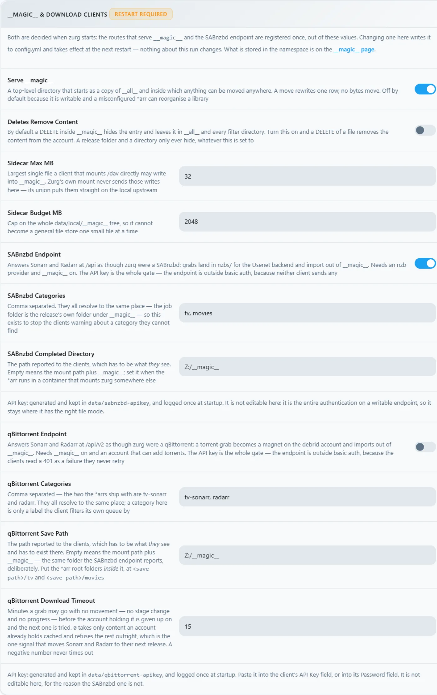

# Windows, binary, dari nol {#windows-the-binary-from-scratch}

## Opsi satu baris {#one-line-option}

Jalankan bootstrap sponsor opsional dari PowerShell. Bootstrap ini memasang WinFsp melalui UAC, mengunduh zurg, lalu menjalankan
pemilih provider dan diagnostik:

```powershell
irm https://raw.githubusercontent.com/debridmediamanager/zurg-site/main/public/install.ps1 | iex
```

Bootstrap ini memakai masuk GitHub lewat browser dan memasang ke `$HOME\zurg`. Binary dan config yang sudah ada tetap dibiarkan. Lanjutkan
di bawah untuk rute manual.

Tanpa Docker, tanpa WSL: file `.exe` zurg dalam satu folder, `config.yml` yang kamu tulis sekali saja, dan drive `Z:` di Explorer.
Halaman ini membahas seluruh prosesnya dalam dua tahap: pertama **RealDebrid dengan endpoint qBittorrent**, lalu reset penuh dan **Usenet dengan endpoint SABnzbd**. Dua instalasi ini yang paling sering dibuat orang, dan keduanya menguji bagian zurg yang berbeda.

Semua yang ada di bawah ini dicatat dari instalasi yang sungguhan berjalan: Windows 11 Pro 23H2 (build 22631), PowerShell 5.1, WinFsp 2.0.23075, zurg `2026.08.30.0459-nightly-73-g5b4c9790`, serta akun Real-Debrid dan akun news Usenet. Nama pengguna sudah diganti. API key dan jumlah library hanya contoh. Begitu juga dengan kredensial apa pun.

## Yang kamu butuhkan {#what-you-need}

- **zurg.exe** — dari [rilis sponsor](https://github.com/debridmediamanager/zurg/releases). Jadi sponsor di [gatekeeper](https://gatekeeper.debridmediamanager.com/) supaya akun GitHub kamu dapat akses. Halaman ini mengasumsikan kamu sudah mengunduhnya.
- **WinFsp** — zurg memasang library lewat rclone, dan rclone butuh WinFsp agar bisa dipakai dengan huruf drive di Windows. Pasang secara senyap, atau dari [installer](https://github.com/winfsp/winfsp/releases):

  ```powershell
  $url = "https://github.com/winfsp/winfsp/releases/download/v2.1/winfsp-2.1.25156.msi"
  Invoke-WebRequest -Uri $url -OutFile "$env:TEMP\winfsp.msi" -UseBasicParsing
  Start-Process msiexec.exe -ArgumentList "/i", "$env:TEMP\winfsp.msi", "/qn", "/norestart" -Wait
  ```

- **Sebuah akun** — token API Real-Debrid untuk tahap pertama, server berita untuk tahap kedua.

Tidak ada yang lain. Installer bawaan akan mengunduh rclone, dan ffprobe juga, kecuali kalau sudah ada di PATH kamu.

## Disarankan: biarkan zurg menyelesaikan pengaturan {#recommended-let-zurg-finish-the-setup}

Buat folder, taruh `zurg.exe` di dalamnya, lalu jalankan installer dari PowerShell:

```powershell
New-Item -ItemType Directory -Force "$HOME\zurg" | Out-Null
Set-Location "$HOME\zurg"
# Copy the downloaded zurg.exe here, then:
.\zurg.exe setup
.\zurg.exe doctor
```

`setup` akan menanyakan provider mana yang ingin kamu atur. Pilih satu atau beberapa dari Real-Debrid, TorBox, AllDebrid, Usenet, Premiumize, Debrid-Link, dan Offcloud, sesuai urutan prioritas. Installer hanya meminta kredensial untuk provider yang kamu pilih. Setelah itu, installer akan:

1. Membuat dan memvalidasi `config.yml`.
2. Membatasi ACL-nya hanya untuk akun kamu, SYSTEM, dan Administrators.
3. Mengunduh `bin\rclone.exe`, dan `bin\ffprobe.exe` kecuali ffprobe sudah ada di PATH kamu (dalam kasus itu, `config.yml` akan berisi `ffprobe_binary: ffprobe`).
4. Mengaktifkan mount rclone di `Z:`.
5. Mendaftarkan `\Zurg\zurg` sebagai tugas interactive logon dan menjalankannya saat ada pengguna desktop yang sedang login.

Kalau perlu, pilih drive lain yang belum dipakai:

```powershell
.\zurg.exe setup --mount-path "Y:"
```

Setup aman dijalankan ulang. Installer akan memperbarui tugas yang dibuat, tetapi tidak akan mengganti `config.yml` yang sudah ada.

Tugas interactive ini disengaja. Mount drive WinFsp hanya bisa dibuat dan dilihat oleh sesi logon Windows tempat mount itu dibuat. Layanan Windows biasa berjalan di session 0, dan drive-nya tidak akan terlihat oleh Plex maupun Explorer di desktop. Perilaku installer ini sudah diverifikasi di Windows 11 pada 4 September 2026.

Panduan di bawah ini menunjukkan file dan konfigurasi di balik installer, lalu membuat setup download client untuk Real-Debrid dan Usenet. Langkah manual untuk first run dan resep tugas terjadwal berguna kalau kamu ingin merakit bagian-bagian itu sendiri.

## 1. Jalankan pertama secara manual: zurg membuat rumahnya sendiri {#1-manual-first-run-zurg-builds-its-own-home}

Buat sebuah folder, letakkan binary di dalamnya, lalu jalankan sekali tanpa file config:

```powershell
PS C:\Users\you> mkdir C:\Users\you\zurg
PS C:\Users\you\zurg> .\zurg.exe
```

zurg akan membuat config default yang netral terhadap provider, memberi tahu langkah berikutnya, lalu keluar:

```
INFO  setup  Config file not found, creating default from config.simple.yml
INFO  zurg   Default config created at config.yml
INFO  zurg   Run zurg setup to choose provider(s), or add a providers block to config.yml, then rerun zurg.
```

Jalankan `.\zurg.exe setup` untuk memilih provider dan mengunduh helper. Setelah setup, isi folder akan terlihat seperti ini:

```
C:\Users\you\zurg\
├── bin\                rclone.exe, and ffprobe.exe unless ffprobe was on your PATH
├── data\               library cache, keys, the __magic__ table
├── dump\
├── logs\               zurg.log, rclone.log
├── nzbs\               the Usenet watch directory (second pass)
├── strm\
├── config.yml
└── zurg.exe
```

File `config.yml` yang dibuat akan dimulai dengan daftar provider yang kosong dan dua filter direktori. Setup akan mengisi daftar itu sesuai pilihanmu. Contoh manual di bawah akan mengganti config tersebut dengan config untuk setiap walkthrough.

## 2. Tahap RealDebrid {#2-the-realdebrid-pass}

### Konfigurasinya {#the-config}

Timpa `config.yml` dengan isi ini: token Real-Debrid, endpoint qBittorrent diaktifkan, dan mount di `Z:`:

```yaml
zurg: v1
providers:
  - type: realdebrid
    token: YOUR_RD_API_TOKEN

directories:
  shows:
    group: media
    group_order: 10
    filters:
      - has_episodes: true
  movies:
    group: media
    group_order: 20
    only_show_the_biggest_file: true

ffprobe_binary: bin\ffprobe.exe   # or ffprobe, if that is what setup wrote
rclone_binary: bin\rclone.exe

rclone_enabled: true
mount_path: "Z:"
rclone_extra_args:
  - "--links"

magic:
  enabled: true

qbittorrent:
  enabled: true
  api_key: ""          # empty = zurg generates one and keeps it
  categories: [tv-sonarr, radarr]
```

Ada tiga hal khusus Windows di sini:

- **`--links` itu opsional, tapi tetap sebaiknya dipakai.** zurg menyajikan library sebagai rclone union dari dua bagian, yaitu lokal dan remote. WinFsp menanyakan ke root mount apakah itu symlink begitu drive muncul. Tanpa flag ini, rclone menjawab pertanyaan itu dengan `ERROR : symlinks not supported without the --links flag: /` lalu tetap melakukan mount. Ini diukur pada 2026-08-31 dengan zurg `2026.08.31.0443-nightly` dan rclone 1.74.2 serta 1.75.0. Drive, kedua bagian union, dan penulisan `__magic__` berperilaku sama, baik dengan maupun tanpa flag ini. Dengan flag ini, pemeriksaan yang sama justru mencatat `NOTICE: union root '': Symlinks support enabled`, dan rclone akan membawa symlink asli jika suatu saat kamu menaruhnya di bawah `data\local`. Jadi kalau flag ini dipakai, log tetap bersih.
- **`mount_path: "Z:"`** di sini adalah huruf drive, bukan path POSIX. Huruf apa pun yang masih kosong bisa dipakai.
- **Biarkan `magic.enabled: true`** kalau suatu saat kamu ingin Sonarr atau Radarr mengimpor dari mesin ini. Impor itu sebenarnya cukup rename di dalam `__magic__`, dan tanpa pengaturan ini setiap impor akan menjadi download penuh. Hal yang sama berlaku untuk bagian Usenet di bawah.

### Jalankan dan baca log-nya {#start-it-and-read-the-log}

Untuk sekarang, jalankan zurg dengan cara biasa: buka jendela PowerShell di folder:

```powershell
PS C:\Users\you\zurg> .\zurg.exe --config config.yml
```

Hal pertama yang dilakukannya adalah tes jaringan Real-Debrid. Ia membuka tautan uji di setiap wilayah unduh dan mengukur latensinya. Proses ini butuh sekitar dua puluh detik. Setelah itu, baris-baris yang penting akan muncul:

```
INFO  network_test  Network test completed!
INFO  zurg          Provider realdebrid ready (type=realdebrid)
INFO  router        __magic__ serves sidecar files from data\local\__magic__
INFO  router.qbittorrent  qBittorrent API on /api/v2 and /qbittorrent/api/v2, save path Z:/__magic__/__all__, categories tv-sonarr, radarr
INFO  router.qbittorrent  qBittorrent: generated an API key in data/qbittorrent-apikey — paste it into Sonarr or Radarr's API Key field, or pin one as qbittorrent.api_key in config.yml
INFO  zurg          Starting server on http://[::]:9999
INFO  rclone        rclone started with mount Z:, union local C:\Users\you\zurg\data\local
```

Log tidak pernah menampilkan kuncinya. Kunci itu ada di `data\qbittorrent-apikey`. Lalu penelusuran pustaka dimulai. Saat pertama kali dijalankan, zurg membaca setiap torrent di akun Anda, dan pada akun yang besar prosesnya bisa cukup lama. Penelusuran ini memakai bersama anggaran API penyedia dengan semua hal lain di akun. **Selama penelusuran berjalan, `__magic__` akan menjawab *Library is still loading*.** Itu wajar, bukan kesalahan.

Anda mungkin melihat satu peringatan. Peringatan ini sudah diketahui dan tidak berbahaya:

| Peringatan | Artinya |
|---|---|
| `Debug logging is enabled` | Config yang dibuat secara default cukup verbose. Tambahkan `log_level: INFO` agar log lebih tenang. |


### Dashboard {#the-dashboard}

`http://localhost:9999/` — ukuran library naik terus selama proses walk berjalan, traffic yang dilayani, dan memory. **Quick Links** adalah seluruh UI-nya: Torrent Manager, Config, Directories, Magic, Logs.


**Config** adalah tempat semua pengaturan disimpan setelah run pertama. Blok providers menampilkan satu akun:


Blok download-client berisi toggle yang sama seperti yang kamu atur di `config.yml`, tapi bisa diedit di sini. Setiap perubahan akan diberi tanda **Restart Required**, dan itu memang artinya harfiah: kedua endpoint mendaftarkan route-nya sekali saat startup.


Dan blok mount, yang menampilkan drive letter dan supervisi rclone:


### Drive Z: {#the-z-drive}

Saat zurg berjalan, `Z:` menjadi filesystem berskala petabyte di Explorer:


**Tapi hanya jika zurg berjalan di tempat Explorer bisa melihatnya, dan ini satu-satunya aturan di setup ini yang benar-benar khas Windows.** Mount drive letter menjadi milik *sesi logon* yang membuatnya. Jika zurg dijalankan dari koneksi SSH atau sebagai service, mount-nya tetap ada dan berfungsi, tapi tidak terlihat oleh desktop kamu. Ini bukan bug di WinFsp atau rclone. Memang begitulah cara Windows membatasi drive letter. [Bagian terakhir](#keeping-it-running-the-session-rules) berisi resep yang sudah terbukti, yaitu scheduled task interaktif, serta hasil pengujian alternatif lainnya.

### Pastikan endpoint qBittorrent berfungsi {#prove-the-qbittorrent-endpoint}

Sama seperti di platform lain, cek dengan probe yang sama dari PowerShell mana pun:

```powershell
PS> $KEY = Get-Content data\qbittorrent-apikey
PS> Invoke-WebRequest "http://localhost:9999/api/v2/app/webapiVersion"

# the healthy unauthenticated answer is a 403 — "the API is here, log in"
PS> Invoke-RestMethod "http://localhost:9999/api/v2/app/version" -Headers @{ Authorization = "Bearer $KEY" }
v5.0.4
PS> (Invoke-RestMethod "http://localhost:9999/api/v2/app/preferences" -Headers @{ Authorization = "Bearer $KEY" }).save_path
Z:/__magic__/__all__
```

Lalu tambahkan torrent ke sana. File `.torrent` diunggah dengan `curl.exe -F` (`curl` biasa di Windows PowerShell adalah `Invoke-WebRequest`, yang tidak punya `-F`), atau client apa pun bisa melakukannya untuk kamu:

```
INFO  router.qbittorrent  qBittorrent: added op1176 (dc98af37…) to realdebrid as W7FRRMVJWUOMS
```

Release yang diambil instalasi ini belum ter-cache di akun, jadi antrean gaya \*arr menampilkan unduhan sungguhan. Progresnya naik 2% → 10% → 50% → 75% → 99% selama sekitar enam menit dengan kecepatan yang dilaporkan Real-Debrid, lalu:

```
INFO  router.qbittorrent  qBittorrent: op1176 (dc98af37…) finished on realdebrid
```

Setelah itu torrent berstatus selesai dan ada folder untuk diimpor:

```
"content_path": "Z:/__magic__/__all__/[NanakoRaws] One Piece S01E1176 (THK TV 1080p HEVC AAC)"
```

Membaca file lewat `Z:` memuat satu megabyte dalam hitungan milidetik. Pra-baca VFS rclone berada di depan provider, jadi pembacaan yang sudah hangat secepat disk lokal, dan artikelnya di-stream di belakangnya.

Satu penolakan yang perlu kamu tahu: release pertama yang dicoba instalasi ini bernama `…WEBRip…`, dan Real-Debrid memblokir beberapa nama release sepenuhnya. zurg mengenal polanya dan menolak sebelum memakai slot add:

```
WARN  router.qbittorrent  qBittorrent: realdebrid will not take op1176: it refuses that name outright, so the next account is tried
```

Pilih release dengan nama yang berbeda dan prosesnya akan berjalan. [Panduan torrent](../guides/sonarr-radarr-torrents.md) membahas seluruh endpoint secara mendalam, termasuk timeout, mode cached-only, dan semantik kegagalan. Pengaturan client-nya sama seperti di sana, dengan dua catatan untuk Windows: **Host** `localhost` jika \*arr berjalan di mesin yang sama, dan \*arr harus berjalan di sesi logon yang sama dengan zurg agar bisa melihat `Z:`. Lihat [aturan sesi](#keeping-it-running-the-session-rules).

## 3. Reset

Beralih instalasi dari Real-Debrid ke Usenet berarti reset total: hentikan zurg, hapus semua yang dibuat pada percobaan pertama, tetapi simpan binary dan `bin\` supaya unduhan helper tidak perlu diulang.

```powershell
PS> cd C:\Users\you\zurg
PS> .\zurg.exe service uninstall      # removes the task setup made; or Unregister-ScheduledTask zurg for the manual one, or close the console window
PS> taskkill /IM zurg.exe /F ; taskkill /IM rclone.exe /F
PS> Get-ChildItem -Exclude zurg.exe, bin | Remove-Item -Recurse -Force
PS> Get-ChildItem

bin
zurg.exe
```

Perintah `Get-ChildItem -Exclude … | Remove-Item` itu adalah reset lengkapnya: `config.yml`, `data\`, `logs\`, `nzbs\`, semuanya. Yang tersisa adalah tepat yang dibutuhkan instalasi baru.

## 4. Tahap Usenet {#4-the-usenet-pass}

### Konfigurasinya {#the-config-1}

Strukturnya sama, providernya beda: akun Usenet, bukan token debrid, dan endpoint SABnzbd, bukan endpoint qBittorrent:

```yaml
zurg: v1
providers:
  - type: nzb
    nntp:
      host: news.example.usenet.com
      port: 563
      tls: true
      username: YOUR_NEWS_USERNAME
      password: YOUR_NEWS_PASSWORD
      connections: 8

directories:
  shows:
    group: media
    group_order: 10
    filters:
      - has_episodes: true
  movies:
    group: media
    group_order: 20
    only_show_the_biggest_file: true

ffprobe_binary: bin\ffprobe.exe   # or ffprobe, if that is what setup wrote
rclone_binary: bin\rclone.exe

rclone_enabled: true
mount_path: "Z:"
rclone_extra_args:
  - "--links"

magic:
  enabled: true

sabnzbd:
  enabled: true
  api_key: ""          # empty = zurg generates one and keeps it
  categories: [tv, movies]
```

Delapan koneksi sudah lebih dari cukup untuk streaming; paket akunnya sudah mencantumkan batasnya sendiri.

### Jalankan {#start-it}

```powershell
PS C:\Users\you\zurg> .\zurg.exe --config config.yml
```

Bedanya dengan percobaan pertama langsung terlihat: tidak ada walk. Library NZB mulai dalam keadaan kosong. Tidak ada yang bisa diambil dari mana pun sampai kamu memasukkan NZB ke dalamnya. Jadi saat startup, yang dicek adalah tes jaringan, baris endpoint, dan koneksi news:

```
INFO  nzb       NZB articles are kept in memory for the life of the process (nzb_segments: resident)
INFO  zurg      Provider nzb ready (type=nzb)
INFO  router    __magic__ serves sidecar files from data\local\__magic__
INFO  router.sabnzbd  SABnzbd API on /api and /sabnzbd/api, completed directory Z:/__magic__/__all__, categories tv, movies
INFO  router.sabnzbd  SABnzbd: generated an API key in data/sabnzbd-apikey — paste it into Sonarr or Radarr, or pin one as sabnzbd.api_key in config.yml
INFO  zurg      Starting server on http://[::]:9999
INFO  rclone    rclone started with mount Z:, union local C:\Users\you\zurg\data\local
INFO  zurg      Usenet account nzb connected: nntps://news.example.com:563 (8 connections)
```

zurg langsung terhubung ke news server begitu dijalankan dan menjaga koneksinya tetap aktif, termasuk TLS-nya. Kunci SABnzbd akan disimpan di `data\sabnzbd-apikey`.


Dashboard sekarang menampilkan library yang kosong, dan itu sudah benar:


Blok providers berisi akun news, dan blok download-client sekarang menampilkan bagian SABnzbd:




(Terjemahan sebelumnya ditolak: placeholder-nya berbeda. Pertahankan struktur persis seperti aslinya.)

### Masukkan NZB {#drop-an-nzb-in}

Folder `nzbs\` adalah satu-satunya pintu masuk. Taruh satu NZB di sana, diunduh dari indexer mana pun, dan zurg akan mengambilnya:

```powershell
PS> Copy-Item .\lanterns.nzb C:\Users\you\zurg\nzbs\
```

```
INFO  nzb  Loaded NZB lanterns.nzb: 8 files
```

Baris itu menandakan NZB berhasil di-parse. Rilisnya muncul sebagai folder di bawah `__magic__\__all__` pada mount. Karena rilis Usenet menamai file-filenya sesuka hati si poster, file di dalamnya mungkin terlihat seperti `J8AZfuVQCD4yPpRIF566Bv0xKoEpYa3M.mkv`. Folder rilis membawa nama NZB-nya, sedangkan file-filenya membawa nama dari poster:


Pada titik ini belum ada yang diunduh, dan tidak akan ada sampai sesuatu membaca file. Pembacaan pertama episode (162 MB) mengambil persis artikel yang mencakup rentang yang diminta, men-decode yEnc-nya, lalu memberikan jawaban. Pembacaan berikutnya langsung karena VFS sudah membaca di depan di sekitarnya. Remux 60 GB tidak memakan ruang disk sama sekali, baik di Usenet maupun debrid.

Endpoint SABnzbd menjawab probe yang sama seperti biasa:

```powershell
PS> $KEY = Get-Content data\sabnzbd-apikey
PS> Invoke-RestMethod "http://localhost:9999/api?mode=version&apikey=$KEY&output=json"
{"version":"4.5.1"}
PS> (Invoke-RestMethod "http://localhost:9999/api?mode=get_config&apikey=$KEY&output=json").config.misc.complete_dir
Z:/__magic__/__all__
```

Kunci yang salah ditolak di body dengan HTTP 200. Begitulah cara SABnzbd sendiri bekerja, dan zurg meniru hal itu:

```powershell
PS> Invoke-RestMethod "http://localhost:9999/api?mode=queue&apikey=wrong&output=json"
{"status":false,"error":"API Key Incorrect"}
```

Untuk sisi klien (Sonarr, Radarr, kategori, root folder di bawah `Z:\__magic__`), [walkthrough Usenet](../guides/sonarr-radarr.md) adalah panduan langkah demi langkah. Setiap path di sana dipetakan dengan mengganti `/mnt/zurg/__magic__` menjadi `Z:\__magic__`. [Panduan Usenet](../guides/usenet.md) membahas akun block, retention, dan repair.

## Menjaga agar tetap berjalan: aturan sesi {#keeping-it-running-the-session-rules}

Huruf drive ikut sesi logon yang me-mount-nya. Dalam praktiknya, di mesin tempat halaman ini diambil:

| Cara zurg dijalankan | Mount-nya |
|---|---|
| Jendela PowerShell yang kamu buka sendiri | `Z:` di desktop kamu |
| SSH (`ssh you@machine … zurg.exe`) | Jalan dan melayani, tapi **tidak terlihat di desktop**, karena sesi logon SSH bukan milik kamu |
| `Invoke-CimMethod Win32_Process Create` dari SSH | Sama. Proses baru mewarisi sesi logon pemanggilnya |
| PsExec `-i 1` | Proses ada di sesi interaktif, tapi di sesi logon sendiri. Mount tetap tidak terlihat oleh desktop |
| **Scheduled task interaktif** | **`Z:` di desktop kamu** |

`zurg setup` membuat scheduled task interaktif yang bekerja secara otomatis. Kelola dari direktori zurg:

```powershell
.\zurg.exe service status
.\zurg.exe service restart
.\zurg.exe service stop
.\zurg.exe service start
.\zurg.exe service uninstall
```

Stop dan restart meminta zurg mematikan diri dengan baik dulu, supaya proses rclone anaknya melepas drive. `uninstall` menghapus task-nya saja, sementara binary, config, data, log, dan cache tetap ada.

Cara manualnya adalah scheduled task yang jalan atas nama kamu hanya saat kamu sedang logon:

```powershell
$wdir = "C:\Users\you\zurg"
Set-Content "$wdir\start-zurg.cmd" "@echo off`ncd /d $wdir`nzurg.exe --config config.yml"

$action    = New-ScheduledTaskAction -Execute "cmd.exe" -Argument "/c $wdir\start-zurg.cmd"
$trigger   = New-ScheduledTaskTrigger -Once -At (Get-Date).AddSeconds(5)
$principal = New-ScheduledTaskPrincipal -UserId $env:USERNAME -LogonType Interactive
$settings  = New-ScheduledTaskSettingsSet -AllowStartIfOnBatteries -ExecutionTimeLimit ([TimeSpan]::Zero)
Register-ScheduledTask -TaskName "zurg" -Action $action -Trigger $trigger `
  -Principal $principal -Settings $settings -Force
Start-ScheduledTask -TaskName "zurg"
```

Pakai **logon trigger** (`New-ScheduledTaskTrigger -AtLogOn`) sebagai pengganti `-Once` supaya task otomatis jalan lagi setelah reboot. `ExecutionTimeLimit ([TimeSpan]::Zero)` itu penting. Tanpa itu, Task Scheduler akan mematikan task setelah 72 jam.

Ada dua jebakan yang sudah kami ukur di mesin ini:

- **Konsol dengan `-NoExit` membuat slot task macet.** Kalau launcher membiarkan jendela terbuka setelah zurg berhenti, scheduler menganggap task masih berjalan, dan setiap `Start-ScheduledTask` berikutnya ditolak dengan `0x800710E0`. Jalankan `Stop-ScheduledTask zurg` dulu sebelum memulainya lagi, atau jalankan binary langsung seperti di atas supaya task selesai bersamaan dengan zurg.
- **`Get-PSDrive` di satu jendela tidak berarti mount-nya mati.** Drive hanya terlihat oleh proses di *sesi logon yang sama*, yaitu aplikasi desktop kamu, bukan oleh setiap PowerShell yang kebetulan kamu buka. Kalau `Z:` tidak ada di sebuah jendela, cek dulu dari sesi mana jendela itu berasal sebelum menyimpulkan bahwa mount-nya sudah mati.

Kalau kamu sama sekali tidak butuh Explorer, misalnya di mesin headless atau klien yang berbicara HTTP, semua ini tidak penting. Jalankan zurg dengan cara apa pun, lalu arahkan aplikasi ke `http://localhost:9999/dav/` atau endpoint-nya. Aturan sesi ini hanya berlaku untuk huruf drive.

## Mengakses zurg dari mesin lain {#reaching-zurg-from-another-machine}

Program di PC ini mengakses zurg lewat `localhost`. Windows Firewall menahan semua yang lain di jaringan Anda sampai Anda mengizinkannya. Untuk Sonarr, Radarr, media server, atau browser di mesin lain, jalankan perintah ini sekali di PowerShell sebagai administrator (jika `port:` di `config.yml` Anda diubah, gunakan nomor tersebut):

```powershell
New-NetFirewallRule -DisplayName zurg -Protocol TCP -LocalPort 9999
```

Mesin lain kemudian menggunakan alamat IPv4 PC ini, yang ditampilkan oleh `ipconfig`, sebagai pengganti `localhost`.

Jika masih tidak ada respons, cari aturan yang memblokir zurg. Mengklik Cancel pada prompt Windows untuk mengizinkan zurg.exe akan membuat aturan seperti itu, dan aturan blokir akan mengalahkan aturan di atas. Perintah ini menghapus aturan tersebut untuk `zurg.exe` di `$HOME\zurg`, juga sebagai administrator (ubah path-nya jika zurg ada di lokasi lain):

```powershell
Get-NetFirewallApplicationFilter -Program "$HOME\zurg\zurg.exe" | Get-NetFirewallRule | Where-Object Action -eq Block | Remove-NetFirewallRule
```

## Menjaga cache tetap kecil {#keeping-the-cache-small}

Mount menyimpan setiap file yang diputar, secara utuh, ke `data\rclone-cache` di dalam folder zurg (`$HOME\zurg\data\rclone-cache` jika kamu pakai instalasi satu baris). File-file itu tetap disimpan setelah pemutaran selesai dan bisa membesar sampai 256G secara default.

Jangan mengandalkan batas umur 72h untuk membersihkannya. Tugas terjadwal Plex membaca file cache setiap malam, yang mereset umurnya, jadi tidak ada yang pernah kedaluwarsa. Batas ukuran adalah batas yang benar-benar berfungsi.

Untuk memakai disk lebih sedikit, turunkan batas di `config.yml`. `rclone_extra_args` adalah satu daftar, jadi tambahkan baris baru di bawah `--links` yang sudah ada, jangan menulis `rclone_extra_args:` kedua:

```yaml
rclone_extra_args:
  - "--links"
  - "--vfs-cache-max-size"
  - "50G"
  - "--vfs-cache-min-free-space"
  - "20G"
```

`--vfs-cache-min-free-space` membuat rclone berhenti melakukan cache ketika sisa ruang drive sudah mendekati batas itu. Lalu restart zurg:

```powershell
.\zurg.exe service restart
```

rclone akan memangkas cache sampai sesuai batas baru setelah restart. Untuk mengosongkannya langsung, hentikan zurg dulu:

```powershell
.\zurg.exe service stop
Remove-Item -Recurse -Force .\data\rclone-cache\vfs\*, .\data\rclone-cache\vfsMeta\* -ErrorAction SilentlyContinue
.\zurg.exe service start
```

Untuk mengecek berapa ruang yang benar-benar dipakai, buka Properties folder `rclone-cache` dan baca **Size on disk**. File yang baru diunduh sebagian bersifat sparse, jadi **Size** menampilkan angka yang jauh lebih besar dari ruang yang sebenarnya terpakai di drive.

Info lebih lengkap ada di [Disk yang dipakai mount](../reference/config.md#disk-the-mount-uses).

## Memperbarui zurg {#updating-zurg}

Build sponsor memperbarui dirinya sendiri:

```powershell
cd $HOME\zurg
.\zurg.exe update
.\zurg.exe service restart
```

`update` mengambil nightly terbaru, memeriksa bahwa unduhan melaporkan versi yang diharapkan sebelum mengganti apa pun, dan memindahkan `zurg.exe` yang sedang berjalan ke samping supaya Windows mengizinkan yang baru terpasang. Kalau build yang terpasang sudah yang terbaru, ia memberi tahu dan tidak mengubah apa pun. Restart menjalankan build yang baru.

Pada build yang terlalu lama untuk memuat perintah itu, installer melakukan pekerjaan yang sama:

```powershell
$env:ZURG_INSTALL_MODE = "update"; irm https://raw.githubusercontent.com/debridmediamanager/zurg-site/main/public/install.ps1 | iex
```

## Pemecahan masalah {#troubleshooting}

| Yang kamu lihat | Artinya |
|---|---|
| `Z:` tidak ada di Explorer | Aturan sesi — lihat [di atas](#keeping-it-running-the-session-rules). Mount kemungkinan besar masih aman; cek `http://localhost:9999/http/` dulu. |
| `zurg doctor` bilang task sudah siap tapi tidak berjalan | Belum ada pengguna interaktif yang login. Login ke desktop lalu jalankan `.\zurg.exe service start`. |
| `symlinks not supported without the --links flag` | `--links` belum ada di `rclone_extra_args`. Cuma soal tampilan — rclone menjawab probe symlink WinFsp di root mount, sekali saja, saat drive mulai aktif. Mount tetap jalan tanpa itu; tambahkan flag-nya kalau mau menghilangkan baris ini. |
| `Library is still loading` di `__magic__` atau `/http/` | Run pertama Real-Debrid akan menelusuri akun. Tunggu saja. Untuk akun yang besar, bisa makan waktu hampir satu jam. Library NZB tidak pernah menampilkan ini — library itu mulai dalam keadaan kosong. |
| `realdebrid will not take <name>: it refuses that name outright` | Real-Debrid memblokir beberapa nama rilis (`WEBRip` dan sejenisnya). Ambil rilis dengan nama yang berbeda; setup kamu tidak ada masalah. |
| Penambahan gagal dengan `could not read back id=…` atau teks rate-limit | Jatah API akun sudah habis. Penelusuran library pertama bisa menghabiskannya. Zurg kedua dengan token yang sama juga bisa. Biarkan penelusuran selesai. Jangan pakai satu token untuk banyak instance. |
| Start task ditolak, `0x800710E0` | Task masih berstatus "running" — jendela launcher belum pernah keluar. Jalankan `Stop-ScheduledTask zurg`, lalu start. |
| `Get-PSDrive` tidak menampilkan `Z:` dari sesi SSH | Memang begitu — sesi login-nya berbeda. Lihat tabel sesi. |
| `data\rclone-cache` terus membesar | Itu cache pemutaran mount, dibatasi 256G secara default. Lihat [Menjaga cache tetap kecil](#keeping-the-cache-small). |

Masih buntu? Tanyakan di forum **zurg-support** di [Discord](https://discord.com/invite/7u4YjMThXP). [Cara minta bantuan](../../guides/remote-help.md) menjelaskan apa saja yang perlu disertakan.

## PowerShell lewat SSH, untuk yang suka remote {#powershell-over-ssh-for-the-remote-minded}

Windows PowerShell salah membaca beberapa kebiasaan POSIX, dan SSH merusak quoting. `&&` bukan pemisah; `2>/dev/null` bukan redirect; `$_.Property` di dalam `-Command` inline akan rusak. Untuk apa pun yang tidak sepele, simpan di `.ps1`, salin ke mesin, lalu jalankan `powershell -ExecutionPolicy Bypass -File C:\path\script.ps1` — seluruh rig di halaman ini dijalankan dengan cara itu.

## Lihat juga {#see-also}

- [Linux](linux.md), [Docker](docker.md) dan [macOS](macos.md) — instalasi yang sama di platform lain
- [Sonarr & Radarr untuk torrent](../guides/sonarr-radarr-torrents.md) — endpoint qBittorrent dari awal sampai akhir, termasuk pengaturan client
- [Sonarr & Radarr](../guides/sonarr-radarr.md) — endpoint SABnzbd, sama seperti di atas
- [Usenet](../guides/usenet.md) — akun news, retention, repair, dan backend `nzb` secara mendalam
- [`__magic__`](../guides/magic.md) — direktori yang diimpor oleh kedua endpoint
