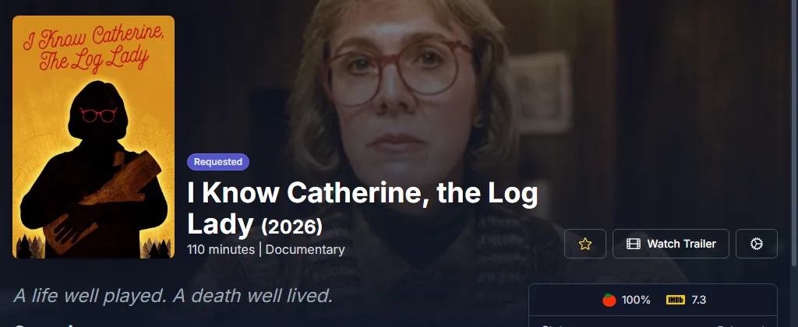

# DMM 経由の Seerr {#seerr-through-dmm}

DMMを[Seerr](https://github.com/seerr-team/seerr)にRadarrおよびSonarrとして追加します。承認されたリクエストは、zurgが取得できるように[DMMのwantedリスト](../zurg/guides/dmm-wanted.md)に入ります。RadarrやSonarrは不要です。Seerrが通信する必要があるのはdebridmediamanager.comだけです。OverseerrとJellyseerrも同じ方法で動作します。

これはスポンサー向けです。Seerrは[gatekeeper](https://gatekeeper.debridmediamanager.com/)のDMM APIキーを使ってサインインします。

## 必要なもの {#what-you-need}

- `config.yml` の `dmm_api_key` を使って、zurg が wanted リストを読み込めるようにする。[DMM から欲しいものを取得する](../zurg/guides/dmm-wanted.md#what-you-need) を参照。
- Seerr を Plex、Jellyfin、Emby のサーバーとつないでおく。これで、Seerr がどのエピソードを持っているかを把握できるようになる。

## DMM を Radarr として追加 {#add-dmm-as-radarr}

Seerr で **Settings → Services** を開き、**Add Radarr Server** を押します。次のように入力してください。

| Field | Value |
|---|---|
| Default Server | チェックを入れる |
| 4K Server | チェックを外す |
| Server Name | `DMM`、または好きな名前 |
| Hostname or IP Address | `debridmediamanager.com` |
| Port | `443` |
| Use SSL | チェックを入れる |
| API Key | DMM の API キー |
| URL Base | `/api/arr/radarr` |

**Test** を押します。接続できたら、Quality Profile は **Any**、Root Folder は **/dmm** を選びます。
Minimum Availability はそのままにしておきます。**Enable Scan** にチェックを入れて、**Add Server** を押します。

Test が失敗する場合は、キーを確認してください。キーは DMM の [設定](https://debridmediamanager.com/settings) ページにあります。また、スポンサーシップの期限が切れていると、DMM はこのキーを受け付けません。

## DMM を Sonarr として追加 {#add-dmm-as-sonarr}

**Add Sonarr Server** を押します。URL Base には `/api/arr/sonarr` を入力します。**Test** を押したあと、プロファイルとルートフォルダーの両方で **Any** と `/dmm` を選びます。**Enable Scan** にチェックを入れて、**Add Server** を押します。

## リクエスト {#requesting}

リクエストはいつもどおり行います。承認された映画は、あなたの wanted リストに追加されます。

番組の場合は、欲しいシーズンを選びます。後からリクエストして、シーズンを追加することもできます。新しいシーズンも含めて番組全体を追いかけたい場合は、DMM のページで **Want all seasons** を押してください。

[wanted リスト](https://debridmediamanager.com/wanted)には、各タイトルが数秒以内に表示されます。zurg は 1 分以内にそれを拾います。

## Seerr に表示される内容 {#what-seerr-shows}

Seerr は1日に1回、**Radarr Scan** と **Sonarr Scan** で DMM のリストを読み込みます。今すぐ実行するには、**Settings → Jobs & Cache** を開き、それぞれの横にある **Run Now** を押してください。

- **映画**: zurg が取得した映画は **Available** と表示されます。

  

- **番組**: エピソードが Plex、Jellyfin、Emby のライブラリに届き、Seerr がそのサーバーのスキャンでそれを見つけるまで、**Processing** のままです。DMM は zurg がどのエピソードを保持しているかを把握していません。

## タイトルの削除 {#removing-a-title}

タイトルを Seerr で開き、歯車ボタンを押してから **Remove from Radarr**（または **Remove from Sonarr**）を選びます。これでウォッチリストから外れます。zurg がすでに取得したものはライブラリに残ります。その横にある **Open in Radarr** を押すと、DMM でそのタイトルが開きます。

困ったときは [Discord](https://discord.com/invite/7u4YjMThXP) の **dmm-support** フォーラムで聞いてください。何を書けばいいかは [Getting help](../guides/remote-help.md) に書いてあります。

## DMM 経由の Seerr か zurg 独自の Seerr ソースか {#seerr-through-dmm-or-zurgs-own-seerr-source}

zurg は Seerr 自体も読み取れます。[`seerr` ソース](../zurg/guides/acquisition.md#configuration) を使えば可能です。
どちらか一方だけを使ってください。両方は使わないでください。

- **DMM 経由の場合**: Seerr はインターネットに接続できれば十分です。リクエストは、**Want** で追加したものと並んで wanted リストに表示されます。さらに Seerr の毎日のスキャンで、zurg が取得した映画が available としてマークされます。
- **zurg 独自のソースの場合**: 4K のリクエストを 1080p のリクエストと区別して扱います。ただし zurg が Seerr に接続できる必要があります。
